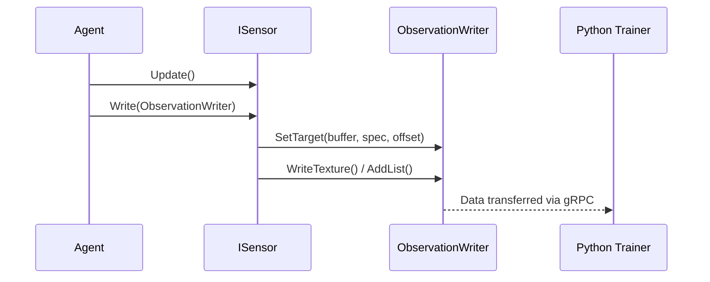

<!-- source: DeepWiki mcp.deepwiki.com · repo Unity-Technologies/ml-agents · page 2.3 Sensors and Observations · fetched 2026-10-30 -->

# Sensors and Observations

<details>
<summary>Relevant source files</summary>

The following files were used as context for generating this wiki page:

- [Project/Assets/ML-Agents/Examples/SharedAssets/Scripts/ModelCarousel.cs](Project/Assets/ML-Agents/Examples/SharedAssets/Scripts/ModelCarousel.cs)
- [Project/Assets/ML-Agents/Examples/SharedAssets/Scripts/ModelCarousel.cs.meta](Project/Assets/ML-Agents/Examples/SharedAssets/Scripts/ModelCarousel.cs.meta)
- [Project/Assets/ML-Agents/Examples/SharedAssets/Scripts/SensorBase.cs](Project/Assets/ML-Agents/Examples/SharedAssets/Scripts/SensorBase.cs)
- [com.unity.ml-agents/Editor/CameraSensorComponentEditor.cs](com.unity.ml-agents/Editor/CameraSensorComponentEditor.cs)
- [com.unity.ml-agents/Editor/RayPerceptionSensorComponentBaseEditor.cs](com.unity.ml-agents/Editor/RayPerceptionSensorComponentBaseEditor.cs)
- [com.unity.ml-agents/Editor/RenderTextureSensorComponentEditor.cs](com.unity.ml-agents/Editor/RenderTextureSensorComponentEditor.cs)
- [com.unity.ml-agents/Editor/VectorSensorComponentEditor.cs](com.unity.ml-agents/Editor/VectorSensorComponentEditor.cs)
- [com.unity.ml-agents/Runtime/Areas/TrainingAreaReplicator.cs](com.unity.ml-agents/Runtime/Areas/TrainingAreaReplicator.cs)
- [com.unity.ml-agents/Runtime/Grpc/CommunicatorObjects/AgentInfo.cs](com.unity.ml-agents/Runtime/Grpc/CommunicatorObjects/AgentInfo.cs)
- [com.unity.ml-agents/Runtime/IMultiAgentGroup.cs](com.unity.ml-agents/Runtime/IMultiAgentGroup.cs)
- [com.unity.ml-agents/Runtime/IMultiAgentGroup.cs.meta](com.unity.ml-agents/Runtime/IMultiAgentGroup.cs.meta)
- [com.unity.ml-agents/Runtime/MultiAgentGroupIdCounter.cs](com.unity.ml-agents/Runtime/MultiAgentGroupIdCounter.cs)
- [com.unity.ml-agents/Runtime/MultiAgentGroupIdCounter.cs.meta](com.unity.ml-agents/Runtime/MultiAgentGroupIdCounter.cs.meta)
- [com.unity.ml-agents/Runtime/SensorHelper.cs](com.unity.ml-agents/Runtime/SensorHelper.cs)
- [com.unity.ml-agents/Runtime/Sensors/BoxOverlapChecker.cs](com.unity.ml-agents/Runtime/Sensors/BoxOverlapChecker.cs)
- [com.unity.ml-agents/Runtime/Sensors/BufferSensor.cs](com.unity.ml-agents/Runtime/Sensors/BufferSensor.cs)
- [com.unity.ml-agents/Runtime/Sensors/BufferSensorComponent.cs](com.unity.ml-agents/Runtime/Sensors/BufferSensorComponent.cs)
- [com.unity.ml-agents/Runtime/Sensors/CameraSensor.cs](com.unity.ml-agents/Runtime/Sensors/CameraSensor.cs)
- [com.unity.ml-agents/Runtime/Sensors/CameraSensorComponent.cs](com.unity.ml-agents/Runtime/Sensors/CameraSensorComponent.cs)
- [com.unity.ml-agents/Runtime/Sensors/CompressionSpec.cs](com.unity.ml-agents/Runtime/Sensors/CompressionSpec.cs)
- [com.unity.ml-agents/Runtime/Sensors/GridSensorBase.cs](com.unity.ml-agents/Runtime/Sensors/GridSensorBase.cs)
- [com.unity.ml-agents/Runtime/Sensors/GridSensorComponent.cs](com.unity.ml-agents/Runtime/Sensors/GridSensorComponent.cs)
- [com.unity.ml-agents/Runtime/Sensors/IGridPerception.cs](com.unity.ml-agents/Runtime/Sensors/IGridPerception.cs)
- [com.unity.ml-agents/Runtime/Sensors/IGridPerception.cs.meta](com.unity.ml-agents/Runtime/Sensors/IGridPerception.cs.meta)
- [com.unity.ml-agents/Runtime/Sensors/ISensor.cs](com.unity.ml-agents/Runtime/Sensors/ISensor.cs)
- [com.unity.ml-agents/Runtime/Sensors/OneHotGridSensor.cs](com.unity.ml-agents/Runtime/Sensors/OneHotGridSensor.cs)
- [com.unity.ml-agents/Runtime/Sensors/RayPerceptionSensor.cs](com.unity.ml-agents/Runtime/Sensors/RayPerceptionSensor.cs)
- [com.unity.ml-agents/Runtime/Sensors/RayPerceptionSensorComponentBase.cs](com.unity.ml-agents/Runtime/Sensors/RayPerceptionSensorComponentBase.cs)
- [com.unity.ml-agents/Runtime/Sensors/Reflection/BoolReflectionSensor.cs](com.unity.ml-agents/Runtime/Sensors/Reflection/BoolReflectionSensor.cs)
- [com.unity.ml-agents/Runtime/Sensors/Reflection/FloatReflectionSensor.cs](com.unity.ml-agents/Runtime/Sensors/Reflection/FloatReflectionSensor.cs)
- [com.unity.ml-agents/Runtime/Sensors/Reflection/IntReflectionSensor.cs](com.unity.ml-agents/Runtime/Sensors/Reflection/IntReflectionSensor.cs)
- [com.unity.ml-agents/Runtime/Sensors/Reflection/QuaternionReflectionSensor.cs](com.unity.ml-agents/Runtime/Sensors/Reflection/QuaternionReflectionSensor.cs)
- [com.unity.ml-agents/Runtime/Sensors/Reflection/ReflectionSensorBase.cs](com.unity.ml-agents/Runtime/Sensors/Reflection/ReflectionSensorBase.cs)
- [com.unity.ml-agents/Runtime/Sensors/Reflection/Vector2ReflectionSensor.cs](com.unity.ml-agents/Runtime/Sensors/Reflection/Vector2ReflectionSensor.cs)
- [com.unity.ml-agents/Runtime/Sensors/Reflection/Vector3ReflectionSensor.cs](com.unity.ml-agents/Runtime/Sensors/Reflection/Vector3ReflectionSensor.cs)
- [com.unity.ml-agents/Runtime/Sensors/Reflection/Vector4ReflectionSensor.cs](com.unity.ml-agents/Runtime/Sensors/Reflection/Vector4ReflectionSensor.cs)
- [com.unity.ml-agents/Runtime/Sensors/RenderTextureSensor.cs](com.unity.ml-agents/Runtime/Sensors/RenderTextureSensor.cs)
- [com.unity.ml-agents/Runtime/Sensors/RenderTextureSensorComponent.cs](com.unity.ml-agents/Runtime/Sensors/RenderTextureSensorComponent.cs)
- [com.unity.ml-agents/Runtime/Sensors/StackingSensor.cs](com.unity.ml-agents/Runtime/Sensors/StackingSensor.cs)
- [com.unity.ml-agents/Runtime/Sensors/VectorSensor.cs](com.unity.ml-agents/Runtime/Sensors/VectorSensor.cs)
- [com.unity.ml-agents/Runtime/Sensors/VectorSensorComponent.cs](com.unity.ml-agents/Runtime/Sensors/VectorSensorComponent.cs)
- [com.unity.ml-agents/Runtime/SimpleMultiAgentGroup.cs](com.unity.ml-agents/Runtime/SimpleMultiAgentGroup.cs)
- [com.unity.ml-agents/Runtime/SimpleMultiAgentGroup.cs.meta](com.unity.ml-agents/Runtime/SimpleMultiAgentGroup.cs.meta)

</details>


This document details the ML-Agents sensor system, which provides the mechanism for agents to collect observations from their environment. Sensors are the primary interface between Unity GameObjects and the ML-Agents training pipeline, converting environmental data into structured observations that can be processed by machine learning algorithms.

## Core Sensor Architecture

The ML-Agents sensor system is built around a flexible interface-based architecture that allows for different types of observations while maintaining a consistent API for the training pipeline.

### ISensor Interface and Observation Specifications

The `ISensor` interface defines the contract for all sensors. Each sensor must implement methods for writing observations, providing metadata about the observation space, and handling sensor lifecycle events.

```mermaid
graph TD
    subgraph "Code Entity Space: com.unity.ml-agents/Runtime/Sensors/"
        ISensor["ISensor Interface"]
        VectorSensor["VectorSensor"]
        CameraSensor["CameraSensor"]
        RayPerceptionSensor["RayPerceptionSensor"]
        BufferSensor["BufferSensor"]
        StackingSensor["StackingSensor"]
        ObservationSpec["ObservationSpec"]
        ObservationWriter["ObservationWriter"]
    end

    ISensor ---|implements| VectorSensor
    ISensor ---|implements| CameraSensor
    ISensor ---|implements| RayPerceptionSensor
    ISensor ---|implements| BufferSensor
    ISensor ---|implements| StackingSensor
    
    ISensor -->|returns| ObservationSpec
    ISensor -->|Write() to| ObservationWriter
```
**Sensor Interface Architecture**

The `ObservationSpec` defines the structure of observations, including shape and `DimensionProperty` flags like `TranslationalEquivariance` or `VariableSize` [com.unity.ml-agents/Runtime/Sensors/ISensor.cs:10-33]().

Sources: [com.unity.ml-agents/Runtime/Sensors/ISensor.cs:54-104](), [com.unity.ml-agents/Runtime/Sensors/VectorSensor.cs:10-18]()

### Sensor Component System

Unity's component-based architecture is bridged to the sensor system through `SensorComponent` classes that create `ISensor` instances.

```mermaid
graph TD
    subgraph "Unity Inspector / GameObject"
        VC["VectorSensorComponent"]
        CC["CameraSensorComponent"]
        RC["RayPerceptionSensorComponentBase"]
        BC["BufferSensorComponent"]
        GC["GridSensorComponent"]
    end

    subgraph "Runtime Code Entities"
        VS["VectorSensor"]
        CS["CameraSensor"]
        RS["RayPerceptionSensor"]
        BS["BufferSensor"]
        GS["GridSensorBase"]
    end

    VC -->|CreateSensors()| VS
    CC -->|CreateSensors()| CS
    RC -->|CreateSensors()| RS
    BC -->|CreateSensors()| BS
    GC -->|CreateSensors()| GS
```
**Component to Sensor Mapping**

Sources: [com.unity.ml-agents/Runtime/Sensors/VectorSensorComponent.cs:1-40](), [com.unity.ml-agents/Runtime/Sensors/BufferSensorComponent.cs:50-54](), [com.unity.ml-agents/Runtime/Sensors/GridSensorComponent.cs:11-15]()

## Sensor Types

### VectorSensor
The `VectorSensor` handles numerical observations. It stores observations as a `List<float>` and provides methods like `AddObservation()` for various Unity types (Vector3, Quaternion, etc.) [com.unity.ml-agents/Runtime/Sensors/VectorSensor.cs:137-194](). It handles padding or truncation if the number of observations added does not match the expected `observationSize` [com.unity.ml-agents/Runtime/Sensors/VectorSensor.cs:41-66]().

Sources: [com.unity.ml-agents/Runtime/Sensors/VectorSensor.cs:10-123]()

### CameraSensor
The `CameraSensor` captures visual observations from a Unity `Camera`. It renders the camera view to a `Texture2D` via `ObservationToTexture()` [com.unity.ml-agents/Runtime/Sensors/CameraSensor.cs:134-165]() and writes the result to an `ObservationWriter` [com.unity.ml-agents/Runtime/Sensors/CameraSensor.cs:103-110](). It supports PNG compression [com.unity.ml-agents/Runtime/Sensors/CameraSensor.cs:88-96]().

Sources: [com.unity.ml-agents/Runtime/Sensors/CameraSensor.cs:10-61]()

### RayPerceptionSensor
The `RayPerceptionSensor` performs physics-based raycasting. It uses `RayPerceptionInput` to define ray lengths, angles, and detectable tags [com.unity.ml-agents/Runtime/Sensors/RayPerceptionSensor.cs:28-81](). It supports both 2D and 3D casting types [com.unity.ml-agents/Runtime/Sensors/RayPerceptionSensor.cs:12-23]().

Sources: [com.unity.ml-agents/Runtime/Sensors/RayPerceptionSensor.cs:143-200]()

### BufferSensor
The `BufferSensor` allows observing a variable number of entities. It maintains an internal `m_ObservationBuffer` and allows appending observations until `m_MaxNumObs` is reached [com.unity.ml-agents/Runtime/Sensors/BufferSensor.cs:47-65](). This is particularly useful for environments with a dynamic number of objects.

Sources: [com.unity.ml-agents/Runtime/Sensors/BufferSensor.cs:8-32]()

### GridSensor
The `GridSensorComponent` creates a grid-based observation of the environment. It uses `IGridPerception` to detect objects within a defined `GridSize` and `CellScale` [com.unity.ml-agents/Runtime/Sensors/GridSensorComponent.cs:34-66](). It can be configured to rotate with the agent [com.unity.ml-agents/Runtime/Sensors/GridSensorComponent.cs:69-77]().

Sources: [com.unity.ml-agents/Runtime/Sensors/GridSensorComponent.cs:11-150]()

## Observation Data Flow

Observations are collected and written to the training pipeline through the `ObservationWriter`.


**Observation Writing Sequence**

### StackingSensor
The `StackingSensor` wraps another sensor to provide temporal context. It maintains a circular buffer `m_StackedObservations` [com.unity.ml-agents/Runtime/Sensors/StackingSensor.cs:39-43](). When `Write()` is called, it first updates the current index with the wrapped sensor's latest data and then writes the saved observations from oldest to newest [com.unity.ml-agents/Runtime/Sensors/StackingSensor.cs:119-156]().

Sources: [com.unity.ml-agents/Runtime/Sensors/StackingSensor.cs:19-74]()

### RenderTextureSensor
The `RenderTextureSensor` captures visual data from a `RenderTexture` rather than a live `Camera`. It converts the `RenderTexture` to a `Texture2D` using `ObservationToTexture()` [com.unity.ml-agents/Runtime/Sensors/RenderTextureSensor.cs:108-116]() before writing to the `ObservationWriter` [com.unity.ml-agents/Runtime/Sensors/RenderTextureSensor.cs:75-83]().

Sources: [com.unity.ml-agents/Runtime/Sensors/RenderTextureSensor.cs:9-48]()

## Advanced Sensor Features

### Reflection-Based Sensors
The toolkit includes specialized sensors for reflecting class properties:
- `ReflectionSensorBase` provides a foundation for reflecting values [com.unity.ml-agents/Runtime/Sensors/Reflection/ReflectionSensorBase.cs:1-20]().
- Specific implementations exist for `Vector3`, `Quaternion`, `float`, `int`, and `bool` [com.unity.ml-agents/Runtime/Sensors/Reflection/Vector3ReflectionSensor.cs:1-10](), [com.unity.ml-agents/Runtime/Sensors/Reflection/FloatReflectionSensor.cs:1-10]().

### Compression and Optimization
- **Compression**: Sensors provide a `CompressionSpec` [com.unity.ml-agents/Runtime/Sensors/ISensor.cs:92-96](). Visual sensors typically use `SensorCompressionType.PNG` [com.unity.ml-agents/Runtime/Sensors/CameraSensor.cs:93-95]().
- **Batched Raycasts**: `RayPerceptionSensor` can use Unity's Job System for batched raycasting to improve performance [com.unity.ml-agents/Runtime/Sensors/RayPerceptionSensor.cs:78-80]().

Sources: [com.unity.ml-agents/Runtime/Sensors/RayPerceptionSensorComponentBase.cs:152-165](), [com.unity.ml-agents/Runtime/Sensors/CompressionSpec.cs:1-10]()

---

