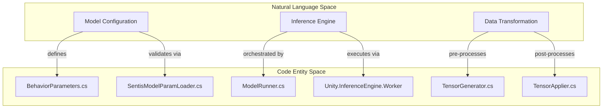
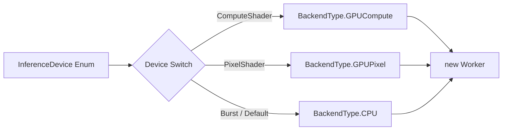

<!-- source: DeepWiki mcp.deepwiki.com · repo Unity-Technologies/ml-agents · page 2.4 Inference and Model Running · fetched 2026-10-30 -->

# Inference and Model Running

Relevant source files

The following files were used as context for generating this wiki page:

- [Project/Assets/ML-Agents/Examples/SharedAssets/Scripts/ModelOverrider.cs](Project/Assets/ML-Agents/Examples/SharedAssets/Scripts/ModelOverrider.cs)
- [com.unity.ml-agents/Editor/BehaviorParametersEditor.cs](com.unity.ml-agents/Editor/BehaviorParametersEditor.cs)
- [com.unity.ml-agents/Runtime/Analytics/AnalyticsUtils.cs](com.unity.ml-agents/Runtime/Analytics/AnalyticsUtils.cs)
- [com.unity.ml-agents/Runtime/Analytics/Events.cs](com.unity.ml-agents/Runtime/Analytics/Events.cs)
- [com.unity.ml-agents/Runtime/Analytics/InferenceAnalytics.cs](com.unity.ml-agents/Runtime/Analytics/InferenceAnalytics.cs)
- [com.unity.ml-agents/Runtime/Analytics/TrainingAnalytics.cs](com.unity.ml-agents/Runtime/Analytics/TrainingAnalytics.cs)
- [com.unity.ml-agents/Runtime/Communicator/CommunicatorFactory.cs](com.unity.ml-agents/Runtime/Communicator/CommunicatorFactory.cs)
- [com.unity.ml-agents/Runtime/Inference/ApplierImpl.cs](com.unity.ml-agents/Runtime/Inference/ApplierImpl.cs)
- [com.unity.ml-agents/Runtime/Inference/GeneratorImpl.cs](com.unity.ml-agents/Runtime/Inference/GeneratorImpl.cs)
- [com.unity.ml-agents/Runtime/Inference/ModelRunner.cs](com.unity.ml-agents/Runtime/Inference/ModelRunner.cs)
- [com.unity.ml-agents/Runtime/Inference/TensorApplier.cs](com.unity.ml-agents/Runtime/Inference/TensorApplier.cs)
- [com.unity.ml-agents/Runtime/Inference/TensorGenerator.cs](com.unity.ml-agents/Runtime/Inference/TensorGenerator.cs)
- [com.unity.ml-agents/Runtime/Inference/TensorNames.cs](com.unity.ml-agents/Runtime/Inference/TensorNames.cs)
- [com.unity.ml-agents/Runtime/Inference/TensorProxy.cs](com.unity.ml-agents/Runtime/Inference/TensorProxy.cs)
- [com.unity.ml-agents/Runtime/Integrations/Match3/Match3Sensor.cs](com.unity.ml-agents/Runtime/Integrations/Match3/Match3Sensor.cs)
- [com.unity.ml-agents/Runtime/Policies/BehaviorParameters.cs](com.unity.ml-agents/Runtime/Policies/BehaviorParameters.cs)
- [com.unity.ml-agents/Runtime/Policies/BrainParameters.cs](com.unity.ml-agents/Runtime/Policies/BrainParameters.cs)
- [com.unity.ml-agents/Runtime/Policies/RemotePolicy.cs](com.unity.ml-agents/Runtime/Policies/RemotePolicy.cs)
- [com.unity.ml-agents/Runtime/Sensors/ObservationWriter.cs](com.unity.ml-agents/Runtime/Sensors/ObservationWriter.cs)
- [com.unity.ml-agents/Runtime/Sensors/Reflection/ObservableAttribute.cs](com.unity.ml-agents/Runtime/Sensors/Reflection/ObservableAttribute.cs)
- [com.unity.ml-agents/Runtime/SideChannels/SideChannelManager.cs](com.unity.ml-agents/Runtime/SideChannels/SideChannelManager.cs)
- [com.unity.ml-agents/Runtime/Timer.cs](com.unity.ml-agents/Runtime/Timer.cs)

This page details how trained neural network models are loaded, managed, and executed for real-time inference within the Unity environment. It focuses on the `ModelRunner` orchestration, the transition to the Unity Sentis inference engine, and the utilities provided for model deployment and validation.

## Core Inference Architecture

The inference system bridges Unity simulation data (observations) with neural network execution. It is designed to handle multiple agents sharing the same model by batching their observations into tensors.

### System Entity Mapping

The following diagram maps high-level inference concepts to the specific classes and files implementing them in the codebase.

**Sources:** [com.unity.ml-agents/Runtime/Policies/BehaviorParameters.cs:72-109](), [com.unity.ml-agents/Runtime/Inference/ModelRunner.cs:16-56](), [com.unity.ml-agents/Runtime/Inference/TensorGenerator.cs:19-42](), [com.unity.ml-agents/Runtime/Inference/TensorApplier.cs:16-30]()

### Primary Components

| Component | Role | File Reference |
| :--- | :--- | :--- |
| `BehaviorParameters` | Inspector-facing component to assign `ModelAsset` and `InferenceDevice`. | [com.unity.ml-agents/Runtime/Policies/BehaviorParameters.cs:72-73]() |
| `ModelRunner` | Manages the lifecycle of the Sentis `Worker` and orchestrates the inference loop. | [com.unity.ml-agents/Runtime/Inference/ModelRunner.cs:16-17]() |
| `TensorGenerator` | Converts `ISensor` observations and agent state into `Tensor` inputs for the model. | [com.unity.ml-agents/Runtime/Inference/TensorGenerator.cs:19-20]() |
| `TensorApplier` | Maps model output tensors back to `ActionBuffers` for the `Agent` to execute. | [com.unity.ml-agents/Runtime/Inference/TensorApplier.cs:16-17]() |
| `SentisModelParamLoader` | Validates that the loaded model's inputs/outputs match the Agent's sensors/actuators. | [com.unity.ml-agents/Editor/BehaviorParametersEditor.cs:159-162]() |

## Sentis Inference Integration

ML-Agents utilizes the **Unity Sentis** engine (replacing the legacy Barracuda engine) for cross-platform neural network execution.

### Worker Initialization
The `ModelRunner` initializes a Sentis `Worker` based on the `InferenceDevice` selected in the `BehaviorParameters`.

**Sources:** [com.unity.ml-agents/Runtime/Inference/ModelRunner.cs:92-108](), [com.unity.ml-agents/Runtime/Policies/BehaviorParameters.cs:112-123]()

### Model Validation
Before execution, the `SentisModelParamLoader` performs compatibility checks between the Unity Agent configuration and the ONNX model file. It verifies:
- **Observation Space**: Matches the number and shape of sensors [com.unity.ml-agents/Editor/BehaviorParametersEditor.cs:118-128]().
- **Action Space**: Matches the `ActionSpec` (continuous and discrete branches) [com.unity.ml-agents/Editor/BehaviorParametersEditor.cs:159-162]().
- **API Version**: Ensures the model was exported with a compatible version of the ML-Agents exporter [com.unity.ml-agents/Runtime/Inference/ModelRunner.cs:79-82]().

## Data Flow and Tensor Management

The inference loop follows a strict "Prepare -> Execute -> Fetch" pattern.

### The Inference Loop
1. **Observation Gathering**: `ModelRunner.PutObservations` collects data from all agents sharing the same behavior [com.unity.ml-agents/Runtime/Inference/ModelRunner.cs:173-186]().
2. **Input Generation**: `TensorGenerator` iterates through registered `IGenerator` implementations (e.g., `ObservationGenerator`, `RecurrentInputGenerator`) to populate Sentis tensors [com.unity.ml-agents/Runtime/Inference/TensorGenerator.cs:65-92]().
3. **Execution**: The `Worker.Execute` method (or implicit execution via output fetching) runs the forward pass [com.unity.ml-agents/Runtime/Inference/ModelRunner.cs:108]().
4. **Action Application**: `TensorApplier` processes outputs. For discrete actions, this may involve stochastic sampling or deterministic selection [com.unity.ml-agents/Runtime/Inference/TensorApplier.cs:51-54]().

### Observation Writing
The `ObservationWriter` provides a unified interface for sensors to write data directly into `TensorProxy` objects, minimizing memory copies during inference preparation [com.unity.ml-agents/Runtime/Sensors/ObservationWriter.cs:13-18]().

**Sources:** [com.unity.ml-agents/Runtime/Inference/ModelRunner.cs:142-171](), [com.unity.ml-agents/Runtime/Inference/GeneratorImpl.cs:15-42](), [com.unity.ml-agents/Runtime/Sensors/ObservationWriter.cs:72-79]()

## Model Deployment Utilities

### ModelOverrider
The `ModelOverrider` is a utility component used primarily in automated testing and validation (e.g., Yamato CI). It allows a build to override an Agent's internal model with an external ONNX file via command-line arguments.

**Key Command Line Flags:**
- `--mlagents-override-model-directory`: Path to the directory containing new models [Project/Assets/ML-Agents/Examples/SharedAssets/Scripts/ModelOverrider.cs:27]().
- `--mlagents-override-model-extension`: Specifies `nn` or `onnx` [Project/Assets/ML-Agents/Examples/SharedAssets/Scripts/ModelOverrider.cs:28]().
- `--mlagents-quit-after-episodes`: Terminates the application after a set number of evaluations [Project/Assets/ML-Agents/Examples/SharedAssets/Scripts/ModelOverrider.cs:29]().

### Inference Analytics
ML-Agents tracks model performance and configuration via the `InferenceAnalytics` system. When a model is set, it gathers metadata such as memory size, weight size, and the number of layers to help Unity improve the Sentis engine and ML-Agents toolkit [com.unity.ml-agents/Runtime/Analytics/InferenceAnalytics.cs:73-80]().

**Sources:** [Project/Assets/ML-Agents/Examples/SharedAssets/Scripts/ModelOverrider.cs:130-164](), [com.unity.ml-agents/Runtime/Analytics/InferenceAnalytics.cs:119-130](), [com.unity.ml-agents/Runtime/Analytics/Events.cs:24-52]()

---

