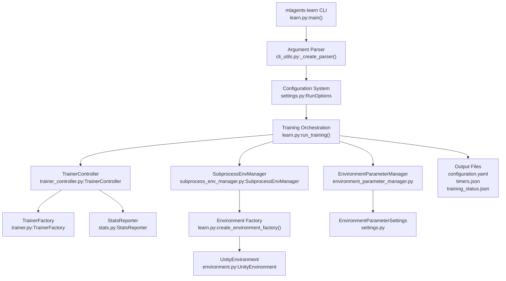
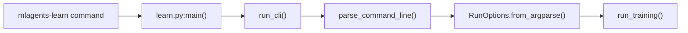
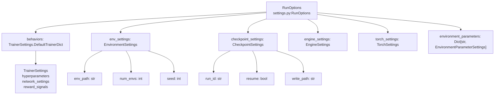
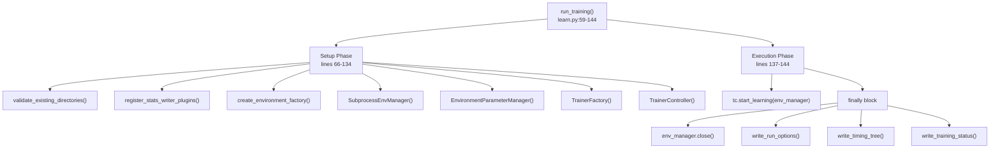
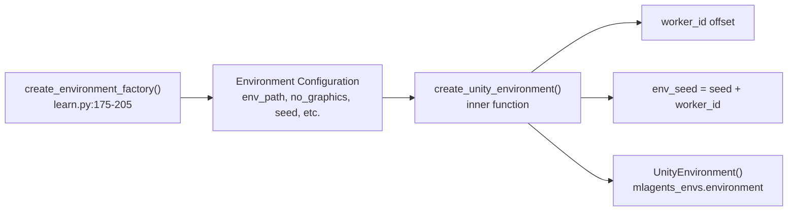
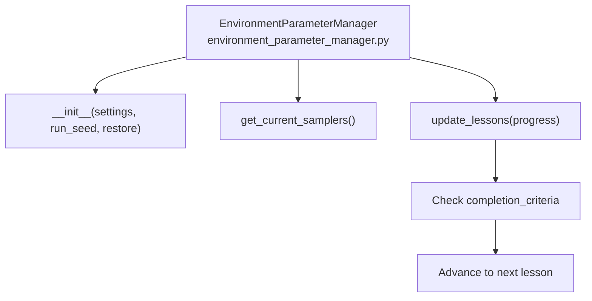

<!-- source: DeepWiki mcp.deepwiki.com · repo Unity-Technologies/ml-agents · page 3 Python Training System · fetched 2026-10-30 -->

# Python Training System

Relevant source files

The following files were used as context for generating this wiki page:

- [.pre-commit-config.yaml](.pre-commit-config.yaml)
- [docs/Using-Virtual-Environment.md](docs/Using-Virtual-Environment.md)
- [ml-agents-envs/mlagents_envs/registry/binary_utils.py](ml-agents-envs/mlagents_envs/registry/binary_utils.py)
- [ml-agents-envs/setup.py](ml-agents-envs/setup.py)
- [ml-agents/mlagents/trainers/cli_utils.py](ml-agents/mlagents/trainers/cli_utils.py)
- [ml-agents/mlagents/trainers/learn.py](ml-agents/mlagents/trainers/learn.py)
- [ml-agents/mlagents/trainers/settings.py](ml-agents/mlagents/trainers/settings.py)
- [ml-agents/mlagents/trainers/tests/test_learn.py](ml-agents/mlagents/trainers/tests/test_learn.py)
- [ml-agents/mlagents/trainers/tests/test_settings.py](ml-agents/mlagents/trainers/tests/test_settings.py)
- [ml-agents/mlagents/trainers/tests/test_trainer_controller.py](ml-agents/mlagents/trainers/tests/test_trainer_controller.py)
- [ml-agents/mlagents/trainers/tests/test_trainer_util.py](ml-agents/mlagents/trainers/tests/test_trainer_util.py)
- [ml-agents/mlagents/trainers/trainer_controller.py](ml-agents/mlagents/trainers/trainer_controller.py)
- [ml-agents/setup.py](ml-agents/setup.py)
- [utils/validate_release_links.py](utils/validate_release_links.py)

The Python Training System is the core training infrastructure of the ML-Agents toolkit, responsible for orchestrating reinforcement learning training sessions. This system provides the command-line interface, configuration management, training loop coordination, and environment management for training ML agents in Unity environments.

For information about the Unity SDK components that interact with this system, see [Unity SDK Components](#2). For details about specific training algorithms and policies, see [Trainers and Algorithms](#3.2) and [Policies and Optimization](#3.3).

## System Architecture

The Python Training System follows a layered architecture with clear separation of concerns, managed primarily by the `mlagents-learn` entry point which delegates to specialized managers.

Sources: [ml-agents/mlagents/trainers/learn.py:59-134](), [ml-agents/mlagents/trainers/cli_utils.py:63-193](), [ml-agents/mlagents/trainers/settings.py:758-848](), [ml-agents/mlagents/trainers/trainer_controller.py:34-70]()

## CLI Entry Point

The `mlagents-learn` command serves as the primary entry point for training sessions. It is defined as a console script in `setup.py` and maps to `mlagents.trainers.learn:main`.

The command-line interface supports extensive configuration options defined in `cli_utils.py`:

| Category | Key Options | Purpose |
|----------|-------------|---------|
| Environment | `--env`, `--num-envs`, `--num-areas` | Unity environment configuration [ml-agents/mlagents/trainers/cli_utils.py:71-180]() |
| Training | `--run-id`, `--resume`, `--initialize-from` | Training session control [ml-agents/mlagents/trainers/cli_utils.py:88-130]() |
| Inference | `--inference`, `--deterministic` | Model evaluation mode [ml-agents/mlagents/trainers/cli_utils.py:95-152]() |
| Engine | `--no-graphics`, `--env-args` | Unity engine settings [ml-agents/mlagents/trainers/cli_utils.py:182-192]() |

Sources: [ml-agents/setup.py:79-81](), [ml-agents/mlagents/trainers/learn.py:51-56](), [ml-agents/mlagents/trainers/cli_utils.py:63-193]()

## Configuration System

The configuration system is built around the `RunOptions` class, which aggregates all training parameters using the `attr` and `cattr` libraries for structured data management.

Configuration can be loaded from YAML files or command-line arguments. The `settings.py` file contains logic for deep merging and validating these settings. For details on configuration structure, see [Training Configuration Files](#5.2).

Sources: [ml-agents/mlagents/trainers/settings.py:758-848](), [ml-agents/mlagents/trainers/settings.py:38-68](), [ml-agents/mlagents/trainers/cli_utils.py:25-61]()

## Training Orchestration

The `run_training()` function in `learn.py` coordinates the setup and execution of the training session. It instantiates the `TrainerController`, which manages the main training loop.

For details on the execution phase and the inner loop, see [Training Pipeline](#3.1).

Sources: [ml-agents/mlagents/trainers/learn.py:59-144](), [ml-agents/mlagents/trainers/trainer_controller.py:168-192]()

## Environment Management

The system supports running multiple Unity instances in parallel via `SubprocessEnvManager`. The `create_environment_factory` ensures each instance is properly configured with unique seeds and ports.

For details on how Python interacts with the Unity executable, see [Environment Management](#3.5).

Sources: [ml-agents/mlagents/trainers/learn.py:175-205](), [ml-agents/mlagents/trainers/learn.py:111-111]()

## Parameter Management

The `EnvironmentParameterManager` handles dynamic environment parameters and curriculum learning. It tracks training progress to determine when to advance to the next "lesson" in a curriculum.

Supported randomization samplers include `UniformSettings`, `GaussianSettings`, and `MultiRangeUniformSettings` defined in `settings.py`.

Sources: [ml-agents/mlagents/trainers/learn.py:112-114](), [ml-agents/mlagents/trainers/settings.py:516-595](), [ml-agents/mlagents/trainers/trainer_controller.py:104-105]()

## Key Workflows

### Training Session Startup
1. **CLI Parsing**: `parse_command_line` processes arguments and loads YAML configs [ml-agents/mlagents/trainers/learn.py:51-56]().
2. **Resource Validation**: `validate_existing_directories` checks for existing models to prevent accidental overwrites [ml-agents/mlagents/trainers/learn.py:75-80]().
3. **Factory Initialization**: `TrainerFactory` and environment factories are prepared [ml-agents/mlagents/trainers/learn.py:116-125]().
4. **Loop Execution**: `TrainerController.start_learning` enters the training loop [ml-agents/mlagents/trainers/trainer_controller.py:168-172]().

### Output Management
Upon completion or interruption, the system persists the final state:
- **Models**: Saved via `Trainer.save_model()` called by `TrainerController` [ml-agents/mlagents/trainers/trainer_controller.py:72-81]().
- **Status**: `training_status.json` tracks global training state [ml-agents/mlagents/trainers/learn.py:160-161]().
- **Timers**: `timers.json` provides a hierarchical breakdown of performance [ml-agents/mlagents/trainers/learn.py:164-173]().

Sources: [ml-agents/mlagents/trainers/learn.py:137-144](), [ml-agents/mlagents/trainers/trainer_controller.py:72-82](), [ml-agents/mlagents/trainers/learn.py:16-19]()

---

