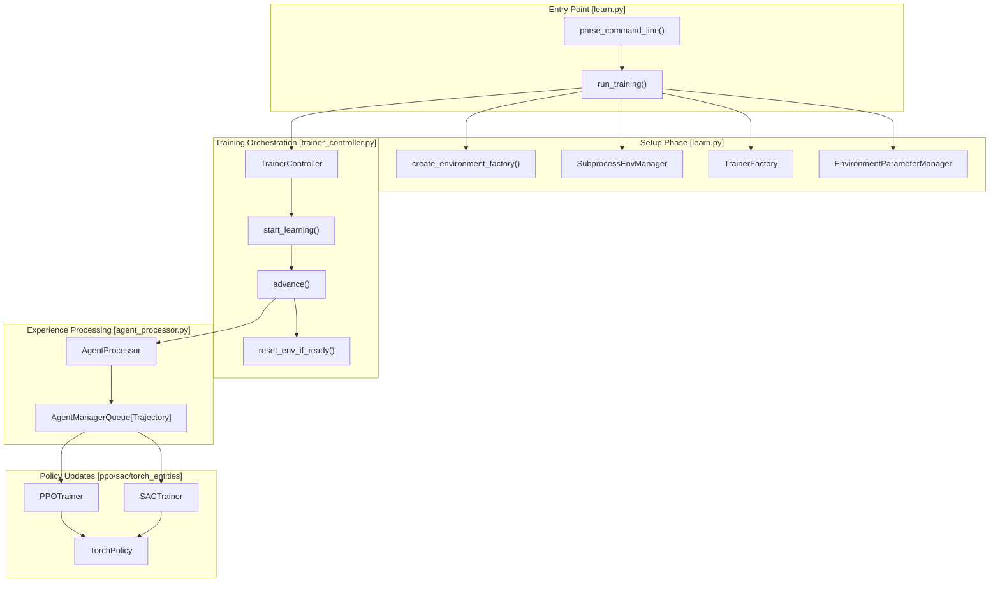
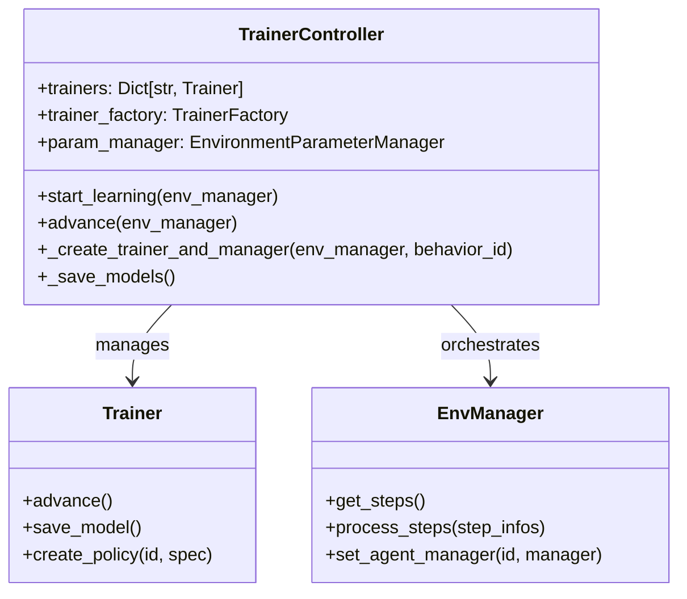
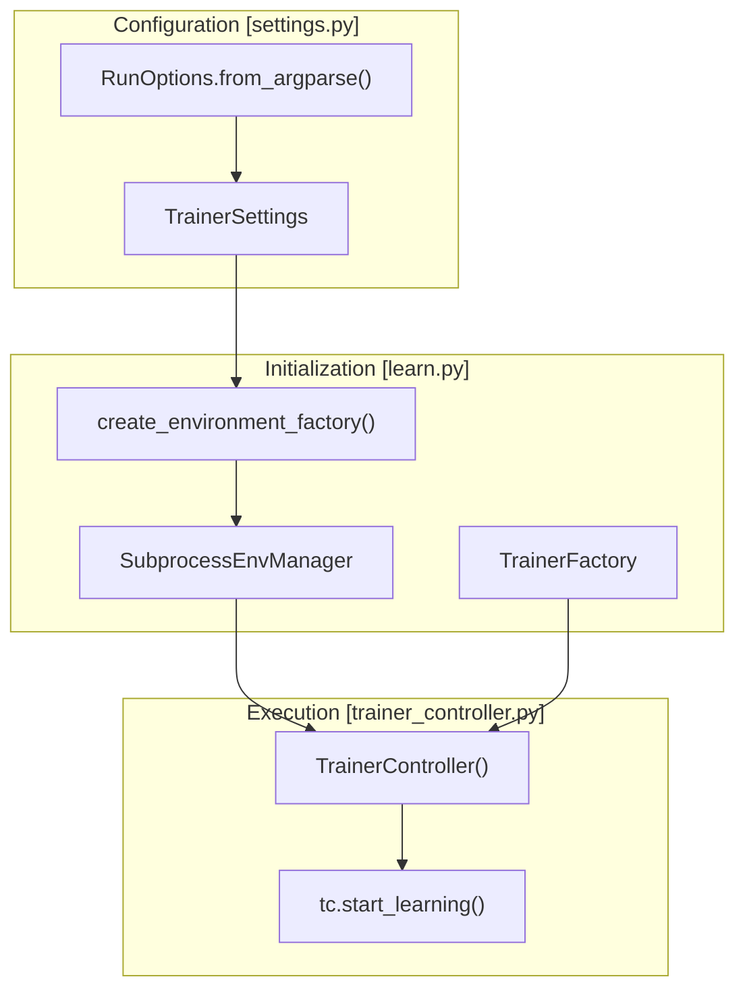

<!-- source: DeepWiki mcp.deepwiki.com · repo Unity-Technologies/ml-agents · page 3.1 Training Pipeline · fetched 2026-10-30 -->

# Training Pipeline

Relevant source files

The following files were used as context for generating this wiki page:

- [ml-agents-envs/mlagents_envs/envs/unity_pettingzoo_base_env.py](ml-agents-envs/mlagents_envs/envs/unity_pettingzoo_base_env.py)
- [ml-agents/mlagents/trainers/agent_processor.py](ml-agents/mlagents/trainers/agent_processor.py)
- [ml-agents/mlagents/trainers/cli_utils.py](ml-agents/mlagents/trainers/cli_utils.py)
- [ml-agents/mlagents/trainers/environment_parameter_manager.py](ml-agents/mlagents/trainers/environment_parameter_manager.py)
- [ml-agents/mlagents/trainers/exception.py](ml-agents/mlagents/trainers/exception.py)
- [ml-agents/mlagents/trainers/learn.py](ml-agents/mlagents/trainers/learn.py)
- [ml-agents/mlagents/trainers/settings.py](ml-agents/mlagents/trainers/settings.py)
- [ml-agents/mlagents/trainers/stats.py](ml-agents/mlagents/trainers/stats.py)
- [ml-agents/mlagents/trainers/tests/mock_brain.py](ml-agents/mlagents/trainers/tests/mock_brain.py)
- [ml-agents/mlagents/trainers/tests/test_agent_processor.py](ml-agents/mlagents/trainers/tests/test_agent_processor.py)
- [ml-agents/mlagents/trainers/tests/test_env_param_manager.py](ml-agents/mlagents/trainers/tests/test_env_param_manager.py)
- [ml-agents/mlagents/trainers/tests/test_learn.py](ml-agents/mlagents/trainers/tests/test_learn.py)
- [ml-agents/mlagents/trainers/tests/test_settings.py](ml-agents/mlagents/trainers/tests/test_settings.py)
- [ml-agents/mlagents/trainers/tests/test_stats.py](ml-agents/mlagents/trainers/tests/test_stats.py)
- [ml-agents/mlagents/trainers/tests/test_trainer_controller.py](ml-agents/mlagents/trainers/tests/test_trainer_controller.py)
- [ml-agents/mlagents/trainers/tests/test_trainer_util.py](ml-agents/mlagents/trainers/tests/test_trainer_util.py)
- [ml-agents/mlagents/trainers/trainer_controller.py](ml-agents/mlagents/trainers/trainer_controller.py)

This page details the main training loop orchestrated by `learn.py` and `TrainerController`, focusing on how the Python training components execute the core training pipeline. For information about the Unity-side components such as the Agent and Academy, see [Unity SDK Components](#2).

The training pipeline represents the execution flow from the `mlagents-learn` command through the main training loop, experience collection, policy updates, and model saving.

## Training Pipeline Overview

The ML-Agents training pipeline is orchestrated by two main components: `learn.py` which handles setup and orchestration, and `TrainerController` which manages the main training loop. The pipeline executes in the following sequence:

1.  **Entry Point**: `mlagents-learn` CLI command invokes `learn.py` via the `parser` defined in `cli_utils.py`.
2.  **Setup Phase**: Environment creation, trainer factory setup, and parameter management in `run_training()`.
3.  **Training Loop**: `TrainerController.start_learning()` executes the main training loop.
4.  **Experience Processing**: Agent experiences are collected by `AgentProcessor` and organized into trajectories.
5.  **Policy Updates**: Trainers (e.g., `PPOTrainer`) update policies based on collected experiences.
6.  **Model Persistence**: Trained models are saved as checkpoints and exported to ONNX.

### Core Training Pipeline Architecture

Sources:
- [ml-agents/mlagents/trainers/learn.py:51-134]()
- [ml-agents/mlagents/trainers/trainer_controller.py:168-201]()
- [ml-agents/mlagents/trainers/agent_processor.py:36-89]()

## Main Training Loop Components

### TrainerController

The `TrainerController` class serves as the central orchestrator. It implements the main training loop in `start_learning()` and coordinates all training activities across different behavior types.

Key methods and responsibilities:
- `start_learning(env_manager)`: Entry point for the training loop [ml-agents/mlagents/trainers/trainer_controller.py:168-179]().
- `advance(env_manager)`: Drives the environment forward and triggers trainer updates [ml-agents/mlagents/trainers/trainer_controller.py:230-252]().
- `_create_trainer_and_manager()`: Dynamically instantiates trainers and links them to environment managers [ml-agents/mlagents/trainers/trainer_controller.py:115-159]().
- `_save_models()`: Iterates through all active trainers to save their current state [ml-agents/mlagents/trainers/trainer_controller.py:72-81]().

Sources:
- [ml-agents/mlagents/trainers/trainer_controller.py:34-69]()
- [ml-agents/mlagents/trainers/trainer_controller.py:115-159]()
- [ml-agents/mlagents/trainers/trainer_controller.py:168-201]()

### Experience Processing Pipeline

Agent experiences are collected via `AgentProcessor`, which maintains buffers for each agent and groups them into `Trajectory` objects once a `max_trajectory_length` or terminal state is reached.

1.  **Experience Collection**: `AgentProcessor.add_experiences()` is called during `TrainerController.advance()` with the latest `DecisionSteps` and `TerminalSteps` [ml-agents/mlagents/trainers/agent_processor.py:90-102]().
2.  **Trajectory Assembly**: When a trajectory is complete, it is put into an `AgentManagerQueue` [ml-agents/mlagents/trainers/agent_processor.py:206-215]().
3.  **Trainer Consumption**: Trainers subscribe to these queues to pull trajectories for buffer updates [ml-agents/mlagents/trainers/trainer_controller.py:155-155]().

Sources:
- [ml-agents/mlagents/trainers/agent_processor.py:36-89]()
- [ml-agents/mlagents/trainers/agent_processor.py:90-158]()
- [ml-agents/mlagents/trainers/trainer_controller.py:150-156]()

## Training Setup and Configuration

The pipeline starts with `learn.py`, which initializes the environment and trainers based on `RunOptions`.

### Setup Phase Code Flow

The `run_training()` function in `learn.py` performs the following:
- Validates directories and handles resume/initialization logic [ml-agents/mlagents/trainers/learn.py:75-90]().
- Configures global `StatsReporter` with writers (TensorBoard, Console, etc.) [ml-agents/mlagents/trainers/learn.py:92-95]().
- Creates the `SubprocessEnvManager` to handle parallel environment instances [ml-agents/mlagents/trainers/learn.py:111-111]().
- Instantiates the `TrainerFactory` which is responsible for creating specific trainer types (PPO, SAC, etc.) [ml-agents/mlagents/trainers/learn.py:116-125]().

Sources:
- [ml-agents/mlagents/trainers/learn.py:59-134]()
- [ml-agents/mlagents/trainers/settings.py:127-140]()

## Environment Parameter Management

The `EnvironmentParameterManager` manages curriculum learning and parameter randomization. It tracks training progress and updates environment parameters via side channels.

- **Curriculum Learning**: Lessons are updated based on rewards and step counts in `update_lessons()` [ml-agents/mlagents/trainers/environment_parameter_manager.py:80-122]().
- **Parameter Sampling**: Supports various sampling strategies like `UniformSettings` and `GaussianSettings` defined in `settings.py` [ml-agents/mlagents/trainers/settings.py:254-325]().

Sources:
- [ml-agents/mlagents/trainers/environment_parameter_manager.py:18-45]()
- [ml-agents/mlagents/trainers/trainer_controller.py:208-227]()

## Statistics and Monitoring

The `StatsReporter` and `StatsWriter` classes handle logging and monitoring.

- **StatsReporter**: A singleton-like class that aggregates statistics across trainers [ml-agents/mlagents/trainers/stats.py:22-45]().
- **Writers**: Multiple writers can be registered, including `ConsoleWriter` for CLI output and `TensorboardWriter` for visual tracking [ml-agents/mlagents/trainers/stats.py:131-197]().
- **Aggregation**: Supports different methods like `AVERAGE`, `SUM`, and `MOST_RECENT` [ml-agents/mlagents/trainers/stats.py:42-73]().

Sources:
- [ml-agents/mlagents/trainers/stats.py:79-130]()
- [ml-agents/mlagents/trainers/stats.py:157-197]()

## Training Termination and Output

When training completes or is interrupted, `learn.py` ensures all resources are cleaned up and final artifacts are saved.

- **Final Save**: `TrainerController._save_models()` is called to write the final neural network state [ml-agents/mlagents/trainers/trainer_controller.py:72-81]().
- **Artifacts**:
    - `configuration.yaml`: The exact configuration used for the run [ml-agents/mlagents/trainers/learn.py:146-158]().
    - `timers.json`: Hierarchical timing information for performance profiling [ml-agents/mlagents/trainers/learn.py:164-172]().
    - `training_status.json`: Progress tracking for resuming training [ml-agents/mlagents/trainers/learn.py:160-161]().

Sources:
- [ml-agents/mlagents/trainers/learn.py:137-144]()
- [ml-agents/mlagents/trainers/trainer_controller.py:180-201]()

---

