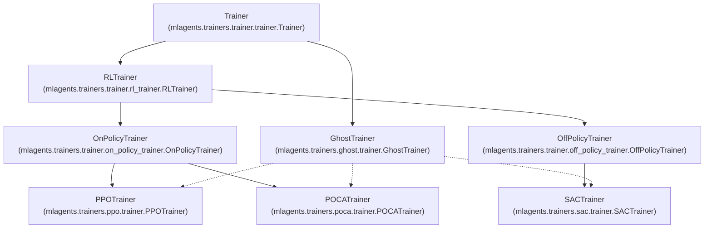
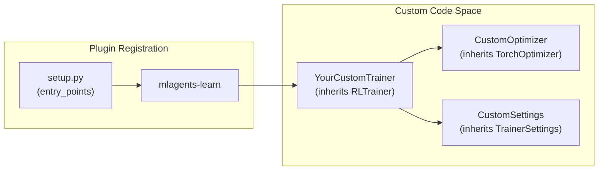

<!-- source: DeepWiki mcp.deepwiki.com · repo Unity-Technologies/ml-agents · page 3.2 Trainers and Algorithms · fetched 2026-10-30 -->

# Trainers and Algorithms

Relevant source files

The following files were used as context for generating this wiki page:

- [docs/Python-Custom-Trainer-Plugin.md](docs/Python-Custom-Trainer-Plugin.md)
- [docs/Python-LLAPI-Documentation.md](docs/Python-LLAPI-Documentation.md)
- [docs/Python-On-Off-Policy-Trainer-Documentation.md](docs/Python-On-Off-Policy-Trainer-Documentation.md)
- [docs/Python-Optimizer-Documentation.md](docs/Python-Optimizer-Documentation.md)
- [docs/Training-Plugins.md](docs/Training-Plugins.md)
- [docs/Tutorial-Custom-Trainer-Plugin.md](docs/Tutorial-Custom-Trainer-Plugin.md)
- [localized_docs/KR/docs/Installation-Anaconda-Windows.md](localized_docs/KR/docs/Installation-Anaconda-Windows.md)
- [localized_docs/KR/docs/Installation.md](localized_docs/KR/docs/Installation.md)
- [localized_docs/TR/docs/Installation.md](localized_docs/TR/docs/Installation.md)
- [ml-agents-plugin-examples/README.md](ml-agents-plugin-examples/README.md)
- [ml-agents-plugin-examples/mlagents_plugin_examples/__init__.py](ml-agents-plugin-examples/mlagents_plugin_examples/__init__.py)
- [ml-agents-plugin-examples/mlagents_plugin_examples/example_stats_writer.py](ml-agents-plugin-examples/mlagents_plugin_examples/example_stats_writer.py)
- [ml-agents-plugin-examples/mlagents_plugin_examples/tests/__init__.py](ml-agents-plugin-examples/mlagents_plugin_examples/tests/__init__.py)
- [ml-agents-plugin-examples/setup.py](ml-agents-plugin-examples/setup.py)
- [ml-agents/mlagents/plugins/__init__.py](ml-agents/mlagents/plugins/__init__.py)
- [ml-agents/mlagents/plugins/stats_writer.py](ml-agents/mlagents/plugins/stats_writer.py)
- [ml-agents/mlagents/trainers/ghost/trainer.py](ml-agents/mlagents/trainers/ghost/trainer.py)
- [ml-agents/mlagents/trainers/poca/trainer.py](ml-agents/mlagents/trainers/poca/trainer.py)
- [ml-agents/mlagents/trainers/ppo/trainer.py](ml-agents/mlagents/trainers/ppo/trainer.py)
- [ml-agents/mlagents/trainers/sac/trainer.py](ml-agents/mlagents/trainers/sac/trainer.py)
- [ml-agents/mlagents/trainers/tests/results/ppo/run_logs/training_status.json](ml-agents/mlagents/trainers/tests/results/ppo/run_logs/training_status.json)
- [ml-agents/mlagents/trainers/tests/test_rl_trainer.py](ml-agents/mlagents/trainers/tests/test_rl_trainer.py)
- [ml-agents/mlagents/trainers/tests/test_trainers.py](ml-agents/mlagents/trainers/tests/test_trainers.py)
- [ml-agents/mlagents/trainers/trainer/rl_trainer.py](ml-agents/mlagents/trainers/trainer/rl_trainer.py)
- [ml-agents/mlagents/trainers/trainer/trainer.py](ml-agents/mlagents/trainers/trainer/trainer.py)
- [ml-agents/pydoc-config.yaml](ml-agents/pydoc-config.yaml)

This document explains the trainer implementations and machine learning algorithms in the ML-Agents Python training system. It covers the specific algorithm implementations (PPO, SAC, POCA), their architectural relationships, and the plugin system for extensibility.

## Trainer Architecture Overview

The ML-Agents training system uses a hierarchical trainer architecture where algorithm-specific trainers inherit from base classes that provide common functionality like reward signal processing and checkpointing.

### Trainer Class Hierarchy

**Sources:** [ml-agents/mlagents/trainers/trainer/trainer.py:19-184](), [ml-agents/mlagents/trainers/trainer/rl_trainer.py:35-306](), [ml-agents/mlagents/trainers/ppo/trainer.py:29-60](), [ml-agents/mlagents/trainers/sac/trainer.py:30-64](), [ml-agents/mlagents/trainers/ghost/trainer.py:28-65]()

### Core Components Association

| Natural Language concept | Code Entity | File Path |
| :--- | :--- | :--- |
| **PPO Trainer** | `PPOTrainer` | [mlagents/trainers/ppo/trainer.py:29]() |
| **SAC Trainer** | `SACTrainer` | [mlagents/trainers/sac/trainer.py:30]() |
| **POCA Trainer** | `POCATrainer` | [mlagents/trainers/poca/trainer.py:30]() |
| **Self-Play Wrapper** | `GhostTrainer` | [mlagents/trainers/ghost/trainer.py:28]() |
| **Optimizer Base** | `TorchOptimizer` | [mlagents/trainers/optimizer/torch_optimizer.py:17]() |
| **Checkpointing** | `ModelCheckpointManager` | [mlagents/trainers/policy/checkpoint_manager.py:12]() |

**Sources:** [ml-agents/mlagents/trainers/ppo/trainer.py:29-30](), [ml-agents/mlagents/trainers/sac/trainer.py:30-34](), [ml-agents/mlagents/trainers/poca/trainer.py:30-31](), [ml-agents/mlagents/trainers/ghost/trainer.py:28-40](), [ml-agents/mlagents/trainers/trainer/rl_trainer.py:10-13]()

## PPO (Proximal Policy Optimization) Trainer

PPO is an on-policy algorithm that uses a clipped surrogate objective to prevent large policy updates, making training more stable.

### PPO Implementation Details
The `PPOTrainer` manages the training loop for PPO. It processes trajectories by calculating value and advantage targets using Generalized Advantage Estimation (GAE) [mlagents/trainers/ppo/trainer.py:68-74]().

- **Advantage Calculation**: Uses `get_gae` with hyperparameters like `lambd` and `gamma` [mlagents/trainers/ppo/trainer.py:135-141]().
- **Update Buffer**: Processed trajectories are converted to `AgentBuffer` and appended to the `update_buffer` for the optimizer [mlagents/trainers/ppo/trainer.py:161]().
- **Optimizer**: `TorchPPOOptimizer` handles the clipped objective and entropy regularization [mlagents/trainers/ppo/optimizer_torch.py:17]().

**Sources:** [ml-agents/mlagents/trainers/ppo/trainer.py:68-171](), [ml-agents/mlagents/trainers/ppo/optimizer_torch.py:17-17]()

## SAC (Soft Actor-Critic) Trainer

SAC is an off-policy algorithm that maximizes expected return while also maximizing entropy, promoting exploration.

### SAC Implementation Details
The `SACTrainer` inherits from `OffPolicyTrainer` [mlagents/trainers/sac/trainer.py:30]().

- **Replay Buffer**: SAC relies on a replay buffer; `SACTrainer` handles loading and saving this buffer across sessions [mlagents/trainers/sac/trainer.py:168]().
- **Trajectory Processing**: Unlike PPO, SAC doesn't calculate advantages during trajectory processing. It evaluates reward functions and value estimates primarily for reporting [mlagents/trainers/sac/trainer.py:102-129]().
- **Normalization**: Updates actor and critic normalization based on trajectory data [mlagents/trainers/sac/trainer.py:98-100]().

**Sources:** [ml-agents/mlagents/trainers/sac/trainer.py:30-143](), [ml-agents/mlagents/trainers/sac/trainer.py:168-168]()

## POCA (Partially Observable Centralized Actor) Trainer

POCA is a multi-agent algorithm that uses a centralized critic to train agents that may only have partial local observations.

### POCA Implementation Details
The `POCATrainer` processes trajectories with centralized baseline estimates [mlagents/trainers/poca/trainer.py:30-31]().

- **Centralized Value Estimates**: Calls `get_trajectory_and_baseline_value_estimates` to get global critic values [mlagents/trainers/poca/trainer.py:92-99]().
- **Lambda Returns**: Computes `lambda_return` and subtracts the baseline estimate to calculate `local_advantage` [mlagents/trainers/poca/trainer.py:153-161]().
- **Group Rewards**: Specifically tracks `collected_group_rewards` separate from individual environment rewards [mlagents/trainers/poca/trainer.py:68]().

**Sources:** [ml-agents/mlagents/trainers/poca/trainer.py:30-170](), [ml-agents/mlagents/trainers/poca/trainer.py:68-68]()

## Ghost Trainer and Self-Play

The `GhostTrainer` acts as a wrapper for adversarial games (teams in opposition) using a self-play mechanism [mlagents/trainers/ghost/trainer.py:28-30]().

- **Ghosting**: While one team learns, the other team is "ghosted," executing fixed policies from snapshots [mlagents/trainers/ghost/trainer.py:31-33]().
- **Snapshots**: Maintains `policy_snapshots` to be used as fixed policies [mlagents/trainers/ghost/trainer.py:116]().
- **ELO Rating**: The `GhostController` coordinates trainers and calculates ELO to track relative skill [mlagents/trainers/ghost/trainer.py:38-39]().
- **Training Team Rotation**: The learning team ID is cycled throughout the run to ensure all behaviors improve [mlagents/trainers/ghost/trainer.py:127-132]().

**Sources:** [ml-agents/mlagents/trainers/ghost/trainer.py:28-40](), [ml-agents/mlagents/trainers/ghost/trainer.py:116-132]()

## Trainer Plugin System

ML-Agents supports extending the training suite with custom algorithms (e.g., A2C, DQN) through a plugin system using Python entry points [docs/Python-Custom-Trainer-Plugin.md:3-8]().

### Custom Trainer Implementation Flow

**Sources:** [docs/Tutorial-Custom-Trainer-Plugin.md:12-62](), [docs/Training-Plugins.md:19-28](), [docs/Python-Custom-Trainer-Plugin.md:19-33]()

### Implementation Requirements
To implement a custom trainer, developers must:
1. **Extend Base Classes**: Inherit from `OnPolicyTrainer` or `OffPolicyTrainer` [docs/Tutorial-Custom-Trainer-Plugin.md:12]().
2. **Implement Abstract Methods**:
    - `create_policy`: Define the network architecture (e.g., using `SimpleActor`) [docs/Tutorial-Custom-Trainer-Plugin.md:19-44]().
    - `create_optimizer`: Define the learning logic [docs/Tutorial-Custom-Trainer-Plugin.md:54-59]().
    - `_process_trajectory`: Handle advantage and return calculations [docs/Tutorial-Custom-Trainer-Plugin.md:61-108]().
    - `_update_policy`: Execute the optimization step [docs/Tutorial-Custom-Trainer-Plugin.md:61]().
3. **Register Entry Point**: Define the plugin in `setup.py` under the `mlagents.stats_writer` or trainer-specific entry points [docs/Training-Plugins.md:19-28]().

**Sources:** [docs/Tutorial-Custom-Trainer-Plugin.md:12-108](), [docs/Training-Plugins.md:19-28]()

---

