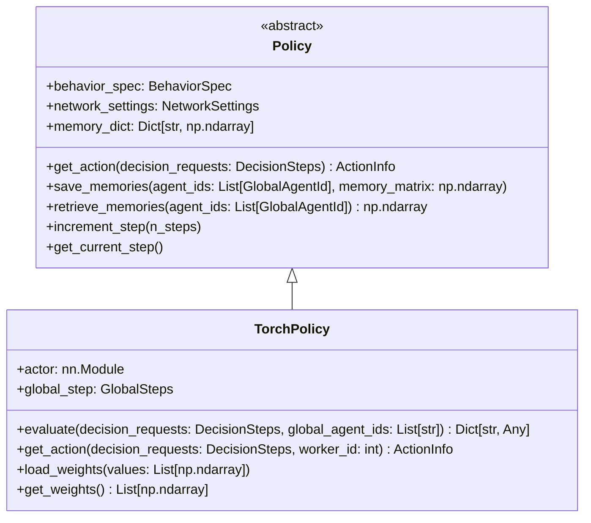
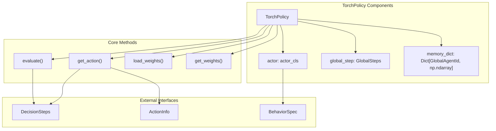
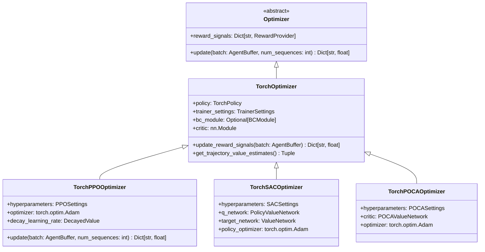
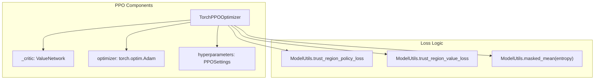
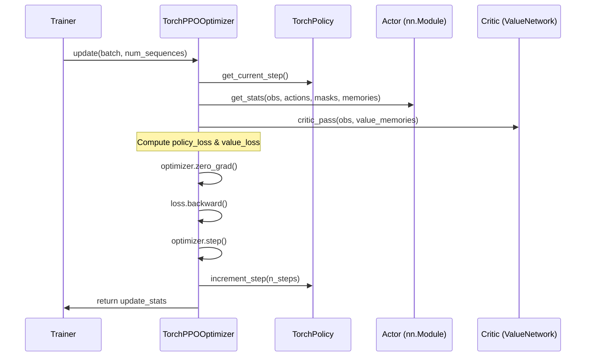

<!-- source: DeepWiki mcp.deepwiki.com · repo Unity-Technologies/ml-agents · page 3.3 Policies and Optimization · fetched 2026-10-30 -->

# Policies and Optimization

Relevant source files

The following files were used as context for generating this wiki page:

- [Project/Assets/ML-Agents/Examples/Match3/Scripts/Match3Board.cs](Project/Assets/ML-Agents/Examples/Match3/Scripts/Match3Board.cs)
- [Project/Assets/ML-Agents/Examples/Match3/Scripts/Match3Drawer.cs](Project/Assets/ML-Agents/Examples/Match3/Scripts/Match3Drawer.cs)
- [Project/Assets/ML-Agents/Examples/Match3/Scripts/Match3ExampleActuatorComponent.cs](Project/Assets/ML-Agents/Examples/Match3/Scripts/Match3ExampleActuatorComponent.cs)
- [com.unity.ml-agents/Runtime/Integrations/Match3/Match3Actuator.cs](com.unity.ml-agents/Runtime/Integrations/Match3/Match3Actuator.cs)
- [com.unity.ml-agents/Runtime/Integrations/Match3/Match3ActuatorComponent.cs](com.unity.ml-agents/Runtime/Integrations/Match3/Match3ActuatorComponent.cs)
- [ml-agents-trainer-plugin/mlagents_trainer_plugin/dqn/dqn_optimizer.py](ml-agents-trainer-plugin/mlagents_trainer_plugin/dqn/dqn_optimizer.py)
- [ml-agents/mlagents/torch_utils/cpu_utils.py](ml-agents/mlagents/torch_utils/cpu_utils.py)
- [ml-agents/mlagents/torch_utils/torch.py](ml-agents/mlagents/torch_utils/torch.py)
- [ml-agents/mlagents/trainers/model_saver/model_saver.py](ml-agents/mlagents/trainers/model_saver/model_saver.py)
- [ml-agents/mlagents/trainers/model_saver/torch_model_saver.py](ml-agents/mlagents/trainers/model_saver/torch_model_saver.py)
- [ml-agents/mlagents/trainers/optimizer/torch_optimizer.py](ml-agents/mlagents/trainers/optimizer/torch_optimizer.py)
- [ml-agents/mlagents/trainers/poca/optimizer_torch.py](ml-agents/mlagents/trainers/poca/optimizer_torch.py)
- [ml-agents/mlagents/trainers/policy/checkpoint_manager.py](ml-agents/mlagents/trainers/policy/checkpoint_manager.py)
- [ml-agents/mlagents/trainers/policy/policy.py](ml-agents/mlagents/trainers/policy/policy.py)
- [ml-agents/mlagents/trainers/policy/torch_policy.py](ml-agents/mlagents/trainers/policy/torch_policy.py)
- [ml-agents/mlagents/trainers/ppo/optimizer_torch.py](ml-agents/mlagents/trainers/ppo/optimizer_torch.py)
- [ml-agents/mlagents/trainers/sac/optimizer_torch.py](ml-agents/mlagents/trainers/sac/optimizer_torch.py)
- [ml-agents/mlagents/trainers/tests/test_torch_utils.py](ml-agents/mlagents/trainers/tests/test_torch_utils.py)
- [ml-agents/mlagents/trainers/tests/test_training_status.py](ml-agents/mlagents/trainers/tests/test_training_status.py)
- [ml-agents/mlagents/trainers/tests/torch_entities/test_attention.py](ml-agents/mlagents/trainers/tests/torch_entities/test_attention.py)
- [ml-agents/mlagents/trainers/torch_entities/components/reward_providers/gail_reward_provider.py](ml-agents/mlagents/trainers/torch_entities/components/reward_providers/gail_reward_provider.py)
- [ml-agents/mlagents/trainers/torch_entities/networks.py](ml-agents/mlagents/trainers/torch_entities/networks.py)
- [ml-agents/mlagents/trainers/torch_entities/utils.py](ml-agents/mlagents/trainers/torch_entities/utils.py)
- [ml-agents/mlagents/trainers/training_status.py](ml-agents/mlagents/trainers/training_status.py)

This document covers the policy and optimization systems in ML-Agents, focusing on the PyTorch-based neural network policies and their associated optimizers. The policy system handles action selection and evaluation during both training and inference, while the optimization system manages gradient-based learning algorithms that update policy parameters.

## Policy System Architecture

The policy system in ML-Agents provides an abstraction layer for neural network-based decision making. The base `Policy` class defines the interface, while `TorchPolicy` implements PyTorch-specific functionality for neural network policies.

### Policy Class Hierarchy

The `Policy` base class handles memory management for recurrent networks (LSTMs) and provides the core interface for action selection. `TorchPolicy` extends this with PyTorch-specific implementations, managing the `actor` network and `GlobalSteps` counter.

**Sources:** [ml-agents/mlagents/trainers/policy/policy.py:21-147](), [ml-agents/mlagents/trainers/policy/torch_policy.py:20-62]()

### TorchPolicy Implementation

The `TorchPolicy` class serves as the bridge between the trainer system and neural network actors. It manages the actor network, global step tracking, and memory handling for recurrent policies.

The policy evaluation process involves extracting observations and action masks via `_extract_masks`, converting them to tensors, and passing them through `actor.get_action_and_stats`. The `evaluate` method handles this process with `torch.no_grad()` for inference efficiency.

**Sources:** [ml-agents/mlagents/trainers/policy/torch_policy.py:71-115](), [ml-agents/mlagents/trainers/policy/torch_policy.py:117-143]()

## Optimization System Architecture

The optimization system implements gradient-based learning algorithms. The base `TorchOptimizer` class provides common functionality like reward signal management and behavioral cloning (BC) integration.

### Optimizer Class Hierarchy

**Sources:** [ml-agents/mlagents/trainers/optimizer/torch_optimizer.py:23-44](), [ml-agents/mlagents/trainers/ppo/optimizer_torch.py:35-98](), [ml-agents/mlagents/trainers/sac/optimizer_torch.py:44-180](), [ml-agents/mlagents/trainers/poca/optimizer_torch.py:53-178]()

### Algorithm-Specific Optimizers

#### PPO Optimizer
The PPO optimizer implements Proximal Policy Optimization. It manages a `ValueNetwork` for state value estimation and uses `ModelUtils.trust_region_policy_loss` and `ModelUtils.trust_region_value_loss` to compute the clipped surrogate objective.

**Sources:** [ml-agents/mlagents/trainers/ppo/optimizer_torch.py:58-64](), [ml-agents/mlagents/trainers/ppo/optimizer_torch.py:165-179]()

#### SAC Optimizer
The SAC optimizer implements Soft Actor-Critic. It uses a `PolicyValueNetwork` which contains two Q-networks (`q1_network`, `q2_network`) to mitigate overestimation bias. It also manages a `target_network` for stable value estimation via `ModelUtils.soft_update`.

**Sources:** [ml-agents/mlagents/trainers/sac/optimizer_torch.py:45-70](), [ml-agents/mlagents/trainers/sac/optimizer_torch.py:170-175]()

## Policy-Optimizer Integration

The policy and optimizer communicate primarily through the `AgentBuffer`. The optimizer pulls experiences from the buffer and applies gradients to the `actor` network housed within the `TorchPolicy`.

### Training Update Flow

**Sources:** [ml-agents/mlagents/trainers/ppo/optimizer_torch.py:100-197](), [ml-agents/mlagents/trainers/policy/torch_policy.py:161-167]()

## Neural Network Components

### Observation Encoding
ML-Agents uses `ObservationEncoder` to process various sensor inputs. It utilizes `ModelUtils.create_input_processors` to generate encoders for vector, visual, and goal-based observations. If variable-length observations are present, it employs `ResidualSelfAttention` (RSA).

**Sources:** [ml-agents/mlagents/trainers/torch_entities/networks.py:33-63](), [ml-agents/mlagents/trainers/torch_entities/networks.py:100-146]()

### Recurrent Memory
When `NetworkSettings.memory` is configured, policies use `LSTM` modules.
- `TorchPolicy` handles actor memory via `save_memories` and `retrieve_memories`.
- `TorchOptimizer` handles critic memory via `_evaluate_by_sequence`, which processes trajectories sequence-by-sequence to capture intermediate hidden states.

**Sources:** [ml-agents/mlagents/trainers/policy/policy.py:50-69](), [ml-agents/mlagents/trainers/optimizer/torch_optimizer.py:66-133]()

### Model Saving and Export
The `TorchModelSaver` manages the persistence of both `TorchPolicy` and `TorchOptimizer` states.
- `save_checkpoint`: Saves a `.pt` PyTorch file and exports a `.onnx` file using `ModelSerializer`.
- `initialize_or_load`: Restores model weights and global steps from a provided path.

**Sources:** [ml-agents/mlagents/trainers/model_saver/torch_model_saver.py:49-65](), [ml-agents/mlagents/trainers/model_saver/torch_model_saver.py:72-84]()

## Device and Performance
The toolkit utilizes a centralized device configuration via `mlagents.torch_utils.torch`.
- `set_torch_config`: Detects CUDA availability or respects `TorchSettings`.
- `get_num_threads_to_use`: Automatically scales CPU threads (typically 1-4) based on available cores and container limits (cgroups).

**Sources:** [ml-agents/mlagents/torch_utils/torch.py:42-67](), [ml-agents/mlagents/torch_utils/cpu_utils.py:6-13]()

---

