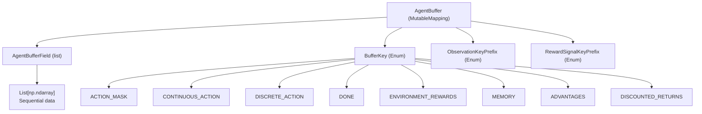
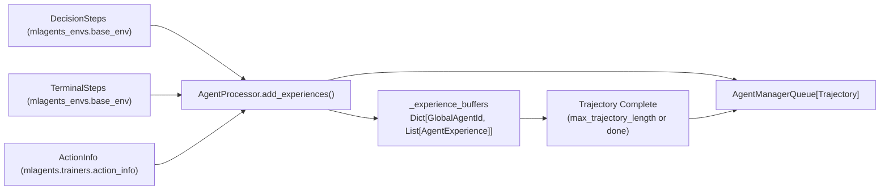

<!-- source: DeepWiki mcp.deepwiki.com · repo Unity-Technologies/ml-agents · page 3.4 Experience Collection and Buffers · fetched 2026-10-30 -->

# Experience Collection and Buffers

Relevant source files

The following files were used as context for generating this wiki page:

- [ml-agents-envs/mlagents_envs/base_env.py](ml-agents-envs/mlagents_envs/base_env.py)
- [ml-agents-envs/mlagents_envs/rpc_utils.py](ml-agents-envs/mlagents_envs/rpc_utils.py)
- [ml-agents/mlagents/trainers/agent_processor.py](ml-agents/mlagents/trainers/agent_processor.py)
- [ml-agents/mlagents/trainers/buffer.py](ml-agents/mlagents/trainers/buffer.py)
- [ml-agents/mlagents/trainers/demo_loader.py](ml-agents/mlagents/trainers/demo_loader.py)
- [ml-agents/mlagents/trainers/stats.py](ml-agents/mlagents/trainers/stats.py)
- [ml-agents/mlagents/trainers/tests/dummy_config.py](ml-agents/mlagents/trainers/tests/dummy_config.py)
- [ml-agents/mlagents/trainers/tests/mock_brain.py](ml-agents/mlagents/trainers/tests/mock_brain.py)
- [ml-agents/mlagents/trainers/tests/simple_test_envs.py](ml-agents/mlagents/trainers/tests/simple_test_envs.py)
- [ml-agents/mlagents/trainers/tests/test_agent_processor.py](ml-agents/mlagents/trainers/tests/test_agent_processor.py)
- [ml-agents/mlagents/trainers/tests/test_buffer.py](ml-agents/mlagents/trainers/tests/test_buffer.py)
- [ml-agents/mlagents/trainers/tests/test_demo_loader.py](ml-agents/mlagents/trainers/tests/test_demo_loader.py)
- [ml-agents/mlagents/trainers/tests/test_stats.py](ml-agents/mlagents/trainers/tests/test_stats.py)
- [ml-agents/mlagents/trainers/tests/test_trajectory.py](ml-agents/mlagents/trainers/tests/test_trajectory.py)
- [ml-agents/mlagents/trainers/trajectory.py](ml-agents/mlagents/trainers/trajectory.py)
- [ml-agents/tests/yamato/scripts/run_gym.py](ml-agents/tests/yamato/scripts/run_gym.py)
- [ml-agents/tests/yamato/scripts/run_llapi.py](ml-agents/tests/yamato/scripts/run_llapi.py)

This document covers the ML-Agents experience collection and buffer management system, which is responsible for gathering agent experiences from the Unity environment and organizing them into efficient data structures for training algorithms. The system handles the transformation of raw environment observations, actions, and rewards into structured trajectories that can be consumed by reinforcement learning trainers.

## Core Data Structures

The experience collection system is built around several key data structures that represent different levels of agent experience data.

### AgentBuffer and AgentBufferField

The `AgentBuffer` class serves as the primary container for storing agent experiences during training. It implements a dictionary-like interface where keys represent different types of data (observations, actions, rewards, etc.) and values are `AgentBufferField` objects containing the actual data sequences.

Title: AgentBuffer Architecture

**AgentBuffer Key Features:**
- Implements `MutableMapping` interface for dictionary-like access [ml-agents/mlagents/trainers/buffer.py:254-255]().
- Supports both simple keys (`BufferKey`) and composite keys for observations and reward signals [ml-agents/mlagents/trainers/buffer.py:70-72]().
- Provides batch sampling via `sample_mini_batch()` [ml-agents/mlagents/trainers/buffer.py:419-443]().
- Handles serialization to HDF5 format via `save_to_file()` and `load_from_file()` [ml-agents/mlagents/trainers/buffer.py:481-522]().

**AgentBufferField Operations:**
- `get_batch()`: Retrieve sequences with optional padding for sequential (LSTM) training [ml-agents/mlagents/trainers/buffer.py:142-185]().
- `padded_to_batch()`: Convert to numpy arrays with padding for variable-length group data [ml-agents/mlagents/trainers/buffer.py:223-252]().
- `resequence_and_append()`: Reorganizes data from one buffer into another using a specific training length [ml-agents/mlagents/trainers/buffer.py:336-357]().

Sources: [ml-agents/mlagents/trainers/buffer.py:25-522]().

### Experience and Trajectory Data Structures

The system uses two primary data structures to represent agent experiences at different granularities:

Title: Trajectory and Experience Classes

```mermaid
graph TB
    AgentExperience["AgentExperience (NamedTuple)"]
    AgentStatus["AgentStatus (NamedTuple)"]
    Trajectory["Trajectory (NamedTuple)"]
    
    AgentExperience --> obs["obs: List[np.ndarray]"]
    AgentExperience --> reward["reward: float"]
    AgentExperience --> done["done: bool"]
    AgentExperience --> action["action: ActionTuple"]
    AgentExperience --> action_probs["action_probs: LogProbsTuple"]
    AgentExperience --> action_mask["np.ndarray"]
    AgentExperience --> prev_action["np.ndarray"]
    AgentExperience --> interrupted["bool"]
    AgentExperience --> memory["np.ndarray"]
    AgentExperience --> group_status["List[AgentStatus]"]
    AgentExperience --> group_reward["float"]
    
    Trajectory --> steps["steps: List[AgentExperience]"]
    Trajectory --> next_obs["next_obs: List[np.ndarray]"]
    Trajectory --> next_group_obs["next_group_obs: List[List[np.ndarray]]"]
    Trajectory --> agent_id["str"]
    Trajectory --> behavior_id["str"]
    
    AgentStatus --> simple_obs["obs: List[np.ndarray]"]
    AgentStatus --> simple_reward["float"]
    AgentStatus --> simple_action["ActionTuple"]
    AgentStatus --> simple_done["bool"]
```

**AgentExperience** contains the complete information for a single agent timestep, including policy outputs (`action_probs`), memory for RNNs, and group information for multi-agent scenarios [ml-agents/mlagents/trainers/trajectory.py:26-44]().

**Trajectory** represents a sequence of agent experiences from episode start to termination or maximum trajectory length, plus bootstrap observations (`next_obs`) for value estimation [ml-agents/mlagents/trainers/trajectory.py:136-144]().

Sources: [ml-agents/mlagents/trainers/trajectory.py:14-144]().

## Experience Collection Flow

The experience collection process transforms raw environment steps into structured trajectories through a multi-stage pipeline.

### AgentProcessor and Trajectory Management

The `AgentProcessor` class serves as the core component responsible for accumulating agent experiences and converting them into trajectories.

Title: AgentProcessor Data Flow

**Key Processing Steps:**
1. **Experience Buffering**: `add_experiences()` processes `DecisionSteps` and `TerminalSteps` from the environment [ml-agents/mlagents/trainers/agent_processor.py:90-102]().
2. **Step Processing**: `_process_step()` creates `AgentExperience` objects and appends them to per-agent buffers [ml-agents/mlagents/trainers/agent_processor.py:228-293]().
3. **Trajectory Creation**: When the `max_trajectory_length` is reached or an agent terminates, `_create_trajectory()` is called [ml-agents/mlagents/trainers/agent_processor.py:313-351]().
4. **Queue Distribution**: Completed trajectories are put into `_trajectory_queues` for trainers to consume [ml-agents/mlagents/trainers/agent_processor.py:349-351]().

Sources: [ml-agents/mlagents/trainers/agent_processor.py:36-351]().

## Buffer Management and Operations

The buffer system provides operations for managing training data across different algorithm requirements.

### Buffer Key System

ML-Agents uses a hierarchical key system to organize data. `AgentBufferKey` is a Union of `BufferKey` (Enum), `ObservationKeyPrefix` tuples, and `RewardSignalKeyPrefix` tuples [ml-agents/mlagents/trainers/buffer.py:70-72]().

**Key Mapping Utility:**
- `ObsUtil.get_name_at(index)`: Generates a key for current observations [ml-agents/mlagents/trainers/trajectory.py:48-52]().
- `ObsUtil.get_name_at_next(index)`: Generates a key for next observations [ml-agents/mlagents/trainers/trajectory.py:55-59]().
- `RewardSignalUtil`: Provides static methods to generate keys for specific reward signals (e.g., `rewards_key`, `value_estimates_key`) [ml-agents/mlagents/trainers/buffer.py:75-95]().

Sources: [ml-agents/mlagents/trainers/buffer.py:25-96](), [ml-agents/mlagents/trainers/trajectory.py:46-80]().

### Batch Processing and Sampling

The `AgentBuffer` class provides methods to extract data for neural network training:

- **`make_mini_batch(start, end)`**: Extracts a slice of data across all fields in the buffer [ml-agents/mlagents/trainers/buffer.py:397-417]().
- **`sample_mini_batch(batch_size, sequence_length)`**: Randomly samples indices and retrieves sequences of a specific length, essential for training recurrent models [ml-agents/mlagents/trainers/buffer.py:419-443]().
- **`resequence_and_append(target_buffer, batch_size, training_length)`**: Used to move data from a raw trajectory buffer into a trainer's update buffer while enforcing sequence lengths [ml-agents/mlagents/trainers/buffer.py:336-357]().

Sources: [ml-agents/mlagents/trainers/buffer.py:336-443]().

## Statistics and Reporting

During collection, statistics are reported using the `StatsReporter` class.

- **`StatsReporter.add_stat(key, value)`**: Records a single scalar value [ml-agents/mlagents/trainers/stats.py:261-274]().
- **`StatsWriter`**: Abstract class for writing statistics to various sinks [ml-agents/mlagents/trainers/stats.py:79-129]().
- **`TensorboardWriter`**: Writes statistics to TensorBoard event files [ml-agents/mlagents/trainers/stats.py:293-376]().
- **`ConsoleWriter`**: Logs summary statistics (Mean Reward, Step, Time) to the terminal [ml-agents/mlagents/trainers/stats.py:157-217]().

Sources: [ml-agents/mlagents/trainers/stats.py:79-376]().

## Demonstration Loading

The `demo_loader.py` module facilitates loading experiences from `.demo` files into `AgentBuffer` objects for imitation learning.

- **`load_demonstration(file_path)`**: Parses protobuf-encoded demonstration files [ml-agents/mlagents/trainers/demo_loader.py:174-210]().
- **`make_demo_buffer(pair_infos, behavior_spec, sequence_length)`**: Converts protobuf agent/action pairs into a training-ready `AgentBuffer` [ml-agents/mlagents/trainers/demo_loader.py:25-101]().

Sources: [ml-agents/mlagents/trainers/demo_loader.py:25-143]().

---

