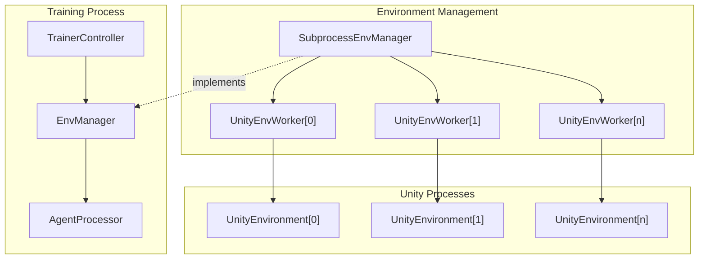
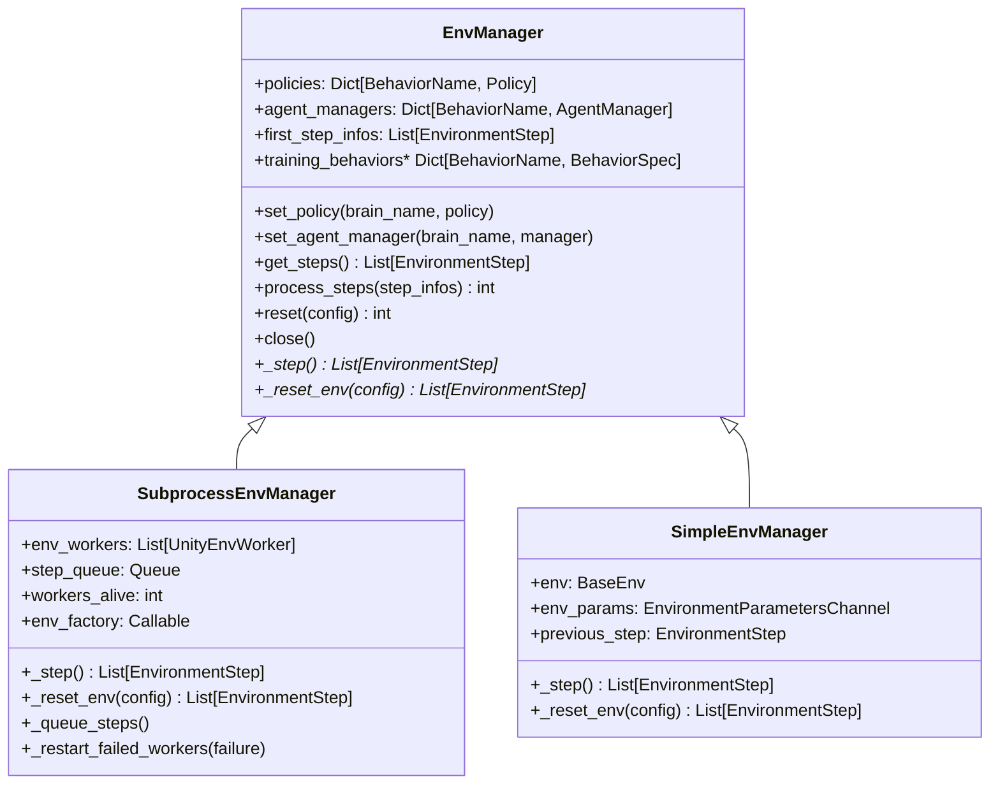
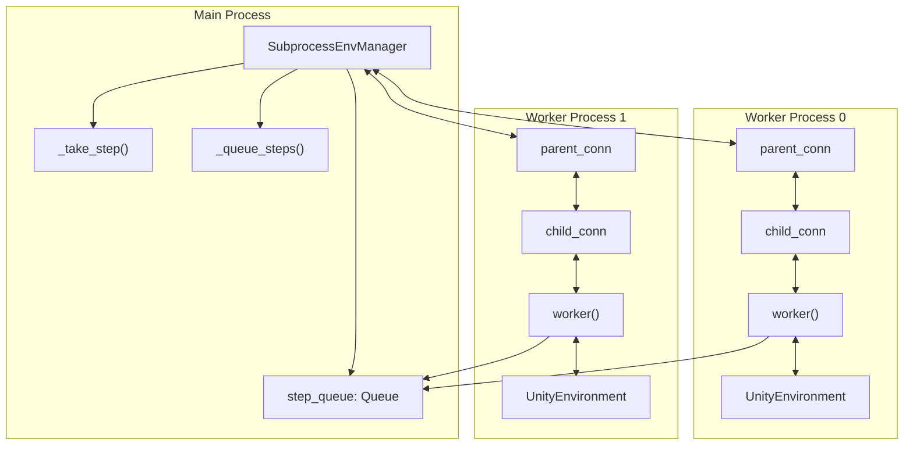
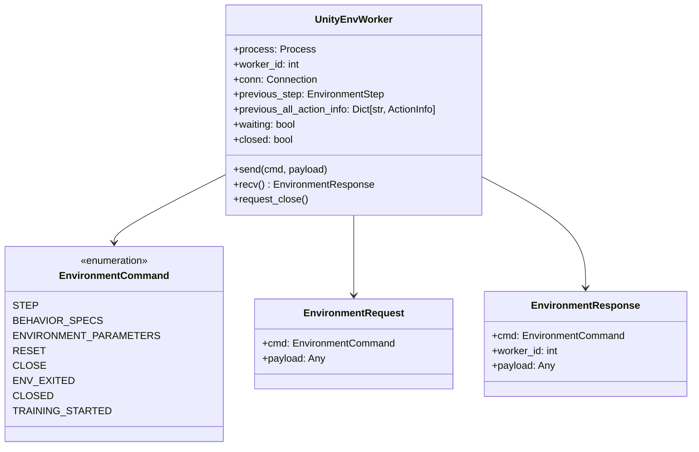
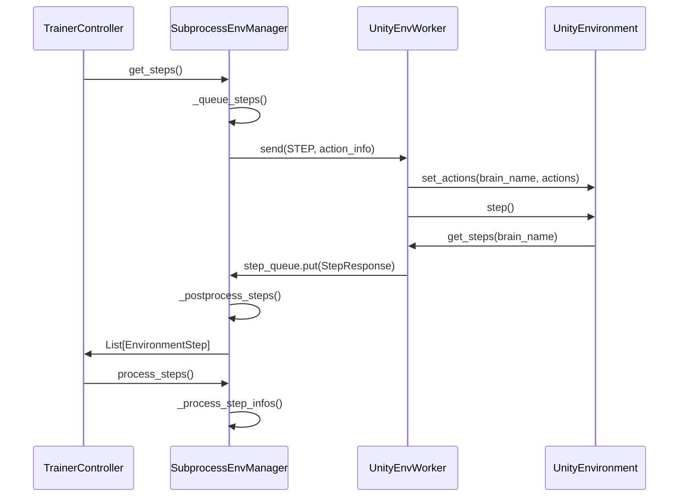
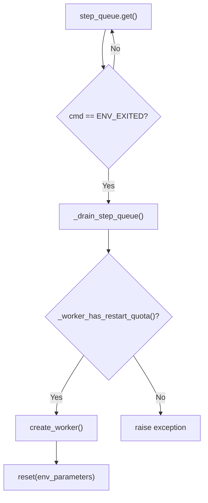

<!-- source: DeepWiki mcp.deepwiki.com · repo Unity-Technologies/ml-agents · page 3.5 Environment Management · fetched 2026-10-30 -->

# Environment Management

<details>
<summary>Relevant source files</summary>

The following files were used as context for generating this wiki page:

- [docs/Package-Settings.md](docs/Package-Settings.md)
- [docs/Python-Gym-API.md](docs/Python-Gym-API.md)
- [docs/Python-PettingZoo-API.md](docs/Python-PettingZoo-API.md)
- [docs/Unity-Environment-Registry.md](docs/Unity-Environment-Registry.md)
- [ml-agents-envs/colabs/Colab_PettingZoo.ipynb](ml-agents-envs/colabs/Colab_PettingZoo.ipynb)
- [ml-agents-envs/mlagents_envs/base_env.py](ml-agents-envs/mlagents_envs/base_env.py)
- [ml-agents-envs/mlagents_envs/registry/__init__.py](ml-agents-envs/mlagents_envs/registry/__init__.py)
- [ml-agents-envs/mlagents_envs/registry/base_registry_entry.py](ml-agents-envs/mlagents_envs/registry/base_registry_entry.py)
- [ml-agents-envs/mlagents_envs/registry/unity_env_registry.py](ml-agents-envs/mlagents_envs/registry/unity_env_registry.py)
- [ml-agents-envs/mlagents_envs/rpc_utils.py](ml-agents-envs/mlagents_envs/rpc_utils.py)
- [ml-agents/mlagents/trainers/action_info.py](ml-agents/mlagents/trainers/action_info.py)
- [ml-agents/mlagents/trainers/env_manager.py](ml-agents/mlagents/trainers/env_manager.py)
- [ml-agents/mlagents/trainers/simple_env_manager.py](ml-agents/mlagents/trainers/simple_env_manager.py)
- [ml-agents/mlagents/trainers/subprocess_env_manager.py](ml-agents/mlagents/trainers/subprocess_env_manager.py)
- [ml-agents/mlagents/trainers/tests/dummy_config.py](ml-agents/mlagents/trainers/tests/dummy_config.py)
- [ml-agents/mlagents/trainers/tests/simple_test_envs.py](ml-agents/mlagents/trainers/tests/simple_test_envs.py)
- [ml-agents/mlagents/trainers/tests/test_subprocess_env_manager.py](ml-agents/mlagents/trainers/tests/test_subprocess_env_manager.py)
- [ml-agents/tests/yamato/scripts/run_gym.py](ml-agents/tests/yamato/scripts/run_gym.py)
- [ml-agents/tests/yamato/scripts/run_llapi.py](ml-agents/tests/yamato/scripts/run_llapi.py)

</details>


The Environment Management system provides an abstraction layer for managing multiple Unity environments during training. This system handles parallel environment execution, worker process coordination, and communication between the Python training pipeline and Unity simulation environments.

For information about the base environment interface and step data structures, see [Unity-Python Communication](#4). For details about the training pipeline that consumes environment data, see [Training Pipeline](#3.1).

## Architecture Overview

The environment management system uses a manager-worker pattern to coordinate multiple Unity environments running in separate processes. The `EnvManager` abstraction allows the training system to interact with environments without knowing whether they run locally or in subprocesses.

Title: Environment Management Architecture


**Sources:** [ml-agents/mlagents/trainers/subprocess_env_manager.py:246-547](), [ml-agents/mlagents/trainers/env_manager.py:39-158]()

## Core Components

### EnvManager Base Class

The `EnvManager` abstract base class defined in [ml-agents/mlagents/trainers/env_manager.py:39-158]() defines the interface for environment management. It maintains collections of policies and agent managers, and provides methods for stepping environments and processing results.

Title: EnvManager Class Hierarchy


**Sources:** [ml-agents/mlagents/trainers/env_manager.py:39-158](), [ml-agents/mlagents/trainers/subprocess_env_manager.py:246-547](), [ml-agents/mlagents/trainers/simple_env_manager.py:13-85]()

### EnvironmentStep Data Structure

The `EnvironmentStep` namedtuple defined in [ml-agents/mlagents/trainers/env_manager.py:24-37]() encapsulates all data from a single environment step, including observations, actions, and worker metadata.

| Field | Type | Description |
|-------|------|-------------|
| `current_all_step_result` | `AllStepResult` | Decision and terminal steps for all behaviors [ml-agents/mlagents/trainers/env_manager.py:18-25]() |
| `worker_id` | `int` | Identifier for the worker process [ml-agents/mlagents/trainers/env_manager.py:26-26]() |
| `brain_name_to_action_info` | `Dict[BehaviorName, ActionInfo]` | Actions taken by policies [ml-agents/mlagents/trainers/env_manager.py:27-27]() |
| `environment_stats` | `EnvironmentStats` | Performance metrics from the environment [ml-agents/mlagents/trainers/env_manager.py:28-28]() |

**Sources:** [ml-agents/mlagents/trainers/env_manager.py:24-37]()

## Worker Process Architecture

The `SubprocessEnvManager` implements parallel environment execution using worker processes that communicate via pipes and queues. Each worker runs a Unity environment and responds to commands from the main process.

Title: Subprocess Worker Data Flow


**Sources:** [ml-agents/mlagents/trainers/subprocess_env_manager.py:79-297](), [ml-agents/mlagents/trainers/subprocess_env_manager.py:116-244]()

### UnityEnvWorker

The `UnityEnvWorker` class [ml-agents/mlagents/trainers/subprocess_env_manager.py:79-114]() represents a worker process that runs a Unity environment. It maintains the process handle, connection objects, and state tracking for the worker.

Title: Worker Communication Entities


**Sources:** [ml-agents/mlagents/trainers/subprocess_env_manager.py:79-114](), [ml-agents/mlagents/trainers/subprocess_env_manager.py:51-77]()

## Communication and Data Flow

The environment management system coordinates training steps through a request-response pattern. The main process queues actions to workers and collects environment observations through a shared queue.

Title: Environment Step Sequence


**Sources:** [ml-agents/mlagents/trainers/subprocess_env_manager.py:406-432](), [ml-agents/mlagents/trainers/subprocess_env_manager.py:299-306](), [ml-agents/mlagents/trainers/subprocess_env_manager.py:509-547]()

### Step Processing Pipeline

The `_step()` method [ml-agents/mlagents/trainers/subprocess_env_manager.py:406-432]() coordinates environment stepping across all workers:

1. **Queue Actions**: Send action commands to non-waiting workers via `_queue_steps()` [ml-agents/mlagents/trainers/subprocess_env_manager.py:410-410]().
2. **Collect Responses**: Poll the step queue for completed worker responses [ml-agents/mlagents/trainers/subprocess_env_manager.py:412-423]().
3. **Handle Failures**: Restart failed workers through `_restart_failed_workers()` [ml-agents/mlagents/trainers/subprocess_env_manager.py:425-425]().
4. **Postprocess**: Merge timer data and update worker state via `_postprocess_steps()` [ml-agents/mlagents/trainers/subprocess_env_manager.py:431-431]().

**Sources:** [ml-agents/mlagents/trainers/subprocess_env_manager.py:406-432]()

## Error Handling and Recovery

The system implements robust error handling to recover from worker failures without stopping training. When a worker crashes (e.g., throwing `UnityEnvironmentException`), the system restarts it and resets all environments to maintain training consistency.

### Worker Restart Logic

Title: Crash Recovery Workflow


**Sources:** [ml-agents/mlagents/trainers/subprocess_env_manager.py:307-329](), [ml-agents/mlagents/trainers/subprocess_env_manager.py:355-390]()

### Restart Rate Limiting

The system tracks restart timestamps and enforces limits to prevent infinite restart loops:

- **Lifetime Limit**: Maximum total restarts per worker (`max_lifetime_restarts`).
- **Rate Limit**: Maximum restarts within a time window (`restarts_rate_limit_n`, `restarts_rate_limit_period_s`).

**Sources:** [ml-agents/mlagents/trainers/subprocess_env_manager.py:376-404]()

## Configuration and Lifecycle Management

### Environment Factory Pattern

The `SubprocessEnvManager` uses a factory function to create environment instances in worker processes. The factory is serialized with `cloudpickle` to support complex environment configurations [ml-agents/mlagents/trainers/subprocess_env_manager.py:124-126]().

```python
env_factory: Callable[[int, List[SideChannel]], UnityEnvironment]
```

**Sources:** [ml-agents/mlagents/trainers/subprocess_env_manager.py:249-251](), [ml-agents/mlagents/trainers/subprocess_env_manager.py:273-297]()

### Side Channel Management

Workers support side channels for environment configuration:

| Channel | Purpose |
|---------|---------|
| `EnvironmentParametersChannel` | Runtime parameter updates [ml-agents/mlagents/trainers/subprocess_env_manager.py:127-127]() |
| `EngineConfigurationChannel` | Unity engine settings [ml-agents/mlagents/trainers/subprocess_env_manager.py:137-138]() |
| `StatsSideChannel` | Performance metrics collection [ml-agents/mlagents/trainers/subprocess_env_manager.py:140-140]() |
| `TrainingAnalyticsSideChannel` | Training analytics (worker 0 only) [ml-agents/mlagents/trainers/subprocess_env_manager.py:142-143]() |

**Sources:** [ml-agents/mlagents/trainers/subprocess_env_manager.py:127-173]()

### Environment Parameter Updates

The `set_env_parameters()` method broadcasts parameter changes to all workers through the `EnvironmentParametersChannel` [ml-agents/mlagents/trainers/subprocess_env_manager.py:449-457](). Parameters can be static values or `ParameterRandomizationSettings` for curriculum learning [ml-agents/mlagents/trainers/simple_env_manager.py:60-61]().

**Sources:** [ml-agents/mlagents/trainers/subprocess_env_manager.py:449-457](), [ml-agents/mlagents/trainers/simple_env_manager.py:50-61]()

---

