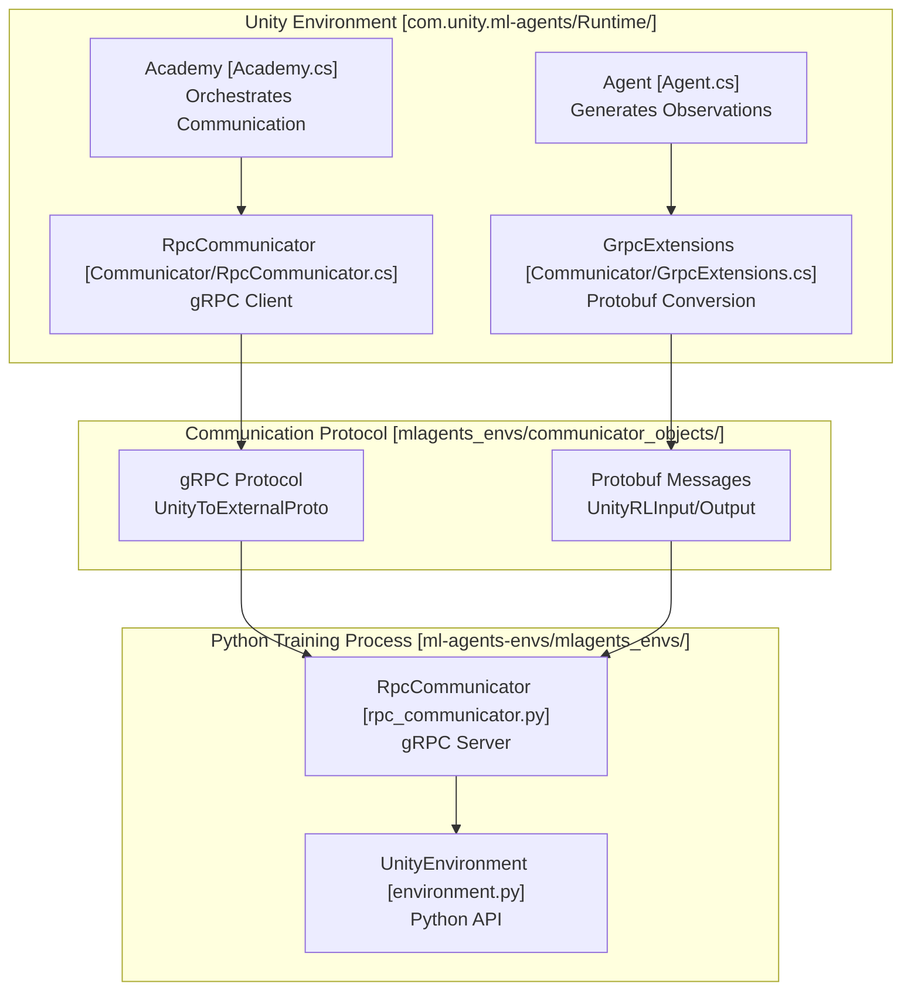
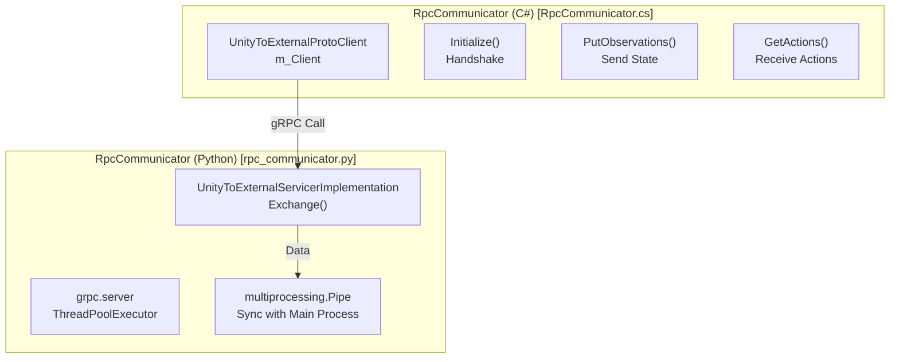
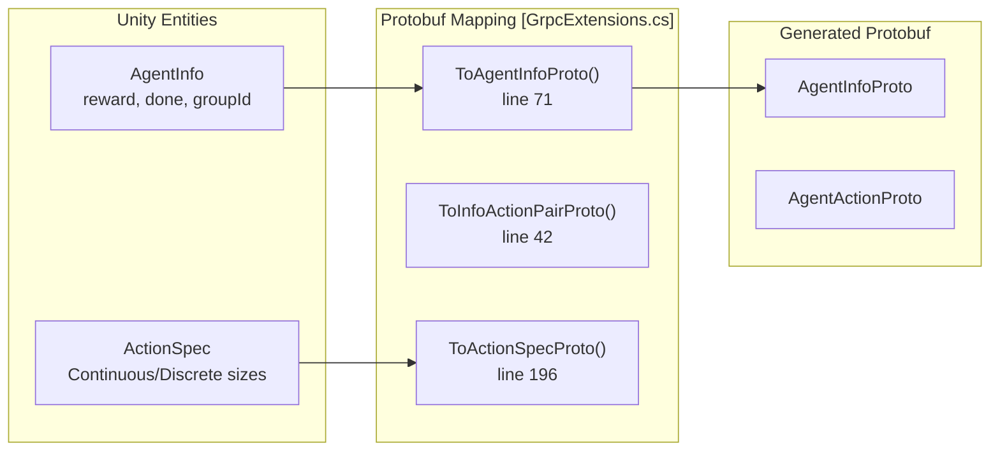
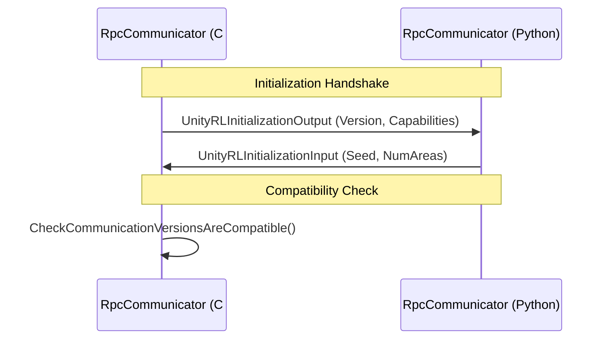
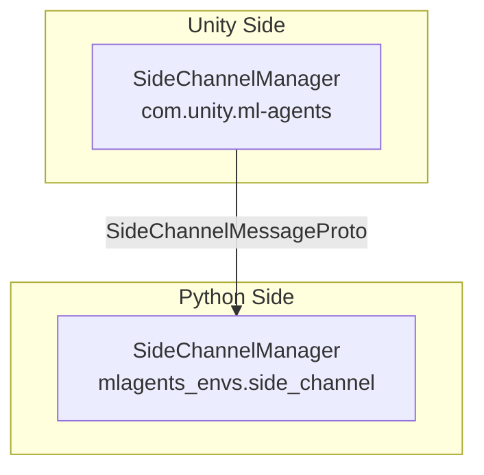

<!-- source: DeepWiki mcp.deepwiki.com · repo Unity-Technologies/ml-agents · page 4 Unity-Python Communication · fetched 2026-10-30 -->

# Unity-Python Communication

Relevant source files

The following files were used as context for generating this wiki page:

- [com.unity.ml-agents/Runtime/Communicator/GrpcExtensions.cs](com.unity.ml-agents/Runtime/Communicator/GrpcExtensions.cs)
- [com.unity.ml-agents/Runtime/Communicator/ICommunicator.cs](com.unity.ml-agents/Runtime/Communicator/ICommunicator.cs)
- [com.unity.ml-agents/Runtime/Communicator/RpcCommunicator.cs](com.unity.ml-agents/Runtime/Communicator/RpcCommunicator.cs)
- [com.unity.ml-agents/Runtime/DecisionRequester.cs](com.unity.ml-agents/Runtime/DecisionRequester.cs)
- [com.unity.ml-agents/Runtime/Demonstrations/DemonstrationWriter.cs](com.unity.ml-agents/Runtime/Demonstrations/DemonstrationWriter.cs)
- [com.unity.ml-agents/Runtime/Grpc/CommunicatorObjects/Observation.cs](com.unity.ml-agents/Runtime/Grpc/CommunicatorObjects/Observation.cs)
- [ml-agents-envs/mlagents_envs/communicator.py](ml-agents-envs/mlagents_envs/communicator.py)
- [ml-agents-envs/mlagents_envs/communicator_objects/observation_pb2.py](ml-agents-envs/mlagents_envs/communicator_objects/observation_pb2.py)
- [ml-agents-envs/mlagents_envs/communicator_objects/observation_pb2.pyi](ml-agents-envs/mlagents_envs/communicator_objects/observation_pb2.pyi)
- [ml-agents-envs/mlagents_envs/communicator_objects/unity_to_external_pb2.py](ml-agents-envs/mlagents_envs/communicator_objects/unity_to_external_pb2.py)
- [ml-agents-envs/mlagents_envs/communicator_objects/unity_to_external_pb2_grpc.py](ml-agents-envs/mlagents_envs/communicator_objects/unity_to_external_pb2_grpc.py)
- [ml-agents-envs/mlagents_envs/env_utils.py](ml-agents-envs/mlagents_envs/env_utils.py)
- [ml-agents-envs/mlagents_envs/environment.py](ml-agents-envs/mlagents_envs/environment.py)
- [ml-agents-envs/mlagents_envs/exception.py](ml-agents-envs/mlagents_envs/exception.py)
- [ml-agents-envs/mlagents_envs/mock_communicator.py](ml-agents-envs/mlagents_envs/mock_communicator.py)
- [ml-agents-envs/mlagents_envs/rpc_communicator.py](ml-agents-envs/mlagents_envs/rpc_communicator.py)
- [protobuf-definitions/README.md](protobuf-definitions/README.md)
- [protobuf-definitions/make_for_win.bat](protobuf-definitions/make_for_win.bat)
- [protobuf-definitions/proto/mlagents_envs/communicator_objects/observation.proto](protobuf-definitions/proto/mlagents_envs/communicator_objects/observation.proto)

This document explains the gRPC-based communication system that enables Unity environments to exchange data with Python training processes in the ML-Agents Toolkit. This covers the protocol implementation, message types, and data flow between Unity and Python processes.

For information about the overall system architecture, see [ML-Agents Overview](#1). For details about the Python training system, see [Python Training System](#3).

## Communication Architecture Overview

The ML-Agents communication system uses gRPC to enable bidirectional data exchange between Unity environments and Python training processes. The `RpcCommunicator` serves as the primary Unity-side implementation, while the `ICommunicator` interface defines the contract for external communication.

**Sources:** [com.unity.ml-agents/Runtime/Communicator/RpcCommunicator.cs:25-54](), [com.unity.ml-agents/Runtime/Communicator/ICommunicator.cs:130-180](), [ml-agents-envs/mlagents_envs/environment.py:55-68](), [ml-agents-envs/mlagents_envs/rpc_communicator.py:34-52]()

## gRPC Protocol Implementation

The `RpcCommunicator` class implements the Unity-side gRPC client that connects to the Python training process. On the Python side, `mlagents_envs.rpc_communicator.RpcCommunicator` acts as the server. This reversal (Unity as client, Python as server) allows for easier environment management in containerized or distributed settings.

For details, see [gRPC and Protobuf Layer](#4.1).

**Sources:** [com.unity.ml-agents/Runtime/Communicator/RpcCommunicator.cs:51-54](), [com.unity.ml-agents/Runtime/Communicator/RpcCommunicator.cs:106-154](), [ml-agents-envs/mlagents_envs/rpc_communicator.py:21-32](), [ml-agents-envs/mlagents_envs/rpc_communicator.py:53-75]()

## Message Types and Data Conversion

The `GrpcExtensions` class provides conversion utilities between Unity C# objects and protobuf messages. This enables seamless serialization of agent observations, actions, and metadata for transmission over gRPC.

**Sources:** [com.unity.ml-agents/Runtime/Communicator/GrpcExtensions.cs:42-65](), [com.unity.ml-agents/Runtime/Communicator/GrpcExtensions.cs:71-105](), [com.unity.ml-agents/Runtime/Communicator/GrpcExtensions.cs:196-218]()

## Initialization and Handshake Protocol

The communication system follows a specific initialization sequence. Unity sends a `UnityRLInitializationOutputProto` containing its capabilities and versions. Python responds with a `UnityRLInitializationInputProto` which includes the RNG seed and environment configuration.

**Sources:** [com.unity.ml-agents/Runtime/Communicator/RpcCommunicator.cs:106-154](), [com.unity.ml-agents/Runtime/Communicator/RpcCommunicator.cs:73-97](), [ml-agents-envs/mlagents_envs/environment.py:120-129]()

## Side Channel Communication

Side channels provide an auxiliary communication mechanism for exchanging non-RL data like environment parameters, engine configuration, and statistics. These are handled outside the standard observation/action loop.

For details, see [Side Channels](#4.2).

**Sources:** [ml-agents-envs/mlagents_envs/environment.py:12-14](), [com.unity.ml-agents/Runtime/Communicator/RpcCommunicator.cs:17-20]()

## Communication API Versioning

The system maintains compatibility through semantic versioning. Both sides verify the `API_VERSION` during the handshake.

| Version | Key Feature Support |
|---------|---------------------|
| 1.0.0   | Initial version |
| 1.3.0   | Hybrid actions (Continuous + Discrete) |
| 1.5.0   | Variable length observations and Multi-agent groups |

**Sources:** [ml-agents-envs/mlagents_envs/environment.py:55-68](), [com.unity.ml-agents/Runtime/Communicator/RpcCommunicator.cs:73-97]()

## Protobuf Maintenance

When the communication protocol changes, the protobuf definitions must be updated and regenerated for both C# and Python.

*   **Definitions:** Located in `protobuf-definitions/proto/`.
*   **Generation:** Use `make.sh` (Linux/Mac) or `make_for_win.bat` (Windows).
*   **Requirements:** `protoc`, `grpcio-tools`, and `Grpc.Tools`.

For details, see [gRPC and Protobuf Layer](#4.1).

**Sources:** [protobuf-definitions/README.md:1-43](), [protobuf-definitions/make_for_win.bat:1-44]()

---

