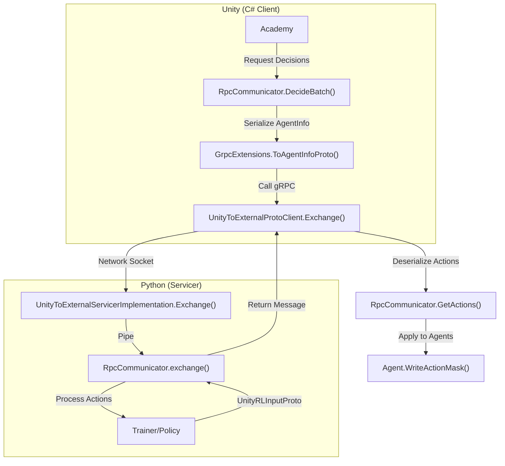
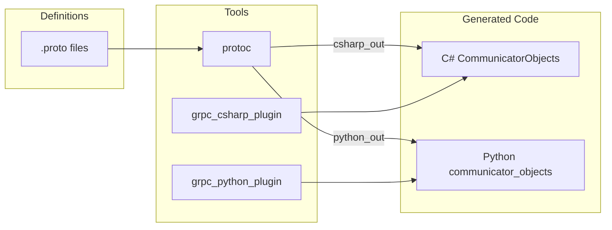

<!-- source: DeepWiki mcp.deepwiki.com · repo Unity-Technologies/ml-agents · page 4.1 gRPC and Protobuf Layer · fetched 2026-10-30 -->

# gRPC and Protobuf Layer

<details>
<summary>Relevant source files</summary>

The following files were used as context for generating this wiki page:

- [com.unity.ml-agents/Runtime/Communicator/GrpcExtensions.cs](com.unity.ml-agents/Runtime/Communicator/GrpcExtensions.cs)
- [com.unity.ml-agents/Runtime/Communicator/ICommunicator.cs](com.unity.ml-agents/Runtime/Communicator/ICommunicator.cs)
- [com.unity.ml-agents/Runtime/Communicator/RpcCommunicator.cs](com.unity.ml-agents/Runtime/Communicator/RpcCommunicator.cs)
- [com.unity.ml-agents/Runtime/Communicator/UnityRLCapabilities.cs](com.unity.ml-agents/Runtime/Communicator/UnityRLCapabilities.cs)
- [com.unity.ml-agents/Runtime/DecisionRequester.cs](com.unity.ml-agents/Runtime/DecisionRequester.cs)
- [com.unity.ml-agents/Runtime/Demonstrations/DemonstrationWriter.cs](com.unity.ml-agents/Runtime/Demonstrations/DemonstrationWriter.cs)
- [com.unity.ml-agents/Runtime/Grpc/CommunicatorObjects/Capabilities.cs](com.unity.ml-agents/Runtime/Grpc/CommunicatorObjects/Capabilities.cs)
- [com.unity.ml-agents/Runtime/Grpc/CommunicatorObjects/Observation.cs](com.unity.ml-agents/Runtime/Grpc/CommunicatorObjects/Observation.cs)
- [ml-agents-envs/mlagents_envs/communicator.py](ml-agents-envs/mlagents_envs/communicator.py)
- [ml-agents-envs/mlagents_envs/communicator_objects/capabilities_pb2.py](ml-agents-envs/mlagents_envs/communicator_objects/capabilities_pb2.py)
- [ml-agents-envs/mlagents_envs/communicator_objects/capabilities_pb2.pyi](ml-agents-envs/mlagents_envs/communicator_objects/capabilities_pb2.pyi)
- [ml-agents-envs/mlagents_envs/communicator_objects/observation_pb2.py](ml-agents-envs/mlagents_envs/communicator_objects/observation_pb2.py)
- [ml-agents-envs/mlagents_envs/communicator_objects/observation_pb2.pyi](ml-agents-envs/mlagents_envs/communicator_objects/observation_pb2.pyi)
- [ml-agents-envs/mlagents_envs/communicator_objects/unity_to_external_pb2.py](ml-agents-envs/mlagents_envs/communicator_objects/unity_to_external_pb2.py)
- [ml-agents-envs/mlagents_envs/communicator_objects/unity_to_external_pb2_grpc.py](ml-agents-envs/mlagents_envs/communicator_objects/unity_to_external_pb2_grpc.py)
- [ml-agents-envs/mlagents_envs/env_utils.py](ml-agents-envs/mlagents_envs/env_utils.py)
- [ml-agents-envs/mlagents_envs/environment.py](ml-agents-envs/mlagents_envs/environment.py)
- [ml-agents-envs/mlagents_envs/exception.py](ml-agents-envs/mlagents_envs/exception.py)
- [ml-agents-envs/mlagents_envs/mock_communicator.py](ml-agents-envs/mlagents_envs/mock_communicator.py)
- [ml-agents-envs/mlagents_envs/rpc_communicator.py](ml-agents-envs/mlagents_envs/rpc_communicator.py)
- [protobuf-definitions/README.md](protobuf-definitions/README.md)
- [protobuf-definitions/make_for_win.bat](protobuf-definitions/make_for_win.bat)
- [protobuf-definitions/proto/mlagents_envs/communicator_objects/capabilities.proto](protobuf-definitions/proto/mlagents_envs/communicator_objects/capabilities.proto)
- [protobuf-definitions/proto/mlagents_envs/communicator_objects/observation.proto](protobuf-definitions/proto/mlagents_envs/communicator_objects/observation.proto)

</details>


The gRPC and Protobuf layer provides the low-level communication infrastructure between the Unity simulation (C#) and the Python training process. This layer ensures that complex simulation data, such as high-dimensional observations and multi-agent actions, are serialized efficiently and transmitted across a network socket with minimal overhead.

## System Architecture

The communication follows a client-server model where the **Python process acts as the gRPC Server** and the **Unity process acts as the gRPC Client** [ml-agents-envs/mlagents_envs/rpc_communicator.py:37-37](). This design allows the Python trainer to manage multiple Unity environment instances (workers) by assigning unique ports to each [ml-agents-envs/mlagents_envs/rpc_communicator.py:40-46]().

### Communication Data Flow
The following diagram illustrates the lifecycle of a single simulation step and the code entities involved in the exchange.

**Diagram: Step Exchange Data Flow**

Sources: [com.unity.ml-agents/Runtime/Communicator/RpcCommunicator.cs:171-171](), [com.unity.ml-agents/Runtime/Communicator/GrpcExtensions.cs:71-71](), [ml-agents-envs/mlagents_envs/rpc_communicator.py:29-31](), [ml-agents-envs/mlagents_envs/rpc_communicator.py:135-146]()

## Key Components

### RpcCommunicator (C# and Python)
The `RpcCommunicator` implements the `ICommunicator` interface on both sides, serving as the primary gateway for data exchange.

*   **C# Implementation**: Responsible for gathering observations from sensors and mapping them to protobuf messages via `PutObservations` [com.unity.ml-agents/Runtime/Communicator/RpcCommunicator.cs:164-164](). It manages the gRPC `Channel` and `UnityToExternalProtoClient` [com.unity.ml-agents/Runtime/Communicator/RpcCommunicator.cs:52-53]().
*   **Python Implementation**: Inherits from `Communicator` and manages the `grpc.server` instance [ml-agents-envs/mlagents_envs/rpc_communicator.py:34-51](). It uses a `multiprocessing.Pipe` to bridge the gRPC servicer thread with the main training loop [ml-agents-envs/mlagents_envs/rpc_communicator.py:23-23]().

### GrpcExtensions (C#)
This utility class contains extension methods for converting native Unity objects into Protobuf messages.
*   **ToAgentInfoProto**: Converts `AgentInfo` (rewards, completion status, IDs) into `AgentInfoProto` [com.unity.ml-agents/Runtime/Communicator/GrpcExtensions.cs:71-105]().
*   **ToProto (BrainParameters)**: Maps brain configurations, including action space types and sizes, to `BrainParametersProto` [com.unity.ml-agents/Runtime/Communicator/GrpcExtensions.cs:136-157]().
*   **Capabilities Mapping**: Handles the negotiation of feature support (e.g., Hybrid Actions, Multi-Agent Groups) between the trainer and the C# SDK [com.unity.ml-agents/Runtime/Communicator/GrpcExtensions.cs:175-180]().

### Protobuf Message Hierarchy
The communication is encapsulated in a `UnityMessageProto` which contains headers and payloads [com.unity.ml-agents/Runtime/Communicator/ICommunicator.cs:117-124]().

| Message Level | Components | Purpose |
| :--- | :--- | :--- |
| **Header** | Status Codes (200, 400) | Indicates success or shutdown signals [ml-agents-envs/mlagents_envs/rpc_communicator.py:129-154](). |
| **UnityOutput** | `UnityRLOutputProto`, `UnityRLInitializationOutputProto` | Data sent from Unity to Python (Observations, Rewards) [com.unity.ml-agents/Runtime/Communicator/ICommunicator.cs:119-121](). |
| **UnityInput** | `UnityRLInputProto`, `UnityRLInitializationInputProto` | Data sent from Python to Unity (Actions, RNG Seeds) [com.unity.ml-agents/Runtime/Communicator/ICommunicator.cs:122-124](). |

Sources: [com.unity.ml-agents/Runtime/Communicator/RpcCommunicator.cs:25-26](), [ml-agents-envs/mlagents_envs/rpc_communicator.py:128-131](), [com.unity.ml-agents/Runtime/Communicator/ICommunicator.cs:11-68]()

## Protocol Versioning and Compatibility

ML-Agents uses semantic versioning for the communication API to ensure compatibility between different versions of the Unity package and the Python library.
*   **API_VERSION**: The current protocol version (e.g., "1.5.0") [ml-agents-envs/mlagents_envs/environment.py:68-68]().
*   **Compatibility Check**: During initialization, the system compares the major and minor versions. If the major versions mismatch, a `UnityEnvironmentException` is raised [ml-agents-envs/mlagents_envs/environment.py:91-117]().
*   **Capability Flags**: Features like `variableLengthObservation` or `multiAgentGroups` are toggled based on the `UnityRLCapabilitiesProto` exchanged during the handshake [ml-agents-envs/mlagents_envs/environment.py:120-129]().

Sources: [ml-agents-envs/mlagents_envs/environment.py:82-88](), [com.unity.ml-agents/Runtime/Communicator/RpcCommunicator.cs:73-97]()

## Regenerating Protobuf Files

When the protocol definitions (`.proto` files) change, the C# and Python source files must be regenerated.

### Requirements
*   `protobuf 3.19.6` [protobuf-definitions/README.md:7-7]()
*   `grpcio-tools 1.48.2` [protobuf-definitions/README.md:8-8]()
*   `Grpc.Tools 1.14.1` (NuGet package) [protobuf-definitions/README.md:9-9]()

### Regeneration Steps
1.  **Environment Setup**: Install dependencies via pip and download `Grpc.Tools` using NuGet [protobuf-definitions/README.md:17-39]().
2.  **Execution**: Run the provided scripts from the `protobuf-definitions` directory:
    *   **Windows**: `make_for_win.bat` [protobuf-definitions/README.md:47-47]()
    *   **Linux/Mac**: `make.sh` [protobuf-definitions/README.md:47-47]()
3.  **Post-Processing**: Ensure the generated `UnityToExternalGrpc.cs` includes platform preprocessor directives (`#if UNITY_EDITOR || UNITY_STANDALONE`) to prevent compilation errors on unsupported platforms [protobuf-definitions/README.md:49-60]().
4.  **Reinstall**: Reinstall the Python packages in editable mode to apply changes:
    ```bash
    pip install -e ml-agents-envs
    pip install -e ml-agents
    ```
    [protobuf-definitions/README.md:62-72]()

**Diagram: Protobuf Regeneration Pipeline**

Sources: [protobuf-definitions/make_for_win.bat:24-34](), [protobuf-definitions/README.md:43-48]()

---

