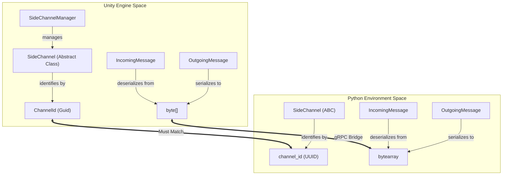
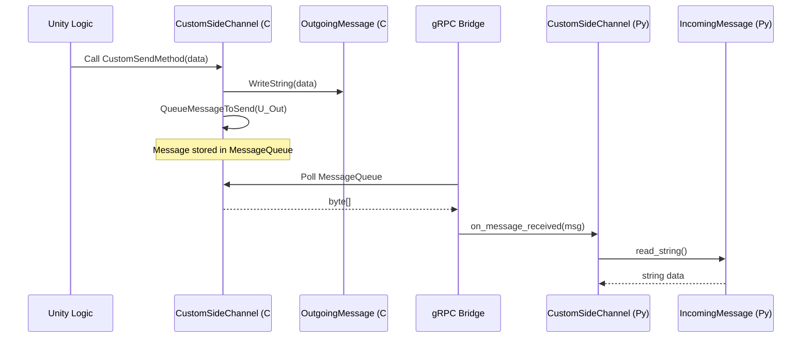

<!-- source: DeepWiki mcp.deepwiki.com · repo Unity-Technologies/ml-agents · page 4.2 Side Channels · fetched 2026-10-30 -->

# Side Channels

Relevant source files

The following files were used as context for generating this wiki page:

- [DevProject/ProjectSettings/ProjectSettings.asset](DevProject/ProjectSettings/ProjectSettings.asset)
- [com.unity.ml-agents/Editor/EditorUtilities.cs](com.unity.ml-agents/Editor/EditorUtilities.cs)
- [com.unity.ml-agents/Runtime/EnvironmentParameters.cs](com.unity.ml-agents/Runtime/EnvironmentParameters.cs)
- [com.unity.ml-agents/Runtime/SideChannels/EngineConfigurationChannel.cs](com.unity.ml-agents/Runtime/SideChannels/EngineConfigurationChannel.cs)
- [com.unity.ml-agents/Runtime/SideChannels/FloatPropertiesChannel.cs](com.unity.ml-agents/Runtime/SideChannels/FloatPropertiesChannel.cs)
- [com.unity.ml-agents/Runtime/SideChannels/IncomingMessage.cs](com.unity.ml-agents/Runtime/SideChannels/IncomingMessage.cs)
- [com.unity.ml-agents/Runtime/SideChannels/IncomingMessage.cs.meta](com.unity.ml-agents/Runtime/SideChannels/IncomingMessage.cs.meta)
- [com.unity.ml-agents/Runtime/SideChannels/OutgoingMessage.cs](com.unity.ml-agents/Runtime/SideChannels/OutgoingMessage.cs)
- [com.unity.ml-agents/Runtime/SideChannels/OutgoingMessage.cs.meta](com.unity.ml-agents/Runtime/SideChannels/OutgoingMessage.cs.meta)
- [com.unity.ml-agents/Runtime/SideChannels/RawBytesChannel.cs](com.unity.ml-agents/Runtime/SideChannels/RawBytesChannel.cs)
- [com.unity.ml-agents/Runtime/SideChannels/SideChannel.cs](com.unity.ml-agents/Runtime/SideChannels/SideChannel.cs)
- [com.unity.ml-agents/Runtime/SideChannels/StatsSideChannel.cs](com.unity.ml-agents/Runtime/SideChannels/StatsSideChannel.cs)
- [com.unity.ml-agents/Runtime/StatsRecorder.cs](com.unity.ml-agents/Runtime/StatsRecorder.cs)
- [docs/Custom-SideChannels.md](docs/Custom-SideChannels.md)
- [ml-agents-envs/mlagents_envs/side_channel/__init__.py](ml-agents-envs/mlagents_envs/side_channel/__init__.py)
- [ml-agents-envs/mlagents_envs/side_channel/default_training_analytics_side_channel.py](ml-agents-envs/mlagents_envs/side_channel/default_training_analytics_side_channel.py)
- [ml-agents-envs/mlagents_envs/side_channel/engine_configuration_channel.py](ml-agents-envs/mlagents_envs/side_channel/engine_configuration_channel.py)
- [ml-agents-envs/mlagents_envs/side_channel/float_properties_channel.py](ml-agents-envs/mlagents_envs/side_channel/float_properties_channel.py)
- [ml-agents-envs/mlagents_envs/side_channel/incoming_message.py](ml-agents-envs/mlagents_envs/side_channel/incoming_message.py)
- [ml-agents-envs/mlagents_envs/side_channel/outgoing_message.py](ml-agents-envs/mlagents_envs/side_channel/outgoing_message.py)
- [ml-agents-envs/mlagents_envs/side_channel/raw_bytes_channel.py](ml-agents-envs/mlagents_envs/side_channel/raw_bytes_channel.py)
- [ml-agents-envs/mlagents_envs/side_channel/side_channel.py](ml-agents-envs/mlagents_envs/side_channel/side_channel.py)
- [ml-agents-envs/mlagents_envs/side_channel/stats_side_channel.py](ml-agents-envs/mlagents_envs/side_channel/stats_side_channel.py)

Side channels provide a mechanism for sending and receiving data between Unity and Python that exists outside of the standard machine learning loop (observations, actions, and rewards) [com.unity.ml-agents/Runtime/SideChannels/SideChannel.cs:7-10](). This system is essential for exchanging complex data structures, environment configurations, or statistics that are not directly related to a specific agent's RL policy [docs/Custom-SideChannels.md:3-7]().

## System Architecture

The Side Channel system relies on mirrored implementations in both Unity (C#) and Python. Every side channel is identified by a unique `Guid` (C#) or `UUID` (Python), which must match on both sides to establish a communication link [com.unity.ml-agents/Runtime/SideChannels/SideChannel.cs:25-30](), [ml-agents-envs/mlagents_envs/side_channel/side_channel.py:20-21]().

### Communication Flow
Data is exchanged via byte arrays. Messages are queued and then processed during the simulation step [com.unity.ml-agents/Runtime/SideChannels/SideChannel.cs:21-23]().

**Unity to Python Flow:**
1.  Unity side creates an `OutgoingMessage` [com.unity.ml-agents/Runtime/SideChannels/OutgoingMessage.cs:11-12]().
2.  Data is written to the message (e.g., `WriteFloat32`, `WriteString`) [com.unity.ml-agents/Runtime/SideChannels/OutgoingMessage.cs:56-65]().
3.  The message is queued via `QueueMessageToSend(msg)` [com.unity.ml-agents/Runtime/SideChannels/SideChannel.cs:64-67]().
4.  The Python side receives the message in `on_message_received(msg)` [ml-agents-envs/mlagents_envs/side_channel/side_channel.py:32-38]().

**Python to Unity Flow:**
1.  Python side creates an `OutgoingMessage` [ml-agents-envs/mlagents_envs/side_channel/outgoing_message.py:1-5]().
2.  The message is queued via `queue_message_to_send(msg)` [ml-agents-envs/mlagents_envs/side_channel/side_channel.py:24-29]().
3.  Unity side receives the message in `OnMessageReceived(IncomingMessage msg)` [com.unity.ml-agents/Runtime/SideChannels/SideChannel.cs:58-58]().

### Data Entity Mapping
The following diagram illustrates the relationship between high-level side channel concepts and their corresponding code entities.

**Side Channel Entity Map**

Sources: [com.unity.ml-agents/Runtime/SideChannels/SideChannel.cs:19-34](), [ml-agents-envs/mlagents_envs/side_channel/side_channel.py:11-46](), [docs/Custom-SideChannels.md:14-47]()

---

## Built-in Side Channels

ML-Agents provides several pre-implemented side channels for common tasks.

### EngineConfigurationChannel
Used to modify Unity engine attributes from Python, such as screen resolution, time scale, and frame rate [com.unity.ml-agents/Runtime/SideChannels/EngineConfigurationChannel.cs:7-9]().

| Property | Description | Code Constant |
| :--- | :--- | :--- |
| **Screen Resolution** | Sets width and height of the display [ml-agents-envs/mlagents_envs/side_channel/engine_configuration_channel.py:71-72](). | `ConfigurationType.ScreenResolution` |
| **Quality Level** | Sets the Unity quality settings level [com.unity.ml-agents/Runtime/SideChannels/EngineConfigurationChannel.cs:43-45](). | `ConfigurationType.QualityLevel` |
| **Time Scale** | Multiplier for simulation time (DeltaTime) [ml-agents-envs/mlagents_envs/side_channel/engine_configuration_channel.py:74-76](). | `ConfigurationType.TimeScale` |
| **Target Frame Rate** | Desired rendering frame rate [com.unity.ml-agents/Runtime/SideChannels/EngineConfigurationChannel.cs:60-62](). | `ConfigurationType.TargetFrameRate` |

Sources: [com.unity.ml-agents/Runtime/SideChannels/EngineConfigurationChannel.cs:11-18](), [ml-agents-envs/mlagents_envs/side_channel/engine_configuration_channel.py:36-41]()

### FloatPropertiesChannel
Provides a key-value store of string-to-float properties. This is often used for dynamic environment parameterization (e.g., changing gravity or speed during training) [com.unity.ml-agents/Runtime/SideChannels/FloatPropertiesChannel.cs:6-11]().

*   **Unity side:** Allows registering callbacks that trigger when a specific property is updated from Python via `RegisterCallback(key, action)` [com.unity.ml-agents/Runtime/SideChannels/FloatPropertiesChannel.cs:83-86]().
*   **Python side:** Updated via `set_property(key, value)` [ml-agents-envs/mlagents_envs/side_channel/float_properties_channel.py:29-39]().

Sources: [com.unity.ml-agents/Runtime/SideChannels/FloatPropertiesChannel.cs:11-13](), [ml-agents-envs/mlagents_envs/side_channel/float_properties_channel.py:6-11]()

### StatsSideChannel
Facilitates sending custom metrics from Unity to Python for reporting in TensorBoard or trainer gauges [com.unity.ml-agents/Runtime/StatsRecorder.cs:34-37](). It supports various `StatAggregationMethod` types:
*   `Average`: Mean of values in a summary period [com.unity.ml-agents/Runtime/StatsRecorder.cs:13-13]().
*   `Sum`: Total of values [com.unity.ml-agents/Runtime/StatsRecorder.cs:25-25]().
*   `MostRecent`: Only the latest value [com.unity.ml-agents/Runtime/StatsRecorder.cs:20-20]().
*   `Histogram`: Distribution of values [com.unity.ml-agents/Runtime/StatsRecorder.cs:30-30]().

Sources: [com.unity.ml-agents/Runtime/StatsRecorder.cs:8-31](), [ml-agents-envs/mlagents_envs/side_channel/stats_side_channel.py:28-32]()

---

## Custom Side Channels

Users can implement their own side channels to handle specialized data.

### Implementation Requirements
1.  **Unique ID:** Both C# and Python classes must share the same UUID [docs/Custom-SideChannels.md:23-26]().
2.  **Message Handling:**
    *   Implement `OnMessageReceived` (Unity) and `on_message_received` (Python) to deserialize incoming data [docs/Custom-SideChannels.md:19-21](), [docs/Custom-SideChannels.md:40-42]().
    *   Data must be read in the exact order it was written to the `OutgoingMessage` [docs/Custom-SideChannels.md:20-21]().
3.  **Registration:**
    *   Unity: Call `SideChannelManager.RegisterSideChannel(myChannel)` [com.unity.ml-agents/Runtime/SideChannels/SideChannel.cs:14-15]().
    *   Python: Pass the channel instance into the `UnityEnvironment` constructor [docs/Custom-SideChannels.md:60-63]().

### Implementation Diagram
The following diagram demonstrates the internal data flow of a custom side channel implementation.

**Custom Side Channel Data Flow**

Sources: [com.unity.ml-agents/Runtime/SideChannels/SideChannel.cs:36-67](), [docs/Custom-SideChannels.md:108-197]()

### RawBytesChannel Example
The `RawBytesChannel` is a minimal implementation used for general research, allowing the exchange of raw byte arrays without high-level serialization [ml-agents-envs/mlagents_envs/side_channel/raw_bytes_channel.py:6-10]().

*   **Python:** `send_raw_data(data: bytearray)` queues the message [ml-agents-envs/mlagents_envs/side_channel/raw_bytes_channel.py:32-39]().
*   **Unity:** `OnMessageReceived` stores the bytes in a list for later retrieval [ml-agents-envs/mlagents_envs/side_channel/raw_bytes_channel.py:16-22]().

Sources: [ml-agents-envs/mlagents_envs/side_channel/raw_bytes_channel.py:1-40]()

---

