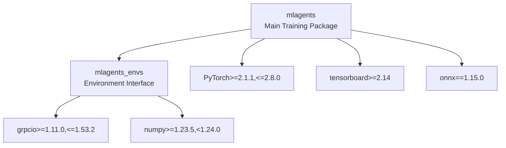
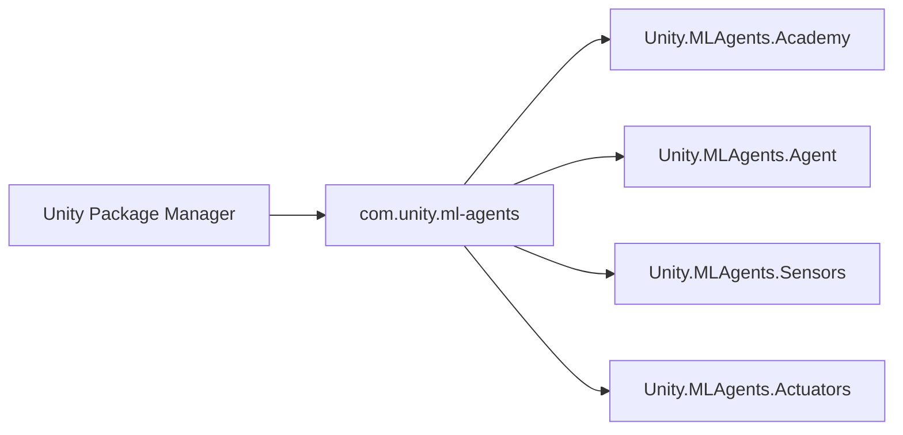
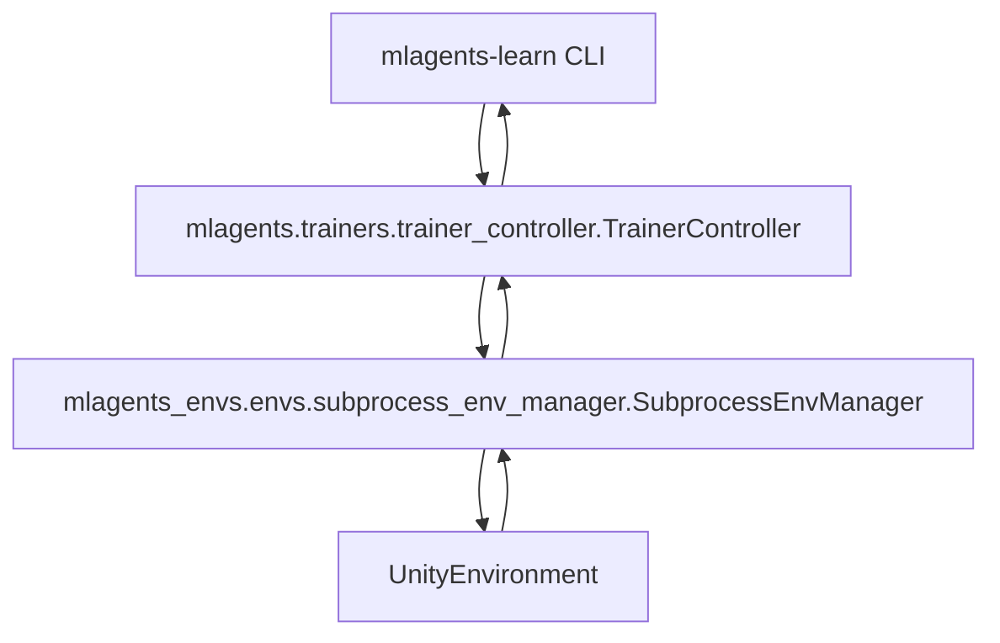
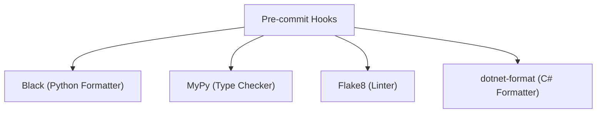
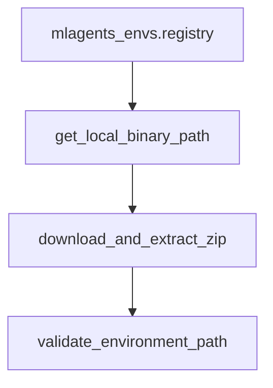

<!-- source: DeepWiki mcp.deepwiki.com · repo Unity-Technologies/ml-agents · page 5 Project Setup and Usage · fetched 2026-10-30 -->

# Project Setup and Usage

<details>
<summary>Relevant source files</summary>

The following files were used as context for generating this wiki page:

- [.pre-commit-config.yaml](.pre-commit-config.yaml)
- [com.unity.ml-agents/Documentation~/Examples-setup.md](com.unity.ml-agents/Documentation~/Examples-setup.md)
- [com.unity.ml-agents/Documentation~/Examples.md](com.unity.ml-agents/Documentation~/Examples.md)
- [com.unity.ml-agents/Documentation~/Get-Started.md](com.unity.ml-agents/Documentation~/Get-Started.md)
- [com.unity.ml-agents/Documentation~/Inference-Engine.md](com.unity.ml-agents/Documentation~/Inference-Engine.md)
- [com.unity.ml-agents/Documentation~/Installation.md](com.unity.ml-agents/Documentation~/Installation.md)
- [com.unity.ml-agents/Documentation~/Learning-Environment-Examples.md](com.unity.ml-agents/Documentation~/Learning-Environment-Examples.md)
- [com.unity.ml-agents/Documentation~/ML-Agents-Overview.md](com.unity.ml-agents/Documentation~/ML-Agents-Overview.md)
- [com.unity.ml-agents/Documentation~/Migrating.md](com.unity.ml-agents/Documentation~/Migrating.md)
- [com.unity.ml-agents/Documentation~/Python-Gym-API.md](com.unity.ml-agents/Documentation~/Python-Gym-API.md)
- [com.unity.ml-agents/Documentation~/Sample.md](com.unity.ml-agents/Documentation~/Sample.md)
- [com.unity.ml-agents/Documentation~/TableOfContents.md](com.unity.ml-agents/Documentation~/TableOfContents.md)
- [com.unity.ml-agents/Documentation~/index.md](com.unity.ml-agents/Documentation~/index.md)
- [com.unity.ml-agents/Runtime/Actuators/IActionReceiver.cs](com.unity.ml-agents/Runtime/Actuators/IActionReceiver.cs)
- [com.unity.ml-agents/Runtime/Actuators/IDiscreteActionMask.cs](com.unity.ml-agents/Runtime/Actuators/IDiscreteActionMask.cs)
- [com.unity.ml-agents/Runtime/Agent.cs](com.unity.ml-agents/Runtime/Agent.cs)
- [com.unity.ml-agents/Runtime/Demonstrations/DemonstrationRecorder.cs](com.unity.ml-agents/Runtime/Demonstrations/DemonstrationRecorder.cs)
- [docs/Installation-Anaconda-Windows.md](docs/Installation-Anaconda-Windows.md)
- [docs/Installation.md](docs/Installation.md)
- [docs/Migrating.md](docs/Migrating.md)
- [docs/Training-on-Amazon-Web-Service.md](docs/Training-on-Amazon-Web-Service.md)
- [docs/Training-on-Microsoft-Azure.md](docs/Training-on-Microsoft-Azure.md)
- [docs/Using-Virtual-Environment.md](docs/Using-Virtual-Environment.md)
- [ml-agents-envs/README.md](ml-agents-envs/README.md)
- [ml-agents-envs/mlagents_envs/registry/binary_utils.py](ml-agents-envs/mlagents_envs/registry/binary_utils.py)
- [ml-agents-envs/setup.py](ml-agents-envs/setup.py)
- [ml-agents/README.md](ml-agents/README.md)
- [ml-agents/setup.py](ml-agents/setup.py)
- [utils/validate_release_links.py](utils/validate_release_links.py)

</details>


This document provides a comprehensive guide for setting up and using the ML-Agents toolkit. It covers Python package installation, Unity package setup, CLI tool usage, and development environment configuration.

For information about training configuration and parameters, see [Training Configuration Files](#5.2). For details about the CI/CD testing pipeline, see [Testing and CI/CD](#5.3).

## Python Environment Setup

The ML-Agents toolkit consists of two main Python packages that must be installed in the correct order. The minimum supported version is Python 3.10.12 [docs/Migrating.md:7-9]().

### Package Dependencies



### Installation Process

The standard installation requires Python 3.10.12 [docs/Installation.md:40-42](). It is highly recommended to use a virtual environment like `conda` or `venv` [docs/Using-Virtual-Environment.md:1-13]().

```bash
# Recommended environment creation
conda create -n mlagents python=3.10.12 && conda activate mlagents

# Install packages from PyPi
python -m pip install mlagents==1.1.0
```

The `mlagents` package provides several CLI entry points defined in [ml-agents/setup.py:79-85]():

| Command | Purpose | Code Reference |
|---------|---------|----------------|
| `mlagents-learn` | Main training CLI | `mlagents.trainers.learn:main` |
| `mlagents-run-experiment` | Experiment runner | `mlagents.trainers.run_experiment:main` |
| `mlagents-push-to-hf` | HuggingFace upload | `mlagents.utils.push_to_hf:main` |
| `mlagents-load-from-hf` | HuggingFace download | `mlagents.utils.load_from_hf:main` |

**Sources:** [ml-agents/setup.py:56-78](), [ml-agents-envs/setup.py:55-66](), [docs/Installation.md:21-32]()

### Development Installation

For development or modifying the source code, install packages in editable mode from a cloned repository [docs/Installation.md:57-64]():

```bash
git clone --branch release_22 https://github.com/Unity-Technologies/ml-agents.git
cd ml-agents
python -m pip install -e ./ml-agents-envs
python -m pip install -e ./ml-agents
```

**Sources:** [docs/Installation.md:141-158](), [ml-agents/setup.py:38-54]()

## Unity Package Installation

The Unity ML-Agents C# SDK is distributed as the `com.unity.ml-agents` package [docs/Installation.md:5-8]().

### Package Structure



### Installation Methods

The official version of Unity supported is **6000.0** or later [docs/Migrating.md:21-24]().

1. **Package Manager Registry**: Search for `com.unity.ml-agents` in the Unity Package Manager [docs/Installation.md:94-98]().
2. **Local Disk**: Navigate to `Window` -> `Package Manager`, select `Add package from disk...`, and point to `com.unity.ml-agents/package.json` [docs/Installation.md:103-114]().

**Sources:** [docs/Installation.md:34-38](), [com.unity.ml-agents/Runtime/Agent.cs:13-113]()

## CLI Tools and Usage

### Main Training Command

The primary interface for training is `mlagents-learn`. On Windows, if using visual observations, training is typically done in headless mode [docs/Training-on-Microsoft-Azure.md:62-64]().

```bash
mlagents-learn <trainer-config-file> --env=<environment-name> --run-id=<run-id>
```

### Command Flow



### Plugin System

The toolkit includes a plugin system for extending statistics and trainer types [ml-agents/setup.py:86-93]():

- `ML_AGENTS_STATS_WRITER`: Handles how training metrics are logged (e.g., TensorBoard).
- `ML_AG_TRAINER_TYPE`: Allows registration of custom RL algorithms.

**Sources:** [ml-agents/setup.py:79-93](), [docs/Training-on-Microsoft-Azure.md:75-80]()

## Development Environment Setup

### Pre-commit Hooks

The project uses `pre-commit` to ensure code quality across Python and C# [ .pre-commit-config.yaml:1-5]().



### Code Quality Tools

| Tool | Purpose | Files | Code Reference |
|------|---------|-------|----------------|
| `black` | Python formatting | `*.py` | [.pre-commit-config.yaml:2-11]() |
| `mypy` | Static typing | `ml-agents/` | [.pre-commit-config.yaml:13-27]() |
| `flake8` | Style linting | `*.py` | [.pre-commit-config.yaml:28-38]() |
| `dotnet format` | C# formatting | `*.cs` | [.pre-commit-config.yaml:95-100]() |

**Sources:** [.pre-commit-config.yaml:1-141]()

## Cloud and Specialized Setup

### Amazon Web Services (AWS)
Instructions exist for using a pre-configured AMI (`ami-016ff5559334f8619`) or configuring a custom EC2 instance with X Server for visual observations [docs/Training-on-Amazon-Web-Service.md:9-22]().

### Microsoft Azure
Training can be performed on N-Series GPU VMs or via Azure Container Instances (ACI). Headless mode requires the `--no-graphics` flag [docs/Training-on-Microsoft-Azure.md:12-22](), [docs/Training-on-Microsoft-Azure.md:62-64]().

### Demonstration Recording
For Imitation Learning, the `DemonstrationRecorder` component must be attached to an `Agent` in Unity to record `.demo` files [com.unity.ml-agents/Runtime/Demonstrations/DemonstrationRecorder.cs:11-26]().

**Sources:** [docs/Training-on-Amazon-Web-Service.md:51-60](), [docs/Training-on-Microsoft-Azure.md:1-10](), [com.unity.ml-agents/Runtime/Demonstrations/DemonstrationRecorder.cs:112-126]()

## Binary Environment Management

### Environment Registry

The toolkit includes a binary utility system for downloading and managing Unity environments programmatically.



### Binary Utilities

The `binary_utils.py` module provides platform-specific path resolution [ml-agents-envs/mlagents_envs/registry/binary_utils.py:27-40]():
- **Linux**: Appends `.x86_64`
- **Windows**: Appends `.exe`
- **macOS**: Appends `.app`

**Sources:** [ml-agents-envs/mlagents_envs/registry/binary_utils.py:27-104]()

---

