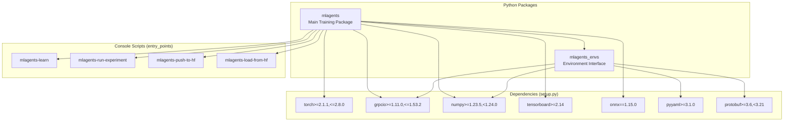
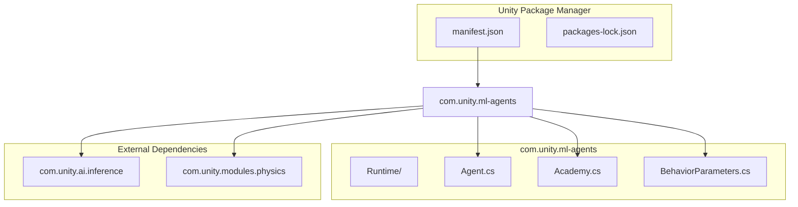
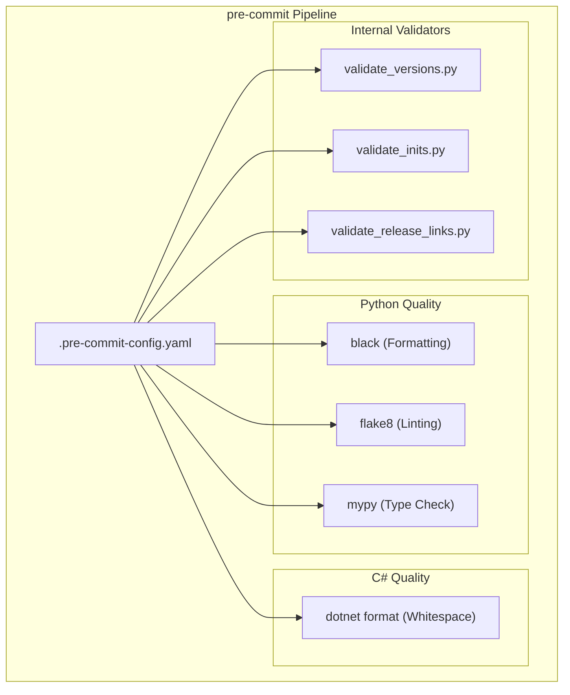

<!-- source: DeepWiki mcp.deepwiki.com · repo Unity-Technologies/ml-agents · page 5.1 Installation and Configuration · fetched 2026-10-30 -->

# Installation and Configuration

<details>
<summary>Relevant source files</summary>

The following files were used as context for generating this wiki page:

- [.pre-commit-config.yaml](.pre-commit-config.yaml)
- [DevProject/Packages/manifest.json](DevProject/Packages/manifest.json)
- [DevProject/Packages/packages-lock.json](DevProject/Packages/packages-lock.json)
- [DevProject/ProjectSettings/EditorBuildSettings.asset](DevProject/ProjectSettings/EditorBuildSettings.asset)
- [DevProject/ProjectSettings/ProjectVersion.txt](DevProject/ProjectSettings/ProjectVersion.txt)
- [PerformanceProject/Packages/packages-lock.json](PerformanceProject/Packages/packages-lock.json)
- [Project/Packages/manifest.json](Project/Packages/manifest.json)
- [Project/Packages/packages-lock.json](Project/Packages/packages-lock.json)
- [Project/ProjectSettings/ProjectVersion.txt](Project/ProjectSettings/ProjectVersion.txt)
- [com.unity.ml-agents.tests/package.json](com.unity.ml-agents.tests/package.json)
- [com.unity.ml-agents/Documentation~/Examples-setup.md](com.unity.ml-agents/Documentation~/Examples-setup.md)
- [com.unity.ml-agents/Documentation~/Examples.md](com.unity.ml-agents/Documentation~/Examples.md)
- [com.unity.ml-agents/Documentation~/Get-Started.md](com.unity.ml-agents/Documentation~/Get-Started.md)
- [com.unity.ml-agents/Documentation~/Inference-Engine.md](com.unity.ml-agents/Documentation~/Inference-Engine.md)
- [com.unity.ml-agents/Documentation~/Installation.md](com.unity.ml-agents/Documentation~/Installation.md)
- [com.unity.ml-agents/Documentation~/Learning-Environment-Examples.md](com.unity.ml-agents/Documentation~/Learning-Environment-Examples.md)
- [com.unity.ml-agents/Documentation~/ML-Agents-Overview.md](com.unity.ml-agents/Documentation~/ML-Agents-Overview.md)
- [com.unity.ml-agents/Documentation~/Migrating.md](com.unity.ml-agents/Documentation~/Migrating.md)
- [com.unity.ml-agents/Documentation~/Python-Gym-API.md](com.unity.ml-agents/Documentation~/Python-Gym-API.md)
- [com.unity.ml-agents/Documentation~/Sample.md](com.unity.ml-agents/Documentation~/Sample.md)
- [com.unity.ml-agents/Documentation~/TableOfContents.md](com.unity.ml-agents/Documentation~/TableOfContents.md)
- [com.unity.ml-agents/Documentation~/index.md](com.unity.ml-agents/Documentation~/index.md)
- [com.unity.ml-agents/Runtime/Actuators/IActionReceiver.cs](com.unity.ml-agents/Runtime/Actuators/IActionReceiver.cs)
- [com.unity.ml-agents/Runtime/Actuators/IDiscreteActionMask.cs](com.unity.ml-agents/Runtime/Actuators/IDiscreteActionMask.cs)
- [com.unity.ml-agents/Runtime/Agent.cs](com.unity.ml-agents/Runtime/Agent.cs)
- [com.unity.ml-agents/Runtime/Demonstrations/DemonstrationRecorder.cs](com.unity.ml-agents/Runtime/Demonstrations/DemonstrationRecorder.cs)
- [docs/Installation-Anaconda-Windows.md](docs/Installation-Anaconda-Windows.md)
- [docs/Installation.md](docs/Installation.md)
- [docs/Migrating.md](docs/Migrating.md)
- [docs/Training-on-Amazon-Web-Service.md](docs/Training-on-Amazon-Web-Service.md)
- [docs/Training-on-Microsoft-Azure.md](docs/Training-on-Microsoft-Azure.md)
- [docs/Using-Virtual-Environment.md](docs/Using-Virtual-Environment.md)
- [ml-agents-envs/README.md](ml-agents-envs/README.md)
- [ml-agents-envs/mlagents_envs/registry/binary_utils.py](ml-agents-envs/mlagents_envs/registry/binary_utils.py)
- [ml-agents-envs/setup.py](ml-agents-envs/setup.py)
- [ml-agents/README.md](ml-agents/README.md)
- [ml-agents/setup.py](ml-agents/setup.py)
- [utils/validate_release_links.py](utils/validate_release_links.py)

</details>


This document covers the installation and configuration of the ML-Agents Toolkit, including Python package setup, Unity package installation, development environment configuration, and validation procedures. For information about training configuration files and parameters, see [Training Configuration Files](#5.2). For testing and CI/CD pipeline details, see [Testing and CI/CD](#5.3).

## Python Package Installation

The ML-Agents Toolkit consists of two main Python packages that must be installed in a specific environment to ensure compatibility.

### Package Architecture



Sources: [ml-agents/setup.py:56-93](), [ml-agents-envs/setup.py:55-65]()

### Installation Commands

The toolkit requires Python 3.10.12 for optimal compatibility [docs/Installation.md:40-42](). It is highly recommended to use a virtual environment via Conda or Mamba [docs/Installation.md:46-48]().

```bash
# Create and activate environment
conda create -n mlagents python=3.10.12 && conda activate mlagents

# (Windows Only) Install CUDA-enabled PyTorch first
pip3 install torch~=2.2.1 --index-url https://download.pytorch.org/whl/cu121

# Install from local source (cloned repository)
pip3 install -e ./ml-agents-envs
pip3 install -e ./ml-agents
```

Sources: [docs/Installation.md:50-55](), [docs/Installation.md:146-148](), [docs/Training-on-Amazon-Web-Service.md:74-75]()

### Version Compatibility

The toolkit enforces strict versioning between the environment interface and the trainers.

| Component | Requirement | Source |
|-----------|-------------|--------|
| Python | `>=3.10.1, <=3.10.12` | [ml-agents/setup.py:78]() |
| mlagents | `VERSION` (e.g., 1.1.0) | [ml-agents/setup.py:9]() |
| mlagents_envs | `=={VERSION}` | [ml-agents/setup.py:60]() |

## Unity Package Installation

The Unity side uses the Unity Package Manager (UPM) and requires Unity 6000.0 or later for the current release [docs/Installation.md:34-34]().

### Package Structure



Sources: [DevProject/Packages/manifest.json:1-22](), [Project/Packages/packages-lock.json:117-126]()

### Installation Methods

1. **Package Manager Registry**: Search for "ML-Agents" in the Package Manager UI. Ensure "Preview Packages" is enabled in Advanced settings [docs/Installation.md:94-98]().
2. **Local Installation (Development)**: Add the package from disk by selecting the `package.json` in the `com.unity.ml-agents` folder [docs/Installation.md:103-114]().
3. **Manual Manifest Edit**: Add the local path to `Packages/manifest.json`:
   ```json
   "com.unity.ml-agents": "file:../../com.unity.ml-agents"
   ```
   Sources: [DevProject/Packages/manifest.json:7-7]()

## Development Environment Setup

### Pre-commit Configuration

The project uses `pre-commit` to maintain code quality across C# and Python.



Sources: [.pre-commit-config.yaml:1-141]()

### Release Validation

The utility `validate_release_links.py` ensures that all documentation links and version strings match the current release tag [utils/validate_release_links.py:11-26]().

## Environment Configuration

### Binary Executable Management

The toolkit includes utilities for handling compiled Unity environments across different platforms.

| Platform | Executable Extension | Path Resolution Logic |
|----------|----------------------|-----------------------|
| Linux | `.x86_64` | Appends extension to binary name |
| macOS | `.app` | Treats as a directory/bundle |
| Windows | `.exe` | Appends extension to binary name |

Sources: [ml-agents-envs/mlagents_envs/registry/binary_utils.py:82-89]()

### Cloud Training Configuration

While primarily developed for local use, the toolkit supports cloud instances.

*   **AWS**: Uses EC2 p2.xlarge instances with X Server enabled for visual observations [docs/Training-on-Amazon-Web-Service.md:11-15]().
*   **Azure**: Supports "Headless Mode" builds for Linux. When running headless, the `--no-graphics` flag must be appended to the `mlagents-learn` command [docs/Training-on-Microsoft-Azure.md:46-62]().

## Migration and Upgrading

When moving between versions, specific API changes must be addressed:

*   **Python**: Minimum version is now 3.10.12 [docs/Migrating.md:8-9]().
*   **Unity**: Official support is for Unity 6000.0 [docs/Migrating.md:22-22]().
*   **API Replacements**:
    *   `Agent.Heuristic(float[] actionsOut)` → `Agent.Heuristic(in ActionBuffers actionsOut)` [docs/Migrating.md:40-40]().
    *   `SensorComponent.CreateSensor()` → `CreateSensors()` (returns array) [docs/Migrating.md:121-121]().

Sources: [docs/Migrating.md:1-121]()

---

