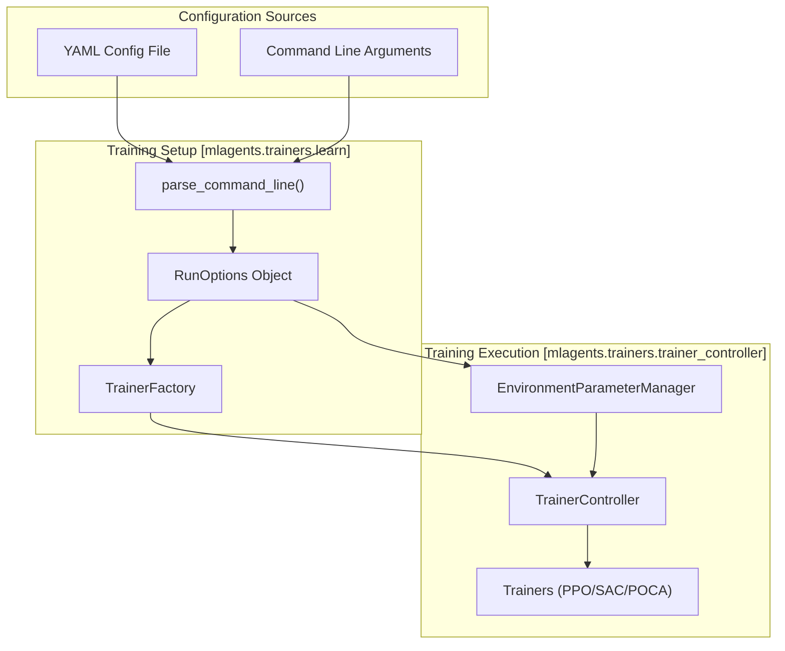
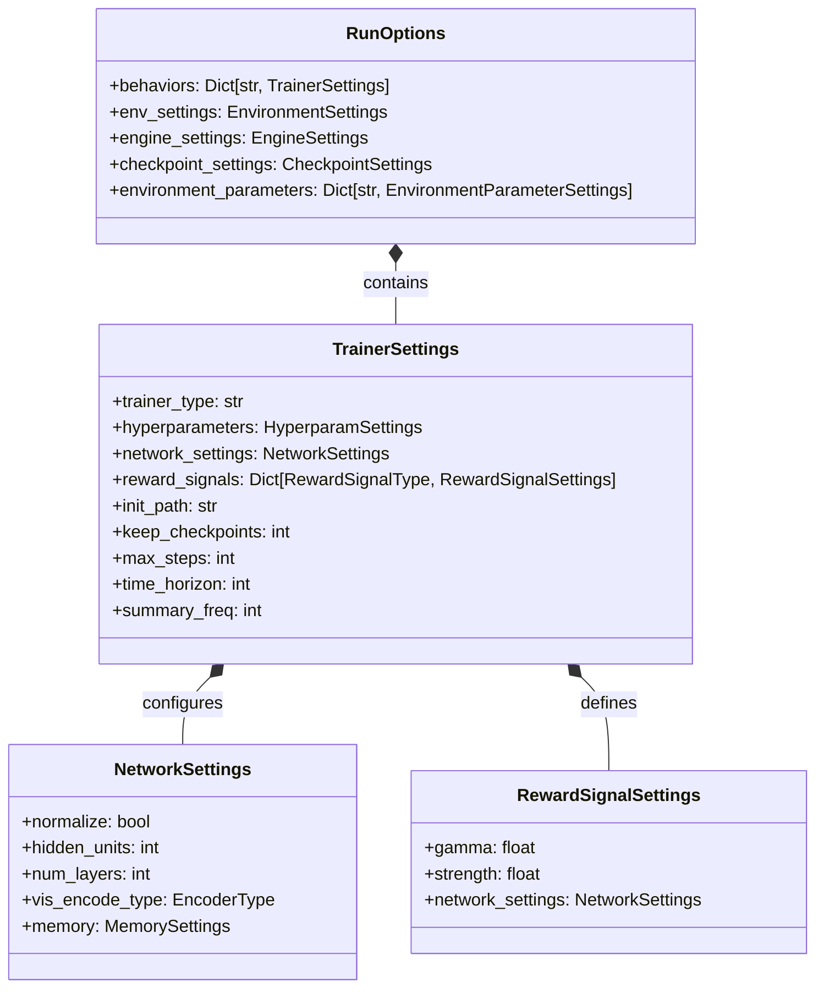
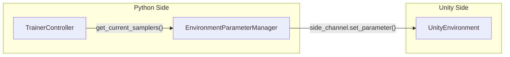

<!-- source: DeepWiki mcp.deepwiki.com · repo Unity-Technologies/ml-agents · page 5.2 Training Configuration Files · fetched 2026-10-30 -->

# Training Configuration Files

<details>
<summary>Relevant source files</summary>

The following files were used as context for generating this wiki page:

- [Project/Assets/ML-Agents/Examples/SharedAssets/Scripts/CollisionCallbacks.cs](Project/Assets/ML-Agents/Examples/SharedAssets/Scripts/CollisionCallbacks.cs)
- [Project/Assets/ML-Agents/Examples/SharedAssets/Scripts/CollisionCallbacks.cs.meta](Project/Assets/ML-Agents/Examples/SharedAssets/Scripts/CollisionCallbacks.cs.meta)
- [Project/Assets/ML-Agents/Examples/Sorter/Prefabs/Area.prefab](Project/Assets/ML-Agents/Examples/Sorter/Prefabs/Area.prefab)
- [Project/Assets/ML-Agents/Examples/Sorter/Scripts/NumberTile.cs](Project/Assets/ML-Agents/Examples/Sorter/Scripts/NumberTile.cs)
- [Project/Assets/ML-Agents/Examples/Sorter/TFModels/Sorter.onnx](Project/Assets/ML-Agents/Examples/Sorter/TFModels/Sorter.onnx)
- [Project/Assets/ML-Agents/Examples/Sorter/TFModels/Sorter.onnx.meta](Project/Assets/ML-Agents/Examples/Sorter/TFModels/Sorter.onnx.meta)
- [config/imitation/Crawler.yaml](config/imitation/Crawler.yaml)
- [config/imitation/Hallway.yaml](config/imitation/Hallway.yaml)
- [config/imitation/PushBlock.yaml](config/imitation/PushBlock.yaml)
- [config/poca/PushBlockCollab.yaml](config/poca/PushBlockCollab.yaml)
- [config/ppo/3DBall.yaml](config/ppo/3DBall.yaml)
- [config/ppo/3DBallHard.yaml](config/ppo/3DBallHard.yaml)
- [config/ppo/3DBall_randomize.yaml](config/ppo/3DBall_randomize.yaml)
- [config/ppo/Basic.yaml](config/ppo/Basic.yaml)
- [config/ppo/FoodCollector.yaml](config/ppo/FoodCollector.yaml)
- [config/ppo/Hallway.yaml](config/ppo/Hallway.yaml)
- [config/ppo/PushBlock.yaml](config/ppo/PushBlock.yaml)
- [config/ppo/Pyramids.yaml](config/ppo/Pyramids.yaml)
- [config/ppo/Sorter_curriculum.yaml](config/ppo/Sorter_curriculum.yaml)
- [config/ppo/WallJump_curriculum.yaml](config/ppo/WallJump_curriculum.yaml)
- [config/sac/Pyramids.yaml](config/sac/Pyramids.yaml)
- [ml-agents/mlagents/trainers/cli_utils.py](ml-agents/mlagents/trainers/cli_utils.py)
- [ml-agents/mlagents/trainers/learn.py](ml-agents/mlagents/trainers/learn.py)
- [ml-agents/mlagents/trainers/settings.py](ml-agents/mlagents/trainers/settings.py)
- [ml-agents/mlagents/trainers/tests/test_learn.py](ml-agents/mlagents/trainers/tests/test_learn.py)
- [ml-agents/mlagents/trainers/tests/test_settings.py](ml-agents/mlagents/trainers/tests/test_settings.py)
- [ml-agents/mlagents/trainers/tests/test_trainer_controller.py](ml-agents/mlagents/trainers/tests/test_trainer_controller.py)
- [ml-agents/mlagents/trainers/tests/test_trainer_util.py](ml-agents/mlagents/trainers/tests/test_trainer_util.py)
- [ml-agents/mlagents/trainers/trainer_controller.py](ml-agents/mlagents/trainers/trainer_controller.py)

</details>


Training configuration files are YAML files that define the parameters and settings for the ML-Agents training process. These files are parsed by the `parse_command_line()` function in `learn.py` and converted into a `RunOptions` object that contains all configuration settings. The configuration allows you to customize how your agents learn, including the learning algorithm, neural network architecture, reward signals, and environmental parameters.

## Configuration File Structure and Usage

Training configuration files are YAML files that contain a hierarchical structure of parameters. The most basic configuration file defines behavior names and their associated trainer settings.

### Workflow Integration

The configuration file is the primary entry point for the training pipeline. It is loaded via `mlagents.trainers.cli_utils.load_config` and structured into typed objects using the `cattr` library.



Sources: [ml-agents/mlagents/trainers/learn.py:51-56](), [ml-agents/mlagents/trainers/learn.py:116-134](), [ml-agents/mlagents/trainers/cli_utils.py:63-69]()

### Using Configuration Files

To use a configuration file with ML-Agents, you specify it as an argument to the `mlagents-learn` command. The `RunOptions` class handles the merging of CLI arguments and YAML settings, ensuring that command line flags (like `--resume` or `--force`) take precedence.

```bash
mlagents-learn config/ppo/3DBall.yaml --env=3DBall --run-id=3DBallRun
```

Sources: [ml-agents/mlagents/trainers/learn.py:51-56](), [ml-agents/mlagents/trainers/settings.py:25-26](), [ml-agents/mlagents/trainers/tests/test_learn.py:123-152]()

## Configuration File Schema

The configuration is mapped to the `RunOptions` class, which aggregates several sub-settings classes.



Sources: [ml-agents/mlagents/trainers/settings.py:91-96](), [ml-agents/mlagents/trainers/settings.py:117-142](), [ml-agents/mlagents/trainers/settings.py:454-507]()

### Core Components

*   **Behaviors**: Maps a `Behavior Name` (set in the Unity Editor's `Behavior Parameters` component) to a `TrainerSettings` object [ml-agents/mlagents/trainers/settings.py:454-507]().
*   **Hyperparameters**: Algorithm-specific settings. For PPO/POCA, if `beta_schedule` or `epsilon_schedule` are omitted, they default to the `learning_rate_schedule` [ml-agents/mlagents/trainers/settings.py:48-58]().
*   **Network Settings**: Defines the architecture of the policy. Supports recurrent neural networks via the `memory` field (using `MemorySettings`) [ml-agents/mlagents/trainers/settings.py:117-134]().

## Common Trainer Parameters

These settings are defined in `TrainerSettings` and apply across most algorithms.

| Parameter | Description | Implementation Class |
|-----------|-------------|----------------------|
| `trainer_type` | Algorithm to use (`ppo`, `sac`, `poca`) | `TrainerSettings` |
| `max_steps` | Total simulation steps before training ends | `TrainerSettings` |
| `time_horizon` | Steps to collect per agent before updating | `TrainerSettings` |
| `summary_freq` | Frequency of stats reporting to TensorBoard | `TrainerSettings` |
| `keep_checkpoints` | Number of `.pt` model files to retain | `TrainerSettings` |
| `hidden_units` | Neurons per fully connected layer | `NetworkSettings` |
| `vis_encode_type` | Encoder for visual observations (e.g., `resnet`, `nature_cnn`) | `NetworkSettings` |

Sources: [ml-agents/mlagents/trainers/settings.py:117-142](), [ml-agents/mlagents/trainers/settings.py:454-507](), [config/ppo/Sorter_curriculum.yaml:1-25]()

## Trainer-Specific Hyperparameters

### PPO (Proximal Policy Optimization)
PPO uses `OnPolicyHyperparamSettings`. Key parameters include `beta` (entropy regularization), `epsilon` (policy update clipping), and `lambd` (GAE smoothing) [ml-agents/mlagents/trainers/settings.py:165-167]().

### SAC (Soft Actor-Critic)
SAC uses `OffPolicyHyperparamSettings`. It includes unique fields like `buffer_init_steps` (random actions before training) and `save_replay_buffer` (persisting experience across runs) [ml-agents/mlagents/trainers/settings.py:170-177]().

### MA-POCA
Designed for multi-agent groups. It shares many parameters with PPO but is orchestrated to handle group-based rewards and credit assignment [config/poca/PushBlockCollab.yaml:1-12]().

## Reward Signals

Reward signals are configured as a dictionary where the key is the `RewardSignalType` (extrinsic, gail, curiosity, or rnd). Each signal can have its own `network_settings` to override the global policy network settings [ml-agents/mlagents/trainers/settings.py:180-211]().

```yaml
reward_signals:
  extrinsic:
    gamma: 0.99
    strength: 1.0
  curiosity:
    gamma: 0.99
    strength: 0.02
    network_settings:
      hidden_units: 256
```

Sources: [ml-agents/mlagents/trainers/settings.py:180-211](), [ml-agents/mlagents/trainers/settings.py:241-245]()

## Environment Parameters and Curriculum

The `environment_parameters` section allows for dynamic adjustment of Unity global variables via `EnvironmentParametersChannel` [ml-agents/mlagents/trainers/settings.py:30-32]().

### Curriculum Learning
Curriculum is managed by `EnvironmentParameterManager`. It tracks "lessons" based on `completion_criteria` (measurements like `progress` or `reward`). When a threshold is met, the parameter value is updated [ml-agents/mlagents/trainers/settings.py:534-565]().



Sources: [ml-agents/mlagents/trainers/environment_parameter_manager.py:104-105](), [ml-agents/mlagents/trainers/trainer_controller.py:104-105](), [config/ppo/Sorter_curriculum.yaml:26-102]()

### Parameter Randomization
Parameters can be sampled from distributions:
*   **Uniform**: `UniformSettings` (min/max) [ml-agents/mlagents/trainers/settings.py:351-360]().
*   **Gaussian**: `GaussianSettings` (mean/std) [ml-agents/mlagents/trainers/settings.py:363-372]().
*   **MultiRangeUniform**: `MultiRangeUniformSettings` (list of intervals) [ml-agents/mlagents/trainers/settings.py:375-385]().

Sources: [ml-agents/mlagents/trainers/settings.py:338-385]()

---

