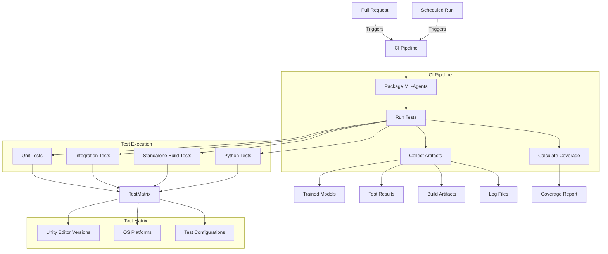
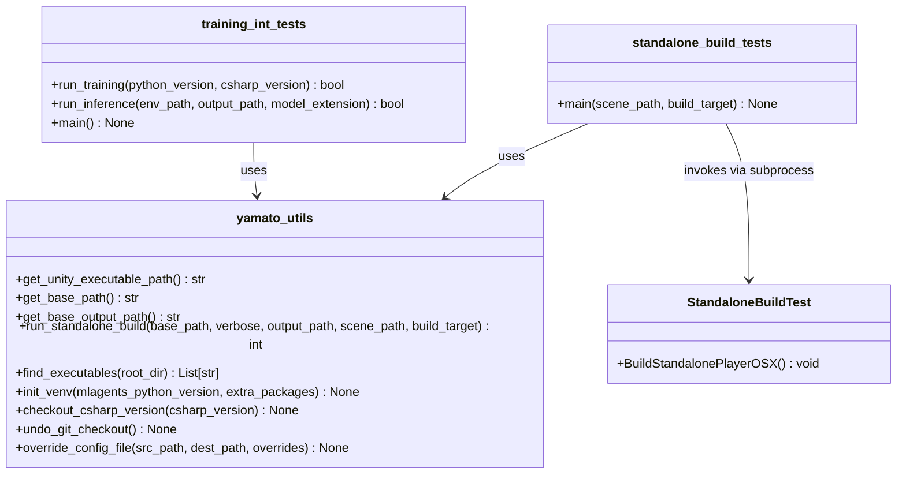

<!-- source: DeepWiki mcp.deepwiki.com · repo Unity-Technologies/ml-agents · page 5.3 Testing and CI/CD · fetched 2026-10-30 -->

# Testing and CI/CD

<details>
<summary>Relevant source files</summary>

The following files were used as context for generating this wiki page:

- [.github/workflows/colab.yml](.github/workflows/colab.yml)
- [.github/workflows/lock.yml](.github/workflows/lock.yml)
- [.github/workflows/nightly.yml](.github/workflows/nightly.yml)
- [.github/workflows/pre-commit.yml](.github/workflows/pre-commit.yml)
- [.github/workflows/publish_docs.yaml](.github/workflows/publish_docs.yaml)
- [.github/workflows/publish_pypi.yaml](.github/workflows/publish_pypi.yaml)
- [.github/workflows/publish_pypi_python_api.yaml](.github/workflows/publish_pypi_python_api.yaml)
- [.github/workflows/pytest.yml](.github/workflows/pytest.yml)
- [.github/workflows/validate_catalog.yaml](.github/workflows/validate_catalog.yaml)
- [.yamato/com.unity.ml-agents-coverage.yml](.yamato/com.unity.ml-agents-coverage.yml)
- [.yamato/com.unity.ml-agents-pack.yml](.yamato/com.unity.ml-agents-pack.yml)
- [.yamato/com.unity.ml-agents-performance.yml](.yamato/com.unity.ml-agents-performance.yml)
- [.yamato/com.unity.ml-agents-promotion.yml](.yamato/com.unity.ml-agents-promotion.yml)
- [.yamato/com.unity.ml-agents-publish.yml](.yamato/com.unity.ml-agents-publish.yml)
- [.yamato/com.unity.ml-agents-test.yml](.yamato/com.unity.ml-agents-test.yml)
- [.yamato/compressed-sensor-test.yml](.yamato/compressed-sensor-test.yml)
- [.yamato/coverage_tests.metafile](.yamato/coverage_tests.metafile)
- [.yamato/generated-scripts/infrastructure-instability-detection-linux.sh](.yamato/generated-scripts/infrastructure-instability-detection-linux.sh)
- [.yamato/generated-scripts/infrastructure-instability-detection-mac.sh](.yamato/generated-scripts/infrastructure-instability-detection-mac.sh)
- [.yamato/generated-scripts/infrastructure-instability-detection-win.cmd](.yamato/generated-scripts/infrastructure-instability-detection-win.cmd)
- [.yamato/gym-interface-test.yml](.yamato/gym-interface-test.yml)
- [.yamato/protobuf-generation-test.yml](.yamato/protobuf-generation-test.yml)
- [.yamato/pytest-gpu.yml](.yamato/pytest-gpu.yml)
- [.yamato/python-ll-api-test.yml](.yamato/python-ll-api-test.yml)
- [.yamato/standalone-build-test.yml](.yamato/standalone-build-test.yml)
- [.yamato/standalone-build-webgl-test.yml](.yamato/standalone-build-webgl-test.yml)
- [.yamato/test_versions.metafile](.yamato/test_versions.metafile)
- [.yamato/training-int-tests.yml](.yamato/training-int-tests.yml)
- [.yamato/wrench/api-validation-jobs.yml](.yamato/wrench/api-validation-jobs.yml)
- [.yamato/wrench/package-pack-jobs.yml](.yamato/wrench/package-pack-jobs.yml)
- [.yamato/wrench/preview-a-p-v.yml](.yamato/wrench/preview-a-p-v.yml)
- [.yamato/wrench/promotion-jobs.yml](.yamato/wrench/promotion-jobs.yml)
- [.yamato/wrench/publish-trigger.yml](.yamato/wrench/publish-trigger.yml)
- [.yamato/wrench/recipe-regeneration.yml](.yamato/wrench/recipe-regeneration.yml)
- [.yamato/wrench/validation-jobs.yml](.yamato/wrench/validation-jobs.yml)
- [.yamato/wrench/wrench_config.json](.yamato/wrench/wrench_config.json)
- [PerformanceProject/ProjectSettings/PackageManagerSettings.asset](PerformanceProject/ProjectSettings/PackageManagerSettings.asset)
- [Project/Assets/ML-Agents/Editor/Tests/StandaloneBuildTest.cs](Project/Assets/ML-Agents/Editor/Tests/StandaloneBuildTest.cs)
- [ml-agents/tests/yamato/standalone_build_tests.py](ml-agents/tests/yamato/standalone_build_tests.py)
- [ml-agents/tests/yamato/training_int_tests.py](ml-agents/tests/yamato/training_int_tests.py)
- [ml-agents/tests/yamato/yamato_utils.py](ml-agents/tests/yamato/yamato_utils.py)
- [test_requirements.txt](test_requirements.txt)

</details>


This page provides a comprehensive overview of the testing infrastructure and continuous integration/continuous deployment (CI/CD) pipeline used in the ML-Agents toolkit. It covers the testing architecture, test types, CI/CD configuration, and how tests are executed in the automated pipeline.

## Overview of Testing Architecture

ML-Agents employs a comprehensive testing strategy that spans both the Unity C# SDK and Python training system. The testing architecture is designed to validate individual components, integration between components, and end-to-end workflows to ensure reliability and prevent regressions.

### Test Types

```mermaid
flowchart TD
    subgraph "Yamato Test Jobs"
        UnitTests["com.unity.ml-agents-test.yml"]
        StandaloneBuildTests["standalone-build-test.yml"]
        TrainingIntTests["training-int-tests.yml"]
        CoverageTests["com.unity.ml-agents-coverage.yml"]
        ProtobufTests["protobuf-generation-test.yml"]
        PytestGPU["pytest-gpu.yml"]
        GymInterfaceTests["gym-interface-test.yml"]
        LLAPITests["python-ll-api-test.yml"]
        CompressedSensorTests["compressed-sensor-test.yml"]
        WebGLTests["standalone-build-webgl-test.yml"]
    end

    subgraph "Test Execution"
        UnitTests --> UpmCI["upm-ci package test"]
        StandaloneBuildTests --> StandaloneBuildTestsPy["standalone_build_tests.py"]
        TrainingIntTests --> TrainingIntTestsPy["training_int_tests.py"]
        CoverageTests --> CodeCoverage["Unity Code Coverage"]
        PytestGPU --> PytestRunner["pytest -m 'not slow'"]
    end

    subgraph "Test Platforms"
        LinuxVM["Unity::VM (ml-agents/ubuntu-ci:v1.0.1)"]
        MacVM["Unity::VM::osx (package-ci/macos-13:v4)"]
        WinVM["Unity::VM (package-ci/win11:v4)"]
        GPUVM["Unity::VM::GPU (ml-agents/ubuntu-ci:v1.0.1)"]
    end

    UnitTests --> LinuxVM
    UnitTests --> MacVM
    UnitTests --> WinVM
    StandaloneBuildTests --> LinuxVM
    PytestGPU --> GPUVM
```



Sources: [.yamato/com.unity.ml-agents-test.yml:1-144](), [.yamato/standalone-build-test.yml:1-43](), [.yamato/training-int-tests.yml:1-43](), [.yamato/protobuf-generation-test.yml:1-45](), [.yamato/pytest-gpu.yml:1-34]()

#### Unity Package Tests (`com.unity.ml-agents-test.yml`)
Tests Unity packages using `upm-ci package test` across multiple editor versions and platforms:
- Editor versions: 6000.0 (Project and DevProject) and `trunk` [.yamato/com.unity.ml-agents-test.yml:3-12]()
- Platforms: Windows (win11:v4), macOS (macos-13:v4), Linux (ubuntu-ci:v1.0.1) [.yamato/com.unity.ml-agents-test.yml:14-26]()
- Packages: `com.unity.ml-agents` [.yamato/com.unity.ml-agents-test.yml:29-30]()

#### Standalone Build Tests (`standalone-build-test.yml`)
Uses `standalone_build_tests.py` to build and test Unity players:
- Builds scenes: Basic, Match3, WallJump, TestGridCompressed, TestTextureCompressed [.yamato/standalone-build-test.yml:20-24]()
- Tests on Linux platform with different build targets [.yamato/standalone-build-test.yml:19]()
- Executes `Unity.MLAgents.StandaloneBuildTest.BuildStandalonePlayerOSX` method via `yamato_utils.py` [ml-agents/tests/yamato/yamato_utils.py:64]()

#### Training Integration Tests (`training-int-tests.yml`)
Runs `training_int_tests.py` to validate the complete training pipeline:
- Uses `run_training()` and `run_inference()` functions [ml-agents/tests/yamato/training_int_tests.py:21-180]()
- Tests model generation with overridden configs (batch_size=10, buffer_size=10, max_steps=100) [ml-agents/tests/yamato/training_int_tests.py:71-75]()
- Validates ONNX model export and inference functionality [ml-agents/tests/yamato/training_int_tests.py:96-118]()

#### Python Tests (`pytest-gpu.yml`)
Executes Python unit tests using pytest:
- Runs `pytest -m "not slow"` on GPU-enabled agents [.yamato/pytest-gpu.yml:4-21]()
- Tests PyTorch CUDA availability [.yamato/pytest-gpu.yml:15-20]()
- Validates Python package functionality [.yamato/pytest-gpu.yml:21]()

#### GitHub Actions Workflows
In addition to Yamato, GitHub Actions are used for public PR validation:
- **pre-commit** (`pre-commit.yml`): Runs linting, markdown link checks, and meta-file validation [.github/workflows/pre-commit.yml:1-76]()
- **pytest** (`pytest.yml`): Runs Python unit tests with coverage reporting across Python 3.10.x [.github/workflows/pytest.yml:32-86]()
- **nightly** (`nightly.yml`): Scheduled full test suite runs, including "slow" markers [.github/workflows/nightly.yml:4-80]()

## CI/CD Pipeline

ML-Agents uses a custom CI/CD system called Yamato, which is configured through YAML files in the `.yamato` directory. The pipeline automatically builds, tests, and potentially releases ML-Agents based on code changes.

### Pipeline Workflow



Sources: [.yamato/com.unity.ml-agents-test.yml:34-53](), [.yamato/training-int-tests.yml:18-32](), [.yamato/standalone-build-test.yml:25-34]()

### CI Configuration

The CI/CD pipeline is defined in several YAML files that use metadata files for configuration:

1. **Main test configuration** [.yamato/com.unity.ml-agents-test.yml:1-144]()
   - Uses `coverage_tests.metafile` for test matrix configuration [.yamato/com.unity.ml-agents-test.yml:1]()
   - Executes `upm-ci package test` with `--warnings-as-errors` flag [.yamato/com.unity.ml-agents-test.yml:78]()
   - Depends on `com.unity.ml-agents-pack.yml#pack` job [.yamato/com.unity.ml-agents-test.yml:84]()

2. **Test version matrix** [.yamato/test_versions.metafile:1-12]()
   - Defines `test_editors`: 6000.0 (gym), 6000.0 (sensor), trunk (llapi) [.yamato/test_versions.metafile:5-12]()
   - Assigns specialized tests to specific editor versions.

3. **Standalone build tests** [.yamato/standalone-build-test.yml:1-43]()
   - Executes `standalone_build_tests.py` with `--build-target=linux` [.yamato/standalone-build-test.yml:19]()
   - Tests scenes: Basic.unity, Match3.unity, WallJump.unity, TestGridCompressed.unity, TestTextureCompressed.unity [.yamato/standalone-build-test.yml:20-24]()
   - Uses `unity-downloader-cli` for Unity editor setup [.yamato/standalone-build-test.yml:18]()

4. **Training integration tests** [.yamato/training-int-tests.yml:1-43]()
   - Runs `training_int_tests.py` for end-to-end training validation [.yamato/training-int-tests.yml:17]()
   - Depends on standalone build tests for test executables [.yamato/training-int-tests.yml:19]()

5. **Protobuf Generation** [.yamato/protobuf-generation-test.yml:1-45]()
   - Validates that `CommunicatorObjects` protocol definitions are up to date [.yamato/protobuf-generation-test.yml:25-28]()
   - Installs `Grpc.Tools` via nuget to regenerate files and checks for git diffs [.yamato/protobuf-generation-test.yml:15-28]()

### Test Triggers

Tests are triggered based on specific events using Yamato's trigger system:

1. **Pull Request Triggers**
   - Target branches: `main`, `develop`, or `release.+` pattern [.yamato/training-int-tests.yml:23-25]()
   - File change filters to run only relevant tests [.yamato/training-int-tests.yml:27-31]()
   - Excludes draft PRs and documentation-only changes (`**/*.md`) [.yamato/training-int-tests.yml:26,32]()

2. **Scheduled Triggers**
   - Daily runs: `all_package_tests` runs daily on `develop` branch [.yamato/com.unity.ml-agents-test.yml:56-58]()
   - Nightly GitHub Action: Runs at 7 AM UTC [.github/workflows/nightly.yml:4-5]()

3. **Platform-specific Triggers**
   - Linux tests run on all qualifying pull requests [.yamato/com.unity.ml-agents-test.yml:94-103]()
   - Pytest GPU runs on push to main/develop branches [.yamato/pytest-gpu.yml:25-27]()

## Key Test Components and Implementation

The test system comprises numerous Python and C# components that work together to validate ML-Agents functionality.

### Python Test Framework



The Python test framework consists of several key components:

**Core Utilities** (`yamato_utils.py`):
- `get_unity_executable_path()`: Locates Unity executable from unity-downloader-cli [ml-agents/tests/yamato/yamato_utils.py:9-17]()
- `run_standalone_build()`: Executes Unity in batch mode with `BuildStandalonePlayerOSX` [ml-agents/tests/yamato/yamato_utils.py:33-101]()
- `init_venv()`: Sets up Python virtual environment with mlagents packages [ml-agents/tests/yamato/yamato_utils.py:125-154]()
- `override_config_file()`: Modifies YAML training configs for testing [ml-agents/tests/yamato/yamato_utils.py:184-199]()

**Training Testing** (`training_int_tests.py`):
- `run_training()`: Executes `mlagents-learn` with test configurations [ml-agents/tests/yamato/training_int_tests.py:21-118]()
- `run_inference()`: Validates model loading and episode execution [ml-agents/tests/yamato/training_int_tests.py:121-179]()
- Uses `override_config_file()` to set `batch_size=10`, `buffer_size=10`, `max_steps=100` [ml-agents/tests/yamato/training_int_tests.py:71-75]()

Sources: [ml-agents/tests/yamato/yamato_utils.py:1-201](), [ml-agents/tests/yamato/training_int_tests.py:1-200]()

### Standalone Build Testing

Standalone builds represent how users deploy trained agents. The `yamato_utils.py` script facilitates this by invoking a specific C# method:

1. Uses a Unity editor in batch mode to build player executables [ml-agents/tests/yamato/yamato_utils.py:58-65]()
2. Maps short names like `linux` to official Unity `BuildTarget` enums like `StandaloneLinux64` [ml-agents/tests/yamato/yamato_utils.py:49-56]()
3. Verifies that the build output exists and moves it to the artifacts folder [ml-agents/tests/yamato/yamato_utils.py:89-94]()

Sources: [ml-agents/tests/yamato/yamato_utils.py:33-101]()

### Model Override System

Testing inference requires loading generated models into a player. The `training_int_tests.py` script validates this via `run_inference()`:

- Locates the player executable using `find_executables()` [ml-agents/tests/yamato/training_int_tests.py:123]()
- Passes CLI arguments to the Unity player to override the model directory [ml-agents/tests/yamato/training_int_tests.py:142-143]()
- Configures the player to quit after 1 episode or a specific timeout [ml-agents/tests/yamato/training_int_tests.py:145-150]()
- Parses `3DBall_timers.json` to verify that cumulative rewards were recorded [ml-agents/tests/yamato/training_int_tests.py:164-175]()

Sources: [ml-agents/tests/yamato/training_int_tests.py:121-179]()

## Code Coverage and Quality

ML-Agents enforces code quality through automated coverage measurements and linting.

### Coverage Requirements

The code coverage system is configured through `com.unity.ml-agents-test.yml`:

| Package | Assembly Pattern | Minimum Coverage |
|---------|------------------|------------------|
| com.unity.ml-agents | Unity.ML-Agents | 72% [.yamato/com.unity.ml-agents-test.yml:31]() |

### Linting and Formatting

Python code quality is enforced through GitHub Actions using `pre-commit`:

- **pre-commit** (`pre-commit.yml`): Runs linting across all files [.github/workflows/pre-commit.yml:46-48]()
- **markdown-link-check**: Validates documentation links [.github/workflows/pre-commit.yml:49-67]()
- **validate-meta-files**: Ensures Unity `.meta` files are correct [.github/workflows/pre-commit.yml:68-75]()

Python dependencies for testing are managed via `test_requirements.txt` and `test_constraints_version.txt` [.github/workflows/pytest.yml:43-44]().

## Running Tests Locally

Developers can run the same tests locally that are run in CI. 

**Running Python Tests**:
```bash
# Run pytest locally
pytest -v -m "not slow"
```

**Running Integration Tests**:
```bash
# Run training integration tests
python -m ml-agents.tests.yamato.training_int_tests
```

**Running Low-Level API Tests**:
```bash
# Run LL-API tests against a built environment
python ml-agents/tests/yamato/scripts/run_llapi.py --env=artifacts/testPlayer-Basic
```

Sources: [ml-agents/tests/yamato/training_int_tests.py:182-199](), [.yamato/python-ll-api-test.yml:18-21]()

## Conclusion

The ML-Agents testing and CI/CD infrastructure ensures code quality and prevents regressions through:
- Comprehensive test coverage across multiple platforms and Unity versions.
- Automated testing on pull requests and scheduled runs.
- End-to-end validation of the training and inference pipeline.
- Rigorous check of protocol buffers and standalone build integrity.

---

