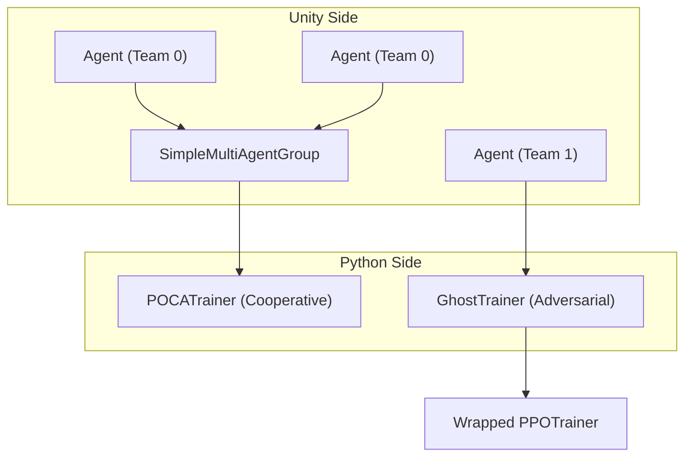
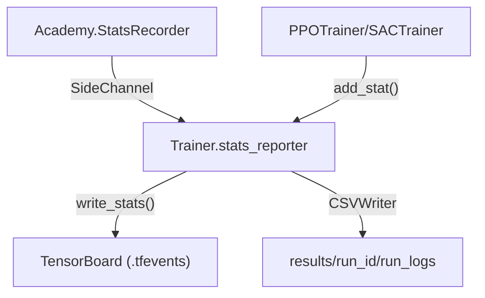

<!-- source: DeepWiki mcp.deepwiki.com · repo Unity-Technologies/ml-agents · page 6 Advanced Topics · fetched 2026-10-30 -->

# Advanced Topics

Relevant source files

The following files were used as context for generating this wiki page:

- [docs/FAQ.md](docs/FAQ.md)
- [docs/Getting-Started.md](docs/Getting-Started.md)
- [docs/Learning-Environment-Create-New.md](docs/Learning-Environment-Create-New.md)
- [docs/Learning-Environment-Design-Agents.md](docs/Learning-Environment-Design-Agents.md)
- [docs/Learning-Environment-Design.md](docs/Learning-Environment-Design.md)
- [docs/Learning-Environment-Examples.md](docs/Learning-Environment-Examples.md)
- [docs/Learning-Environment-Executable.md](docs/Learning-Environment-Executable.md)
- [docs/ML-Agents-Overview.md](docs/ML-Agents-Overview.md)
- [docs/Readme.md](docs/Readme.md)
- [docs/Training-Configuration-File.md](docs/Training-Configuration-File.md)
- [docs/Training-ML-Agents.md](docs/Training-ML-Agents.md)
- [ml-agents/mlagents/trainers/ghost/trainer.py](ml-agents/mlagents/trainers/ghost/trainer.py)
- [ml-agents/mlagents/trainers/poca/trainer.py](ml-agents/mlagents/trainers/poca/trainer.py)
- [ml-agents/mlagents/trainers/ppo/trainer.py](ml-agents/mlagents/trainers/ppo/trainer.py)
- [ml-agents/mlagents/trainers/sac/trainer.py](ml-agents/mlagents/trainers/sac/trainer.py)
- [ml-agents/mlagents/trainers/tests/test_rl_trainer.py](ml-agents/mlagents/trainers/tests/test_rl_trainer.py)
- [ml-agents/mlagents/trainers/tests/test_trainers.py](ml-agents/mlagents/trainers/tests/test_trainers.py)
- [ml-agents/mlagents/trainers/trainer/rl_trainer.py](ml-agents/mlagents/trainers/trainer/rl_trainer.py)
- [ml-agents/mlagents/trainers/trainer/trainer.py](ml-agents/mlagents/trainers/trainer/trainer.py)

This document covers advanced features and specialized use cases in the Unity ML-Agents Toolkit. It's intended for users who are already familiar with the basics of training ML-Agents and want to explore more sophisticated techniques and configurations.

## Example Environments and Multi-Agent Training

The ML-Agents Toolkit provides over 17 example environments that highlight various features of the toolkit [docs/Readme.md:26-26](). These environments serve as templates for new designs or benchmarks for reinforcement learning algorithms [docs/Learning-Environment-Examples.md:5-9]().

### Cooperative and Adversarial Patterns

Multi-agent scenarios are categorized into cooperative and adversarial patterns:

- **Adversarial (Self-Play)**: Agents are divided into teams using `BehaviorParameters.TeamId`. The `GhostTrainer` manages self-play by keeping snapshots of past policies to act as opponents [ml-agents/mlagents/trainers/ghost/trainer.py:28-40]().
- **Cooperative (MA-POCA)**: Uses the `SimpleMultiAgentGroup` API to group agents. The MA-POCA trainer (Multi-Agent Post-hoc Attention) allows agents to work together towards a shared goal even if agents are added or removed during the episode [docs/ML-Agents-Overview.md:92-102]().

**Multi-Agent Coordination Architecture**

For details, see [Example Environments and Multi-Agent Training](#6.1).

Sources: [docs/Learning-Environment-Design-Agents.md:38-41](), [ml-agents/mlagents/trainers/ghost/trainer.py:28-40](), [docs/ML-Agents-Overview.md:92-102]().

## Docker and Cloud Training

Training can be scaled by moving from the Unity Editor to standalone builds running in Docker containers or cloud infrastructure.

### Docker Containers
Docker provides a consistent environment for training, especially useful for headless servers. The `mlagents-learn` command supports a `--no-graphics` flag for these environments [docs/FAQ.md:47-51]().

### Cloud Infrastructure
Users can train on AWS, Azure, or Google Cloud Platform by deploying Docker images. This allows for:
- **Concurrent Instances**: Training using multiple parallel Unity instances to speed up experience collection [docs/Training-ML-Agents.md:25-25]().
- **Remote Monitoring**: Accessing training progress via TensorBoard hosted on the cloud instance.

For details, see [Docker and Cloud Training](#6.2).

Sources: [docs/FAQ.md:47-51](), [docs/Training-ML-Agents.md:25-25]().

## Analytics and Monitoring

ML-Agents includes a robust system for tracking metrics through the `StatsReporter` and `StatsRecorder` classes.

### Metric Tracking Pipeline
The `StatsReporter` in Python collects data from the trainers (PPO, SAC, etc.) and writes them to TensorBoard summaries [ml-agents/mlagents/trainers/ppo/trainer.py:103-107]().

**Analytics Data Flow**

### Key Metrics
| Category | Metric Name | Source |
| :--- | :--- | :--- |
| **Environment** | `Cumulative Reward` | [ml-agents/mlagents/trainers/trainer/rl_trainer.py:80-80]() |
| **Policy** | `Value Estimate` | [ml-agents/mlagents/trainers/ppo/trainer.py:103-106]() |
| **Self-Play** | `ELO` | [ml-agents/mlagents/trainers/ghost/trainer.py:81-82]() |

For details, see [Analytics and Monitoring](#6.3).

Sources: [ml-agents/mlagents/trainers/ppo/trainer.py:103-107](), [ml-agents/mlagents/trainers/ghost/trainer.py:81-82](), [docs/Training-ML-Agents.md:91-95]().

## Contributing and Development

The toolkit is designed to be extensible, allowing developers to add custom algorithms and sensors.

### Trainer Plugin System
The `Trainer` class serves as the base for all algorithms. Developers can implement new trainers by extending `RLTrainer` or `OnPolicyTrainer`/`OffPolicyTrainer` [ml-agents/mlagents/trainers/tests/test_rl_trainer.py:21-21]().

### Testing and Quality
The codebase includes a suite of unit tests for both the Unity SDK and Python trainers. For example, `test_rl_trainer.py` validates the advance of the training loop and checkpoint saving [ml-agents/mlagents/trainers/tests/test_rl_trainer.py:97-114]().

For details, see [Contributing and Development](#6.4).

Sources: [ml-agents/mlagents/trainers/tests/test_rl_trainer.py:21-63](), [docs/Readme.md:32-32]().

---

