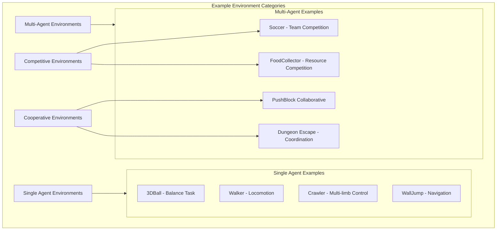
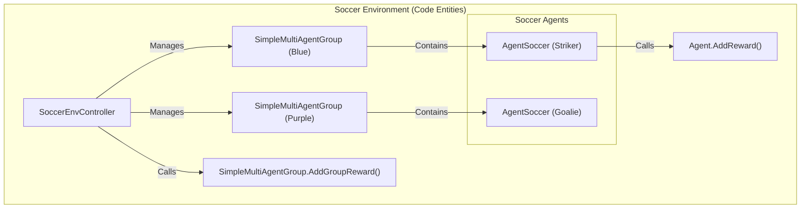
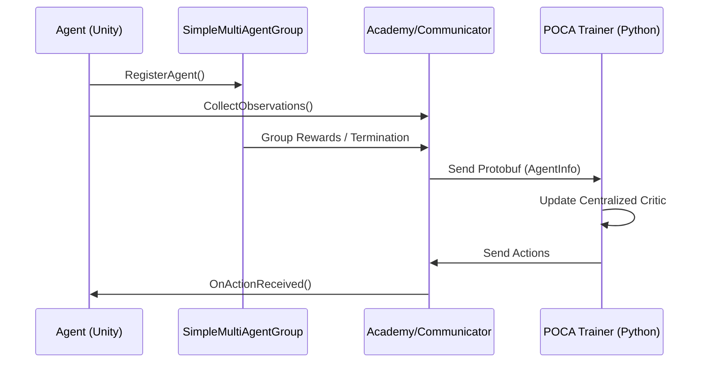

<!-- source: DeepWiki mcp.deepwiki.com · repo Unity-Technologies/ml-agents · page 6.1 Example Environments and Multi-Agent Training · fetched 2026-10-30 -->

# Example Environments and Multi-Agent Training

<details>
<summary>Relevant source files</summary>

The following files were used as context for generating this wiki page:

- [Project/Assets/ML-Agents/Examples/3DBall/Scripts/Ball3DAgent.cs](Project/Assets/ML-Agents/Examples/3DBall/Scripts/Ball3DAgent.cs)
- [Project/Assets/ML-Agents/Examples/3DBall/Scripts/Ball3DHardAgent.cs](Project/Assets/ML-Agents/Examples/3DBall/Scripts/Ball3DHardAgent.cs)
- [Project/Assets/ML-Agents/Examples/Crawler/Prefabs/Crawler.prefab](Project/Assets/ML-Agents/Examples/Crawler/Prefabs/Crawler.prefab)
- [Project/Assets/ML-Agents/Examples/Crawler/Scripts/CrawlerAgent.cs](Project/Assets/ML-Agents/Examples/Crawler/Scripts/CrawlerAgent.cs)
- [Project/Assets/ML-Agents/Examples/Crawler/TFModels/Crawler.onnx](Project/Assets/ML-Agents/Examples/Crawler/TFModels/Crawler.onnx)
- [Project/Assets/ML-Agents/Examples/DungeonEscape/Scripts/DungeonEscapeEnvController.cs](Project/Assets/ML-Agents/Examples/DungeonEscape/Scripts/DungeonEscapeEnvController.cs)
- [Project/Assets/ML-Agents/Examples/DungeonEscape/Scripts/PushAgentEscape.cs](Project/Assets/ML-Agents/Examples/DungeonEscape/Scripts/PushAgentEscape.cs)
- [Project/Assets/ML-Agents/Examples/FoodCollector/Scripts/FoodCollectorAgent.cs](Project/Assets/ML-Agents/Examples/FoodCollector/Scripts/FoodCollectorAgent.cs)
- [Project/Assets/ML-Agents/Examples/GridWorld/Scripts/GridAgent.cs](Project/Assets/ML-Agents/Examples/GridWorld/Scripts/GridAgent.cs)
- [Project/Assets/ML-Agents/Examples/Hallway/Scripts/HallwayAgent.cs](Project/Assets/ML-Agents/Examples/Hallway/Scripts/HallwayAgent.cs)
- [Project/Assets/ML-Agents/Examples/PushBlock/Scripts/PushAgentBasic.cs](Project/Assets/ML-Agents/Examples/PushBlock/Scripts/PushAgentBasic.cs)
- [Project/Assets/ML-Agents/Examples/PushBlock/Scripts/PushAgentCollab.cs](Project/Assets/ML-Agents/Examples/PushBlock/Scripts/PushAgentCollab.cs)
- [Project/Assets/ML-Agents/Examples/PushBlock/Scripts/PushBlockEnvController.cs](Project/Assets/ML-Agents/Examples/PushBlock/Scripts/PushBlockEnvController.cs)
- [Project/Assets/ML-Agents/Examples/PushBlockWithInput/Scripts/PushBlockWithInputAgentBasic.cs](Project/Assets/ML-Agents/Examples/PushBlockWithInput/Scripts/PushBlockWithInputAgentBasic.cs)
- [Project/Assets/ML-Agents/Examples/PushBlockWithInput/Scripts/PushBlockWithInputPlayerController.cs](Project/Assets/ML-Agents/Examples/PushBlockWithInput/Scripts/PushBlockWithInputPlayerController.cs)
- [Project/Assets/ML-Agents/Examples/Pyramids/Scripts/PyramidAgent.cs](Project/Assets/ML-Agents/Examples/Pyramids/Scripts/PyramidAgent.cs)
- [Project/Assets/ML-Agents/Examples/SharedAssets/Scripts/JointDriveController.cs](Project/Assets/ML-Agents/Examples/SharedAssets/Scripts/JointDriveController.cs)
- [Project/Assets/ML-Agents/Examples/Soccer/Prefabs/SoccerFieldTwos.prefab](Project/Assets/ML-Agents/Examples/Soccer/Prefabs/SoccerFieldTwos.prefab)
- [Project/Assets/ML-Agents/Examples/Soccer/Prefabs/StrikersVsGoalieField.prefab](Project/Assets/ML-Agents/Examples/Soccer/Prefabs/StrikersVsGoalieField.prefab)
- [Project/Assets/ML-Agents/Examples/Soccer/Scenes/SoccerTwos.unity](Project/Assets/ML-Agents/Examples/Soccer/Scenes/SoccerTwos.unity)
- [Project/Assets/ML-Agents/Examples/Soccer/Scenes/StrikersVsGoalie.unity](Project/Assets/ML-Agents/Examples/Soccer/Scenes/StrikersVsGoalie.unity)
- [Project/Assets/ML-Agents/Examples/Soccer/Scripts/AgentSoccer.cs](Project/Assets/ML-Agents/Examples/Soccer/Scripts/AgentSoccer.cs)
- [Project/Assets/ML-Agents/Examples/Soccer/Scripts/SoccerBallController.cs](Project/Assets/ML-Agents/Examples/Soccer/Scripts/SoccerBallController.cs)
- [Project/Assets/ML-Agents/Examples/Soccer/Scripts/SoccerEnvController.cs](Project/Assets/ML-Agents/Examples/Soccer/Scripts/SoccerEnvController.cs)
- [Project/Assets/ML-Agents/Examples/Soccer/Scripts/SoccerEnvController.cs.meta](Project/Assets/ML-Agents/Examples/Soccer/Scripts/SoccerEnvController.cs.meta)
- [Project/Assets/ML-Agents/Examples/Soccer/TFModels/SoccerTwos.onnx](Project/Assets/ML-Agents/Examples/Soccer/TFModels/SoccerTwos.onnx)
- [Project/Assets/ML-Agents/Examples/Sorter/Scripts/SorterAgent.cs](Project/Assets/ML-Agents/Examples/Sorter/Scripts/SorterAgent.cs)
- [Project/Assets/ML-Agents/Examples/Walker/Scripts/WalkerAgent.cs](Project/Assets/ML-Agents/Examples/Walker/Scripts/WalkerAgent.cs)
- [Project/Assets/ML-Agents/Examples/WallJump/Scripts/WallJumpAgent.cs](Project/Assets/ML-Agents/Examples/WallJump/Scripts/WallJumpAgent.cs)
- [Project/Assets/ML-Agents/Examples/Worm/Scripts/WormAgent.cs](Project/Assets/ML-Agents/Examples/Worm/Scripts/WormAgent.cs)
- [com.unity.ml-agents/Runtime/Grpc/CommunicatorObjects/AgentInfo.cs](com.unity.ml-agents/Runtime/Grpc/CommunicatorObjects/AgentInfo.cs)
- [com.unity.ml-agents/Runtime/IMultiAgentGroup.cs](com.unity.ml-agents/Runtime/IMultiAgentGroup.cs)
- [com.unity.ml-agents/Runtime/IMultiAgentGroup.cs.meta](com.unity.ml-agents/Runtime/IMultiAgentGroup.cs.meta)
- [com.unity.ml-agents/Runtime/MultiAgentGroupIdCounter.cs](com.unity.ml-agents/Runtime/MultiAgentGroupIdCounter.cs)
- [com.unity.ml-agents/Runtime/MultiAgentGroupIdCounter.cs.meta](com.unity.ml-agents/Runtime/MultiAgentGroupIdCounter.cs.meta)
- [com.unity.ml-agents/Runtime/Sensors/BufferSensor.cs](com.unity.ml-agents/Runtime/Sensors/BufferSensor.cs)
- [com.unity.ml-agents/Runtime/Sensors/BufferSensorComponent.cs](com.unity.ml-agents/Runtime/Sensors/BufferSensorComponent.cs)
- [com.unity.ml-agents/Runtime/SimpleMultiAgentGroup.cs](com.unity.ml-agents/Runtime/SimpleMultiAgentGroup.cs)
- [com.unity.ml-agents/Runtime/SimpleMultiAgentGroup.cs.meta](com.unity.ml-agents/Runtime/SimpleMultiAgentGroup.cs.meta)
- [docs/FAQ.md](docs/FAQ.md)
- [docs/Getting-Started.md](docs/Getting-Started.md)
- [docs/Learning-Environment-Create-New.md](docs/Learning-Environment-Create-New.md)
- [docs/Learning-Environment-Design-Agents.md](docs/Learning-Environment-Design-Agents.md)
- [docs/Learning-Environment-Design.md](docs/Learning-Environment-Design.md)
- [docs/Learning-Environment-Examples.md](docs/Learning-Environment-Examples.md)
- [docs/Learning-Environment-Executable.md](docs/Learning-Environment-Executable.md)
- [docs/ML-Agents-Overview.md](docs/ML-Agents-Overview.md)
- [docs/Readme.md](docs/Readme.md)
- [docs/Training-Configuration-File.md](docs/Training-Configuration-File.md)
- [docs/Training-ML-Agents.md](docs/Training-ML-Agents.md)

</details>


This document showcases the example environments included with ML-Agents and explains multi-agent training patterns, specifically focusing on implementation via `SimpleMultiAgentGroup` and algorithms like MA-POCA.

## Overview of Example Environments

ML-Agents includes a comprehensive set of example environments that demonstrate various training scenarios. These environments serve as learning resources and templates for developing custom training logic.

### Environment Categories

ML-Agents example environments can be categorized by their agent interaction patterns:



Sources:
- [docs/Learning-Environment-Examples.md:23-176]()
- [Project/Assets/ML-Agents/Examples/Soccer/Scripts/AgentSoccer.cs:1-217]()
- [Project/Assets/ML-Agents/Examples/FoodCollector/Scripts/FoodCollectorAgent.cs:1-272]()

## Single-Agent Example Environments

### 3DBall: Balance Control
The 3DBall environment demonstrates a balance control task where an agent must balance a ball on a platform by rotating the platform.

**Implementation Details:**
- **Class:** `Ball3DAgent` extends `Agent` [Project/Assets/ML-Agents/Examples/3DBall/Scripts/Ball3DAgent.cs:11-11]()
- **Observations:** 8 variables (rotation of cube, position/velocity of ball) [docs/Learning-Environment-Examples.md:55-57]()
- **Actions:** 2 continuous actions (X and Z rotation) [docs/Learning-Environment-Examples.md:59-60]()
- **Reward:** +0.1 for every step the ball remains on head; -1.0 if it falls [docs/Learning-Environment-Examples.md:51-53]()

### Walker and Crawler: Locomotion
These environments focus on physics-based locomotion using joint drives.

- **Walker:** Bipedal movement where the `WalkerAgent` must move towards a target [Project/Assets/ML-Agents/Examples/Walker/Scripts/WalkerAgent.cs:13-13]().
- **Crawler:** A four-legged creature. The `CrawlerAgent` uses `JointDriveController` to manage body parts and joint physics [Project/Assets/ML-Agents/Examples/Crawler/Scripts/CrawlerAgent.cs:15-15]().

Sources:
- [docs/Learning-Environment-Examples.md:43-77]()
- [docs/Learning-Environment-Examples.md:171-176]()
- [Project/Assets/ML-Agents/Examples/SharedAssets/Scripts/JointDriveController.cs:1-187]()

## Multi-Agent Training Patterns

ML-Agents supports complex multi-agent scenarios, ranging from zero-sum competition to team-based cooperation.

### Cooperative Training with SimpleMultiAgentGroup
For cooperative scenarios, agents are often grouped to share rewards or be treated as a single entity for episode management. The `SimpleMultiAgentGroup` class is the primary utility for this.

**Key Functions:**
- `RegisterAgent(Agent agent)`: Adds an agent to the group [com.unity.ml-agents/Runtime/SimpleMultiAgentGroup.cs:40-50]().
- `AddGroupReward(float reward)`: Distributes a reward to all agents currently in the group [com.unity.ml-agents/Runtime/SimpleMultiAgentGroup.cs:72-82]().
- `EndGroupEpisode()`: Ends the episode for all agents in the group simultaneously [com.unity.ml-agents/Runtime/SimpleMultiAgentGroup.cs:110-120]().

### Soccer Environment: Competitive Team Play
The Soccer environment demonstrates team-based competition (2v2) where agents must coordinate within a team to score while defending.

**Environment Architecture:**


**Implementation Details:**
- **Roles:** Agents are assigned roles (Striker or Goalie) in `AgentSoccer.Initialize()` [Project/Assets/ML-Agents/Examples/Soccer/Scripts/AgentSoccer.cs:51-96]().
- **Group Rewards:** When a goal is scored, the `SoccerEnvController` uses `AddGroupReward` to reward the scoring team and penalize the conceding team [Project/Assets/ML-Agents/Examples/Soccer/Scripts/SoccerEnvController.cs:98-114]().

Sources:
- [Project/Assets/ML-Agents/Examples/Soccer/Scripts/SoccerEnvController.cs:1-137]()
- [com.unity.ml-agents/Runtime/SimpleMultiAgentGroup.cs:1-135]()

## MA-POCA (Multi-Agent Post-Adversarial Critical Architecture)

MA-POCA is a centralized-critic trainer designed for cooperative multi-agent tasks where agents may be added or removed during an episode.

### Training Configuration
To use MA-POCA, the `trainer_type` must be set to `poca` in the YAML configuration [docs/Training-Configuration-File.md:31-31]().

**Key MA-POCA Parameters:**

| Setting | Description |
| :--- | :--- |
| `trainer_type` | Set to `poca` [docs/Training-Configuration-File.md:31-31]() |
| `time_horizon` | Steps to collect before adding to buffer (default 64) [docs/Training-Configuration-File.md:33-33]() |
| `max_steps` | Total steps for the training run [docs/Training-Configuration-File.md:34-34]() |

### Self-Play for Competitive Scenarios
For competitive environments like Soccer, **Self-Play** allows agents to train against past versions of themselves. This is configured in the YAML file under the `self_play` section [docs/Training-Configuration-File.md:18-18]().

**Self-Play Mechanism:**
1. The trainer maintains a pool of past policy snapshots.
2. During training, the agent's opponent is sampled from this pool.
3. This ensures the agent learns to counter a variety of strategies rather than over-fitting to a single opponent [docs/ML-Agents-Overview.md:23-23]().

Sources:
- [docs/ML-Agents-Overview.md:23-26]()
- [docs/Training-Configuration-File.md:1-40]()

## Implementation Best Practices

### Agent Specialization
In multi-agent tasks, specialized behaviors are achieved through role-based initialization. For example, in `AgentSoccer`, strikers and goalies receive different movement speeds and existential rewards:

```csharp
// Position-based behavior configuration in AgentSoccer.cs
if (position == Position.Goalie)
{
    m_LateralSpeed = 1.0f;
    m_ForwardSpeed = 1.0f;
    AddReward(m_Existential); // Bonus for staying in game
}
else if (position == Position.Striker)
{
    m_LateralSpeed = 0.3f;
    m_ForwardSpeed = 1.3f;
    AddReward(-m_Existential); // Penalty to encourage scoring
}
```
Sources: [Project/Assets/ML-Agents/Examples/Soccer/Scripts/AgentSoccer.cs:76-90]()

### Variable Length Observations
Environments like `FoodCollector` often use `BufferSensor` to handle a variable number of visible entities (e.g., multiple food items or enemies).

**BufferSensor Pattern:**
- **Class:** `BufferSensor` allows observing a variable number of entities [com.unity.ml-agents/Runtime/Sensors/BufferSensor.cs:8-8]().
- **Usage:** Agents call `AppendObservation()` for each entity in range up to a maximum limit [com.unity.ml-agents/Runtime/Sensors/BufferSensor.cs:47-65]().

Sources:
- [com.unity.ml-agents/Runtime/Sensors/BufferSensor.cs:1-123]()
- [docs/Learning-Environment-Design-Agents.md:23-24]()

### Multi-Agent Data Flow

The following diagram illustrates how data flows from individual Unity agents through the grouping logic to the Python trainer.



Sources:
- [com.unity.ml-agents/Runtime/SimpleMultiAgentGroup.cs:40-50]()
- [docs/Learning-Environment-Design.md:27-40]()
- [com.unity.ml-agents/Runtime/Grpc/CommunicatorObjects/AgentInfo.cs:1-100]()

Sources:
- [docs/Learning-Environment-Design-Agents.md:1-105]()
- [docs/Training-ML-Agents.md:1-141]()
- [docs/ML-Agents-Overview.md:1-110]()
- [com.unity.ml-agents/Runtime/SimpleMultiAgentGroup.cs:1-135]()
- [Project/Assets/ML-Agents/Examples/Soccer/Scripts/SoccerEnvController.cs:1-137]()

---

