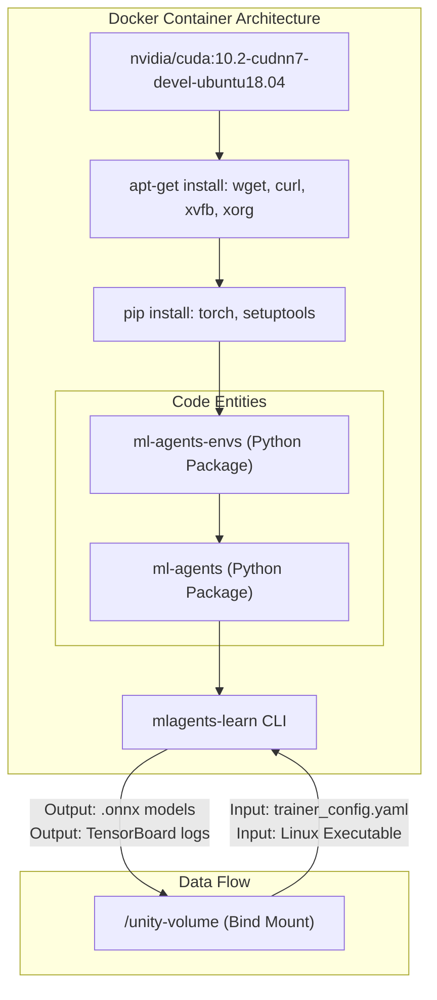
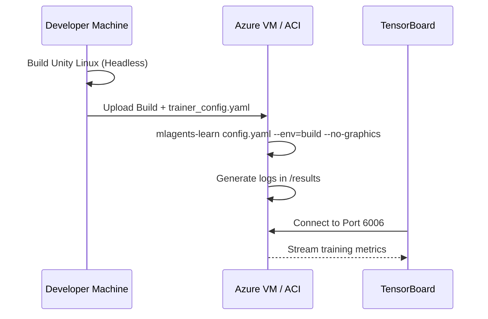
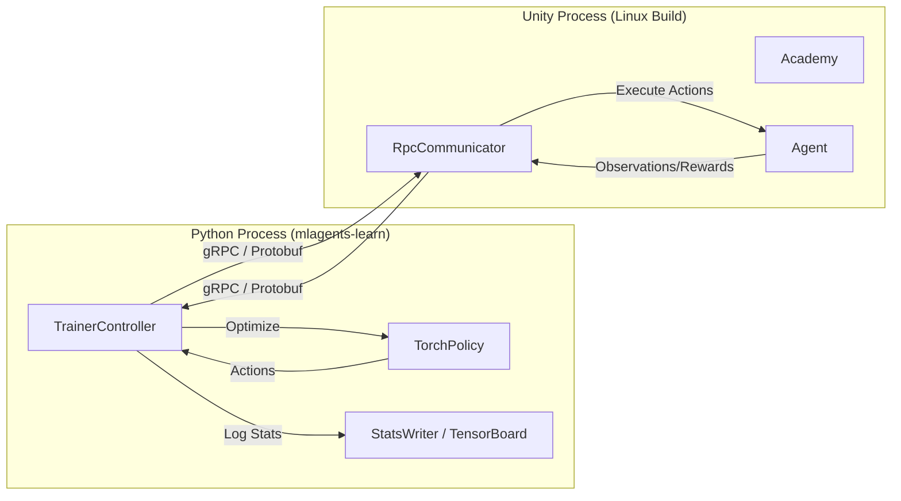

<!-- source: DeepWiki mcp.deepwiki.com · repo Unity-Technologies/ml-agents · page 6.2 Docker and Cloud Training · fetched 2026-10-30 -->

# Docker and Cloud Training

<details>
<summary>Relevant source files</summary>

The following files were used as context for generating this wiki page:

- [Dockerfile](Dockerfile)
- [colab/Colab_UnityEnvironment_1_Run.ipynb](colab/Colab_UnityEnvironment_1_Run.ipynb)
- [colab/Colab_UnityEnvironment_2_Train.ipynb](colab/Colab_UnityEnvironment_2_Train.ipynb)
- [colab/Colab_UnityEnvironment_3_SideChannel.ipynb](colab/Colab_UnityEnvironment_3_SideChannel.ipynb)
- [colab/Colab_UnityEnvironment_4_SB3VectorEnv.ipynb](colab/Colab_UnityEnvironment_4_SB3VectorEnv.ipynb)
- [com.unity.ml-agents/README.md](com.unity.ml-agents/README.md)
- [com.unity.ml-agents/README.md.meta](com.unity.ml-agents/README.md.meta)
- [com.unity.ml-agents/Runtime/Actuators/IActionReceiver.cs](com.unity.ml-agents/Runtime/Actuators/IActionReceiver.cs)
- [com.unity.ml-agents/Runtime/Actuators/IDiscreteActionMask.cs](com.unity.ml-agents/Runtime/Actuators/IDiscreteActionMask.cs)
- [com.unity.ml-agents/Runtime/Agent.cs](com.unity.ml-agents/Runtime/Agent.cs)
- [com.unity.ml-agents/Runtime/Demonstrations/DemonstrationRecorder.cs](com.unity.ml-agents/Runtime/Demonstrations/DemonstrationRecorder.cs)
- [docs/Installation-Anaconda-Windows.md](docs/Installation-Anaconda-Windows.md)
- [docs/Installation.md](docs/Installation.md)
- [docs/Migrating.md](docs/Migrating.md)
- [docs/Training-on-Amazon-Web-Service.md](docs/Training-on-Amazon-Web-Service.md)
- [docs/Training-on-Microsoft-Azure.md](docs/Training-on-Microsoft-Azure.md)
- [docs/Using-Docker.md](docs/Using-Docker.md)
- [docs/Using-Tensorboard.md](docs/Using-Tensorboard.md)
- [docs/images/docker_build_settings.png](docs/images/docker_build_settings.png)
- [docs/images/unity_linux_build_support.png](docs/images/unity_linux_build_support.png)
- [docs/images/unity_package_json.png](docs/images/unity_package_json.png)
- [docs/images/unity_package_manager_window.png](docs/images/unity_package_manager_window.png)
- [ml-agents-envs/README.md](ml-agents-envs/README.md)
- [ml-agents/README.md](ml-agents/README.md)

</details>


This page provides a technical guide for using Docker containers and cloud platforms with the ML-Agents toolkit. While Docker provides isolation and dependency management, cloud platforms enable large-scale distributed training. This document covers Docker-based workflows, TensorBoard monitoring, and cloud training on AWS/Azure.

## Docker Support and Configuration

ML-Agents provides a Docker-based solution primarily for users who wish to avoid local Python/PyTorch dependency management or need to run training in isolated environments.

### Docker Container Architecture

The `Dockerfile` provided in the repository sets up a complete Linux-based training environment.


Sources: [Dockerfile:1-29](), [docs/Using-Docker.md:37-48]()

### Building and Running the Container

The workflow requires building the Unity environment for the Linux platform to ensure compatibility with the container's kernel.

1.  **Unity Build**: Target Platform `Linux`, Architecture `x86_64`. [docs/Using-Docker.md:58-69]()
2.  **Build Image**:
    `docker build -t <image-name> .` [docs/Using-Docker.md:79-81]()
3.  **Execute Training**:
    The container uses `mlagents-learn` as its primary entry point. It requires mounting a local directory (e.g., `unity-volume`) to share the executable and configuration.

```bash
docker run -it --name mlagents-container \
           --mount type=bind,source="$(pwd)"/unity-volume,target=/unity-volume \
           -p 5005:5005 -p 6006:6006 \
           <image-name>:latest \
           /unity-volume/trainer_config.yaml \
           --env=/unity-volume/<env-name> \
           --train --run-id=<run-id>
```
Sources: [docs/Using-Docker.md:92-136]()

### Headless Rendering with Xvfb
Since Docker containers often lack a physical display, ML-Agents uses `Xvfb` (X virtual framebuffer) to perform rendering for visual observations. This allows agents with `CameraSensor` or `RayPerceptionSensor` to function without a GPU-attached monitor. [docs/Using-Docker.md:9-15](), [Dockerfile:11-13]()

## Cloud Training on AWS and Azure

Training in the cloud allows for high-performance GPU instances (e.g., NVIDIA Tesla K80/V100) and long-running sessions.

### Amazon Web Services (AWS)
AWS training typically involves EC2 instances. ML-Agents provides guidance for using the Deep Learning AMI (Ubuntu).

**X Server Configuration for Visual Observations:**
To use visual observations on AWS, an X Server must be started to provide a rendering target for the Unity Engine.

```bash
# Start X Server
sudo /usr/bin/X :0 &
export DISPLAY=:0
```
Sources: [docs/Training-on-Amazon-Web-Service.md:20-49](), [docs/Training-on-Amazon-Web-Service.md:92-109]()

### Microsoft Azure
Azure support includes Virtual Machines (N-Series for GPU) and Azure Container Instances (ACI).

**Headless Mode Requirements:**
When running on Azure in headless mode, the `--no-graphics` flag must be appended to the `mlagents-learn` command to ensure the Unity executable runs without a display. [docs/Training-on-Microsoft-Azure.md:62-64]()


Sources: [docs/Training-on-Microsoft-Azure.md:42-48](), [docs/Training-on-Microsoft-Azure.md:76-81](), [docs/Training-on-Microsoft-Azure.md:106-111]()

## TensorBoard Monitoring

TensorBoard is the primary tool for monitoring training progress, providing real-time visualization of rewards, losses, and policy metrics.

### Key Metrics
| Metric | Code/Tag | Description |
| :--- | :--- | :--- |
| **Cumulative Reward** | `Environment/Cumulative Reward` | Mean reward per episode; should increase over time. |
| **Policy Loss** | `Losses/Policy Loss` | Magnitude of policy updates; should stabilize. |
| **Entropy** | `Policy/Entropy` | Measure of decision randomness; should slowly decrease. |
| **Value Estimate** | `Policy/Value Estimate` | Agent's prediction of future rewards. |

Sources: [docs/Using-Tensorboard.md:38-121]()

### Custom Metrics via StatsRecorder
Developers can send custom C# metrics to TensorBoard using the `StatsRecorder` class accessed via the `Academy` singleton.

```csharp
// Example of recording a custom metric in Unity
var statsRecorder = Academy.Instance.StatsRecorder;
statsRecorder.Add("Custom/MyMetric", 1.0f);
```
Sources: [docs/Using-Tensorboard.md:130-137]()

### Docker TensorBoard Execution
To monitor a training session running inside a container, use `docker exec` to launch the TensorBoard server on the mapped port (6006).

```bash
docker exec -it <container-name> tensorboard --logdir /unity-volume/results --host 0.0.0.0
```
Sources: [docs/Using-Docker.md:147-160]()

## Implementation Details and Data Flow

The `mlagents-learn` entry point in the `mlagents` package orchestrates the communication between the Python trainers and the Unity environment (running inside Docker or the Cloud).


Sources: [ml-agents/README.md:1-12](), [com.unity.ml-agents/Runtime/Agent.cs:119-157](), [docs/Using-Docker.md:118-123]()

### Graceful Termination
When training in Docker or Cloud environments, it is critical to use `SIGINT` (Ctrl+C) to stop the process. This triggers the `TrainerController` to save the current model as an `.onnx` file before the environment shuts down. [docs/Using-Docker.md:165-177](), [docs/Training-on-Microsoft-Azure.md:62-64]()

Sources:
- `docs/Using-Docker.md`
- `docs/Training-on-Amazon-Web-Service.md`
- `docs/Training-on-Microsoft-Azure.md`
- `docs/Using-Tensorboard.md`
- `Dockerfile`
- `com.unity.ml-agents/Runtime/Agent.cs`
- `ml-agents/README.md`

---

