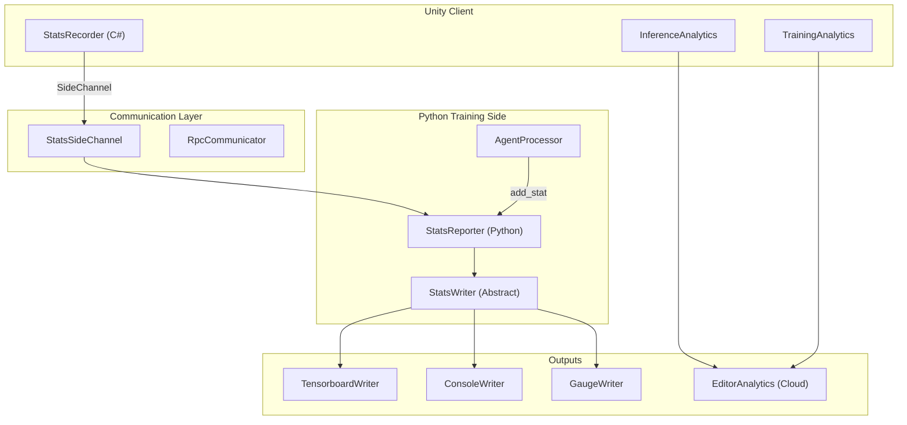
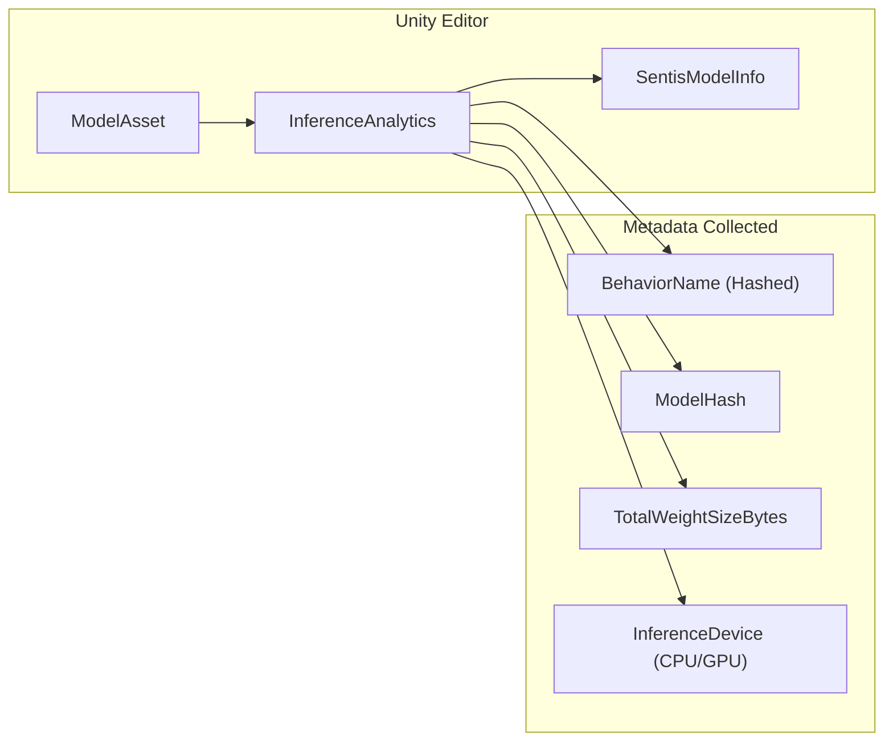

<!-- source: DeepWiki mcp.deepwiki.com · repo Unity-Technologies/ml-agents · page 6.3 Analytics and Monitoring · fetched 2026-10-30 -->

# Analytics and Monitoring

Relevant source files

The following files were used as context for generating this wiki page:

- [com.unity.ml-agents/Runtime/Analytics/AnalyticsUtils.cs](com.unity.ml-agents/Runtime/Analytics/AnalyticsUtils.cs)
- [com.unity.ml-agents/Runtime/Analytics/Events.cs](com.unity.ml-agents/Runtime/Analytics/Events.cs)
- [com.unity.ml-agents/Runtime/Analytics/InferenceAnalytics.cs](com.unity.ml-agents/Runtime/Analytics/InferenceAnalytics.cs)
- [com.unity.ml-agents/Runtime/Analytics/TrainingAnalytics.cs](com.unity.ml-agents/Runtime/Analytics/TrainingAnalytics.cs)
- [com.unity.ml-agents/Runtime/Policies/RemotePolicy.cs](com.unity.ml-agents/Runtime/Policies/RemotePolicy.cs)
- [com.unity.ml-agents/Runtime/StatsRecorder.cs](com.unity.ml-agents/Runtime/StatsRecorder.cs)
- [docs/Profiling-Python.md](docs/Profiling-Python.md)
- [ml-agents-envs/mlagents_envs/side_channel/stats_side_channel.py](ml-agents-envs/mlagents_envs/side_channel/stats_side_channel.py)
- [ml-agents-envs/mlagents_envs/timers.py](ml-agents-envs/mlagents_envs/timers.py)
- [ml-agents/mlagents/trainers/agent_processor.py](ml-agents/mlagents/trainers/agent_processor.py)
- [ml-agents/mlagents/trainers/stats.py](ml-agents/mlagents/trainers/stats.py)
- [ml-agents/mlagents/trainers/tests/mock_brain.py](ml-agents/mlagents/trainers/tests/mock_brain.py)
- [ml-agents/mlagents/trainers/tests/test_agent_processor.py](ml-agents/mlagents/trainers/tests/test_agent_processor.py)
- [ml-agents/mlagents/trainers/tests/test_stats.py](ml-agents/mlagents/trainers/tests/test_stats.py)

This document covers the analytics and monitoring system within the ML-Agents toolkit, which tracks usage patterns, model deployments, and training configurations. It also details the Python-side `StatsReporter` pipeline for monitoring training metrics like rewards, entropy, and ELO via TensorBoard and console output.

## Overview

The ML-Agents monitoring system consists of two main branches:
1.  **Unity Client Analytics**: Telemetry data regarding model deployment and environment initialization, sent to Unity's analytics backend.
2.  **Training Metrics (StatsReporter)**: Real-time training data (e.g., Cumulative Reward) processed on the Python side and dispatched to TensorBoard, the console, or custom writers.

**Monitoring System Architecture**

Sources: [com.unity.ml-agents/Runtime/Analytics/InferenceAnalytics.cs:25-80](), [ml-agents/mlagents/trainers/stats.py:79-114](), [com.unity.ml-agents/Runtime/StatsRecorder.cs:41-79](), [ml-agents-envs/mlagents_envs/side_channel/stats_side_channel.py:28-63]()

## Python Stats Pipeline

The Python-side `StatsReporter` is the central hub for all training metrics. It aggregates values over time and distributes them to multiple `StatsWriter` implementations.

### StatsReporter and StatsSummary
The `StatsReporter` maintains a collection of `StatsWriter` objects. When `add_stat` is called, it updates internal distributions. Periodically, `write_stats` is called to aggregate these distributions into a `StatsSummary` and pass them to writers. [ml-agents/mlagents/trainers/stats.py:22-68]()

**Aggregation Methods:**
Defined in `StatsAggregationMethod`, these determine how multiple values in a summary window are reduced:
- `AVERAGE`: Mean of all values.
- `SUM`: Total sum of values.
- `MOST_RECENT`: The last value received.
- `HISTOGRAM`: Full distribution (used by TensorBoard).

Sources: [ml-agents-envs/mlagents_envs/side_channel/stats_side_channel.py:10-21](), [ml-agents/mlagents/trainers/stats.py:42-72]()

### StatsWriter Implementations
Writers handle the actual output of aggregated data:

| Class | Output Destination | Behavior |
| :--- | :--- | :--- |
| `TensorboardWriter` | `.tfevents` files | Uses `torch.utils.tensorboard.SummaryWriter` to log scalars and text. [ml-agents/mlagents/trainers/stats.py:246-300]() |
| `ConsoleWriter` | Terminal / Logs | Prints formatted strings including Step, Time, Mean Reward, and ELO. [ml-agents/mlagents/trainers/stats.py:157-197]() |
| `GaugeWriter` | Timer Gauges | Sanitizes keys (replacing `/` with `.`) and writes to internal timers. [ml-agents/mlagents/trainers/stats.py:131-155]() |

Sources: [ml-agents/mlagents/trainers/stats.py:131-300]()

## Metric Collection Points

Metrics enter the `StatsReporter` from two primary sources:

### 1. AgentProcessor (Internal Metrics)
The `AgentProcessor` automatically reports training-specific metrics during the trajectory collection loop.
- **Policy/Entropy**: Reported whenever a policy generates actions. [ml-agents/mlagents/trainers/agent_processor.py:104-109]()
- **Environment/Cumulative Reward**: Calculated at the end of an episode and reported via the reporter. [ml-agents/mlagents/trainers/agent_processor.py:210-225]()

### 2. StatsSideChannel (Custom User Metrics)
Users can report custom metrics from Unity using the `StatsRecorder`.
- **Unity side**: `StatsRecorder.Add("MyMetric", 1.0f)` sends data through the `StatsSideChannel`. [com.unity.ml-agents/Runtime/StatsRecorder.cs:67-73]()
- **Python side**: `StatsSideChannel.on_message_received` parses the key, value, and aggregation type, which the `AgentManager` then pushes to the `StatsReporter`. [ml-agents-envs/mlagents_envs/side_channel/stats_side_channel.py:41-52]()

Sources: [ml-agents/mlagents/trainers/agent_processor.py:81-112](), [com.unity.ml-agents/Runtime/StatsRecorder.cs:41-55]()

## Unity Inference Analytics

The `InferenceAnalytics` class monitors how models are deployed in the Unity Editor. It captures metadata about the neural network and the agent's configuration.

**Inference Analytics Metadata Collection**

- **Privacy**: The `BehaviorName` is hashed using `AnalyticsUtils.Hash` with a vendor key to prevent PII leakage. [com.unity.ml-agents/Runtime/Analytics/InferenceAnalytics.cs:133]()
- **Model Details**: The system calculates the `TotalWeightSizeBytes` by iterating through the Sentis model constants, mimicking the Sentis inspector's logic. [com.unity.ml-agents/Runtime/Analytics/InferenceAnalytics.cs:180-196]()

Sources: [com.unity.ml-agents/Runtime/Analytics/InferenceAnalytics.cs:119-171](), [com.unity.ml-agents/Runtime/Analytics/Events.cs:24-52]()

## Training Analytics

`TrainingAnalytics` tracks the lifecycle of a training session. It generates a unique `TrainingSessionGuid` per session to correlate events. [com.unity.ml-agents/Runtime/Analytics/TrainingAnalytics.cs:37-66]()

### Key Events
1.  **TrainingEnvironmentInitialized**: Sent once per session. Includes `MLAgentsVersion`, `PythonVersion`, and `TorchVersion`. [com.unity.ml-agents/Runtime/Analytics/Events.cs:181-205]()
2.  **RemotePolicyInitialized**: Sent when a `RemotePolicy` is first used. Captures the `ActionSpec` and `ObservationSpecs` used for training. [com.unity.ml-agents/Runtime/Analytics/TrainingAnalytics.cs:126-160]()
3.  **TrainingBehaviorInitialized**: Captures the trainer configuration (e.g., whether GAIL or Curiosity is enabled). [com.unity.ml-agents/Runtime/Analytics/TrainingAnalytics.cs:188-215]()

Sources: [com.unity.ml-agents/Runtime/Analytics/TrainingAnalytics.cs:24-123](), [com.unity.ml-agents/Runtime/Analytics/Events.cs:153-178]()

## Performance Profiling

In addition to stats, the toolkit includes a hierarchical timer system for Python profiling.
- **Usage**: Developers use the `@timed` decorator or `hierarchical_timer` context manager. [docs/Profiling-Python.md:17-34]()
- **Output**: Timers are saved as `{run_id}_timers.json` in the summaries directory. This JSON includes `total`, `self`, and `count` for each code block. [docs/Profiling-Python.md:40-54]()
- **Parallelism**: The system handles subprocesses (e.g., `SubprocessEnvManager`) by aggregating timers from child processes back to the main process. [docs/Profiling-Python.md:57-66]()

Sources: [docs/Profiling-Python.md:1-73](), [ml-agents-envs/mlagents_envs/timers.py:1-50]()

---

