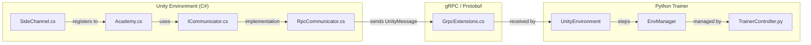
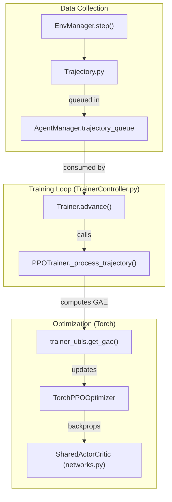

<!-- source: DeepWiki mcp.deepwiki.com · repo Unity-Technologies/ml-agents · page 7 Glossary · fetched 2026-10-30 -->

# Glossary

Relevant source files

The following files were used as context for generating this wiki page:

- [com.unity.ml-agents/CHANGELOG.md](com.unity.ml-agents/CHANGELOG.md)
- [com.unity.ml-agents/Runtime/Academy.cs](com.unity.ml-agents/Runtime/Academy.cs)
- [com.unity.ml-agents/Runtime/Communicator/GrpcExtensions.cs](com.unity.ml-agents/Runtime/Communicator/GrpcExtensions.cs)
- [com.unity.ml-agents/Runtime/Communicator/ICommunicator.cs](com.unity.ml-agents/Runtime/Communicator/ICommunicator.cs)
- [com.unity.ml-agents/Runtime/Communicator/RpcCommunicator.cs](com.unity.ml-agents/Runtime/Communicator/RpcCommunicator.cs)
- [com.unity.ml-agents/Runtime/DecisionRequester.cs](com.unity.ml-agents/Runtime/DecisionRequester.cs)
- [com.unity.ml-agents/Runtime/Demonstrations/DemonstrationWriter.cs](com.unity.ml-agents/Runtime/Demonstrations/DemonstrationWriter.cs)
- [com.unity.ml-agents/package.json](com.unity.ml-agents/package.json)
- [docs/FAQ.md](docs/FAQ.md)
- [docs/Getting-Started.md](docs/Getting-Started.md)
- [docs/Glossary.md](docs/Glossary.md)
- [docs/Learning-Environment-Create-New.md](docs/Learning-Environment-Create-New.md)
- [docs/Learning-Environment-Design-Agents.md](docs/Learning-Environment-Design-Agents.md)
- [docs/Learning-Environment-Design.md](docs/Learning-Environment-Design.md)
- [docs/Learning-Environment-Examples.md](docs/Learning-Environment-Examples.md)
- [docs/Learning-Environment-Executable.md](docs/Learning-Environment-Executable.md)
- [docs/ML-Agents-Overview.md](docs/ML-Agents-Overview.md)
- [docs/Readme.md](docs/Readme.md)
- [docs/Training-Configuration-File.md](docs/Training-Configuration-File.md)
- [docs/Training-ML-Agents.md](docs/Training-ML-Agents.md)
- [ml-agents-envs/mlagents_envs/__init__.py](ml-agents-envs/mlagents_envs/__init__.py)
- [ml-agents-envs/mlagents_envs/environment.py](ml-agents-envs/mlagents_envs/environment.py)
- [ml-agents/mlagents/trainers/__init__.py](ml-agents/mlagents/trainers/__init__.py)
- [ml-agents/mlagents/trainers/cli_utils.py](ml-agents/mlagents/trainers/cli_utils.py)
- [ml-agents/mlagents/trainers/ghost/trainer.py](ml-agents/mlagents/trainers/ghost/trainer.py)
- [ml-agents/mlagents/trainers/learn.py](ml-agents/mlagents/trainers/learn.py)
- [ml-agents/mlagents/trainers/poca/trainer.py](ml-agents/mlagents/trainers/poca/trainer.py)
- [ml-agents/mlagents/trainers/ppo/trainer.py](ml-agents/mlagents/trainers/ppo/trainer.py)
- [ml-agents/mlagents/trainers/sac/trainer.py](ml-agents/mlagents/trainers/sac/trainer.py)
- [ml-agents/mlagents/trainers/settings.py](ml-agents/mlagents/trainers/settings.py)
- [ml-agents/mlagents/trainers/tests/test_learn.py](ml-agents/mlagents/trainers/tests/test_learn.py)
- [ml-agents/mlagents/trainers/tests/test_rl_trainer.py](ml-agents/mlagents/trainers/tests/test_rl_trainer.py)
- [ml-agents/mlagents/trainers/tests/test_settings.py](ml-agents/mlagents/trainers/tests/test_settings.py)
- [ml-agents/mlagents/trainers/tests/test_trainer_controller.py](ml-agents/mlagents/trainers/tests/test_trainer_controller.py)
- [ml-agents/mlagents/trainers/tests/test_trainer_util.py](ml-agents/mlagents/trainers/tests/test_trainer_util.py)
- [ml-agents/mlagents/trainers/tests/test_trainers.py](ml-agents/mlagents/trainers/tests/test_trainers.py)
- [ml-agents/mlagents/trainers/trainer/rl_trainer.py](ml-agents/mlagents/trainers/trainer/rl_trainer.py)
- [ml-agents/mlagents/trainers/trainer/trainer.py](ml-agents/mlagents/trainers/trainer/trainer.py)
- [ml-agents/mlagents/trainers/trainer_controller.py](ml-agents/mlagents/trainers/trainer_controller.py)
- [utils/validate_versions.py](utils/validate_versions.py)

This page provides definitions for the core terminology, technical jargon, and domain-specific concepts used within the Unity ML-Agents Toolkit. It serves as a reference for onboarding engineers to map abstract Reinforcement Learning (RL) concepts to their specific implementations in the C# and Python codebases.

## Core Architectural Concepts

The toolkit is divided into the Unity SDK (C#) and the Trainer (Python). The following terms describe the high-level bridge between these two domains.

| Term | Definition | Code Pointer |
| :--- | :--- | :--- |
| **Academy** | A singleton that orchestrates the simulation step and manages the connection to the Python communicator. | [com.unity.ml-agents/Runtime/Academy.cs:66-67]() |
| **Agent** | The base class for any Unity GameObject that perceives observations and performs actions. | [com.unity.ml-agents/Runtime/Agent.cs]() (Implicit in [docs/Learning-Environment-Design-Agents.md:44-49]()) |
| **Behavior** | A unique identifier for a set of Agents that share the same observation and action spaces. | [ml-agents/mlagents/trainers/behavior_id_utils.py:28-28]() |
| **Communicator** | The interface responsible for sending observations/rewards to Python and receiving actions/commands back via gRPC. | [com.unity.ml-agents/Runtime/Communicator/ICommunicator.cs]() |
| **Side Channel** | A communication bridge for sending non-RL data (like environment configurations or custom stats) between Unity and Python. | [com.unity.ml-agents/Runtime/SideChannels/SideChannel.cs]() |

**Sources:** [com.unity.ml-agents/Runtime/Academy.cs:49-67](), [docs/Learning-Environment-Design-Agents.md:44-56](), [ml-agents/mlagents/trainers/behavior_id_utils.py:28-28]()

---

## Unity SDK Terms (C#)

These terms relate to the components living inside the Unity Engine that define the simulation logic.

### Sensor & Observation
*   **Vector Observation**: A feature vector of floats representing the state of the world [docs/Learning-Environment-Design-Agents.md:91-96]().
*   **Sensor**: A component that implements `ISensor` to produce observations (e.g., `RayPerceptionSensor`, `CameraSensor`) [docs/Learning-Environment-Design-Agents.md:11-11]().
*   **Stacking**: The process of concatenating observations from previous time steps to provide the agent with temporal information [docs/Learning-Environment-Design-Agents.md:15-15]().

### Action & Actuator
*   **ActionBuffers**: A container for both `ContinuousActions` and `DiscreteActions` sent to an agent [com.unity.ml-agents/Runtime/Agent.cs]() (Referenced in [docs/Learning-Environment-Create-New.md:132-132]()).
*   **Actuator**: A component implementing `IActuator` that translates numerical actions from the brain into physical movements or logic in Unity [docs/Learning-Environment-Design-Agents.md:31-31]().
*   **Action Masking**: A feature for discrete actions that allows the environment to tell the agent which actions are currently invalid [docs/Learning-Environment-Design-Agents.md:30-30]().

### Decision Making
*   **Decision Requester**: A component that automatically calls `Agent.RequestDecision()` at a fixed step interval [com.unity.ml-agents/Runtime/DecisionRequester.cs]().
*   **Heuristic**: A manual implementation of a policy (e.g., keyboard input) used for debugging or player control [docs/Learning-Environment-Design-Agents.md:78-83]().

**Sources:** [docs/Learning-Environment-Design-Agents.md:1-43](), [docs/Learning-Environment-Create-New.md:113-132](), [com.unity.ml-agents/Runtime/Academy.cs:104-110]()

---

## Python Trainer Terms

These terms relate to the `mlagents` Python package and the machine learning algorithms.

### Training Infrastructure
*   **TrainerController**: The main loop that coordinates environment stepping and trainer updates [ml-agents/mlagents/trainers/trainer_controller.py:34-34]().
*   **EnvManager**: Abstract layer for managing one or multiple Unity instances (e.g., `SubprocessEnvManager`) [ml-agents/mlagents/trainers/subprocess_env_manager.py:27-27]().
*   **Trajectory**: A sequence of steps (observations, actions, rewards) collected from an agent until a terminal state or time horizon is reached [ml-agents/mlagents/trainers/trajectory.py]() (Referenced in [ml-agents/mlagents/trainers/ppo/trainer.py:68-74]()).

### Algorithms (Trainers)
*   **PPO (Proximal Policy Optimization)**: An on-policy reinforcement learning algorithm [ml-agents/mlagents/trainers/ppo/trainer.py:29-30]().
*   **SAC (Soft Actor-Critic)**: An off-policy reinforcement learning algorithm [ml-agents/mlagents/trainers/sac/trainer.py]().
*   **MA-POCA (Multi-Agent Posthumous Credit Assignment)**: An algorithm for cooperative multi-agent training [ml-agents/mlagents/trainers/poca/trainer.py]().
*   **GhostTrainer**: Implementation for Self-Play where an agent trains against past versions of itself [ml-agents/mlagents/trainers/ghost/trainer.py]().

**Sources:** [ml-agents/mlagents/trainers/learn.py:13-36](), [ml-agents/mlagents/trainers/trainer_controller.py:34-63](), [ml-agents/mlagents/trainers/ppo/trainer.py:29-63]()

---

## Entity Mapping Diagrams

### Diagram 1: Unity to Python Communication Bridge
This diagram maps the C# communication entities to their Python counterparts via the gRPC layer.

**Sources:** [com.unity.ml-agents/Runtime/Academy.cs:162-162](), [com.unity.ml-agents/Runtime/Communicator/RpcCommunicator.cs](), [ml-agents/mlagents/trainers/trainer_controller.py:168-175](), [ml-agents-envs/mlagents_envs/environment.py]()

### Diagram 2: Trainer Logic Flow
This diagram associates Reinforcement Learning concepts with the specific Python classes and functions that handle them.

**Sources:** [ml-agents/mlagents/trainers/trainer_controller.py:115-156](), [ml-agents/mlagents/trainers/ppo/trainer.py:68-161](), [ml-agents/mlagents/trainers/ppo/trainer.py:22-22]()

---

## Domain Jargon Table

| Jargon | Definition | Reference |
| :--- | :--- | :--- |
| **Brain** | (Legacy) Now referred to as **Behavior Name**. Represents the logic that maps observations to actions. | [ml-agents/mlagents/trainers/behavior_id_utils.py]() |
| **Lesson** | A specific stage in **Curriculum Learning** where environment parameters are fixed. | [ml-agents/mlagents/trainers/learn.py:173-173]() |
| **Reward Signal** | A module (e.g., Extrinsic, Curiosity, GAIL) that provides scalar values to the trainer to encourage specific behaviors. | [ml-agents/mlagents/trainers/ppo/trainer.py:112-118]() |
| **Run ID** | A unique string identifier for a specific training session, used to name folders for models and logs. | [ml-agents/mlagents/trainers/learn.py:130-130]() |
| **Time Horizon** | The number of steps an agent takes before the collected experiences are processed by the trainer. | [ml-agents/mlagents/trainers/trainer_controller.py:147-147]() |

**Sources:** [ml-agents/mlagents/trainers/learn.py:59-145](), [ml-agents/mlagents/trainers/ppo/trainer.py:108-122](), [docs/Training-ML-Agents.md:63-83]()