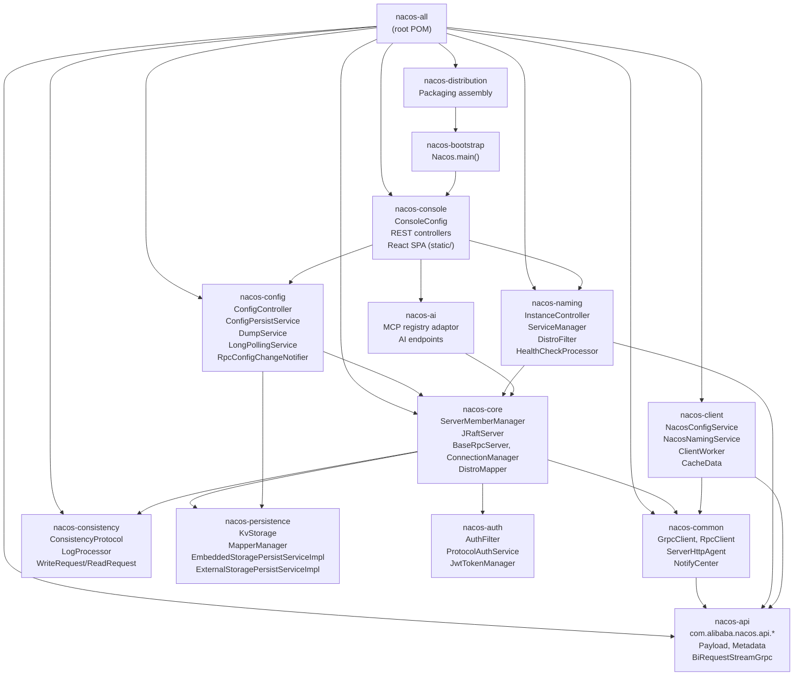
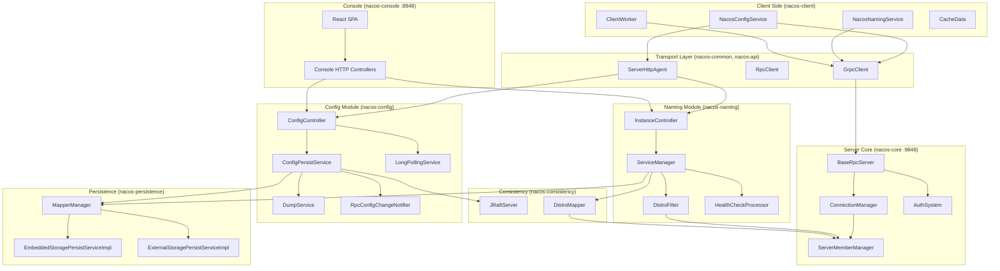

<!-- source: DeepWiki mcp.deepwiki.com · repo alibaba/nacos · page 1 Overview · fetched 2026-10-29 -->

# Overview

<details>
<summary>Relevant source files</summary>

The following files were used as context for generating this wiki page:

- [README.md](README.md)
- [api/pom.xml](api/pom.xml)
- [client/pom.xml](client/pom.xml)
- [common/pom.xml](common/pom.xml)
- [config/pom.xml](config/pom.xml)
- [console/pom.xml](console/pom.xml)
- [core/pom.xml](core/pom.xml)
- [distribution/pom.xml](distribution/pom.xml)
- [example/pom.xml](example/pom.xml)
- [naming/pom.xml](naming/pom.xml)
- [pom.xml](pom.xml)
- [test/pom.xml](test/pom.xml)

</details>


This page introduces the Nacos project: what it does, its four core capabilities, the client ecosystems it supports, and a high-level view of how its major runtime components relate. For the detailed architectural breakdown, see [System Architecture](#1.1). For module dependency specifics, see [Module Structure and Dependencies](#1.2).

---

## What Is Nacos

Nacos (**Na**ming and **Co**nfiguration **S**ervice) is a platform for dynamic service discovery, configuration management, and service management in cloud-native and microservice environments. It is developed by Alibaba Group and distributed under the Apache 2.0 license. The current development branch targets version `3.2.0-SNAPSHOT` as declared in [pom.xml:91]().

The name encodes its two primary concerns:

- **Naming** — service registry and discovery
- **Configuration** — centralized, dynamic configuration management

---

## Four Core Capabilities

| Capability | Description |
|---|---|
| **Service Discovery and Health Check** | Services self-register and are discovered via HTTP or DNS. Real-time health checks prevent routing to unhealthy instances. |
| **Dynamic Configuration Management** | Configurations for all services are managed centrally and pushed to clients without application restarts. |
| **Dynamic DNS Service** | Weighted routing and DNS-based service discovery are supported, decoupling applications from vendor-specific discovery APIs. |
| **Service and Metadata Management** | A built-in dashboard manages service metadata, configuration, Kubernetes DNS, health status, and metrics. |

Sources: [README.md:19-36]()

---

## Supported Client Ecosystems

Nacos integrates with three major service frameworks:

| Ecosystem | Protocol | Notes |
|---|---|---|
| **Apache Dubbo** | Dubbo RPC / gRPC | Uses Nacos for service registry and configuration |
| **Spring Cloud** | HTTP REST | Via `spring-cloud-alibaba` / `nacos-spring-project` |
| **Kubernetes** | DNS | Via `nacos-k8s-sync` module and Kubernetes client |

The `nacos-client` artifact ([client/pom.xml]()) targets Java 1.8 (`client.java.version`) to maximize compatibility, while the server-side modules target Java 17 ([pom.xml:96-98]()).

---

## Maven Module Map

The project is structured as a multi-module Maven build rooted at `nacos-all` ([pom.xml:24]()). The modules declared in [pom.xml:618-648]() are:

**Core runtime modules:**

| Maven Artifact ID | Directory | Role |
|---|---|---|
| `nacos-api` | `api/` | gRPC stubs, public POJOs, client-facing interfaces |
| `nacos-common` | `common/` | HTTP utils, event bus, lifecycle, remote client base |
| `nacos-consistency` | `consistency/` | `ConsistencyProtocol`, `LogProcessor` interfaces |
| `nacos-core` | `core/` | Cluster management, gRPC server, JRaft, auth filter chain |
| `nacos-config` | `config/` | Configuration management server-side logic |
| `nacos-naming` | `naming/` | Service discovery server-side logic |
| `nacos-persistence` | `persistence/` | Storage abstraction, Derby and MySQL DAL |
| `nacos-auth` | `auth/` | Authentication framework |
| `nacos-console` | `console/` | REST controllers + React SPA host |
| `nacos-client` | `client/` | Config + Naming client library (shaded fat jar) |
| `nacos-bootstrap` | `bootstrap/` | Spring Boot application entry point |
| `nacos-server` | `server/` | Server assembly wiring |
| `nacos-distribution` | `distribution/` | Packages the final server tar/zip artifact |
| `nacos-ai` | `ai/` | MCP (Model Context Protocol) registry and AI endpoints |

**Plugin modules** (under `plugin/` and `plugin-default-impl/`):

| Maven Artifact ID | Purpose |
|---|---|
| `nacos-auth-plugin` | Auth SPI interface |
| `nacos-datasource-plugin` | Datasource SPI interface |
| `nacos-encryption-plugin` | Encryption SPI interface |
| `nacos-config-plugin` | Config type extension SPI |
| `nacos-trace-plugin` | Tracing SPI |
| `nacos-control-plugin` | Rate control SPI |
| `default-auth-plugin` | Default JWT-based auth implementation |

Sources: [pom.xml:618-648](), [pom.xml:700-870]()

---

## Module Dependency Diagram

**Maven inter-module dependencies with key classes**



Sources: [pom.xml:618-648](), [core/pom.xml:36-196](), [config/pom.xml:34-140](), [naming/pom.xml:36-130](), [console/pom.xml:31-112](), [client/pom.xml:40-119](), [distribution/pom.xml:34-44]()

---

## Runtime Architecture Overview

At runtime, Nacos exposes two primary subsystems — **Config** and **Naming** — both accessible over gRPC and HTTP. The `console` module sits above both and also hosts the management UI. The system operates in a three-tier architecture: client layer, server layer, and persistence layer.

**High-level system architecture**

```mermaid
graph TB
    subgraph "Client Layer"
        SDK["Nacos Client SDK\nNacosConfigService\nNacosNamingService\nClientWorker\nJava 8 compatible"]
        UI["Console UI\nReact Frontend\nstatic/console-ui/"]
    end
    
    subgraph "Server Layer"
        CONSOLE["nacos-console\nConsole controllers\nFunctionMode handler"]
        CONFIG["nacos-config\nConfigController\nConfigPersistService\nRpcConfigChangeNotifier"]
        NAMING["nacos-naming\nInstanceController\nServiceManager\nDistroFilter"]
        CORE["nacos-core\nServerMemberManager\nConnectionManager\nBaseRpcServer\nAuthSystem"]
    end
    
    subgraph "Communication Layer"
        RPC["gRPC Layer\nBaseRpcServer :9848\nGrpcClusterServer :9849\nPayload/Metadata"]
        HTTP["HTTP Layer\nSpring MVC :8848\nTomcat Embedded"]
    end
    
    subgraph "Persistence Layer"
        EMBEDDED["Embedded Storage\nDerby\nEmbeddedStoragePersistServiceImpl"]
        EXTERNAL["External DB\nMySQL/PostgreSQL\nExternalStoragePersistServiceImpl"]
    end
    
    subgraph "Cluster Management"
        MEMBER["ServerMemberManager\nCluster membership\nHealth checks"]
        DISTRO["DistroMapper\nConsistent hashing\nAP protocol"]
        RAFT["JRaftServer\nRaft consensus\nCP protocol"]
    end
    
    SDK -->|"gRPC/HTTP"| RPC
    UI -->|"HTTP API"| CONSOLE
    
    RPC --> CONFIG
    RPC --> NAMING
    HTTP --> CONSOLE
    
    CONSOLE --> CONFIG
    CONSOLE --> NAMING
    CONSOLE --> CORE
    
    CONFIG --> CORE
    NAMING --> CORE
    
    CONFIG --> EMBEDDED
    CONFIG --> EXTERNAL
    NAMING --> EMBEDDED
    NAMING --> EXTERNAL
    
    CORE --> MEMBER
    NAMING --> DISTRO
    CONFIG --> RAFT
    
    MEMBER -.."cluster coordination"..-> MEMBER
    DISTRO -.."uses"..-> MEMBER
    RAFT -.."uses"..-> MEMBER
```

Sources: [README.md:1-257](), [pom.xml:618-648](), [console/pom.xml:31-112](), [config/pom.xml:34-140](), [naming/pom.xml:36-130](), [core/pom.xml:36-196](), [client/pom.xml:35-38]()

---

**Detailed runtime component interaction**



Sources: [console/pom.xml:31-112](), [config/pom.xml:34-140](), [naming/pom.xml:36-130](), [core/pom.xml:36-196](), [client/pom.xml:40-119]()

---

## Key Technology Stack

| Concern | Technology | Version in pom.xml |
|---|---|---|
| RPC transport | gRPC (grpc-netty-shaded) | `1.75.0` |
| Serialization | Protocol Buffers | `3.25.5` |
| CP consistency | SOFAJRaft (jraft-core) | `1.4.0` |
| Embedded DB | Apache Derby | `10.14.2.0` |
| External DB | MySQL Connector/J | `8.2.0` |
| Metrics | Micrometer | `1.12.8` |
| Auth tokens | JJWT | `0.11.2` |
| Server framework | Spring Boot | `3.4.10` |
| Kubernetes client | Official Java client | `22.0.0` |
| AI/MCP | MCP SDK | `0.14.1` |

Sources: [pom.xml:130-167]()

---

## Where to Go Next

| Topic | Wiki Page |
|---|---|
| Runtime port topology, auth filter chain, protocol details | [System Architecture](#1.1) |
| Maven module layering in depth | [Module Structure and Dependencies](#1.2) |
| Deployment modes, startup scripts | [Installation and Deployment](#2) |
| Configuration service client SDK and server API | [Configuration Service](#3) |
| Service discovery client SDK and server | [Naming Service](#4) |
| Persistence layer (KvStorage, Derby, MySQL) | [Data Persistence](#5) |
| JRaft CP + Distro AP protocols | [Consistency Protocols](#6.2) |
| gRPC server and client implementation | [Communication Framework](#7) |
| Management console (React + Spring controllers) | [Console and Management UI](#8) |
| Auth plugin SPI, build system, monitoring | [Development and Operations](#9) |

---

