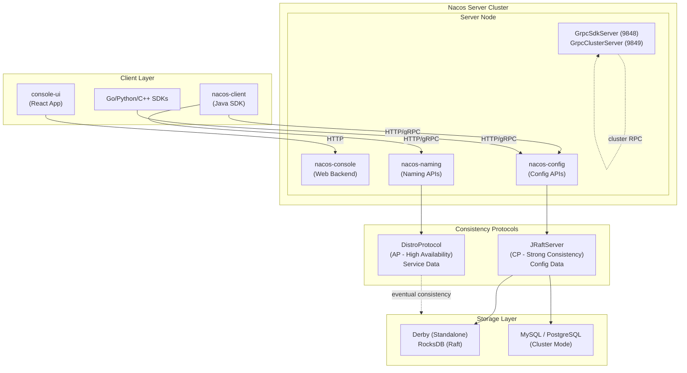
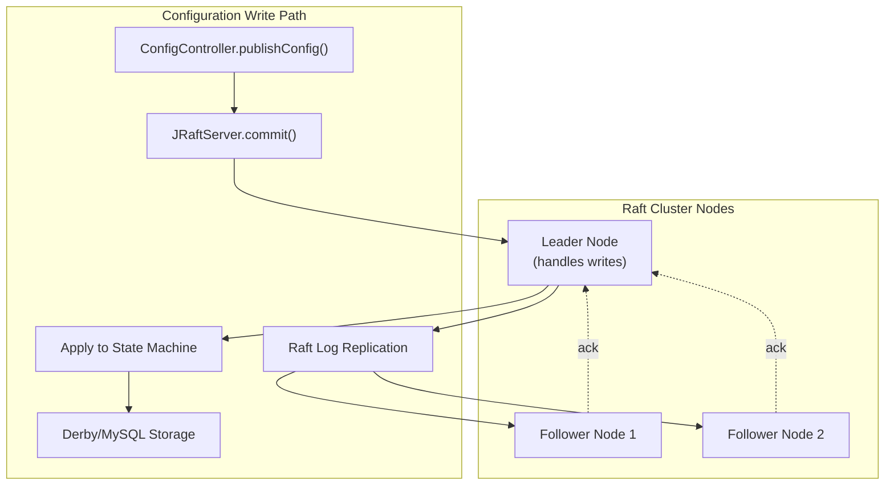
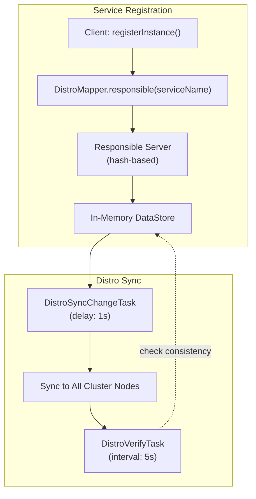
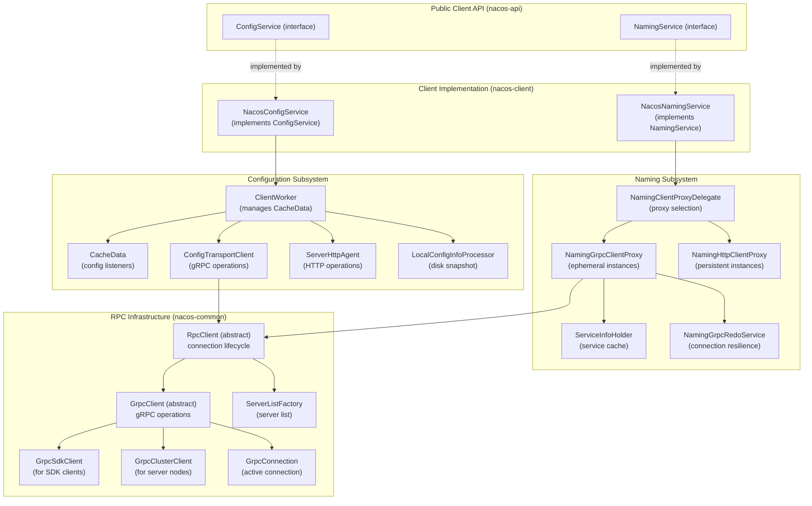
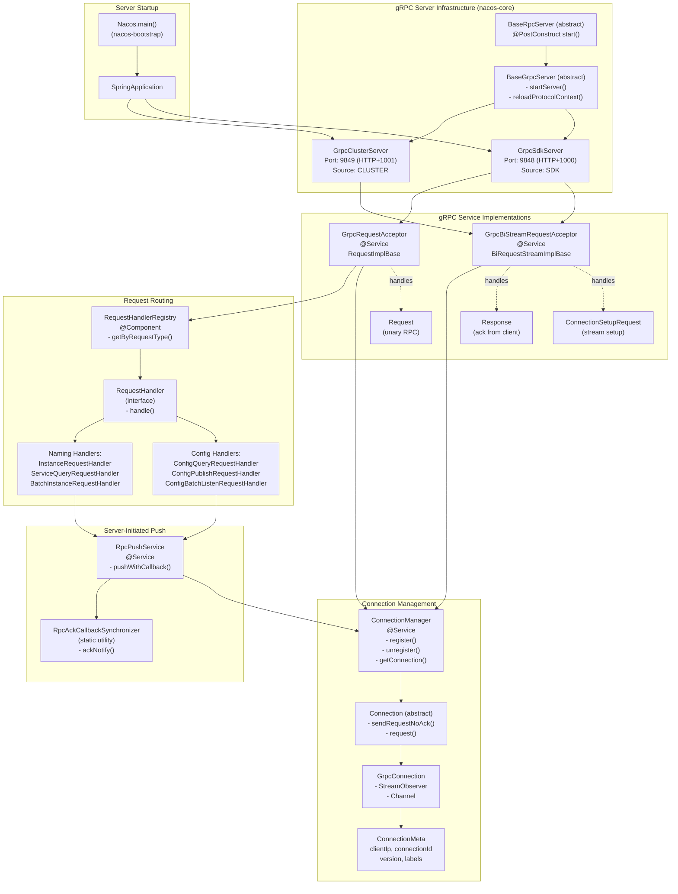
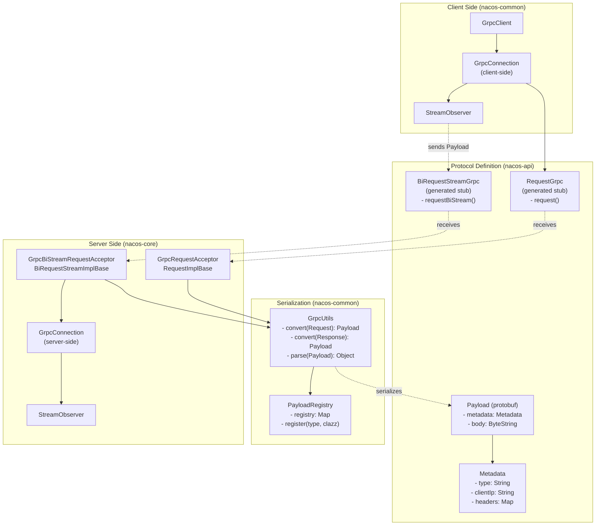
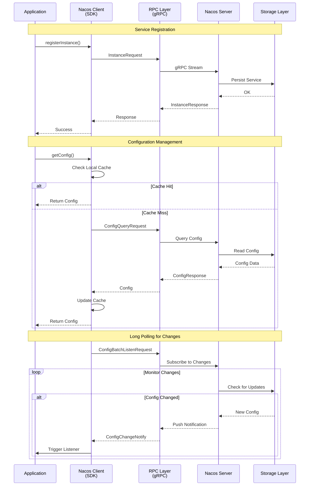
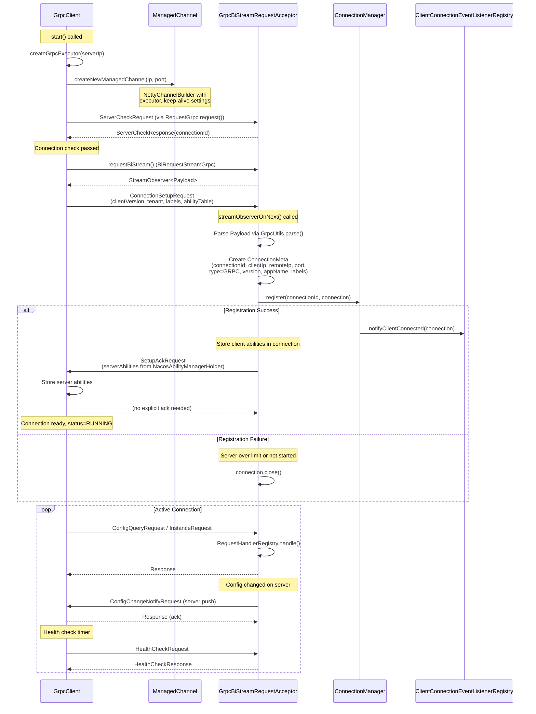
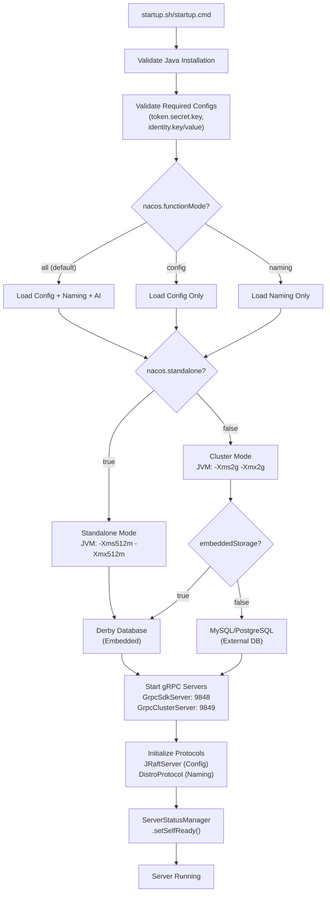
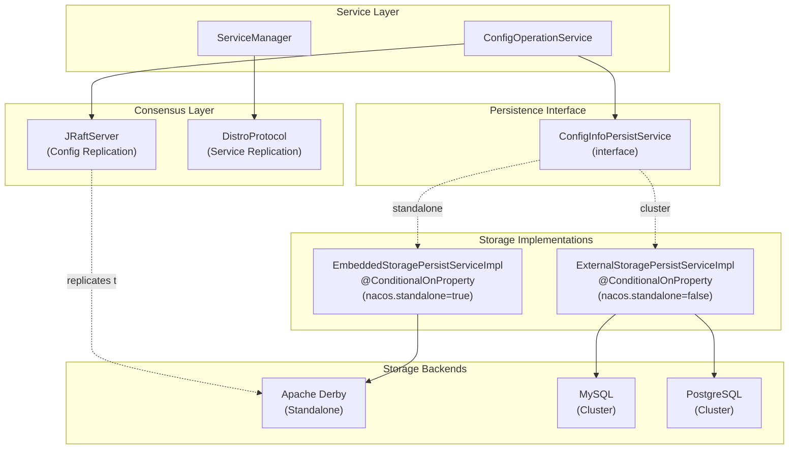

<!-- source: DeepWiki mcp.deepwiki.com · repo alibaba/nacos · page 1.1 System Architecture · fetched 2026-10-29 -->

# System Architecture

<details>
<summary>Relevant source files</summary>

The following files were used as context for generating this wiki page:

- [.gitignore](.gitignore)
- [README.md](README.md)
- [api/pom.xml](api/pom.xml)
- [client/pom.xml](client/pom.xml)
- [common/pom.xml](common/pom.xml)
- [config/pom.xml](config/pom.xml)
- [console/pom.xml](console/pom.xml)
- [console/src/main/resources/META-INF/nacos-default.properties](console/src/main/resources/META-INF/nacos-default.properties)
- [core/pom.xml](core/pom.xml)
- [distribution/bin/shutdown.cmd](distribution/bin/shutdown.cmd)
- [distribution/bin/shutdown.sh](distribution/bin/shutdown.sh)
- [distribution/bin/startup.cmd](distribution/bin/startup.cmd)
- [distribution/bin/startup.sh](distribution/bin/startup.sh)
- [distribution/conf/application.properties](distribution/conf/application.properties)
- [distribution/pom.xml](distribution/pom.xml)
- [example/pom.xml](example/pom.xml)
- [naming/pom.xml](naming/pom.xml)
- [pom.xml](pom.xml)
- [test/pom.xml](test/pom.xml)

</details>


## Overview

Nacos implements a client-server architecture with a dual-protocol consistency model: **Raft (CP)** for configuration data requiring strong consistency, and **Distro (AP)** for service discovery prioritizing availability. The system supports multi-protocol communication (gRPC and HTTP) and can be deployed in standalone or cluster modes.

This page explains the overall system design, major components, and how they interact. For detailed subsystem documentation:
- Module dependencies: Page 1.2 Module Structure and Dependencies
- Configuration service: Page 3 Configuration Service
- Naming service: Page 4 Naming Service
- Cluster management: Page 6 Cluster Management
- RPC framework: Page 7 Communication Framework

---

## High-Level Architecture

Nacos separates concerns across four primary layers: Client Layer (SDK and UI), Server Layer (service modules), Communication Layer (gRPC/HTTP), and Storage Layer (embedded or external databases). The system uses two distinct consistency protocols based on data characteristics.

### System Layers and Components



**Layer Responsibilities:**

| Layer | Key Components | Purpose |
|-------|----------------|---------|
| **Client Layer** | `NacosConfigService`, `NacosNamingService`, `ClientWorker` | SDK for application integration, local caching, long polling |
| **Server Layer** | `ConfigController`, `InstanceController`, `BaseGrpcServer` | REST APIs, gRPC services, request routing |
| **Consistency Layer** | `JRaftServer`, `DistroProtocol`, `ServerMemberManager` | Data replication, cluster coordination |
| **Storage Layer** | `EmbeddedStoragePersistServiceImpl`, `ExternalStoragePersistServiceImpl` | Data persistence, dual-storage strategy |

**Sources:** [pom.xml:614-645](), [core/src/main/java/com/alibaba/nacos/core/remote/grpc/BaseGrpcServer.java:64](), [core/src/main/java/com/alibaba/nacos/core/remote/grpc/GrpcSdkServer.java](), [consistency/src/main/java/com/alibaba/nacos/consistency/cp/CPProtocol.java]()

---

## Dual-Protocol Consistency Model

Nacos uses **two distinct consistency protocols** based on data characteristics: Raft for configuration data (CP in CAP theorem) and Distro for service discovery data (AP in CAP theorem).

### Raft Protocol for Configuration (CP)



**Raft Implementation Details:**

- **Library**: Uses Alibaba JRaft (SOFAJRaft) library from `jraft-core` dependency
- **Leader Election**: Implements Raft leader election with configurable timeout (default: 5 seconds)
- **Log Replication**: Writes replicate to majority of nodes before commit
- **Snapshot**: Periodic snapshots (default: 30 minutes) via `nacos.core.protocol.raft.data.snapshot_interval_secs`
- **Read Strategy**: Supports `ReadOnlySafe` (leader tenure confirmation) and `ReadOnlyLeaseBased`
- **Key Classes**: `JRaftServer`, `JRaftProtocol`, `NacosStateMachine`, `LogProcessor4CP`

**Sources:** [core/pom.xml:114-123](), [consistency/src/main/java/com/alibaba/nacos/consistency/cp/CPProtocol.java](), [distribution/conf/application.properties:107-122]()

### Distro Protocol for Service Discovery (AP)



**Distro Implementation Details:**

- **Hash-Based Distribution**: `DistroMapper` calculates responsible server using consistent hashing on service name
- **Eventual Consistency**: Data propagates asynchronously to all nodes (default sync delay: 1 second)
- **Memory Storage**: Ephemeral service instances stored in `DataStore` (not persisted)
- **Verification**: `DistroVerifyTask` periodically checks data consistency across nodes (default: 5 seconds)
- **Retry Logic**: Failed syncs retry with exponential backoff (default retry delay: 3 seconds)
- **Key Classes**: `DistroProtocol`, `DistroMapper`, `DistroSyncChangeTask`, `DistroVerifyTask`, `DataStore`

**Configuration Properties:**

```properties
# Distro sync delay (default: 1000ms)
nacos.core.protocol.distro.data.sync.delayMs=1000

# Distro sync timeout (default: 3000ms)
nacos.core.protocol.distro.data.sync.timeoutMs=3000

# Distro verify interval (default: 5000ms)
nacos.core.protocol.distro.data.verify.intervalMs=5000
```

**Sources:** [naming/src/main/java/com/alibaba/nacos/naming/consistency/ephemeral/distro/DistroProtocol.java](), [naming/src/main/java/com/alibaba/nacos/naming/consistency/ephemeral/distro/DistroMapper.java](), [distribution/conf/application.properties:124-139]()

---

## Client-Server Communication

### Client Architecture

The `nacos-client` module provides programmatic APIs for configuration and naming services. Both use a shared `RpcClient` infrastructure for gRPC communication with automatic failover and reconnection.

#### Client Component Hierarchy



**Key Client Classes:**

| Component | Module | Responsibility |
|-----------|--------|----------------|
| `NacosConfigService` | nacos-client | Public API for config operations (get, publish, listen) |
| `NacosNamingService` | nacos-client | Public API for naming operations (register, subscribe, deregister) |
| `ClientWorker` | nacos-client | Config long polling, local cache (`CacheData`), listener notification |
| `ConfigTransportClient` | nacos-client | gRPC-based config queries and batch listen |
| `NamingClientProxyDelegate` | nacos-client | Routes to gRPC (ephemeral) or HTTP (persistent) proxies |
| `NamingGrpcClientProxy` | nacos-client | Handles ephemeral instance registration via gRPC |
| `NamingGrpcRedoService` | nacos-client | Connection resilience, automatic re-registration on reconnect |
| `ServiceInfoHolder` | nacos-client | Local cache for service instance lists with scheduled refresh |
| `RpcClient` | nacos-common | Base class with connection lifecycle, health checks, reconnection |
| `GrpcClient` | nacos-common | gRPC implementation with bidirectional streaming |
| `GrpcSdkClient` | nacos-common | SDK-specific gRPC client (port: server+1000) |
```

**RpcClient Architecture:**

The `RpcClient` abstract class ([common/src/main/java/com/alibaba/nacos/common/remote/client/RpcClient.java:69]()) provides:

- **Connection Lifecycle**: Methods `start()`, `shutdown()`, automatic reconnection via `reconnectionSignal` queue
- **Server Selection**: `ServerListFactory` integration for dynamic server list updates
- **Health Monitoring**: Periodic `HealthCheckRequest` sent via `healthCheck()` method
- **Client States**: `WAIT_INIT`, `INITIALIZED`, `STARTING`, `RUNNING`, `UNHEALTHY`, `SHUTDOWN`
- **Event Handling**: `eventLinkedBlockingQueue` publishes `ConnectionEvent` notifications
```

**Sources:** [client/src/main/java/com/alibaba/nacos/client/config/NacosConfigService.java](), [client/src/main/java/com/alibaba/nacos/client/naming/NacosNamingService.java](), [client/src/main/java/com/alibaba/nacos/client/config/impl/ClientWorker.java](), [common/src/main/java/com/alibaba/nacos/common/remote/client/RpcClient.java:69-450](), [common/src/main/java/com/alibaba/nacos/common/remote/client/grpc/GrpcClient.java:79-600]()

**RpcClient Architecture:**

The `RpcClient` abstract class ([common/src/main/java/com/alibaba/nacos/common/remote/client/RpcClient.java:69]()) provides the foundation for all client-server communication:

- **Connection Lifecycle**: Automatic connection establishment, health monitoring, and reconnection
- **Server Selection**: `ServerListFactory` integration for dynamic server list updates
- **Health Checking**: Periodic `HealthCheckRequest` sent via `healthCheck()` method
- **Reconnection Signal**: `BlockingQueue<ReconnectContext> reconnectionSignal` triggers reconnect operations
- **Event Handling**: `BlockingQueue<ConnectionEvent> eventLinkedBlockingQueue` notifies connection state changes
- **RpcClientStatus**: Tracks client state: `WAIT_INIT`, `INITIALIZED`, `STARTING`, `RUNNING`, `UNHEALTHY`, `SHUTDOWN`

The `GrpcClient` implementation ([common/src/main/java/com/alibaba/nacos/common/remote/client/grpc/GrpcClient.java:79]()) extends `RpcClient` for gRPC protocol:

- **Bidirectional Streaming**: `BiRequestStreamGrpc.BiRequestStreamStub` for server push capability
- **Unary Requests**: `RequestGrpc.RequestFutureStub` for request-response pattern
- **Channel Management**: Creates `ManagedChannel` via `createNewManagedChannel(serverIp, port)`
- **Ability Negotiation**: `RecAbilityContext` coordinates capability exchange with `SetupRequestHandler`
- **TLS Support**: Optional `RpcClientTlsConfig` for encrypted connections
- **Thread Pool**: Dedicated `grpcExecutor` created via `createGrpcExecutor(serverIp)`

**Sources:** [common/src/main/java/com/alibaba/nacos/common/remote/client/RpcClient.java:69-450](), [common/src/main/java/com/alibaba/nacos/common/remote/client/grpc/GrpcClient.java:79-600](), [common/src/main/java/com/alibaba/nacos/common/remote/client/grpc/GrpcSdkClient.java:31](), [common/src/main/java/com/alibaba/nacos/common/remote/client/grpc/GrpcClusterClient.java:32]()

### Server Architecture

The server uses a dual gRPC server design: `GrpcSdkServer` (port 9848) for client connections and `GrpcClusterServer` (port 9849) for inter-node cluster communication. Each server runs independently with separate connection pools and policies.

#### Server Component Architecture



**Key Server Classes:**

| Component | Module | Port | Responsibility |
|-----------|--------|------|----------------|
| `BaseGrpcServer` | nacos-core | - | Abstract base with `startServer()`, `addServices()`, interceptors |
| `GrpcSdkServer` | nacos-core | 9848 | Handles SDK client connections (HTTP port + 1000) |
| `GrpcClusterServer` | nacos-core | 9849 | Inter-node cluster communication (HTTP port + 1001) |
| `GrpcBiStreamRequestAcceptor` | nacos-core | - | Implements `BiRequestStreamImplBase` for bidirectional streaming |
| `GrpcRequestAcceptor` | nacos-core | - | Implements `RequestImplBase` for unary RPC |
| `ConnectionManager` | nacos-core | - | Connection registration, tracking, health monitoring, ejection |
| `RequestHandlerRegistry` | nacos-core | - | Routes incoming requests to appropriate `RequestHandler` implementations |
| `RpcPushService` | nacos-core | - | Server-initiated push notifications to connected clients |
```

**BaseGrpcServer Implementation:**

The `BaseGrpcServer` ([core/src/main/java/com/alibaba/nacos/core/remote/grpc/BaseGrpcServer.java:64]()) provides:

- **Server Startup**: `startServer()` creates `NettyServerBuilder` with `getServicePort()`
- **Service Registration**: `addServices()` registers gRPC stubs with interceptors (`GrpcConnectionInterceptor`)
- **Keep-Alive**: Configurable via `getKeepAliveTime()`, `getKeepAliveTimeout()`, `getPermitKeepAliveTime()`
- **Message Limits**: `getMaxInboundMessageSize()` defaults to 10MB
- **TLS Support**: Optional `newProtocolNegotiator()` for encrypted connections
```

**Sources:** [core/src/main/java/com/alibaba/nacos/core/remote/grpc/BaseGrpcServer.java:64-188](), [core/src/main/java/com/alibaba/nacos/core/remote/grpc/GrpcSdkServer.java](), [core/src/main/java/com/alibaba/nacos/core/remote/grpc/GrpcClusterServer.java](), [core/src/main/java/com/alibaba/nacos/core/remote/ConnectionManager.java:57-370]()

**BaseGrpcServer Implementation:**

The `BaseGrpcServer` abstract class ([core/src/main/java/com/alibaba/nacos/core/remote/grpc/BaseGrpcServer.java:64]()) provides core server functionality:

- **Server Startup**: `startServer()` creates `NettyServerBuilder` with configured port via `getServicePort()`
- **Service Registration**: `addServices()` registers gRPC service implementations with interceptors
- **Protocol Negotiation**: Optional `newProtocolNegotiator()` for TLS/proxy protocol support
- **Keep-Alive Configuration**: Methods `getKeepAliveTime()`, `getKeepAliveTimeout()`, `getPermitKeepAliveTime()`
- **Message Size Limits**: `getMaxInboundMessageSize()` defaults to 10MB
- **Interceptors**: `getSeverInterceptors()` returns `GrpcConnectionInterceptor` for connection tracking
- **Transport Filters**: `getServerTransportFilters()` returns `AddressTransportFilter` for IP extraction

**ConnectionManager Responsibilities:**

The `ConnectionManager` service ([core/src/main/java/com/alibaba/nacos/core/remote/ConnectionManager.java:57]()) manages connection lifecycle:

- **Registration**: `register(connectionId, connection)` validates and stores new connections
- **Connection Limits**: `checkLimit()` enforces per-IP and per-app connection quotas via `ControlManagerCenter`
- **Validation**: `checkValid(connectionId)` verifies connection is still registered
- **Retrieval**: `getConnection(connectionId)` and `getConnectionByIp(clientIp)` for connection lookup
- **Unregistration**: `unregister(connectionId)` removes connection and notifies listeners
- **Health Monitoring**: Integrates with `RuntimeConnectionEjector` for periodic health checks
- **Event Notification**: `ClientConnectionEventListenerRegistry` notifies on connect/disconnect events

**Sources:** [core/src/main/java/com/alibaba/nacos/core/remote/grpc/BaseGrpcServer.java:64-188](), [core/src/main/java/com/alibaba/nacos/core/remote/grpc/GrpcSdkServer.java:1-80](), [core/src/main/java/com/alibaba/nacos/core/remote/grpc/GrpcClusterServer.java:1-80](), [core/src/main/java/com/alibaba/nacos/core/remote/grpc/GrpcBiStreamRequestAcceptor.java:52-213](), [core/src/main/java/com/alibaba/nacos/core/remote/grpc/GrpcRequestAcceptor.java:56-220](), [core/src/main/java/com/alibaba/nacos/core/remote/ConnectionManager.java:57-370]()

### Communication Protocols

Nacos supports dual communication protocols: **gRPC** for efficient bidirectional streaming and **HTTP** for backward compatibility. gRPC is the primary protocol using Protobuf serialization.

#### gRPC Protocol Implementation



**Protobuf Message Structure:**

The `Payload` message ([api/src/main/proto/nacos_grpc_service.proto]()) wraps all gRPC communication:

```protobuf
message Payload {
    Metadata metadata = 1;    // Request type, client IP, headers
    google.protobuf.Any body = 2;  // Serialized request/response
}

message Metadata {
    string type = 1;         // e.g., "ConfigQueryRequest"
    string clientIp = 2;     // Client IP address
    map<string, string> headers = 3;  // Custom headers
}
```

**Serialization:**

`GrpcUtils` ([common/src/main/java/com/alibaba/nacos/common/remote/client/grpc/GrpcUtils.java]()) handles serialization:
- `convert(Request)`: Serializes request to `Payload` using JSON
- `parse(Payload)`: Deserializes `Payload` using `PayloadRegistry` type mapping
- `PayloadRegistry`: Maps request type strings (e.g., "ConfigQueryRequest") to Java classes

**gRPC Services:**

- `BiRequestStreamGrpc.requestBiStream()`: Bidirectional streaming for server push
- `RequestGrpc.request()`: Unary RPC for request-response patterns
```

**Sources:** [api/src/main/proto/nacos_grpc_service.proto](), [common/src/main/java/com/alibaba/nacos/common/remote/client/grpc/GrpcUtils.java]()

### Interaction Patterns

Nacos implements three primary interaction patterns: service registration (push), configuration queries (pull with caching), and change notifications (server push via long polling).

#### Service Registration and Configuration Query Flow



**Interaction Patterns Explained:**

1. **Service Registration (Push)**:
   - Client calls `NamingService.registerInstance()`
   - `NamingGrpcClientProxy` creates `InstanceRequest` and sends via gRPC stream
   - `InstanceRequestHandler` on server processes request
   - `DistroProtocol` distributes registration to responsible node
   - `NamingGrpcRedoService` caches registration for automatic retry on reconnection

2. **Configuration Query (Pull with Cache)**:
   - Client calls `ConfigService.getConfig()`
   - `ClientWorker` checks local `CacheData` first
   - On cache miss, `ConfigTransportClient` sends `ConfigQueryRequest`
   - Server `ConfigQueryRequestHandler` reads from storage (via Raft)
   - Client updates `CacheData` and returns to application

3. **Long Polling (Server Push)**:
   - `ClientWorker` sends `ConfigBatchListenRequest` for monitored configs
   - Server tracks listeners in `ConfigChangeListenContext`
   - On config change, `RpcConfigChangeNotifier` publishes `LocalDataChangeEvent`
   - `RpcPushService` sends `ConfigChangeNotifyRequest` via bidirectional stream
   - Client `ClientWorker` triggers registered `Listener.receiveConfigInfo()` callbacks

**Sources:** [client/src/main/java/com/alibaba/nacos/client/config/impl/ClientWorker.java](), [client/src/main/java/com/alibaba/nacos/client/naming/remote/NamingClientProxyDelegate.java](), [config/src/main/java/com/alibaba/nacos/config/server/remote/RpcConfigChangeNotifier.java]()

### Connection Establishment

The connection setup involves server capability check, bidirectional stream creation, and ability negotiation between client and server.

#### Connection Setup Sequence



**Connection Establishment Steps:**

1. **Channel Creation**: `GrpcClient.createNewManagedChannel()` builds `NettyChannelBuilder` with TLS, keep-alive, and executor configuration

2. **Server Check**: Client sends `ServerCheckRequest` via unary RPC to verify server availability and get connection ID

3. **Stream Setup**: `bindRequestStream()` establishes bidirectional stream using `BiRequestStreamGrpc.requestBiStream()`

4. **Setup Request**: Client sends `ConnectionSetupRequest` with client version, labels, and ability table

5. **Connection Registration**: Server creates `ConnectionMeta`, validates limits via `ConnectionManager.checkLimit()`, and registers connection

6. **Setup Ack**: Server responds with `SetupAckRequest` containing server ability table

7. **Ready State**: Client transitions to `RUNNING` state and begins sending requests

**Connection Resilience:**

- **Health Checks**: Periodic `HealthCheckRequest` every 3 seconds (configurable)
- **Reconnection**: Automatic reconnection on failure via `reconnectionSignal` queue
- **Connection Ejection**: Server ejects unhealthy connections via `RuntimeConnectionEjector`
- **Retry Logic**: Exponential backoff for failed connection attempts

**Sources:** [common/src/main/java/com/alibaba/nacos/common/remote/client/grpc/GrpcClient.java:199-450](), [core/src/main/java/com/alibaba/nacos/core/remote/grpc/GrpcBiStreamRequestAcceptor.java:74-212](), [core/src/main/java/com/alibaba/nacos/core/remote/ConnectionManager.java:102-162]()

### Server Push Mechanism

Configuration changes trigger server-initiated push notifications to connected clients through an event-driven architecture using `NotifyCenter` and registered subscribers.

#### Server Push Architecture

```mermaid
graph TB
    subgraph EventSource["Event Sources (nacos-common)"]
        LocalDataChangeEvent["LocalDataChangeEvent<br/>(extends Event)<br/>groupKey, isBeta"]
        ServiceChangeEvent["ServiceChangeEvent<br/>serviceName, namespace"]
        NotifyCenter["NotifyCenter<br/>- publishEvent()<br/>- registerSubscriber()"]
    end
    
    subgraph Subscribers["Event Subscribers (nacos-config, nacos-naming)"]
        RpcConfigChangeNotifier["RpcConfigChangeNotifier<br/>extends Subscriber<LocalDataChangeEvent><br/>@Component"]
        ConfigChangeListenContext["ConfigChangeListenContext<br/>- getListeners(groupKey)<br/>- getConfigListenState()"]
        NamingSubscriberService["NamingSubscriberService<br/>(for naming events)"]
    end
    
    subgraph PushInfra["Push Infrastructure (nacos-core)"]
        RpcPushService["RpcPushService<br/>@Service<br/>- pushWithCallback()"]
        RpcPushTask["RpcPushTask<br/>- request: Request<br/>- retryTimes: int<br/>- connectionId: String"]
        RpcAckCallbackSynchronizer["RpcAckCallbackSynchronizer<br/>- ackNotify()<br/>- ConcurrentHashMap callbacks"]
    end
    
    subgraph ConnectionInfra["Connection Infrastructure (nacos-core)"]
        ConnectionManager["ConnectionManager<br/>- getConnection()<br/>- connections: Map"]
        GrpcConnection["GrpcConnection<br/>- sendRequestNoAck()<br/>- request(timeout)<br/>- streamObserver"]
        StreamObserver["StreamObserver<Payload><br/>- onNext()"]
    end
    
    subgraph CallbackHandling["Callback Handling"]
        AbstractPushCallBack["AbstractPushCallBack<br/>- onSuccess()<br/>- onFail()<br/>- onTimeout()"]
        ConfigPushCallback["Custom callbacks:<br/>- retry logic<br/>- metrics recording"]
    end
    
    LocalDataChangeEvent --> NotifyCenter
    NotifyCenter --> RpcConfigChangeNotifier
    RpcConfigChangeNotifier --> ConfigChangeListenContext
    
    Note over RpcConfigChangeNotifier: onEvent() called
    RpcConfigChangeNotifier --> RpcPushService
    RpcPushService --> RpcPushTask
    
    RpcPushTask --> ConnectionManager
    ConnectionManager --> GrpcConnection
    GrpcConnection --> StreamObserver
    
    Note over StreamObserver: Sends Payload via gRPC
    StreamObserver -.client ack.-> RpcAckCallbackSynchronizer
    RpcAckCallbackSynchronizer --> AbstractPushCallBack
    AbstractPushCallBack --> ConfigPushCallback
```

**Server Push Components:**

| Component | Module | Key Method | Responsibility |
|-----------|--------|------------|----------------|
| `NotifyCenter` | nacos-common | `publishEvent()` | Event bus for internal events |
| `RpcConfigChangeNotifier` | nacos-config | `configDataChanged()` | Subscribes to `LocalDataChangeEvent` |
| `ConfigChangeListenContext` | nacos-config | `getListeners(groupKey)` | Tracks which connections listen to which configs |
| `RpcPushService` | nacos-core | `pushWithCallback()` | Executes push with async callback |
| `RpcPushTask` | nacos-config | `run()` | Retry logic for failed pushes |
| `GrpcConnection` | nacos-core | `request(timeout)` | Sends via `StreamObserver.onNext()` |
| `RpcAckCallbackSynchronizer` | nacos-core | `ackNotify()` | Routes client acknowledgment to callback |
```

**Push Notification Flow:**

1. **Event Publication**: Configuration change triggers `LocalDataChangeEvent` published via `NotifyCenter.publishEvent()`

2. **Event Handling**: `RpcConfigChangeNotifier.configDataChanged()` receives event, queries `ConfigChangeListenContext.getListeners()` for interested connection IDs

3. **Push Request Creation**: Creates `ConfigChangeNotifyRequest` with dataId, group, tenant, and wraps in `RpcPushTask`

4. **Push Execution**: `RpcPushService.pushWithCallback()` retrieves `GrpcConnection`, calls `connection.request()`, registers callback in `RpcAckCallbackSynchronizer`

5. **Client Acknowledgment**: Client sends `Response`, server `GrpcBiStreamRequestAcceptor.onNext()` receives it, `RpcAckCallbackSynchronizer.ackNotify()` triggers callback

6. **Retry on Failure**: `RpcPushTask` tracks retry count, re-queues via `ConfigExecutor.scheduleConfigTask()` if push fails, respects max retries

**Sources:** [config/src/main/java/com/alibaba/nacos/config/server/remote/RpcConfigChangeNotifier.java:51-180](), [core/src/main/java/com/alibaba/nacos/core/remote/RpcPushService.java](), [core/src/main/java/com/alibaba/nacos/core/remote/RpcAckCallbackSynchronizer.java]()


---

## Deployment Modes

Nacos supports standalone (single-node) and cluster (multi-node) deployment modes with configurable function modes and storage backends.

### Deployment Configuration

| Mode | Configuration | Database | Use Case |
|------|---------------|----------|----------|
| **Standalone** | `nacos.standalone=true` | Embedded Derby | Development, testing, small-scale production |
| **Cluster** | `nacos.standalone=false` | External MySQL/PostgreSQL | Production HA environments |
| **Function: all** | `nacos.functionMode=all` | - | Both config and naming services enabled (default) |
| **Function: config** | `nacos.functionMode=config` | - | Configuration service only |
| **Function: naming** | `nacos.functionMode=naming` | - | Service discovery only |

### Startup and Module Loading



**Function Modes:**

| Mode | Property | Modules Loaded | Use Case |
|------|----------|----------------|----------|
| **All** | `nacos.functionMode=all` (default) | Config + Naming + AI | Full-featured deployment |
| **Config** | `nacos.functionMode=config` | Config only (read-only naming stubs) | Dedicated config management |
| **Naming** | `nacos.functionMode=naming` | Naming only (read-only config stubs) | Dedicated service registry |

**Storage Selection:**

- **Standalone**: Uses Derby embedded database with Raft for local consensus
- **Cluster + Embedded**: Uses RocksDB with Raft for distributed consensus (not recommended for production)
- **Cluster + External**: Uses MySQL or PostgreSQL shared database (recommended for production)

**Startup Commands:**

```bash
# Standalone (development)
sh startup.sh -m standalone

# Cluster with external DB (production)
sh startup.sh -m cluster

# Config-only mode
sh startup.sh -f config -m cluster

# Windows standalone
startup.cmd -m standalone
```

**Key Configuration Properties:**

```properties
# Deployment mode
nacos.standalone=true|false

# Function mode
nacos.functionMode=all|config|naming

# HTTP server port (default: 8848)
server.port=8848

# External database (cluster mode)
db.num=1
db.url.0=jdbc:mysql://localhost:3306/nacos
db.user.0=nacos
db.password.0=nacos

# Authentication
nacos.core.auth.enabled=true
nacos.core.auth.plugin.nacos.token.secret.key=<Base64-encoded-key>
```

**Sources:** [distribution/bin/startup.sh:57-211](), [distribution/bin/startup.cmd:26-113](), [distribution/conf/application.properties:17-330]()

### Port Allocation

Nacos uses three ports per server instance:

| Service | Port | Formula | Purpose |
|---------|------|---------|---------|
| HTTP/Console | 8848 | Configurable via `server.port` | REST APIs, web console |
| gRPC SDK | 9848 | `server.port + 1000` | Client SDK connections |
| gRPC Cluster | 9849 | `server.port + 1001` | Inter-node cluster communication |

The `BaseGrpcServer.rpcPortOffset()` method calculates gRPC ports:
- `GrpcSdkServer.getServicePort()` returns HTTP port + 1000
- `GrpcClusterServer.getServicePort()` returns HTTP port + 1001

**Sources:** [core/src/main/java/com/alibaba/nacos/core/remote/grpc/BaseGrpcServer.java:90-116](), [core/src/main/java/com/alibaba/nacos/core/remote/grpc/GrpcSdkServer.java](), [core/src/main/java/com/alibaba/nacos/core/remote/grpc/GrpcClusterServer.java]()

### Storage Architecture



**Storage Selection:**

- **Standalone Mode**: `EmbeddedStoragePersistServiceImpl` with Derby, Raft replication within embedded DB
- **Cluster Mode**: `ExternalStoragePersistServiceImpl` with MySQL/PostgreSQL, Raft replication via shared DB

Spring `@ConditionalOnProperty` annotations control which implementation loads based on `nacos.standalone` property.

**Sources:** [persistence/src/main/java/com/alibaba/nacos/persistence/configuration/DatasourceConfiguration.java](), [config/pom.xml:34-50](), [core/pom.xml:114-123]()

---

## Cross-Cutting Concerns

### Connection Lifecycle Management

The `ConnectionManager` ([core/src/main/java/com/alibaba/nacos/core/remote/ConnectionManager.java:57]()) tracks all active connections and manages their lifecycle:

1. **Registration**: New connections are registered with validation ([core/src/main/java/com/alibaba/nacos/core/remote/ConnectionManager.java:102-127]())
2. **Health Monitoring**: Periodic health checks detect stale connections
3. **Connection Limits**: Per-IP connection limits prevent abuse ([core/src/main/java/com/alibaba/nacos/core/remote/ConnectionManager.java:129-140]())
4. **Ejection**: Unhealthy connections are automatically removed ([core/src/main/java/com/alibaba/nacos/core/remote/ConnectionManager.java:147-162]())

### Ability Negotiation

Clients and servers negotiate capabilities during connection setup to enable feature compatibility:

1. Client sends `ConnectionSetupRequest` with its ability table ([api/src/main/java/com/alibaba/nacos/api/remote/request/ConnectionSetupRequest.java:28]())
2. Server validates and stores client abilities in `Connection.abilityTable` ([core/src/main/java/com/alibaba/nacos/core/remote/Connection.java:60-66]())
3. Server responds with `SetupAckRequest` containing server abilities ([core/src/main/java/com/alibaba/nacos/core/remote/grpc/GrpcBiStreamRequestAcceptor.java:186-198]())
4. Client stores server abilities for feature detection

This enables graceful degradation when clients and servers have different versions.

### Error Handling and Resilience

The system implements multiple resilience patterns:

- **Client-side retry**: `RpcClient` automatically retries failed requests with exponential backoff ([common/src/main/java/com/alibaba/nacos/common/remote/client/RpcClient.java:338-357]())
- **Server push retry**: `RpcPushTask` retries failed push operations ([config/src/main/java/com/alibaba/nacos/config/server/remote/RpcConfigChangeNotifier.java:108-111]())
- **Connection failover**: Clients automatically switch servers on connection failure ([common/src/main/java/com/alibaba/nacos/common/remote/client/RpcClient.java:216-234]())
- **Local failover**: Configuration client uses disk snapshots when server is unavailable

**Sources:** [core/src/main/java/com/alibaba/nacos/core/remote/ConnectionManager.java:57-370](), [core/src/main/java/com/alibaba/nacos/core/remote/Connection.java:32-103](), [core/src/main/java/com/alibaba/nacos/core/remote/grpc/GrpcBiStreamRequestAcceptor.java:151-199](), [common/src/main/java/com/alibaba/nacos/common/remote/client/RpcClient.java:338-382]()

---

