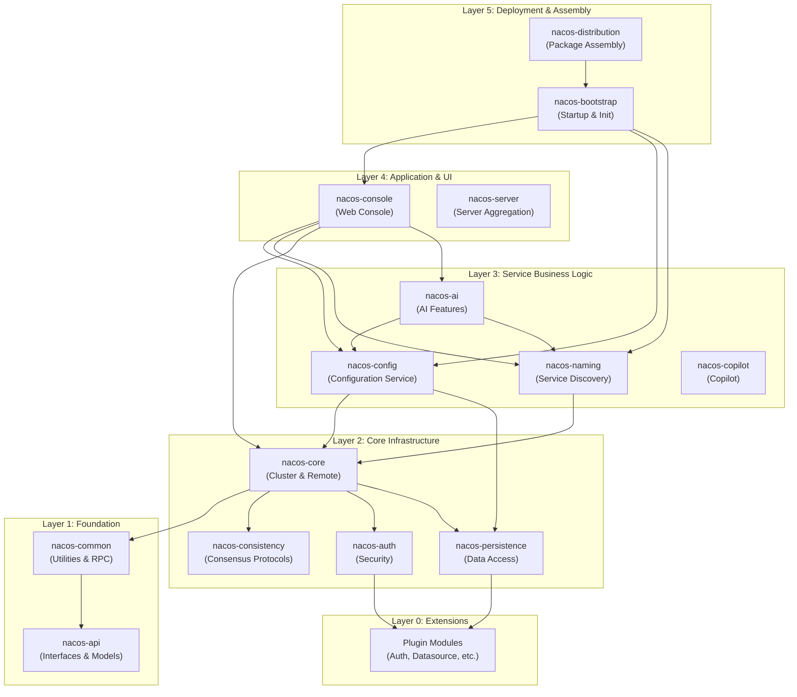
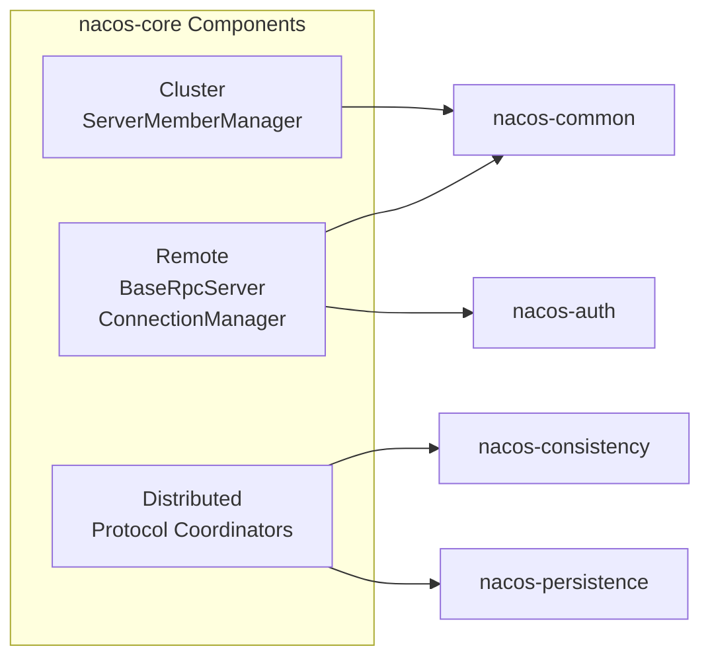
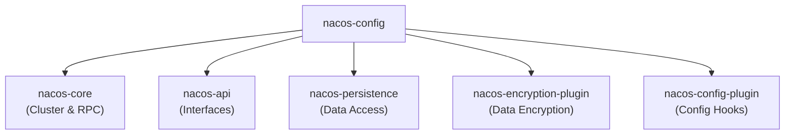
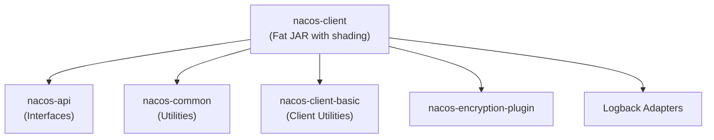

<!-- source: DeepWiki mcp.deepwiki.com · repo alibaba/nacos · page 1.2 Module Structure and Dependencies · fetched 2026-10-29 -->

# Module Structure and Dependencies

<details>
<summary>Relevant source files</summary>

The following files were used as context for generating this wiki page:

- [api/pom.xml](api/pom.xml)
- [client/pom.xml](client/pom.xml)
- [common/pom.xml](common/pom.xml)
- [config/pom.xml](config/pom.xml)
- [console/pom.xml](console/pom.xml)
- [core/pom.xml](core/pom.xml)
- [distribution/pom.xml](distribution/pom.xml)
- [example/pom.xml](example/pom.xml)
- [naming/pom.xml](naming/pom.xml)
- [pom.xml](pom.xml)
- [test/pom.xml](test/pom.xml)

</details>


This document describes the Maven module structure of the Nacos codebase, the layered architecture that organizes these modules, and the inter-module dependency relationships. For information about the overall system architecture and component interactions, see [System Architecture](#1.1). For deployment-specific configurations, see [Deployment Modes and Requirements](#2.1).

## Purpose and Scope

Nacos is organized as a multi-module Maven project with 30+ modules that follow a layered architecture pattern. This document explains:

- The complete module inventory and their purposes
- The layered organization (Foundation, Core, Service, Client, Deployment, Extension)
- Inter-module dependencies and dependency flow
- Maven dependency management strategy
- Build configuration and compilation order

## Module Inventory

The Nacos project consists of the following modules, declared in [pom.xml:614-645]():

| Module | Artifact ID | Purpose |
|--------|-------------|---------|
| **Foundation Modules** | | |
| api | nacos-api | Core interfaces, data models, and gRPC definitions |
| common | nacos-common | Shared utilities, RPC framework, and helper classes |
| **Core Infrastructure** | | |
| core | nacos-core | Cluster management, remote communication, distributed protocols |
| consistency | nacos-consistency | Consensus protocol abstractions (Raft, Distro) |
| auth | nacos-auth | Authentication and authorization framework |
| persistence | nacos-persistence | Data access layer and storage abstractions |
| sys | nacos-sys | System management utilities |
| lock | nacos-lock | Distributed locking support |
| **Service Modules** | | |
| config | nacos-config | Configuration management service |
| naming | nacos-naming | Service discovery and registration |
| ai | nacos-ai | AI-powered features |
| copilot | nacos-copilot | AI copilot integration |
| mcp-registry-adaptor | nacos-mcp-registry-adaptor | Model Context Protocol adaptor |
| **Client Modules** | | |
| client | nacos-client | Java SDK for configuration and naming clients |
| client-basic | nacos-client-basic | Basic client utilities and shared code |
| maintainer-client | nacos-maintainer-client | Maintainer-specific client tools |
| **Deployment & Console** | | |
| console | nacos-console | Web-based management UI |
| bootstrap | nacos-bootstrap | Server startup and initialization |
| distribution | nacos-distribution | Package assembly and release artifacts |
| server | nacos-server | Server runtime aggregation |
| **Extension & Integration** | | |
| plugin | nacos-plugin | Plugin SPI definitions |
| plugin-default-impl | nacos-default-plugin-all | Default plugin implementations |
| cmdb | nacos-cmdb | CMDB integration |
| istio | nacos-istio | Istio service mesh integration |
| k8s-sync | nacos-k8s-sync | Kubernetes synchronization |
| prometheus | nacos-prometheus | Prometheus metrics integration |
| address | nacos-address | Address server for cluster discovery |
| **Logging Adapters** | | |
| logger-adapter-impl | logger adapters | Logback and Log4j2 adapters |
| **Testing** | | |
| test | nacos-test | Integration and E2E test modules |
| example | nacos-example | Sample applications and examples |

**Sources:** [pom.xml:614-645]()

## Layered Architecture

The modules are organized into a layered architecture where dependencies flow from upper layers to lower layers, preventing circular dependencies.



**Sources:** [pom.xml:614-645](), [console/pom.xml:31-73](), [config/pom.xml:34-68](), [core/pom.xml:36-57](), [naming/pom.xml:36-117]()

## Foundation Layer

### nacos-api Module

The `nacos-api` module provides core interfaces and data models that are consumed by both client and server components. It has minimal dependencies and is compiled with Java 8 compatibility for client usage.

**Key contents:**
- Configuration API: `ConfigService`, `ConfigRequest`, `ConfigResponse`
- Naming API: `NamingService`, `Instance`, service-related POJOs
- gRPC protocol definitions: `Payload`, `Metadata`, auto-generated stubs
- Remote communication models: request/response abstractions

**Dependencies:**
- External: Jackson, gRPC libraries, Protobuf
- Internal: None (foundation layer)

**Sources:** [api/pom.xml:1-131](), [pom.xml:732-734]()

### nacos-common Module

The `nacos-common` module provides shared utilities and the RPC framework used across all server-side modules.

**Key contents:**
- RPC client/server framework
- Utility classes for HTTP, IO, encryption
- Version information and constants
- Shared data structures

**Dependencies:**
- Internal: `nacos-api`
- External: SLF4J, Commons IO, Jackson, Apache HttpClient5

**Compilation:** Java 8 compatible for client usage.

**Sources:** [common/pom.xml:1-120](), [pom.xml:767-769]()

## Core Infrastructure Layer

### nacos-core Module

The `nacos-core` module is the central infrastructure component providing cluster management, remote communication, and distributed protocol coordination.



**Key dependencies:**

```xml
<!-- From core/pom.xml:36-57 -->
<dependency>
    <groupId>com.alibaba.nacos</groupId>
    <artifactId>nacos-common</artifactId>
</dependency>
<dependency>
    <groupId>com.alibaba.nacos</groupId>
    <artifactId>nacos-consistency</artifactId>
</dependency>
<dependency>
    <groupId>com.alibaba.nacos</groupId>
    <artifactId>nacos-persistence</artifactId>
</dependency>
<dependency>
    <groupId>com.alibaba.nacos</groupId>
    <artifactId>nacos-auth</artifactId>
</dependency>
```

**External dependencies:**
- Spring Boot (starter, security, actuator, AOP)
- JRaft (jraft-core, rpc-grpc-impl)
- Apache HttpClient5
- Micrometer (Prometheus, Influx, Elastic registries)

**Sources:** [core/pom.xml:36-196](), [pom.xml:707-709]()

### nacos-consistency Module

The `nacos-consistency` module provides abstractions for distributed consensus protocols.

**Key contents:**
- `ConsistencyProtocol` interface
- Raft protocol implementation using JRaft
- Distro protocol implementation for AP scenarios
- Protocol entity definitions (WriteRequest, ReadRequest, Response)

**Sources:** [core/pom.xml:42-44](), [pom.xml:828-830]()

### nacos-persistence Module

The `nacos-persistence` module abstracts the data access layer with support for multiple storage backends.

**Key contents:**
- `PersistService` interface
- Dual implementations: `EmbeddedStoragePersistServiceImpl` (Derby) and `ExternalStoragePersistServiceImpl` (MySQL/PostgreSQL)
- `MapperManager` factory pattern for database-specific SQL
- Conditional loading via Spring `@ConditionalOnProperty`

**Sources:** [core/pom.xml:46-48](), [config/pom.xml:48-50](), [pom.xml:716-719]()

### nacos-auth Module

The `nacos-auth` module provides the authentication and authorization framework.

**Key contents:**
- Auth plugin SPI
- Identity verification
- Permission management
- Security configuration handlers

**Sources:** [core/pom.xml:51-53](), [pom.xml:868-870]()

## Service Layer

### nacos-config Module

The `nacos-config` module implements the configuration management service.



**Key dependencies from [config/pom.xml:34-68]():**

```xml
<dependency>
    <groupId>com.alibaba.nacos</groupId>
    <artifactId>nacos-api</artifactId>
</dependency>
<dependency>
    <groupId>com.alibaba.nacos</groupId>
    <artifactId>nacos-core</artifactId>
</dependency>
<dependency>
    <groupId>com.alibaba.nacos</groupId>
    <artifactId>nacos-persistence</artifactId>
</dependency>
<dependency>
    <groupId>com.alibaba.nacos</groupId>
    <artifactId>nacos-encryption-plugin</artifactId>
</dependency>
<dependency>
    <groupId>com.alibaba.nacos</groupId>
    <artifactId>nacos-config-plugin</artifactId>
</dependency>
```

**External dependencies:**
- Spring Boot Web
- Apache HttpClient5
- Commons IO
- Micrometer registries

**Sources:** [config/pom.xml:34-140](), [pom.xml:702-704]()

### nacos-naming Module

The `nacos-naming` module implements the service discovery and registration service.

**Key dependencies from [naming/pom.xml:36-117]():**

```xml
<dependency>
    <groupId>com.alibaba.nacos</groupId>
    <artifactId>nacos-core</artifactId>
</dependency>
<dependency>
    <groupId>com.alibaba.nacos</groupId>
    <artifactId>nacos-api</artifactId>
</dependency>
<dependency>
    <groupId>com.alibaba.nacos</groupId>
    <artifactId>nacos-cmdb</artifactId>
</dependency>
```

**External dependencies:**
- Spring Boot Web
- Apache HttpClient5
- MySQL JDBC driver
- Micrometer registries

**Sources:** [naming/pom.xml:36-130](), [pom.xml:721-724]()

### nacos-ai Module

The `nacos-ai` module provides AI-powered features built on top of configuration and naming services.

**Dependencies:** Depends on both `nacos-config` and `nacos-naming` as shown in the high-level architecture diagram.

**Sources:** [console/pom.xml:50-52](), [pom.xml:727-729]()

## Client Layer

### nacos-client Module

The `nacos-client` module is the Java SDK distributed to application developers.



**Special build configuration:** The client module uses `maven-shade-plugin` to create a fat JAR with relocated dependencies to avoid conflicts.

**Shading configuration from [client/pom.xml:202-253]():**
- gRPC packages relocated to `com.alibaba.nacos.shaded.io.grpc`
- Google packages relocated to `com.alibaba.nacos.shaded.com.google`
- Minimized JAR excludes unused classes

**Key dependencies from [client/pom.xml:40-82]():**

```xml
<dependency>
    <groupId>com.alibaba.nacos</groupId>
    <artifactId>nacos-api</artifactId>
    <optional>true</optional>
</dependency>
<dependency>
    <groupId>com.alibaba.nacos</groupId>
    <artifactId>nacos-common</artifactId>
    <optional>true</optional>
</dependency>
<dependency>
    <groupId>com.alibaba.nacos</groupId>
    <artifactId>nacos-client-basic</artifactId>
</dependency>
```

**Compilation:** Java 8 compatible (`client.java.version=1.8`).

**Sources:** [client/pom.xml:1-340](), [pom.xml:737-739]()

### nacos-client-basic Module

Provides basic client utilities shared between the main client and other client-related modules.

**Sources:** [client/pom.xml:60-62]()

## Deployment Layer

### nacos-console Module

The `nacos-console` module aggregates all server-side services and provides the web-based management UI.

**Comprehensive dependencies from [console/pom.xml:31-73]():**

```xml
<!-- Service Dependencies -->
<dependency>
    <groupId>com.alibaba.nacos</groupId>
    <artifactId>nacos-config</artifactId>
</dependency>
<dependency>
    <groupId>com.alibaba.nacos</groupId>
    <artifactId>nacos-naming</artifactId>
</dependency>
<dependency>
    <groupId>com.alibaba.nacos</groupId>
    <artifactId>nacos-core</artifactId>
</dependency>
<dependency>
    <groupId>com.alibaba.nacos</groupId>
    <artifactId>nacos-ai</artifactId>
</dependency>
<dependency>
    <groupId>com.alibaba.nacos</groupId>
    <artifactId>nacos-copilot</artifactId>
</dependency>

<!-- Integration Dependencies -->
<dependency>
    <groupId>com.alibaba.nacos</groupId>
    <artifactId>nacos-istio</artifactId>
</dependency>
<dependency>
    <groupId>com.alibaba.nacos</groupId>
    <artifactId>nacos-prometheus</artifactId>
</dependency>
<dependency>
    <groupId>com.alibaba.nacos</groupId>
    <artifactId>nacos-k8s-sync</artifactId>
</dependency>
```

**External dependencies:**
- Spring Boot Security
- Model Context Protocol SDK
- Logging bridges (log4j-over-slf4j, jcl-over-slf4j, jul-to-slf4j)

**Development profile:** Includes `nacos-default-plugin-all` in dev mode [console/pom.xml:159-171]().

**Sources:** [console/pom.xml:31-121](), [pom.xml:776-779]()

### nacos-bootstrap Module

The `nacos-bootstrap` module handles server startup and initialization, loading all necessary components.

**Sources:** [distribution/pom.xml:36-38](), [pom.xml:791-794]()

### nacos-distribution Module

The `nacos-distribution` module assembles the final distribution packages using Maven Assembly Plugin.

**Build profiles:**
- `release-address`: Packages the address server
- `release-client`: Packages the client SDK
- `release-nacos`: Packages the full server distribution
- `release-native`: Packages GraalVM native image distribution

**Sources:** [distribution/pom.xml:1-161](), [pom.xml:797-799]()

## Extension & Plugin Layer

### Plugin Architecture

Nacos provides several plugin points for extensibility:

| Plugin Type | Module | Purpose |
|-------------|--------|---------|
| Auth Plugin | nacos-auth-plugin | Custom authentication mechanisms |
| Datasource Plugin | nacos-datasource-plugin | Custom data storage backends |
| Encryption Plugin | nacos-encryption-plugin | Data encryption/decryption |
| Config Plugin | nacos-config-plugin | Configuration lifecycle hooks |
| Control Plugin | nacos-control-plugin | Access control and rate limiting |
| Trace Plugin | nacos-trace-plugin | Distributed tracing integration |
| Custom Environment Plugin | nacos-custom-environment-plugin | Environment customization |

**Default implementations:** The `nacos-default-plugin-all` module aggregates default implementations of all plugin types.

**Sources:** [pom.xml:832-875](), [console/pom.xml:164-170](), [distribution/pom.xml:40-43]()

### Integration Modules

Additional modules provide integration with external systems:

- **nacos-istio:** Service mesh integration [pom.xml:812-815]()
- **nacos-k8s-sync:** Kubernetes service synchronization [pom.xml:817-820]()
- **nacos-prometheus:** Metrics export for Prometheus [pom.xml:822-825]()
- **nacos-cmdb:** Configuration management database integration [pom.xml:771-774]()

**Sources:** [pom.xml:812-825](), [console/pom.xml:62-73]()

## Dependency Management Strategy

### Version Management

All module versions are managed centrally using the `${revision}` property defined in [pom.xml:91]():

```xml
<revision>3.2.0-BETA</revision>
```

### Dependency Declarations

The parent POM uses `<dependencyManagement>` to declare versions without forcing inclusion. Modules explicitly declare their dependencies.

**Example from [pom.xml:674-875]():**

```xml
<dependencyManagement>
    <dependencies>
        <!-- Internal module versions -->
        <dependency>
            <groupId>com.alibaba.nacos</groupId>
            <artifactId>nacos-config</artifactId>
            <version>${project.version}</version>
        </dependency>
        <dependency>
            <groupId>com.alibaba.nacos</groupId>
            <artifactId>nacos-core</artifactId>
            <version>${project.version}</version>
        </dependency>
        <!-- External dependency versions imported from Spring Boot BOM -->
        <dependency>
            <groupId>org.springframework.boot</groupId>
            <artifactId>spring-boot-dependencies</artifactId>
            <version>${spring-boot-dependencies.version}</version>
            <type>pom</type>
            <scope>import</scope>
        </dependency>
    </dependencies>
</dependencyManagement>
```

**Sources:** [pom.xml:674-875]()

### Circular Dependency Prevention

The `maven-enforcer-plugin` is configured to detect and prevent circular dependencies [pom.xml:210-234]():

```xml
<plugin>
    <artifactId>maven-enforcer-plugin</artifactId>
    <configuration>
        <rules>
            <banCircularDependencies/>
        </rules>
        <fail>true</fail>
    </configuration>
</plugin>
```

**Sources:** [pom.xml:210-234]()

## Build Configuration

### Multi-Java Version Support

The project supports two compilation targets:

| Component | Java Version | Property |
|-----------|--------------|----------|
| Server modules | Java 17 | `java.version=17` |
| Client modules (api, common, client) | Java 8 | `client.java.version=1.8` |

**Configuration in [pom.xml:95-98]():**

```xml
<client.java.version>1.8</client.java.version>
<java.version>17</java.version>
<maven.compiler.source>${java.version}</maven.compiler.source>
<maven.compiler.target>${java.version}</maven.compiler.target>
```

Client modules override this with:

```xml
<maven.compiler.source>${client.java.version}</maven.compiler.source>
<maven.compiler.target>${client.java.version}</maven.compiler.target>
```

**Sources:** [pom.xml:95-98](), [client/pom.xml:35-38](), [api/pom.xml:34-37](), [common/pom.xml:36-39]()

### Test Configuration

Test modules are disabled by default and can be run separately:

- **Unit tests:** Included in individual modules
- **Integration tests:** `nacos-test` parent with `config-test`, `naming-test`, `core-test` submodules
- **CIT profile:** `mvn test -Pcit-test` runs config integration tests
- **NIT profile:** `mvn test -Pnit-test` runs naming integration tests

**Sources:** [test/pom.xml:1-113](), [pom.xml:538-575]()

### Build Plugins

Key build plugins configured in the parent POM:

| Plugin | Purpose | Configuration |
|--------|---------|---------------|
| maven-compiler-plugin | Java compilation | Source/target version, parameter preservation |
| maven-enforcer-plugin | Dependency validation | Ban circular dependencies |
| maven-assembly-plugin | Distribution packaging | Used by distribution module |
| maven-shade-plugin | Fat JAR creation | Used by client module for dependency relocation |
| spring-boot-maven-plugin | Spring Boot packaging | Used by bootstrap module |
| jacoco-maven-plugin | Code coverage | Integrated with tests |
| maven-checkstyle-plugin | Code style validation | NacosCheckStyle.xml rules |
| apache-rat-plugin | License header verification | Apache License 2.0 enforcement |

**Sources:** [pom.xml:172-488](), [client/pom.xml:121-286]()

## Module Compilation Order

Maven automatically determines the compilation order based on dependency relationships. The typical order is:

1. **Foundation:** `nacos-api`, `nacos-common`
2. **Plugins:** Plugin SPI and default implementations
3. **Core Infrastructure:** `nacos-consistency`, `nacos-auth`, `nacos-persistence`, `nacos-core`
4. **Services:** `nacos-config`, `nacos-naming`, `nacos-ai`
5. **Integrations:** `nacos-istio`, `nacos-k8s-sync`, `nacos-prometheus`, `nacos-cmdb`
6. **Client:** `nacos-client-basic`, `nacos-client`
7. **Console & Server:** `nacos-console`, `nacos-server`
8. **Bootstrap & Distribution:** `nacos-bootstrap`, `nacos-distribution`

**Sources:** [pom.xml:614-645]()

---

