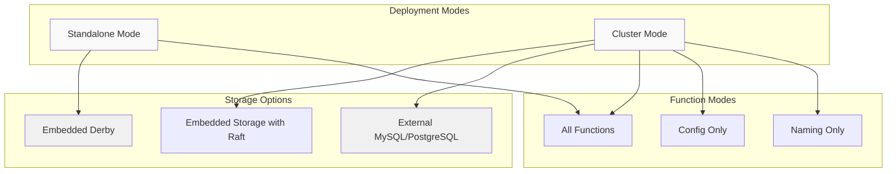
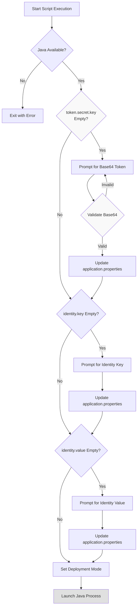
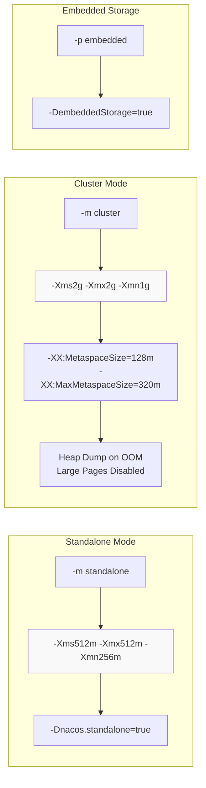

<!-- source: DeepWiki mcp.deepwiki.com · repo alibaba/nacos · page 2 Installation and Deployment · fetched 2026-10-29 -->

# Installation and Deployment

<details>
<summary>Relevant source files</summary>

The following files were used as context for generating this wiki page:

- [.gitignore](.gitignore)
- [README.md](README.md)
- [console/src/main/resources/META-INF/nacos-default.properties](console/src/main/resources/META-INF/nacos-default.properties)
- [distribution/bin/shutdown.cmd](distribution/bin/shutdown.cmd)
- [distribution/bin/shutdown.sh](distribution/bin/shutdown.sh)
- [distribution/bin/startup.cmd](distribution/bin/startup.cmd)
- [distribution/bin/startup.sh](distribution/bin/startup.sh)
- [distribution/conf/application.properties](distribution/conf/application.properties)

</details>


This document provides comprehensive guidance for installing and deploying Nacos server instances. It covers the binary package installation process, system prerequisites, deployment architecture options, and basic startup procedures. 

For detailed information on specific aspects of deployment:
- For deployment mode selection and system requirements, see [Deployment Modes and Requirements](#2.1)
- For configuration property details, see [Server Configuration](#2.2)
- For startup procedures and lifecycle management, see [Startup and Lifecycle Management](#2.3)

## Prerequisites

### Java Environment

Nacos requires a Java runtime environment to operate. The startup scripts validate Java availability and compatibility:

| Requirement | Details |
|-------------|---------|
| Minimum Java Version | JDK 8 |
| Recommended Version | JDK 8 or later |
| Architecture | x64 |
| Environment Variable | `JAVA_HOME` must be set |

The startup script [distribution/bin/startup.sh:97-128]() performs Java discovery by checking multiple standard locations and validating the Java executable exists. On Windows, [distribution/bin/startup.cmd:14]() validates Java availability before proceeding.

### System Resources

Memory allocation varies by deployment mode:

| Mode | Heap Memory | Young Generation | Metaspace |
|------|-------------|------------------|-----------|
| Standalone | 512 MB (default) | 256 MB | N/A |
| Cluster | 2 GB (default) | 1 GB | 128-320 MB |

Sources: [distribution/bin/startup.sh:172-182](), [distribution/bin/startup.cmd:62-77]()

## Installation Process

### Download and Extract

Download the binary distribution package from the official release:

```
nacos-server-${version}.zip
```

Extract the package to obtain the following directory structure:

```
nacos/
├── bin/              # Startup and shutdown scripts
├── conf/             # Configuration files
├── target/           # Nacos server JAR file
├── logs/             # Runtime logs (created on first start)
└── plugins/          # Plugin directories
```

The base directory is automatically detected by startup scripts at [distribution/bin/startup.sh:159]() and [distribution/bin/startup.cmd:19-22]().

Sources: [README.md:50-58](), [distribution/bin/startup.sh:159]()

## Deployment Architecture Options

### Deployment Architecture Overview



Sources: [distribution/bin/startup.sh:131-155](), [distribution/conf/application.properties:32-39]()

### Mode Selection

Nacos supports three orthogonal deployment dimensions controlled by startup script parameters:

**Deployment Mode** (`-m` parameter):
- `standalone`: Single server for development/testing
- `cluster`: Multi-server for production with high availability

**Function Mode** (`-f` parameter):
- `all`: Both configuration and naming services (default)
- `config`: Configuration service only
- `naming`: Naming service only

**Storage Mode** (`-p` parameter):
- (empty): External database required for cluster
- `embedded`: Use embedded storage with Raft consensus

Sources: [distribution/bin/startup.sh:136-155](), [distribution/bin/startup.cmd:26-55]()

## Startup Command Reference

### Linux/Unix/Mac Platforms

```bash
# Standalone mode (development)
sh startup.sh -m standalone

# Cluster mode with external database
sh startup.sh -m cluster

# Cluster mode with embedded storage
sh startup.sh -m cluster -p embedded

# Config service only
sh startup.sh -m cluster -f config

# Naming service only
sh startup.sh -m cluster -f naming
```

The startup script sets the deployment mode via JVM system properties at [distribution/bin/startup.sh:172-188]().

### Windows Platform

```cmd
# Standalone mode
startup.cmd -m standalone

# Cluster mode
startup.cmd -m cluster

# Cluster mode with embedded storage
startup.cmd -m cluster -p embedded
```

Sources: [README.md:62-70](), [distribution/bin/startup.sh:136-155](), [distribution/bin/startup.cmd:36-86]()

## Configuration Initialization

### Security Configuration Requirements

Starting from recent versions, Nacos enforces mandatory security configurations. The startup scripts validate and prompt for three required properties:

| Property | Purpose | Validation |
|----------|---------|------------|
| `nacos.core.auth.plugin.nacos.token.secret.key` | JWT token generation secret | Must be Base64-encoded, original string ≥32 characters |
| `nacos.core.auth.server.identity.key` | Server identity authentication key | Required for cluster communication |
| `nacos.core.auth.server.identity.value` | Server identity authentication value | Required for cluster communication |

The validation logic is implemented at [distribution/bin/startup.sh:30-95]() with Base64 validation and length checking.

### Configuration Initialization Flow



Sources: [distribution/bin/startup.sh:57-95](), [distribution/bin/startup.sh:165-167](), [distribution/bin/startup.cmd:57-59]()

### Configuration File Processing

The `process_required_config` function at [distribution/bin/startup.sh:57-95]() performs:
1. Pattern matching for empty configuration values
2. User input prompting with validation hints
3. Base64 validation for cryptographic keys (≥32 characters when decoded)
4. In-place file update using `sed`
5. Confirmation output of updated values

The Windows equivalent is implemented at [distribution/bin/startup.cmd:118-153]().

Sources: [distribution/bin/startup.sh:57-95](), [distribution/bin/startup.cmd:118-153]()

## JVM Configuration

### Memory Allocation Strategy



Sources: [distribution/bin/startup.sh:172-182](), [distribution/bin/startup.cmd:62-77]()

### Java Version-Specific Settings

The startup scripts detect Java major version and apply version-specific flags:

**Java 9+ Settings** [distribution/bin/startup.sh:193-197]():
- Garbage collection logging: `-Xlog:gc*:file=${BASE_DIR}/logs/nacos_gc.log`
- Module access flags: `--add-opens=java.base/java.lang=ALL-UNNAMED`
- Additional module opens for reflection and utilities

**Java 8 Settings** [distribution/bin/startup.sh:199-202]():
- CMS garbage collector configuration
- Traditional GC logging: `-Xloggc:${BASE_DIR}/logs/nacos_gc.log`
- Extension directories: `-Djava.ext.dirs=${JAVA_HOME}/jre/lib/ext`

Sources: [distribution/bin/startup.sh:192-202](), [distribution/bin/startup.cmd:89-94]()

### Complete JVM Options Assembly

The final Java command includes [distribution/bin/startup.sh:204-211]():

| Option Type | Example Value | Purpose |
|-------------|---------------|---------|
| Deployment Type | `-Dnacos.deployment.type=merged` | Deployment configuration mode |
| Plugin Loader Path | `-Dloader.path=${BASE_DIR}/plugins,...` | Plugin discovery directories |
| Nacos Home | `-Dnacos.home=${BASE_DIR}` | Base directory reference |
| Main JAR | `-jar ${BASE_DIR}/target/nacos-server.jar` | Application entry point |
| Spring Config | `--spring.config.additional-location=...` | External configuration location |
| Logging Config | `--logging.config=${BASE_DIR}/conf/nacos-logback.xml` | Logback configuration file |
| HTTP Header Size | `--server.max-http-request-header-size=524288` | Maximum header size (512KB) |

Sources: [distribution/bin/startup.sh:204-211](), [distribution/bin/startup.cmd:97-107]()

## Process Lifecycle

### Startup Process Execution

The startup script executes the Java process in background mode:


The process launch occurs at [distribution/bin/startup.sh:232-236]() using `nohup` to detach from the terminal session.

### Shutdown Process

The shutdown scripts terminate the running Nacos process:

**Linux/Unix/Mac** [distribution/bin/shutdown.sh:18-28]():
```bash
pid=`pgrep -f nacos.nacos | xargs`
kill ${pid}
```

**Windows** [distribution/bin/shutdown.cmd:29-32]():
```cmd
for /f "tokens=1" %%i in ('jps -m ^| find "nacos.nacos"') do (
    taskkill /F /PID %%i
)
```

The process identifier is located by searching for the unique argument `nacos.nacos` passed to the Java command.

Sources: [distribution/bin/shutdown.sh:18-28](), [distribution/bin/shutdown.cmd:29-38]()

## Network Ports

### Default Port Configuration

Nacos uses multiple ports for different services as defined in [distribution/conf/application.properties:20-225]():

| Service | Default Port | Configuration Property | Purpose |
|---------|--------------|------------------------|---------|
| Nacos Server | 8848 | `nacos.server.main.port` | Main HTTP/gRPC endpoint |
| Console | 8080 | `nacos.console.port` | Web UI and management API |
| gRPC SDK | 9848 (8848+1000) | Offset from main port | Client SDK communication |
| gRPC Cluster | 9849 (8848+1001) | Offset from main port | Inter-node communication |
| MCP Registry | 9080 | `nacos.ai.mcp.registry.port` | AI MCP registry server (optional) |

The gRPC ports are automatically calculated as offsets from the main port.

Sources: [distribution/conf/application.properties:20-21](), [distribution/conf/application.properties:188-189](), [distribution/conf/application.properties:224-225]()

## Deployment Type Configuration

### Deployment Type Matrix

The `-d` parameter controls deployment architecture [distribution/bin/startup.sh:149-150]():

| Type | Description | Use Case |
|------|-------------|----------|
| `merged` | Default unified deployment | All services in single process (default) |
| `console` | Separate console deployment | Console UI deployed separately from server |

This is set via JVM property at [distribution/bin/startup.sh:204]():
```bash
-Dnacos.deployment.type=${DEPLOYMENT}
```

When `deployment=console`, the console references the server context path via `nacos.console.remote.server.context-path` at [distribution/conf/application.properties:230]().

Sources: [distribution/bin/startup.sh:135-155](), [distribution/conf/application.properties:228-230]()

## Log Files

### Log Directory Structure

The startup process creates and uses the following log files:

| File | Purpose | Configuration |
|------|---------|---------------|
| `logs/startup.log` | Startup command and console output | Created at [distribution/bin/startup.sh:225-236]() |
| `logs/nacos_gc.log` | JVM garbage collection logs | Configured at [distribution/bin/startup.sh:194-201]() |
| `logs/java_heapdump.hprof` | Heap dump on OOM | Configured at [distribution/bin/startup.sh:180]() |
| Tomcat access logs | HTTP access logs | Configured at [distribution/conf/application.properties:199-208]() |

The logs directory is created automatically if it doesn't exist at [distribution/bin/startup.sh:213-215]().

Sources: [distribution/bin/startup.sh:213-236](), [distribution/conf/application.properties:197-208]()

## Cluster Member Configuration

### Member List Specification

For cluster deployments, member nodes can be specified using the `-c` parameter [distribution/bin/startup.sh:145-146]():

```bash
sh startup.sh -m cluster -c "192.168.1.1:8848,192.168.1.2:8848,192.168.1.3:8848"
```

This is passed to the JVM as [distribution/bin/startup.sh:190]():
```bash
-Dnacos.member.list=${MEMBER_LIST}
```

Alternatively, members can be configured in:
- `conf/cluster.conf` file (file-based lookup)
- Address server URL (dynamic lookup)
- `nacos.member.list` property in [distribution/conf/application.properties:95]()

The member lookup strategy is selected based on `nacos.core.member.lookup.type` at [distribution/conf/application.properties:92]().

Sources: [distribution/bin/startup.sh:133-190](), [distribution/conf/application.properties:92-105]()

## Quick Start Examples

### Development Deployment (Standalone)

```bash
# Linux/Unix/Mac
cd nacos/bin
sh startup.sh -m standalone

# Windows
cd nacos\bin
startup.cmd -m standalone
```

Access the console at: `http://localhost:8080/nacos`

### Production Deployment (Cluster with External Database)

1. Configure database connection in `conf/application.properties` [distribution/conf/application.properties:32-39]():
```properties
spring.sql.init.platform=mysql
db.num=1
db.url.0=jdbc:mysql://127.0.0.1:3306/nacos?...
db.user=nacos
db.password=nacos
```

2. Start each cluster node:
```bash
sh startup.sh -m cluster
```

### Production Deployment (Cluster with Embedded Storage)

```bash
sh startup.sh -m cluster -p embedded
```

This uses JRaft for data replication without requiring external database configuration.

Sources: [README.md:62-72](), [distribution/bin/startup.sh:176-178]()

## Verification

After startup, verify the deployment:

1. Check the startup log:
```bash
tail -f logs/startup.log
```

2. Access the console UI at the configured port (default: `http://localhost:8080/nacos`)

3. Verify process is running:
```bash
# Linux/Unix/Mac
pgrep -f nacos.nacos

# Windows
jps -m | find "nacos.nacos"
```

These are the same process identification methods used by shutdown scripts at [distribution/bin/shutdown.sh:18]() and [distribution/bin/shutdown.cmd:29]().

Sources: [distribution/bin/shutdown.sh:18-24](), [distribution/bin/shutdown.cmd:29-32]()

---

