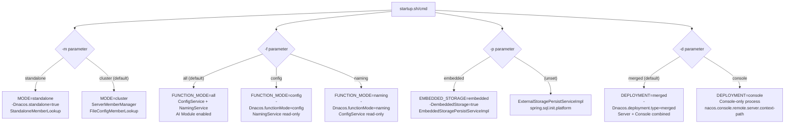
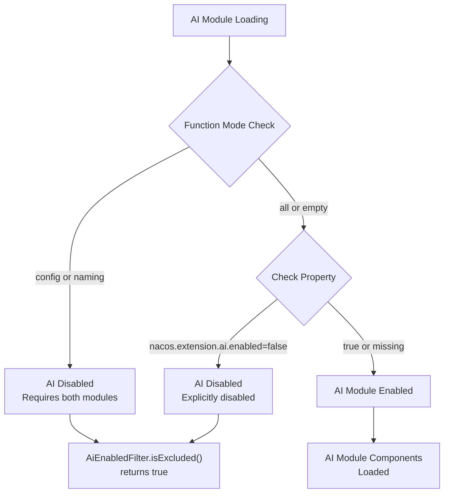
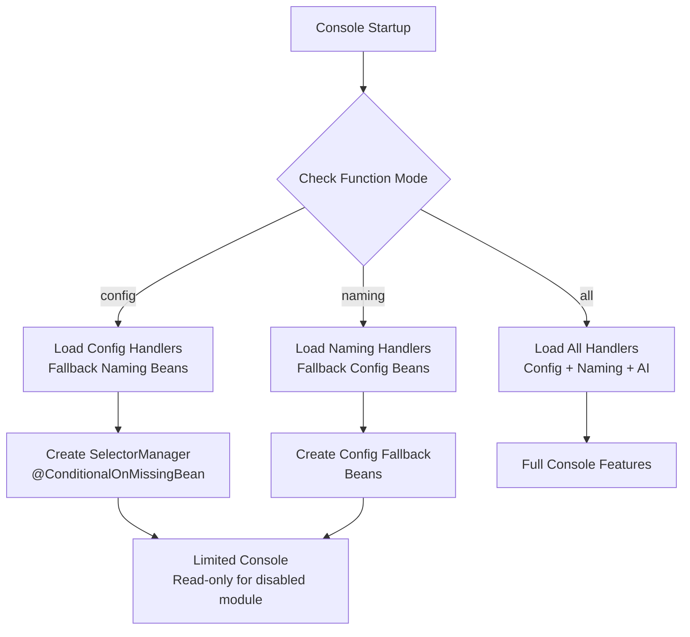
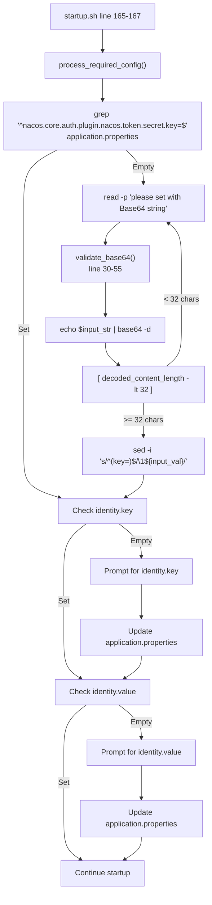

<!-- source: DeepWiki mcp.deepwiki.com · repo alibaba/nacos · page 2.1 Deployment Modes and Requirements · fetched 2026-10-29 -->

# Deployment Modes and Requirements

<details>
<summary>Relevant source files</summary>

The following files were used as context for generating this wiki page:

- [.gitignore](.gitignore)
- [console/src/main/resources/META-INF/nacos-default.properties](console/src/main/resources/META-INF/nacos-default.properties)
- [distribution/bin/shutdown.cmd](distribution/bin/shutdown.cmd)
- [distribution/bin/shutdown.sh](distribution/bin/shutdown.sh)
- [distribution/bin/startup.cmd](distribution/bin/startup.cmd)
- [distribution/bin/startup.sh](distribution/bin/startup.sh)
- [distribution/conf/application.properties](distribution/conf/application.properties)

</details>


## Purpose and Scope

This document describes the various deployment configurations available in Nacos, including standalone vs cluster modes, function modes (config/naming/all), storage backends, and their respective system requirements. It explains how these modes are configured through startup scripts and application properties, enabling operators to deploy Nacos in configurations optimized for different use cases.

For detailed configuration properties and their values, see [Server Configuration](#2.2). For the actual startup process and lifecycle management, see [Startup and Lifecycle Management](#2.3).

## Deployment Mode Overview

Nacos supports multiple deployment dimensions configured via startup script parameters and system properties:



**Sources:** [distribution/bin/startup.sh:130-155](), [distribution/bin/startup.cmd:26-55](), [distribution/bin/startup.sh:172-190]()

## Standalone vs Cluster Mode

### Standalone Mode

Standalone mode deploys a single Nacos server instance using `StandaloneMemberLookup` for member discovery.

**Startup Configuration:**

```bash
# Linux/Mac
./startup.sh -m standalone

# Windows
startup.cmd -m standalone
```

**JVM Memory Configuration:**
```bash
# From startup.sh:172-174
if [[ "${MODE}" == "standalone" ]]; then
    JAVA_OPT="${JAVA_OPT} ${CUSTOM_NACOS_MEMORY:- -Xms512m -Xmx512m -Xmn256m}"
    JAVA_OPT="${JAVA_OPT} -Dnacos.standalone=true"
fi
```

- Default heap: `-Xms512m -Xmx512m -Xmn256m`
- Young generation: `-Xmn256m`
- Override via `CUSTOM_NACOS_MEMORY` environment variable
- System property: `-Dnacos.standalone=true`

**Member Lookup Implementation:**
- Class: `com.alibaba.nacos.core.cluster.lookup.StandaloneMemberLookup`
- Returns single local member
- No cluster configuration required

**Storage:**
- `EmbeddedStoragePersistServiceImpl` with Derby database
- Data directory: `${nacos.home}/data/derby-data`
- Auto-initialized on startup
- Property: `spring.sql.init.platform` not required

**Sources:** [distribution/bin/startup.sh:172-174](), [distribution/bin/startup.cmd:62-67]()

### Cluster Mode

Cluster mode deploys multiple Nacos server instances coordinated via `ServerMemberManager` using JRaft and Distro protocols.

**Startup Configuration:**

```bash
# Linux/Mac (default mode)
./startup.sh -m cluster -c "node1:8848,node2:8848,node3:8848"

# Windows
startup.cmd -m cluster
```

**JVM Memory Configuration:**
```bash
# From startup.sh:176-182
JAVA_OPT="${JAVA_OPT} -server ${CUSTOM_NACOS_MEMORY:- -Xms2g -Xmx2g -Xmn1g -XX:MetaspaceSize=128m -XX:MaxMetaspaceSize=320m}"
JAVA_OPT="${JAVA_OPT} -XX:-OmitStackTraceInFastThrow -XX:+HeapDumpOnOutOfMemoryError -XX:HeapDumpPath=${BASE_DIR}/logs/java_heapdump.hprof"
JAVA_OPT="${JAVA_OPT} -XX:-UseLargePages"
```

- Default heap: `-Xms2g -Xmx2g -Xmn1g`
- Metaspace: `-XX:MetaspaceSize=128m -XX:MaxMetaspaceSize=320m`
- Heap dump on OOM: `java_heapdump.hprof` in logs directory
- Override via `CUSTOM_NACOS_MEMORY` environment variable

**Storage Options:**
- External: `ExternalStoragePersistServiceImpl` (recommended for production)
- Embedded: `EmbeddedStoragePersistServiceImpl` with `-p embedded` flag

**Cluster Membership Discovery:**

```mermaid
graph TB
    StartupScript["startup.sh -c parameter<br/>MEMBER_LIST variable"]
    ClusterConf["cluster.conf file<br/>conf/cluster.conf"]
    PropertyFile["application.properties<br/>nacos.member.list"]
    AddressServerUrl["Address Server URL<br/>address.server.domain"]
    
    StartupScript --> SetProperty["-Dnacos.member.list=${MEMBER_LIST}"]
    ClusterConf --> FileConfigMLookup["FileConfigMemberLookup"]
    PropertyFile --> FileConfigMLookup
    AddressServerUrl --> AddressServerMLookup["AddressServerMemberLookup"]
    
    SetProperty --> ServerMemberManager["ServerMemberManager.init()"]
    FileConfigMLookup --> ServerMemberManager
    AddressServerMLookup --> ServerMemberManager
    
    ServerMemberManager --> LookupType{"nacos.core.member<br/>.lookup.type"}
    LookupType -->|"file"| UseFCML["Use FileConfigMemberLookup"]
    LookupType -->|"address-server"| UseASML["Use AddressServerMemberLookup"]
    LookupType -->|"(unset)"| AutoDetect["Auto-detect based on<br/>cluster.conf existence"]
    
    UseFCML --> MemberList["ServerMemberManager<br/>member list"]
    UseASML --> MemberList
    AutoDetect --> MemberList
```



**Member Lookup Configuration:**

| Property | Purpose | Default |
|----------|---------|---------|
| `nacos.core.member.lookup.type` | Force lookup type | Auto-detect |
| `nacos.member.list` | Direct member list | Empty |
| `address.server.domain` | Address server domain | jmenv.tbsite.net |
| `address.server.port` | Address server port | 8080 |
| `address.server.url` | Address server URL path | /nacos/serverlist |
| `nacos.core.address-server.retry` | Max retries on init | 5 |

**Sources:** [distribution/bin/startup.sh:176-182](), [distribution/bin/startup.sh:190](), [distribution/bin/startup.cmd:70-77](), [distribution/conf/application.properties:90-105]()

## Function Modes

Function modes allow Nacos to run with a subset of features enabled, optimizing resource usage and security boundaries.

### Function Mode Configuration

| Function Mode | Config Module | Naming Module | AI Module | Use Case |
|--------------|---------------|---------------|-----------|----------|
| `all` (default) | Full | Full | Enabled | Complete feature set |
| `config` | Full | Read-only | Disabled | Configuration management only |
| `naming` | Read-only | Full | Disabled | Service discovery only |

**Startup Configuration:**

```bash
# Config mode only
./startup.sh -f config

# Naming mode only  
./startup.sh -f naming

# All features (default)
./startup.sh -f all
```

**System Properties:**
- `-Dnacos.functionMode=config`
- `-Dnacos.functionMode=naming`

**Sources:** [distribution/bin/startup.sh:184-188](), [distribution/bin/startup.cmd:79-86]()

### AI Module Dependency

The AI module has specific requirements and is conditionally loaded:



**Implementation Details:**
- Filter class: `com.alibaba.nacos.ai.config.AiEnabledFilter`
- Property key: `nacos.extension.ai.enabled` (default: true)
- Package prefix: `com.alibaba.nacos.ai`
- Dependency: Requires both config and naming modules enabled

**Sources:** [ai/src/main/java/com/alibaba/nacos/ai/config/AiEnabledFilter.java:32-58](), [console/src/main/java/com/alibaba/nacos/console/handler/ai/EnabledAiHandler.java:33-38]()

### Console Function Conditional Loading

When function modes restrict module availability, the console adapts:



**Conditional Bean Loading:**
- Class: `com.alibaba.nacos.console.config.ConsoleFunctionEnabledConfig`
- Condition implementation: `com.alibaba.nacos.console.handler.impl.ConditionFunctionEnabled`
- Provides fallback beans when modules are disabled

**Sources:** [console/src/main/java/com/alibaba/nacos/console/config/ConsoleFunctionEnabledConfig.java:29-43](), [console/src/main/java/com/alibaba/nacos/console/handler/impl/ConditionFunctionEnabled.java:32-71]()

## Storage Modes

### Embedded Storage

Nacos uses `EmbeddedStoragePersistServiceImpl` when embedded storage is enabled.

**Derby Database (Standalone Mode):**
- Implementation class: `com.alibaba.nacos.config.server.service.repository.embedded.EmbeddedStoragePersistServiceImpl`
- Conditional loading: `@ConditionalOnProperty(name = "nacos.standalone", matchIfMissing = false)`
- JDBC driver: `org.apache.derby.jdbc.EmbeddedDriver`
- Data directory: `${nacos.home}/data/derby-data`
- URL pattern: `jdbc:derby:${nacos.home}/data/derby-data;create=true`
- Auto-initialization via SQL scripts

**Embedded Storage with Raft (Cluster Mode):**
```bash
# Startup with embedded storage
./startup.sh -m cluster -p embedded

# Sets system property
-DembeddedStorage=true
```

- Activated by: `EMBEDDED_STORAGE="embedded"` from `-p` parameter
- System property: `-DembeddedStorage=true` (startup.sh:177)
- Implementation: `EmbeddedStoragePersistServiceImpl` (cluster mode)
- Consensus: JRaft protocol for data replication
- Data directory: `${nacos.home}/data/protocol/raft`
- Snapshot directory: `${nacos.home}/data/protocol/raft/snapshot`

**Configuration Properties:**

```properties
# No database configuration required
# Embedded storage auto-detected via system properties
# nacos.standalone=true (standalone) or
# -DembeddedStorage=true (cluster embedded)
```

**Sources:** [distribution/bin/startup.sh:176-178](), [distribution/bin/startup.cmd:72-74]()

## External Storage

External storage uses `ExternalStoragePersistServiceImpl` for production cluster deployments.

**Implementation Details:**
- Class: `com.alibaba.nacos.config.server.service.repository.extrnal.ExternalStoragePersistServiceImpl`
- Conditional loading: `@ConditionalOnProperty` excludes when `nacos.standalone=true` or `embeddedStorage=true`
- Database selection: `spring.sql.init.platform` property
- Mapper factory: `MapperManager` for database-specific SQL

**Supported Database Platforms:**

| Platform | spring.sql.init.platform | Driver Class | JDBC URL Format |
|----------|--------------------------|--------------|-----------------|
| MySQL | mysql | com.mysql.cj.jdbc.Driver | jdbc:mysql://host:port/nacos |
| PostgreSQL | postgresql | org.postgresql.Driver | jdbc:postgresql://host:port/nacos |

**Configuration Properties:**

```properties
# Database Platform Selection
spring.sql.init.platform=mysql

# Database Instances
db.num=1

# Connection URL (example for MySQL)
db.url.0=jdbc:mysql://127.0.0.1:3306/nacos?characterEncoding=utf8&connectTimeout=1000&socketTimeout=3000&autoReconnect=true&useUnicode=true&useSSL=false&serverTimezone=UTC

# Credentials
db.user=nacos
db.password=nacos

# Pool Configuration (optional)
db.pool.config.driverClassName=com.mysql.cj.jdbc.Driver
```

**MySQL Example Configuration:**

```properties
spring.sql.init.platform=mysql
db.num=1
db.url.0=jdbc:mysql://127.0.0.1:3306/nacos?characterEncoding=utf8&connectTimeout=1000&socketTimeout=3000&autoReconnect=true&useUnicode=true&useSSL=false&serverTimezone=UTC
db.user=nacos
db.password=nacos
```

**PostgreSQL Example Configuration:**

```properties
spring.sql.init.platform=postgresql
db.num=1
db.url.0=jdbc:postgresql://127.0.0.1:5432/nacos
db.user=nacos
db.password=nacos
db.pool.config.driverClassName=org.postgresql.Driver
```

**Multi-Database Configuration:**

```properties
# For read/write splitting or sharding
db.num=2
db.url.0=jdbc:mysql://primary:3306/nacos
db.url.1=jdbc:mysql://replica:3306/nacos
db.user=nacos
db.password=nacos
```

The `MapperManager` class dynamically selects SQL mappers based on `spring.sql.init.platform`:
- MySQL mappers: Package `com.alibaba.nacos.config.server.service.repository.extrnal.mysql`
- PostgreSQL mappers: Package `com.alibaba.nacos.config.server.service.repository.extrnal.postgresql`

**Sources:** [distribution/conf/application.properties:30-40]()

## Deployment Types

### Merged Deployment

The default deployment type where server and console run in the same process.

**Configuration:**

```bash
./startup.sh -d merged  # Default
```

**Characteristics:**
- System property: `-Dnacos.deployment.type=merged`
- Server port: `nacos.server.main.port=8848` (default)
- Console port: Same as server port
- Context path: `nacos.server.contextPath=/nacos`

**Sources:** [distribution/bin/startup.sh:204](), [distribution/conf/application.properties:194-195]()

### Console-Only Deployment

Deploys only the console UI that connects to a separate Nacos server cluster.

**Configuration:**

```bash
./startup.sh -d console
```

**Characteristics:**
- System property: `-Dnacos.deployment.type=console`
- Console port: `nacos.console.port=8080` (default)
- Console context: `nacos.console.contextPath=/` (empty by default)
- Remote server context: `nacos.console.remote.server.context-path=/nacos`

**Properties:**

```properties
# Console-only deployment configuration
nacos.console.port=8080
nacos.console.contextPath=
nacos.console.remote.server.context-path=/nacos
```

**Sources:** [distribution/conf/application.properties:224-230](), [bootstrap/src/main/resources/application.properties:214-223]()

## System Requirements

### Hardware Requirements

**Minimum Requirements:**

| Component | Standalone | Cluster (per node) |
|-----------|-----------|-------------------|
| CPU | 1 core | 2 cores |
| Memory | 512 MB | 2 GB |
| Disk | 1 GB | 10 GB |
| Network | - | Low latency (<10ms inter-node) |

**Production Recommendations:**

| Component | Cluster (per node) | Notes |
|-----------|-------------------|-------|
| CPU | 4+ cores | 8 cores for high load |
| Memory | 8 GB | 16+ GB for large datasets |
| Disk | 50+ GB SSD | SSD recommended for database |
| Network | 1 Gbps | Low latency critical for Raft |

### Software Requirements

**Java Runtime:**

```bash
# Minimum: Java 8
# Recommended: Java 11 or later
# Java 9+ features:
# - Enhanced GC logging: -Xlog:gc*
# - Module system opens: --add-opens
```

**Java Version Detection:**

```bash
# From startup.sh
JAVA_MAJOR_VERSION=$($JAVA -version 2>&1 | sed -E -n 's/.* version "([0-9]*).*$/\1/p')
if [[ "$JAVA_MAJOR_VERSION" -ge "9" ]] ; then
  # Java 9+ specific options
  JAVA_OPT="${JAVA_OPT} -Xlog:gc*:file=${BASE_DIR}/logs/nacos_gc.log:time,tags:filecount=10,filesize=100m"
  JAVA_OPT="${JAVA_OPT} --add-opens=java.base/java.lang=ALL-UNNAMED"
else
  # Java 8 specific options
  JAVA_OPT="${JAVA_OPT} -XX:+UseConcMarkSweepGC"
fi
```

**Sources:** [distribution/bin/startup.sh:192-202](), [distribution/bin/startup.cmd:88-94]()

**Database Requirements (External Storage):**
- MySQL 5.6.5+ or 8.0+
- PostgreSQL 9.6+ or 12+
- Properly sized for data volume
- Regular backups configured

### Network Requirements

**Port Configuration:**

| Port | Purpose | Configuration Property | Calculation | Required For |
|------|---------|------------------------|-------------|--------------|
| 8848 | Main HTTP/gRPC server | `nacos.server.main.port` | Direct | All modes |
| 8080 | Console UI | `nacos.console.port` | Direct | Console deployment type |
| 9080 | MCP Registry | `nacos.ai.mcp.registry.port` | Direct | AI module when `nacos.ai.mcp.registry.enabled=true` |
| 9848 | Client gRPC (SDK) | Calculated | main.port + 1000 | Client SDK connections |
| 9849 | Cluster gRPC | Calculated | main.port + 1001 | Inter-node cluster communication |
| 7848 | Raft protocol | Calculated | main.port - 1000 | JRaft consensus in cluster mode |

**Port Offset Calculation:**

The gRPC server implementations use port offsets:
- `GrpcSdkServer`: `nacos.server.main.port` + 1000 (default 9848)
- `GrpcClusterServer`: `nacos.server.main.port` + 1001 (default 9849)
- Raft port: `nacos.server.main.port` - 1000 (default 7848)

**Firewall Requirements:**

For cluster deployments:
- Inbound TCP 8848: HTTP API from clients and other nodes
- Inbound TCP 9848: gRPC SDK connections from client SDKs
- Inbound TCP 9849: gRPC cluster connections from other nodes
- Inbound TCP 7848: JRaft consensus traffic (cluster nodes only)
- Outbound TCP 3306/5432: External database (MySQL/PostgreSQL)

For console-only deployment:
- Inbound TCP 8080: Console UI access
- Outbound TCP 8848: Connects to Nacos server cluster

**Sources:** [distribution/conf/application.properties:19-21](), [distribution/conf/application.properties:189](), [distribution/conf/application.properties:224-230]()

## Security Configuration Requirements

### Authentication Setup

Startup scripts validate required security properties via `process_required_config()` function.

**Validation Flow:**



**Required Properties:**

```properties
# JWT Token Secret - Base64 encoded string
# Original string must be >= 32 characters before encoding
nacos.core.auth.plugin.nacos.token.secret.key=

# Server Identity - for inter-server authentication
# Used in cluster mode to verify requests between nodes
nacos.core.auth.server.identity.key=
nacos.core.auth.server.identity.value=
```

**Validation Implementation:**

The `validate_base64()` function in startup.sh performs:

1. Base64 decoding: `echo "$input_str" | base64 -d`
2. Check decode success: `[ $decoded_result -ne 0 ]`
3. Check length: `[ ${decoded_content_length} -lt 32 ]`
4. Return validation result

**Implementation Location:**
- Function: `validate_base64()` at [distribution/bin/startup.sh:30-55]()
- Function: `process_required_config()` at [distribution/bin/startup.sh:57-95]()
- Invocation: [distribution/bin/startup.sh:165-167]()
- Windows: `Process_required_config` subroutine at [distribution/bin/startup.cmd:118-154]()

**Sources:** [distribution/bin/startup.sh:30-95](), [distribution/bin/startup.sh:165-167](), [distribution/bin/startup.cmd:57-59](), [distribution/conf/application.properties:270-282]()

### Authentication Configuration Options

```properties
# Enable/disable auth systems
nacos.core.auth.enabled=false              # Server API auth
nacos.core.auth.admin.enabled=true         # Admin API auth  
nacos.core.auth.console.enabled=true       # Console API auth

# Auth system type: nacos or ldap
nacos.core.auth.system.type=nacos

# Token configuration
nacos.core.auth.plugin.nacos.token.cache.enable=false
nacos.core.auth.plugin.nacos.token.expire.seconds=18000

# LDAP configuration (when system.type=ldap)
nacos.core.auth.ldap.url=ldap://localhost:389
nacos.core.auth.ldap.basedc=dc=example,dc=org
nacos.core.auth.ldap.userDn=cn=admin,${nacos.core.auth.ldap.basedc}
```

**Sources:** [distribution/conf/application.properties:252-291]()

## Configuration File Locations

Directory structure for Nacos deployment:

```mermaid
graph TB
    BaseDir["${BASE_DIR}<br/>-Dnacos.home<br/>startup.sh:206"]
    
    BaseDir --> ConfDir["conf/"]
    BaseDir --> TargetDir["target/"]
    BaseDir --> LogsDir["logs/"]
    BaseDir --> DataDir["data/"]
    BaseDir --> PluginsDir["plugins/"]
    
    ConfDir --> AppProps["application.properties<br/>--spring.config.additional-location"]
    ConfDir --> LogbackXml["nacos-logback.xml<br/>--logging.config"]
    ConfDir --> ClusterConf["cluster.conf<br/>FileConfigMemberLookup"]
    
    TargetDir --> ServerJar["nacos-server.jar<br/>-jar ${BASE_DIR}/target/nacos-server.jar"]
    
    LogsDir --> StartupLog["startup.log<br/>startup.sh:225"]
    LogsDir --> NacosLog["nacos.log<br/>nacos-logback.xml"]
    LogsDir --> GcLog["nacos_gc.log<br/>-Xlog:gc* or -Xloggc"]
    LogsDir --> HeapDump["java_heapdump.hprof<br/>-XX:HeapDumpPath"]
    
    DataDir --> DerbyData["derby-data/<br/>EmbeddedStoragePersistServiceImpl"]
    DataDir --> ProtocolData["protocol/raft/<br/>JRaft snapshots and logs"]
    DataDir --> DistroData["protocol/distro/<br/>Distro verification data"]
    
    PluginsDir --> HealthPlugin["health/<br/>Health check plugins<br/>-Dloader.path"]
    PluginsDir --> CmdbPlugin["cmdb/<br/>CMDB plugins"]
    PluginsDir --> SelectorPlugin["selector/<br/>Selector plugins"]
```



**Configuration Loading Order:**

1. Defaults: `META-INF/nacos-default.properties` (Spring Boot embedded)
2. Main: `${BASE_DIR}/conf/application.properties` (via `--spring.config.additional-location`)
3. System properties: `-Dproperty=value` from startup script
4. Command-line args: `--property=value` passed to JAR

**System Properties from Startup Script:**

| Property | Source Line | Value | Purpose |
|----------|-------------|-------|---------|
| `-Dnacos.home` | startup.sh:206 | `${BASE_DIR}` | Base directory path |
| `-Dnacos.standalone` | startup.sh:174 | `true` (standalone only) | Mode flag |
| `-Dnacos.functionMode` | startup.sh:185-187 | `config` or `naming` | Function mode |
| `-DembeddedStorage` | startup.sh:177 | `true` (when `-p embedded`) | Storage type |
| `-Dnacos.member.list` | startup.sh:190 | Member list from `-c` | Cluster members |
| `-Dnacos.deployment.type` | startup.sh:204 | `merged` or `console` | Deployment type |
| `-Dloader.path` | startup.sh:205 | `${BASE_DIR}/plugins,...` | Plugin directories |

**Spring Boot Configuration Arguments:**

| Argument | Source Line | Value | Purpose |
|----------|-------------|-------|---------|
| `--spring.config.additional-location` | startup.sh:209 | `file:${BASE_DIR}/conf/` | Config file location |
| `--logging.config` | startup.sh:210 | `${BASE_DIR}/conf/nacos-logback.xml` | Logging configuration |
| `--server.max-http-request-header-size` | startup.sh:211 | `524288` | Max HTTP header size (512KB) |

**Sources:** [distribution/bin/startup.sh:159-211](), [distribution/bin/startup.sh:225-230](), [console/src/main/resources/META-INF/nacos-default.properties:17-78]()

## Startup Parameters Reference

### Command-Line Options

```bash
# Linux/Mac: startup.sh
# Windows: startup.cmd

Options:
  -m <mode>        Run mode: standalone | cluster (default: cluster)
  -f <function>    Function mode: all | config | naming (default: all)
  -s <server>      Server jar name (default: nacos-server)
  -c <members>     Cluster member list (format: host:port,host:port)
  -p <storage>     Storage type: embedded (use embedded storage in cluster)
  -d <deployment>  Deployment type: merged | console (default: merged)
```

**Examples:**

```bash
# Standalone with all features
./startup.sh -m standalone

# Cluster with config-only
./startup.sh -m cluster -f config

# Cluster with embedded storage
./startup.sh -m cluster -p embedded

# Console-only deployment
./startup.sh -d console

# Combined options
./startup.sh -m cluster -f naming -c "192.168.1.10:8848,192.168.1.11:8848,192.168.1.12:8848"
```

**Sources:** [distribution/bin/startup.sh:136-155](), [distribution/bin/startup.cmd:26-55]()

### Environment Variables

| Variable | Purpose | Default |
|----------|---------|---------|
| `JAVA_HOME` | Java installation path | Auto-detected |
| `CUSTOM_NACOS_MEMORY` | JVM memory settings | Mode-dependent |
| `JAVA_OPT_EXT` | Additional JVM options | Empty |

**Custom Memory Example:**

```bash
export CUSTOM_NACOS_MEMORY="-Xms4g -Xmx4g -Xmn2g"
./startup.sh -m cluster
```

**Sources:** [distribution/bin/startup.sh:97-128](), [distribution/bin/startup.sh:173](), [distribution/bin/startup.sh:179]()

## Summary of Mode Combinations

Common deployment scenarios:

| Scenario | Mode | Function | Storage | Deployment | Use Case |
|----------|------|----------|---------|------------|----------|
| Development | standalone | all | embedded Derby | merged | Local development |
| Config Server | cluster | config | external MySQL | merged | Centralized configuration |
| Service Registry | cluster | naming | external MySQL | merged | Service discovery only |
| Production All-in-One | cluster | all | external MySQL | merged | Full-featured production |
| Embedded Raft | cluster | all | embedded RocksDB | merged | No external DB dependency |
| Separate Console | cluster | all | external MySQL | console | Dedicated management UI |

**Sources:** All startup and configuration files referenced throughout this document.

---

