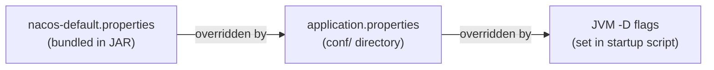
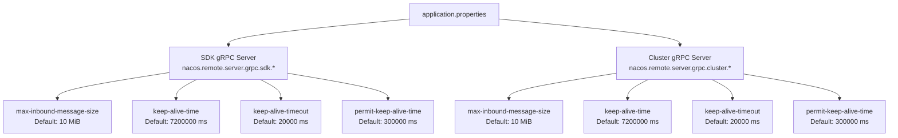
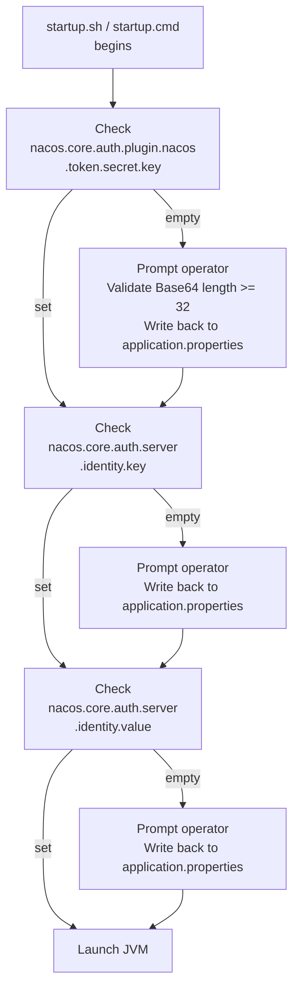
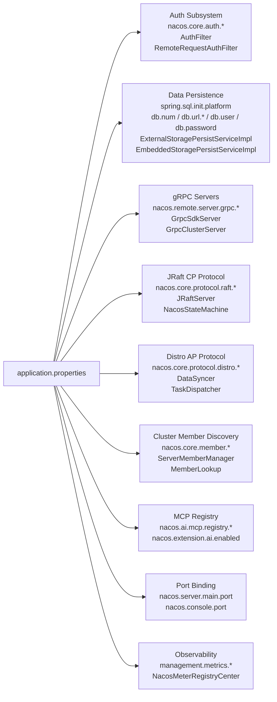

<!-- source: DeepWiki mcp.deepwiki.com · repo alibaba/nacos · page 2.2 Server Configuration · fetched 2026-10-29 -->

# Server Configuration

Relevant source files

The following files were used as context for generating this wiki page:

- [.gitignore](.gitignore)
- [console/src/main/resources/META-INF/nacos-default.properties](console/src/main/resources/META-INF/nacos-default.properties)
- [distribution/bin/shutdown.cmd](distribution/bin/shutdown.cmd)
- [distribution/bin/shutdown.sh](distribution/bin/shutdown.sh)
- [distribution/bin/startup.cmd](distribution/bin/startup.cmd)
- [distribution/bin/startup.sh](distribution/bin/startup.sh)
- [distribution/conf/application.properties](distribution/conf/application.properties)

This page documents the configuration properties available to a Nacos server operator. It covers the configuration layering model, the primary configuration file (`application.properties`), and the categories of settings within it — including database connections, authentication, gRPC tuning, cluster peer discovery, and the MCP registry.

For information about choosing a deployment mode or understanding port assignments, see [Deployment Modes and Requirements](#2.1). For startup script arguments and JVM heap tuning, see [Startup and Lifecycle Management](#2.3).

---

## Configuration Layering Model

Nacos resolves configuration from three layers, in ascending priority order:

**Configuration layering (lowest to highest priority)**

| Layer | File / Mechanism | Location |
|---|---|---|
| Defaults | `nacos-default.properties` | Bundled in `console` module JAR |
| Operator config | `application.properties` | `conf/application.properties` at runtime |
| JVM overrides | `-Dkey=value` flags | Passed on the `java` command line |

**Sources:**
- [console/src/main/resources/META-INF/nacos-default.properties:1-78]()
- [distribution/conf/application.properties:1-326]()
- [distribution/bin/startup.sh:209]()

The startup script adds `--spring.config.additional-location=${CUSTOM_SEARCH_LOCATIONS}` to the `java` command [distribution/bin/startup.sh:209](), where `CUSTOM_SEARCH_LOCATIONS` resolves to `file:${BASE_DIR}/conf/`. This causes Spring Boot to read `conf/application.properties` from the distribution directory and merge it with the bundled defaults.

---

## application.properties Reference

The authoritative operator configuration file is [distribution/conf/application.properties:1-326](). The file is organized into named sections. The descriptions below follow those sections.

---

### Port Configuration

| Property | Default | Description |
|---|---|---|
| `nacos.server.main.port` | `8848` | Main HTTP/gRPC plane port |
| `nacos.console.port` | `8080` | Console web plane port |
| `nacos.ai.mcp.registry.port` | `9080` | MCP registry server port (when enabled) |
| `nacos.server.contextPath` | `/nacos` | Context path for the server API |
| `nacos.console.contextPath` | _(empty)_ | Context path for the console |

Sources: [distribution/conf/application.properties:21-22](), [distribution/conf/application.properties:221-223](), [distribution/conf/application.properties:185](), [distribution/conf/application.properties:191]()

---

### Database Connection

By default, Nacos uses an embedded Derby database. To switch to MySQL, uncomment and populate the following properties:

| Property | Example value | Description |
|---|---|---|
| `spring.sql.init.platform` | `mysql` | Activates the MySQL datasource path |
| `db.num` | `1` | Number of database instances |
| `db.url.0` | `jdbc:mysql://127.0.0.1:3306/nacos?...` | JDBC URL for the first DB instance |
| `db.user` | `nacos` | Database username |
| `db.password` | `nacos` | Database password |

Additional instances are declared as `db.url.1`, `db.url.2`, etc., with `db.num` set accordingly.

Sources: [distribution/conf/application.properties:32-39]()

---

### Authentication

The authentication subsystem is controlled by the `nacos.core.auth.*` namespace.

#### Enable/Disable Auth

| Property | Default | Description |
|---|---|---|
| `nacos.core.auth.enabled` | `false` | Enable auth for the server (data plane) API |
| `nacos.core.auth.admin.enabled` | `true` | Enable auth for admin APIs |
| `nacos.core.auth.console.enabled` | `true` | Enable auth for the console API |
| `nacos.core.auth.system.type` | `nacos` | Auth plugin type; `nacos` or `ldap` |
| `nacos.core.auth.caching.enabled` | `true` | Cache auth lookups (15-second stale window) |

#### Server Identity (Inter-Node Auth)

When `nacos.core.auth.enabled=true`, cluster nodes authenticate internal calls using a shared identity key/value pair. Both properties **must** be set; the startup script (`process_required_config`) will block launch and prompt for values if either is empty.

| Property | Default | Description |
|---|---|---|
| `nacos.core.auth.server.identity.key` | _(empty)_ | Identity header key name |
| `nacos.core.auth.server.identity.value` | _(empty)_ | Identity header value |

#### Token Settings (Nacos auth plugin)

| Property | Default | Description |
|---|---|---|
| `nacos.core.auth.plugin.nacos.token.secret.key` | _(empty)_ | Base64-encoded JWT signing key (decoded string ≥ 32 chars) |
| `nacos.core.auth.plugin.nacos.token.expire.seconds` | `18000` | JWT token TTL in seconds |
| `nacos.core.auth.plugin.nacos.token.cache.enable` | `false` | Enable in-memory token cache |

The `token.secret.key` is a **required** field. The startup script [distribution/bin/startup.sh:165]() calls `process_required_config` for it with `isBase64=true`, meaning it validates the input is a valid Base64 string encoding a string of at least 32 characters. If the property is blank in `application.properties`, the server will not start without interactive input.

#### LDAP Settings (when `system.type=ldap`)

| Property | Example | Description |
|---|---|---|
| `nacos.core.auth.ldap.url` | `ldap://localhost:389` | LDAP server URL |
| `nacos.core.auth.ldap.basedc` | `dc=example,dc=org` | Base distinguished name |
| `nacos.core.auth.ldap.userDn` | `cn=admin,...` | Admin bind DN |
| `nacos.core.auth.ldap.password` | `admin` | Admin bind password |
| `nacos.core.auth.ldap.userdn` | `cn={0},dc=...` | User DN template; `{0}` = login username |

Sources: [distribution/conf/application.properties:248-287](), [distribution/bin/startup.sh:165-167]()

---

### gRPC Tuning

Nacos runs two gRPC servers: an SDK-facing server and an intra-cluster server. Both expose separate tuning knobs.

**gRPC configuration flow**

| Property | Default | Description |
|---|---|---|
| `nacos.remote.server.grpc.sdk.max-inbound-message-size` | `10485760` (10 MiB) | Maximum inbound message size for SDK connections |
| `nacos.remote.server.grpc.sdk.keep-alive-time` | `7200000` ms | Idle time before server sends a keepalive ping to SDK clients |
| `nacos.remote.server.grpc.sdk.keep-alive-timeout` | `20000` ms | Time to wait for a keepalive ping ACK before closing |
| `nacos.remote.server.grpc.sdk.permit-keep-alive-time` | `300000` ms | Minimum keep-alive interval permitted from clients |
| `nacos.remote.server.grpc.cluster.max-inbound-message-size` | `10485760` (10 MiB) | Maximum inbound message size for cluster connections |
| `nacos.remote.server.grpc.cluster.keep-alive-time` | `7200000` ms | Idle time before server sends a keepalive ping to peer nodes |
| `nacos.remote.server.grpc.cluster.keep-alive-timeout` | `20000` ms | Time to wait for a keepalive ping ACK before closing (cluster) |
| `nacos.remote.server.grpc.cluster.permit-keep-alive-time` | `300000` ms | Minimum keep-alive interval permitted from cluster peers |

All gRPC properties are commented out in the shipped `application.properties`; the defaults listed above are the compiled-in gRPC defaults described in the file comments.

Sources: [distribution/conf/application.properties:137-154]()

---

### Cluster Peer Configuration

Nacos discovers cluster members through a `MemberLookup` strategy. The relevant properties are:

| Property | Values | Description |
|---|---|---|
| `nacos.core.member.lookup.type` | `file`, `address-server` | Lookup strategy; overrides auto-detection if set |
| `nacos.member.list` | Comma-separated `host:port?raft_port=N` | Inline peer list (highest priority when set via `-D`) |

**`file` lookup** reads member addresses from `conf/cluster.conf`. **`address-server` lookup** polls a remote HTTP endpoint.

#### Address Server Properties (when `lookup.type=address-server`)

| Property | Default | Description |
|---|---|---|
| `nacos.core.address-server.retry` | `5` | Retry attempts on startup |
| `address.server.domain` | `jmenv.tbsite.net` | Domain of the address server |
| `address.server.port` | `8080` | Port of the address server |
| `address.server.url` | `/nacos/serverlist` | URL path returning the server list |

#### Network Interface Preferences

| Property | Default | Description |
|---|---|---|
| `nacos.inetutils.prefer-hostname-over-ip` | `false` | Use hostname instead of IP in cluster addresses |
| `nacos.inetutils.ip-address` | _(empty)_ | Force a specific local IP address |

Sources: [distribution/conf/application.properties:24-101]()

---

### JRaft (CP Protocol) Settings

These settings control the Raft consensus engine used for configuration data. See [Consistency Protocols](#6.2) for background.

| Property | Default | Description |
|---|---|---|
| `nacos.core.protocol.raft.data.election_timeout_ms` | `5000` | Leader election timeout in milliseconds |
| `nacos.core.protocol.raft.data.snapshot_interval_secs` | `30` (minutes) | How frequently Raft snapshots are written |
| `nacos.core.protocol.raft.data.core_thread_num` | `8` | Raft internal worker threads |
| `nacos.core.protocol.raft.data.cli_service_thread_num` | `4` | Business request processing threads |
| `nacos.core.protocol.raft.data.read_index_type` | `ReadOnlySafe` | Linear read strategy |
| `nacos.core.protocol.raft.data.rpc_request_timeout_ms` | `5000` | Raft RPC timeout in milliseconds |

Sources: [distribution/conf/application.properties:103-116]()

---

### Distro (AP Protocol) Settings

These settings control the Distro protocol used for ephemeral naming data. See [Consistency Protocols](#6.2) for background.

| Property | Default | Description |
|---|---|---|
| `nacos.core.protocol.distro.data.sync.delayMs` | `1000` | Delay before dispatching a sync task; same-key tasks merge during this window |
| `nacos.core.protocol.distro.data.sync.timeoutMs` | `3000` | Timeout per individual sync operation |
| `nacos.core.protocol.distro.data.sync.retryDelayMs` | `3000` | Delay before retrying a failed sync |
| `nacos.core.protocol.distro.data.verify.intervalMs` | `5000` | Interval for verifying synced data freshness |
| `nacos.core.protocol.distro.data.verify.timeoutMs` | `3000` | Timeout per individual verify operation |
| `nacos.core.protocol.distro.data.load.retryDelayMs` | `30000` | Delay before retrying a failed snapshot load |

Sources: [distribution/conf/application.properties:120-133]()

---

### MCP Registry

The MCP registry is a separate server process for AI/Model Context Protocol integrations. See [AI and MCP Management System](#8.3) for the UI component.

| Property | Default | Description |
|---|---|---|
| `nacos.extension.ai.enabled` | `true` | Enable the AI module (requires both config and naming modules) |
| `nacos.ai.mcp.registry.enabled` | `false` | Start the MCP registry server |
| `nacos.ai.mcp.registry.port` | `9080` | Port on which the MCP registry listens |

Sources: [distribution/conf/application.properties:175-185]()

---

### Console CORS

| Property | Default | Description |
|---|---|---|
| `nacos.console.cors.allow-credentials` | `true` | Allow cookies and auth headers in cross-origin requests |
| `nacos.console.cors.allowed-headers` | _(empty = all)_ | Comma-separated list of allowed headers |
| `nacos.console.cors.allowed-methods` | _(empty = all)_ | Comma-separated list of allowed HTTP methods |
| `nacos.console.cors.allowed-origins` | _(empty = all)_ | Comma-separated allowed origin patterns |
| `nacos.console.cors.max-age` | `18000` | Preflight cache duration in seconds |

Sources: [distribution/conf/application.properties:59-74]()

---

### Metrics / Observability

| Property | Default | Description |
|---|---|---|
| `management.endpoints.web.exposure.include` | _(not set)_ | Set to `prometheus` to expose the Prometheus scrape endpoint |
| `management.metrics.export.elastic.enabled` | `false` | Enable Elasticsearch metrics export |
| `management.metrics.export.influx.enabled` | `false` | Enable InfluxDB metrics export |
| `nacos.prometheus.metrics.enabled` | _(not set)_ | Enable Prometheus-based service discovery metadata |

Sources: [distribution/conf/application.properties:41-55](), [distribution/conf/application.properties:117-118]()

---

### Access Log

| Property | Default | Description |
|---|---|---|
| `server.tomcat.accesslog.enabled` | `true` | Enable Tomcat access logging |
| `server.tomcat.accesslog.max-days` | `30` | Days to retain access log files |
| `server.tomcat.accesslog.pattern` | `%h %l %u %t "%r" %s %b %D ...` | Log line format |
| `server.tomcat.basedir` | `file:.` | Base directory for log file output |

Sources: [distribution/conf/application.properties:193-204]()

---

## Startup-Time Config Validation

The startup scripts enforce that three security-critical properties are non-empty before the JVM is launched. If any of these properties has an empty value in `application.properties`, the script prompts the operator interactively and writes the supplied value back into the file.

**Required config gate (`process_required_config`)**

The `process_required_config` function is defined at [distribution/bin/startup.sh:57-95]() and called three times at [distribution/bin/startup.sh:165-167](). The Windows equivalent is the `:Process_required_config` subroutine in [distribution/bin/startup.cmd:118-153]().

Sources: [distribution/bin/startup.sh:57-167](), [distribution/bin/startup.cmd:57-59](), [distribution/bin/startup.cmd:118-153]()

---

## Complete Property-to-Subsystem Map

The diagram below maps each configuration section to the server subsystem that consumes it.

Sources: [distribution/conf/application.properties:1-326]()

---

