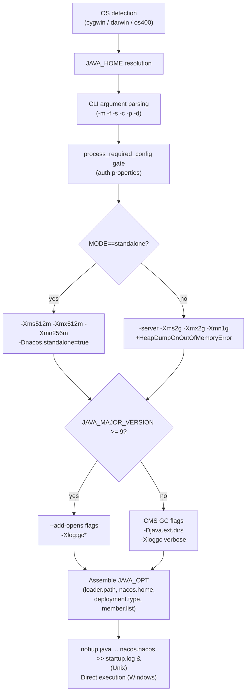
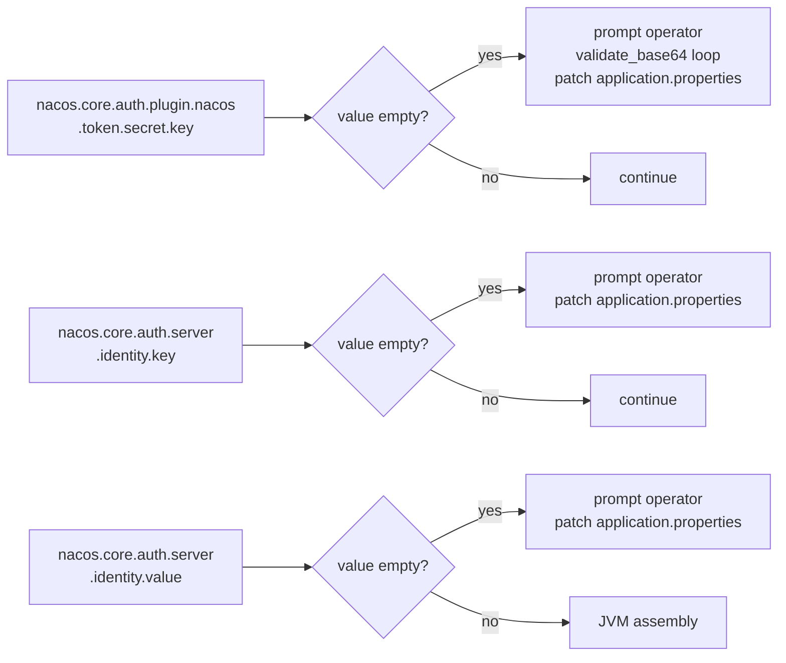
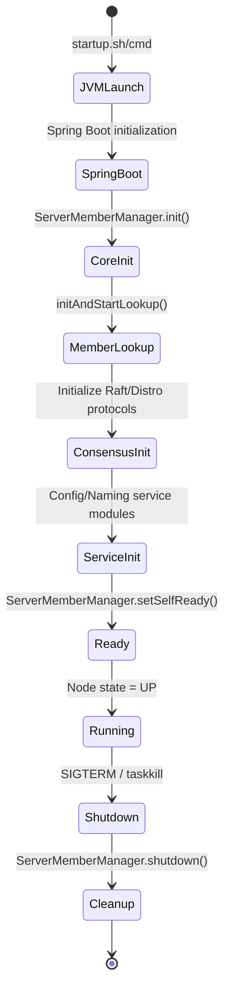
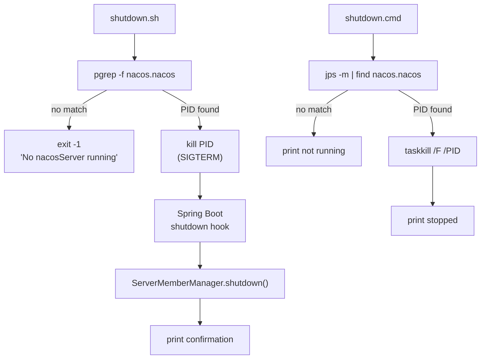

<!-- source: DeepWiki mcp.deepwiki.com · repo alibaba/nacos · page 2.3 Startup and Lifecycle Management · fetched 2026-10-29 -->

# Startup and Lifecycle Management

<details>
<summary>Relevant source files</summary>

The following files were used as context for generating this wiki page:

- [.gitignore](.gitignore)
- [common/src/main/java/com/alibaba/nacos/common/utils/LoggerUtils.java](common/src/main/java/com/alibaba/nacos/common/utils/LoggerUtils.java)
- [console/src/main/resources/META-INF/nacos-default.properties](console/src/main/resources/META-INF/nacos-default.properties)
- [core/src/main/java/com/alibaba/nacos/core/cluster/Member.java](core/src/main/java/com/alibaba/nacos/core/cluster/Member.java)
- [core/src/main/java/com/alibaba/nacos/core/cluster/MemberChangeListener.java](core/src/main/java/com/alibaba/nacos/core/cluster/MemberChangeListener.java)
- [core/src/main/java/com/alibaba/nacos/core/cluster/MemberMetaDataConstants.java](core/src/main/java/com/alibaba/nacos/core/cluster/MemberMetaDataConstants.java)
- [core/src/main/java/com/alibaba/nacos/core/cluster/MemberUtil.java](core/src/main/java/com/alibaba/nacos/core/cluster/MemberUtil.java)
- [core/src/main/java/com/alibaba/nacos/core/cluster/MembersChangeEvent.java](core/src/main/java/com/alibaba/nacos/core/cluster/MembersChangeEvent.java)
- [core/src/main/java/com/alibaba/nacos/core/cluster/ServerMemberManager.java](core/src/main/java/com/alibaba/nacos/core/cluster/ServerMemberManager.java)
- [core/src/main/java/com/alibaba/nacos/core/cluster/lookup/AddressServerMemberLookup.java](core/src/main/java/com/alibaba/nacos/core/cluster/lookup/AddressServerMemberLookup.java)
- [core/src/main/java/com/alibaba/nacos/core/cluster/lookup/FileConfigMemberLookup.java](core/src/main/java/com/alibaba/nacos/core/cluster/lookup/FileConfigMemberLookup.java)
- [core/src/main/java/com/alibaba/nacos/core/cluster/lookup/LookupFactory.java](core/src/main/java/com/alibaba/nacos/core/cluster/lookup/LookupFactory.java)
- [core/src/main/java/com/alibaba/nacos/core/cluster/lookup/StandaloneMemberLookup.java](core/src/main/java/com/alibaba/nacos/core/cluster/lookup/StandaloneMemberLookup.java)
- [distribution/bin/shutdown.cmd](distribution/bin/shutdown.cmd)
- [distribution/bin/shutdown.sh](distribution/bin/shutdown.sh)
- [distribution/bin/startup.cmd](distribution/bin/startup.cmd)
- [distribution/bin/startup.sh](distribution/bin/startup.sh)
- [distribution/conf/application.properties](distribution/conf/application.properties)

</details>


This page documents the startup and shutdown scripts distributed with Nacos: how the Java runtime is located, which CLI flags are accepted, the pre-flight configuration gate that runs before the JVM is launched, how JVM heap and GC flags are chosen, and how the server process is terminated. For configuration properties that are validated during startup see [Server Configuration](#2.2). For deployment mode selection (standalone vs. cluster) see [Deployment Modes and Requirements](#2.1).

---

## Script Locations

Nacos ships two startup scripts and two shutdown scripts inside the `distribution/bin/` directory:

| Platform | Startup | Shutdown |
|---|---|---|
| Linux / macOS | `distribution/bin/startup.sh` | `distribution/bin/shutdown.sh` |
| Windows | `distribution/bin/startup.cmd` | `distribution/bin/shutdown.cmd` |

Both platform variants implement the same logical pipeline. The sections below describe the shared logic, noting platform differences where they exist.

---

## Startup Pipeline Overview

**Startup Script Execution Flow**



Sources: [distribution/bin/startup.sh:1-239](), [distribution/bin/startup.cmd:1-154]()

---

## Java Detection and JAVA_HOME Resolution

`startup.sh` probes four candidate paths before falling back to the system PATH:

```
$HOME/jdk/java
/usr/java
/opt/taobao/java
(unset, proceed to auto-detect)
```

[distribution/bin/startup.sh:97-128]()

If `JAVA_HOME` is still unset after those probes, the script performs OS-specific resolution:

- **macOS (`darwin=true`)**: calls `/usr/libexec/java_home`, then falls back to the legacy framework path `/System/Library/Frameworks/JavaVM.framework/Versions/CurrentJDK/Home`.
- **Other Unix**: derives the path from `readlink -f $(which javac)` or from `which java`.

If no Java binary can be found after all probes, `error_exit` is called and the script aborts.

`startup.cmd` is simpler: it requires `%JAVA_HOME%\bin\java.exe` to already exist and exits immediately with an error message if it does not. [distribution/bin/startup.cmd:14-15]()

---

## CLI Argument Parsing

**Argument Flags and Their Defaults**

| Flag | Variable | Default | Purpose |
|---|---|---|---|
| `-m` | `MODE` | `cluster` | Deployment mode: `standalone` or `cluster` |
| `-f` | `FUNCTION_MODE` | `all` | Functional subset: `all`, `config`, or `naming` |
| `-s` | `SERVER` | `nacos-server` | JAR file base name |
| `-c` | `MEMBER_LIST` | *(empty)* | Comma-separated peer list, passed as `-Dnacos.member.list` |
| `-p` | `EMBEDDED_STORAGE` | *(empty)* | Set to `embedded` to force Derby storage in cluster mode |
| `-d` | `DEPLOYMENT` | `merged` | Deployment type, passed as `-Dnacos.deployment.type` |

Sources: [distribution/bin/startup.sh:136-155](), [distribution/bin/startup.cmd:37-55]()

`startup.sh` uses `getopts` for parsing. `startup.cmd` performs two sequential `for` loop passes over `%*` to locate flag positions and then read values, since `cmd.exe` has no `getopts` equivalent.

---

## Pre-flight Configuration Gate (`process_required_config`)

Before any JVM option is assembled, the script checks three required properties in `conf/application.properties`. If a property line exists but its value is empty, the operator is prompted to supply a value interactively; the file is then updated in-place before startup continues.

**Properties Checked**

| Property | Description | Validation |
|---|---|---|
| `nacos.core.auth.plugin.nacos.token.secret.key` | JWT signing key (Base64-encoded string) | Must be valid Base64; decoded value must be ≥ 32 bytes |
| `nacos.core.auth.server.identity.key` | Server identity header key | Non-empty string |
| `nacos.core.auth.server.identity.value` | Server identity header value | Non-empty string |

[distribution/bin/startup.sh:57-95](), [distribution/bin/startup.sh:165-167]()

The `validate_base64` function decodes the supplied string with the system `base64` utility and rejects it if decoding fails or if the decoded length is less than 32 characters. The loop in `process_required_config` repeats the prompt until valid input is provided.

The `startup.cmd` equivalent is the `:Process_required_config` subroutine, which uses `findstr` and a `for /f` loop to locate and patch the property file. [distribution/bin/startup.cmd:118-153]()

**Pre-flight Gate Diagram**



Sources: [distribution/bin/startup.sh:30-95](), [distribution/bin/startup.sh:165-167](), [distribution/bin/startup.cmd:118-153]()

---

## JVM Heap Sizing by Mode

Heap parameters differ significantly between standalone and cluster mode. The `CUSTOM_NACOS_MEMORY` environment variable can override the defaults for either mode.

**Standalone Mode**

```
-Xms512m -Xmx512m -Xmn256m
-Dnacos.standalone=true
```

**Cluster Mode**

```
-server -Xms2g -Xmx2g -Xmn1g
-XX:MetaspaceSize=128m -XX:MaxMetaspaceSize=320m
-XX:-OmitStackTraceInFastThrow
-XX:+HeapDumpOnOutOfMemoryError -XX:HeapDumpPath=<BASE_DIR>/logs/java_heapdump.hprof
-XX:-UseLargePages
```

When `-p embedded` is supplied in cluster mode, the flag `-DembeddedStorage=true` is also added.

Sources: [distribution/bin/startup.sh:172-182](), [distribution/bin/startup.cmd:62-77]()

---

## Java Version Branching for GC and Module Flags

The script detects the running JVM major version by parsing the output of `java -version`:

```bash
JAVA_MAJOR_VERSION=$($JAVA -version 2>&1 | sed -E -n 's/.* version "([0-9]*).*$/\1/p')
```

[distribution/bin/startup.sh:192]()

**JVM flags applied per version**

| Java Version | GC Configuration | Module Flags |
|---|---|---|
| ≥ 9 | `-Xlog:gc*:file=<logs>/nacos_gc.log:time,tags:filecount=10,filesize=100m` | `--add-opens=java.base/java.lang=ALL-UNNAMED`<br>`--add-opens=java.base/java.lang.reflect=ALL-UNNAMED`<br>`--add-opens=java.base/java.util=ALL-UNNAMED` |
| < 9 | `-XX:+UseConcMarkSweepGC -XX:+UseCMSCompactAtFullCollection`<br>`-XX:CMSInitiatingOccupancyFraction=70 -XX:+CMSParallelRemarkEnabled`<br>`-Xloggc:<logs>/nacos_gc.log -verbose:gc -XX:+PrintGCDetails` | `-Djava.ext.dirs=<JAVA_HOME>/jre/lib/ext:<JAVA_HOME>/lib/ext` |

The `--add-opens` flags are required because Nacos's reflection-heavy internals (Spring Boot, gRPC generated code, JRaft) access JDK internal APIs that are encapsulated by the Java 9+ module system.

Sources: [distribution/bin/startup.sh:192-202](), [distribution/bin/startup.cmd:89-94]()

---

## Full JVM Option Assembly

After mode and version branching, the following options are always appended regardless of mode or version:

| JVM / Spring Option | Value | Purpose |
|---|---|---|
| `-Dnacos.deployment.type` | `${DEPLOYMENT}` | Signals deployment topology to the application |
| `-Dloader.path` | `<BASE_DIR>/plugins,<BASE_DIR>/plugins/health,<BASE_DIR>/plugins/cmdb,<BASE_DIR>/plugins/selector` | Plugin classpath roots for `PropertiesLauncher` |
| `-Dnacos.home` | `<BASE_DIR>` | Root directory used internally for data, logs, conf paths |
| `-jar` | `<BASE_DIR>/target/<SERVER>.jar` | Application JAR |
| `--spring.config.additional-location` | `file:<BASE_DIR>/conf/` | Loads `application.properties` from the conf directory |
| `--logging.config` | `<BASE_DIR>/conf/nacos-logback.xml` | Logback configuration |
| `--server.max-http-request-header-size` | `524288` | 512 KB HTTP header limit |

Sources: [distribution/bin/startup.sh:204-211](), [distribution/bin/startup.cmd:97-107]()

---

## Process Launch

**Unix (`startup.sh`)**

The server is launched as a background daemon using `nohup`. Output is redirected to `logs/startup.log`:

```bash
nohup "$JAVA" ${JAVA_OPT} nacos.nacos >> <BASE_DIR>/logs/startup.log 2>&1 &
```

The argument `nacos.nacos` is passed as the Spring Boot application name marker (it appears in the process name for `pgrep` matching).

If `JAVA_OPT_EXT_FIX` is non-empty (set only for Java < 9 to supply `-Djava.ext.dirs`), it is passed as a separate argument before `JAVA_OPT` to preserve word splitting semantics.

The `logs` directory is created if it does not exist. [distribution/bin/startup.sh:213-215]()

[distribution/bin/startup.sh:232-236]()

**Windows (`startup.cmd`)**

The process runs in the foreground within the same `cmd.exe` window. A `pause` statement at the end keeps the window open:

```cmd
%JAVA%" %NACOS_JVM_OPTS% %NACOS_OPTS% %NACOS_CONFIG_OPTS% %NACOS_LOG4J_OPTS% nacos.nacos %*
pause
```

[distribution/bin/startup.cmd:109-114]()

---

## Server Initialization and Lifecycle

Once the JVM process launches, Spring Boot initializes the application context and Nacos server components follow a specific lifecycle sequence.

**Server Lifecycle Phases**



Sources: [core/src/main/java/com/alibaba/nacos/core/cluster/ServerMemberManager.java:151-173](), [core/src/main/java/com/alibaba/nacos/core/cluster/ServerMemberManager.java:469-478](), [core/src/main/java/com/alibaba/nacos/core/cluster/ServerMemberManager.java:485-491]()

### Initialization (`ServerMemberManager.init`)

The `ServerMemberManager` component is instantiated early in the Spring context lifecycle and performs cluster resource initialization:

1. **Server Port Resolution**: Reads `nacos.server.main.port` (default `8848`) from environment properties
2. **Local Address Discovery**: Constructs `localAddress` as `<IP>:<PORT>` using `InetUtils.getSelfIP()`
3. **Self Member Creation**: Creates a `Member` object representing this node with:
   - Version metadata from `VersionUtils.version`
   - Default abilities initialized via `ServerAbilityInitializer`
   - gRPC reporting enabled by default
4. **Event Registration**: Registers `MembersChangeEvent` publisher to `NotifyCenter`
5. **Member Lookup Initialization**: Calls `initAndStartLookup()` to select and start a `MemberLookup` strategy

[core/src/main/java/com/alibaba/nacos/core/cluster/ServerMemberManager.java:151-173]()

### Member Lookup Strategies

The `LookupFactory` selects one of three addressing strategies based on configuration and file presence:

| Strategy Class | Trigger | Behavior |
|---|---|---|
| `StandaloneMemberLookup` | `-Dnacos.standalone=true` | Single-node mode, uses local address only |
| `FileConfigMemberLookup` | `cluster.conf` file exists or `nacos.member.list` property set | Reads member list from file, watches for changes using `WatchFileCenter` |
| `AddressServerMemberLookup` | Neither of above | Polls external address server at configured URL to retrieve member list |

The selected strategy is started by calling its `start()` method, which triggers an initial member list sync. [core/src/main/java/com/alibaba/nacos/core/cluster/lookup/LookupFactory.java:50-73]()

**FileConfigMemberLookup** registers a `FileWatcher` that monitors the `conf/` directory and automatically re-reads `cluster.conf` when it changes. [core/src/main/java/com/alibaba/nacos/core/cluster/lookup/FileConfigMemberLookup.java:54-65]()

**AddressServerMemberLookup** schedules an `AddressServerSyncTask` that runs every 5 seconds to poll the address server. The address server URL is constructed from properties:
- `address.server.domain` (default: `jmenv.tbsite.net`)
- `address.server.port` (default: `8080`)
- `address.server.url` (default: `/nacos/serverlist`)

[core/src/main/java/com/alibaba/nacos/core/cluster/lookup/AddressServerMemberLookup.java:96-154]()

### Ready State Transition

After all modules complete initialization, `ServerMemberManager.setSelfReady(int port)` is called to signal that this node is ready to serve requests:

1. Sets the node's `Member.state` to `NodeState.UP`
2. In cluster mode, schedules two periodic reporting tasks:
   - `MemberInfoReportTask`: Reports this node's metadata to one peer every 2 seconds
   - `UnhealthyMemberInfoReportTask`: Reports to all unhealthy peers every 5 seconds
3. Updates environment properties with the final port and local address

[core/src/main/java/com/alibaba/nacos/core/cluster/ServerMemberManager.java:469-478]()

The `MemberInfoReportTask` cycles through the peer list (`allMembersWithoutSelf()`) and sends a `MemberReportRequest` via gRPC (or HTTP for legacy nodes) to exactly one peer per execution. This design distributes the reporting load across the cluster. [core/src/main/java/com/alibaba/nacos/core/cluster/ServerMemberManager.java:511-651]()

### Monitoring Startup Progress

Startup logs are written to:
- **Console output**: `logs/startup.log` (Unix) or console window (Windows)
- **Application logs**: `logs/nacos.log` (configured via `conf/nacos-logback.xml`)

Key log messages to monitor:

| Logger | Message Pattern | Significance |
|---|---|---|
| `com.alibaba.nacos.core.cluster.ServerMemberManager` | `"Nacos-related cluster resource initialization"` | Cluster init started |
| `com.alibaba.nacos.core.cluster.ServerMemberManager` | `"The cluster resource is initialized"` | Cluster init completed |
| `com.alibaba.nacos.core.cluster.ServerMemberManager` | `"This node is ready to provide external services"` | Server is UP |
| `com.alibaba.nacos.core.cluster.ServerMemberManager` | `"[serverlist] changed to : {}"` | Member list updated |

Sources: [core/src/main/java/com/alibaba/nacos/core/cluster/ServerMemberManager.java:152](), [core/src/main/java/com/alibaba/nacos/core/cluster/ServerMemberManager.java:172](), [core/src/main/java/com/alibaba/nacos/core/cluster/ServerMemberManager.java:477](), [core/src/main/java/com/alibaba/nacos/core/cluster/ServerMemberManager.java:395]()

---

## Shutdown

**Shutdown Script Behavior**



Sources: [distribution/bin/shutdown.sh:15-28](), [distribution/bin/shutdown.cmd:15-40]()

### Unix Graceful Shutdown (`shutdown.sh`)

`shutdown.sh` locates the Nacos process using `pgrep -f nacos.nacos` and sends `SIGTERM` (`kill <PID>`) to initiate graceful shutdown. The Spring Boot shutdown hook triggers cleanup of server components.

[distribution/bin/shutdown.sh:18-26]()

**ServerMemberManager Cleanup Sequence**

The `@PreDestroy` annotation on `ServerMemberManager.shutdown()` ensures it is called during application context destruction:

1. **Clear Member Lists**: Removes all entries from `serverList` and `memberAddressInfos` collections
2. **Stop Reporting Tasks**: Calls `infoReportTask.shutdown()` to cancel scheduled member reporting
3. **Destroy Lookup**: Calls `LookupFactory.destroy()` to stop the active `MemberLookup` strategy (e.g., stops the address server polling task or deregisters file watchers)

[core/src/main/java/com/alibaba/nacos/core/cluster/ServerMemberManager.java:485-491]()

### Windows Forced Shutdown (`shutdown.cmd`)

`shutdown.cmd` uses `jps -m | find "nacos.nacos"` to locate the process and calls `taskkill /F /PID` to forcibly terminate it. This does **not** trigger Spring shutdown hooks, so cleanup logic in `@PreDestroy` methods will not execute. Administrators should use CTRL+C or close the console window to perform graceful shutdown on Windows.

[distribution/bin/shutdown.cmd:27-32]()

---

## Environment Variable Reference

| Variable | Used By | Effect |
|---|---|---|
| `JAVA_HOME` | Both scripts | Base path for the Java binary |
| `CUSTOM_NACOS_MEMORY` | `startup.sh`, `startup.cmd` | Overrides default heap flags (e.g., `-Xms1g -Xmx1g`) |
| `JAVA_OPT_EXT` | `startup.sh` | Appended verbatim to `JAVA_OPT` after all other options are set |

Sources: [distribution/bin/startup.sh:172-173](), [distribution/bin/startup.sh:208](), [distribution/bin/startup.cmd:65-66]()

---

