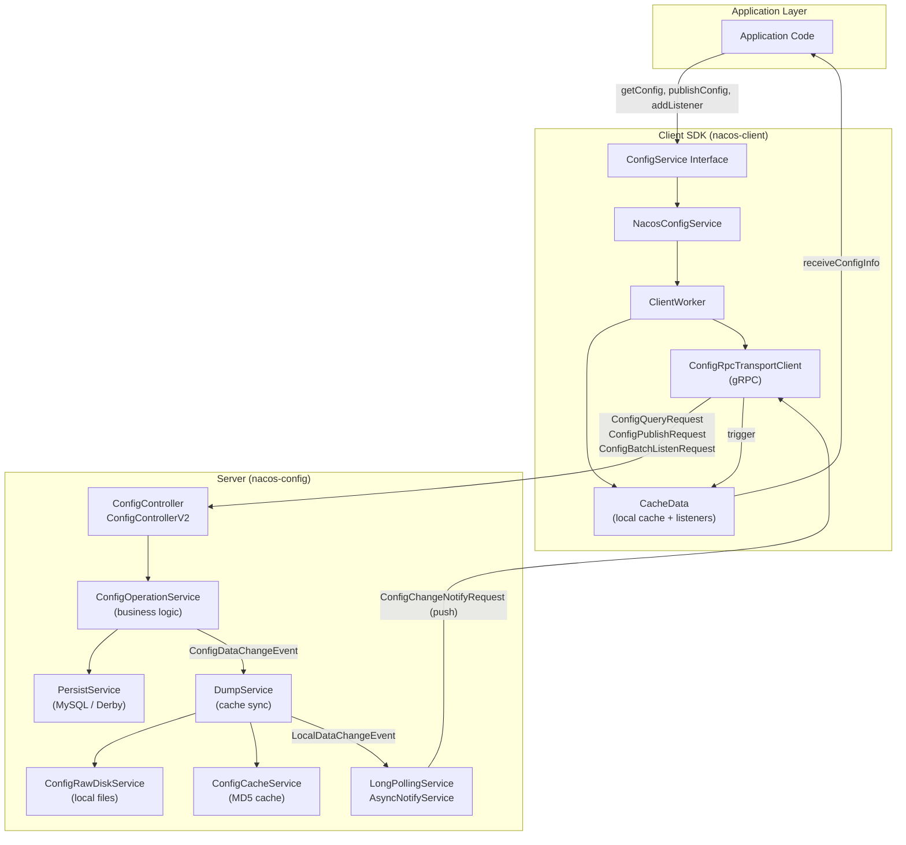
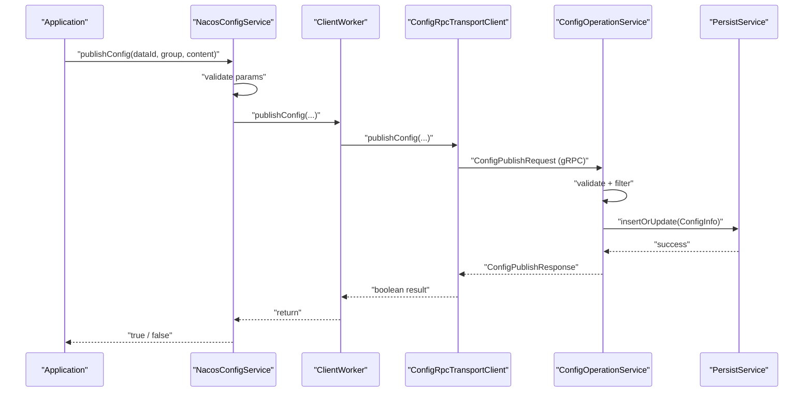
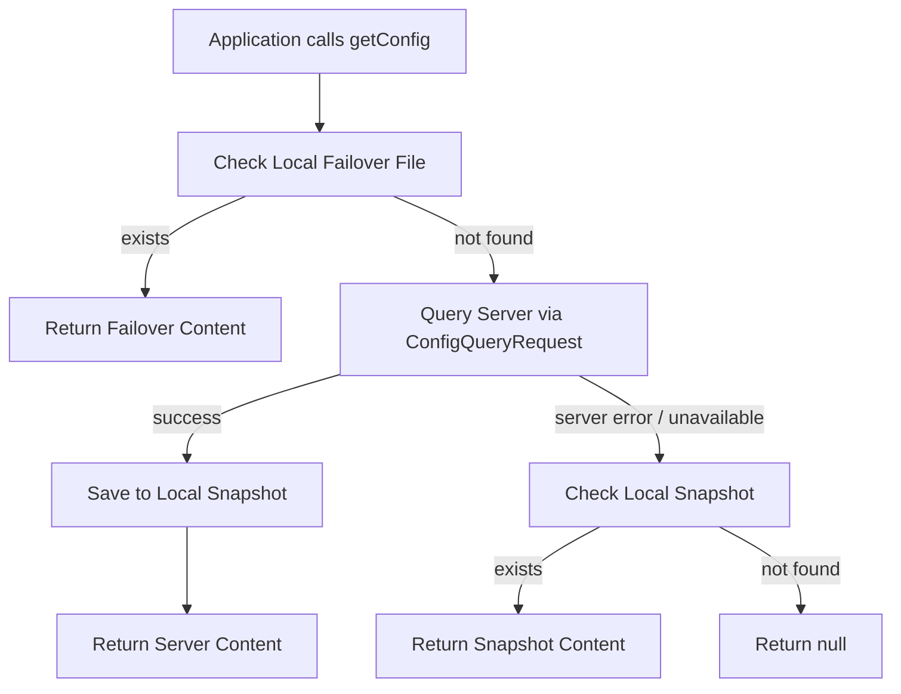
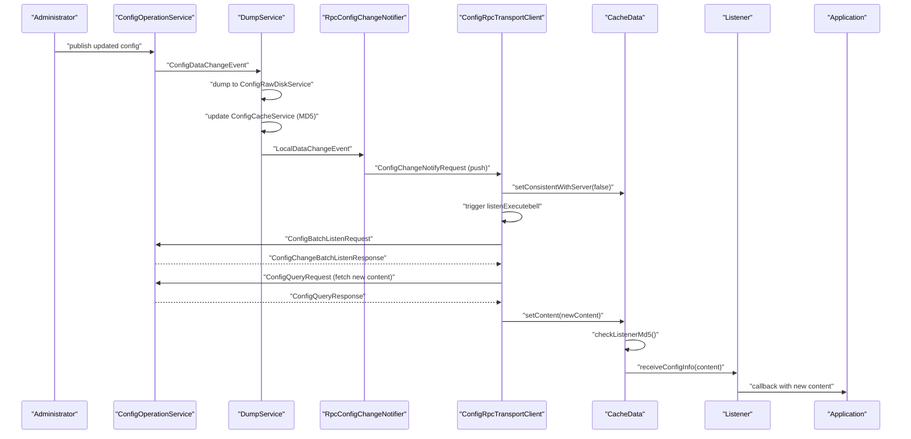
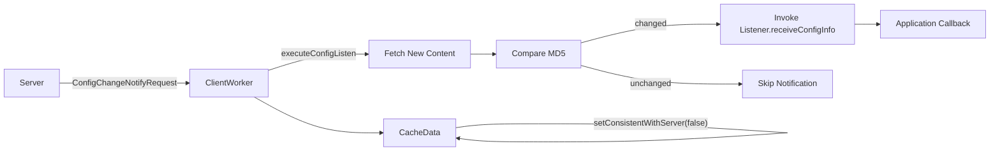

<!-- source: DeepWiki mcp.deepwiki.com · repo alibaba/nacos · page 3 Configuration Service · fetched 2026-10-29 -->

# Configuration Service

Relevant source files

The following files were used as context for generating this wiki page:

- [api/src/main/java/com/alibaba/nacos/api/PropertyKeyConst.java](api/src/main/java/com/alibaba/nacos/api/PropertyKeyConst.java)
- [api/src/main/java/com/alibaba/nacos/api/common/Constants.java](api/src/main/java/com/alibaba/nacos/api/common/Constants.java)
- [api/src/main/java/com/alibaba/nacos/api/config/ConfigService.java](api/src/main/java/com/alibaba/nacos/api/config/ConfigService.java)
- [client/src/main/java/com/alibaba/nacos/client/config/NacosConfigService.java](client/src/main/java/com/alibaba/nacos/client/config/NacosConfigService.java)
- [client/src/main/java/com/alibaba/nacos/client/config/http/ServerHttpAgent.java](client/src/main/java/com/alibaba/nacos/client/config/http/ServerHttpAgent.java)
- [client/src/main/java/com/alibaba/nacos/client/config/impl/CacheData.java](client/src/main/java/com/alibaba/nacos/client/config/impl/CacheData.java)
- [client/src/main/java/com/alibaba/nacos/client/config/impl/ClientWorker.java](client/src/main/java/com/alibaba/nacos/client/config/impl/ClientWorker.java)
- [client/src/main/java/com/alibaba/nacos/client/naming/NacosNamingService.java](client/src/main/java/com/alibaba/nacos/client/naming/NacosNamingService.java)
- [client/src/main/java/com/alibaba/nacos/client/naming/backups/FailoverReactor.java](client/src/main/java/com/alibaba/nacos/client/naming/backups/FailoverReactor.java)
- [client/src/main/java/com/alibaba/nacos/client/naming/cache/DiskCache.java](client/src/main/java/com/alibaba/nacos/client/naming/cache/DiskCache.java)
- [client/src/main/java/com/alibaba/nacos/client/naming/core/Balancer.java](client/src/main/java/com/alibaba/nacos/client/naming/core/Balancer.java)
- [client/src/main/java/com/alibaba/nacos/client/naming/utils/UtilAndComs.java](client/src/main/java/com/alibaba/nacos/client/naming/utils/UtilAndComs.java)
- [client/src/test/java/com/alibaba/nacos/client/config/NacosConfigServiceTest.java](client/src/test/java/com/alibaba/nacos/client/config/NacosConfigServiceTest.java)
- [client/src/test/java/com/alibaba/nacos/client/config/impl/CacheDataTest.java](client/src/test/java/com/alibaba/nacos/client/config/impl/CacheDataTest.java)
- [client/src/test/java/com/alibaba/nacos/client/config/impl/ClientWorkerTest.java](client/src/test/java/com/alibaba/nacos/client/config/impl/ClientWorkerTest.java)
- [config/src/main/java/com/alibaba/nacos/config/server/enums/FileTypeEnum.java](config/src/main/java/com/alibaba/nacos/config/server/enums/FileTypeEnum.java)
- [config/src/main/java/com/alibaba/nacos/config/server/service/dump/disk/ConfigRawDiskService.java](config/src/main/java/com/alibaba/nacos/config/server/service/dump/disk/ConfigRawDiskService.java)
- [config/src/main/java/com/alibaba/nacos/config/server/utils/ParamUtils.java](config/src/main/java/com/alibaba/nacos/config/server/utils/ParamUtils.java)
- [config/src/main/java/com/alibaba/nacos/config/server/utils/ZipUtils.java](config/src/main/java/com/alibaba/nacos/config/server/utils/ZipUtils.java)
- [config/src/test/java/com/alibaba/nacos/config/server/service/dump/disk/ConfigRawDiskServiceTest.java](config/src/test/java/com/alibaba/nacos/config/server/service/dump/disk/ConfigRawDiskServiceTest.java)
- [config/src/test/java/com/alibaba/nacos/config/server/utils/ParamUtilsTest.java](config/src/test/java/com/alibaba/nacos/config/server/utils/ParamUtilsTest.java)
- [config/src/test/java/com/alibaba/nacos/config/server/utils/PropertyUtilTest.java](config/src/test/java/com/alibaba/nacos/config/server/utils/PropertyUtilTest.java)
- [config/src/test/java/com/alibaba/nacos/config/server/utils/ProtocolTest.java](config/src/test/java/com/alibaba/nacos/config/server/utils/ProtocolTest.java)

The configuration service provides centralized storage and dynamic distribution of application configuration data. It enables applications to externalize properties, YAML files, JSON, XML, and other configuration formats, allowing runtime updates without redeployment.

This page provides an overview of configuration management capabilities, including storage, retrieval, modification, and distribution mechanisms. For client API details, see [Configuration Client SDK](#3.1). For server implementation, see [Configuration Server API](#3.2).

---

## Core Capabilities

The configuration service manages *config items* — uniquely identified text blobs that are stored, versioned, and distributed to subscribed applications.

| Capability | Description | Implementation |
|---|---|---|
| **Storage** | Persist configurations in database (MySQL/Derby) and local disk cache | `ConfigOperationService`, `ConfigRawDiskService` |
| **Retrieval** | Fetch config by `dataId + group + namespace`, with local cache and failover | `NacosConfigService.getConfig`, `ClientWorker.getServerConfig` |
| **Publication** | Create, update, or delete configuration items | `NacosConfigService.publishConfig`, `ConfigPublishRequest` |
| **Change Notification** | Push-based updates via gRPC or HTTP long-polling | `ConfigChangeNotifyRequest`, `LongPollingService` |
| **Listener Pattern** | Subscribe to specific config changes with callbacks | `CacheData`, `Listener` interface |
| **Fuzzy Watch** | Pattern-based subscriptions (wildcards for `dataId`/`group`) | `ConfigFuzzyWatchGroupKeyHolder`, `FuzzyWatchEventWatcher` |
| **Gray Release** | Targeted content delivery to specific client groups (beta IPs, tags) | Server-side filtering in `ConfigServletInner` |
| **Import/Export** | Bulk transfer of config sets as ZIP archives | `ZipUtils` |

Sources: [api/src/main/java/com/alibaba/nacos/api/config/ConfigService.java:32-265](), [client/src/main/java/com/alibaba/nacos/client/config/NacosConfigService.java:57-375](), [config/src/main/java/com/alibaba/nacos/config/server/utils/ZipUtils.java:39-157]()

---

## Configuration Identity

Every configuration item is uniquely identified by three coordinates:

| Field | Default | Description | Validation |
|---|---|---|---|
| `dataId` | (required) | Logical identifier, e.g., `application.properties` | Letters, digits, `_`, `-`, `.`, `:` only |
| `group` | `DEFAULT_GROUP` | Grouping dimension for organization | Same character restrictions |
| `namespace` (or `tenant`) | `public` | Isolation boundary for multi-tenancy | Max 128 characters |

These three fields are combined into a *group key* string (format: `dataId+group+namespace`) that serves as the primary cache and index key throughout the system.

Sources: [api/src/main/java/com/alibaba/nacos/api/common/Constants.java:32-56](), [client/src/main/java/com/alibaba/nacos/client/config/common/GroupKey.java](), [config/src/main/java/com/alibaba/nacos/config/server/utils/ParamUtils.java:34-238]()

---

## Architecture Overview

The configuration service comprises client-side and server-side components that work together to provide reliable configuration management.

**Configuration Service — System Architecture**

Sources: [client/src/main/java/com/alibaba/nacos/client/config/NacosConfigService.java:57-87](), [client/src/main/java/com/alibaba/nacos/client/config/impl/ClientWorker.java:115-650](), [client/src/main/java/com/alibaba/nacos/client/config/impl/CacheData.java:55-180]()

---

## Configuration Lifecycle

### Publishing a Configuration

**Configuration Publish Flow**

Sources: [client/src/main/java/com/alibaba/nacos/client/config/NacosConfigService.java:175-194](), [client/src/main/java/com/alibaba/nacos/client/config/impl/ClientWorker.java:368-372]()

### Retrieving a Configuration

Configuration retrieval follows a three-tier fallback strategy to ensure availability:

**Configuration Retrieval Priority**

1. **Local Failover**: Manually-placed files in `${nacos.home}/config-data/failover/` (highest priority)
2. **Remote Server**: Query via gRPC `ConfigQueryRequest` 
3. **Local Snapshot**: Automatically-cached files from previous successful fetches (fallback)

Sources: [client/src/main/java/com/alibaba/nacos/client/config/NacosConfigService.java:206-260](), [client/src/main/java/com/alibaba/nacos/client/config/impl/LocalConfigInfoProcessor.java]()

### Change Notification

**Configuration Change Propagation**

Sources: [client/src/main/java/com/alibaba/nacos/client/config/impl/ClientWorker.java:745-763](), [client/src/main/java/com/alibaba/nacos/client/config/impl/ClientWorker.java:862-947](), [client/src/main/java/com/alibaba/nacos/client/config/impl/CacheData.java:342-510]()

---

## Key Components

### Client Components

| Component | Class | Responsibility |
|---|---|---|
| **Public API** | `ConfigService` | Interface defining `getConfig`, `publishConfig`, `addListener`, `removeListener`, `fuzzyWatch` |
| **Service Implementation** | `NacosConfigService` | Main client entry point; manages `ClientWorker` and filter chain |
| **Worker Thread** | `ClientWorker` | Maintains `CacheData` map, runs gRPC listen loop, dispatches listener callbacks |
| **Local Cache** | `CacheData` | Per-config state: content, MD5, listeners, consistency flag; detects changes via MD5 comparison |
| **Transport Layer** | `ConfigRpcTransportClient` | gRPC client for `ConfigQueryRequest`, `ConfigPublishRequest`, `ConfigBatchListenRequest` |
| **Snapshot Handler** | `LocalConfigInfoProcessor` | Reads/writes local failover and snapshot files for offline access |
| **Fuzzy Watch** | `ConfigFuzzyWatchGroupKeyHolder` | Manages pattern-based subscriptions and synchronization state |

### Server Components

| Component | Class | Responsibility |
|---|---|---|
| **API Endpoints** | `ConfigController`, `ConfigControllerV2` | REST APIs (v1/v2) and gRPC request handlers |
| **Business Logic** | `ConfigOperationService` | Validates, persists, and publishes configuration change events |
| **Persistence** | `PersistService` implementations | Storage backend: `EmbeddedStoragePersistServiceImpl` (Derby+JRaft) or `ExternalStoragePersistServiceImpl` (MySQL) |
| **Cache Sync** | `DumpService` | Subscribes to `ConfigDataChangeEvent`, updates disk and memory caches |
| **Disk Cache** | `ConfigRawDiskService` | Reads/writes config content to local file system (`${nacos.home}/data/config-data/`) |
| **Memory Cache** | `ConfigCacheService` | In-memory MD5 cache for fast change detection |
| **Change Notification** | `LongPollingService`, `AsyncNotifyService` | Push notifications to clients (HTTP long-poll or gRPC) and peer servers |
| **Import/Export** | `ZipUtils` | Compresses/decompresses config sets for bulk transfer |

Detailed API documentation is available in [Configuration Client SDK](#3.1) and [Configuration Server API](#3.2).

Sources: [api/src/main/java/com/alibaba/nacos/api/config/ConfigService.java:32-265](), [client/src/main/java/com/alibaba/nacos/client/config/NacosConfigService.java:57-375](), [client/src/main/java/com/alibaba/nacos/client/config/impl/ClientWorker.java:115-650](), [client/src/main/java/com/alibaba/nacos/client/config/impl/CacheData.java:55-647](), [config/src/main/java/com/alibaba/nacos/config/server/utils/ZipUtils.java:39-157]()

---

## Storage and Caching

### Persistence Layer

The server persists configurations in a relational database and maintains local disk caches for fast access:

| Storage Type | Implementation | Purpose |
|---|---|---|
| **Database** | `EmbeddedStoragePersistServiceImpl` (Derby + JRaft) or `ExternalStoragePersistServiceImpl` (MySQL) | Source of truth; survives server restarts |
| **Disk Cache** | `ConfigRawDiskService` | Local files in `${nacos.home}/data/config-data/` for fast server startup and cluster consistency |
| **Memory Cache** | `ConfigCacheService` | MD5 checksums for change detection without disk I/O |

### Client-Side Caching

The client maintains a three-tier cache hierarchy to ensure availability even when the server is unreachable:

| Cache Tier | Location | Purpose | Populated By |
|---|---|---|---|
| **Failover File** | `${nacos.home}/config-data/failover/` | Manual override by operators | Administrator |
| **Memory Cache** | `CacheData` objects in `ClientWorker.cacheMap` | Runtime performance | Server responses |
| **Snapshot File** | `${nacos.home}/config-data/snapshot/` | Automatic backup for offline access | Every successful `getConfig` |

The retrieval order is: Failover → Server → Snapshot. This ensures high availability and allows emergency configuration changes when the server is down.

Sources: [client/src/main/java/com/alibaba/nacos/client/config/NacosConfigService.java:206-260](), [client/src/main/java/com/alibaba/nacos/client/config/impl/LocalConfigInfoProcessor.java](), [config/src/main/java/com/alibaba/nacos/config/server/service/dump/disk/ConfigRawDiskService.java:41-157]()

---

## Change Notification Mechanisms

### Listener Pattern

Applications register `Listener` callbacks via `ConfigService.addListener`. Each `CacheData` maintains a list of listeners and uses MD5-based change detection:

**Listener Notification Flow**

**Key behaviors:**
- MD5 comparison: Each listener tracks `lastCallMd5` to avoid redundant callbacks
- Thread safety: Listeners registered via `CopyOnWriteArrayList` for concurrent access
- Custom executors: Listeners can provide their own `Executor` for async processing
- Block detection: Callbacks exceeding `nacos.listener.notify.warn.timeout` (default 60s) trigger a `ChangeNotifyBlockEvent`

### Notification Protocols

| Protocol | Class | Use Case |
|---|---|---|
| **gRPC Push** | `ConfigChangeNotifyRequest` | Modern clients using gRPC connection |
| **HTTP Long-Polling** | `LongPollingService` | Legacy clients or HTTP-only environments |
| **Peer Notification** | `AsyncNotifyService` | Cluster node synchronization |

Sources: [client/src/main/java/com/alibaba/nacos/client/config/impl/CacheData.java:238-510](), [client/src/main/java/com/alibaba/nacos/client/config/impl/ClientWorker.java:745-763](), [client/src/main/java/com/alibaba/nacos/client/config/impl/ClientWorker.java:862-947]()

---

## Advanced Features

### Fuzzy Watch (Pattern-Based Subscriptions)

Since version 3.0, applications can subscribe to multiple configurations using wildcard patterns:

| Method | Pattern Scope | Returns |
|---|---|---|
| `fuzzyWatch(groupPattern, watcher)` | All `dataId`s in matching groups | `void` |
| `fuzzyWatch(dataIdPattern, groupPattern, watcher)` | Specific `dataId` and `group` patterns | `void` |
| `fuzzyWatchWithGroupKeys(...)` | Same as above | `Future<Set<String>>` of matching keys |

**Example patterns:**
- `groupPattern = "app.*"` — matches groups like `app.service1`, `app.service2`
- `dataIdPattern = ".*\\.properties"` — matches any `dataId` ending in `.properties`

Pattern matching is handled by `ConfigFuzzyWatchGroupKeyHolder` and synchronized with the server via dedicated gRPC requests.

### Gray Release

The server supports targeted configuration delivery to specific client subsets:

| Filter Type | Parameter | Description |
|---|---|---|
| **Beta IPs** | `betaIps` | Comma-separated IP addresses receive beta content |
| **Tag** | `tag` | Clients with matching tag receive tagged content |

This enables gradual rollouts and A/B testing without affecting all clients.

### Import and Export

`ZipUtils` provides bulk configuration transfer:

- **Export**: Compress multiple configs into a ZIP archive
- **Import**: Extract and validate configs from ZIP, including metadata verification

This is useful for environment migration and backup/restore operations.

Sources: [api/src/main/java/com/alibaba/nacos/api/config/ConfigService.java:188-264](), [client/src/main/java/com/alibaba/nacos/client/config/NacosConfigService.java:126-172](), [config/src/main/java/com/alibaba/nacos/config/server/utils/ZipUtils.java:39-157]()

---

## Validation and Security

### Parameter Validation

Both client and server validate configuration parameters:

| Field | Constraints | Enforced By |
|---|---|---|
| `dataId` / `group` | Letters, digits, `_`, `-`, `.`, `:` only | `ParamUtils.isValid` |
| `namespace` | Max 128 characters | `ParamUtils.checkTenantV2` |
| `tag` | Max 16 characters | `ParamUtils.checkParamV2` |
| `content` | Max 10 MB (configurable) | `PropertyUtil.getMaxContent` |

### Path Traversal Prevention

`ConfigRawDiskService` uses `PathEncoderManager` to sanitize file paths, preventing directory traversal attacks when storing configurations to disk.

Sources: [config/src/main/java/com/alibaba/nacos/config/server/utils/ParamUtils.java:34-238](), [config/src/main/java/com/alibaba/nacos/config/server/service/dump/disk/ConfigRawDiskService.java:54-82]()

---

## Sub-pages

| Page | Contents |
|---|---|
| [Configuration Client SDK](#3.1) | `NacosConfigService`, `ClientWorker`, `CacheData`, transport clients, listener lifecycle |
| [Configuration Server API](#3.2) | `ConfigController`, `ConfigControllerV2`, gRPC handlers, `ConfigOperationService`, gray release |
| [Configuration Change Notification](#3.3) | `ConfigDataChangeEvent` → `DumpService` → `LocalDataChangeEvent` → `LongPollingService` / `AsyncNotifyService` |
| [Configuration Persistence and Storage](#3.4) | Derby/JRaft embedded backend, MySQL external backend, `ConfigRawDiskService`, `ConfigCacheService` |
| [Configuration Import, Export, and Validation](#3.5) | `ParamUtils`, `ZipUtils`, `FileTypeEnum`, path traversal prevention |

---

