<!-- source: DeepWiki mcp.deepwiki.com · repo alibaba/nacos · page 3.1 Configuration Client SDK · fetched 2026-10-29 -->

# Configuration Client SDK

<details>
<summary>Relevant source files</summary>

The following files were used as context for generating this wiki page:

- [api/src/main/java/com/alibaba/nacos/api/PropertyKeyConst.java](api/src/main/java/com/alibaba/nacos/api/PropertyKeyConst.java)
- [api/src/main/java/com/alibaba/nacos/api/common/Constants.java](api/src/main/java/com/alibaba/nacos/api/common/Constants.java)
- [api/src/main/java/com/alibaba/nacos/api/config/ConfigService.java](api/src/main/java/com/alibaba/nacos/api/config/ConfigService.java)
- [client/src/main/java/com/alibaba/nacos/client/config/NacosConfigService.java](client/src/main/java/com/alibaba/nacos/client/config/NacosConfigService.java)
- [client/src/main/java/com/alibaba/nacos/client/config/http/ServerHttpAgent.java](client/src/main/java/com/alibaba/nacos/client/config/http/ServerHttpAgent.java)
- [client/src/main/java/com/alibaba/nacos/client/config/impl/CacheData.java](client/src/main/java/com/alibaba/nacos/client/config/impl/CacheData.java)
- [client/src/main/java/com/alibaba/nacos/client/config/impl/ClientWorker.java](client/src/main/java/com/alibaba/nacos/client/config/impl/ClientWorker.java)
- [client/src/main/java/com/alibaba/nacos/client/naming/NacosNamingService.java](client/src/main/java/com/alibaba/nacos/client/naming/NacosNamingService.java)
- [client/src/main/java/com/alibaba/nacos/client/naming/backups/FailoverReactor.java](client/src/main/java/com/alibaba/nacos/client/naming/backups/FailoverReactor.java)
- [client/src/main/java/com/alibaba/nacos/client/naming/cache/DiskCache.java](client/src/main/java/com/alibaba/nacos/client/naming/cache/DiskCache.java)
- [client/src/main/java/com/alibaba/nacos/client/naming/core/Balancer.java](client/src/main/java/com/alibaba/nacos/client/naming/core/Balancer.java)
- [client/src/main/java/com/alibaba/nacos/client/naming/utils/UtilAndComs.java](client/src/main/java/com/alibaba/nacos/client/naming/utils/UtilAndComs.java)
- [client/src/test/java/com/alibaba/nacos/client/config/NacosConfigServiceTest.java](client/src/test/java/com/alibaba/nacos/client/config/NacosConfigServiceTest.java)
- [client/src/test/java/com/alibaba/nacos/client/config/impl/CacheDataTest.java](client/src/test/java/com/alibaba/nacos/client/config/impl/CacheDataTest.java)
- [client/src/test/java/com/alibaba/nacos/client/config/impl/ClientWorkerTest.java](client/src/test/java/com/alibaba/nacos/client/config/impl/ClientWorkerTest.java)

</details>


## Purpose and Scope

This document describes the configuration client SDK for Nacos, which provides APIs for applications to retrieve, publish, and listen to configuration changes from Nacos servers. The SDK handles communication with the server, local caching, failover mechanisms, and change notification to application listeners.

For server-side configuration APIs and storage, see [Configuration Server API](#3.2). For configuration change notification mechanisms on the server side, see [Configuration Change Notification](#3.3).

---

## SDK Architecture Overview

The Configuration Client SDK is organized around three primary components: `NacosConfigService` (the main API entry point), `ClientWorker` (manages server communication and long polling), and `CacheData` (manages individual configuration items and their listeners).

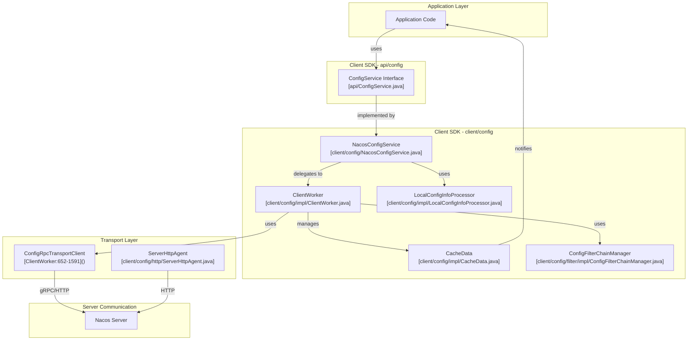

**Sources**: [client/src/main/java/com/alibaba/nacos/client/config/NacosConfigService.java:1-377](), [client/src/main/java/com/alibaba/nacos/client/config/impl/ClientWorker.java:1-115]()

---

## Core Components

### NacosConfigService

`NacosConfigService` is the main implementation of the `ConfigService` interface and serves as the primary entry point for all configuration operations. It is initialized with connection properties and creates a `ClientWorker` to handle the actual communication and caching.

**Key responsibilities**:
- Provides public API methods (`getConfig`, `publishConfig`, `addListener`, etc.)
- Manages namespace configuration
- Delegates operations to `ClientWorker`
- Applies configuration filters via `ConfigFilterChainManager`

**Initialization**:

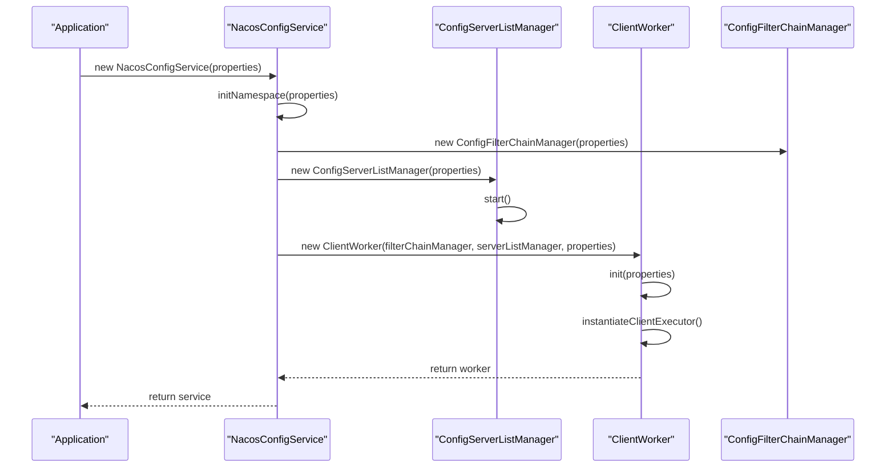

**Sources**: [client/src/main/java/com/alibaba/nacos/client/config/NacosConfigService.java:74-87](), [client/src/main/java/com/alibaba/nacos/client/config/NacosConfigService.java:89-92]()

### ClientWorker

`ClientWorker` is the core orchestrator that manages communication with Nacos servers, maintains configuration cache, and coordinates long polling for configuration changes.

**Key data structures**:
- `cacheMap`: `AtomicReference<Map<String, CacheData>>` - Thread-safe map of all cached configurations indexed by `GroupKey` (dataId + group + tenant)
- `taskIdCacheCountList`: `List<AtomicInteger>` - Tracks cache count per task ID for load distribution
- `agent`: `ConfigRpcTransportClient` - Handles actual RPC communication with server

**Key methods**:

| Method | Purpose | Returns |
|--------|---------|---------|
| `addTenantListeners()` | Adds listeners for a configuration | void |
| `removeTenantListener()` | Removes a listener | void |
| `getServerConfig()` | Fetches configuration from server | ConfigResponse |
| `publishConfig()` | Publishes configuration to server | boolean |
| `removeConfig()` | Deletes configuration from server | boolean |
| `addCacheDataIfAbsent()` | Creates or retrieves CacheData | CacheData |

**Sources**: [client/src/main/java/com/alibaba/nacos/client/config/impl/ClientWorker.java:115-641](), [client/src/main/java/com/alibaba/nacos/client/config/impl/ClientWorker.java:134](), [client/src/main/java/com/alibaba/nacos/client/config/impl/ClientWorker.java:161]()

### CacheData

`CacheData` represents a single configuration item with its content, MD5 hash, and registered listeners. Each `CacheData` instance tracks whether it is synchronized with the server and manages listener notifications.

**Key fields**:

| Field | Type | Purpose |
|-------|------|---------|
| `dataId` | String | Configuration data identifier |
| `group` | String | Configuration group |
| `tenant` | String | Namespace/tenant identifier |
| `content` | String | Configuration content |
| `md5` | String | MD5 hash of content |
| `listeners` | CopyOnWriteArrayList<ManagerListenerWrap> | Registered listeners |
| `isConsistentWithServer` | AtomicBoolean | Server synchronization status |
| `receiveNotifyChanged` | AtomicBoolean | Change notification flag |
| `taskId` | int | Task ID for load distribution |

**Sources**: [client/src/main/java/com/alibaba/nacos/client/config/impl/CacheData.java:55-647](), [client/src/main/java/com/alibaba/nacos/client/config/impl/CacheData.java:123-176]()

---

## Configuration Operations

### Getting Configuration

The configuration retrieval flow follows a three-tier fallback strategy: local failover → server → local snapshot.

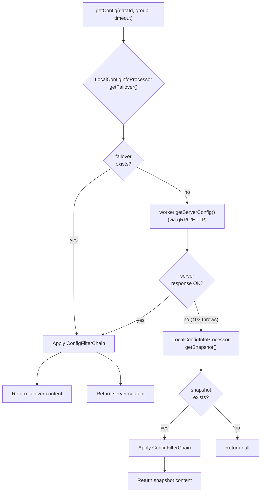

**Implementation details**:

The `getConfigInner()` method in `NacosConfigService` implements this flow:

1. **Failover check** [client/src/main/java/com/alibaba/nacos/client/config/NacosConfigService.java:220-231](): Checks for manually maintained failover content in local disk
2. **Server query** [client/src/main/java/com/alibaba/nacos/client/config/NacosConfigService.java:233-247](): Requests configuration from server via `worker.getServerConfig()`
3. **Snapshot fallback** [client/src/main/java/com/alibaba/nacos/client/config/NacosConfigService.java:249-260](): Retrieves cached snapshot if server is unavailable

**Sources**: [client/src/main/java/com/alibaba/nacos/client/config/NacosConfigService.java:206-261]()

### Publishing Configuration

Publishing configurations supports both standard publish and CAS (Compare-And-Swap) operations for optimistic locking.

**API signatures**:
- `publishConfig(dataId, group, content)` - Standard publish
- `publishConfig(dataId, group, content, type)` - With content type
- `publishConfigCas(dataId, group, content, casMd5)` - CAS with MD5 check
- `publishConfigCas(dataId, group, content, casMd5, type)` - CAS with type

**Flow**:

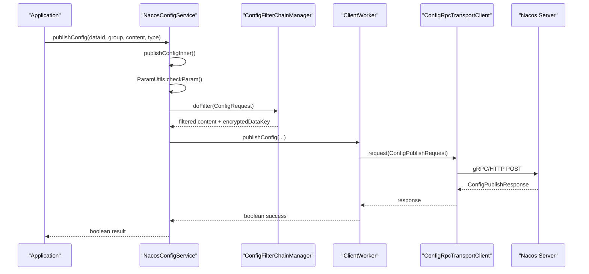

**Sources**: [client/src/main/java/com/alibaba/nacos/client/config/NacosConfigService.java:175-194](), [client/src/main/java/com/alibaba/nacos/client/config/NacosConfigService.java:339-356]()

### Removing Configuration

Configuration removal is straightforward and delegates directly to the worker.

**Implementation**: [client/src/main/java/com/alibaba/nacos/client/config/NacosConfigService.java:197-199](), [client/src/main/java/com/alibaba/nacos/client/config/NacosConfigService.java:333-337]()

---

## Listener Management

The SDK supports attaching listeners to configurations to receive change notifications. Listeners can be either simple callback listeners or more advanced listeners that track configuration changes.

### Listener Types

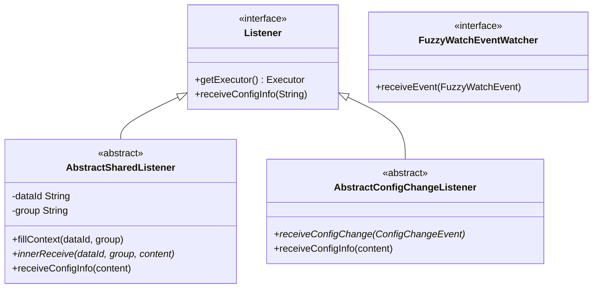

**Listener types**:
1. **Listener**: Basic interface for receiving configuration content
2. **AbstractSharedListener**: Listener that receives dataId and group context [client/src/main/java/com/alibaba/nacos/client/config/impl/CacheData.java:438-443]()
3. **AbstractConfigChangeListener**: Listener that receives detailed change events (added/modified/deleted) [client/src/main/java/com/alibaba/nacos/client/config/impl/CacheData.java:463-469]()
4. **FuzzyWatchEventWatcher**: Listener for fuzzy/pattern-based watching

**Sources**: [api/src/main/java/com/alibaba/nacos/api/config/ConfigService.java:84-94]()

### Adding and Removing Listeners

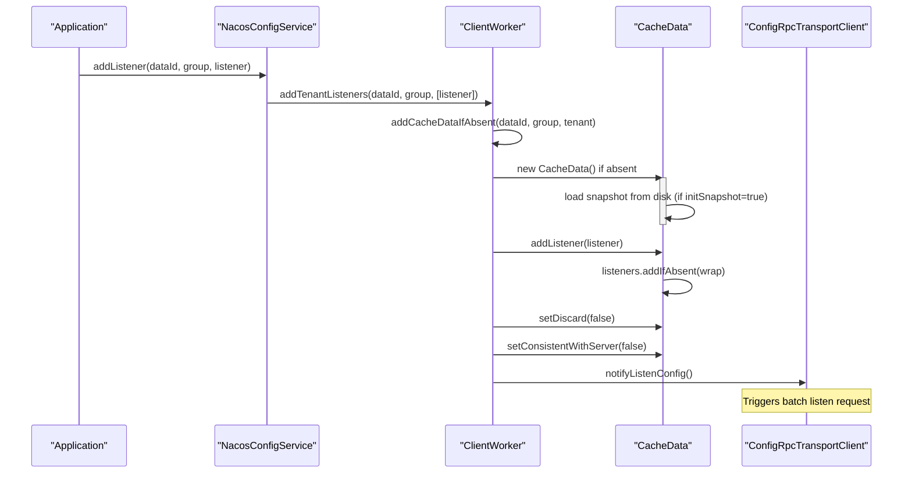

**Key implementation details**:

1. **CacheData creation** [client/src/main/java/com/alibaba/nacos/client/config/impl/ClientWorker.java:430-473](): When a listener is first added for a dataId+group+tenant combination, a `CacheData` is created
2. **Task ID assignment** [client/src/main/java/com/alibaba/nacos/client/config/impl/ClientWorker.java:497-506](): Each `CacheData` is assigned a task ID for load distribution across polling tasks
3. **Listener wrapping** [client/src/main/java/com/alibaba/nacos/client/config/impl/CacheData.java:238-260](): Listeners are wrapped in `ManagerListenerWrap` which tracks the last MD5 seen by that listener

**Sources**: [client/src/main/java/com/alibaba/nacos/client/config/NacosConfigService.java:121-123](), [client/src/main/java/com/alibaba/nacos/client/config/impl/ClientWorker.java:195-213]()

---

## Long Polling Mechanism

Long polling is the core mechanism for efficiently detecting configuration changes without constant server requests. The SDK maintains a persistent connection to poll for changes at regular intervals (default: 3 minutes).

### Long Polling Architecture

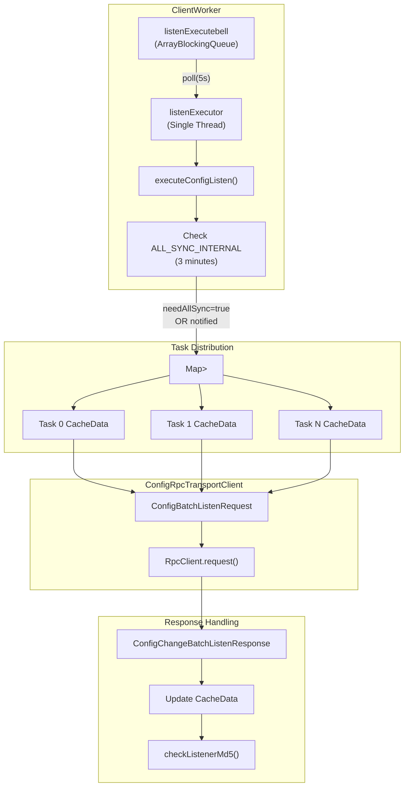

**Sources**: [client/src/main/java/com/alibaba/nacos/client/config/impl/ClientWorker.java:652-894](), [client/src/main/java/com/alibaba/nacos/client/config/impl/ClientWorker.java:897-1591]()

### Listen Execution Flow

The `executeConfigListen()` method in `ConfigRpcTransportClient` implements the long polling logic:

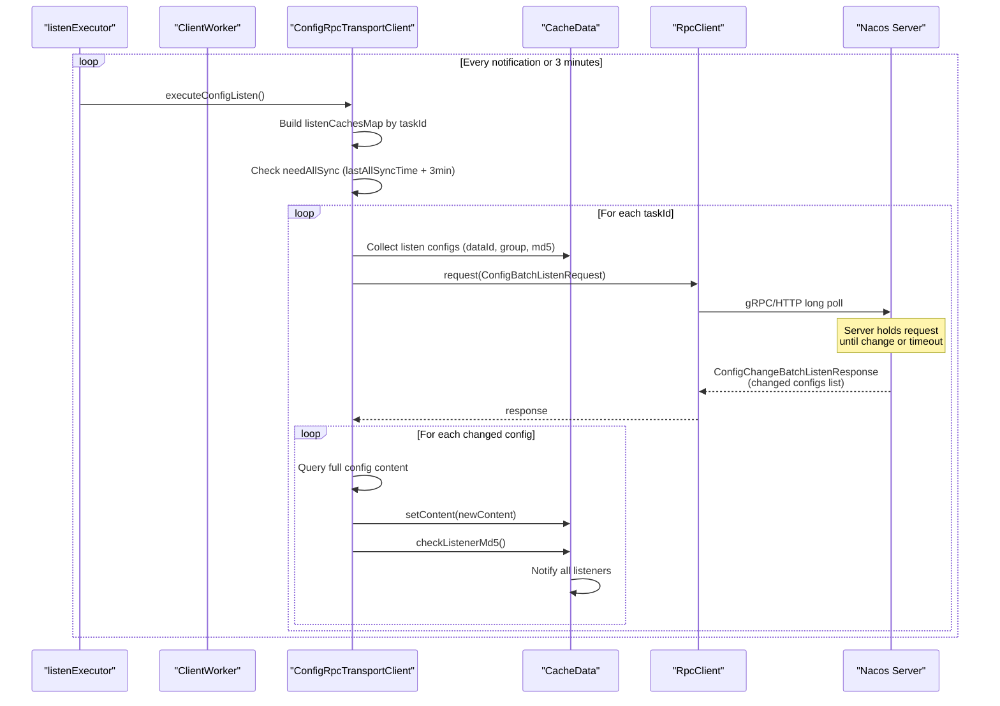

**Key timeouts**:
- `ALL_SYNC_INTERNAL`: 3 minutes [client/src/main/java/com/alibaba/nacos/client/config/impl/ClientWorker.java:669]() - Interval to check all listening configurations
- Long poll timeout: Configured via `CONFIG_LONG_POLL_TIMEOUT` (default 30 seconds) [api/src/main/java/com/alibaba/nacos/api/common/Constants.java:129]()

**Sources**: [client/src/main/java/com/alibaba/nacos/client/config/impl/ClientWorker.java:897-1147]()

### Server Push Notifications

In addition to long polling, the server can proactively push configuration changes via gRPC streaming:

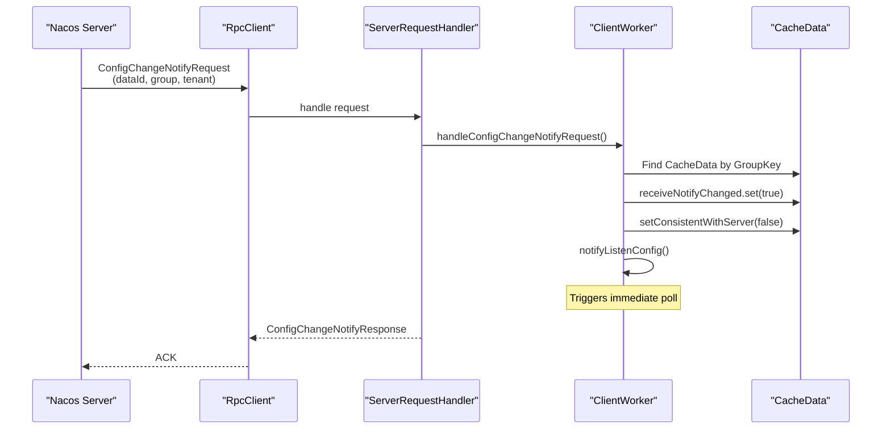

**Sources**: [client/src/main/java/com/alibaba/nacos/client/config/impl/ClientWorker.java:745-763]()

---

## Local Caching and Failover

The SDK maintains local disk caches to enable operation even when the Nacos server is unavailable. There are two types of local storage:

### Storage Types

1. **Snapshot**: Automatically saved cache of server configurations [client/src/main/java/com/alibaba/nacos/client/config/impl/LocalConfigInfoProcessor.java]()
2. **Failover**: Manually maintained local configuration for emergency scenarios

**Directory structure**:
```
${user.home}/nacos/config/
├── fixed-${serverAddr}_${port}_${namespace}/    # Snapshot directory
│   ├── config/
│   │   ├── {dataId}@{group}@{tenant}           # Snapshot file
│   │   └── ...
│   └── snapshot-tenant/
└── config-data/                                 # Failover directory
    └── {dataId}@{group}@{tenant}               # Failover file
```

### Snapshot Management

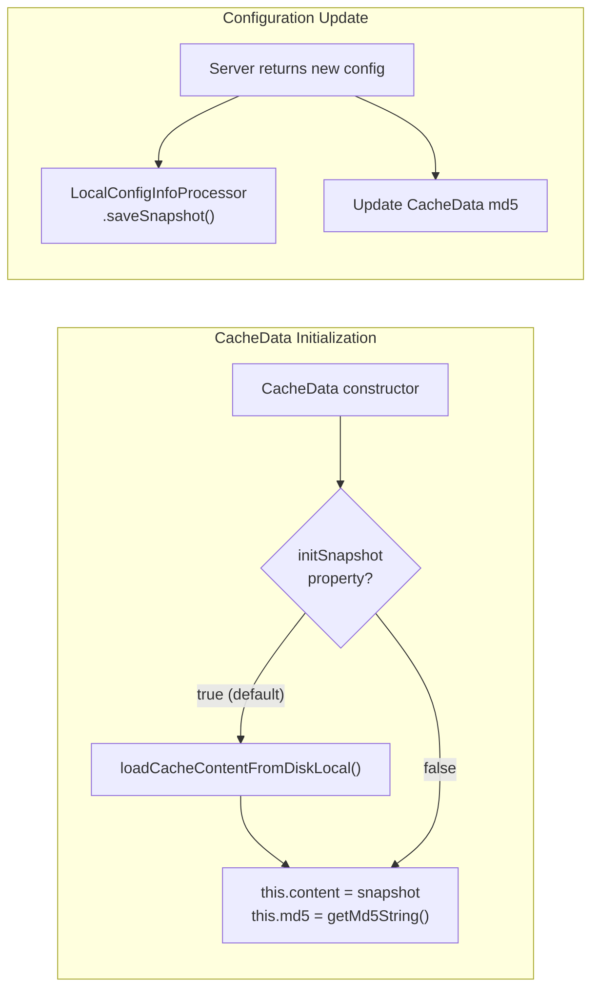

**Snapshot behavior**:
- Controlled by `nacos.cache.data.init.snapshot` property (default: true) [client/src/main/java/com/alibaba/nacos/client/config/impl/CacheData.java:119-121]()
- On `CacheData` creation, snapshot is loaded if available [client/src/main/java/com/alibaba/nacos/client/config/impl/CacheData.java:574-578]()
- Snapshots are updated whenever server returns new configuration content

**Sources**: [client/src/main/java/com/alibaba/nacos/client/config/impl/CacheData.java:530-534](), [client/src/main/java/com/alibaba/nacos/client/config/impl/CacheData.java:558-579]()

### Failover Priority

Failover configurations have the highest priority in the retrieval hierarchy. This allows operators to manually place configuration files on disk for emergency use when the server is unavailable or behaving incorrectly.

**Priority order** (from `getConfigInner()` in NacosConfigService):
1. Failover (if exists) → return immediately
2. Server query (if successful) → return
3. Snapshot (if exists) → return
4. null

**Sources**: [client/src/main/java/com/alibaba/nacos/client/config/NacosConfigService.java:215-231]()

---

## Fuzzy Watch Feature

Fuzzy watch enables pattern-based subscription to multiple configurations using wildcards, introduced in Nacos 3.0.

### Fuzzy Watch API

**API methods**:

| Method | Pattern Support | Returns |
|--------|----------------|---------|
| `fuzzyWatch(groupPattern, watcher)` | Matches all dataIds in group | void |
| `fuzzyWatch(dataIdPattern, groupPattern, watcher)` | Matches dataId and group patterns | void |
| `fuzzyWatchWithGroupKeys(groupPattern, watcher)` | Returns matched keys | Future<Set<String>> |
| `fuzzyWatchWithGroupKeys(dataIdPattern, groupPattern, watcher)` | Returns matched keys | Future<Set<String>> |
| `cancelFuzzyWatch(...)` | Cancels pattern subscription | void |

**Pattern syntax**:
- `*` (ALL_PATTERN): Matches any sequence of characters
- `.*` (ANY_PATTERN): Regex-style wildcard [api/src/main/java/com/alibaba/nacos/api/common/Constants.java:205-213]()

**Sources**: [api/src/main/java/com/alibaba/nacos/api/config/ConfigService.java:189-265](), [client/src/main/java/com/alibaba/nacos/client/config/NacosConfigService.java:126-172]()

### Fuzzy Watch Architecture

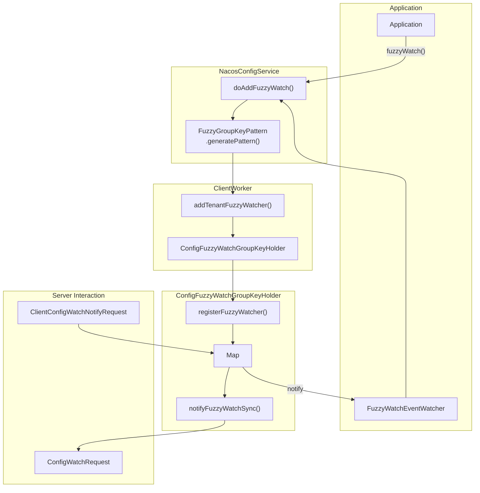

**Key components**:
- `ConfigFuzzyWatchGroupKeyHolder` [client/src/main/java/com/alibaba/nacos/client/config/impl/ClientWorker.java:138](): Manages all fuzzy watch patterns
- `ConfigFuzzyWatchContext` [client/src/main/java/com/alibaba/nacos/client/config/impl/ConfigFuzzyWatchContext.java](): Tracks individual pattern subscription state
- Pattern format: `{dataIdPattern}>>{groupPattern}>>{namespace}` [api/src/main/java/com/alibaba/nacos/api/common/Constants.java:283]()

**Sources**: [client/src/main/java/com/alibaba/nacos/client/config/impl/ClientWorker.java:301-316](), [client/src/main/java/com/alibaba/nacos/client/config/NacosConfigService.java:148-153]()

---

## Configuration Filters

Configuration filters allow transformation of configuration content during publish and retrieval operations. Filters are applied via `ConfigFilterChainManager`.

### Filter Chain Architecture

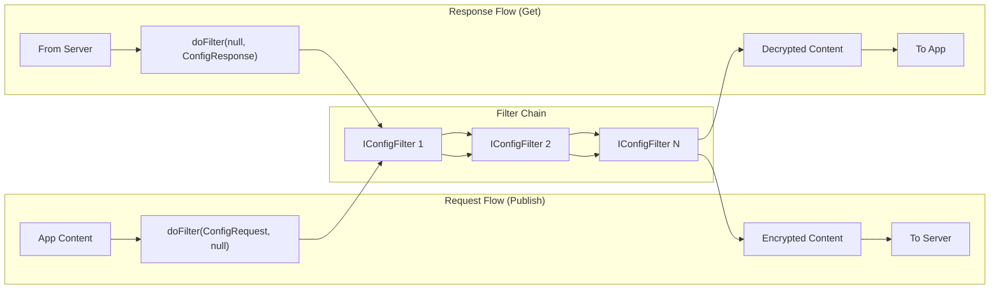

**Filter application points**:

1. **Publish**: [client/src/main/java/com/alibaba/nacos/client/config/NacosConfigService.java:344-352]()
   - Before sending to server
   - `ConfigRequest` contains content to be filtered
   - May set `encryptedDataKey` for encryption

2. **Get**: [client/src/main/java/com/alibaba/nacos/client/config/NacosConfigService.java:228](), [client/src/main/java/com/alibaba/nacos/client/config/NacosConfigService.java:237-238]()
   - After receiving from server
   - After loading from failover/snapshot
   - `ConfigResponse` contains content to be filtered

3. **Listener notification**: [client/src/main/java/com/alibaba/nacos/client/config/impl/CacheData.java:449-455]()
   - Before invoking listener callback
   - Ensures listeners receive processed content

**Adding custom filters**:
```java
nacosConfigService.addConfigFilter(customFilter);
```

**Sources**: [client/src/main/java/com/alibaba/nacos/client/config/filter/impl/ConfigFilterChainManager.java](), [api/src/main/java/com/alibaba/nacos/api/config/ConfigService.java:172-179]()

---

## Thread Management and Executors

The SDK uses multiple thread pools for different responsibilities:

### Executor Structure

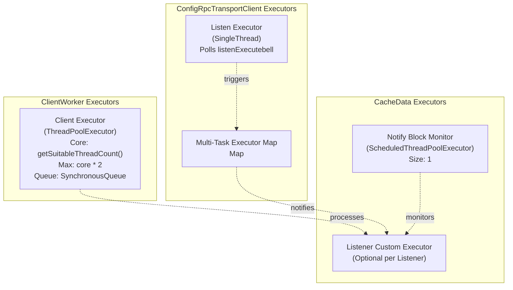

**Executor details**:

1. **Client Executor** [client/src/main/java/com/alibaba/nacos/client/config/impl/ClientWorker.java:553-565]():
   - Created in `ClientWorker` constructor
   - Uses `SynchronousQueue` to avoid task buffering (creates threads on demand)
   - `CallerRunsPolicy` ensures no task is lost

2. **Listen Executor** [client/src/main/java/com/alibaba/nacos/client/config/impl/ClientWorker.java:863-883]():
   - Single-threaded executor for configuration listening
   - Polls `listenExecutebell` queue every 5 seconds
   - Executes `executeConfigListen()` method

3. **Listener Custom Executor** [client/src/main/java/com/alibaba/nacos/client/config/impl/CacheData.java:493-505]():
   - Provided by individual `Listener.getExecutor()`
   - If null, notification runs in Nacos thread
   - Recommended for async processing

4. **Notify Block Monitor** [client/src/main/java/com/alibaba/nacos/client/config/impl/CacheData.java:85-99]():
   - Monitors listener execution time
   - Logs warning if listener blocks > `notifyWarnTimeout` (default 60s)
   - Can be configured via `nacos.listener.notify.warn.timeout` system property

**Sources**: [client/src/main/java/com/alibaba/nacos/client/config/impl/ClientWorker.java:541-575](), [client/src/main/java/com/alibaba/nacos/client/config/impl/CacheData.java:456-460]()

---

## Configuration Properties

Key configuration properties for the client SDK:

| Property | Default | Description |
|----------|---------|-------------|
| `serverAddr` | (required) | Nacos server address(es) |
| `namespace` | "public" | Namespace/tenant identifier |
| `configLongPollTimeout` | 30000 ms | Long polling timeout |
| `configRetryTime` | 2000 ms | Retry interval on failure |
| `configRequestTimeout` | -1 | Request timeout (-1 = no timeout) |
| `clientWorkerThreadCount` | auto | Number of worker threads |
| `enableRemoteSyncConfig` | false | Sync from server on listener add |
| `enableClientMetrics` | true | Enable client metrics collection |
| `nacos.cache.data.init.snapshot` | true | Load snapshot on CacheData init |

**Sources**: [api/src/main/java/com/alibaba/nacos/api/PropertyKeyConst.java:76-88](), [client/src/main/java/com/alibaba/nacos/client/config/impl/ClientWorker.java:577-586]()

---

## Error Handling and Resilience

### Connection Handling

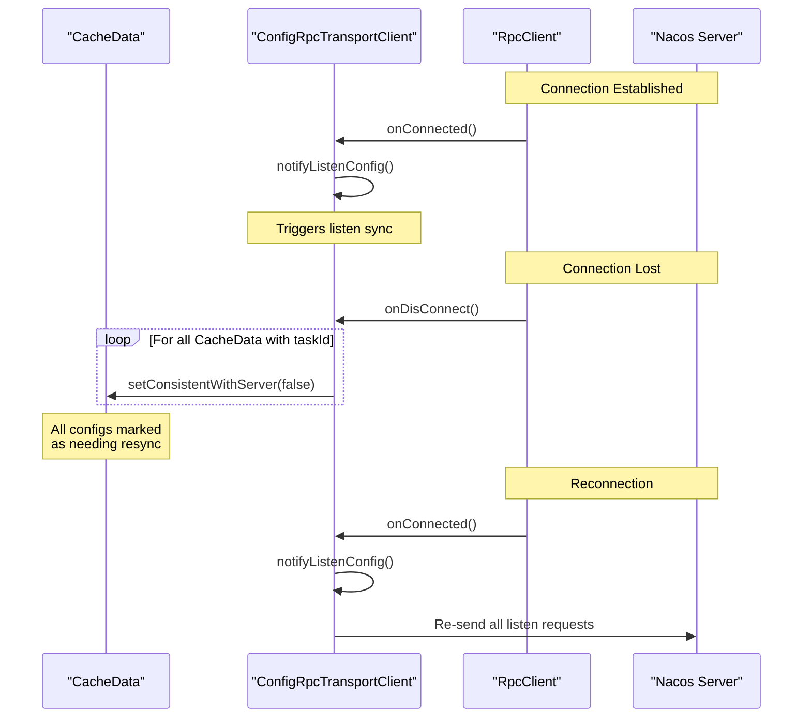

**Reconnection behavior** [client/src/main/java/com/alibaba/nacos/client/config/impl/ClientWorker.java:794-825]():
- On disconnect: All `CacheData` marked as inconsistent with server
- On reconnect: Immediate listen notification triggers full resync
- Fuzzy watch contexts also reset [client/src/main/java/com/alibaba/nacos/client/config/impl/ClientWorker.java:821-822]()

### Retry Mechanisms

**Server-side retry**: `ServerHttpAgent` retries failed requests up to `maxRetry` times (default: 3) with server rotation [client/src/main/java/com/alibaba/nacos/client/config/http/ServerHttpAgent.java:53-110]()

**Failover to snapshot**: When server is unavailable, the SDK automatically falls back to local snapshot [client/src/main/java/com/alibaba/nacos/client/config/NacosConfigService.java:241-260]()

**Sources**: [client/src/main/java/com/alibaba/nacos/client/config/impl/ClientWorker.java:794-825](), [client/src/main/java/com/alibaba/nacos/client/config/http/ServerHttpAgent.java:58-110]()

---

