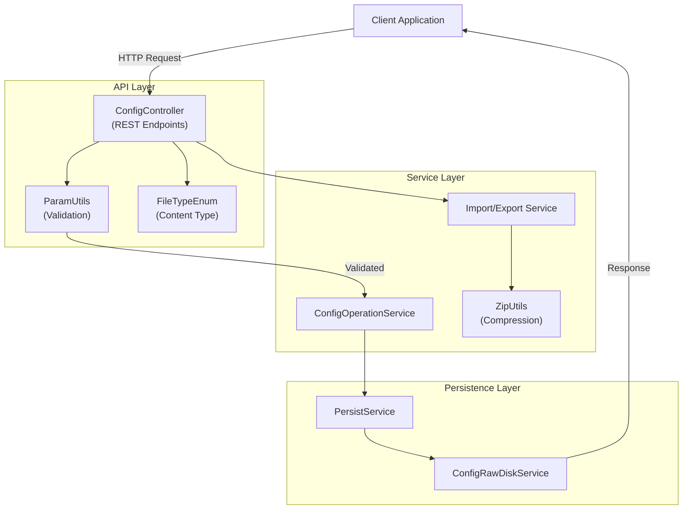
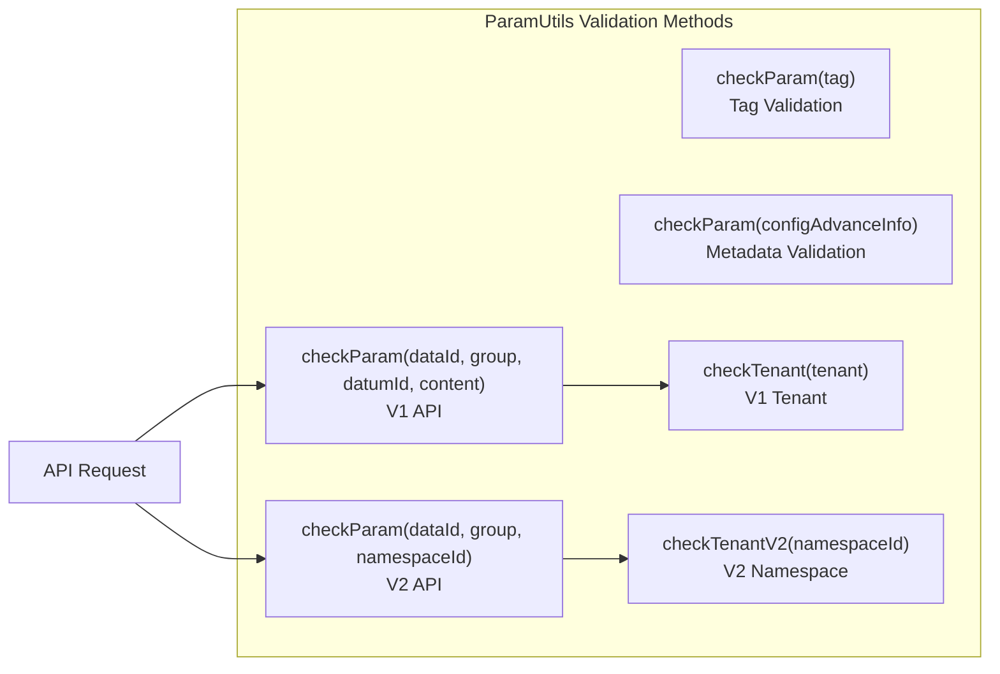
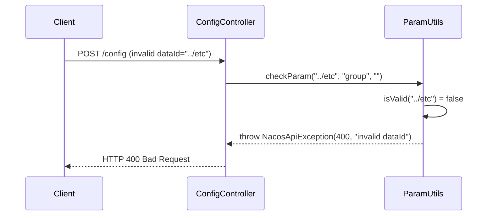
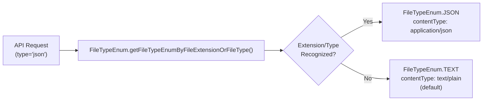
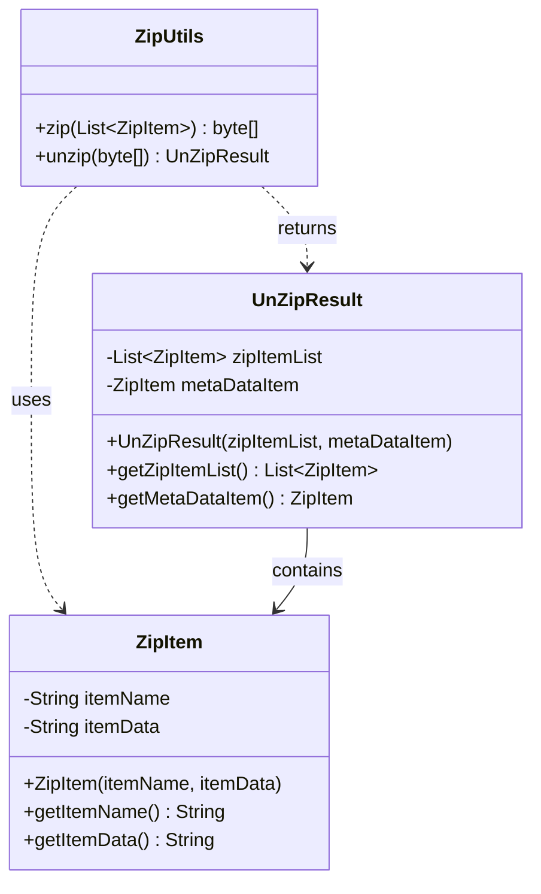
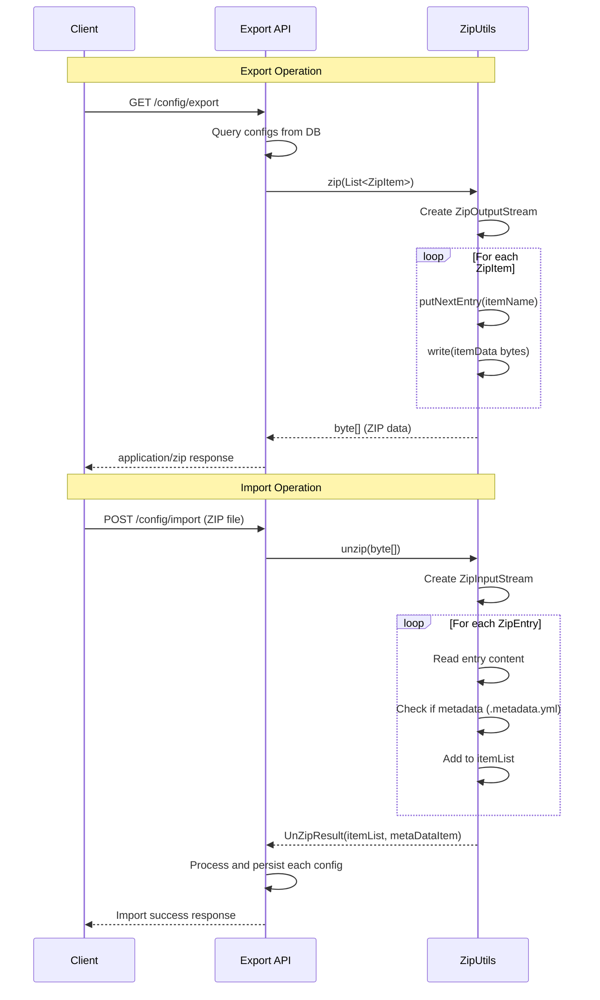
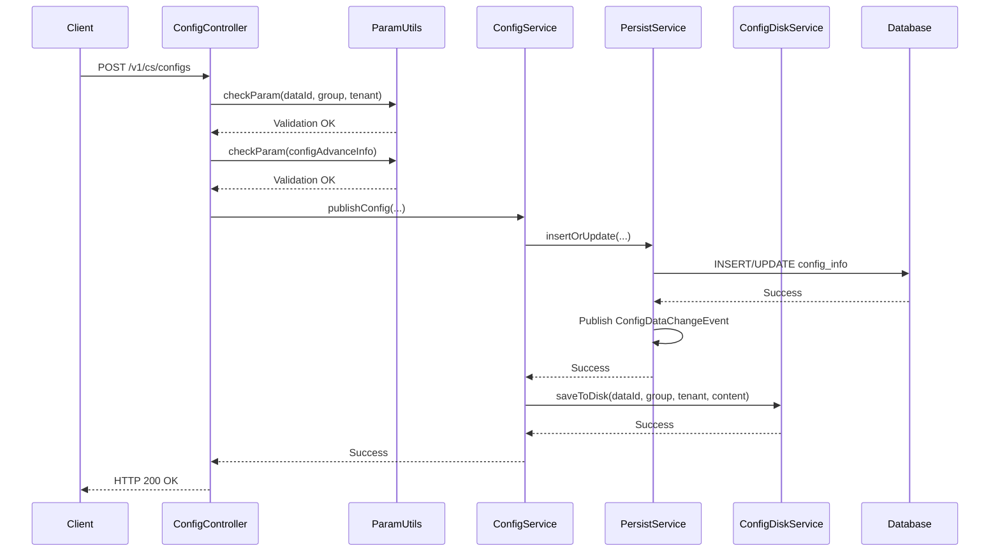
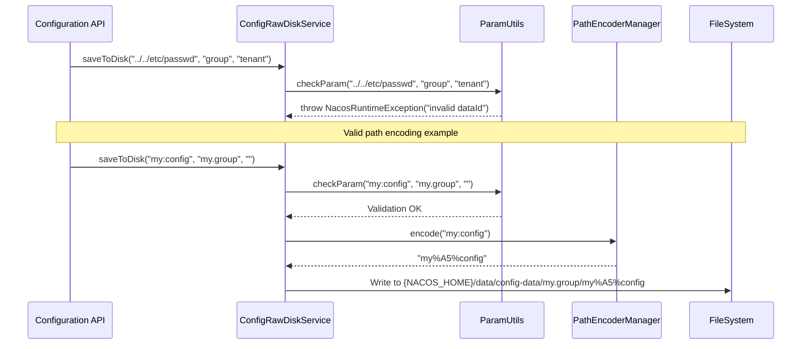
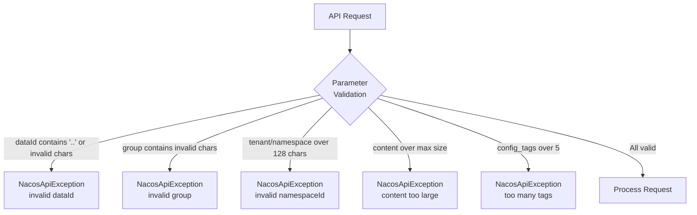

<!-- source: DeepWiki mcp.deepwiki.com · repo alibaba/nacos · page 3.2 Configuration Server API · fetched 2026-10-29 -->

# Configuration Server API

<details>
<summary>Relevant source files</summary>

The following files were used as context for generating this wiki page:

- [config/src/main/java/com/alibaba/nacos/config/server/enums/FileTypeEnum.java](config/src/main/java/com/alibaba/nacos/config/server/enums/FileTypeEnum.java)
- [config/src/main/java/com/alibaba/nacos/config/server/service/dump/disk/ConfigRawDiskService.java](config/src/main/java/com/alibaba/nacos/config/server/service/dump/disk/ConfigRawDiskService.java)
- [config/src/main/java/com/alibaba/nacos/config/server/utils/ParamUtils.java](config/src/main/java/com/alibaba/nacos/config/server/utils/ParamUtils.java)
- [config/src/main/java/com/alibaba/nacos/config/server/utils/ZipUtils.java](config/src/main/java/com/alibaba/nacos/config/server/utils/ZipUtils.java)
- [config/src/test/java/com/alibaba/nacos/config/server/service/dump/disk/ConfigRawDiskServiceTest.java](config/src/test/java/com/alibaba/nacos/config/server/service/dump/disk/ConfigRawDiskServiceTest.java)
- [config/src/test/java/com/alibaba/nacos/config/server/utils/ParamUtilsTest.java](config/src/test/java/com/alibaba/nacos/config/server/utils/ParamUtilsTest.java)
- [config/src/test/java/com/alibaba/nacos/config/server/utils/PropertyUtilTest.java](config/src/test/java/com/alibaba/nacos/config/server/utils/PropertyUtilTest.java)
- [config/src/test/java/com/alibaba/nacos/config/server/utils/ProtocolTest.java](config/src/test/java/com/alibaba/nacos/config/server/utils/ProtocolTest.java)

</details>


## Purpose and Scope

This document describes the server-side REST API layer for Nacos configuration management. The Configuration Server API provides HTTP endpoints for publishing, retrieving, updating, and deleting configuration data, as well as bulk import/export operations. These APIs are exposed by the `ConfigController` and related controller classes in the server module.

For client-side configuration operations, see [Configuration Client SDK](#3.1). For the internal change notification mechanism that propagates updates to clients, see [Configuration Change Notification](#3.3).

---

## API Architecture Overview

The Configuration Server API follows a layered request processing architecture where incoming HTTP requests pass through validation, processing, and persistence layers before returning responses to clients.



**Sources:** Based on high-level architecture diagrams and [config/src/main/java/com/alibaba/nacos/config/server/utils/ParamUtils.java](), [config/src/main/java/com/alibaba/nacos/config/server/utils/ZipUtils.java](), [config/src/main/java/com/alibaba/nacos/config/server/enums/FileTypeEnum.java]()

---

## Request Parameter Validation

All configuration API requests undergo strict parameter validation through the `ParamUtils` class to ensure data integrity and prevent path traversal attacks.

### Validation Rules

The `ParamUtils.isValid()` method enforces a whitelist-based validation approach:

| Parameter Type | Validation Rules | Max Length |
|---------------|------------------|------------|
| `dataId` | Letters, digits, `_`, `-`, `.`, `:` only | N/A |
| `group` | Letters, digits, `_`, `-`, `.`, `:` only | N/A |
| `namespaceId` (tenant) | Letters, digits, `_`, `-`, `.`, `:` only | 128 chars |
| `tag` | Letters, digits, `_`, `-`, `.`, `:` only | 16 chars |
| `content` | Any content | 10 MB (configurable) |

**Sources:** [config/src/main/java/com/alibaba/nacos/config/server/utils/ParamUtils.java:58-69]()

### Core Validation Methods



**Sources:** [config/src/main/java/com/alibaba/nacos/config/server/utils/ParamUtils.java:84-101](), [config/src/main/java/com/alibaba/nacos/config/server/utils/ParamUtils.java:110-120]()

### Configuration Metadata Validation

The `checkParam(Map<String, Object>)` method validates advanced configuration metadata fields:

| Field | Purpose | Max Length |
|-------|---------|------------|
| `config_tags` | Configuration tags (comma-separated) | Max 5 tags, 64 chars each |
| `desc` | Description | 128 chars |
| `use` | Usage information | 32 chars |
| `effect` | Effect information | 32 chars |
| `type` | Configuration type | 32 chars |
| `schema` | Configuration schema | 32,768 chars |
| `encryptedDataKey` | Encryption key | No limit |

**Sources:** [config/src/main/java/com/alibaba/nacos/config/server/utils/ParamUtils.java:139-192]()

### Validation Error Handling

Invalid parameters throw `NacosApiException` with HTTP 400 (Bad Request) status:



**Sources:** [config/src/main/java/com/alibaba/nacos/config/server/utils/ParamUtils.java:84-100](), [config/src/test/java/com/alibaba/nacos/config/server/utils/ParamUtilsTest.java:46-100]()

---

## File Type and Content Type Support

The `FileTypeEnum` enumeration maps file extensions to configuration types and HTTP content types, enabling proper handling of different configuration formats.

### Supported File Types

| File Extension | Type Category | Content-Type |
|----------------|---------------|--------------|
| `yaml`, `yml` | YAML | `text/plain` |
| `txt`, `text` | Plain text | `text/plain` |
| `json` | JSON | `application/json` |
| `xml` | XML | `application/xml` |
| `htm`, `html` | HTML | `text/html` |
| `properties` | Properties | `text/plain` |

**Sources:** [config/src/main/java/com/alibaba/nacos/config/server/enums/FileTypeEnum.java:28-73]()

### File Type Resolution

The API uses `FileTypeEnum.getFileTypeEnumByFileExtensionOrFileType()` to determine the appropriate file type handler based on the file extension or explicit type parameter:



**Sources:** [config/src/main/java/com/alibaba/nacos/config/server/enums/FileTypeEnum.java:109-119]()

---

## Import and Export Operations

The Configuration Server API supports bulk import/export of configurations using ZIP compression through the `ZipUtils` class.

### Export Operation Structure

Exported configuration data is packaged into a ZIP file with the following structure:

```
exported-configs.zip
├── .metadata.yml              (or .meta.yml - export metadata)
├── {namespace}/{group}/{dataId}
├── {namespace}/{group}/{dataId}
└── ...
```

### ZipUtils Components



**Sources:** [config/src/main/java/com/alibaba/nacos/config/server/utils/ZipUtils.java:43-97]()

### ZIP Compression and Decompression Flow



**Sources:** [config/src/main/java/com/alibaba/nacos/config/server/utils/ZipUtils.java:102-117](), [config/src/main/java/com/alibaba/nacos/config/server/utils/ZipUtils.java:122-154]()

### Metadata File Handling

The ZIP import operation recognizes two metadata file names that contain export information:

- `CONFIG_EXPORT_METADATA` = `.metadata.yml` (legacy format)
- `CONFIG_EXPORT_METADATA_NEW` = `.meta.yml` (new format)

The metadata file is extracted separately in `UnZipResult.metaDataItem` for processing export metadata like version, timestamp, and namespace mappings.

**Sources:** [config/src/main/java/com/alibaba/nacos/config/server/utils/ZipUtils.java:138-145]()

---

## API Operations

The Configuration Server API exposes the following primary operations through REST endpoints:

### Configuration CRUD Operations

| Operation | HTTP Method | Purpose | Key Parameters |
|-----------|-------------|---------|----------------|
| Publish | POST | Create or update configuration | `dataId`, `group`, `tenant`, `content`, `type` |
| Get | GET | Retrieve configuration content | `dataId`, `group`, `tenant`, `tag` (optional) |
| Delete | DELETE | Remove configuration | `dataId`, `group`, `tenant` |
| Query | GET | Search configurations | `dataId`, `group`, `tenant`, `pageNo`, `pageSize` |

### Request Processing Flow



**Sources:** [config/src/main/java/com/alibaba/nacos/config/server/utils/ParamUtils.java:84-120](), [config/src/main/java/com/alibaba/nacos/config/server/service/dump/disk/ConfigRawDiskService.java:54-57]()

---

## Disk Storage Operations

The `ConfigRawDiskService` class manages local disk caching of configuration data, which serves as a fast-access layer for the Configuration Server API.

### Disk Storage Directory Structure

```
{NACOS_HOME}/
├── data/
│   ├── config-data/                    # Non-tenant configs
│   │   ├── {group}/
│   │   │   └── {dataId}
│   ├── tenant-config-data/             # Tenant-specific configs
│   │   ├── {tenant}/
│   │   │   ├── {group}/
│   │   │   │   └── {dataId}
│   ├── gray-data/                      # Gray release configs
│   │   ├── {group}/
│   │   │   ├── {dataId}/
│   │   │   │   └── {grayName}
│   └── tenant-gray-data/               # Tenant gray configs
│       ├── {tenant}/
│       │   ├── {group}/
│       │   │   ├── {dataId}/
│       │   │   │   └── {grayName}
```

**Sources:** [config/src/main/java/com/alibaba/nacos/config/server/service/dump/disk/ConfigRawDiskService.java:43-49]()

### ConfigRawDiskService Methods

```mermaid
graph TB
    ConfigRawDiskService["ConfigRawDiskService"]
    
    subgraph "Write Operations"
        saveToDisk["saveToDisk(dataId, group, tenant, content)<br/>Write config to disk"]
        saveGrayToDisk["saveGrayToDisk(dataId, group, tenant, grayName, content)<br/>Write gray config to disk"]
    end
    
    subgraph "Read Operations"
        getContent["getContent(dataId, group, tenant)<br/>Read config from disk"]
        getGrayContent["getGrayContent(dataId, group, tenant, grayName)<br/>Read gray config from disk"]
    end
    
    subgraph "Delete Operations"
        removeConfigInfo["removeConfigInfo(dataId, group, tenant)<br/>Delete config file"]
        removeConfigInfo4Gray["removeConfigInfo4Gray(dataId, group, tenant, grayName)<br/>Delete gray config file"]
    end
    
    subgraph "Maintenance Operations"
        clearAll["clearAll()<br/>Clear all config files"]
        clearAllGray["clearAllGray()<br/>Clear all gray config files"]
    end
    
    ConfigRawDiskService --> saveToDisk
    ConfigRawDiskService --> saveGrayToDisk
    ConfigRawDiskService --> getContent
    ConfigRawDiskService --> getGrayContent
    ConfigRawDiskService --> removeConfigInfo
    ConfigRawDiskService --> removeConfigInfo4Gray
    ConfigRawDiskService --> clearAll
    ConfigRawDiskService --> clearAllGray
```



**Sources:** [config/src/main/java/com/alibaba/nacos/config/server/service/dump/disk/ConfigRawDiskService.java:54-208]()

### Path Encoding for Security

To prevent path traversal attacks, the `ConfigRawDiskService` uses `PathEncoderManager` to encode dataId, group, and tenant values before constructing file paths:



**Sources:** [config/src/main/java/com/alibaba/nacos/config/server/service/dump/disk/ConfigRawDiskService.java:62-82](), [config/src/test/java/com/alibaba/nacos/config/server/service/dump/disk/ConfigRawDiskServiceTest.java:68-72]()

---

## Error Handling and Validation

### Exception Types

The Configuration Server API uses two primary exception types for error responses:

| Exception Class | HTTP Status | Use Case |
|----------------|-------------|----------|
| `NacosApiException` | 400 (Bad Request) | Parameter validation failures (V2 API) |
| `IllegalArgumentException` | 400 (Bad Request) | Parameter validation failures (V1 API) |
| `NacosException` | Varies | General server-side errors |

**Sources:** [config/src/main/java/com/alibaba/nacos/config/server/utils/ParamUtils.java:86-100]()

### Common Validation Errors



**Sources:** [config/src/main/java/com/alibaba/nacos/config/server/utils/ParamUtils.java:84-120](), [config/src/test/java/com/alibaba/nacos/config/server/utils/ParamUtilsTest.java:164-268]()

### Content Size Limits

The maximum configuration content size is controlled by `PropertyUtil.getMaxContent()`, which defaults to 10 MB but can be configured via system properties. Requests exceeding this limit are rejected with a validation error.

**Sources:** [config/src/main/java/com/alibaba/nacos/config/server/utils/ParamUtils.java:97-100]()

---

## API Versioning

Nacos Configuration Server API supports two API versions with different validation behaviors:

| API Version | Validation Method | Exception Type | Prefix |
|-------------|-------------------|----------------|--------|
| V1 | `checkParam(tag)`, `checkTenant(tenant)` | `IllegalArgumentException` | `/v1/cs/` |
| V2 | `checkParamV2(tag)`, `checkTenantV2(namespaceId)` | `NacosApiException` | `/v2/cs/` |

The V2 API provides more structured error responses through `NacosApiException` with explicit HTTP status codes and error codes defined in `ErrorCode` enum.

**Sources:** [config/src/main/java/com/alibaba/nacos/config/server/utils/ParamUtils.java:125-134](), [config/src/main/java/com/alibaba/nacos/config/server/utils/ParamUtils.java:197-208]()

---

