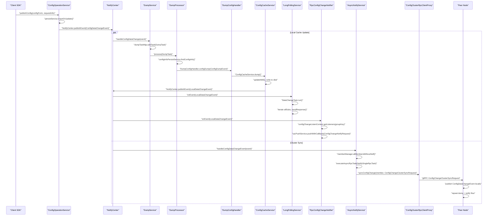
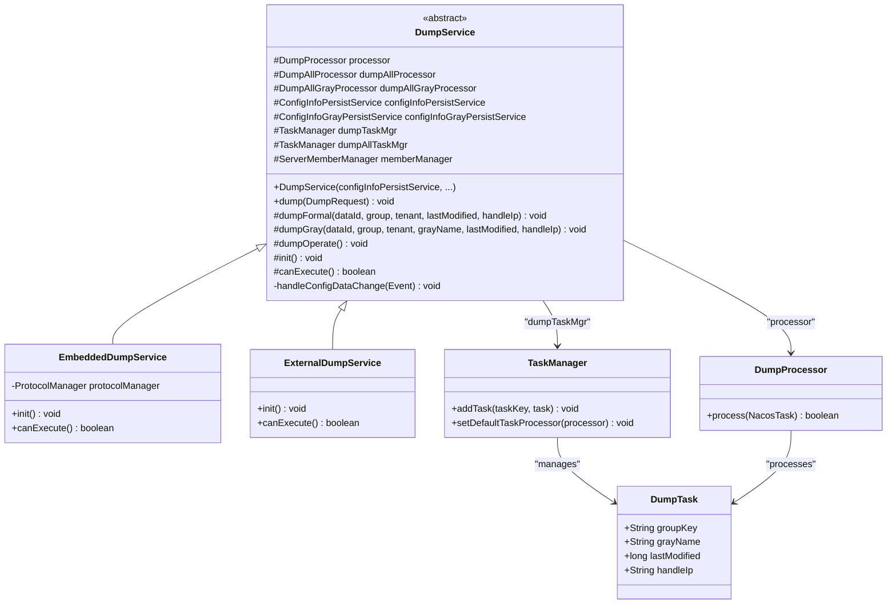
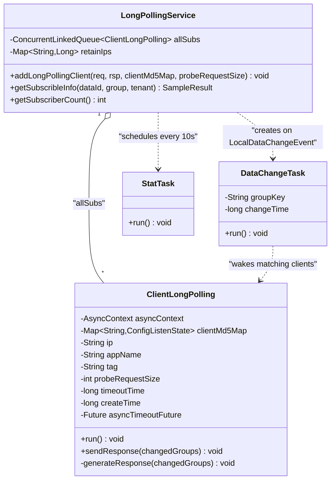
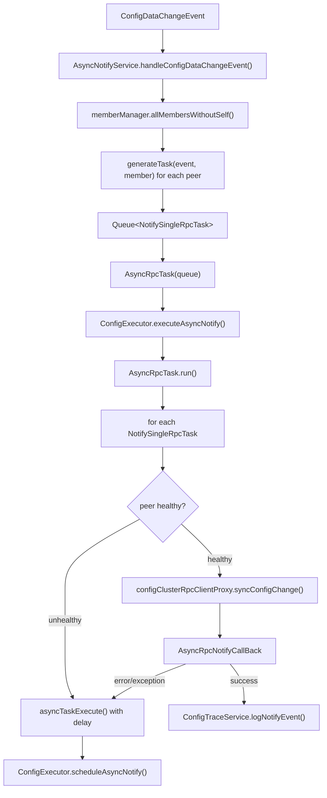
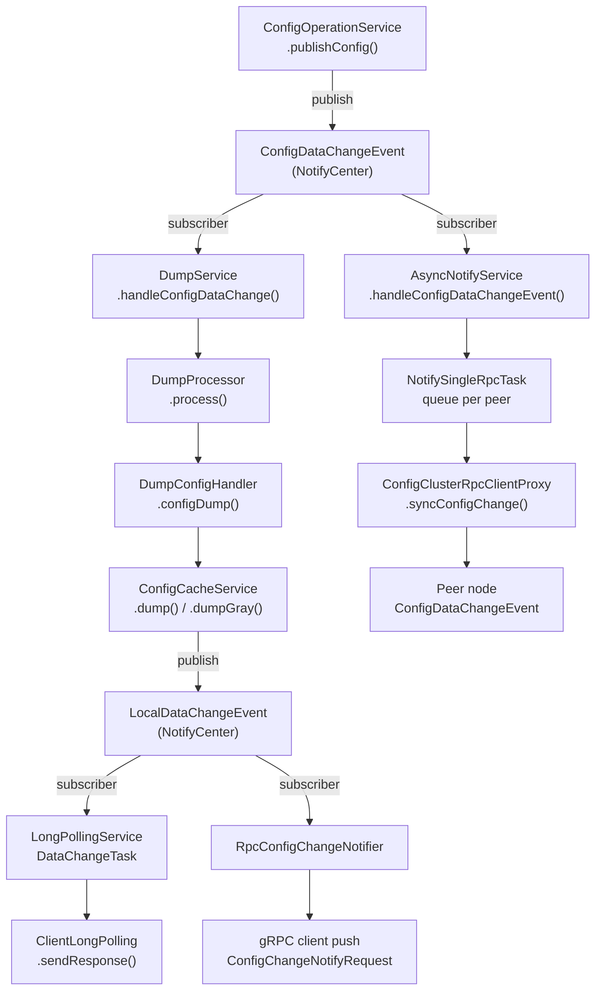

<!-- source: DeepWiki mcp.deepwiki.com · repo alibaba/nacos · page 3.3 Configuration Change Notification · fetched 2026-10-29 -->

# Configuration Change Notification

<details>
<summary>Relevant source files</summary>

The following files were used as context for generating this wiki page:

- [config/src/main/java/com/alibaba/nacos/config/server/aspect/RequestLogAspect.java](config/src/main/java/com/alibaba/nacos/config/server/aspect/RequestLogAspect.java)
- [config/src/main/java/com/alibaba/nacos/config/server/model/event/ConfigDataChangeEvent.java](config/src/main/java/com/alibaba/nacos/config/server/model/event/ConfigDataChangeEvent.java)
- [config/src/main/java/com/alibaba/nacos/config/server/model/event/ConfigDumpEvent.java](config/src/main/java/com/alibaba/nacos/config/server/model/event/ConfigDumpEvent.java)
- [config/src/main/java/com/alibaba/nacos/config/server/model/event/LocalDataChangeEvent.java](config/src/main/java/com/alibaba/nacos/config/server/model/event/LocalDataChangeEvent.java)
- [config/src/main/java/com/alibaba/nacos/config/server/service/LongPollingService.java](config/src/main/java/com/alibaba/nacos/config/server/service/LongPollingService.java)
- [config/src/main/java/com/alibaba/nacos/config/server/service/dump/DumpConfigHandler.java](config/src/main/java/com/alibaba/nacos/config/server/service/dump/DumpConfigHandler.java)
- [config/src/main/java/com/alibaba/nacos/config/server/service/dump/DumpService.java](config/src/main/java/com/alibaba/nacos/config/server/service/dump/DumpService.java)
- [config/src/main/java/com/alibaba/nacos/config/server/service/dump/EmbeddedDumpService.java](config/src/main/java/com/alibaba/nacos/config/server/service/dump/EmbeddedDumpService.java)
- [config/src/main/java/com/alibaba/nacos/config/server/service/dump/ExternalDumpService.java](config/src/main/java/com/alibaba/nacos/config/server/service/dump/ExternalDumpService.java)
- [config/src/main/java/com/alibaba/nacos/config/server/service/dump/processor/DumpAllProcessor.java](config/src/main/java/com/alibaba/nacos/config/server/service/dump/processor/DumpAllProcessor.java)
- [config/src/main/java/com/alibaba/nacos/config/server/service/dump/processor/DumpProcessor.java](config/src/main/java/com/alibaba/nacos/config/server/service/dump/processor/DumpProcessor.java)
- [config/src/main/java/com/alibaba/nacos/config/server/service/dump/task/DumpTask.java](config/src/main/java/com/alibaba/nacos/config/server/service/dump/task/DumpTask.java)
- [config/src/main/java/com/alibaba/nacos/config/server/service/notify/AsyncNotifyService.java](config/src/main/java/com/alibaba/nacos/config/server/service/notify/AsyncNotifyService.java)
- [config/src/main/java/com/alibaba/nacos/config/server/service/trace/ConfigTraceService.java](config/src/main/java/com/alibaba/nacos/config/server/service/trace/ConfigTraceService.java)

</details>


This page documents the event-driven configuration change notification system in Nacos. When a configuration is published, deleted, or modified, the change must be propagated to: (1) the local disk cache, (2) all connected clients (HTTP long-polling and gRPC), and (3) all peer cluster nodes. This is accomplished through a dual-event pattern using `NotifyCenter` as the event bus.

For configuration write APIs, see [3.2](). For persistence layer details, see [3.4](). For client SDK usage, see [3.1]().

---

## Dual-Event Pattern

Configuration change notification uses two cascading events:

| Event Class | Trigger | Publishers | Subscribers |
|---|---|---|---|
| `ConfigDataChangeEvent` | Configuration write completed | `ConfigOperationService` (after DB write)<br/>`ConfigClusterRpcClientProxy` (on peer sync) | `DumpService`<br/>`AsyncNotifyService` |
| `LocalDataChangeEvent` | Local cache updated | `ConfigCacheService` (after disk dump) | `LongPollingService`<br/>`RpcConfigChangeNotifier` |

**Flow**: `ConfigDataChangeEvent` triggers cache refresh via `DumpService`. The cache refresh publishes `LocalDataChangeEvent`, which triggers client notifications. This two-stage pattern decouples database writes from client notifications and ensures the local cache is updated before clients are notified.

**Event registration**: Both event types are registered with `NotifyCenter` during service initialization. `AsyncNotifyService` registers `ConfigDataChangeEvent` at line [config/src/main/java/com/alibaba/nacos/config/server/service/notify/AsyncNotifyService.java:88](), and `LongPollingService` registers `LocalDataChangeEvent` at line [config/src/main/java/com/alibaba/nacos/config/server/service/LongPollingService.java:236]().

Sources: [config/src/main/java/com/alibaba/nacos/config/server/model/event/ConfigDataChangeEvent.java:1-53](), [config/src/main/java/com/alibaba/nacos/config/server/model/event/LocalDataChangeEvent.java:1-35](), [config/src/main/java/com/alibaba/nacos/config/server/service/notify/AsyncNotifyService.java:84-104](), [config/src/main/java/com/alibaba/nacos/config/server/service/LongPollingService.java:230-256]()

---

## End-to-End Notification Flow

**Configuration change propagation sequence**



Sources: [config/src/main/java/com/alibaba/nacos/config/server/service/dump/DumpService.java:132-155](), [config/src/main/java/com/alibaba/nacos/config/server/service/dump/processor/DumpProcessor.java:53-93](), [config/src/main/java/com/alibaba/nacos/config/server/service/dump/DumpConfigHandler.java:41-98](), [config/src/main/java/com/alibaba/nacos/config/server/service/notify/AsyncNotifyService.java:106-201](), [config/src/main/java/com/alibaba/nacos/config/server/service/LongPollingService.java:267-299]()

---

## Component 1: DumpService — Local Cache Refresh

`DumpService` is an abstract base class responsible for dumping configuration data from the database to the local disk cache. It subscribes to `ConfigDataChangeEvent` and manages asynchronous dump tasks.

### Implementations

| Class | Storage Mode | Leader Check |
|---|---|---|
| `EmbeddedDumpService` | Derby + JRaft | Only Raft leader executes dumps |
| `ExternalDumpService` | External MySQL/PostgreSQL | First IP in cluster executes dumps |

Both implementations are conditionally loaded via Spring `@Conditional` annotations: `@ConditionOnEmbeddedStorage` and `@ConditionOnExternalStorage` respectively.

**DumpService class structure**



Sources: [config/src/main/java/com/alibaba/nacos/config/server/service/dump/DumpService.java:61-349](), [config/src/main/java/com/alibaba/nacos/config/server/service/dump/EmbeddedDumpService.java:51-178](), [config/src/main/java/com/alibaba/nacos/config/server/service/dump/ExternalDumpService.java:37-68]()

### Event Subscription and Task Creation

In the constructor, `DumpService` registers a `Subscriber<ConfigDataChangeEvent>` via `NotifyCenter.registerSubscriber()`. When `ConfigDataChangeEvent` is received:

1. `handleConfigDataChange()` is invoked at [config/src/main/java/com/alibaba/nacos/config/server/service/dump/DumpService.java:146-155]()
2. A `DumpRequest` is created containing `dataId`, `group`, `tenant`, `grayName`, `lastModifiedTs`
3. `dump(dumpRequest)` calls either `dumpFormal()` or `dumpGray()` based on `grayName`
4. A `DumpTask` is created with a unique `taskKey`:
   - Formal: `groupKey = GroupKey2.getKey(dataId, group, tenant)`
   - Gray: `groupKey + "+gray+" + grayName`
5. The task is added to `dumpTaskMgr` via `addTask(taskKey, dumpTask)`

The `TaskManager` (named `"com.alibaba.nacos.server.DumpTaskManager"`) processes tasks asynchronously using `DumpProcessor` as the default processor.

Sources: [config/src/main/java/com/alibaba/nacos/config/server/service/dump/DumpService.java:132-155](), [config/src/main/java/com/alibaba/nacos/config/server/service/dump/DumpService.java:293-337]()

### DumpProcessor Execution

`DumpProcessor.process(NacosTask)` executes the dump:

1. Parses `groupKey` into `dataId`, `group`, `tenant` via `GroupKey2.parseKey()`
2. Queries database:
   - Formal: `configInfoPersistService.findConfigInfo(dataId, group, tenant)`
   - Gray: `configInfoGrayPersistService.findConfigInfo4Gray(dataId, group, tenant, grayName)`
3. Builds `ConfigDumpEvent` with content, type, encryptedDataKey, lastModifiedTs
4. Calls `DumpConfigHandler.configDump(event)` to update cache

Sources: [config/src/main/java/com/alibaba/nacos/config/server/service/dump/processor/DumpProcessor.java:53-93]()

### DumpConfigHandler and Cache Update

`DumpConfigHandler.configDump()` at [config/src/main/java/com/alibaba/nacos/config/server/service/dump/DumpConfigHandler.java:41-98]() performs the actual cache write:

- Formal config: `ConfigCacheService.dump(dataId, group, namespaceId, content, lastModified, type, encryptedDataKey)`
- Gray config: `ConfigCacheService.dumpGray(dataId, group, namespaceId, grayName, grayRule, content, lastModified, encryptedDataKey)`
- Removed config: `ConfigCacheService.remove()` or `ConfigCacheService.removeGray()`

After successful cache update, `ConfigCacheService` publishes `LocalDataChangeEvent(groupKey)` to `NotifyCenter`, triggering the second stage of notification.

Sources: [config/src/main/java/com/alibaba/nacos/config/server/service/dump/DumpConfigHandler.java:41-98]()

---

## Component 2: LongPollingService — HTTP Client Notification

`LongPollingService` handles notification for HTTP clients using long polling. It maintains a queue of pending `ClientLongPolling` objects and wakes them when a matching `LocalDataChangeEvent` arrives.

### Client Registration

HTTP clients indicate long-polling support via the `Long-Pulling-Timeout` request header. When detected, `ConfigServletInner.doPollingConfig()` invokes `LongPollingService.addLongPollingClient(req, rsp, clientMd5Map, probeRequestSize)` at [config/src/main/java/com/alibaba/nacos/config/server/service/LongPollingService.java:172-215]().

**Registration flow**:
1. Compare client MD5s with server MD5s via `MD5Util.compareMd5(req, rsp, clientMd5Map)`
2. If changes detected immediately, call `generateResponse()` and return without blocking
3. If `Long-Pulling-Timeout-No-Hangup` header is set, return without blocking (used for health checks)
4. Otherwise, start async context: `req.startAsync()` with timeout 0 (manual control)
5. Check connection limit via `ControlManagerCenter.getConnectionControlManager().check()`
6. Create `ClientLongPolling` with calculated timeout: `Math.max(minLongPoolingTimeout, requestTimeout - delayTime)`
7. Submit `ClientLongPolling` to `ConfigExecutor.executeLongPolling()`

The `ClientLongPolling` constructor sets up a timeout task scheduled for `timeoutTime` milliseconds. When executed, `run()` adds itself to the `allSubs` queue, which is a `ConcurrentLinkedQueue<ClientLongPolling>`.

Sources: [config/src/main/java/com/alibaba/nacos/config/server/service/LongPollingService.java:172-215](), [config/src/main/java/com/alibaba/nacos/config/server/service/LongPollingService.java:310-411]()

### LocalDataChangeEvent Handling

`LongPollingService` subscribes to `LocalDataChangeEvent` in its constructor at [config/src/main/java/com/alibaba/nacos/config/server/service/LongPollingService.java:239-254](). When an event arrives:

1. `onEvent(LocalDataChangeEvent)` creates `DataChangeTask(evt.groupKey)`
2. `DataChangeTask` is submitted to `ConfigExecutor.executeLongPolling()`
3. `DataChangeTask.run()` iterates all `ClientLongPolling` in `allSubs`
4. For each client with matching `groupKey` in its `clientMd5Map`:
   - Record IP in `retainIps` map
   - Remove from `allSubs` queue
   - Call `clientSub.sendResponse(Collections.singletonMap(groupKey, md5State))`
5. `sendResponse()` cancels the timeout future and writes changed groupKeys to HTTP response

**LongPollingService component interaction**



**Thread executor**: All `DataChangeTask` and `ClientLongPolling` timeout tasks execute on `ConfigExecutor` thread pools. `DataChangeTask` uses the long-polling executor configured in `ConfigExecutor.executeLongPolling()`.

Sources: [config/src/main/java/com/alibaba/nacos/config/server/service/LongPollingService.java:230-256](), [config/src/main/java/com/alibaba/nacos/config/server/service/LongPollingService.java:267-299](), [config/src/main/java/com/alibaba/nacos/config/server/service/LongPollingService.java:310-411]()

---

## Component 3: RpcConfigChangeNotifier — gRPC Client Notification

`RpcConfigChangeNotifier` handles notification for gRPC clients. It subscribes to `LocalDataChangeEvent` and uses `RpcPushService` to push `ConfigChangeNotifyRequest` to connected clients.

### Listener Registration

gRPC clients register interest via `ConfigBatchListenRequest`, handled by `ConfigChangeBatchListenRequestHandler`. The handler invokes `ConfigChangeListenContext.addListen(groupKey, md5, connectionId)` for each listened configuration.

**Immediate response**: At registration time, `ConfigCacheService.isUptodate(groupKey, md5)` is checked. If the client's MD5 differs from the server's MD5, the changed keys are returned immediately in `ConfigChangeBatchListenResponse.changedConfigs` without waiting for a push.

**Data structure**: `ConfigChangeListenContext` maintains:
- `groupKey → Set<String>` mapping where each String is a `connectionId`
- This allows reverse lookup: given a changed `groupKey`, find all interested connections

Sources: [config/src/main/java/com/alibaba/nacos/config/server/remote/ConfigChangeBatchListenRequestHandler.java:58-89]()

### Push Notification on LocalDataChangeEvent

`RpcConfigChangeNotifier` is a Spring component with `@DependsOn("configCacheService")`. It subscribes to `LocalDataChangeEvent` and executes the following on each event:

1. Extract `groupKey` from `LocalDataChangeEvent`
2. Query `ConfigChangeListenContext.getListeners(groupKey)` to get all `connectionId`s
3. For each `connectionId`, create `ConfigChangeNotifyRequest(groupKey)`
4. Call `RpcPushService.pushWithCallback(connectionId, request, callback)`
5. gRPC client receives push and issues `ConfigQueryRequest` to fetch new content

**Bi-directional streaming**: The push mechanism uses gRPC bi-directional streaming established during client connection. See [7.3]() for details on `RpcPushService` and the underlying `ConnectionManager`.

Sources: `RpcConfigChangeNotifier` implementation (not shown in provided files, referenced in [config/src/main/java/com/alibaba/nacos/config/server/service/dump/ExternalDumpService.java:39]())

---

## Component 4: AsyncNotifyService — Peer Cluster Notification

`AsyncNotifyService` propagates configuration changes to peer cluster nodes. It subscribes to `ConfigDataChangeEvent` and sends `ConfigChangeClusterSyncRequest` to each peer via gRPC.

### Event Handling Flow

When `ConfigDataChangeEvent` arrives, `handleConfigDataChangeEvent()` at [config/src/main/java/com/alibaba/nacos/config/server/service/notify/AsyncNotifyService.java:106-129]() executes:

1. Increment `MetricsMonitor.incrementConfigChangeCount(tenant, group, dataId)`
2. Fetch peer list: `memberManager.allMembersWithoutSelf()`
3. Create `NotifySingleRpcTask` for each peer via `generateTask(event, member)`
4. Add all tasks to a `LinkedList<NotifySingleRpcTask>` queue
5. Submit `AsyncRpcTask(queue)` to `ConfigExecutor.executeAsyncNotify()`

**AsyncNotifyService notification flow**



Sources: [config/src/main/java/com/alibaba/nacos/config/server/service/notify/AsyncNotifyService.java:106-129](), [config/src/main/java/com/alibaba/nacos/config/server/service/notify/AsyncNotifyService.java:159-201]()

### NotifySingleRpcTask and Retry Mechanism

`NotifySingleRpcTask` extends `AbstractDelayTask` and carries:

| Field | Type | Purpose |
|---|---|---|
| `dataId` | `String` | Configuration data ID |
| `group` | `String` | Configuration group |
| `tenant` | `String` | Namespace/tenant |
| `grayName` | `String` | Gray release name (nullable) |
| `lastModified` | `long` | Modification timestamp |
| `member` | `Member` | Target peer cluster member |
| `failCount` | `int` | Number of failed attempts |

**Retry delay calculation** at [config/src/main/java/com/alibaba/nacos/config/server/service/notify/AsyncNotifyService.java:401-408]():
```
delay = MIN_RETRY_INTERVAL + failCount² × INCREASE_STEPS
      = 500 + failCount² × 1000
```

| Attempt | failCount | Delay (ms) |
|---|---|---|
| 1st retry | 1 | 1,500 |
| 2nd retry | 2 | 4,500 |
| 3rd retry | 3 | 9,500 |
| 4th retry | 4 | 16,500 |
| 5th retry | 5 | 25,500 |
| 6th retry | 6 | 36,500 |
| 7th+ retry | 6 (capped) | 36,500 |

After computing the delay, `asyncTaskExecute(task)` schedules the retry via `ConfigExecutor.scheduleAsyncNotify(asyncTask, delay, TimeUnit.MILLISECONDS)`.

Sources: [config/src/main/java/com/alibaba/nacos/config/server/service/notify/AsyncNotifyService.java:217-313](), [config/src/main/java/com/alibaba/nacos/config/server/service/notify/AsyncNotifyService.java:401-408]()

### RPC Execution and Health Checks

`executeAsyncRpcTask()` processes each `NotifySingleRpcTask`:

1. Build `ConfigChangeClusterSyncRequest` with dataId, group, tenant, grayName, lastModified
2. Check if `memberManager.hasMember(member.address)` (member still in cluster)
3. Check member health: `memberManager.stateCheck(address, [UP, SUSPICIOUS])`
4. If unhealthy: log `NOTIFY_TYPE_UNHEALTH` and call `asyncTaskExecute(task)` to retry
5. If healthy: call `configClusterRpcClientProxy.syncConfigChange(member, syncRequest, callback)`
6. Handle response via `AsyncRpcNotifyCallBack`:
   - `onResponse()`: log success or error, retry on failure
   - `onException()`: log exception, retry

**ConfigClusterRpcClientProxy**: Uses `GrpcClusterClient` to send the RPC. See [7.1]() for RPC client details.

Sources: [config/src/main/java/com/alibaba/nacos/config/server/service/notify/AsyncNotifyService.java:159-201](), [config/src/main/java/com/alibaba/nacos/config/server/service/notify/AsyncNotifyService.java:327-392]()

### Gray Release Backward Compatibility

`generateTask()` at [config/src/main/java/com/alibaba/nacos/config/server/service/notify/AsyncNotifyService.java:131-153]() handles backward compatibility for gray releases:

- If `PropertyUtil.isGrayCompatibleModel() == true` and `grayName` is not blank
- Check peer capability: `member.getExtendInfo().getOrDefault(SUPPORT_GRAY_MODEL, false)`
- If peer does **not** support new gray model:
  - Set `task.setBeta(true)` if `grayName == "beta"`
  - Set `task.setTag(tagName)` if `grayName.startsWith("tag_")`
- This allows new servers to notify old servers using deprecated beta/tag fields

Sources: [config/src/main/java/com/alibaba/nacos/config/server/service/notify/AsyncNotifyService.java:131-153]()

---

## Peer Node Reception

When a peer receives `ConfigChangeClusterSyncRequest` via `ConfigChangeClusterSyncRequestHandler`, it:

1. Extracts `dataId`, `group`, `tenant`, `grayName`, `lastModified` from the request
2. Creates `ConfigDataChangeEvent(dataId, group, tenant, grayName, lastModified)`
3. Publishes the event via `NotifyCenter.publishEvent(event)`
4. Returns `ConfigChangeClusterSyncResponse(success=true)`

This restarts the full notification chain on the peer node:
- `DumpService` dumps to local cache
- `ConfigCacheService` publishes `LocalDataChangeEvent`
- `LongPollingService` and `RpcConfigChangeNotifier` notify connected clients

**Note**: Peer nodes do **not** re-notify other peers when receiving a cluster sync request, avoiding infinite loops. The `AsyncNotifyService` only reacts to `ConfigDataChangeEvent` from local writes, not from peer syncs (though the implementation detail of this loop prevention is not visible in the provided code).

Sources: Inferred from cluster sync request handling pattern

---

## Observability and Tracing

### ConfigTraceService Logging

`ConfigTraceService` provides structured audit logging for all configuration operations. All methods log to `LogUtil.TRACE_LOG` at INFO level with pipe-delimited format:

```
localIp | dataId | group | tenant | requestIpAppName | ts | handleIp | event | type | delayed | ext
```

**Logging methods and their purposes**:

| Method | Event Constant | Usage |
|---|---|---|
| `logPersistenceEvent()` | `PERSISTENCE_EVENT` | Config write/delete to database |
| `logNotifyEvent()` | `NOTIFY_EVENT` | Cluster peer notification |
| `logDumpEvent()` | `DUMP_EVENT` | Cache dump operation |
| `logDumpGrayNameEvent()` | `DUMP_EVENT + "-" + grayName` | Gray config cache dump |
| `logPullEvent()` | `PULL_EVENT` | Client config pull request |

**Type constants for each event**:

| Event | Type Values |
|---|---|
| Persistence | `PERSISTENCE_TYPE_PUB`, `PERSISTENCE_TYPE_REMOVE`, `PERSISTENCE_TYPE_MERGE` |
| Notify | `NOTIFY_TYPE_OK`, `NOTIFY_TYPE_ERROR`, `NOTIFY_TYPE_UNHEALTH`, `NOTIFY_TYPE_EXCEPTION` |
| Dump | `DUMP_TYPE_OK`, `DUMP_TYPE_REMOVE_OK`, `DUMP_TYPE_ERROR` |
| Pull | `PULL_TYPE_OK`, `PULL_TYPE_NOTFOUND`, `PULL_TYPE_CONFLICT`, `PULL_TYPE_ERROR` |

**Example trace log entries**:
```
# Successful cluster notification
192.168.1.10 | example.yaml | DEFAULT_GROUP | public | app1 | 1678901234567 | 192.168.1.10 | notify | ok | 125 | 192.168.1.11

# Failed dump operation
192.168.1.10 | config.properties | APP_GROUP | dev | null | 1678901234567 | 192.168.1.10 | dump | error | 0 | 1024
```

Sources: [config/src/main/java/com/alibaba/nacos/config/server/service/trace/ConfigTraceService.java:29-273]()

### Metrics Collection

`MetricsMonitor` exposes Prometheus-compatible metrics:

| Metric | Type | Updated By | Purpose |
|---|---|---|---|
| `configChangeCount` | Counter | `AsyncNotifyService` | Incremented per config change |
| `notifyRtTimer` | Timer | `ConfigTraceService.logNotifyEvent()` | Records cluster notification latency |
| `dumpRtTimer` | Timer | `ConfigTraceService.logDumpEvent()` | Records dump operation latency |
| `configNotifyException` | Counter | `AsyncNotifyService` | Incremented on notification failure |
| `longPollingMonitor` | Gauge | `LongPollingService.StatTask` | Number of active long-polling connections |

`StatTask` runs every 10 seconds via `ConfigExecutor.scheduleLongPolling()` to update the long-polling gauge.

Sources: [config/src/main/java/com/alibaba/nacos/config/server/service/notify/AsyncNotifyService.java:110](), [config/src/main/java/com/alibaba/nacos/config/server/service/LongPollingService.java:301-308](), [config/src/main/java/com/alibaba/nacos/config/server/service/trace/ConfigTraceService.java:164-216]()

### RequestLogAspect

`RequestLogAspect` uses Spring AOP to log all config API operations. It intercepts:

- `ConfigOperationService.publishConfig()` at [config/src/main/java/com/alibaba/nacos/config/server/aspect/RequestLogAspect.java:63-81]()
- `ConfigQueryChainService.handle()` for GET operations
- `ConfigOperationService.deleteConfig()` for DELETE operations
- `ConfigChangeBatchListenRequestHandler.handleRequest()` for gRPC listen operations

All intercepted methods log to `LogUtil.CLIENT_LOG` with format:
```
opType: {publish|get|delete|listen} | rt: {responseTime}ms | status: {success|failure} | requestIp: {ip} | dataId: {id} | group: {group} | tenant: {tenant} | md5: {md5}
```

Sources: [config/src/main/java/com/alibaba/nacos/config/server/aspect/RequestLogAspect.java:46-181]()

---

## Scheduled Dump Operations

Beyond event-driven incremental dumps, `DumpService` performs scheduled full dumps to ensure cache consistency.

### Startup Full Dump

`dumpOperate()` at [config/src/main/java/com/alibaba/nacos/config/server/service/dump/DumpService.java:214-263]() executes on server startup:

1. `dumpAllConfigInfoOnStartup(dumpAllProcessor)`:
   - Clears all cached configs via `ConfigDiskServiceFactory.getInstance().clearAll()`
   - Calls `dumpAllProcessor.process(new DumpAllTask(isStartUp=true))`
   - Re-dumps every config from database to disk

2. `dumpAllGrayConfigInfoOnStartup(dumpAllGrayProcessor)`:
   - Clears gray configs via `ConfigDiskServiceFactory.getInstance().clearAllGray()`
   - Calls `dumpAllGrayProcessor.process(new DumpAllGrayTask())`

Sources: [config/src/main/java/com/alibaba/nacos/config/server/service/dump/DumpService.java:265-286]()

### Periodic Full Dump (Cluster Mode)

In non-standalone mode, `DumpService` schedules periodic tasks:

**Full dump tasks**:
- Initial delay: `ThreadLocalRandom.current().nextInt(INITIAL_DELAY_IN_MINUTE) + 10` minutes (10-370 minutes)
- Repeat interval: `DUMP_ALL_INTERVAL_IN_MINUTE = 360` minutes (6 hours)
- Tasks: `DumpAllProcessorRunner` and `DumpAllGrayProcessorRunner`
- Executor: `ConfigExecutor.scheduleConfigTask()`

**Incremental change workers**:
- Initial delay: Random milliseconds up to `PropertyUtil.getDumpChangeWorkerInterval()`
- Tasks: `DumpChangeConfigWorker` and `DumpChangeGrayConfigWorker`
- Purpose: Catch configs changed in database but missed by event notifications
- Executor: `ConfigExecutor.scheduleConfigChangeTask()`

**History cleanup**:
- Task: `ConfigHistoryClear`
- Schedule: Every 10 minutes
- Cleaner: Configured via `HistoryConfigCleanerConfig.getActiveHistoryConfigCleaner()`

Sources: [config/src/main/java/com/alibaba/nacos/config/server/service/dump/DumpService.java:232-257]()

### DumpAllProcessor Implementation

`DumpAllProcessor.process()` at [config/src/main/java/com/alibaba/nacos/config/server/service/dump/processor/DumpAllProcessor.java:55-164]() pages through all configs:

1. Query max config ID: `configInfoPersistService.findConfigMaxId()`
2. Create thread pool based on startup flag:
   - Startup: `Runtime.availableProcessors()` threads
   - Periodic: Single thread
3. Page through configs:
   - `findAllConfigInfoFragment(lastMaxId, pageSize, isStartUp)`
   - For non-startup dumps, check if MD5 or lastModified changed before re-dumping
4. For each changed config:
   - Load special configs: `ClientIpWhiteList.CLIENT_IP_WHITELIST_METADATA`, `SwitchService.SWITCH_META_DATA_ID`
   - Call `ConfigCacheService.dumpWithMd5()` asynchronously
5. Wait for all dump tasks to complete before shutdown

**Page size**: Controlled by `PropertyUtil.getAllDumpPageSize()` with default queue size of `pageSize × 2` for startup dumps.

Sources: [config/src/main/java/com/alibaba/nacos/config/server/service/dump/processor/DumpAllProcessor.java:48-167]()

---

## Summary: Event and Component Map

**Event bus participants**



Sources: [config/src/main/java/com/alibaba/nacos/config/server/service/dump/DumpService.java](), [config/src/main/java/com/alibaba/nacos/config/server/service/notify/AsyncNotifyService.java](), [config/src/main/java/com/alibaba/nacos/config/server/service/LongPollingService.java](), [config/src/main/java/com/alibaba/nacos/config/server/service/dump/DumpConfigHandler.java]()

---

