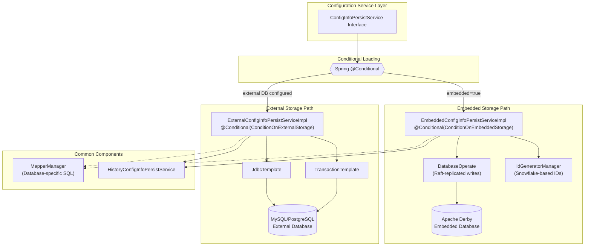
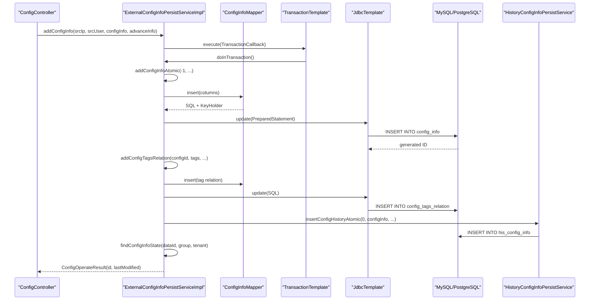
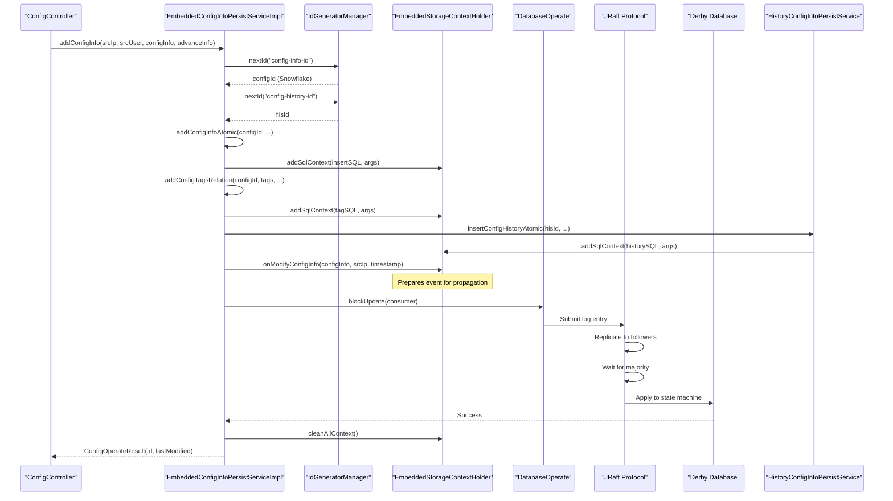
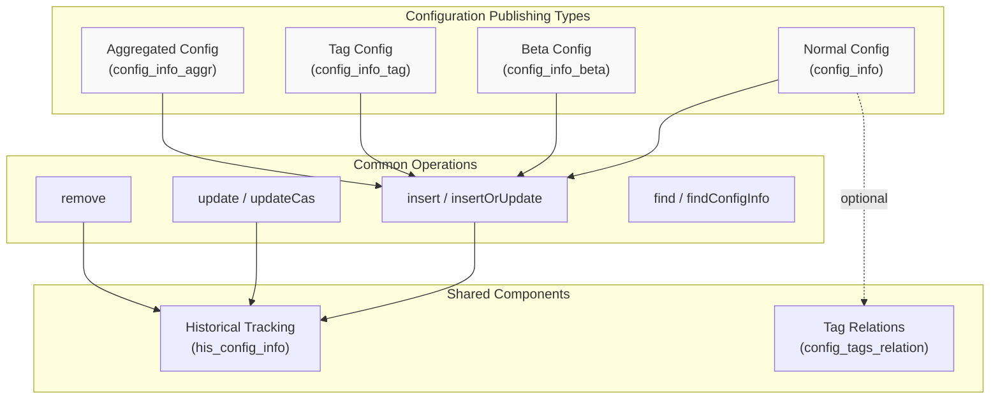
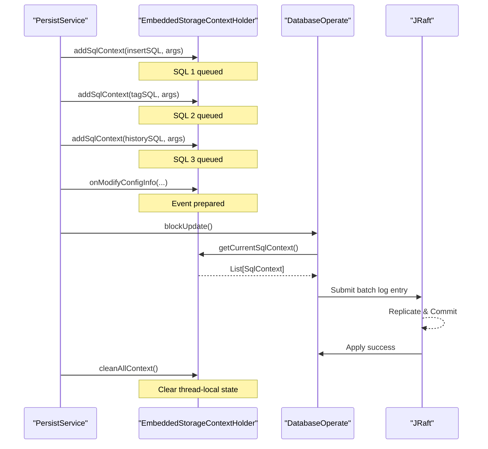
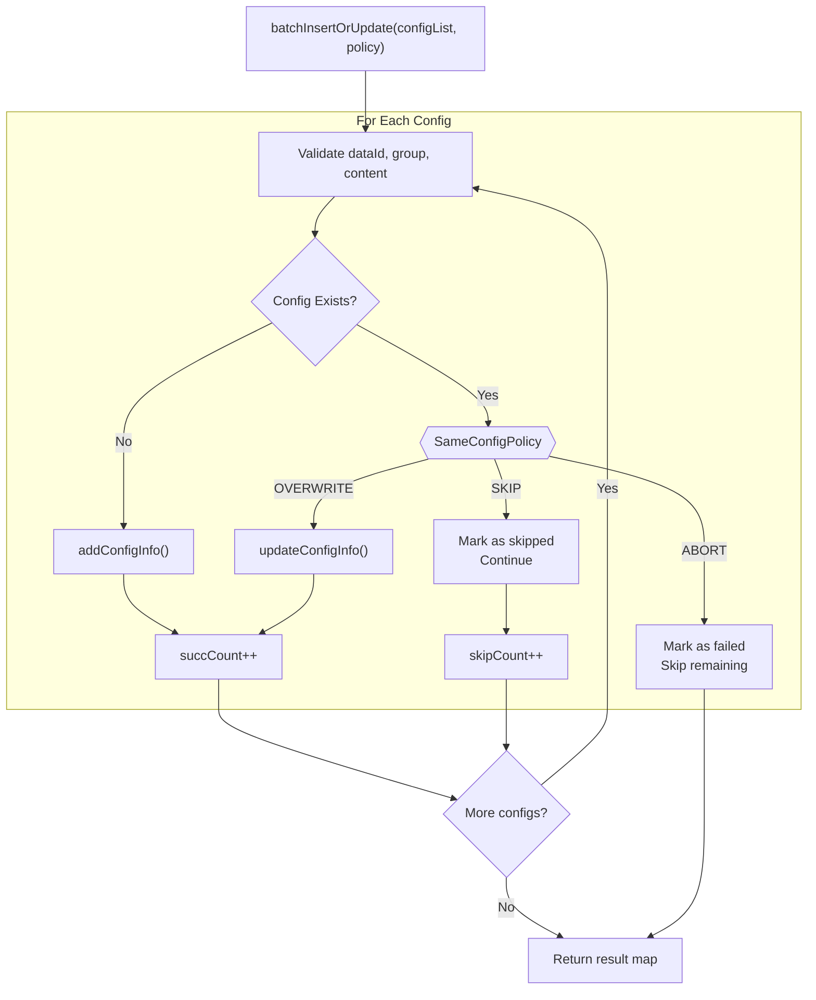

<!-- source: DeepWiki mcp.deepwiki.com · repo alibaba/nacos · page 3.4 Configuration Persistence and Storage · fetched 2026-10-29 -->

# Configuration Persistence and Storage

<details>
<summary>Relevant source files</summary>

The following files were used as context for generating this wiki page:

- [config/src/main/java/com/alibaba/nacos/config/server/service/repository/embedded/EmbeddedConfigInfoBetaPersistServiceImpl.java](config/src/main/java/com/alibaba/nacos/config/server/service/repository/embedded/EmbeddedConfigInfoBetaPersistServiceImpl.java)
- [config/src/main/java/com/alibaba/nacos/config/server/service/repository/embedded/EmbeddedConfigInfoPersistServiceImpl.java](config/src/main/java/com/alibaba/nacos/config/server/service/repository/embedded/EmbeddedConfigInfoPersistServiceImpl.java)
- [config/src/main/java/com/alibaba/nacos/config/server/service/repository/embedded/EmbeddedConfigInfoTagPersistServiceImpl.java](config/src/main/java/com/alibaba/nacos/config/server/service/repository/embedded/EmbeddedConfigInfoTagPersistServiceImpl.java)
- [config/src/main/java/com/alibaba/nacos/config/server/service/repository/embedded/EmbeddedHistoryConfigInfoPersistServiceImpl.java](config/src/main/java/com/alibaba/nacos/config/server/service/repository/embedded/EmbeddedHistoryConfigInfoPersistServiceImpl.java)
- [config/src/main/java/com/alibaba/nacos/config/server/service/repository/extrnal/ExternalConfigInfoBetaPersistServiceImpl.java](config/src/main/java/com/alibaba/nacos/config/server/service/repository/extrnal/ExternalConfigInfoBetaPersistServiceImpl.java)
- [config/src/main/java/com/alibaba/nacos/config/server/service/repository/extrnal/ExternalConfigInfoPersistServiceImpl.java](config/src/main/java/com/alibaba/nacos/config/server/service/repository/extrnal/ExternalConfigInfoPersistServiceImpl.java)
- [config/src/main/java/com/alibaba/nacos/config/server/service/repository/extrnal/ExternalConfigInfoTagPersistServiceImpl.java](config/src/main/java/com/alibaba/nacos/config/server/service/repository/extrnal/ExternalConfigInfoTagPersistServiceImpl.java)
- [config/src/main/java/com/alibaba/nacos/config/server/service/repository/extrnal/ExternalHistoryConfigInfoPersistServiceImpl.java](config/src/main/java/com/alibaba/nacos/config/server/service/repository/extrnal/ExternalHistoryConfigInfoPersistServiceImpl.java)
- [plugin/datasource/src/main/java/com/alibaba/nacos/plugin/datasource/mapper/ConfigInfoAggrMapper.java](plugin/datasource/src/main/java/com/alibaba/nacos/plugin/datasource/mapper/ConfigInfoAggrMapper.java)
- [plugin/datasource/src/main/java/com/alibaba/nacos/plugin/datasource/mapper/ConfigInfoBetaMapper.java](plugin/datasource/src/main/java/com/alibaba/nacos/plugin/datasource/mapper/ConfigInfoBetaMapper.java)
- [plugin/datasource/src/main/java/com/alibaba/nacos/plugin/datasource/model/MapperContext.java](plugin/datasource/src/main/java/com/alibaba/nacos/plugin/datasource/model/MapperContext.java)

</details>


This document describes the storage architecture for Nacos configuration data, including the dual-storage implementation, data access layer, and persistence service interfaces. It covers how configuration data is stored, retrieved, and managed across different database backends.

For information about configuration change notification and event propagation, see [Configuration Change Notification](#3.3). For details about configuration client APIs and server endpoints, see [Configuration Client SDK](#3.1) and [Configuration Server API](#3.2).

---

## Storage Architecture Overview

Nacos supports two storage modes for configuration data, selectable at deployment time through Spring conditional annotations:

1. **Embedded Storage** - Uses Apache Derby database, suitable for standalone or cluster mode with embedded Raft consensus
2. **External Storage** - Uses MySQL or PostgreSQL, suitable for production cluster deployments

The architecture uses a strategy pattern where different persistence service implementations are loaded based on the deployment configuration.

**Dual Storage Strategy**



**Sources:** [config/src/main/java/com/alibaba/nacos/config/server/service/repository/embedded/EmbeddedConfigInfoPersistServiceImpl.java:97-99](), [config/src/main/java/com/alibaba/nacos/config/server/service/repository/extrnal/ExternalConfigInfoPersistServiceImpl.java:98-100]()

---

## Persistence Service Implementations

### External Storage Implementation

The `ExternalConfigInfoPersistServiceImpl` handles persistence to external databases (MySQL, PostgreSQL) and is conditionally loaded when external storage is configured.

**Key Components:**

| Component | Type | Purpose |
|-----------|------|---------|
| `JdbcTemplate` | Spring JDBC | Executes SQL statements |
| `TransactionTemplate` | Spring TX | Manages database transactions |
| `MapperManager` | Mapper Factory | Provides database-specific SQL mappers |
| `DataSourceService` | Data Source | Manages connection pool via `DynamicDataSource` |

**Configuration Insert Flow:**



**Sources:** [config/src/main/java/com/alibaba/nacos/config/server/service/repository/extrnal/ExternalConfigInfoPersistServiceImpl.java:149-176](), [config/src/main/java/com/alibaba/nacos/config/server/service/repository/extrnal/ExternalConfigInfoPersistServiceImpl.java:257-277]()

**PreparedStatement Creation:**

The implementation creates parameterized SQL statements to prevent SQL injection and optimize query execution:

[config/src/main/java/com/alibaba/nacos/config/server/service/repository/extrnal/ExternalConfigInfoPersistServiceImpl.java:279-313]()

Key fields stored include: `data_id`, `group_id`, `tenant_id`, `app_name`, `content`, `md5`, `src_ip`, `src_user`, `c_desc`, `c_use`, `effect`, `type`, `c_schema`, `encrypted_data_key`.

### Embedded Storage Implementation

The `EmbeddedConfigInfoPersistServiceImpl` handles persistence to the embedded Derby database, integrating with Raft consensus for cluster replication.

**Key Components:**

| Component | Type | Purpose |
|-----------|------|---------|
| `DatabaseOperate` | Embedded DB Wrapper | Executes operations on embedded Derby |
| `IdGeneratorManager` | ID Generator | Generates unique IDs using Snowflake algorithm |
| `EmbeddedStorageContextHolder` | Context Manager | Holds SQL context for batch operations |
| `MapperManager` | Mapper Factory | Provides database-specific SQL mappers |

**Configuration Insert with Raft Replication:**



**Sources:** [config/src/main/java/com/alibaba/nacos/config/server/service/repository/embedded/EmbeddedConfigInfoPersistServiceImpl.java:208-245](), [config/src/main/java/com/alibaba/nacos/config/server/service/repository/embedded/EmbeddedConfigInfoPersistServiceImpl.java:302-326]()

**ID Generation Strategy:**

Embedded storage uses `IdGeneratorManager` to pre-generate IDs for all entities:

[config/src/main/java/com/alibaba/nacos/config/server/service/repository/embedded/EmbeddedConfigInfoPersistServiceImpl.java:149-156]()

Registered resource types include: `config-info-id`, `config-history-id`, `config-tag-relation-id`, `app-configdata-relation-subs`, `config-beta-id`, `namespace-id`, `user-id`, `role-id`, `permissions_id`.

---

## Data Access Layer - Mapper Pattern

The persistence layer uses a **Mapper pattern** to abstract database-specific SQL generation. The `MapperManager` factory provides mapper instances based on the database type.

### MapperManager and Database Abstraction

```mermaid
graph LR
    subgraph "Persistence Service"
        Service["ConfigInfoPersistService"]
    end
    
    subgraph "MapperManager Factory"
        MapperMgr["MapperManager.instance()"]
        MapperMgr -->|"findMapper(dbType, table)"| Mapper
    end
    
    subgraph "Mapper Interfaces"
        Mapper["Mapper Interface"]
        ConfigInfoMapper["ConfigInfoMapper"]
        ConfigTagsRelationMapper["ConfigTagsRelationMapper"]
        ConfigInfoBetaMapper["ConfigInfoBetaMapper"]
        ConfigInfoTagMapper["ConfigInfoTagMapper"]
        HistoryConfigInfoMapper["HistoryConfigInfoMapper"]
        ConfigInfoAggrMapper["ConfigInfoAggrMapper"]
        
        Mapper <|-- ConfigInfoMapper
        Mapper <|-- ConfigTagsRelationMapper
        Mapper <|-- ConfigInfoBetaMapper
        Mapper <|-- ConfigInfoTagMapper
        Mapper <|-- HistoryConfigInfoMapper
        Mapper <|-- ConfigInfoAggrMapper
    end
    
    subgraph "Database-Specific Implementations"
        MySQLMapper["MySQL Implementation"]
        PostgreSQLMapper["PostgreSQL Implementation"]
        DerbyMapper["Derby Implementation"]
        
        ConfigInfoMapper -.->|implements| MySQLMapper
        ConfigInfoMapper -.->|implements| PostgreSQLMapper
        ConfigInfoMapper -.->|implements| DerbyMapper
    end
    
    Service --> MapperMgr
```

**Sources:** [config/src/main/java/com/alibaba/nacos/config/server/service/repository/extrnal/ExternalConfigInfoPersistServiceImpl.java:111-125](), [config/src/main/java/com/alibaba/nacos/config/server/service/repository/embedded/EmbeddedConfigInfoPersistServiceImpl.java:137-160]()

### MapperContext - Query Parameter Container

The `MapperContext` class encapsulates query parameters passed to mappers:

| Parameter Type | Method | Purpose |
|---------------|--------|---------|
| WHERE parameters | `putWhereParameter(key, value)` | Conditions in WHERE clause |
| UPDATE parameters | `putUpdateParameter(key, value)` | Values in UPDATE SET clause |
| Context parameters | `putContextParameter(key, value)` | Metadata like pagination |

**Example Usage - CAS Update:**

[config/src/main/java/com/alibaba/nacos/config/server/service/repository/extrnal/ExternalConfigInfoPersistServiceImpl.java:665-688]()

**Sources:** [plugin/datasource/src/main/java/com/alibaba/nacos/plugin/datasource/model/MapperContext.java:28-142]()

### Mapper SQL Generation

Mappers generate database-specific SQL with parameter lists:

**Insert Operation:**

```java
// Example from ConfigInfoMapper usage
ConfigInfoMapper mapper = mapperManager.findMapper(dbType, TableConstant.CONFIG_INFO);
String sql = mapper.insert(
    Arrays.asList("data_id", "group_id", "tenant_id", "app_name", 
                  "content", "md5", "src_ip", "src_user",
                  "gmt_create@NOW()", "gmt_modified@NOW()", 
                  "c_desc", "c_use", "effect", "type", "c_schema",
                  "encrypted_data_key")
);
```

The `@NOW()` suffix indicates the mapper should use database-specific current timestamp functions.

**Update Operation with Conditional Columns:**

[config/src/main/java/com/alibaba/nacos/config/server/service/repository/extrnal/ExternalConfigInfoPersistServiceImpl.java:709-730]()

The implementation dynamically builds column lists, only including `c_desc` when it's not null to preserve existing values.

**Sources:** [config/src/main/java/com/alibaba/nacos/config/server/service/repository/extrnal/ExternalConfigInfoPersistServiceImpl.java:262-277](), [config/src/main/java/com/alibaba/nacos/config/server/service/repository/embedded/EmbeddedConfigInfoPersistServiceImpl.java:315-325]()

---

## Configuration Types and Database Tables

Nacos persists several types of configuration data to different database tables:

### Main Configuration Tables

| Table | Purpose | Persistence Service |
|-------|---------|-------------------|
| `config_info` | Normal production configurations | `ConfigInfoPersistService` |
| `config_info_beta` | Beta/canary configurations for testing | `ConfigInfoBetaPersistService` |
| `config_info_tag` | Tag-based configurations for routing | `ConfigInfoTagPersistService` |
| `config_info_aggr` | Aggregated configuration fragments | Handled by `ConfigInfoAggrMapper` |
| `config_tags_relation` | Many-to-many relation between configs and tags | Embedded in `ConfigInfoPersistService` |
| `his_config_info` | Historical versions of all configurations | `HistoryConfigInfoPersistService` |

### Configuration Type Hierarchy



**Sources:** [config/src/main/java/com/alibaba/nacos/config/server/service/repository/extrnal/ExternalConfigInfoPersistServiceImpl.java:100](), [config/src/main/java/com/alibaba/nacos/config/server/service/repository/extrnal/ExternalConfigInfoBetaPersistServiceImpl.java:63](), [config/src/main/java/com/alibaba/nacos/config/server/service/repository/extrnal/ExternalConfigInfoTagPersistServiceImpl.java:65]()

### Beta Configuration

Beta configurations allow gradual rollout to specific IP addresses before full production deployment:

**Beta Insert Operation:**

[config/src/main/java/com/alibaba/nacos/config/server/service/repository/extrnal/ExternalConfigInfoBetaPersistServiceImpl.java:88-108]()

Key field: `beta_ips` - Comma-separated list of IP addresses that should receive the beta configuration.

**Sources:** [config/src/main/java/com/alibaba/nacos/config/server/service/repository/embedded/EmbeddedConfigInfoBetaPersistServiceImpl.java:118-145]()

### Tag Configuration

Tag configurations enable routing different configuration versions based on client tags:

**Tag Insert Operation:**

[config/src/main/java/com/alibaba/nacos/config/server/service/repository/embedded/EmbeddedConfigInfoTagPersistServiceImpl.java:117-145]()

Tag configurations use the same dataId/group/tenant but differentiated by `tag_id` field.

**Sources:** [config/src/main/java/com/alibaba/nacos/config/server/service/repository/extrnal/ExternalConfigInfoTagPersistServiceImpl.java:117-137]()

### Aggregated Configuration

Aggregated configurations allow splitting large configurations into multiple fragments identified by `datum_id`:

**Aggregated Query Mapper:**

[plugin/datasource/src/main/java/com/alibaba/nacos/plugin/datasource/mapper/ConfigInfoAggrMapper.java:116-126]()

The query returns all fragments ordered by `datum_id`, which can then be concatenated into a single configuration.

**Batch Delete Aggregated Data:**

[plugin/datasource/src/main/java/com/alibaba/nacos/plugin/datasource/mapper/ConfigInfoAggrMapper.java:44-69]()

**Sources:** [plugin/datasource/src/main/java/com/alibaba/nacos/plugin/datasource/mapper/ConfigInfoAggrMapper.java:34-160]()

---

## Transaction Management

Transaction handling differs significantly between external and embedded storage implementations.

### External Storage Transactions

Uses Spring's `TransactionTemplate` for declarative transaction management:

**Transaction Pattern:**

[config/src/main/java/com/alibaba/nacos/config/server/service/repository/extrnal/ExternalConfigInfoPersistServiceImpl.java:149-176]()

The transaction callback pattern ensures atomicity across:
1. Config info insertion
2. Tag relation insertion
3. History record insertion

**Transaction Rollback on Error:**

[config/src/main/java/com/alibaba/nacos/config/server/service/repository/extrnal/ExternalConfigInfoPersistServiceImpl.java:436-459]()

**Sources:** [config/src/main/java/com/alibaba/nacos/config/server/service/repository/extrnal/ExternalConfigInfoPersistServiceImpl.java:109-110]()

### Embedded Storage Transactions

Uses `EmbeddedStorageContextHolder` to accumulate SQL statements for batch Raft submission:

**Context-Based Transaction:**



**Context Cleanup Pattern:**

All embedded operations use try-finally to ensure context cleanup:

[config/src/main/java/com/alibaba/nacos/config/server/service/repository/embedded/EmbeddedConfigInfoPersistServiceImpl.java:216-244]()

The `finally` block always calls `EmbeddedStorageContextHolder.cleanAllContext()` to prevent thread-local memory leaks.

**Sources:** [config/src/main/java/com/alibaba/nacos/config/server/service/repository/embedded/EmbeddedConfigInfoPersistServiceImpl.java:447-474]()

---

## Historical Configuration Tracking

All configuration changes are tracked in the `his_config_info` table for audit and rollback purposes.

### History Record Structure

History records capture:
- Complete configuration snapshot (`data_id`, `group_id`, `tenant_id`, `content`, `md5`)
- Change metadata (`src_ip`, `src_user`, `gmt_modified`)
- Operation type (`op_type`): "I" (insert), "U" (update), "D" (delete)
- Publish type: "FORMAL", "BETA", "TAG"
- Gray release name (`gray_name`)
- Extended information (`ext_info`)
- Encryption key (`encrypted_data_key`)

### History Insertion

**External Storage:**

[config/src/main/java/com/alibaba/nacos/config/server/service/repository/extrnal/ExternalHistoryConfigInfoPersistServiceImpl.java:90-112]()

**Embedded Storage:**

[config/src/main/java/com/alibaba/nacos/config/server/service/repository/embedded/EmbeddedHistoryConfigInfoPersistServiceImpl.java:92-112]()

Note: History insertion is skipped when `CONFIG_MIGRATE_FLAG` is true, preventing duplicate history during data migration.

### History Queries

**Find Configuration History (Paginated):**

[config/src/main/java/com/alibaba/nacos/config/server/service/repository/extrnal/ExternalHistoryConfigInfoPersistServiceImpl.java:162-188]()

**Find Deleted Configurations:**

Used for cleanup and synchronization:

[config/src/main/java/com/alibaba/nacos/config/server/service/repository/extrnal/ExternalHistoryConfigInfoPersistServiceImpl.java:127-159]()

Returns configurations marked as deleted (`op_type='D'`) after a specific timestamp, useful for propagating deletions to clients.

**Sources:** [config/src/main/java/com/alibaba/nacos/config/server/service/repository/embedded/EmbeddedHistoryConfigInfoPersistServiceImpl.java:64-230]()

---

## Batch Operations and Import

The persistence layer supports batch insertion for configuration import scenarios.

### Batch Insert/Update

**Policy-Based Conflict Handling:**



**Implementation:**

[config/src/main/java/com/alibaba/nacos/config/server/service/repository/extrnal/ExternalConfigInfoPersistServiceImpl.java:340-417]()

The method returns a map containing:
- `succCount`: Number of successfully processed configurations
- `skipCount`: Number of skipped configurations
- `failData`: List of failed configurations (only in ABORT mode)
- `skipData`: List of skipped configurations

**File Type Determination:**

When importing, if the configuration type is not specified, it's inferred from the file extension:

[config/src/main/java/com/alibaba/nacos/config/server/service/repository/extrnal/ExternalConfigInfoPersistServiceImpl.java:419-431]()

**Sources:** [config/src/main/java/com/alibaba/nacos/config/server/service/repository/embedded/EmbeddedConfigInfoPersistServiceImpl.java:348-445]()

---

## Compare-And-Swap (CAS) Operations

Both storage implementations support optimistic locking through CAS operations, preventing concurrent update conflicts.

### CAS Update Flow

**External Storage CAS:**

[config/src/main/java/com/alibaba/nacos/config/server/service/repository/extrnal/ExternalConfigInfoPersistServiceImpl.java:652-693]()

The update includes MD5 in the WHERE clause: `WHERE data_id=? AND group_id=? AND tenant_id=? AND md5=?`

If the MD5 has changed since the client last read it, the update returns 0 rows affected, indicating a conflict.

**CAS Success Check:**

[config/src/main/java/com/alibaba/nacos/config/server/service/repository/extrnal/ExternalConfigInfoPersistServiceImpl.java:599-650]()

If fewer than 1 row is updated, the operation returns `ConfigOperateResult(false)`.

### Embedded Storage CAS

**CAS with Context:**

[config/src/main/java/com/alibaba/nacos/config/server/service/repository/embedded/EmbeddedConfigInfoPersistServiceImpl.java:597-667]()

The embedded version uses the same MD5-based optimistic locking but coordinates through the Raft log.

**Sources:** [plugin/datasource/src/main/java/com/alibaba/nacos/plugin/datasource/mapper/ConfigInfoBetaMapper.java:44-65]()

---

## Integration with Other Subsystems

The persistence layer integrates with several other Nacos components:

### Configuration Encryption

Configurations can store an `encrypted_data_key` field for encrypted content:

[config/src/main/java/com/alibaba/nacos/config/server/service/repository/extrnal/ExternalConfigInfoPersistServiceImpl.java:289-291]()

The encryption is handled by `EncryptionHandler` (see [Authentication and Security](#9.3)).

### Configuration Tags

Configurations can be associated with multiple tags for categorization:

**Tag Relation Insertion:**

[config/src/main/java/com/alibaba/nacos/config/server/service/repository/extrnal/ExternalConfigInfoPersistServiceImpl.java:329-337]()

Tags are stored in the `config_tags_relation` table with a many-to-many relationship.

**Tag Removal:**

[config/src/main/java/com/alibaba/nacos/config/server/service/repository/extrnal/ExternalConfigInfoPersistServiceImpl.java:494-503]()

Tags are deleted atomically when updating or removing configurations.

### Pagination Support

Both implementations provide pagination helpers for large result sets:

**External Storage Pagination:**

[config/src/main/java/com/alibaba/nacos/config/server/service/repository/extrnal/ExternalConfigInfoPersistServiceImpl.java:129-131]()

Uses `ExternalStoragePaginationHelperImpl` with JDBC template.

**Embedded Storage Pagination:**

[config/src/main/java/com/alibaba/nacos/config/server/service/repository/embedded/EmbeddedConfigInfoPersistServiceImpl.java:165-167]()

Uses `EmbeddedPaginationHelperImpl` with database operate abstraction.

**Sources:** [config/src/main/java/com/alibaba/nacos/config/server/service/repository/extrnal/ExternalConfigInfoPersistServiceImpl.java:316-327](), [config/src/main/java/com/alibaba/nacos/config/server/service/repository/embedded/EmbeddedConfigInfoPersistServiceImpl.java:328-346]()

---

## Key Design Patterns

### Strategy Pattern

Different persistence strategies selected at runtime via Spring conditionals:

| Pattern Element | Implementation |
|----------------|----------------|
| Strategy Interface | `ConfigInfoPersistService` |
| Concrete Strategy A | `ExternalConfigInfoPersistServiceImpl` |
| Concrete Strategy B | `EmbeddedConfigInfoPersistServiceImpl` |
| Context Selector | `@Conditional(ConditionOnExternalStorage)` |

### Factory Pattern

`MapperManager` acts as a factory for database-specific mapper implementations:

```java
MapperManager mapperManager = MapperManager.instance(isDataSourceLogEnable);
ConfigInfoMapper mapper = mapperManager.findMapper(dbType, TableConstant.CONFIG_INFO);
```

### Template Method Pattern

Both Beta and Tag configurations follow the same operational template:
1. Check if configuration exists (`findConfigInfo4XXXState`)
2. If not exists: insert (`addConfigInfo4XXX`)
3. If exists: update (`updateConfigInfo4XXX` or `updateConfigInfo4XXXCas`)

This is encapsulated in methods like `insertOrUpdate` and `insertOrUpdateCas`.

**Sources:** [config/src/main/java/com/alibaba/nacos/config/server/service/repository/extrnal/ExternalConfigInfoBetaPersistServiceImpl.java:111-122](), [config/src/main/java/com/alibaba/nacos/config/server/service/repository/embedded/EmbeddedConfigInfoTagPersistServiceImpl.java:147-155]()

---

## Summary

The Nacos configuration persistence layer provides:

1. **Dual Storage Support** - Seamless switching between embedded Derby and external MySQL/PostgreSQL
2. **Database Abstraction** - Mapper pattern for database-specific SQL generation
3. **Multiple Config Types** - Normal, Beta, Tag, and Aggregated configurations with history tracking
4. **Transaction Safety** - Different transaction strategies optimized for each storage type
5. **Optimistic Locking** - CAS operations to prevent concurrent update conflicts
6. **Batch Operations** - Efficient import with configurable conflict policies
7. **Audit Trail** - Complete history tracking for all configuration changes

The architecture is designed to scale from single-node development setups with embedded storage to multi-node production clusters with external databases and Raft-based replication.

---

