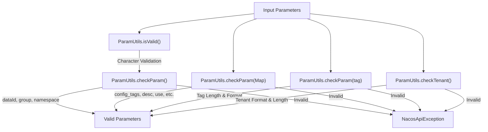
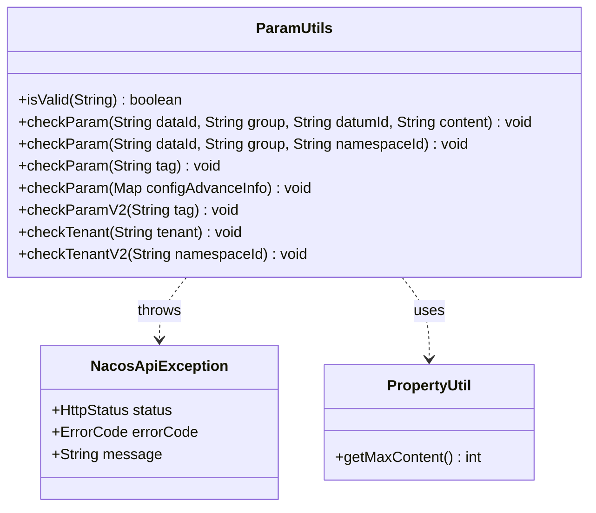
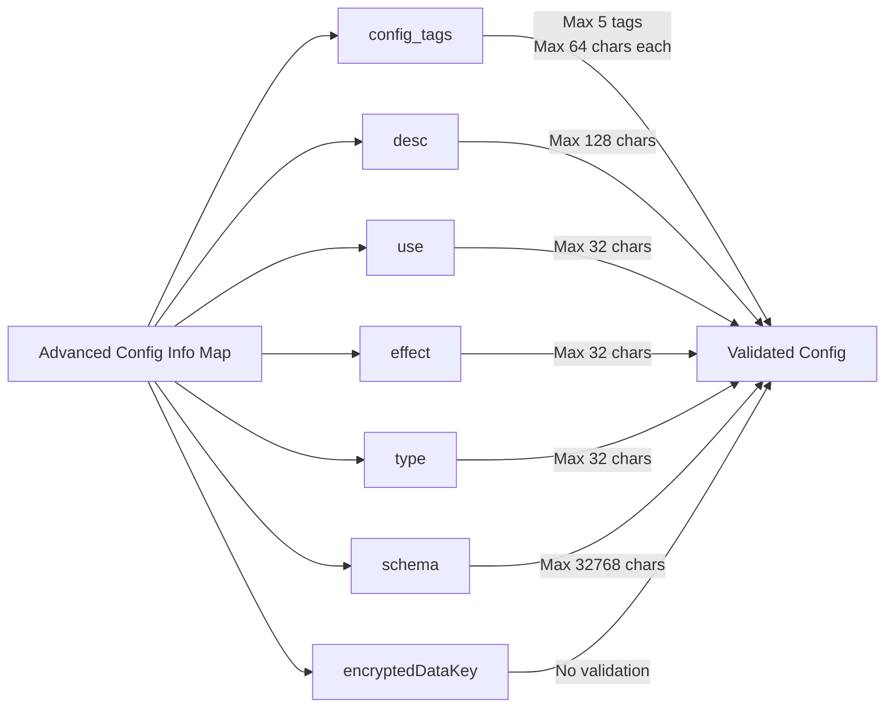
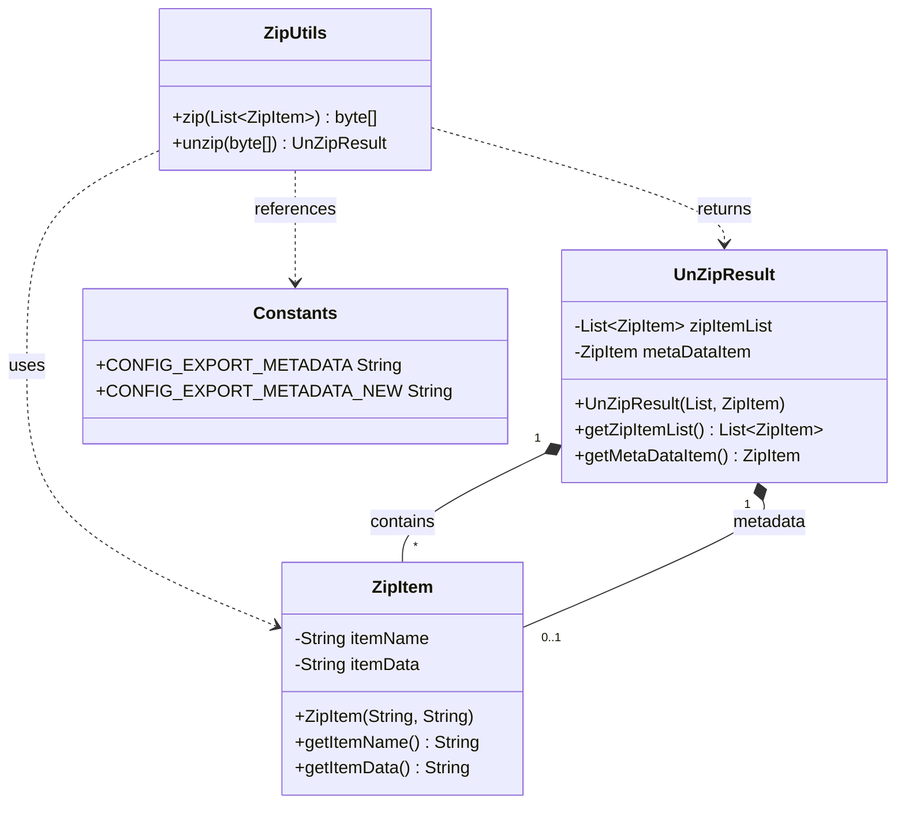
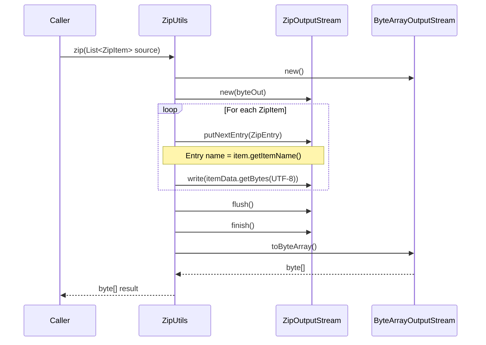
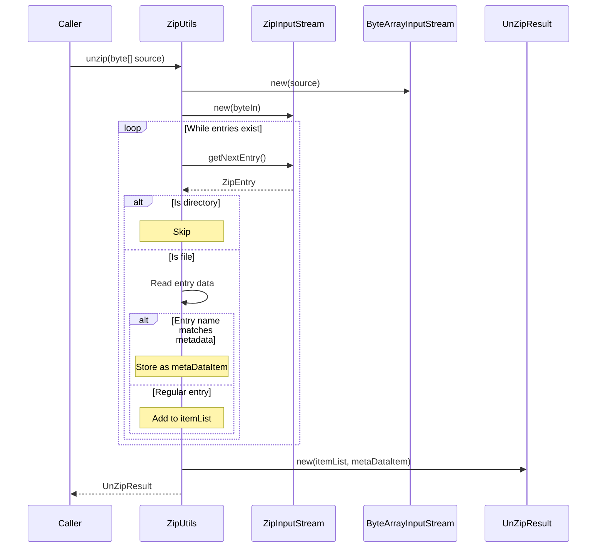
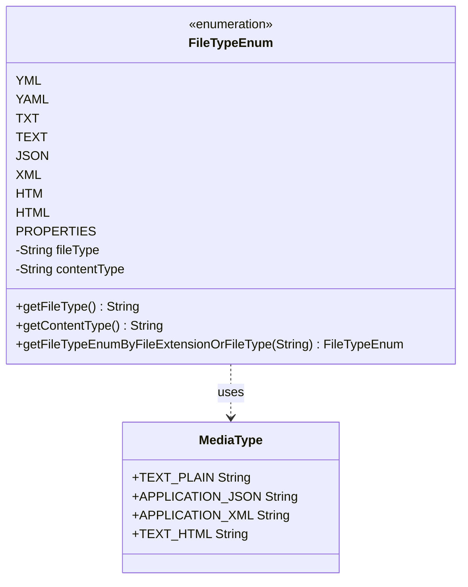
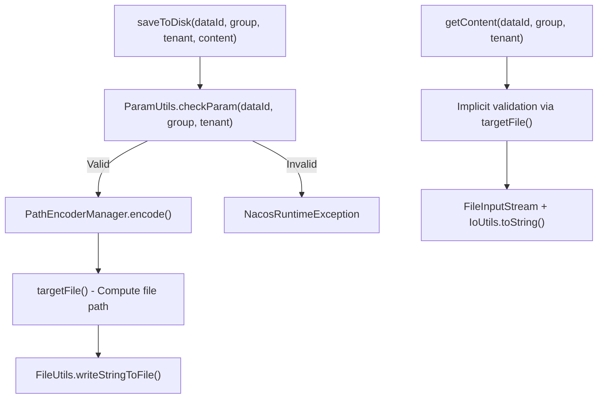
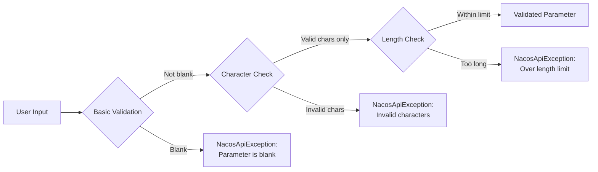

<!-- source: DeepWiki mcp.deepwiki.com · repo alibaba/nacos · page 3.5 Configuration Import, Export, and Validation · fetched 2026-10-29 -->

# Configuration Import, Export, and Validation

Relevant source files

The following files were used as context for generating this wiki page:

- [config/src/main/java/com/alibaba/nacos/config/server/enums/FileTypeEnum.java](config/src/main/java/com/alibaba/nacos/config/server/enums/FileTypeEnum.java)
- [config/src/main/java/com/alibaba/nacos/config/server/service/dump/disk/ConfigRawDiskService.java](config/src/main/java/com/alibaba/nacos/config/server/service/dump/disk/ConfigRawDiskService.java)
- [config/src/main/java/com/alibaba/nacos/config/server/utils/ParamUtils.java](config/src/main/java/com/alibaba/nacos/config/server/utils/ParamUtils.java)
- [config/src/main/java/com/alibaba/nacos/config/server/utils/ZipUtils.java](config/src/main/java/com/alibaba/nacos/config/server/utils/ZipUtils.java)
- [config/src/test/java/com/alibaba/nacos/config/server/service/dump/disk/ConfigRawDiskServiceTest.java](config/src/test/java/com/alibaba/nacos/config/server/service/dump/disk/ConfigRawDiskServiceTest.java)
- [config/src/test/java/com/alibaba/nacos/config/server/utils/ParamUtilsTest.java](config/src/test/java/com/alibaba/nacos/config/server/utils/ParamUtilsTest.java)
- [config/src/test/java/com/alibaba/nacos/config/server/utils/PropertyUtilTest.java](config/src/test/java/com/alibaba/nacos/config/server/utils/PropertyUtilTest.java)
- [config/src/test/java/com/alibaba/nacos/config/server/utils/ProtocolTest.java](config/src/test/java/com/alibaba/nacos/config/server/utils/ProtocolTest.java)

This document describes the configuration import, export, and validation mechanisms in Nacos. These utilities ensure configuration data integrity through parameter validation and provide functionality to bulk import/export configurations using ZIP archives.

For information about configuration persistence and storage, see [Configuration Persistence and Storage](#3.4). For details about configuration server APIs that use these utilities, see [Configuration Server API](#3.2).

## Overview

The configuration import, export, and validation system consists of three main components:

- **ParamUtils**: Parameter validation utility that enforces naming conventions, character restrictions, and length limits
- **ZipUtils**: Import/export utility that handles ZIP compression and decompression of configuration data
- **FileTypeEnum**: File type enumeration that maps configuration file extensions to content types

These utilities are used throughout the configuration service to validate input parameters before persistence and to facilitate bulk configuration management operations.

## Parameter Validation System

### Validation Architecture

The `ParamUtils` class provides comprehensive validation for all configuration-related parameters including dataId, group, tenant/namespace, tags, and advanced configuration attributes.

**Sources:** [config/src/main/java/com/alibaba/nacos/config/server/utils/ParamUtils.java:1-240]()

### Character Validation

The `isValid()` method enforces a whitelist of allowed characters. Valid parameters can only contain:
- Letters (a-z, A-Z)
- Digits (0-9)
- Special characters: `_`, `-`, `.`, `:`

[config/src/main/java/com/alibaba/nacos/config/server/utils/ParamUtils.java:58-79]()

| Method | Purpose |
|--------|---------|
| `isValid(String param)` | Validates that parameter contains only allowed characters |
| `isValidChar(char ch)` | Checks if a character is in the valid character array |

**Sources:** [config/src/main/java/com/alibaba/nacos/config/server/utils/ParamUtils.java:34-79]()

### Basic Parameter Validation

Multiple `checkParam()` overloads validate different parameter combinations:

**Sources:** [config/src/main/java/com/alibaba/nacos/config/server/utils/ParamUtils.java:32-240]()

#### DataId, Group, and Namespace Validation

The primary validation method checks core configuration identifiers:

[config/src/main/java/com/alibaba/nacos/config/server/utils/ParamUtils.java:110-120]()

**Validation Rules:**
- **dataId**: Must not be blank and must contain only valid characters
- **group**: Must not be blank and must contain only valid characters  
- **namespaceId/tenant**: Maximum length of 128 characters, valid characters only

**Sources:** [config/src/main/java/com/alibaba/nacos/config/server/utils/ParamUtils.java:110-120](), [config/src/main/java/com/alibaba/nacos/config/server/utils/ParamUtils.java:227-238]()

#### Content Validation

For V1 API with datumId parameter:

[config/src/main/java/com/alibaba/nacos/config/server/utils/ParamUtils.java:84-101]()

**Validation Rules:**
- All parameters (dataId, group, datumId) must not be blank and must be valid
- Content must not be blank
- Content length must not exceed `PropertyUtil.getMaxContent()` (default: 10MB)

**Sources:** [config/src/main/java/com/alibaba/nacos/config/server/utils/ParamUtils.java:84-101]()

### Advanced Configuration Validation

The `checkParam(Map<String, Object> configAdvanceInfo)` method validates additional configuration metadata:

**Sources:** [config/src/main/java/com/alibaba/nacos/config/server/utils/ParamUtils.java:139-192]()

#### Field Length Limits

| Field | Maximum Length | Additional Rules |
|-------|----------------|------------------|
| `config_tags` | 64 chars per tag | Maximum 5 tags total |
| `desc` | 128 characters | Description field |
| `use` | 32 characters | Usage field |
| `effect` | 32 characters | Effect field |
| `type` | 32 characters | Configuration type |
| `schema` | 32768 characters | Schema definition |
| `encryptedDataKey` | No limit | Encryption key (no validation) |
| `tag` | 16 characters | Single tag parameter |
| `tenant` / `namespaceId` | 128 characters | Namespace identifier |

**Sources:** [config/src/main/java/com/alibaba/nacos/config/server/utils/ParamUtils.java:36-50](), [config/src/main/java/com/alibaba/nacos/config/server/utils/ParamUtils.java:139-192]()

### API Version Differences

ParamUtils provides separate validation methods for V1 and V2 APIs:

| Method | API Version | Exception Type |
|--------|-------------|----------------|
| `checkParam(String tag)` | V1 | `IllegalArgumentException` |
| `checkParamV2(String tag)` | V2 | `NacosApiException` |
| `checkTenant(String tenant)` | V1 | `IllegalArgumentException` |
| `checkTenantV2(String namespaceId)` | V2 | `NacosApiException` |

The V2 methods throw `NacosApiException` with proper HTTP status codes (`HttpStatus.BAD_REQUEST`) and error codes (`ErrorCode.PARAMETER_VALIDATE_ERROR`), while V1 methods throw standard `IllegalArgumentException`.

**Sources:** [config/src/main/java/com/alibaba/nacos/config/server/utils/ParamUtils.java:125-134](), [config/src/main/java/com/alibaba/nacos/config/server/utils/ParamUtils.java:197-208](), [config/src/main/java/com/alibaba/nacos/config/server/utils/ParamUtils.java:213-222](), [config/src/main/java/com/alibaba/nacos/config/server/utils/ParamUtils.java:227-238]()

## Configuration Import/Export System

### ZipUtils Architecture

The `ZipUtils` class provides methods for compressing and decompressing configuration data into ZIP archives for bulk import/export operations.

**Sources:** [config/src/main/java/com/alibaba/nacos/config/server/utils/ZipUtils.java:39-157]()

### Export Process

The `zip()` method compresses a list of configuration items into a ZIP archive:

**Sources:** [config/src/main/java/com/alibaba/nacos/config/server/utils/ZipUtils.java:102-117]()

#### Implementation Details

[config/src/main/java/com/alibaba/nacos/config/server/utils/ZipUtils.java:102-117]()

**Key Features:**
- Encodes all data in UTF-8 encoding
- Uses try-with-resources for automatic stream cleanup
- Logs errors if compression fails but doesn't throw exceptions
- Returns `null` on error

**Sources:** [config/src/main/java/com/alibaba/nacos/config/server/utils/ZipUtils.java:102-117]()

### Import Process

The `unzip()` method extracts configuration items from a ZIP archive:

**Sources:** [config/src/main/java/com/alibaba/nacos/config/server/utils/ZipUtils.java:122-155]()

#### Metadata Handling

The unzip process recognizes special metadata files:

[config/src/main/java/com/alibaba/nacos/config/server/utils/ZipUtils.java:138-145]()

**Metadata File Names:**
- `Constants.CONFIG_EXPORT_METADATA` - Legacy metadata file name
- `Constants.CONFIG_EXPORT_METADATA_NEW` - New metadata file name

When a ZIP entry name matches either metadata constant, it is stored separately in the `metaDataItem` field of `UnZipResult` rather than being added to the regular item list. This allows the caller to distinguish metadata from actual configuration data.

**Sources:** [config/src/main/java/com/alibaba/nacos/config/server/utils/ZipUtils.java:122-155]()

### Data Structures

#### ZipItem

[config/src/main/java/com/alibaba/nacos/config/server/utils/ZipUtils.java:43-69]()

Represents a single configuration item within a ZIP archive:
- `itemName`: The name/path of the item in the ZIP
- `itemData`: The content of the configuration as a string

#### UnZipResult

[config/src/main/java/com/alibaba/nacos/config/server/utils/ZipUtils.java:71-97]()

Encapsulates the result of an unzip operation:
- `zipItemList`: List of regular configuration items
- `metaDataItem`: Optional metadata item (if present in the archive)

**Sources:** [config/src/main/java/com/alibaba/nacos/config/server/utils/ZipUtils.java:43-97]()

## File Type Handling

### FileTypeEnum Definition

The `FileTypeEnum` enumeration maps file extensions to configuration types and content types for HTTP responses:

**Sources:** [config/src/main/java/com/alibaba/nacos/config/server/enums/FileTypeEnum.java:28-122]()

### Supported File Types

| Enum Value | File Type | Content Type |
|------------|-----------|--------------|
| `YML` | yaml | text/plain |
| `YAML` | yaml | text/plain |
| `TXT` | text | text/plain |
| `TEXT` | text | text/plain |
| `JSON` | json | application/json |
| `XML` | xml | application/xml |
| `HTM` | html | text/html |
| `HTML` | html | text/html |
| `PROPERTIES` | properties | text/plain |

**Sources:** [config/src/main/java/com/alibaba/nacos/config/server/enums/FileTypeEnum.java:33-73]()

### Type Resolution

The `getFileTypeEnumByFileExtensionOrFileType()` method resolves file types from extensions:

[config/src/main/java/com/alibaba/nacos/config/server/enums/FileTypeEnum.java:109-119]()

**Resolution Process:**
1. Trim and convert input to uppercase
2. Match against enum constant names
3. Return matching `FileTypeEnum`
4. Default to `FileTypeEnum.TEXT` if no match found

This case-insensitive matching allows flexible file type specification from various sources (file extensions, user input, etc.).

**Sources:** [config/src/main/java/com/alibaba/nacos/config/server/enums/FileTypeEnum.java:109-119]()

## Integration with Storage Layer

### Validation in ConfigRawDiskService

The validation utilities are integrated throughout the configuration service. For example, `ConfigRawDiskService` validates parameters before disk operations:

**Sources:** [config/src/main/java/com/alibaba/nacos/config/server/service/dump/disk/ConfigRawDiskService.java:54-171]()

### Parameter Validation Flow

[config/src/main/java/com/alibaba/nacos/config/server/service/dump/disk/ConfigRawDiskService.java:62-67]()

When determining the target file path:
1. `ParamUtils.checkParam(dataId, group, tenant)` validates all three identifiers
2. If validation fails, throws `NacosRuntimeException` with `NacosException.CLIENT_INVALID_PARAM`
3. After validation, parameters are encoded using `PathEncoderManager` to handle special characters safely
4. The encoded parameters are used to construct the file path

This ensures that all configuration data written to disk has been properly validated and encoded.

**Sources:** [config/src/main/java/com/alibaba/nacos/config/server/service/dump/disk/ConfigRawDiskService.java:62-82]()

## Testing and Validation Examples

### ParamUtils Test Coverage

The test suite demonstrates comprehensive validation scenarios:

[config/src/test/java/com/alibaba/nacos/config/server/utils/ParamUtilsTest.java:1-304]()

**Test Categories:**
- Character validation: Valid characters (letters, digits, `_`, `-`, `.`, `:`) vs invalid characters (`!`, `~`)
- Empty/blank parameter handling
- Parameter length limits (tags, descriptions, schemas)
- V1 vs V2 API exception types
- Advanced configuration info validation

**Sources:** [config/src/test/java/com/alibaba/nacos/config/server/utils/ParamUtilsTest.java:35-303]()

### Common Validation Patterns

**Sources:** [config/src/test/java/com/alibaba/nacos/config/server/utils/ParamUtilsTest.java:1-304]()

---

