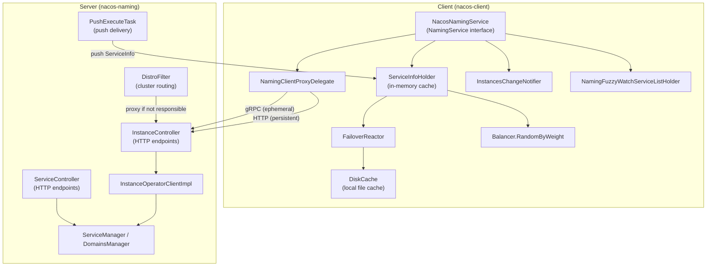
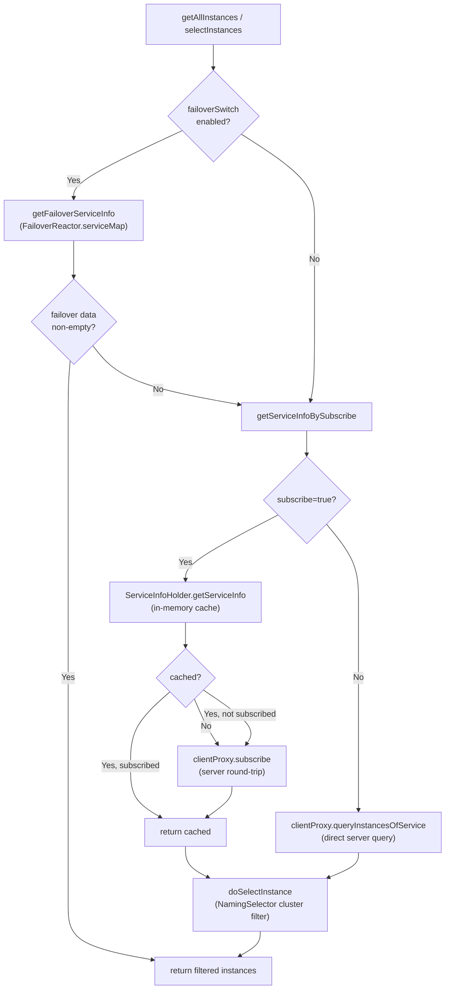
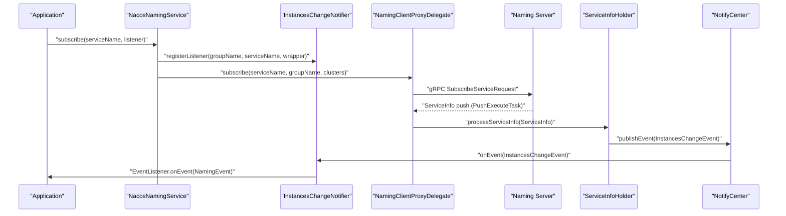

<!-- source: DeepWiki mcp.deepwiki.com · repo alibaba/nacos · page 4 Naming Service · fetched 2026-10-29 -->

# Naming Service

<details>
<summary>Relevant source files</summary>

The following files were used as context for generating this wiki page:

- [api/src/main/java/com/alibaba/nacos/api/naming/NamingService.java](api/src/main/java/com/alibaba/nacos/api/naming/NamingService.java)
- [client/src/main/java/com/alibaba/nacos/client/naming/NacosNamingMaintainService.java](client/src/main/java/com/alibaba/nacos/client/naming/NacosNamingMaintainService.java)
- [client/src/main/java/com/alibaba/nacos/client/naming/remote/AbstractNamingClientProxy.java](client/src/main/java/com/alibaba/nacos/client/naming/remote/AbstractNamingClientProxy.java)
- [client/src/main/java/com/alibaba/nacos/client/naming/remote/NamingClientProxy.java](client/src/main/java/com/alibaba/nacos/client/naming/remote/NamingClientProxy.java)
- [client/src/main/java/com/alibaba/nacos/client/naming/remote/NamingClientProxyDelegate.java](client/src/main/java/com/alibaba/nacos/client/naming/remote/NamingClientProxyDelegate.java)
- [client/src/main/java/com/alibaba/nacos/client/naming/remote/gprc/NamingGrpcClientProxy.java](client/src/main/java/com/alibaba/nacos/client/naming/remote/gprc/NamingGrpcClientProxy.java)
- [client/src/main/java/com/alibaba/nacos/client/naming/remote/gprc/redo/NamingGrpcRedoService.java](client/src/main/java/com/alibaba/nacos/client/naming/remote/gprc/redo/NamingGrpcRedoService.java)
- [client/src/main/java/com/alibaba/nacos/client/naming/remote/gprc/redo/RedoScheduledTask.java](client/src/main/java/com/alibaba/nacos/client/naming/remote/gprc/redo/RedoScheduledTask.java)
- [client/src/main/java/com/alibaba/nacos/client/naming/remote/gprc/redo/data/BatchInstanceRedoData.java](client/src/main/java/com/alibaba/nacos/client/naming/remote/gprc/redo/data/BatchInstanceRedoData.java)
- [client/src/main/java/com/alibaba/nacos/client/naming/remote/gprc/redo/data/InstanceRedoData.java](client/src/main/java/com/alibaba/nacos/client/naming/remote/gprc/redo/data/InstanceRedoData.java)
- [client/src/main/java/com/alibaba/nacos/client/naming/remote/gprc/redo/data/SubscriberRedoData.java](client/src/main/java/com/alibaba/nacos/client/naming/remote/gprc/redo/data/SubscriberRedoData.java)
- [client/src/main/java/com/alibaba/nacos/client/naming/remote/http/NamingHttpClientProxy.java](client/src/main/java/com/alibaba/nacos/client/naming/remote/http/NamingHttpClientProxy.java)
- [client/src/test/java/com/alibaba/nacos/client/naming/NacosNamingServiceTest.java](client/src/test/java/com/alibaba/nacos/client/naming/NacosNamingServiceTest.java)
- [client/src/test/java/com/alibaba/nacos/client/naming/remote/AbstractNamingClientProxyTest.java](client/src/test/java/com/alibaba/nacos/client/naming/remote/AbstractNamingClientProxyTest.java)
- [client/src/test/java/com/alibaba/nacos/client/naming/remote/NamingClientProxyDelegateTest.java](client/src/test/java/com/alibaba/nacos/client/naming/remote/NamingClientProxyDelegateTest.java)
- [client/src/test/java/com/alibaba/nacos/client/naming/remote/gprc/NamingGrpcClientProxyTest.java](client/src/test/java/com/alibaba/nacos/client/naming/remote/gprc/NamingGrpcClientProxyTest.java)
- [client/src/test/java/com/alibaba/nacos/client/naming/remote/gprc/redo/NamingGrpcRedoServiceTest.java](client/src/test/java/com/alibaba/nacos/client/naming/remote/gprc/redo/NamingGrpcRedoServiceTest.java)
- [client/src/test/java/com/alibaba/nacos/client/naming/remote/gprc/redo/RedoScheduledTaskTest.java](client/src/test/java/com/alibaba/nacos/client/naming/remote/gprc/redo/RedoScheduledTaskTest.java)
- [client/src/test/java/com/alibaba/nacos/client/naming/remote/gprc/redo/data/BatchInstanceRedoDataTest.java](client/src/test/java/com/alibaba/nacos/client/naming/remote/gprc/redo/data/BatchInstanceRedoDataTest.java)
- [client/src/test/java/com/alibaba/nacos/client/naming/remote/http/NamingHttpClientProxyTest.java](client/src/test/java/com/alibaba/nacos/client/naming/remote/http/NamingHttpClientProxyTest.java)
- [console/src/main/java/com/alibaba/nacos/Nacos.java](console/src/main/java/com/alibaba/nacos/Nacos.java)
- [naming/src/main/java/com/alibaba/nacos/naming/misc/HttpClient.java](naming/src/main/java/com/alibaba/nacos/naming/misc/HttpClient.java)
- [naming/src/main/java/com/alibaba/nacos/naming/misc/SwitchDomain.java](naming/src/main/java/com/alibaba/nacos/naming/misc/SwitchDomain.java)
- [naming/src/main/java/com/alibaba/nacos/naming/misc/SwitchEntry.java](naming/src/main/java/com/alibaba/nacos/naming/misc/SwitchEntry.java)
- [naming/src/main/java/com/alibaba/nacos/naming/misc/SwitchManager.java](naming/src/main/java/com/alibaba/nacos/naming/misc/SwitchManager.java)
- [naming/src/main/java/com/alibaba/nacos/naming/misc/UtilsAndCommons.java](naming/src/main/java/com/alibaba/nacos/naming/misc/UtilsAndCommons.java)
- [naming/src/main/java/com/alibaba/nacos/naming/web/DistroFilter.java](naming/src/main/java/com/alibaba/nacos/naming/web/DistroFilter.java)

</details>


This page describes the purpose, core concepts, and component structure of Nacos's service discovery subsystem. It is an orientation document — detailed mechanics for each component are covered in the sub-pages:

- Client SDK: [Naming Client SDK](#4.1)
- Server-side instance management: [Naming Server and Instance Management](#4.2)
- Client proxy and reconnect behavior: [Naming Client Proxy and Redo Service](#4.3)
- Caching and push notifications: [Service Information Caching and Push Notifications](#4.4)

For the related configuration subsystem, see [Configuration Service](#3).

---

## What the Naming Service Does

The naming service implements dynamic service registration and discovery. Applications register themselves as named **instances** and query the registry to find other services. The server maintains this registry and pushes changes to subscribed clients in near-real-time.

The model has three participants:

| Participant | Role |
|---|---|
| **Provider** | Registers an `Instance` with a service name, group, namespace, IP, port, and metadata |
| **Consumer** | Subscribes to a service name and receives push updates when the instance list changes |
| **Naming server** | Stores the registry, drives health checks, and pushes updates to subscribers |

---

## Ephemeral vs Persistent Instances

Every `Instance` is either **ephemeral** or **persistent**. This is the most fundamental design decision in the naming model.

| Property | Ephemeral | Persistent |
|---|---|---|
| Consistency protocol | Distro (AP) | JRaft (CP) |
| Transport | gRPC | HTTP |
| Health model | Client keeps connection alive; server removes instance on disconnect | Server actively health-checks; instance remains until explicitly deregistered |
| Typical use | Microservice processes | Static endpoints, middleware |
| Key constant | `UtilsAndCommons.EPHEMERAL = "ephemeral"` | `UtilsAndCommons.PERSIST = "persist"` |

The `ephemeral` field on `Instance` controls which path is taken. `NamingClientProxyDelegate` reads this field to decide whether to route through `NamingGrpcClientProxy` (ephemeral) or `NamingHttpClientProxy` (persistent). See [Naming Client Proxy and Redo Service](#4.3) for details.

Sources: [naming/src/main/java/com/alibaba/nacos/naming/misc/UtilsAndCommons.java:137-139]()

---

## High-Level Component Map

**Diagram: Naming Service Major Components**



Sources: [client/src/main/java/com/alibaba/nacos/client/naming/NacosNamingService.java:74-131](), [client/src/main/java/com/alibaba/nacos/client/naming/backups/FailoverReactor.java:52-82](), [naming/src/main/java/com/alibaba/nacos/naming/web/DistroFilter.java:57-157]()

---

## Client Entry Point: `NacosNamingService`

`NacosNamingService` in [client/src/main/java/com/alibaba/nacos/client/naming/NacosNamingService.java]() implements the `NamingService` interface. It is the single class applications interact with directly.

On construction it initializes:

1. `namespace` — resolved via `InitUtils.initNamespaceForNaming`.
2. `InstancesChangeNotifier` — receives and dispatches `InstancesChangeEvent` to registered `EventListener`s.
3. `ServiceInfoHolder` — holds the in-memory service-info cache and owns `FailoverReactor`.
4. `NamingFuzzyWatchServiceListHolder` — manages pattern-based watch contexts.
5. `NamingClientProxyDelegate` — the actual transport layer; selects gRPC or HTTP per instance type.

[client/src/main/java/com/alibaba/nacos/client/naming/NacosNamingService.java:110-131]()

### Key API Operations

| Method | Description |
|---|---|
| `registerInstance(serviceName, groupName, instance)` | Validates instance, strips group prefix, delegates to `clientProxy.registerService` |
| `deregisterInstance(serviceName, groupName, instance)` | Same validation path, delegates to `clientProxy.deregisterService` |
| `batchRegisterInstance` / `batchDeregisterInstance` | Bulk variants; delegate to `clientProxy.batchRegisterService` / `batchDeregisterService` |
| `getAllInstances(serviceName, ...)` | Returns all instances from cache or server query |
| `selectInstances(serviceName, ..., healthy)` | Filters by `healthy`, `enabled`, and `weight > 0` |
| `selectOneHealthyInstance(serviceName, ...)` | Uses `Balancer.RandomByWeight.selectHost` for weighted random selection |
| `subscribe(serviceName, groupName, listener)` | Registers listener in `InstancesChangeNotifier`, calls `clientProxy.subscribe` |
| `unsubscribe(serviceName, groupName, listener)` | Removes listener; calls `clientProxy.unsubscribe` if no listeners remain |
| `fuzzyWatch(serviceNamePattern, groupNamePattern, watcher)` | Pattern-based watch via `NamingFuzzyWatchServiceListHolder` |
| `getServicesOfServer(pageNo, pageSize, groupName)` | Paginated service list from server |
| `shutDown()` | Shuts down `ServiceInfoHolder`, `clientProxy`, `NamingFuzzyWatchServiceListHolder`, deregisters notifier |

Sources: [client/src/main/java/com/alibaba/nacos/client/naming/NacosNamingService.java:138-639]()

---

## Instance Lookup Flow

When a consumer calls `getAllInstances` or `selectInstances`, the following resolution order applies:

**Diagram: Instance Lookup Decision Flow**



Sources: [client/src/main/java/com/alibaba/nacos/client/naming/NacosNamingService.java:342-405](), [client/src/main/java/com/alibaba/nacos/client/naming/backups/FailoverReactor.java:155-172]()

---

## Subscription and Event Notification

**Diagram: Subscribe and Push Path (class-level)**



The `InstancesChangeNotifier` is keyed by `(groupName, serviceName)`. Each listener is wrapped in a `NamingSelectorWrapper` that applies any cluster or custom `NamingSelector` filter before delivering the event to the application's `EventListener`.

Sources: [client/src/main/java/com/alibaba/nacos/client/naming/NacosNamingService.java:453-538]()

---

## Fuzzy Watch API

Beyond exact service subscriptions, Nacos supports **pattern-based watching** via `fuzzyWatch`. This allows a consumer to watch all services matching a name pattern within a group.

```
fuzzyWatch(serviceNamePattern, groupNamePattern, FuzzyWatchEventWatcher)
```

Internally, `doFuzzyWatch` generates a `groupKeyPattern` string using `FuzzyGroupKeyPattern.generatePattern` and registers the watcher in a `NamingFuzzyWatchContext` managed by `NamingFuzzyWatchServiceListHolder`. The method returns a `Future<ListView<String>>` that resolves to the initial matching service list.

`cancelFuzzyWatch` removes the watcher from the context. If the last watcher is removed, the context is cleaned up.

Sources: [client/src/main/java/com/alibaba/nacos/client/naming/NacosNamingService.java:541-598]()

---

## Failover and Local Disk Cache

`FailoverReactor` runs a background thread (`FailoverSwitchRefresher`) every 5 seconds. When enabled via `FailoverDataSource`, it loads `ServiceInfo` objects from the failover data source (typically the local disk) and publishes `InstancesChangeEvent`s for any differences detected by `InstancesDiffer`.

`DiskCache` handles reading and writing `ServiceInfo` to the filesystem. Each file is named using the URL-encoded service key. `ConcurrentDiskUtil` provides file-locking primitives to prevent data corruption under concurrent access.

When failover switches back off, `FailoverReactor` compares the failover cache to the live `ServiceInfoHolder` map and fires change events so that consumers receive up-to-date data.

Sources: [client/src/main/java/com/alibaba/nacos/client/naming/backups/FailoverReactor.java:52-207](), [client/src/main/java/com/alibaba/nacos/client/naming/cache/DiskCache.java:46-181]()

---

## Server-Side Request Routing: `DistroFilter`

On the server, `DistroFilter` sits in the web filter chain and enforces that each service instance request is handled by the cluster node **responsible** for that service key. The responsibility mapping is done by `DistroMapper` using consistent hashing.

If the current node is not responsible:
- The request is proxied to the target server over HTTP.
- If the incoming request already carries the `Nacos-Server` user-agent header (i.e., it is a peer-to-peer forward), an HTTP 400 is returned to prevent forwarding loops.

Only methods annotated with `@CanDistro` are subject to this check. Methods without the annotation pass through unchanged.

Sources: [naming/src/main/java/com/alibaba/nacos/naming/web/DistroFilter.java:57-157]()

---

## HTTP URL Structure

The naming module exposes three API versions.

| API Version | Base Path | Purpose |
|---|---|---|
| v1 | `/nacos/v1/ns` | Legacy HTTP API |
| v2 | `/nacos/v2/ns` | Current HTTP API |
| v3 admin | `/nacos/v3/admin/ns` | Admin/operator endpoints |
| v3 client | `/nacos/v3/client/ns` | Client-facing endpoints |

Key sub-paths:
- `/instance` — instance registration, deregistration, heartbeat
- `/service` — service CRUD
- `/cluster` — cluster metadata
- `/health` — health-check reporting
- `/client` — client connection info
- `/operator` — operational controls

Sources: [naming/src/main/java/com/alibaba/nacos/naming/misc/UtilsAndCommons.java:45-94]()

---

## Naming Keys and Identifiers

Service registry keys are structured as:

```
<namespaceId>##<groupName>@@<serviceName>
```

`KeyBuilder.buildServiceMetaKey` produces:

```
com.alibaba.nacos.naming.domains.meta.<namespaceId>##<serviceName>
```

`UtilsAndCommons.assembleFullServiceName` produces:

```
<namespaceId>##<serviceName>
```

The `CACHE_KEY_SPLITTER` constant (`@@@@`) separates components in some cache file names.

Sources: [naming/src/main/java/com/alibaba/nacos/naming/consistency/KeyBuilder.java:27-44](), [naming/src/main/java/com/alibaba/nacos/naming/misc/UtilsAndCommons.java:115-127]()

---

## Sub-page Overview

| Sub-page | Topic |
|---|---|
| [4.1 Naming Client SDK](#4.1) | `NacosNamingService`, `NamingClientProxyDelegate`, `FailoverReactor`, `DiskCache`, `Balancer.RandomByWeight`, `ServiceInfoHolder`, `InstancesChangeNotifier`, Fuzzy Watch |
| [4.2 Naming Server and Instance Management](#4.2) | `ServiceManager`, `InstanceController`, `ServiceController`, `InstanceOperatorClientImpl`, filter chain, `GlobalExecutor` |
| [4.3 Naming Client Proxy and Redo Service](#4.3) | `NamingGrpcClientProxy`, `NamingHttpClientProxy`, `NamingGrpcRedoService`, redo data types, reconnect handling |
| [4.4 Service Information Caching and Push Notifications](#4.4) | `ServiceInfoHolder`, `PushExecuteTask`, `PushExecutorDelegate`, `SubscribeManager`, `NamingPushCallback`, metrics |

---

