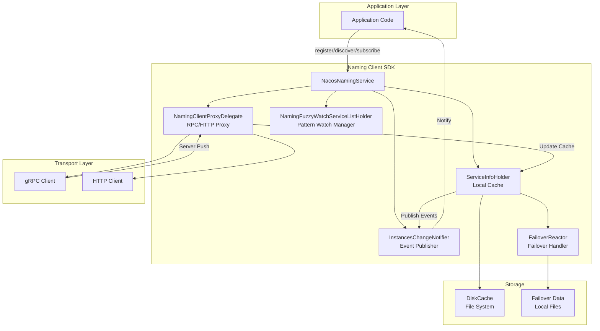
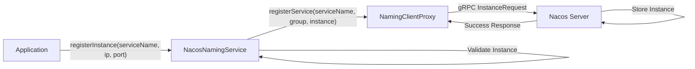
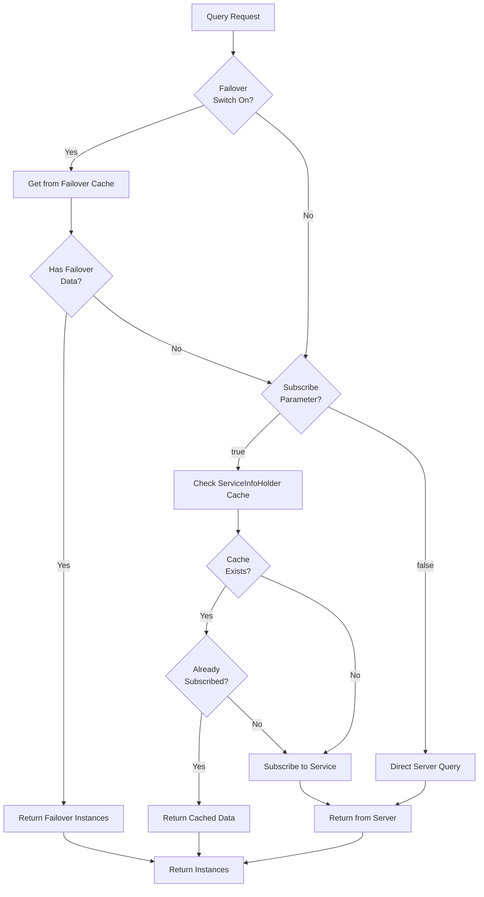
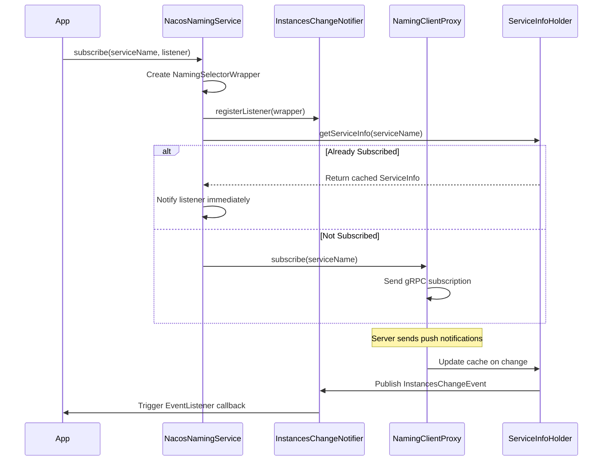
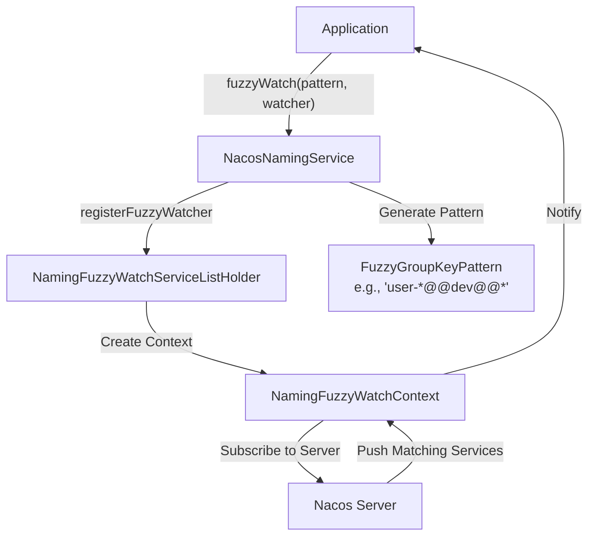
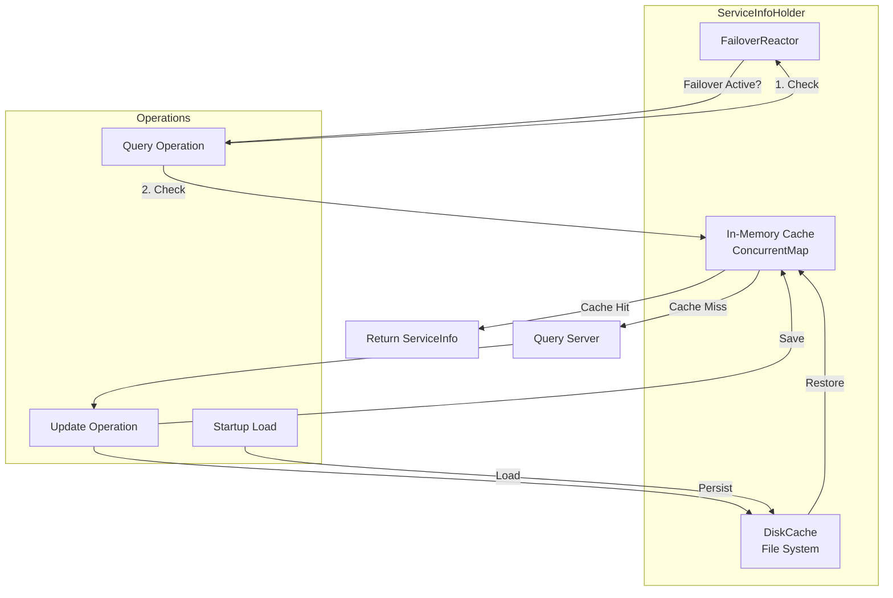
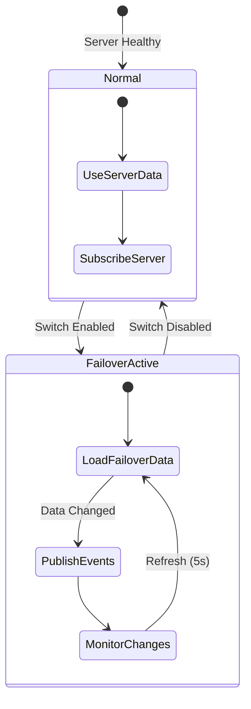
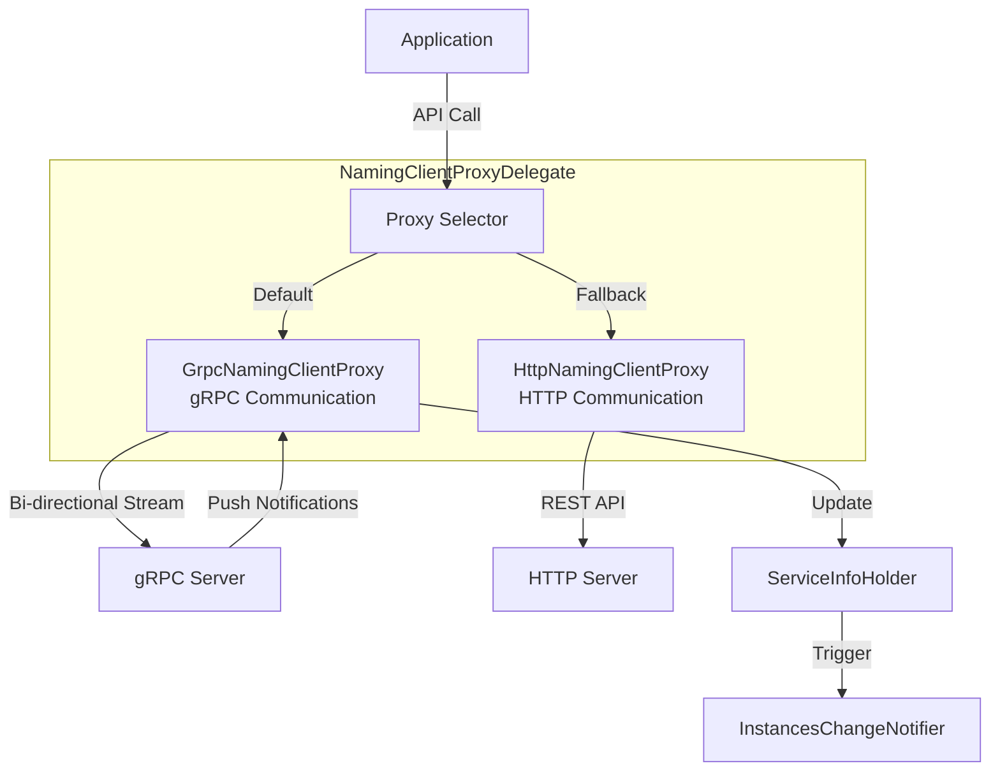
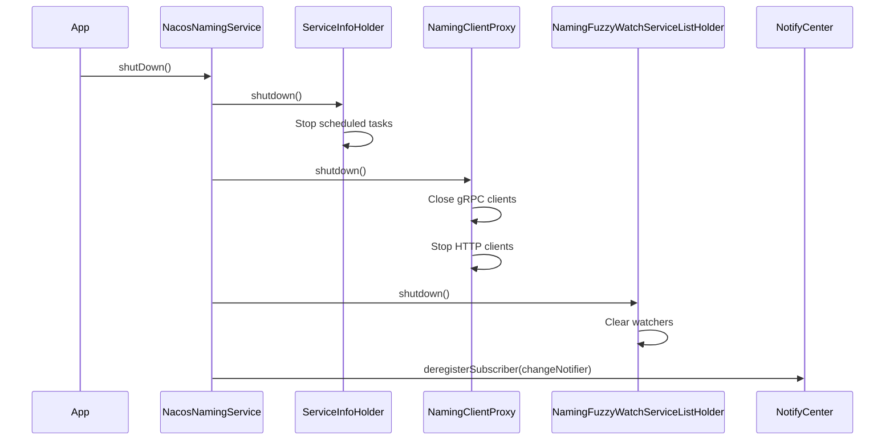

<!-- source: DeepWiki mcp.deepwiki.com · repo alibaba/nacos · page 4.1 Naming Client SDK · fetched 2026-10-29 -->

# Naming Client SDK

<details>
<summary>Relevant source files</summary>

The following files were used as context for generating this wiki page:

- [api/src/main/java/com/alibaba/nacos/api/naming/NamingService.java](api/src/main/java/com/alibaba/nacos/api/naming/NamingService.java)
- [client/src/main/java/com/alibaba/nacos/client/naming/NacosNamingMaintainService.java](client/src/main/java/com/alibaba/nacos/client/naming/NacosNamingMaintainService.java)
- [client/src/main/java/com/alibaba/nacos/client/naming/remote/AbstractNamingClientProxy.java](client/src/main/java/com/alibaba/nacos/client/naming/remote/AbstractNamingClientProxy.java)
- [client/src/main/java/com/alibaba/nacos/client/naming/remote/NamingClientProxy.java](client/src/main/java/com/alibaba/nacos/client/naming/remote/NamingClientProxy.java)
- [client/src/main/java/com/alibaba/nacos/client/naming/remote/NamingClientProxyDelegate.java](client/src/main/java/com/alibaba/nacos/client/naming/remote/NamingClientProxyDelegate.java)
- [client/src/main/java/com/alibaba/nacos/client/naming/remote/gprc/NamingGrpcClientProxy.java](client/src/main/java/com/alibaba/nacos/client/naming/remote/gprc/NamingGrpcClientProxy.java)
- [client/src/main/java/com/alibaba/nacos/client/naming/remote/gprc/redo/NamingGrpcRedoService.java](client/src/main/java/com/alibaba/nacos/client/naming/remote/gprc/redo/NamingGrpcRedoService.java)
- [client/src/main/java/com/alibaba/nacos/client/naming/remote/gprc/redo/RedoScheduledTask.java](client/src/main/java/com/alibaba/nacos/client/naming/remote/gprc/redo/RedoScheduledTask.java)
- [client/src/main/java/com/alibaba/nacos/client/naming/remote/gprc/redo/data/BatchInstanceRedoData.java](client/src/main/java/com/alibaba/nacos/client/naming/remote/gprc/redo/data/BatchInstanceRedoData.java)
- [client/src/main/java/com/alibaba/nacos/client/naming/remote/gprc/redo/data/InstanceRedoData.java](client/src/main/java/com/alibaba/nacos/client/naming/remote/gprc/redo/data/InstanceRedoData.java)
- [client/src/main/java/com/alibaba/nacos/client/naming/remote/gprc/redo/data/SubscriberRedoData.java](client/src/main/java/com/alibaba/nacos/client/naming/remote/gprc/redo/data/SubscriberRedoData.java)
- [client/src/main/java/com/alibaba/nacos/client/naming/remote/http/NamingHttpClientProxy.java](client/src/main/java/com/alibaba/nacos/client/naming/remote/http/NamingHttpClientProxy.java)
- [client/src/test/java/com/alibaba/nacos/client/naming/NacosNamingServiceTest.java](client/src/test/java/com/alibaba/nacos/client/naming/NacosNamingServiceTest.java)
- [client/src/test/java/com/alibaba/nacos/client/naming/remote/AbstractNamingClientProxyTest.java](client/src/test/java/com/alibaba/nacos/client/naming/remote/AbstractNamingClientProxyTest.java)
- [client/src/test/java/com/alibaba/nacos/client/naming/remote/NamingClientProxyDelegateTest.java](client/src/test/java/com/alibaba/nacos/client/naming/remote/NamingClientProxyDelegateTest.java)
- [client/src/test/java/com/alibaba/nacos/client/naming/remote/gprc/NamingGrpcClientProxyTest.java](client/src/test/java/com/alibaba/nacos/client/naming/remote/gprc/NamingGrpcClientProxyTest.java)
- [client/src/test/java/com/alibaba/nacos/client/naming/remote/gprc/redo/NamingGrpcRedoServiceTest.java](client/src/test/java/com/alibaba/nacos/client/naming/remote/gprc/redo/NamingGrpcRedoServiceTest.java)
- [client/src/test/java/com/alibaba/nacos/client/naming/remote/gprc/redo/RedoScheduledTaskTest.java](client/src/test/java/com/alibaba/nacos/client/naming/remote/gprc/redo/RedoScheduledTaskTest.java)
- [client/src/test/java/com/alibaba/nacos/client/naming/remote/gprc/redo/data/BatchInstanceRedoDataTest.java](client/src/test/java/com/alibaba/nacos/client/naming/remote/gprc/redo/data/BatchInstanceRedoDataTest.java)
- [client/src/test/java/com/alibaba/nacos/client/naming/remote/http/NamingHttpClientProxyTest.java](client/src/test/java/com/alibaba/nacos/client/naming/remote/http/NamingHttpClientProxyTest.java)

</details>


## Purpose and Scope

This document describes the client-side API for Nacos's service discovery capabilities. The Naming Client SDK allows applications to register service instances, discover other services, subscribe to service changes, and perform load-balanced instance selection. It provides local caching, failover mechanisms, and pattern-based service watching.

For server-side naming implementation, see [Naming Server and Instance Management](#4.2). For configuration management client features, see [Configuration Client SDK](#3.1).

---

## Architecture Overview

The Naming Client SDK is centered around `NacosNamingService`, which implements the `NamingService` interface and provides all client-side service discovery operations.



**Sources:** [client/src/main/java/com/alibaba/nacos/client/naming/NacosNamingService.java:74-131]()

---

## Client Initialization

### Creating a NacosNamingService

The client is initialized with a `Properties` object containing connection and configuration parameters:

```java
Properties properties = new Properties();
properties.put(PropertyKeyConst.SERVER_ADDR, "127.0.0.1:8848");
properties.put(PropertyKeyConst.NAMESPACE, "dev");
NacosNamingService namingService = new NacosNamingService(properties);
```

### Initialization Process

```mermaid
sequenceDiagram
    participant App
    participant NNS as NacosNamingService
    participant Properties as NacosClientProperties
    participant SIH as ServiceInfoHolder
    participant NCP as NamingClientProxyDelegate
    participant NC as NotifyCenter
    
    App->>NNS: new NacosNamingService(props)
    NNS->>Properties: derive(properties)
    NNS->>NNS: initNamespace()
    NNS->>NNS: generate notifierEventScope UUID
    NNS->>NC: registerToPublisher(InstancesChangeEvent)
    NNS->>NNS: new InstancesChangeNotifier()
    NC->>NC: registerSubscriber(changeNotifier)
    NNS->>SIH: new ServiceInfoHolder()
    NNS->>NC: registerToPublisher(NamingFuzzyWatchNotifyEvent)
    NNS->>NNS: new NamingFuzzyWatchServiceListHolder()
    NNS->>NCP: new NamingClientProxyDelegate()
    NCP->>NCP: Start gRPC/HTTP clients
    NNS-->>App: namingService
```

**Key Configuration Properties:**

| Property | Description | Default |
|----------|-------------|---------|
| `PropertyKeyConst.SERVER_ADDR` | Nacos server addresses (comma-separated) | Required |
| `PropertyKeyConst.NAMESPACE` | Namespace ID for isolation | `public` |
| `PropertyKeyConst.NAMING_LOAD_CACHE_AT_START` | Load cached data on startup | `true` |
| `PropertyKeyConst.NAMING_CACHE_REGISTRY_DIR` | Cache directory path | System-dependent |
| `PropertyKeyConst.USERNAME` | Authentication username | None |
| `PropertyKeyConst.PASSWORD` | Authentication password | None |

**Sources:** [client/src/main/java/com/alibaba/nacos/client/naming/NacosNamingService.java:100-131](), [api/src/main/java/com/alibaba/nacos/api/PropertyKeyConst.java:90-109]()

---

## Service Registration

### Registering Service Instances

Applications register themselves as service instances using the `registerInstance()` methods:



### Registration Methods

The `NacosNamingService` provides multiple overloaded registration methods:

- `registerInstance(String serviceName, String ip, int port)`
- `registerInstance(String serviceName, String groupName, String ip, int port)`
- `registerInstance(String serviceName, String ip, int port, String clusterName)`
- `registerInstance(String serviceName, String groupName, Instance instance)`
- `batchRegisterInstance(String serviceName, String groupName, List<Instance> instances)`

### Instance Model

An `Instance` object contains:

| Field | Type | Description |
|-------|------|-------------|
| `ip` | String | IP address of the instance |
| `port` | int | Port number |
| `weight` | double | Weight for load balancing (default: 1.0) |
| `healthy` | boolean | Health status |
| `enabled` | boolean | Whether instance is enabled |
| `ephemeral` | boolean | Whether instance is ephemeral (temporary) |
| `clusterName` | String | Cluster name (default: "DEFAULT") |
| `serviceName` | String | Service name |
| `metadata` | Map<String, String> | Custom metadata |

**Sources:** [client/src/main/java/com/alibaba/nacos/client/naming/NacosNamingService.java:138-182]()

---

## Service Discovery

### Querying Service Instances

Applications discover other services by querying for instances:



### Discovery Methods

- `getAllInstances(String serviceName)` - Get all instances (healthy + unhealthy)
- `getAllInstances(String serviceName, String groupName, List<String> clusters, boolean subscribe)` - Full control
- `selectInstances(String serviceName, boolean healthy)` - Filter by health status
- `selectInstances(String serviceName, String groupName, List<String> clusters, boolean healthy, boolean subscribe)` - Full filtering

### Instance Selection with Load Balancing

The `selectOneHealthyInstance()` methods use weighted random load balancing:

```java
public Instance selectOneHealthyInstance(String serviceName, String groupName, 
        List<String> clusters, boolean subscribe) throws NacosException {
    ServiceInfo serviceInfo = getServiceInfo(serviceName, groupName, clusters, subscribe);
    return Balancer.RandomByWeight.selectHost(serviceInfo);
}
```

The `Balancer.RandomByWeight` class implements weighted random selection:

1. Filters instances to include only healthy instances with `enabled=true` and `weight>0`
2. Creates weighted pairs of instances
3. Uses `Chooser` utility to perform weighted random selection based on instance weights

**Sources:** [client/src/main/java/com/alibaba/nacos/client/naming/NacosNamingService.java:230-450](), [client/src/main/java/com/alibaba/nacos/client/naming/core/Balancer.java:37-88]()

---

## Service Subscription

### Subscribing to Service Changes

Applications can subscribe to service instance changes to receive real-time notifications:



### Subscription API

- `subscribe(String serviceName, EventListener listener)` - Subscribe to default group
- `subscribe(String serviceName, String groupName, List<String> clusters, EventListener listener)` - Subscribe with filtering
- `subscribe(String serviceName, String groupName, NamingSelector selector, EventListener listener)` - Subscribe with custom selector
- `unsubscribe()` methods - Remove subscriptions

### Event Listener Interface

```java
public interface EventListener {
    void onEvent(Event event);
}
```

The `Event` is typically an `InstancesChangeEvent` containing:
- Service name and group
- List of current instances
- `InstancesDiff` object showing added, removed, and modified instances

**Sources:** [client/src/main/java/com/alibaba/nacos/client/naming/NacosNamingService.java:453-539]()

---

## Fuzzy Watch (Pattern-Based Subscription)

### Overview

Fuzzy watch allows subscribing to multiple services matching a pattern, rather than individual services:



### Fuzzy Watch API

- `fuzzyWatch(String fixedGroupName, FuzzyWatchEventWatcher watcher)` - Watch all services in a group (pattern: `*`)
- `fuzzyWatch(String serviceNamePattern, String groupNamePattern, FuzzyWatchEventWatcher watcher)` - Watch with patterns
- `fuzzyWatchWithServiceKeys()` - Returns `Future<ListView<String>>` with matching service keys
- `cancelFuzzyWatch()` - Stop watching

### Pattern Syntax

The pattern uses `FuzzyGroupKeyPattern` format:
- Service name pattern `>>` Group name pattern `>>` Namespace
- `*` matches any characters
- Example: `user-*>>dev-group>>my-namespace` matches services like `user-service`, `user-api` in `dev-group`

### Event Notification

The `FuzzyWatchEventWatcher` receives `ConfigFuzzyWatchChangeEvent` (note: naming shares event structure with config):

| Event Type | Description |
|------------|-------------|
| `ADD_SERVICE` | New service matching pattern |
| `DELETE_SERVICE` | Service removed |
| `INSTANCE_CHANGED` | Instance list changed |
| `HEART_BEAT` | Periodic heartbeat |

**Sources:** [client/src/main/java/com/alibaba/nacos/client/naming/NacosNamingService.java:542-599](), [api/src/main/java/com/alibaba/nacos/api/common/Constants.java:331-341]()

---

## Local Caching and Failover

### ServiceInfoHolder - Primary Cache

The `ServiceInfoHolder` maintains in-memory cache of service information:



### Cache Storage Structure

Service information is cached in files named by service key:
- Filename format: `{serviceName}@@{groupName}@@{clusters}` (URL-encoded)
- Content: JSON serialized `ServiceInfo` object
- Location: Configured cache directory (default: OS-specific temp directory)

### Failover Mechanism

The `FailoverReactor` provides automatic failover capability:

1. **Failover Data Source**: Monitors failover switch and data files via `FailoverDataSource` SPI
2. **Switch Refresh**: Checks failover status every 5 seconds
3. **Priority**: When failover is active, failover data takes precedence over server data
4. **Automatic Recovery**: When failover is disabled, automatically reverts to server data

### Failover Switch Lifecycle



**Sources:** [client/src/main/java/com/alibaba/nacos/client/naming/backups/FailoverReactor.java:52-208](), [client/src/main/java/com/alibaba/nacos/client/naming/cache/DiskCache.java:46-181]()

---

## Client-Server Communication

### NamingClientProxyDelegate

The `NamingClientProxyDelegate` abstracts communication with the Nacos server, supporting both gRPC (default) and HTTP protocols:



### Key Operations

| Operation | gRPC Request Type | Purpose |
|-----------|------------------|---------|
| Register | `InstanceRequest` | Register service instance |
| Deregister | `InstanceRequest` (deregister) | Remove instance |
| Subscribe | `SubscribeServiceRequest` | Subscribe to service changes |
| Unsubscribe | `SubscribeServiceRequest` (unsubscribe) | Stop subscription |
| Query | `ServiceQueryRequest` | Query service instances |
| Batch Register | `BatchInstanceRequest` | Register multiple instances |

### Server Push Mechanism

When subscribed to a service:
1. Client establishes gRPC bi-directional stream
2. Server pushes `NotifySubscriberRequest` when instances change
3. Client updates `ServiceInfoHolder` cache
4. `InstancesChangeEvent` published to `NotifyCenter`
5. Registered listeners receive callbacks

**Sources:** [client/src/main/java/com/alibaba/nacos/client/naming/NacosNamingService.java:96-97,129-130]()

---

## Deregistration and Cleanup

### Deregistering Instances

```java
// Deregister by IP and port
namingService.deregisterInstance(serviceName, ip, port);

// Deregister with Instance object
namingService.deregisterInstance(serviceName, groupName, instance);

// Batch deregister
namingService.batchDeregisterInstance(serviceName, groupName, instances);
```

### Shutdown Process



The shutdown process ensures:
- All service instances are properly deregistered (if ephemeral)
- Background threads and scheduled tasks are stopped
- Network connections are closed
- Event subscriptions are cleaned up
- Resources are released

**Sources:** [client/src/main/java/com/alibaba/nacos/client/naming/NacosNamingService.java:184-227,634-639]()

---

## Error Handling and Retry

### Exception Types

The SDK throws `NacosException` for various error conditions:

| Error Code | Constant | Description |
|------------|----------|-------------|
| 400 | `CLIENT_INVALID_PARAM` | Invalid parameters |
| 403 | `NO_RIGHT` | Authentication/authorization failure |
| 404 | `NOT_FOUND` | Service or instance not found |
| 500 | `SERVER_ERROR` | Server-side error |
| 503 | `SERVICE_UNAVAILABLE` | Server unavailable |

### Retry Strategy

The client automatically retries failed operations:
- Configurable retry count via `PropertyKeyConst.MAX_RETRY` (default: 3)
- Exponential backoff between retries
- Automatic server failover in cluster deployments

### Graceful Degradation

When server communication fails:
1. **Use Local Cache**: Return cached service information if available
2. **Use Failover Data**: If failover is configured, use failover data source
3. **Throw Exception**: Only throw if no fallback data exists

**Sources:** [api/src/main/java/com/alibaba/nacos/api/PropertyKeyConst.java:86](), [api/src/main/java/com/alibaba/nacos/api/common/Constants.java:144]()

---

## Example Usage Patterns

### Basic Service Registration and Discovery

```java
// Initialize client
Properties props = new Properties();
props.put("serverAddr", "127.0.0.1:8848");
NamingService naming = new NacosNamingService(props);

// Register instance
naming.registerInstance("user-service", "192.168.1.10", 8080);

// Discover instances
List<Instance> instances = naming.getAllInstances("user-service");

// Select one healthy instance with load balancing
Instance instance = naming.selectOneHealthyInstance("user-service");
```

### Service Subscription with Listener

```java
naming.subscribe("user-service", new EventListener() {
    @Override
    public void onEvent(Event event) {
        InstancesChangeEvent changeEvent = (InstancesChangeEvent) event;
        List<Instance> instances = changeEvent.getHosts();
        // Handle instance changes
    }
});
```

### Fuzzy Watch for Dynamic Services

```java
// Watch all services matching pattern
naming.fuzzyWatch("user-*", "dev-group", new FuzzyWatchEventWatcher() {
    @Override
    public void onEvent(ConfigFuzzyWatchChangeEvent event) {
        // Handle matching service changes
    }
    
    @Override
    public Executor getExecutor() {
        return executor; // Custom executor for async processing
    }
});
```

**Sources:** [client/src/main/java/com/alibaba/nacos/client/naming/NacosNamingService.java:100-108,138-182,453-472,542-562]()

---

