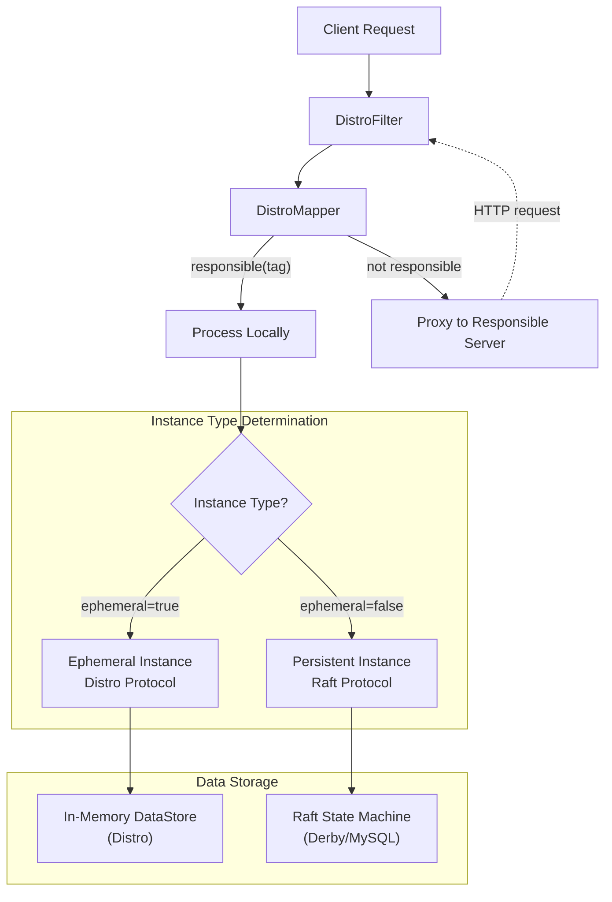
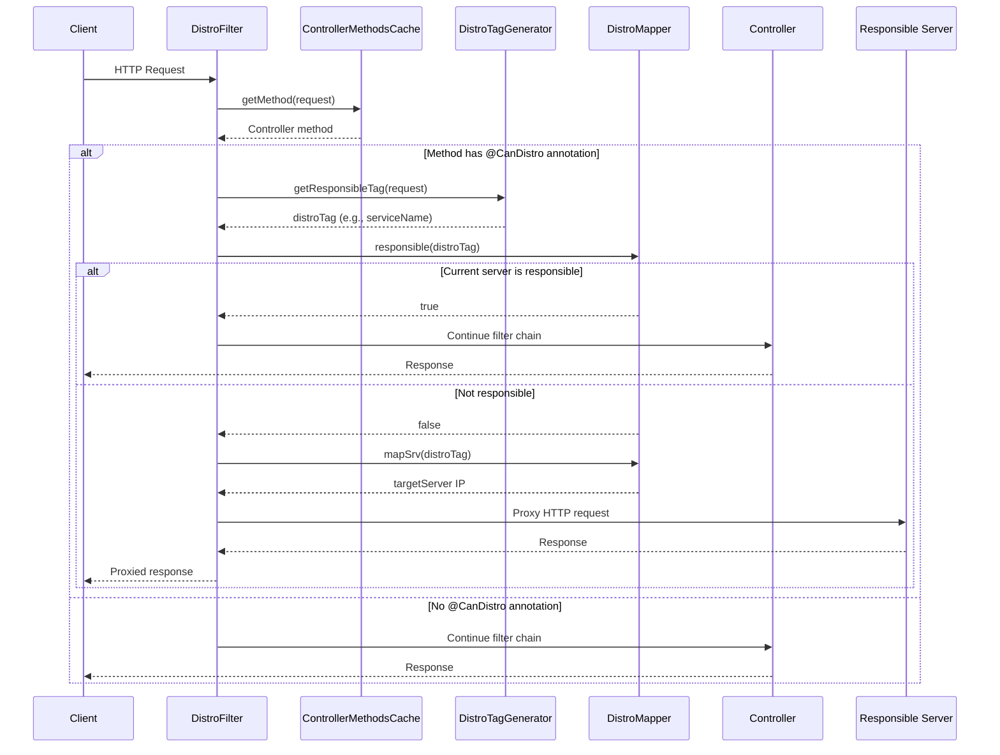
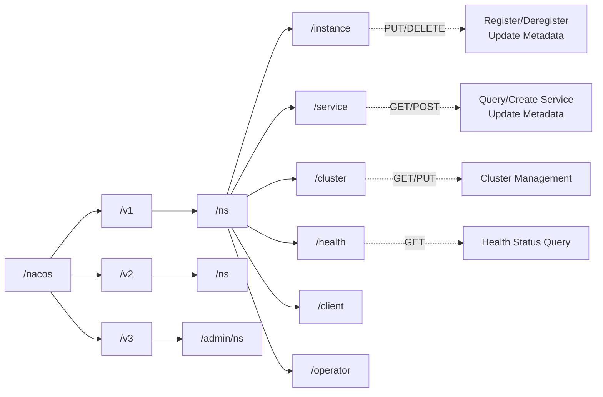
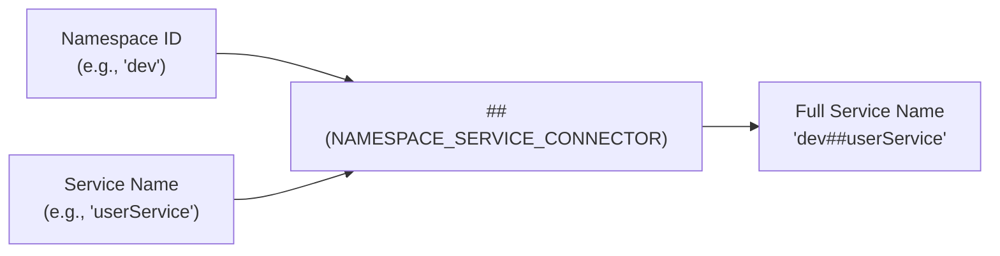
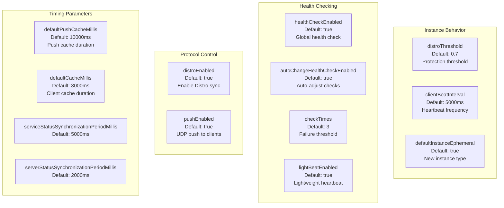
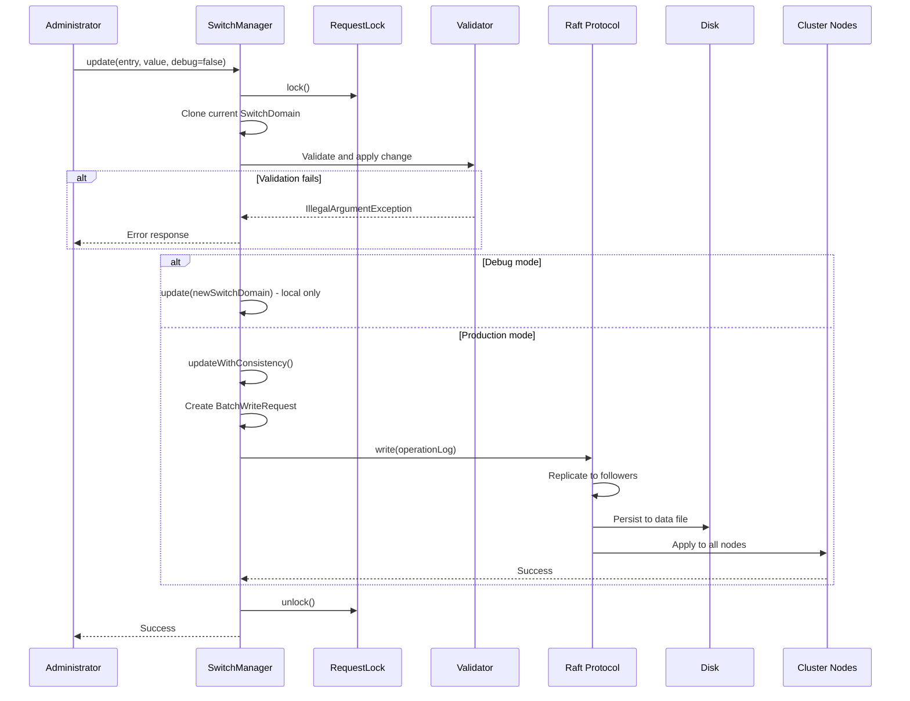

<!-- source: DeepWiki mcp.deepwiki.com · repo alibaba/nacos · page 4.2 Naming Server and Instance Management · fetched 2026-10-29 -->

# Naming Server and Instance Management

<details>
<summary>Relevant source files</summary>

The following files were used as context for generating this wiki page:

- [console/src/main/java/com/alibaba/nacos/Nacos.java](console/src/main/java/com/alibaba/nacos/Nacos.java)
- [naming/src/main/java/com/alibaba/nacos/naming/misc/HttpClient.java](naming/src/main/java/com/alibaba/nacos/naming/misc/HttpClient.java)
- [naming/src/main/java/com/alibaba/nacos/naming/misc/SwitchDomain.java](naming/src/main/java/com/alibaba/nacos/naming/misc/SwitchDomain.java)
- [naming/src/main/java/com/alibaba/nacos/naming/misc/SwitchEntry.java](naming/src/main/java/com/alibaba/nacos/naming/misc/SwitchEntry.java)
- [naming/src/main/java/com/alibaba/nacos/naming/misc/SwitchManager.java](naming/src/main/java/com/alibaba/nacos/naming/misc/SwitchManager.java)
- [naming/src/main/java/com/alibaba/nacos/naming/misc/UtilsAndCommons.java](naming/src/main/java/com/alibaba/nacos/naming/misc/UtilsAndCommons.java)
- [naming/src/main/java/com/alibaba/nacos/naming/web/DistroFilter.java](naming/src/main/java/com/alibaba/nacos/naming/web/DistroFilter.java)

</details>


This document describes the server-side management of service instances in Nacos naming service, including instance registration and deregistration, service metadata management, and the configuration switches that control instance behavior. For client-side naming operations, see [Naming Client SDK](#4.1). For details on how requests are distributed across the cluster, see [Request Distribution and Service Discovery](#4.3). For health check mechanisms, see [Service Health Checks](#4.4).

## Overview

The Nacos naming server manages service instances through a dual-protocol architecture:
- **Ephemeral instances** use the Distro protocol (AP mode) for high availability
- **Persistent instances** use the Raft protocol (CP mode) for strong consistency

The server handles instance lifecycle operations (registration, deregistration, metadata updates), maintains service metadata, and ensures data is properly distributed across the cluster based on the instance type and the responsible server determined by hash-based distribution.

## Instance Management Architecture

The naming server processes instance operations through a layered architecture where requests are first filtered by `DistroFilter` to determine server responsibility, then routed to the appropriate storage backend based on instance type.



Sources: [naming/src/main/java/com/alibaba/nacos/naming/web/DistroFilter.java:77-151]()

## Request Routing with DistroFilter

The `DistroFilter` intercepts HTTP requests to naming service endpoints and determines whether the current server should process the request or proxy it to the responsible server.

### DistroFilter Decision Flow



**Key Components:**

| Component | Purpose | File Reference |
|-----------|---------|----------------|
| `DistroFilter` | Servlet filter that intercepts requests and routes them | [naming/src/main/java/com/alibaba/nacos/naming/web/DistroFilter.java]() |
| `DistroMapper` | Determines which server is responsible for a given tag | Referenced in [naming/src/main/java/com/alibaba/nacos/naming/web/DistroFilter.java:64,102,118]() |
| `DistroTagGenerator` | Extracts the distribution tag from the request | [naming/src/main/java/com/alibaba/nacos/naming/web/DistroFilter.java:70,100]() |
| `@CanDistro` | Annotation marking methods that support distributed routing | [naming/src/main/java/com/alibaba/nacos/naming/web/DistroFilter.java:96]() |

**Request Proxying Logic:**

When a request needs to be proxied, `DistroFilter` performs the following:
1. Checks the `User-Agent` header to prevent infinite redirect loops (servers identify each other via the `Nacos-Server` user agent)
2. Collects all request headers and parameters
3. Uses `HttpClient` to forward the request to the responsible server
4. Returns the proxied response to the original client

Sources: [naming/src/main/java/com/alibaba/nacos/naming/web/DistroFilter.java:77-151](), [naming/src/main/java/com/alibaba/nacos/naming/misc/UtilsAndCommons.java:97,111]()

## Instance Types and Storage

Nacos supports two types of service instances with different consistency guarantees and storage mechanisms.

### Ephemeral vs Persistent Instances

| Aspect | Ephemeral Instances | Persistent Instances |
|--------|---------------------|---------------------|
| **Default Type** | Yes (configurable via `defaultInstanceEphemeral` switch) | No |
| **Consistency Model** | AP (Available, Partition-tolerant) | CP (Consistent, Partition-tolerant) |
| **Storage** | In-memory only | Persisted to database (Derby/MySQL) |
| **Health Check** | Client heartbeat-based | Server-side active probing |
| **Data Sync** | Distro protocol (eventually consistent) | Raft consensus (strongly consistent) |
| **Network Partition Behavior** | Instances may become stale but remain available | May become unavailable until quorum restored |
| **Use Case** | Microservices with dynamic scaling | Stateful services requiring consistency |

**Instance Type Determination:**

The instance type is specified during registration via the `ephemeral` parameter. The default value is controlled by the `defaultInstanceEphemeral` switch in `SwitchDomain`.

Sources: [naming/src/main/java/com/alibaba/nacos/naming/misc/UtilsAndCommons.java:137-139](), [naming/src/main/java/com/alibaba/nacos/naming/misc/SwitchDomain.java:107,376-382](), [naming/src/main/java/com/alibaba/nacos/naming/misc/SwitchEntry.java:102]()

## API Endpoints and Context Paths

The naming service exposes REST APIs under specific context paths for instance and service management operations.

### API Context Path Structure



**Key Constants:**

| Constant | Value | Purpose |
|----------|-------|---------|
| `NACOS_SERVER_CONTEXT` | `/nacos` | Root context for all Nacos APIs |
| `DEFAULT_NACOS_NAMING_CONTEXT` | `/v1/ns` | Base path for naming v1 APIs |
| `DEFAULT_NACOS_NAMING_CONTEXT_V2` | `/v2/ns` | Base path for naming v2 APIs |
| `DEFAULT_NACOS_NAMING_ADMIN_CONTEXT_V3` | `/v3/admin/ns` | Base path for naming admin v3 APIs |
| `NACOS_NAMING_INSTANCE_CONTEXT` | `/instance` | Instance-related operations |
| `NACOS_NAMING_SERVICE_CONTEXT` | `/service` | Service-related operations |
| `NACOS_NAMING_CLUSTER_CONTEXT` | `/cluster` | Cluster-related operations |

Sources: [naming/src/main/java/com/alibaba/nacos/naming/misc/UtilsAndCommons.java:47-89]()

## Instance Metadata Management

Instance metadata is stored as key-value pairs and can be updated independently of instance registration. Nacos supports parsing metadata from both JSON format and comma-separated key=value format.

### Metadata Parsing

The `parseMetadata` utility function handles two formats:

**Format 1: JSON Object**
```json
{"version":"1.0","region":"us-east"}
```

**Format 2: Comma-Separated Pairs**
```
version=1.0,region=us-east
```

**Metadata Operations:**

| Action | Constant | Usage |
|--------|----------|-------|
| Update metadata | `UPDATE_INSTANCE_METADATA_ACTION_UPDATE` | Merge new metadata with existing |
| Remove metadata keys | `UPDATE_INSTANCE_METADATA_ACTION_REMOVE` | Delete specific metadata keys |
| Add instance | `UPDATE_INSTANCE_ACTION_ADD` | Register new instance |
| Remove instance | `UPDATE_INSTANCE_ACTION_REMOVE` | Deregister instance |

Sources: [naming/src/main/java/com/alibaba/nacos/naming/misc/UtilsAndCommons.java:129-135,179-205]()

## Service Naming and Namespaces

Services are identified by a combination of namespace and service name, separated by a specific delimiter.

### Service Name Construction



The `assembleFullServiceName` method constructs the full service identifier:

```
fullServiceName = namespaceId + "##" + serviceName
```

**Default Values:**

| Parameter | Default | Constant |
|-----------|---------|----------|
| Cluster name | `DEFAULT` | `DEFAULT_CLUSTER_NAME` |
| Namespace connector | `##` | `NAMESPACE_SERVICE_CONNECTOR` |
| Cache key splitter | `@@@@` | `CACHE_KEY_SPLITTER` |

Sources: [naming/src/main/java/com/alibaba/nacos/naming/misc/UtilsAndCommons.java:107,115,127,207-209]()

## Switch Domain Configuration

The `SwitchDomain` component manages global configuration switches that control naming service behavior. These switches are persisted using Raft consensus to ensure cluster-wide consistency.

### Core Configuration Switches



**Switch Domain Storage and Replication:**

The `SwitchManager` class implements `RequestProcessor4CP`, meaning it uses the Raft consensus protocol to replicate switch configuration changes across the cluster. When a switch is updated:

1. The new `SwitchDomain` state is serialized into a `Datum`
2. A `BatchWriteRequest` is created with the serialized data
3. The request is submitted to the Raft protocol via `protocolManager.getCpProtocol().write()`
4. After consensus is reached, the change is applied to all cluster nodes
5. The switch data is persisted to disk at the path: `${NACOS_HOME}/data/naming/data/switch-domain`

Sources: [naming/src/main/java/com/alibaba/nacos/naming/misc/SwitchManager.java:68-98,384-398](), [naming/src/main/java/com/alibaba/nacos/naming/misc/SwitchDomain.java:37-107](), [naming/src/main/java/com/alibaba/nacos/naming/misc/UtilsAndCommons.java:141-142]()

### Health Check Parameters

The switch domain defines health check timing parameters for different protocols:

| Protocol | Min RT | Max RT | Factor | Usage |
|----------|--------|--------|--------|-------|
| **HTTP** | 500ms | 5000ms | 0.85 | HTTP endpoint checks |
| **TCP** | 1000ms | 5000ms | 0.75 | TCP port checks |
| **MySQL** | 2000ms | 3000ms | 0.65 | MySQL health checks |

The `factor` parameter is used to exponentially back off or speed up health check intervals based on instance health trends.

**Validation Rules:**

- Minimum health check interval must be >= 500ms
- Maximum health check interval must be >= 3000ms
- Factor must be between 0 and 1

Sources: [naming/src/main/java/com/alibaba/nacos/naming/misc/SwitchDomain.java:431-541](), [naming/src/main/java/com/alibaba/nacos/naming/misc/SwitchManager.java:368-382](), [naming/src/main/java/com/alibaba/nacos/naming/misc/SwitchEntry.java:70-74]()

## Switch Management Operations

The `SwitchManager` provides methods to update switch configuration with validation and consistency guarantees.

### Switch Update Flow



**Update Methods:**

| Method | Purpose | Consistency |
|--------|---------|-------------|
| `update(entry, value, debug)` | Update a specific switch entry | Optional (based on debug flag) |
| `update(SwitchDomain)` | Direct local update of switch domain | None (local only) |
| `updateWithConsistency(SwitchDomain)` | Update via Raft consensus | Strong consistency |

**Common Switch Entries:**

| Entry Name | Switch Constant | Type | Description |
|------------|----------------|------|-------------|
| Distro Threshold | `DISTRO_THRESHOLD` | float | Protection threshold for Distro protocol |
| Client Beat Interval | `CLIENT_BEAT_INTERVAL` | long | Milliseconds between client heartbeats |
| Push Enabled | `PUSH_ENABLED` | boolean | Enable UDP push to clients |
| Health Check | `CHECK` | boolean | Enable health checking |
| Default Instance Type | `DEFAULT_INSTANCE_EPHEMERAL` | boolean | New instances ephemeral by default |
| Light Beat | `LIGHT_BEAT_ENABLED` | boolean | Enable lightweight heartbeat mode |

Sources: [naming/src/main/java/com/alibaba/nacos/naming/misc/SwitchManager.java:108-320,327-361,384-398](), [naming/src/main/java/com/alibaba/nacos/naming/misc/SwitchEntry.java:24-109]()

## Data Persistence and Snapshots

The `SwitchManager` implements snapshot operations for disaster recovery and cluster initialization.

### Snapshot Operations

The switch domain state is persisted to disk and can be saved/restored via snapshots:

**Snapshot Storage Path:**
```
${NACOS_HOME}/data/naming/data/switch-domain
```

**Snapshot Operations:**

| Operation | Method | Purpose |
|-----------|--------|---------|
| Save snapshot | `dumpSnapshot(backupPath)` | Copy switch data to snapshot directory |
| Load snapshot | `loadSnapshot(snapshotPath)` | Restore switch data from snapshot |
| Apply log | `onApply(WriteRequest)` | Apply Raft log entry to switch state |
| Read current state | `onRequest(ReadRequest)` | Return current switch domain as Datum |

**Snapshot Workflow:**

1. **During normal operation:** Switch changes are written to `${NACOS_HOME}/data/naming/data/switch-domain`
2. **During snapshot:** The data file is copied to the Raft snapshot directory
3. **During recovery:** The snapshot directory is copied back to the data directory
4. **After recovery:** Switch domain is deserialized and applied via `update(SwitchDomain)`

Sources: [naming/src/main/java/com/alibaba/nacos/naming/misc/SwitchManager.java:80-97,404-459,461-507](), [naming/src/main/java/com/alibaba/nacos/naming/misc/UtilsAndCommons.java:141-144]()

## HTTP Client for Inter-Server Communication

When `DistroFilter` needs to proxy requests to the responsible server, it uses the `HttpClient` utility which provides synchronous and asynchronous HTTP methods.

### Request Forwarding

The proxy mechanism adds server identification headers to prevent redirect loops:

**Standard Headers Added:**

| Header | Value | Purpose |
|--------|-------|---------|
| `Client-Version` | `VersionUtils.version` | Nacos version identification |
| `User-Agent` | `Nacos-Server:{version}` | Identifies request from another server |
| `Request-Source` | Local server IP | Tracks request origin |
| `Accept-Charset` | `UTF-8` | Character encoding |

**Common Parameters:**

| Parameter | Value | Purpose |
|-----------|-------|---------|
| `encoding` | `UTF-8` | Request/response encoding |
| `nofix` | `1` | Internal parameter flag |

**Proxy Detection:**

When a server receives a request with `User-Agent` containing `Nacos-Server`, it knows the request came from a peer server and rejects further proxying to prevent infinite loops.

Sources: [naming/src/main/java/com/alibaba/nacos/naming/misc/HttpClient.java:102-128](), [naming/src/main/java/com/alibaba/nacos/naming/web/DistroFilter.java:108-116](), [naming/src/main/java/com/alibaba/nacos/naming/misc/UtilsAndCommons.java:97,111]()

## Utility Functions

The `UtilsAndCommons` class provides several utility functions for instance management operations.

### Hash-Based Load Balancing

The `shakeUp` method provides consistent hashing for distributing requests:

```
index = (string.hashCode() & Integer.MAX_VALUE) % upperLimit
```

This function is used for:
- Selecting a server from an array of available servers
- Client-side load balancing
- Deterministic distribution based on caller identity

**Example Usage Pattern:**
```java
String[] serverIps = getAvailableServers();
int index = UtilsAndCommons.shakeUp(callerName, serverIps.length);
String targetServer = serverIps[index];
```

Sources: [naming/src/main/java/com/alibaba/nacos/naming/misc/UtilsAndCommons.java:212-238]()

## Configuration Constants Summary

Key constants used throughout instance management:

| Category | Constant | Value | Usage |
|----------|----------|-------|-------|
| **Paths** | `DATA_BASE_DIR` | `${NACOS_HOME}/data/naming` | Base directory for naming data |
| **Keys** | `RAFT_CACHE_FILE_PREFIX` | `com.alibaba.nacos.naming` | Prefix for Raft cache files |
| **Patterns** | `CIDR_REGEX` | IP/subnet pattern | CIDR notation validation |
| **Patterns** | `NUMBER_PATTERN` | `^\d+$` | Numeric string validation |
| **Patterns** | `VERSION_STRING_SYNTAX` | `[0-9]+\.[0-9]+\.[0-9]+` | Version format validation |
| **Defaults** | `UNKNOWN_SITE` | `unknown` | Default site identifier |
| **Timeouts** | `MAX_PUBLISH_WAIT_TIME_MILLIS` | 5000 | Maximum wait for publish operation |

Sources: [naming/src/main/java/com/alibaba/nacos/naming/misc/UtilsAndCommons.java:103-147]()

---

