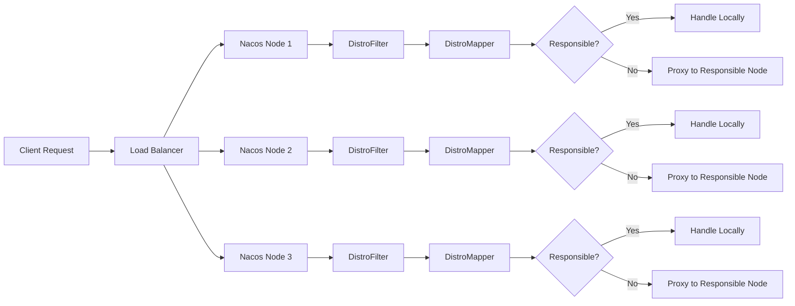
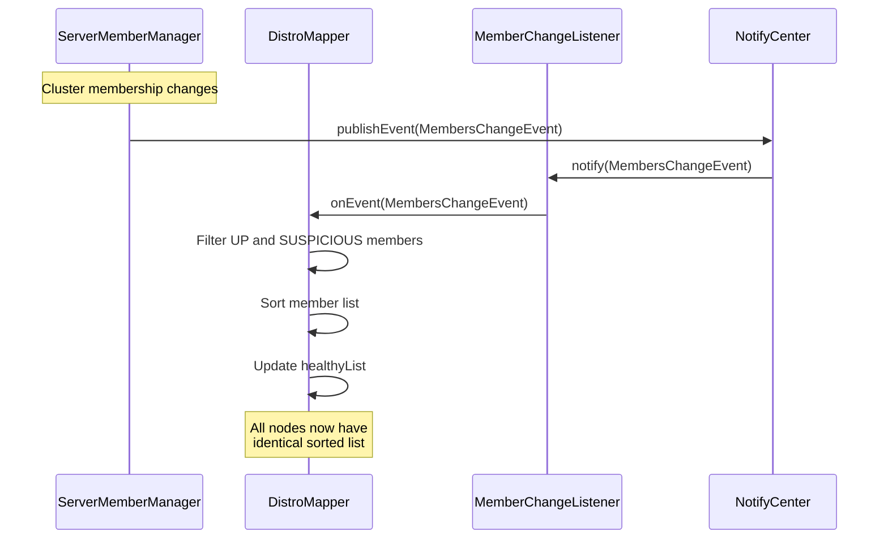
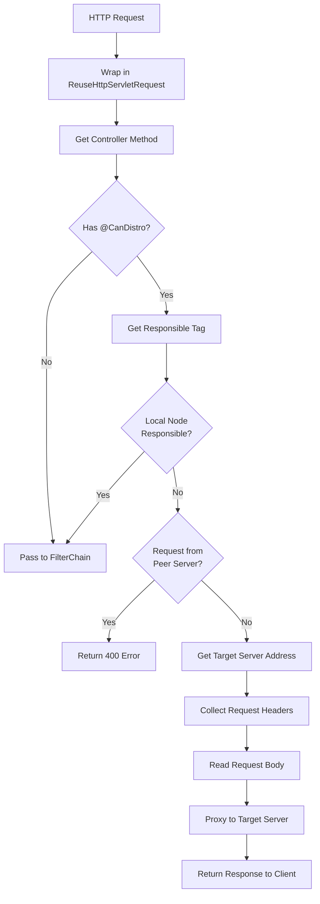
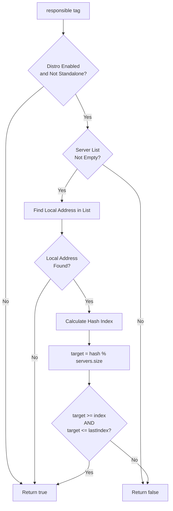
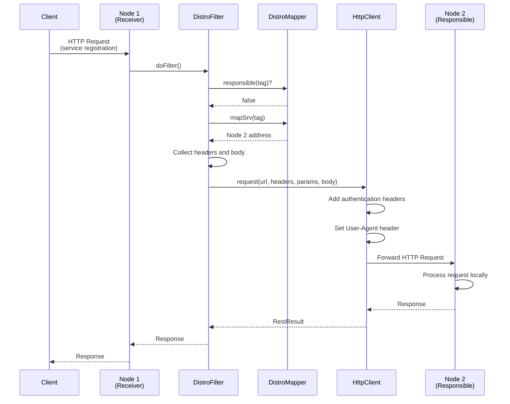
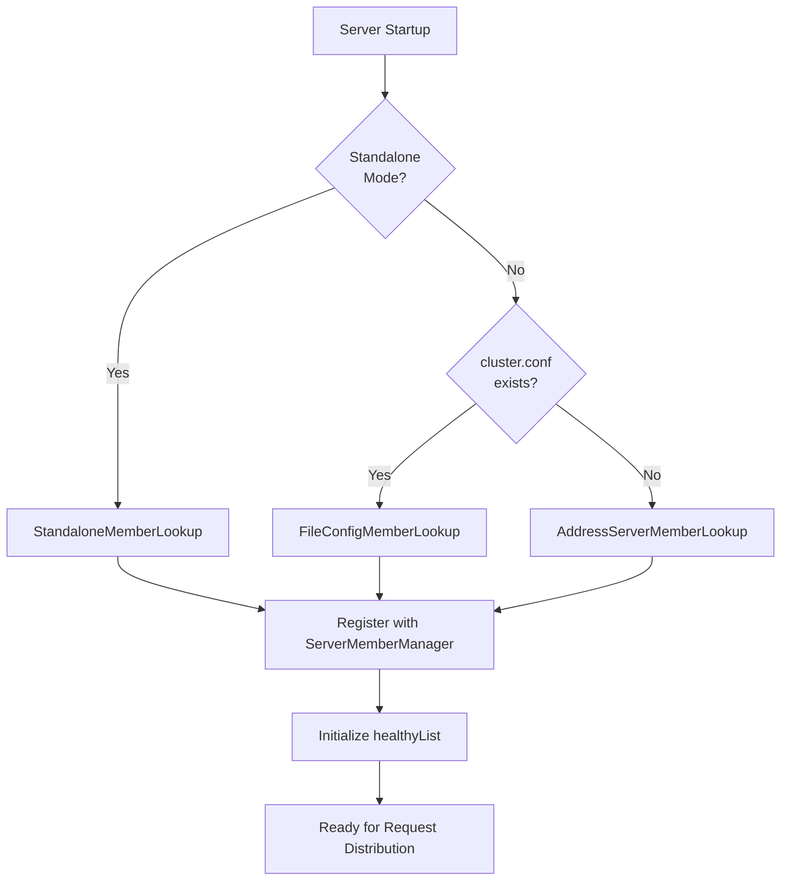
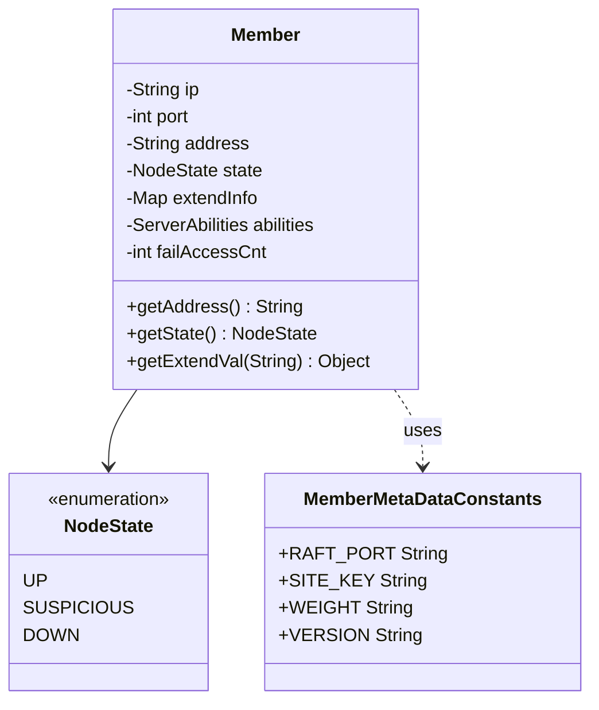
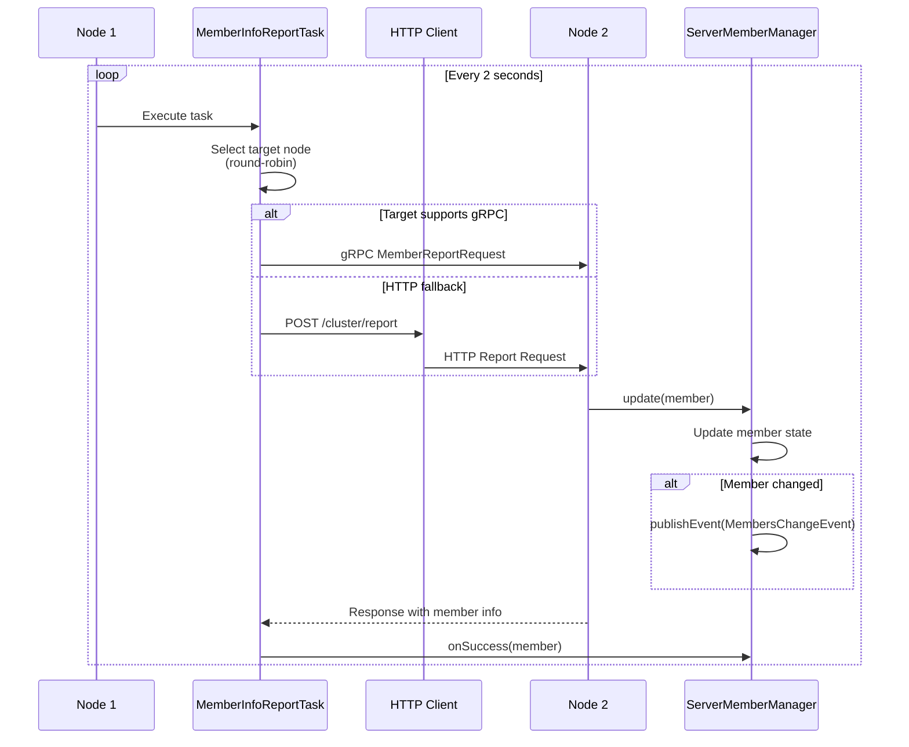

<!-- source: DeepWiki mcp.deepwiki.com · repo alibaba/nacos · page 4.3 Request Distribution and Service Discovery · fetched 2026-10-29 -->

# Request Distribution and Service Discovery

<details>
<summary>Relevant source files</summary>

The following files were used as context for generating this wiki page:

- [naming/src/main/java/com/alibaba/nacos/naming/cluster/ServerStatus.java](naming/src/main/java/com/alibaba/nacos/naming/cluster/ServerStatus.java)
- [naming/src/main/java/com/alibaba/nacos/naming/cluster/ServerStatusManager.java](naming/src/main/java/com/alibaba/nacos/naming/cluster/ServerStatusManager.java)
- [naming/src/main/java/com/alibaba/nacos/naming/consistency/KeyBuilder.java](naming/src/main/java/com/alibaba/nacos/naming/consistency/KeyBuilder.java)
- [naming/src/main/java/com/alibaba/nacos/naming/core/DistroMapper.java](naming/src/main/java/com/alibaba/nacos/naming/core/DistroMapper.java)
- [naming/src/main/java/com/alibaba/nacos/naming/web/TrafficReviseFilter.java](naming/src/main/java/com/alibaba/nacos/naming/web/TrafficReviseFilter.java)

</details>


## Purpose and Scope

This document explains how Nacos distributes incoming service registration and discovery requests across cluster nodes using the Distro protocol. It covers the request routing mechanism, consistent hashing algorithm, responsibility determination, and request proxying to ensure each service instance is managed by a single authoritative node in the cluster.

For information about the Distro protocol's data synchronization mechanism, see [Consistency Protocols](#6.2). For details on service instance management and storage, see [Naming Server and Instance Management](#4.2).

## Overview

In a Nacos cluster, service instance data is partitioned across nodes using a consistent hashing algorithm. Each node is responsible for a subset of services, determined by hashing the service name (for v1 API) or client IP:port (for v2 API). When a request arrives at any node, the system determines whether the local node should handle it or proxy it to the responsible node.



**Request Distribution Flow**

Sources: [naming/src/main/java/com/alibaba/nacos/naming/web/DistroFilter.java](), [naming/src/main/java/com/alibaba/nacos/naming/core/DistroMapper.java]()

## Distro Protocol and Consistent Hashing

The Distro protocol uses consistent hashing to partition service instance data across cluster nodes. Each node maintains a sorted list of healthy cluster members and uses the same hash function to determine responsibility.

### Hash Algorithm

The `DistroMapper` class implements the consistent hashing algorithm:

- **Hash Function**: `Math.abs(responsibleTag.hashCode() % Integer.MAX_VALUE)` [naming/src/main/java/com/alibaba/nacos/naming/core/DistroMapper.java:124-126]()
- **Responsible Tag**: 
  - For v1 API: service name
  - For v2 API: client IP:port
- **Index Calculation**: `hash % servers.size()` [naming/src/main/java/com/alibaba/nacos/naming/core/DistroMapper.java:115-116]()

### Cluster Member List Synchronization

All nodes maintain an identical, sorted list of healthy members to ensure consistent hash results across the cluster:



**Member List Synchronization**

Sources: [naming/src/main/java/com/alibaba/nacos/naming/core/DistroMapper.java:128-138](), [core/src/main/java/com/alibaba/nacos/core/cluster/ServerMemberManager.java:189-220](), [core/src/main/java/com/alibaba/nacos/core/cluster/MembersChangeEvent.java]()

The `DistroMapper` subscribes to `MembersChangeEvent` and maintains a `healthyList` that includes only nodes in `UP` or `SUSPICIOUS` state. This list is sorted to ensure all nodes use the same ordering [naming/src/main/java/com/alibaba/nacos/naming/core/DistroMapper.java:132-136]().

## DistroFilter: Request Interception

The `DistroFilter` is a servlet filter that intercepts HTTP requests annotated with `@CanDistro` and determines whether to handle them locally or proxy them to another node.

### Filter Workflow



**DistroFilter Processing Flow**

Sources: [naming/src/main/java/com/alibaba/nacos/naming/web/DistroFilter.java:76-151]()

### Key Components

| Component | Purpose | Code Reference |
|-----------|---------|----------------|
| `ControllerMethodsCache` | Caches controller methods to determine if `@CanDistro` is present | [naming/src/main/java/com/alibaba/nacos/naming/web/DistroFilter.java:89]() |
| `DistroTagGenerator` | Extracts the responsible tag from the request | [naming/src/main/java/com/alibaba/nacos/naming/web/DistroFilter.java:100]() |
| `DistroMapper` | Determines if local node is responsible and gets target server | [naming/src/main/java/com/alibaba/nacos/naming/web/DistroFilter.java:102-118]() |

### Loop Detection

To prevent infinite proxy loops, the filter checks if the request originates from another Nacos server by examining the `User-Agent` header:

```java
String userAgent = req.getHeader(HttpHeaderConsts.USER_AGENT_HEADER);
if (StringUtils.isNotBlank(userAgent) && userAgent.contains(UtilsAndCommons.NACOS_SERVER_HEADER)) {
    // This request is sent from peer server, should not be redirected again
    resp.sendError(HttpServletResponse.SC_BAD_REQUEST, "receive invalid redirect request from peer");
    return;
}
```

Sources: [naming/src/main/java/com/alibaba/nacos/naming/web/DistroFilter.java:108-116]()

## DistroMapper: Responsibility Determination

The `DistroMapper` class determines which cluster node is responsible for handling a particular service or client connection.

### Responsibility Check

The `responsible(String responsibleTag)` method determines if the local node should handle a request:



**Responsibility Determination Algorithm**

Sources: [naming/src/main/java/com/alibaba/nacos/naming/core/DistroMapper.java:78-99]()

The algorithm allows a local node to appear multiple times in the server list (for weighted distribution). If the calculated target index falls within any range where the local address appears, the node is considered responsible [naming/src/main/java/com/alibaba/nacos/naming/core/DistroMapper.java:91-98]().

### Target Server Resolution

The `mapSrv(String responsibleTag)` method identifies which server should handle a request:

```java
int index = distroHash(responsibleTag) % servers.size();
return servers.get(index);
```

Sources: [naming/src/main/java/com/alibaba/nacos/naming/core/DistroMapper.java:107-122]()

### Configuration Options

| Property | Type | Default | Description |
|----------|------|---------|-------------|
| `distroEnabled` | boolean | true | Enables/disables distro protocol | 
| `distroThreshold` | float | 0.7 | Threshold for distro synchronization |

The distro feature can be controlled via `SwitchDomain`:

Sources: [naming/src/main/java/com/alibaba/nacos/naming/misc/SwitchDomain.java:51-57](), [naming/src/main/java/com/alibaba/nacos/naming/misc/SwitchEntry.java:50]()

## Request Proxying

When a node determines it is not responsible for a request, it proxies the request to the responsible node using the `HttpClient` utility class.

### Proxy Request Flow



**Request Proxying Sequence**

Sources: [naming/src/main/java/com/alibaba/nacos/naming/web/DistroFilter.java:118-139](), [naming/src/main/java/com/alibaba/nacos/naming/misc/HttpClient.java:102-128]()

### Proxy Implementation Details

The `DistroFilter` prepares the proxy request:

1. **Collect Headers**: All original request headers are collected [naming/src/main/java/com/alibaba/nacos/naming/web/DistroFilter.java:120-126]()
2. **Read Body**: The request body is read and preserved [naming/src/main/java/com/alibaba/nacos/naming/web/DistroFilter.java:128]()
3. **Translate Parameters**: Query parameters are extracted [naming/src/main/java/com/alibaba/nacos/naming/web/DistroFilter.java:129]()
4. **Send Request**: The request is forwarded to the target server [naming/src/main/java/com/alibaba/nacos/naming/web/DistroFilter.java:131-133]()

The `HttpClient` adds additional headers:

- `User-Agent`: Set to `UtilsAndCommons.SERVER_VERSION` [naming/src/main/java/com/alibaba/nacos/naming/misc/HttpClient.java:110]()
- `Request-Source`: Set to local address [naming/src/main/java/com/alibaba/nacos/naming/misc/HttpClient.java:111]()
- Authentication headers: Added via `AuthHeaderUtil` [naming/src/main/java/com/alibaba/nacos/naming/misc/HttpClient.java:113-114]()

Sources: [naming/src/main/java/com/alibaba/nacos/naming/misc/HttpClient.java:102-128]()

### Proxy Timeouts

| Timeout Type | Value | Configuration |
|--------------|-------|---------------|
| Connection Timeout | 2000ms | `PROXY_CONNECT_TIMEOUT` |
| Read Timeout | 2000ms | `PROXY_READ_TIMEOUT` |

Sources: [naming/src/main/java/com/alibaba/nacos/naming/web/DistroFilter.java:59-61]()

## Cluster Member Management

The `ServerMemberManager` maintains the authoritative list of cluster members and their health states, which the `DistroMapper` uses for request distribution.

### Member Discovery

Nacos supports three member discovery modes:



**Member Discovery Modes**

Sources: [core/src/main/java/com/alibaba/nacos/core/cluster/lookup/LookupFactory.java:50-73](), [core/src/main/java/com/alibaba/nacos/core/cluster/ServerMemberManager.java:222-226]()

### Member Lookup Strategies

| Strategy | Class | Use Case | Configuration |
|----------|-------|----------|---------------|
| Standalone | `StandaloneMemberLookup` | Single-node deployment | `nacos.standalone=true` |
| File-based | `FileConfigMemberLookup` | Static cluster configuration | `cluster.conf` file exists |
| Address Server | `AddressServerMemberLookup` | Dynamic cluster membership | Default if no file |

Sources: [core/src/main/java/com/alibaba/nacos/core/cluster/lookup/StandaloneMemberLookup.java](), [core/src/main/java/com/alibaba/nacos/core/cluster/lookup/FileConfigMemberLookup.java](), [core/src/main/java/com/alibaba/nacos/core/cluster/lookup/AddressServerMemberLookup.java]()

### Member State Management

Each member has a state that affects its inclusion in request distribution:

| State | Description | Included in Distribution |
|-------|-------------|-------------------------|
| `UP` | Healthy and responsive | Yes |
| `SUSPICIOUS` | Recently failed health checks | Yes (for some time) |
| `DOWN` | Failed multiple health checks | No |

The `DistroMapper` includes both `UP` and `SUSPICIOUS` nodes in the healthy list to provide gradual degradation during transient failures [naming/src/main/java/com/alibaba/nacos/naming/core/DistroMapper.java:132-133]().

Sources: [naming/src/main/java/com/alibaba/nacos/naming/core/DistroMapper.java:128-138](), [core/src/main/java/com/alibaba/nacos/core/cluster/Member.java]()

### Member Metadata

Each `Member` object contains metadata used for request routing and health management:



**Member Class Structure**

Sources: [core/src/main/java/com/alibaba/nacos/core/cluster/Member.java](), [core/src/main/java/com/alibaba/nacos/core/cluster/MemberMetaDataConstants.java]()

### Member Health Reporting

Cluster nodes periodically report their metadata to each other to maintain current health information:



**Member Health Reporting**

Sources: [core/src/main/java/com/alibaba/nacos/core/cluster/ServerMemberManager.java:511-651]()

The `MemberInfoReportTask` runs periodically (every 2 seconds by default) and reports the local node's metadata to one other node in a round-robin fashion [core/src/main/java/com/alibaba/nacos/core/cluster/ServerMemberManager.java:523-547]().

### Member List Persistence

The current member list is persisted to disk to enable faster recovery after restarts:

```
# Written to: {nacos.home}/conf/cluster.conf
# Format: one member per line (ip:port)
192.168.1.1:8848
192.168.1.2:8848
192.168.1.3:8848
```

Sources: [core/src/main/java/com/alibaba/nacos/core/cluster/MemberUtil.java:212-223](), [core/src/main/java/com/alibaba/nacos/core/cluster/ServerMemberManager.java:390-404]()

## Configuration and Switches

The request distribution behavior can be controlled through the `SwitchDomain` configuration.

### Distro Configuration

The following switches control request distribution:

| Switch Entry | Type | Default | Description |
|--------------|------|---------|-------------|
| `distro` | boolean | true | Enable/disable distro protocol |
| `distroThreshold` | float | 0.7 | Threshold for distro sync (not used for routing) |
| `enableStandalone` | boolean | true | Allow standalone mode |

Sources: [naming/src/main/java/com/alibaba/nacos/naming/misc/SwitchEntry.java:28-68](), [naming/src/main/java/com/alibaba/nacos/naming/misc/SwitchDomain.java:51-59]()

### Updating Configuration

The switches can be updated through the `SwitchManager`:

```java
// Via SwitchManager.update(String entry, String value, boolean debug)
switchManager.update(SwitchEntry.DISTRO, "false", false);  // Disable distro
```

When distro is disabled:
- All nodes handle all requests (no distribution)
- Useful for debugging or troubleshooting
- Data consistency may be affected

Sources: [naming/src/main/java/com/alibaba/nacos/naming/misc/SwitchManager.java:108-320]()

### Runtime Behavior

When `distroEnabled` is false or in standalone mode:
- The `DistroMapper.responsible()` method always returns `true` [naming/src/main/java/com/alibaba/nacos/naming/core/DistroMapper.java:81-83]()
- The `DistroFilter` passes all requests through to local processing
- No request proxying occurs

Sources: [naming/src/main/java/com/alibaba/nacos/naming/core/DistroMapper.java:78-99]()

## Practical Example

Consider a 3-node cluster where a client registers a service instance:

1. **Client Request**: Client sends registration request to Node 1 (via load balancer)
2. **Tag Extraction**: For service "my-service", the responsible tag is "my-service"
3. **Hash Calculation**: `hash = Math.abs("my-service".hashCode() % Integer.MAX_VALUE)`
4. **Index Calculation**: `index = hash % 3` (assuming 3 healthy nodes)
5. **Responsibility Check**: 
   - If index maps to Node 1: Handle locally
   - If index maps to Node 2: Proxy request to Node 2
6. **Proxy Execution**: Node 1 forwards request to Node 2 with authentication headers
7. **Processing**: Node 2 processes the registration and updates its local storage
8. **Data Sync**: Node 2 synchronizes the instance data to other nodes via Distro protocol
9. **Response**: Response flows back through Node 1 to the client

This ensures that all requests for "my-service" are consistently routed to the same node (Node 2 in this example), which acts as the authoritative source for that service's instance data.

Sources: [naming/src/main/java/com/alibaba/nacos/naming/web/DistroFilter.java](), [naming/src/main/java/com/alibaba/nacos/naming/core/DistroMapper.java]()

---

