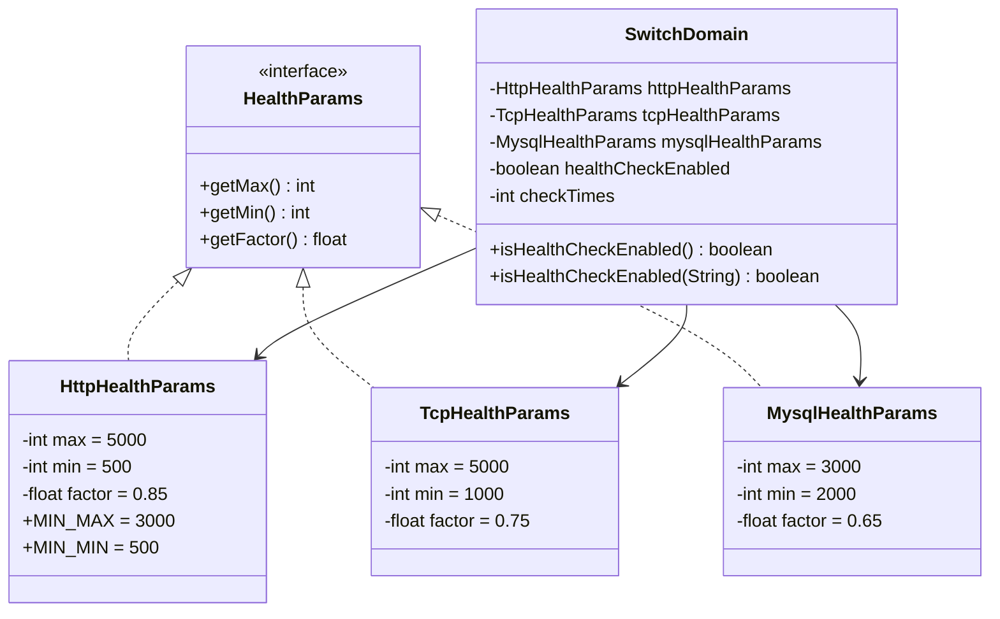
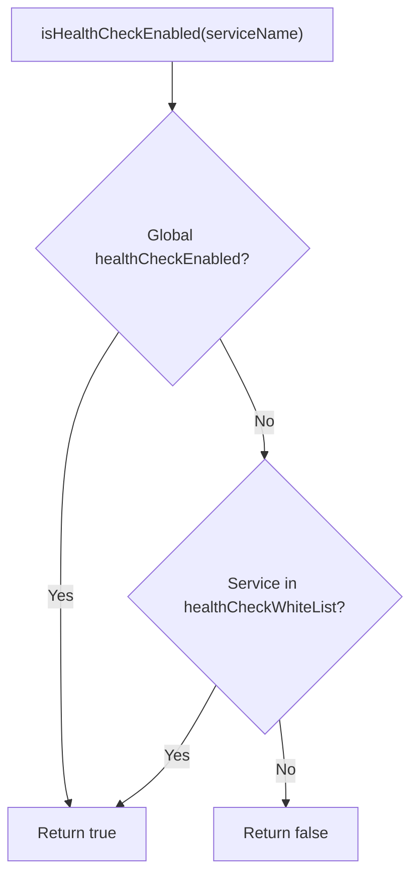
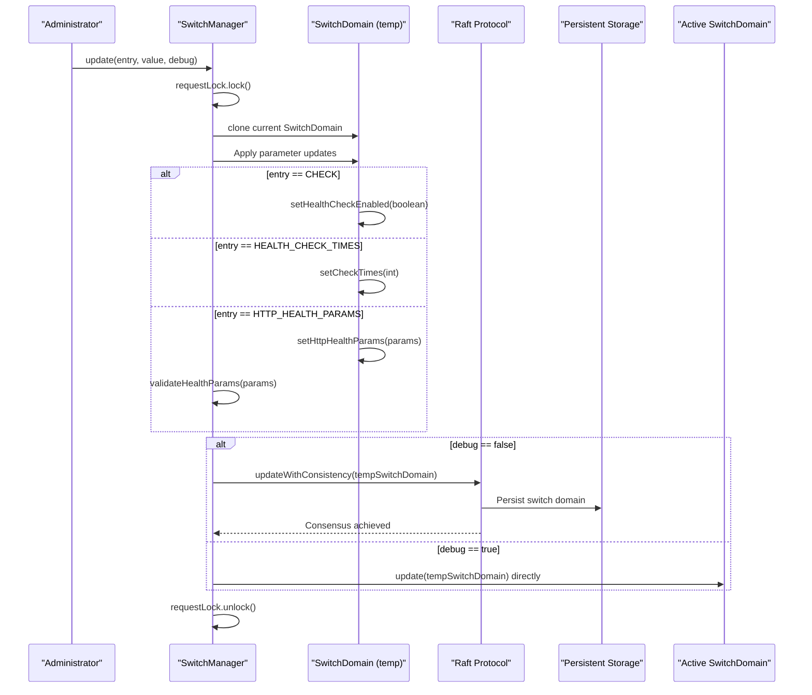
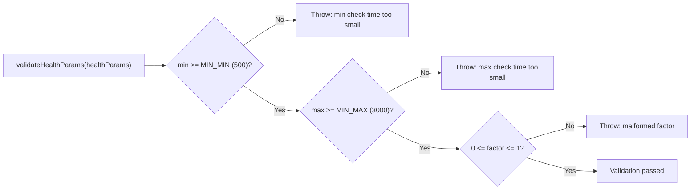
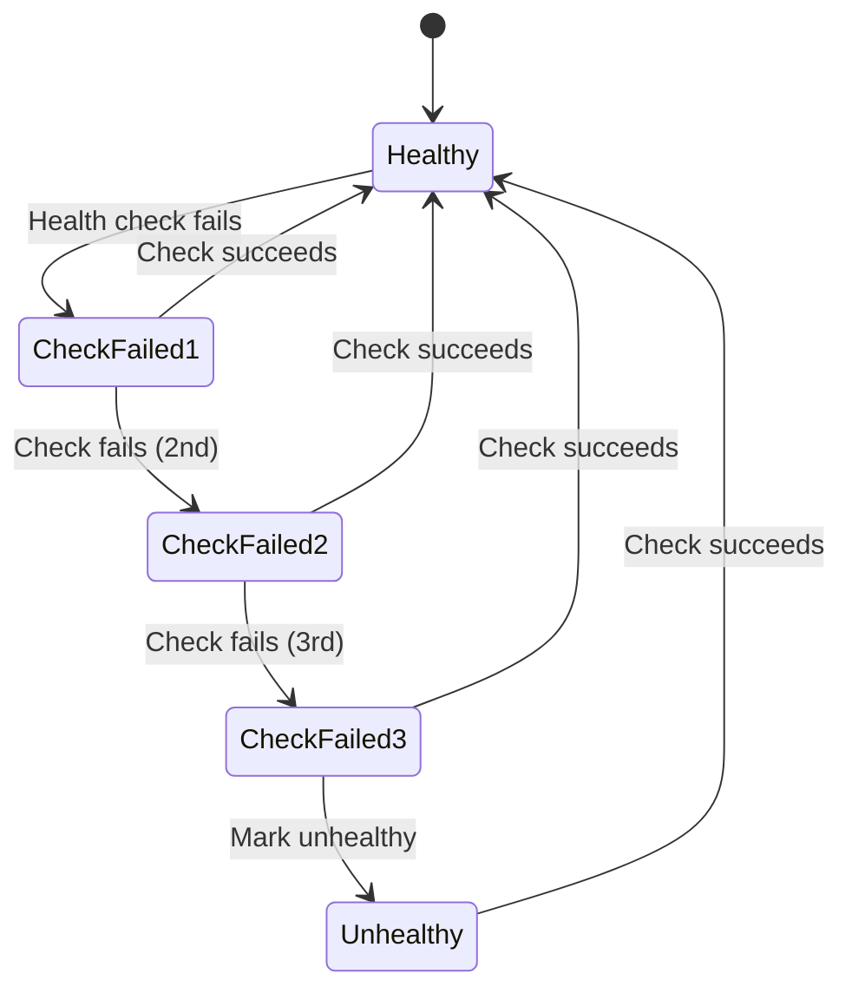
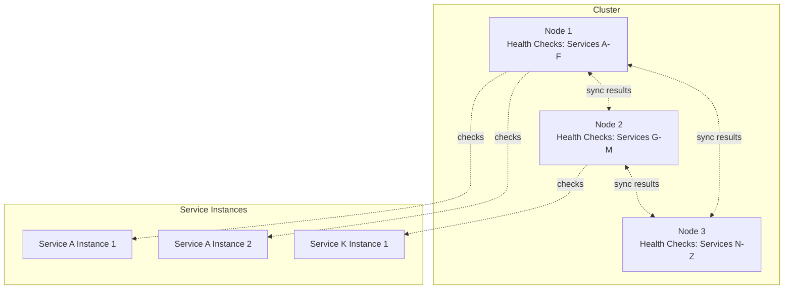

<!-- source: DeepWiki mcp.deepwiki.com · repo alibaba/nacos · page 4.4 Service Health Checks · fetched 2026-10-29 -->

# Service Health Checks

Relevant source files

The following files were used as context for generating this wiki page:

- [console/src/main/java/com/alibaba/nacos/Nacos.java](console/src/main/java/com/alibaba/nacos/Nacos.java)
- [naming/src/main/java/com/alibaba/nacos/naming/misc/HttpClient.java](naming/src/main/java/com/alibaba/nacos/naming/misc/HttpClient.java)
- [naming/src/main/java/com/alibaba/nacos/naming/misc/SwitchDomain.java](naming/src/main/java/com/alibaba/nacos/naming/misc/SwitchDomain.java)
- [naming/src/main/java/com/alibaba/nacos/naming/misc/SwitchEntry.java](naming/src/main/java/com/alibaba/nacos/naming/misc/SwitchEntry.java)
- [naming/src/main/java/com/alibaba/nacos/naming/misc/SwitchManager.java](naming/src/main/java/com/alibaba/nacos/naming/misc/SwitchManager.java)
- [naming/src/main/java/com/alibaba/nacos/naming/misc/UtilsAndCommons.java](naming/src/main/java/com/alibaba/nacos/naming/misc/UtilsAndCommons.java)
- [naming/src/main/java/com/alibaba/nacos/naming/web/DistroFilter.java](naming/src/main/java/com/alibaba/nacos/naming/web/DistroFilter.java)

This document describes the health check system in Nacos's Naming Service, which monitors service instance availability and marks instances as healthy or unhealthy based on periodic health checks. For information about service registration and instance management, see [Naming Server and Instance Management](#4.2). For details on service discovery and request distribution, see [Request Distribution and Service Discovery](#4.3).

## Overview

The health check system in Nacos continuously monitors registered service instances to determine their availability. It supports multiple health check protocols (HTTP, TCP, MySQL) and provides configurable parameters for check intervals, timeouts, and retry behavior. The system can be enabled or disabled globally through the Switch Manager and supports per-service configuration overrides.

Health checks serve two primary purposes:
1. **Instance Status Verification** - Periodically probe instances to verify they are responding correctly
2. **Automatic Failover** - Mark unhealthy instances as unavailable so clients exclude them from service discovery results

Sources: [naming/src/main/java/com/alibaba/nacos/naming/misc/SwitchDomain.java:1-543](), [naming/src/main/java/com/alibaba/nacos/naming/misc/SwitchManager.java:1-526]()

## Health Check Protocols

Nacos supports three distinct health check protocols, each designed for different types of services and infrastructure components.

### Protocol Types

| Protocol | Use Case | Configuration Class | Default Min | Default Max | Default Factor |
|----------|----------|-------------------|-------------|-------------|----------------|
| HTTP | RESTful services, web applications | `HttpHealthParams` | 500ms | 5000ms | 0.85 |
| TCP | TCP socket services, generic network services | `TcpHealthParams` | 1000ms | 5000ms | 0.75 |
| MySQL | Database health monitoring | `MysqlHealthParams` | 2000ms | 3000ms | 0.65 |

### Health Check Parameters

Each protocol shares a common parameter structure defined by the `HealthParams` interface:

- **Min** - Minimum health check interval in milliseconds
- **Max** - Maximum health check interval in milliseconds  
- **Factor** - Multiplicative factor (0-1) used to calculate dynamic check intervals based on response times

**Diagram: Health Check Protocol Parameter Hierarchy**

Sources: [naming/src/main/java/com/alibaba/nacos/naming/misc/SwitchDomain.java:407-541]()

## Health Check Configuration

Health check behavior is controlled through the `SwitchDomain` component, which stores global configuration that can be dynamically updated at runtime.

### Configuration Properties

The `SwitchDomain` class maintains the following health check settings:

| Property | Type | Default | Description |
|----------|------|---------|-------------|
| `healthCheckEnabled` | boolean | true | Global health check enable/disable flag |
| `autoChangeHealthCheckEnabled` | boolean | true | Enables automatic adjustment of health check intervals |
| `checkTimes` | int | 3 | Number of consecutive failed checks before marking instance unhealthy |
| `httpHealthParams` | HttpHealthParams | - | HTTP protocol check parameters |
| `tcpHealthParams` | TcpHealthParams | - | TCP protocol check parameters |
| `mysqlHealthParams` | MysqlHealthParams | - | MySQL protocol check parameters |
| `healthCheckWhiteList` | Set\<String\> | empty | Services that bypass global health check disable setting |

### Health Check Enable Logic

The system determines if health checks are enabled using the following logic:

**Diagram: Health Check Enable Decision Flow**

This allows services in the whitelist to continue health checking even when global health checks are disabled, useful for critical services during maintenance windows.

Sources: [naming/src/main/java/com/alibaba/nacos/naming/misc/SwitchDomain.java:220-227](), [naming/src/main/java/com/alibaba/nacos/naming/misc/SwitchDomain.java:117-125]()

## Switch Management and Dynamic Configuration

The `SwitchManager` component provides runtime configuration management for health check settings, including persistence through the Raft consensus protocol.

### Switch Entries

Health check configuration can be modified through the following switch entries:

| Switch Entry | Constant | Value Type | Description |
|--------------|----------|------------|-------------|
| `CHECK` | `SwitchEntry.CHECK` | boolean | Enable/disable health checks globally |
| `HEALTH_CHECK_TIMES` | `SwitchEntry.HEALTH_CHECK_TIMES` | int | Number of check retries before marking unhealthy |
| `HTTP_HEALTH_PARAMS` | `SwitchEntry.HTTP_HEALTH_PARAMS` | JSON | HTTP health check parameters |
| `TCP_HEALTH_PARAMS` | `SwitchEntry.TCP_HEALTH_PARAMS` | JSON | TCP health check parameters |
| `MYSQL_HEALTH_PARAMS` | `SwitchEntry.MYSQL_HEALTH_PARAMS` | JSON | MySQL health check parameters |
| `AUTO_CHANGE_HEALTH_CHECK_ENABLED` | `SwitchEntry.AUTO_CHANGE_HEALTH_CHECK_ENABLED` | boolean | Enable dynamic interval adjustment |

### Configuration Update Process

**Diagram: Health Check Configuration Update Flow**

Sources: [naming/src/main/java/com/alibaba/nacos/naming/misc/SwitchManager.java:108-320](), [naming/src/main/java/com/alibaba/nacos/naming/misc/SwitchManager.java:384-398]()

### Parameter Validation

When updating health check parameters, the `SwitchManager` validates values to ensure safe operation:

**Diagram: Health Check Parameter Validation**

Minimum values are enforced to prevent excessive health check frequency that could overload services or the Nacos cluster.

Sources: [naming/src/main/java/com/alibaba/nacos/naming/misc/SwitchManager.java:368-382](), [naming/src/main/java/com/alibaba/nacos/naming/misc/SwitchDomain.java:431-436]()

## Health Check Scheduling

The health check system uses adaptive scheduling based on instance response times and configured parameters. While the actual health check executor implementations are not visible in the provided files, the configuration infrastructure supports the following patterns:

### Dynamic Interval Calculation

When `autoChangeHealthCheckEnabled` is true, the system can adjust health check intervals dynamically:

1. **Initial Interval** - Starts at the configured `min` value
2. **Response-Based Adjustment** - After each successful check, interval is recalculated:
   - `newInterval = currentInterval * factor + responseTime * (1 - factor)`
3. **Bounds Enforcement** - Interval is clamped between `min` and `max` values

### Retry and Failure Handling

The `checkTimes` parameter (default 3) determines how many consecutive failures are required before marking an instance unhealthy:

**Diagram: Health Check State Machine**

This retry mechanism prevents transient network issues from immediately marking instances as unhealthy.

Sources: [naming/src/main/java/com/alibaba/nacos/naming/misc/SwitchDomain.java:256-262](), [naming/src/main/java/com/alibaba/nacos/naming/misc/SwitchManager.java:214-218]()

## Configuration Constants

The following constants define validation limits and default behaviors:

### Switch Entry Constants

From `SwitchEntry`:

| Constant | Value | Purpose |
|----------|-------|---------|
| `CHECK` | "check" | Switch entry name for health check enable/disable |
| `HEALTH_CHECK_TIMES` | "healthCheckTimes" | Switch entry for check retry count |
| `HTTP_HEALTH_PARAMS` | "httpHealthParams" | Switch entry for HTTP parameters |
| `TCP_HEALTH_PARAMS` | "tcpHealthParams" | Switch entry for TCP parameters |
| `MYSQL_HEALTH_PARAMS` | "mysqlHealthParams" | Switch entry for MySQL parameters |
| `AUTO_CHANGE_HEALTH_CHECK_ENABLED` | "autoChangeHealthCheckEnabled" | Switch entry for adaptive intervals |

### Utility Constants

From `UtilsAndCommons`:

| Constant | Value | Purpose |
|----------|-------|---------|
| `ENABLE_HEALTH_CHECK` | "enableHealthCheck" | Parameter name for health check enablement |
| `ENABLE_CLIENT_BEAT` | "enableClientBeat" | Parameter name for client-side heartbeat mode |

Sources: [naming/src/main/java/com/alibaba/nacos/naming/misc/SwitchEntry.java:52-108](), [naming/src/main/java/com/alibaba/nacos/naming/misc/UtilsAndCommons.java:148-150]()

## Integration with Instance Management

Health check results directly affect service instance status and availability:

### Instance Status Impact

- **Healthy Instances** - Included in service discovery query results
- **Unhealthy Instances** - Excluded from query results by default (can be included if explicitly requested)
- **Transitional States** - During the `checkTimes` retry window, instance status may be transitional

### Client Beat vs Server Health Check

Nacos supports two modes for instance health monitoring:

1. **Client Beat (Ephemeral Instances)** - Client sends periodic heartbeats; no server-initiated health checks
2. **Server Health Check (Persistent Instances)** - Server actively probes instances using configured protocols

The `ENABLE_CLIENT_BEAT` constant indicates this mode selection, though the actual implementation details are managed by the instance handler components.

Sources: [naming/src/main/java/com/alibaba/nacos/naming/misc/UtilsAndCommons.java:148-150](), [naming/src/main/java/com/alibaba/nacos/naming/misc/SwitchDomain.java:220-230]()

## Cluster Considerations

In a Nacos cluster deployment, health check responsibilities are distributed according to the Distro protocol:

### Responsibility Distribution

**Diagram: Distributed Health Check Responsibility**

Each node is responsible for health checking the service instances assigned to it by the `DistroMapper` consistent hashing algorithm. Health check results are then synchronized to other nodes through the Distro protocol.

Sources: [naming/src/main/java/com/alibaba/nacos/naming/web/DistroFilter.java:1-158]()

## Persistence and Consistency

Health check configuration is persisted through the Raft consensus protocol to ensure cluster-wide consistency:

### Raft Integration

The `SwitchManager` extends `RequestProcessor4CP` and integrates with the CP (Consistency Protocol) layer:

1. **Write Path** - Configuration updates are submitted as `WriteRequest` operations to Raft
2. **Read Path** - Configuration reads are served from local `SwitchDomain` with read lock protection
3. **Snapshot Operations** - Configuration is included in Raft snapshots for recovery

### Data Files

Configuration is persisted to: `{nacos.home}/data/naming/data/com.alibaba.nacos.naming.domains.meta.00-00---000-NACOS_SWITCH_DOMAIN-000---00-00`

Sources: [naming/src/main/java/com/alibaba/nacos/naming/misc/SwitchManager.java:84-98](), [naming/src/main/java/com/alibaba/nacos/naming/misc/SwitchManager.java:414-459](), [naming/src/main/java/com/alibaba/nacos/naming/misc/UtilsAndCommons.java:101]()

## API Surface

While detailed controller implementations are not shown in the provided files, health check configuration is exposed through the Operator API context:

- Base path: `/nacos/v1/ns/operator` (defined by `NACOS_NAMING_OPERATOR_CONTEXT`)
- V3 admin path: `/nacos/v3/admin/ns/ops` (defined by `OPERATOR_CONTROLLER_V3_ADMIN_PATH`)

Switch updates are typically submitted via API calls that invoke `SwitchManager.update()` with the appropriate entry name and value.

Sources: [naming/src/main/java/com/alibaba/nacos/naming/misc/UtilsAndCommons.java:75-87]()

---

