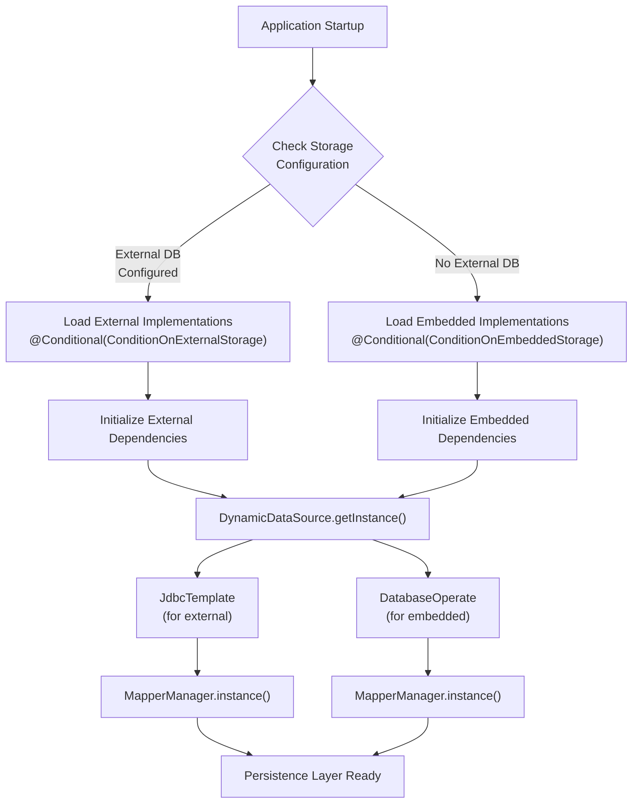
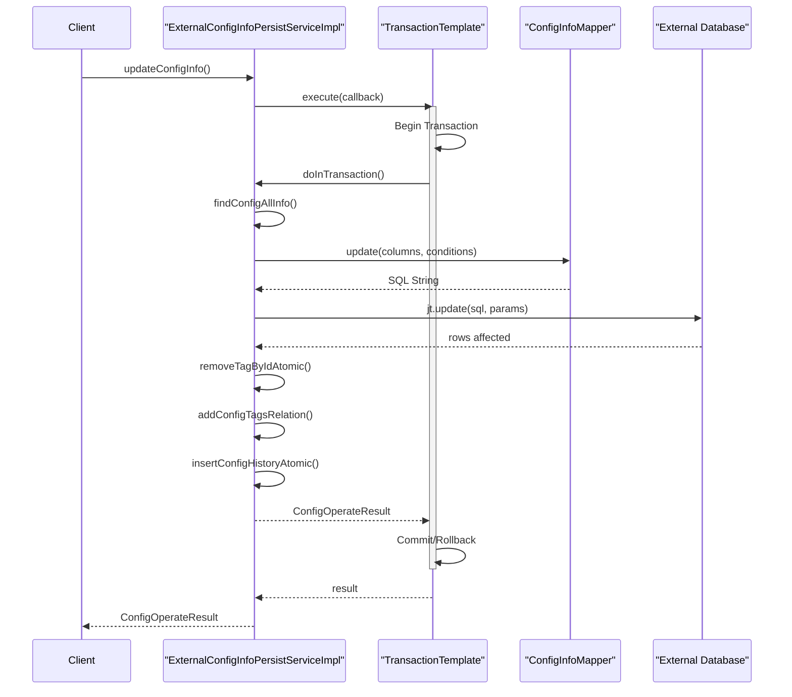
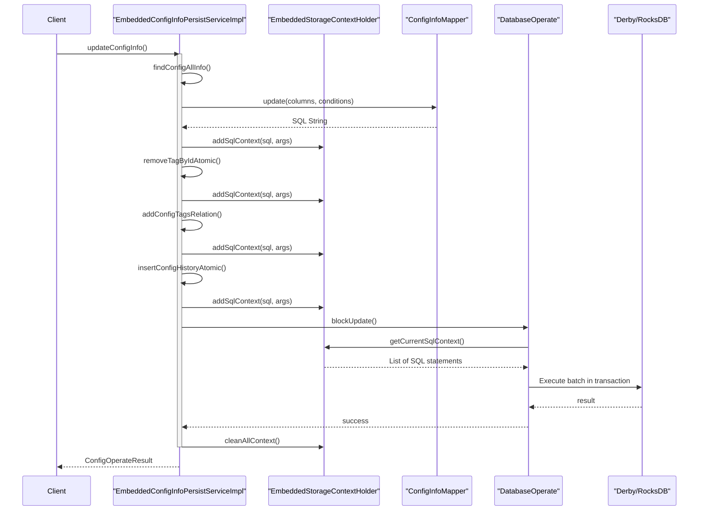
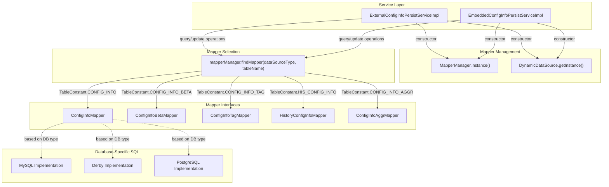
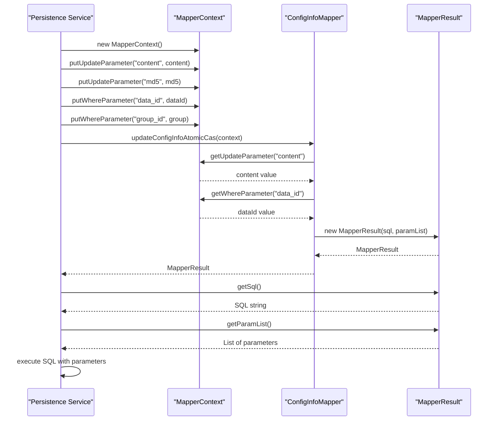
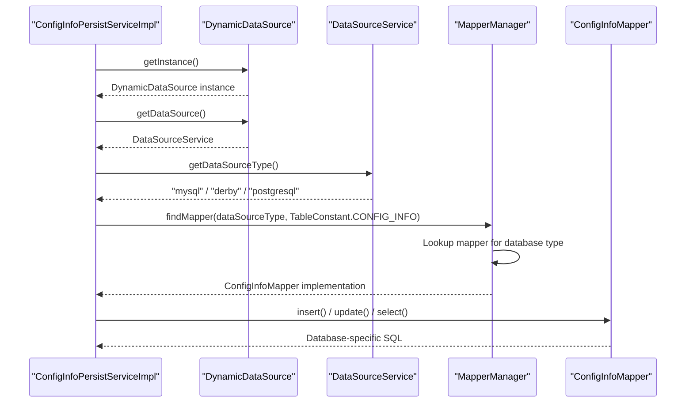

<!-- source: DeepWiki mcp.deepwiki.com · repo alibaba/nacos · page 5 Data Persistence · fetched 2026-10-29 -->

# Data Persistence

Relevant source files

The following files were used as context for generating this wiki page:

- [config/src/main/java/com/alibaba/nacos/config/server/service/repository/embedded/EmbeddedConfigInfoBetaPersistServiceImpl.java](config/src/main/java/com/alibaba/nacos/config/server/service/repository/embedded/EmbeddedConfigInfoBetaPersistServiceImpl.java)
- [config/src/main/java/com/alibaba/nacos/config/server/service/repository/embedded/EmbeddedConfigInfoPersistServiceImpl.java](config/src/main/java/com/alibaba/nacos/config/server/service/repository/embedded/EmbeddedConfigInfoPersistServiceImpl.java)
- [config/src/main/java/com/alibaba/nacos/config/server/service/repository/embedded/EmbeddedConfigInfoTagPersistServiceImpl.java](config/src/main/java/com/alibaba/nacos/config/server/service/repository/embedded/EmbeddedConfigInfoTagPersistServiceImpl.java)
- [config/src/main/java/com/alibaba/nacos/config/server/service/repository/embedded/EmbeddedHistoryConfigInfoPersistServiceImpl.java](config/src/main/java/com/alibaba/nacos/config/server/service/repository/embedded/EmbeddedHistoryConfigInfoPersistServiceImpl.java)
- [config/src/main/java/com/alibaba/nacos/config/server/service/repository/extrnal/ExternalConfigInfoBetaPersistServiceImpl.java](config/src/main/java/com/alibaba/nacos/config/server/service/repository/extrnal/ExternalConfigInfoBetaPersistServiceImpl.java)
- [config/src/main/java/com/alibaba/nacos/config/server/service/repository/extrnal/ExternalConfigInfoPersistServiceImpl.java](config/src/main/java/com/alibaba/nacos/config/server/service/repository/extrnal/ExternalConfigInfoPersistServiceImpl.java)
- [config/src/main/java/com/alibaba/nacos/config/server/service/repository/extrnal/ExternalConfigInfoTagPersistServiceImpl.java](config/src/main/java/com/alibaba/nacos/config/server/service/repository/extrnal/ExternalConfigInfoTagPersistServiceImpl.java)
- [config/src/main/java/com/alibaba/nacos/config/server/service/repository/extrnal/ExternalHistoryConfigInfoPersistServiceImpl.java](config/src/main/java/com/alibaba/nacos/config/server/service/repository/extrnal/ExternalHistoryConfigInfoPersistServiceImpl.java)
- [plugin/datasource/src/main/java/com/alibaba/nacos/plugin/datasource/mapper/ConfigInfoAggrMapper.java](plugin/datasource/src/main/java/com/alibaba/nacos/plugin/datasource/mapper/ConfigInfoAggrMapper.java)
- [plugin/datasource/src/main/java/com/alibaba/nacos/plugin/datasource/mapper/ConfigInfoBetaMapper.java](plugin/datasource/src/main/java/com/alibaba/nacos/plugin/datasource/mapper/ConfigInfoBetaMapper.java)
- [plugin/datasource/src/main/java/com/alibaba/nacos/plugin/datasource/model/MapperContext.java](plugin/datasource/src/main/java/com/alibaba/nacos/plugin/datasource/model/MapperContext.java)

The data persistence layer provides storage and retrieval operations for configuration data. It implements a dual storage strategy with pluggable implementations selected at runtime based on deployment configuration. Embedded storage uses Derby (standalone) or RocksDB (cluster with Raft), while external storage supports MySQL and PostgreSQL.

The persistence layer consists of two main components:
- **Storage Architecture**: Dual implementation strategy with Spring conditional loading
- **Data Access Layer**: MapperManager and database-specific SQL generation

## 5.1. Storage Architecture and Implementations

The persistence layer implements a strategy pattern with two storage implementations selected at runtime using Spring's `@Conditional` annotations.

### Dual Storage Strategy

The persistence layer is organized into multiple abstraction levels that separate business logic from database-specific implementations.

```mermaid
graph TB
    subgraph "Service Layer"
        ConfigService["ConfigInfoPersistService"]
        BetaService["ConfigInfoBetaPersistService"]
        TagService["ConfigInfoTagPersistService"]
        HistoryService["HistoryConfigInfoPersistService"]
    end
    
    subgraph "Implementation Layer"
        ExtConfig["ExternalConfigInfoPersistServiceImpl<br/>@Conditional(ConditionOnExternalStorage)"]
        EmbConfig["EmbeddedConfigInfoPersistServiceImpl<br/>@Conditional(ConditionOnEmbeddedStorage)"]
        ExtBeta["ExternalConfigInfoBetaPersistServiceImpl"]
        EmbBeta["EmbeddedConfigInfoBetaPersistServiceImpl"]
        ExtTag["ExternalConfigInfoTagPersistServiceImpl"]
        EmbTag["EmbeddedConfigInfoTagPersistServiceImpl"]
        ExtHistory["ExternalHistoryConfigInfoPersistServiceImpl"]
        EmbHistory["EmbeddedHistoryConfigInfoPersistServiceImpl"]
    end
    
    subgraph "Data Access Layer"
        MapperMgr["MapperManager"]
        ConfigMapper["ConfigInfoMapper"]
        BetaMapper["ConfigInfoBetaMapper"]
        TagMapper["ConfigInfoTagMapper"]
        HistMapper["HistoryConfigInfoMapper"]
    end
    
    subgraph "Database Layer"
        JdbcTemplate["JdbcTemplate<br/>(External)"]
        DatabaseOperate["DatabaseOperate<br/>(Embedded)"]
        MySQL["MySQL/PostgreSQL"]
        Derby["Derby/RocksDB"]
    end
    
    ConfigService --> ExtConfig
    ConfigService --> EmbConfig
    BetaService --> ExtBeta
    BetaService --> EmbBeta
    TagService --> ExtTag
    TagService --> EmbTag
    HistoryService --> ExtHistory
    HistoryService --> EmbHistory
    
    ExtConfig --> MapperMgr
    EmbConfig --> MapperMgr
    ExtBeta --> MapperMgr
    EmbBeta --> MapperMgr
    ExtTag --> MapperMgr
    EmbTag --> MapperMgr
    ExtHistory --> MapperMgr
    EmbHistory --> MapperMgr
    
    MapperMgr --> ConfigMapper
    MapperMgr --> BetaMapper
    MapperMgr --> TagMapper
    MapperMgr --> HistMapper
    
    ExtConfig --> JdbcTemplate
    EmbConfig --> DatabaseOperate
    ExtBeta --> JdbcTemplate
    EmbBeta --> DatabaseOperate
    ExtTag --> JdbcTemplate
    EmbTag --> DatabaseOperate
    ExtHistory --> JdbcTemplate
    EmbHistory --> DatabaseOperate
    
    JdbcTemplate --> MySQL
    DatabaseOperate --> Derby
```

**Sources:**
- [config/src/main/java/com/alibaba/nacos/config/server/service/repository/extrnal/ExternalConfigInfoPersistServiceImpl.java:100-126]()
- [config/src/main/java/com/alibaba/nacos/config/server/service/repository/embedded/EmbeddedConfigInfoPersistServiceImpl.java:99-162]()

### Storage Abstraction Interfaces

The persistence layer defines several service interfaces that abstract configuration data operations. Each interface has two implementations—one for external storage and one for embedded storage—selected at runtime based on deployment configuration.

| Interface | Purpose | External Implementation | Embedded Implementation |
|-----------|---------|------------------------|------------------------|
| `ConfigInfoPersistService` | Main configuration CRUD operations | `ExternalConfigInfoPersistServiceImpl` | `EmbeddedConfigInfoPersistServiceImpl` |
| `ConfigInfoBetaPersistService` | Beta configuration management | `ExternalConfigInfoBetaPersistServiceImpl` | `EmbeddedConfigInfoBetaPersistServiceImpl` |
| `ConfigInfoTagPersistService` | Tagged configuration management | `ExternalConfigInfoTagPersistServiceImpl` | `EmbeddedConfigInfoTagPersistServiceImpl` |
| `HistoryConfigInfoPersistService` | Configuration history tracking | `ExternalHistoryConfigInfoPersistServiceImpl` | `EmbeddedHistoryConfigInfoPersistServiceImpl` |

**Sources:**
- [config/src/main/java/com/alibaba/nacos/config/server/service/repository/extrnal/ExternalConfigInfoPersistServiceImpl.java:97-100]()
- [config/src/main/java/com/alibaba/nacos/config/server/service/repository/embedded/EmbeddedConfigInfoPersistServiceImpl.java:96-99]()
- [config/src/main/java/com/alibaba/nacos/config/server/service/repository/extrnal/ExternalConfigInfoBetaPersistServiceImpl.java:60-63]()
- [config/src/main/java/com/alibaba/nacos/config/server/service/repository/embedded/EmbeddedConfigInfoBetaPersistServiceImpl.java:62-65]()

### Conditional Implementation Selection

Nacos uses Spring's conditional bean loading to select the appropriate persistence implementation based on the `nacos.standalone` and database configuration properties.

**Sources:**
- [config/src/main/java/com/alibaba/nacos/config/server/service/repository/extrnal/ExternalConfigInfoPersistServiceImpl.java:98-99]()
- [config/src/main/java/com/alibaba/nacos/config/server/service/repository/embedded/EmbeddedConfigInfoPersistServiceImpl.java:97-98]()
- [config/src/main/java/com/alibaba/nacos/config/server/service/repository/extrnal/ExternalConfigInfoPersistServiceImpl.java:117-126]()
- [config/src/main/java/com/alibaba/nacos/config/server/service/repository/embedded/EmbeddedConfigInfoPersistServiceImpl.java:149-162]()

### Core Persistence Operations

Both external and embedded implementations provide the same set of operations for configuration management. The following table describes the primary operations:

| Operation | Method | Description |
|-----------|--------|-------------|
| Create | `addConfigInfo()` | Inserts new configuration with history record |
| Read | `findConfigInfo()` | Retrieves configuration by dataId, group, tenant |
| Update | `updateConfigInfo()` | Updates existing configuration with history record |
| Update CAS | `updateConfigInfoCas()` | Conditional update based on MD5 comparison |
| Delete | `removeConfigInfo()` | Deletes configuration with history record |
| Batch Import | `batchInsertOrUpdate()` | Bulk import with conflict resolution policies |

**Sources:**
- [config/src/main/java/com/alibaba/nacos/config/server/service/repository/extrnal/ExternalConfigInfoPersistServiceImpl.java:149-176]()
- [config/src/main/java/com/alibaba/nacos/config/server/service/repository/extrnal/ExternalConfigInfoPersistServiceImpl.java:544-587]()
- [config/src/main/java/com/alibaba/nacos/config/server/service/repository/embedded/EmbeddedConfigInfoPersistServiceImpl.java:208-245]()

### Transaction Management

The persistence layer uses different transaction mechanisms depending on the storage type.

### External Storage Transactions

External implementations use Spring's `TransactionTemplate` for ACID transaction support:

**Sources:**
- [config/src/main/java/com/alibaba/nacos/config/server/service/repository/extrnal/ExternalConfigInfoPersistServiceImpl.java:117-126]()
- [config/src/main/java/com/alibaba/nacos/config/server/service/repository/extrnal/ExternalConfigInfoPersistServiceImpl.java:544-587]()

### Embedded Storage Transactions

Embedded implementations batch SQL operations in a context holder and execute them atomically:

**Sources:**
- [config/src/main/java/com/alibaba/nacos/config/server/service/repository/embedded/EmbeddedConfigInfoPersistServiceImpl.java:548-594]()
- [config/src/main/java/com/alibaba/nacos/config/server/service/repository/embedded/EmbeddedStorageContextHolder.java]()

### Configuration Data Models

The persistence layer handles several types of configuration data, each with its own table and data model:

| Data Model | Table | Purpose |
|------------|-------|---------|
| `ConfigInfo` | `config_info` | Main configuration data with dataId, group, tenant keys |
| `ConfigInfoBeta` | `config_info_beta` | Beta configurations for gray release testing |
| `ConfigInfoTag` | `config_info_tag` | Tagged configurations for specific environments |
| `ConfigHistoryInfo` | `his_config_info` | Historical records of all configuration changes |
| `ConfigInfoAggr` | `config_info_aggr` | Aggregated configuration data from multiple sources |

Each configuration record includes:
- **Primary Key**: `id` (auto-generated)
- **Business Keys**: `data_id`, `group_id`, `tenant_id`
- **Content**: Configuration content and MD5 hash
- **Metadata**: `app_name`, `src_ip`, `src_user`, timestamps
- **Encryption**: `encrypted_data_key` for encrypted configurations

**Sources:**
- [config/src/main/java/com/alibaba/nacos/config/server/service/repository/extrnal/ExternalConfigInfoPersistServiceImpl.java:279-313]()
- [config/src/main/java/com/alibaba/nacos/config/server/service/repository/embedded/EmbeddedConfigInfoPersistServiceImpl.java:303-326]()

### Pagination Support

Both storage implementations provide pagination helpers for efficient query of large result sets:

- **External Storage**: `ExternalStoragePaginationHelperImpl` wraps `JdbcTemplate`
- **Embedded Storage**: `EmbeddedPaginationHelperImpl` wraps `DatabaseOperate`

Common pagination methods:
- `fetchPage()`: Retrieves a page with total count
- `fetchPageLimit()`: Retrieves a page without total count (more efficient)
- `updateLimit()`: Executes limited UPDATE or DELETE operations

**Sources:**
- [config/src/main/java/com/alibaba/nacos/config/server/service/repository/extrnal/ExternalConfigInfoPersistServiceImpl.java:128-131]()
- [config/src/main/java/com/alibaba/nacos/config/server/service/repository/embedded/EmbeddedConfigInfoPersistServiceImpl.java:164-167]()

### History Tracking

All configuration changes are tracked in the `his_config_info` table through the `HistoryConfigInfoPersistService`. Each CRUD operation on configuration data automatically creates a history record:

- **Insert (I)**: Records new configuration creation
- **Update (U)**: Records configuration modification
- **Delete (D)**: Records configuration removal

History records include operation type (`op_type`), publish type, source IP, source user, and the complete configuration content at the time of change.

**Sources:**
- [config/src/main/java/com/alibaba/nacos/config/server/service/repository/extrnal/ExternalConfigInfoPersistServiceImpl.java:117-126]()
- [config/src/main/java/com/alibaba/nacos/config/server/service/repository/embedded/EmbeddedConfigInfoPersistServiceImpl.java:149-160]()
- [plugin/datasource/src/main/java/com/alibaba/nacos/plugin/datasource/mapper/ConfigInfoBetaMapper.java:44-65]()

## 5.2. Data Access Layer and Mappers

The data access layer uses the `MapperManager` factory pattern to provide database-specific SQL generation through mapper interfaces. This abstraction allows Nacos to support multiple database types without changing business logic.

### MapperManager Factory Pattern

The `MapperManager` is a singleton factory that provides mapper instances based on the database type. It initializes mapper implementations for each supported database and returns the appropriate mapper when requested.

**MapperManager Initialization and Usage**

**Sources:**
- [config/src/main/java/com/alibaba/nacos/config/server/service/repository/extrnal/ExternalConfigInfoPersistServiceImpl.java:111-125]()
- [config/src/main/java/com/alibaba/nacos/config/server/service/repository/extrnal/ExternalConfigInfoPersistServiceImpl.java:262-263]()
- [config/src/main/java/com/alibaba/nacos/config/server/service/repository/embedded/EmbeddedConfigInfoPersistServiceImpl.java:137-160]()

### Database-Specific SQL Generation

Mapper interfaces define methods that return SQL strings or `MapperResult` objects containing SQL and parameters. Each database type has its own implementation that generates dialect-specific SQL.

**Supported Mapper Interfaces**

| Mapper Interface | Table Constant | Purpose |
|------------------|----------------|---------|
| `ConfigInfoMapper` | `TableConstant.CONFIG_INFO` | Main configuration table operations |
| `ConfigInfoBetaMapper` | `TableConstant.CONFIG_INFO_BETA` | Beta configuration operations |
| `ConfigInfoTagMapper` | `TableConstant.CONFIG_INFO_TAG` | Tag-specific configuration operations |
| `HistoryConfigInfoMapper` | `TableConstant.HIS_CONFIG_INFO` | Configuration history operations |
| `ConfigInfoAggrMapper` | `TableConstant.CONFIG_INFO_AGGR` | Aggregated configuration operations |
| `ConfigTagsRelationMapper` | `TableConstant.CONFIG_TAGS_RELATION` | Configuration tag relationship operations |

**Sources:**
- [plugin/datasource/src/main/java/com/alibaba/nacos/plugin/datasource/mapper/ConfigInfoMapper.java]()
- [plugin/datasource/src/main/java/com/alibaba/nacos/plugin/datasource/mapper/ConfigInfoBetaMapper.java:33-34]()
- [plugin/datasource/src/main/java/com/alibaba/nacos/plugin/datasource/mapper/ConfigInfoAggrMapper.java:34]()
- [config/src/main/java/com/alibaba/nacos/config/server/service/repository/extrnal/ExternalConfigInfoPersistServiceImpl.java:46-52]()

### MapperContext for Query Parameters

The `MapperContext` class provides a unified way to pass parameters to mapper methods. It stores three types of parameters:

- **Where Parameters**: Used in SQL WHERE clauses (via `putWhereParameter()` / `getWhereParameter()`)
- **Update Parameters**: Used in SQL UPDATE SET clauses (via `putUpdateParameter()` / `getUpdateParameter()`)  
- **Context Parameters**: Additional metadata (via `putContextParameter()` / `getContextParameter()`)

The mapper uses these parameters to generate a `MapperResult` containing the SQL string and ordered parameter list.

**MapperContext Usage Example**

**Sources:**
- [plugin/datasource/src/main/java/com/alibaba/nacos/plugin/datasource/model/MapperContext.java:28-50]()
- [plugin/datasource/src/main/java/com/alibaba/nacos/plugin/datasource/model/MapperContext.java:58-110]()
- [config/src/main/java/com/alibaba/nacos/config/server/service/repository/extrnal/ExternalConfigInfoPersistServiceImpl.java:665-688]()

### Multi-Database Type Support

The mapper system supports multiple database types through interface implementations. Each database provides its own SQL dialect handling:

**Database Type Detection**

**Common SQL Generation Methods**

Mapper interfaces provide default implementations for common operations:
- `insert(List<String> columns)`: Generate INSERT statement
- `update(List<String> updateColumns, List<String> whereColumns)`: Generate UPDATE statement
- `select(List<String> selectColumns, List<String> whereColumns)`: Generate SELECT statement
- `delete(List<String> whereColumns)`: Generate DELETE statement
- `count(List<String> whereColumns)`: Generate COUNT statement

Database-specific mappers override these methods to handle dialect differences such as:
- Pagination syntax: `LIMIT` vs `OFFSET/FETCH`
- Function names: `NOW()` vs `CURRENT_TIMESTAMP`
- Column escaping: backticks vs double quotes

**Sources:**
- [config/src/main/java/com/alibaba/nacos/config/server/service/repository/extrnal/ExternalHistoryConfigInfoPersistServiceImpl.java:89-112]()
- [config/src/main/java/com/alibaba/nacos/config/server/service/repository/embedded/EmbeddedHistoryConfigInfoPersistServiceImpl.java:91-112]()

---

