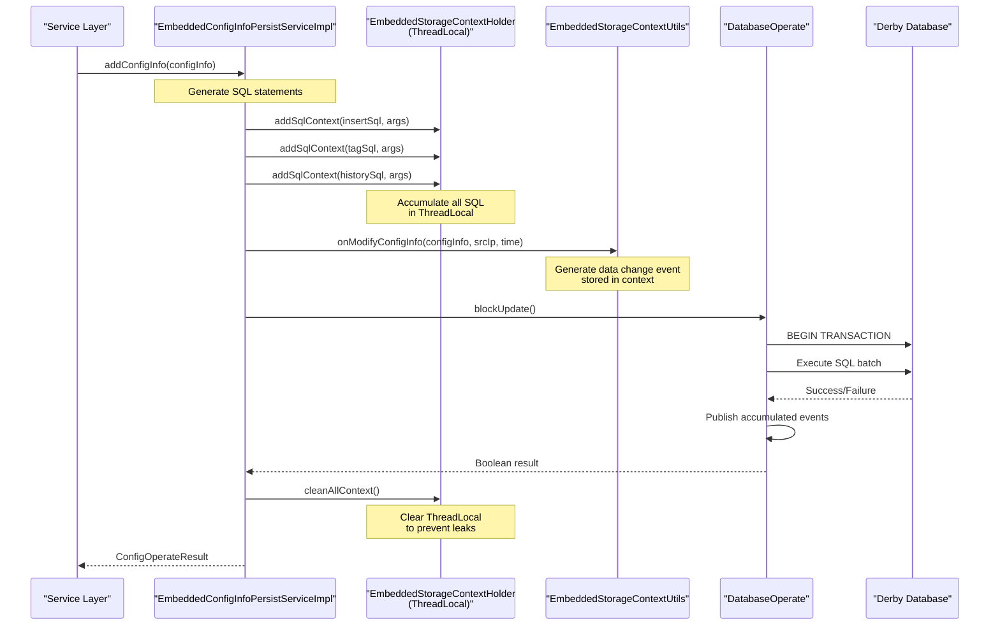
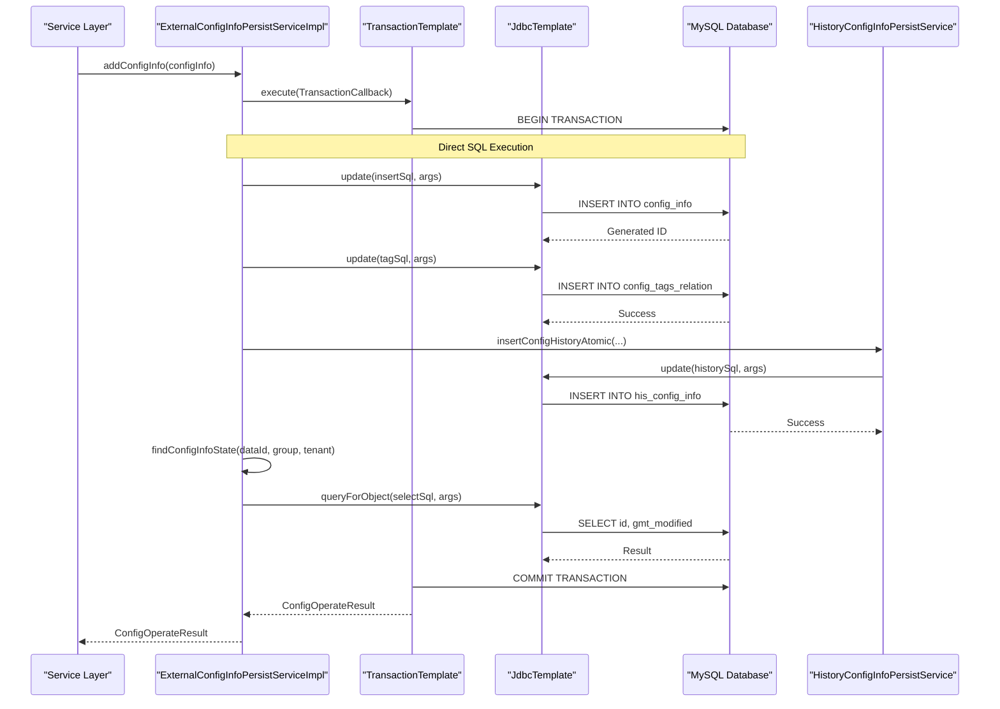
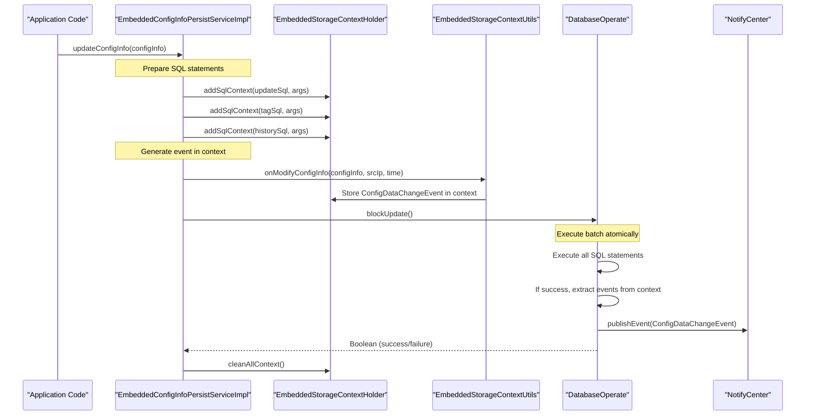

<!-- source: DeepWiki mcp.deepwiki.com · repo alibaba/nacos · page 5.1 Storage Architecture and Implementations · fetched 2026-10-29 -->

# Storage Architecture and Implementations

<details>
<summary>Relevant source files</summary>

The following files were used as context for generating this wiki page:

- [config/src/main/java/com/alibaba/nacos/config/server/service/repository/embedded/EmbeddedConfigInfoBetaPersistServiceImpl.java](config/src/main/java/com/alibaba/nacos/config/server/service/repository/embedded/EmbeddedConfigInfoBetaPersistServiceImpl.java)
- [config/src/main/java/com/alibaba/nacos/config/server/service/repository/embedded/EmbeddedConfigInfoPersistServiceImpl.java](config/src/main/java/com/alibaba/nacos/config/server/service/repository/embedded/EmbeddedConfigInfoPersistServiceImpl.java)
- [config/src/main/java/com/alibaba/nacos/config/server/service/repository/embedded/EmbeddedConfigInfoTagPersistServiceImpl.java](config/src/main/java/com/alibaba/nacos/config/server/service/repository/embedded/EmbeddedConfigInfoTagPersistServiceImpl.java)
- [config/src/main/java/com/alibaba/nacos/config/server/service/repository/embedded/EmbeddedHistoryConfigInfoPersistServiceImpl.java](config/src/main/java/com/alibaba/nacos/config/server/service/repository/embedded/EmbeddedHistoryConfigInfoPersistServiceImpl.java)
- [config/src/main/java/com/alibaba/nacos/config/server/service/repository/extrnal/ExternalConfigInfoBetaPersistServiceImpl.java](config/src/main/java/com/alibaba/nacos/config/server/service/repository/extrnal/ExternalConfigInfoBetaPersistServiceImpl.java)
- [config/src/main/java/com/alibaba/nacos/config/server/service/repository/extrnal/ExternalConfigInfoPersistServiceImpl.java](config/src/main/java/com/alibaba/nacos/config/server/service/repository/extrnal/ExternalConfigInfoPersistServiceImpl.java)
- [config/src/main/java/com/alibaba/nacos/config/server/service/repository/extrnal/ExternalConfigInfoTagPersistServiceImpl.java](config/src/main/java/com/alibaba/nacos/config/server/service/repository/extrnal/ExternalConfigInfoTagPersistServiceImpl.java)
- [config/src/main/java/com/alibaba/nacos/config/server/service/repository/extrnal/ExternalHistoryConfigInfoPersistServiceImpl.java](config/src/main/java/com/alibaba/nacos/config/server/service/repository/extrnal/ExternalHistoryConfigInfoPersistServiceImpl.java)
- [plugin/datasource/src/main/java/com/alibaba/nacos/plugin/datasource/mapper/ConfigInfoAggrMapper.java](plugin/datasource/src/main/java/com/alibaba/nacos/plugin/datasource/mapper/ConfigInfoAggrMapper.java)
- [plugin/datasource/src/main/java/com/alibaba/nacos/plugin/datasource/mapper/ConfigInfoBetaMapper.java](plugin/datasource/src/main/java/com/alibaba/nacos/plugin/datasource/mapper/ConfigInfoBetaMapper.java)
- [plugin/datasource/src/main/java/com/alibaba/nacos/plugin/datasource/model/MapperContext.java](plugin/datasource/src/main/java/com/alibaba/nacos/plugin/datasource/model/MapperContext.java)

</details>


## Purpose and Scope

This page explains Nacos's dual-mode storage architecture, which supports both embedded Derby database for standalone deployments and external databases (MySQL/PostgreSQL) for production clusters. The page covers storage mode selection, implementation differences, and the execution models for each mode. For details on SQL generation and database-specific mapper implementations, see [Data Access Layer and Mappers](#5.2).

## Dual Storage Mode Architecture

Nacos provides two mutually exclusive storage implementations that share identical persistence service interfaces:

- **Embedded Storage**: Uses in-process Derby database for standalone/development mode
- **External Storage**: Uses external MySQL or PostgreSQL for production cluster mode

```mermaid
graph TB
    subgraph "Persistence Service Interfaces"
        CIPS["ConfigInfoPersistService"]
        CBPS["ConfigInfoBetaPersistService"]
        CTPS["ConfigInfoTagPersistService"]
        HCPS["HistoryConfigInfoPersistService"]
    end
    
    subgraph "Embedded Storage Mode"
        ECIPS["EmbeddedConfigInfoPersistServiceImpl<br/>@ConditionOnEmbeddedStorage"]
        ECBPS["EmbeddedConfigInfoBetaPersistServiceImpl"]
        ECTPS["EmbeddedConfigInfoTagPersistServiceImpl"]
        EHCPS["EmbeddedHistoryConfigInfoPersistServiceImpl"]
        
        DO["DatabaseOperate<br/>Direct Derby Access"]
        ESCH["EmbeddedStorageContextHolder<br/>ThreadLocal SQL Context"]
        ESCU["EmbeddedStorageContextUtils<br/>Event Generation"]
    end
    
    subgraph "External Storage Mode"
        EXCIPS["ExternalConfigInfoPersistServiceImpl<br/>@ConditionOnExternalStorage"]
        EXCBPS["ExternalConfigInfoBetaPersistServiceImpl"]
        EXCTPS["ExternalConfigInfoTagPersistServiceImpl"]
        EXHCPS["ExternalHistoryConfigInfoPersistServiceImpl"]
        
        JT["JdbcTemplate<br/>Spring JDBC"]
        TT["TransactionTemplate<br/>Spring Transaction"]
    end
    
    subgraph "Common Components"
        MM["MapperManager<br/>SQL Generation"]
        DSS["DataSourceService<br/>Connection Pool"]
    end
    
    CIPS -.implements.-> ECIPS
    CIPS -.implements.-> EXCIPS
    CBPS -.implements.-> ECBPS
    CBPS -.implements.-> EXCBPS
    CTPS -.implements.-> ECTPS
    CTPS -.implements.-> EXCTPS
    HCPS -.implements.-> EHCPS
    HCPS -.implements.-> EXHCPS
    
    ECIPS --> DO
    ECIPS --> ESCH
    ECIPS --> ESCU
    ECIPS --> MM
    
    EXCIPS --> JT
    EXCIPS --> TT
    EXCIPS --> MM
    
    DO --> DSS
    JT --> DSS
    TT --> DSS
    
    style ECIPS fill:#f9f9f9
    style EXCIPS fill:#f9f9f9
```



**Sources:** [config/src/main/java/com/alibaba/nacos/config/server/service/repository/embedded/EmbeddedConfigInfoPersistServiceImpl.java:97-99](), [config/src/main/java/com/alibaba/nacos/config/server/service/repository/extrnal/ExternalConfigInfoPersistServiceImpl.java:98-100]()

### Conditional Activation

Storage mode is selected at application startup via Spring conditional annotations:

| Annotation | Implementation | Activation Condition |
|------------|---------------|---------------------|
| `@Conditional(value = ConditionOnEmbeddedStorage.class)` | Embedded implementations | `nacos.standalone=true` |
| `@Conditional(value = ConditionOnExternalStorage.class)` | External implementations | `nacos.standalone=false` or external DB configured |

Only one set of implementations is instantiated at runtime. The condition classes check system properties and database configuration to determine which mode to activate.

**Sources:** [config/src/main/java/com/alibaba/nacos/config/server/service/repository/embedded/EmbeddedConfigInfoPersistServiceImpl.java:97-98](), [config/src/main/java/com/alibaba/nacos/config/server/service/repository/extrnal/ExternalConfigInfoPersistServiceImpl.java:98-99]()

## Embedded Storage Mode

### Architecture and Components



**Sources:** [config/src/main/java/com/alibaba/nacos/config/server/service/repository/embedded/EmbeddedConfigInfoPersistServiceImpl.java:208-245]()

### Context-Based Execution Model

The embedded mode uses a **deferred execution pattern** where SQL statements are accumulated in thread-local context before batch execution:

**Step 1: SQL Accumulation**
```java
// From EmbeddedConfigInfoPersistServiceImpl.java:324
final String sql = configInfoMapper.insert(...);
final Object[] args = new Object[] {...};
EmbeddedStorageContextHolder.addSqlContext(sql, args);
```

All database operations within a logical transaction add their SQL to `EmbeddedStorageContextHolder`, which maintains a `ThreadLocal<List<ModifyRequest>>`.

**Step 2: Event Generation**
```java
// From EmbeddedConfigInfoPersistServiceImpl.java:235
EmbeddedStorageContextUtils.onModifyConfigInfo(configInfo, srcIp, now);
```

Data change events are also stored in the context and will be published after successful commit.

**Step 3: Batch Execution**
```java
// From EmbeddedConfigInfoPersistServiceImpl.java:236
boolean result = databaseOperate.blockUpdate(consumer);
```

The `blockUpdate()` method executes all accumulated SQL as a single atomic batch. If any statement fails, the entire batch is rolled back.

**Step 4: Context Cleanup**
```java
// From EmbeddedConfigInfoPersistServiceImpl.java:242-244
finally {
    EmbeddedStorageContextHolder.cleanAllContext();
}
```

The cleanup must occur in a finally block to prevent `ThreadLocal` memory leaks.

**Sources:** [config/src/main/java/com/alibaba/nacos/config/server/service/repository/embedded/EmbeddedConfigInfoPersistServiceImpl.java:213-244]()

### Transaction Semantics

Embedded mode provides implicit ACID guarantees through batch execution:

- **Atomicity**: All SQL in context executes as single batch; partial failures roll back everything
- **Consistency**: Events generated only after successful commit
- **Isolation**: Thread-local context ensures no cross-thread interference
- **Durability**: Derby WAL (Write-Ahead Logging) ensures persistence

**Sources:** [config/src/main/java/com/alibaba/nacos/config/server/service/repository/embedded/EmbeddedConfigInfoPersistServiceImpl.java:236-240]()

### ID Generation

Embedded mode uses `IdGeneratorManager` for distributed ID generation:

```java
// From EmbeddedConfigInfoPersistServiceImpl.java:153-155
idGeneratorManager.register(RESOURCE_CONFIG_INFO_ID, RESOURCE_CONFIG_HISTORY_ID,
        RESOURCE_CONFIG_TAG_RELATION_ID, ...);

// From EmbeddedConfigInfoPersistServiceImpl.java:221-222
long configId = idGeneratorManager.nextId(RESOURCE_CONFIG_INFO_ID);
long hisId = idGeneratorManager.nextId(RESOURCE_CONFIG_HISTORY_ID);
```

This provides consistent, non-conflicting IDs even in standalone mode, preparing for potential migration to cluster mode.

**Sources:** [config/src/main/java/com/alibaba/nacos/config/server/service/repository/embedded/EmbeddedConfigInfoPersistServiceImpl.java:149-155](), [config/src/main/java/com/alibaba/nacos/config/server/service/repository/embedded/EmbeddedConfigInfoPersistServiceImpl.java:221-222]()

## External Storage Mode

### Architecture and Components



**Sources:** [config/src/main/java/com/alibaba/nacos/config/server/service/repository/extrnal/ExternalConfigInfoPersistServiceImpl.java:149-176]()

### Direct Execution Model

External mode uses **immediate execution** with explicit transaction boundaries:

**Transaction Declaration**
```java
// From ExternalConfigInfoPersistServiceImpl.java:151
return tjt.execute(status -> {
    try {
        // Transaction body
    } catch (CannotGetJdbcConnectionException e) {
        LogUtil.FATAL_LOG.error("[db-error] " + e, e);
        throw e;
    }
});
```

The `TransactionTemplate` manages transaction lifecycle: begin, commit, or rollback.

**Immediate SQL Execution**
```java
// From ExternalConfigInfoPersistServiceImpl.java:153
long configId = addConfigInfoAtomic(-1, srcIp, srcUser, configInfo, configAdvanceInfo);

// From ExternalConfigInfoPersistServiceImpl.java:265-267
jt.update(connection -> createPsForInsertConfigInfo(...), keyHolder);
```

Each database operation executes immediately within the transaction. `JdbcTemplate` provides exception translation and resource management.

**History Recording**
```java
// From ExternalConfigInfoPersistServiceImpl.java:160-162
historyConfigInfoPersistService.insertConfigHistoryAtomic(0, configInfo, srcIp, srcUser, 
        now, "I", Constants.FORMAL, null, ...);
```

History records are inserted in the same transaction, ensuring atomicity with the main operation.

**Sources:** [config/src/main/java/com/alibaba/nacos/config/server/service/repository/extrnal/ExternalConfigInfoPersistServiceImpl.java:149-176]()

### Transaction Semantics

External mode provides explicit ACID guarantees through Spring's transaction management:

- **Atomicity**: `TransactionTemplate` ensures all-or-nothing execution
- **Consistency**: Explicit transaction boundaries with rollback on exceptions
- **Isolation**: Database-level isolation (configurable, typically READ_COMMITTED)
- **Durability**: Database guarantees persistence after commit

**Sources:** [config/src/main/java/com/alibaba/nacos/config/server/service/repository/extrnal/ExternalConfigInfoPersistServiceImpl.java:151-175]()

### Auto-Generated Keys

External mode relies on database auto-increment for ID generation:

```java
// From ExternalConfigInfoPersistServiceImpl.java:260
KeyHolder keyHolder = ExternalStorageUtils.createKeyHolder();

// From ExternalConfigInfoPersistServiceImpl.java:265-267
jt.update(connection -> createPsForInsertConfigInfo(...), keyHolder);
Number nu = keyHolder.getKey();
return nu.longValue();
```

The `KeyHolder` retrieves database-generated primary keys after insert. This approach works with MySQL's `AUTO_INCREMENT` and PostgreSQL's `SERIAL`.

**Sources:** [config/src/main/java/com/alibaba/nacos/config/server/service/repository/extrnal/ExternalConfigInfoPersistServiceImpl.java:257-277]()

## Persistence Service Hierarchy

```mermaid
classDiagram
    class ConfigInfoPersistService {
        <<interface>>
        +addConfigInfo() ConfigOperateResult
        +updateConfigInfo() ConfigOperateResult
        +removeConfigInfo() void
        +findConfigInfo() ConfigInfoWrapper
        +insertOrUpdate() ConfigOperateResult
        +batchInsertOrUpdate() Map
    }
    
    class ConfigInfoBetaPersistService {
        <<interface>>
        +addConfigInfo4Beta() ConfigOperateResult
        +updateConfigInfo4Beta() ConfigOperateResult
        +removeConfigInfo4Beta() void
        +findConfigInfo4Beta() ConfigInfoBetaWrapper
    }
    
    class ConfigInfoTagPersistService {
        <<interface>>
        +addConfigInfo4Tag() ConfigOperateResult
        +updateConfigInfo4Tag() ConfigOperateResult
        +removeConfigInfoTag() void
        +findConfigInfo4Tag() ConfigInfoTagWrapper
    }
    
    class HistoryConfigInfoPersistService {
        <<interface>>
        +insertConfigHistoryAtomic() void
        +removeConfigHistory() void
        +findConfigHistory() Page
        +detailConfigHistory() ConfigHistoryInfo
    }
    
    class EmbeddedConfigInfoPersistServiceImpl {
        -DatabaseOperate databaseOperate
        -IdGeneratorManager idGeneratorManager
        -MapperManager mapperManager
    }
    
    class ExternalConfigInfoPersistServiceImpl {
        -JdbcTemplate jt
        -TransactionTemplate tjt
        -MapperManager mapperManager
    }
    
    ConfigInfoPersistService <|.. EmbeddedConfigInfoPersistServiceImpl
    ConfigInfoPersistService <|.. ExternalConfigInfoPersistServiceImpl
    ConfigInfoBetaPersistService <|.. EmbeddedConfigInfoBetaPersistServiceImpl
    ConfigInfoBetaPersistService <|.. ExternalConfigInfoBetaPersistServiceImpl
    ConfigInfoTagPersistService <|.. EmbeddedConfigInfoTagPersistServiceImpl
    ConfigInfoTagPersistService <|.. ExternalConfigInfoTagPersistServiceImpl
    HistoryConfigInfoPersistService <|.. EmbeddedHistoryConfigInfoPersistServiceImpl
    HistoryConfigInfoPersistService <|.. ExternalHistoryConfigInfoPersistServiceImpl
```



**Sources:** [config/src/main/java/com/alibaba/nacos/config/server/service/repository/embedded/EmbeddedConfigInfoPersistServiceImpl.java:99](), [config/src/main/java/com/alibaba/nacos/config/server/service/repository/extrnal/ExternalConfigInfoPersistServiceImpl.java:100]()

### Configuration Types

Nacos maintains separate persistence services for different configuration types:

| Service Interface | Purpose | Table(s) |
|------------------|---------|---------|
| `ConfigInfoPersistService` | Main configuration data | `config_info`, `config_tags_relation` |
| `ConfigInfoBetaPersistService` | Beta/gray release configurations | `config_info_beta` |
| `ConfigInfoTagPersistService` | Tag-specific configurations | `config_info_tag` |
| `HistoryConfigInfoPersistService` | Configuration change audit trail | `his_config_info` |

Each service interface defines operations specific to that config type. All services have both embedded and external implementations that follow the same execution patterns described above.

**Sources:** [config/src/main/java/com/alibaba/nacos/config/server/service/repository/embedded/EmbeddedConfigInfoBetaPersistServiceImpl.java:64](), [config/src/main/java/com/alibaba/nacos/config/server/service/repository/embedded/EmbeddedConfigInfoTagPersistServiceImpl.java:64](), [config/src/main/java/com/alibaba/nacos/config/server/service/repository/embedded/EmbeddedHistoryConfigInfoPersistServiceImpl.java:63]()

### Common Operations

All persistence services provide:

**CRUD Operations**
- Insert: `addConfigInfo()`, `addConfigInfo4Beta()`, `addConfigInfo4Tag()`
- Update: `updateConfigInfo()`, `updateConfigInfo4Beta()`, `updateConfigInfo4Tag()`
- Delete: `removeConfigInfo()`, `removeConfigInfo4Beta()`, `removeConfigInfoTag()`
- Query: `findConfigInfo()`, `findConfigInfo4Beta()`, `findConfigInfo4Tag()`

**Compare-And-Swap (CAS) Operations**
- `insertOrUpdateCas()`: CAS-based upsert using MD5 hash for optimistic locking
- `updateConfigInfoCas()`: Update only if MD5 matches current value
- Prevents lost updates in concurrent scenarios

**Batch Operations**
- `batchInsertOrUpdate()`: Bulk import with configurable conflict policy
- Policies: `ABORT` (stop on first conflict), `SKIP` (skip conflicts), `OVERWRITE` (replace conflicts)

**Pagination**
- `createPaginationHelper()`: Creates mode-specific pagination helper
- Embedded: `EmbeddedPaginationHelperImpl`
- External: `ExternalStoragePaginationHelperImpl`

**Sources:** [config/src/main/java/com/alibaba/nacos/config/server/service/repository/embedded/EmbeddedConfigInfoPersistServiceImpl.java:281-289](), [config/src/main/java/com/alibaba/nacos/config/server/service/repository/embedded/EmbeddedConfigInfoPersistServiceImpl.java:348-445]()

## Implementation Comparison

### Feature Comparison

| Feature | Embedded Storage | External Storage |
|---------|-----------------|------------------|
| **Database** | Derby (in-process) | MySQL, PostgreSQL (external) |
| **Deployment** | Standalone only | Multi-node cluster |
| **Transaction Model** | Deferred batch execution | Immediate execution |
| **Context Management** | `EmbeddedStorageContextHolder` (ThreadLocal) | `TransactionTemplate` (Spring) |
| **SQL Execution** | `DatabaseOperate.blockUpdate()` | `JdbcTemplate.update()` |
| **ID Generation** | `IdGeneratorManager.nextId()` | Database auto-increment |
| **Event Generation** | `EmbeddedStorageContextUtils` | Manual `NotifyCenter.publishEvent()` |
| **Transaction API** | Implicit (batch boundary) | Explicit (`TransactionTemplate`) |
| **Connection Pool** | Single embedded connection | HikariCP connection pool |
| **Latency** | Lower (in-process) | Higher (network I/O) |
| **Setup Complexity** | Zero (bundled) | Requires database installation |
| **Data Capacity** | Limited by JVM heap | Limited by database capacity |

**Sources:** [config/src/main/java/com/alibaba/nacos/config/server/service/repository/embedded/EmbeddedConfigInfoPersistServiceImpl.java:133-162](), [config/src/main/java/com/alibaba/nacos/config/server/service/repository/extrnal/ExternalConfigInfoPersistServiceImpl.java:117-126]()

### Code Organization

**Embedded Implementations:**
- Package: `com.alibaba.nacos.config.server.service.repository.embedded`
- Files: `EmbeddedConfigInfoPersistServiceImpl`, `EmbeddedConfigInfoBetaPersistServiceImpl`, `EmbeddedConfigInfoTagPersistServiceImpl`, `EmbeddedHistoryConfigInfoPersistServiceImpl`
- Dependencies: `DatabaseOperate`, `EmbeddedStorageContextHolder`, `IdGeneratorManager`

**External Implementations:**
- Package: `com.alibaba.nacos.config.server.service.repository.extrnal` (note: package name has typo)
- Files: `ExternalConfigInfoPersistServiceImpl`, `ExternalConfigInfoBetaPersistServiceImpl`, `ExternalConfigInfoTagPersistServiceImpl`, `ExternalHistoryConfigInfoPersistServiceImpl`
- Dependencies: `JdbcTemplate`, `TransactionTemplate`, `DataSourceService`

**Sources:** [config/src/main/java/com/alibaba/nacos/config/server/service/repository/embedded/EmbeddedConfigInfoPersistServiceImpl.java:17](), [config/src/main/java/com/alibaba/nacos/config/server/service/repository/extrnal/ExternalConfigInfoPersistServiceImpl.java:17]()

## Data Change Event Propagation

### Embedded Mode Event Generation



**Event Generation Methods:**
- `EmbeddedStorageContextUtils.onModifyConfigInfo()`: Config insert/update
- `EmbeddedStorageContextUtils.onDeleteConfigInfo()`: Config deletion
- `EmbeddedStorageContextUtils.onModifyConfigBetaInfo()`: Beta config changes
- `EmbeddedStorageContextUtils.onModifyConfigTagInfo()`: Tag config changes
- `EmbeddedStorageContextUtils.onBatchDeleteConfigInfo()`: Batch deletions

Events are stored in the `EmbeddedStorageContextHolder` and published only after successful database commit, ensuring consistency between database state and notifications.

**Sources:** [config/src/main/java/com/alibaba/nacos/config/server/service/repository/embedded/EmbeddedConfigInfoPersistServiceImpl.java:235-236](), [config/src/main/java/com/alibaba/nacos/config/server/service/repository/embedded/EmbeddedConfigInfoPersistServiceImpl.java:588]()

### External Mode Event Generation

External mode does not have automatic event generation like embedded mode. Event propagation relies on:

1. **History Records**: All operations insert history records in the same transaction
2. **Timestamp Tracking**: `gmt_modified` column updated on changes
3. **Manual Notifications**: Services layer responsible for triggering notifications

The history records provide an audit trail and can be used by dump services to detect changes and notify clients.

**Sources:** [config/src/main/java/com/alibaba/nacos/config/server/service/repository/extrnal/ExternalConfigInfoPersistServiceImpl.java:160-162]()

## Storage Context Management

### Thread-Local Context (Embedded)

The `EmbeddedStorageContextHolder` maintains thread-local SQL context:

```java
// Thread-local storage structure
ThreadLocal<List<ModifyRequest>> currentSqlContext;
ThreadLocal<List<Event>> currentEventList;
```

**Context Lifecycle:**
1. **Initialization**: Implicitly created on first `addSqlContext()` call
2. **Accumulation**: Multiple operations add SQL to the same context
3. **Execution**: `blockUpdate()` processes all accumulated SQL
4. **Cleanup**: `cleanAllContext()` removes thread-local data

**Memory Leak Prevention:**
```java
// From EmbeddedConfigInfoPersistServiceImpl.java:242-244
finally {
    EmbeddedStorageContextHolder.cleanAllContext();
}
```

Every operation **must** clean up context in a finally block. Failure to do so causes `ThreadLocal` memory leaks, especially problematic in thread pool environments.

**Sources:** [config/src/main/java/com/alibaba/nacos/config/server/service/repository/embedded/EmbeddedConfigInfoPersistServiceImpl.java:242-244](), [config/src/main/java/com/alibaba/nacos/config/server/service/repository/embedded/EmbeddedConfigInfoPersistServiceImpl.java:324]()

### Connection Pool (External)

The `DataSourceService` provides connection pooling for external storage:

**Initialization:**
```java
// From ExternalConfigInfoPersistServiceImpl.java:119-121
this.dataSourceService = DynamicDataSource.getInstance().getDataSource();
this.jt = dataSourceService.getJdbcTemplate();
this.tjt = dataSourceService.getTransactionTemplate();
```

**Connection Pool Features:**
- HikariCP connection pool (Spring Boot default)
- Configurable pool size via `spring.datasource.hikari.*` properties
- Connection validation on borrow
- Prepared statement caching
- Connection timeout handling

**Transaction Management:**
- `TransactionTemplate` manages connections per transaction
- Connections returned to pool after commit/rollback
- Thread-safe: different threads get different connections

**Sources:** [config/src/main/java/com/alibaba/nacos/config/server/service/repository/extrnal/ExternalConfigInfoPersistServiceImpl.java:117-126]()

## Mapper Integration

Both storage modes use the same `MapperManager` for database-agnostic SQL generation:

```java
// From EmbeddedConfigInfoPersistServiceImpl.java:157-159
Boolean isDataSourceLogEnable = EnvUtil.getProperty(CommonConstant.NACOS_PLUGIN_DATASOURCE_LOG, 
        Boolean.class, false);
this.mapperManager = MapperManager.instance(isDataSourceLogEnable);

// From EmbeddedConfigInfoPersistServiceImpl.java:187-188
ConfigInfoMapper configInfoMapper = mapperManager.findMapper(
        dataSourceService.getDataSourceType(), TableConstant.CONFIG_INFO);
```

The `MapperManager`:
- Selects appropriate mapper based on database type (Derby, MySQL, PostgreSQL)
- Provides abstract SQL generation methods
- Handles database-specific syntax differences (pagination, functions)
- Uses `MapperContext` for parameter passing

For detailed mapper implementation, see [Data Access Layer and Mappers](#5.2).

**Sources:** [config/src/main/java/com/alibaba/nacos/config/server/service/repository/embedded/EmbeddedConfigInfoPersistServiceImpl.java:157-159](), [config/src/main/java/com/alibaba/nacos/config/server/service/repository/embedded/EmbeddedConfigInfoPersistServiceImpl.java:187-188]()

## Configuration and Initialization

### Embedded Mode Initialization

```java
// From EmbeddedConfigInfoPersistServiceImpl.java:149-162
public EmbeddedConfigInfoPersistServiceImpl(DatabaseOperate databaseOperate, 
        IdGeneratorManager idGeneratorManager,
        @Qualifier("embeddedHistoryConfigInfoPersistServiceImpl") 
        HistoryConfigInfoPersistService historyConfigInfoPersistService) {
    this.databaseOperate = databaseOperate;
    this.idGeneratorManager = idGeneratorManager;
    
    // Register ID generators for all entity types
    idGeneratorManager.register(RESOURCE_CONFIG_INFO_ID, RESOURCE_CONFIG_HISTORY_ID,
            RESOURCE_CONFIG_TAG_RELATION_ID, RESOURCE_APP_CONFIGDATA_RELATION_SUBS, 
            RESOURCE_CONFIG_BETA_ID, RESOURCE_NAMESPACE_ID, RESOURCE_USER_ID, 
            RESOURCE_ROLE_ID, RESOURCE_PERMISSIONS_ID);
    
    this.dataSourceService = DynamicDataSource.getInstance().getDataSource();
    Boolean isDataSourceLogEnable = EnvUtil.getProperty(
            CommonConstant.NACOS_PLUGIN_DATASOURCE_LOG, Boolean.class, false);
    this.mapperManager = MapperManager.instance(isDataSourceLogEnable);
    this.historyConfigInfoPersistService = historyConfigInfoPersistService;
    
    NotifyCenter.registerToSharePublisher(DerbyImportEvent.class);
}
```

**Key Initialization Steps:**
1. Inject `DatabaseOperate` for Derby access
2. Register ID generators for each entity type
3. Initialize `MapperManager` with Derby-specific mappers
4. Register for Derby import events (data migration support)

**Sources:** [config/src/main/java/com/alibaba/nacos/config/server/service/repository/embedded/EmbeddedConfigInfoPersistServiceImpl.java:149-162]()

### External Mode Initialization

```java
// From ExternalConfigInfoPersistServiceImpl.java:117-126
public ExternalConfigInfoPersistServiceImpl(
        @Qualifier("externalHistoryConfigInfoPersistServiceImpl") 
        HistoryConfigInfoPersistService historyConfigInfoPersistService) {
    this.dataSourceService = DynamicDataSource.getInstance().getDataSource();
    this.jt = dataSourceService.getJdbcTemplate();
    this.tjt = dataSourceService.getTransactionTemplate();
    
    Boolean isDataSourceLogEnable = EnvUtil.getProperty(
            CommonConstant.NACOS_PLUGIN_DATASOURCE_LOG, Boolean.class, false);
    this.mapperManager = MapperManager.instance(isDataSourceLogEnable);
    this.historyConfigInfoPersistService = historyConfigInfoPersistService;
}
```

**Key Initialization Steps:**
1. Get `DataSourceService` from `DynamicDataSource` singleton
2. Create `JdbcTemplate` for query/update operations
3. Create `TransactionTemplate` for transaction management
4. Initialize `MapperManager` with database-specific mappers (MySQL/PostgreSQL)
5. No ID generator needed (database auto-increment)

**Sources:** [config/src/main/java/com/alibaba/nacos/config/server/service/repository/extrnal/ExternalConfigInfoPersistServiceImpl.java:117-126]()

## Error Handling and Resilience

### Embedded Mode Error Handling

**Transaction Rollback:**
```java
// From EmbeddedConfigInfoPersistServiceImpl.java:236-240
boolean result = databaseOperate.blockUpdate(consumer);
if (!result) {
    return new ConfigOperateResult(false);
}
return getConfigInfoOperateResult(configInfo.getDataId(), configInfo.getGroup(), tenantTmp);
```

If any SQL in the batch fails, `blockUpdate()` returns `false` and no data changes are persisted.

**Context Cleanup:**
```java
// From EmbeddedConfigInfoPersistServiceImpl.java:242-244
finally {
    EmbeddedStorageContextHolder.cleanAllContext();
}
```

Cleanup always occurs, preventing context corruption even if exceptions are thrown.

**Exception Types:**
- `NacosConfigException`: Wrapped database errors
- `IllegalArgumentException`: Invalid parameters or missing data

**Sources:** [config/src/main/java/com/alibaba/nacos/config/server/service/repository/embedded/EmbeddedConfigInfoPersistServiceImpl.java:236-244](), [config/src/main/java/com/alibaba/nacos/config/server/service/repository/embedded/EmbeddedConfigInfoPersistServiceImpl.java:467-470]()

### External Mode Error Handling

**Connection Failures:**
```java
// From ExternalConfigInfoPersistServiceImpl.java:171-175
} catch (CannotGetJdbcConnectionException e) {
    LogUtil.FATAL_LOG.error("[db-error] " + e, e);
    throw e;
}
```

`CannotGetJdbcConnectionException` indicates connection pool exhaustion or database unavailability. The exception is logged and propagated for retry by upper layers.

**Constraint Violations:**
```java
// From ExternalConfigInfoPersistServiceImpl.java:370-372
} catch (DataIntegrityViolationException ive) {
    success = false;
}
```

Duplicate key or foreign key violations are caught during batch operations, allowing policy-based handling (abort, skip, or overwrite).

**Empty Results:**
```java
// From ExternalConfigInfoPersistServiceImpl.java:742-744
} catch (EmptyResultDataAccessException e) {
    return null;
}
```

Query operations return `null` for missing data instead of throwing exceptions.

**Transaction Rollback:**
The `TransactionTemplate` automatically rolls back on any uncaught exception within the transaction callback.

**Sources:** [config/src/main/java/com/alibaba/nacos/config/server/service/repository/extrnal/ExternalConfigInfoPersistServiceImpl.java:171-175](), [config/src/main/java/com/alibaba/nacos/config/server/service/repository/extrnal/ExternalConfigInfoPersistServiceImpl.java:370-372](), [config/src/main/java/com/alibaba/nacos/config/server/service/repository/extrnal/ExternalConfigInfoPersistServiceImpl.java:742-744]()

## Migration Considerations

### Embedded to External Migration

The `CONFIG_MIGRATE_FLAG` controls behavior during migration:

```java
// From EmbeddedConfigInfoPersistServiceImpl.java:230-234
if (!CONFIG_MIGRATE_FLAG.get()) {
    historyConfigInfoPersistService.insertConfigHistoryAtomic(hisId, configInfo, 
            srcIp, srcUser, now, "I", Constants.FORMAL, null,
            ConfigExtInfoUtil.getExtraInfoFromAdvanceInfoMap(configAdvanceInfo, srcUser));
}
```

When `CONFIG_MIGRATE_FLAG` is `true`:
- History record insertion is skipped
- Prevents duplicate history during data export
- Set via system property during migration process

**Migration Process:**
1. Set `CONFIG_MIGRATE_FLAG=true` on source system
2. Export configuration data from embedded Derby
3. Import into external database
4. Deploy cluster nodes with external database configuration
5. Gradually redirect traffic to cluster
6. Retire standalone node

**Sources:** [config/src/main/java/com/alibaba/nacos/config/server/service/repository/embedded/EmbeddedConfigInfoPersistServiceImpl.java:230-234]()

### Zero-Downtime Migration

External mode's multi-node support enables zero-downtime migration:

1. **Parallel Deployment**: Deploy new cluster nodes with external database while standalone node runs
2. **Traffic Shift**: Use load balancer to gradually shift traffic to cluster
3. **Data Synchronization**: Initial data import completed before traffic shift
4. **Node Retirement**: Remove standalone node after full traffic migration

No code changes required—same persistence interfaces work with both modes.

**Sources:** [config/src/main/java/com/alibaba/nacos/config/server/service/repository/extrnal/ExternalConfigInfoPersistServiceImpl.java:98-100]()

---

