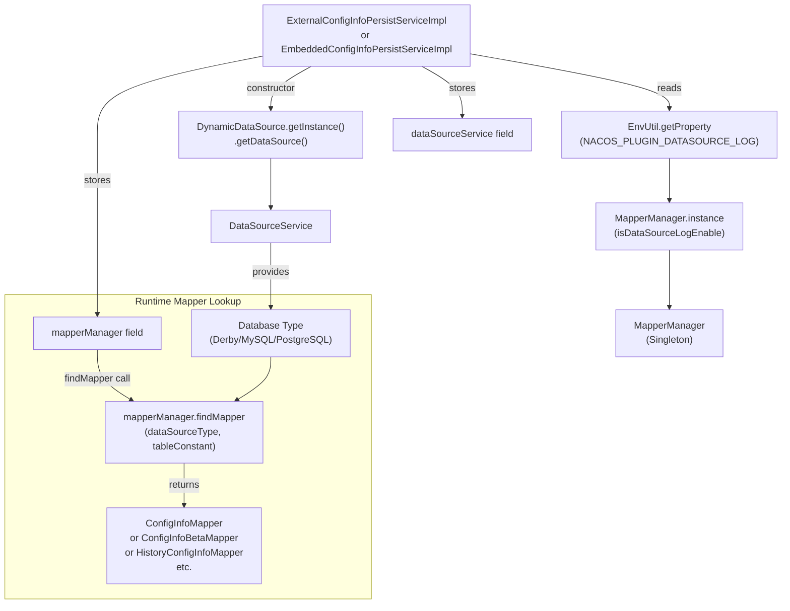
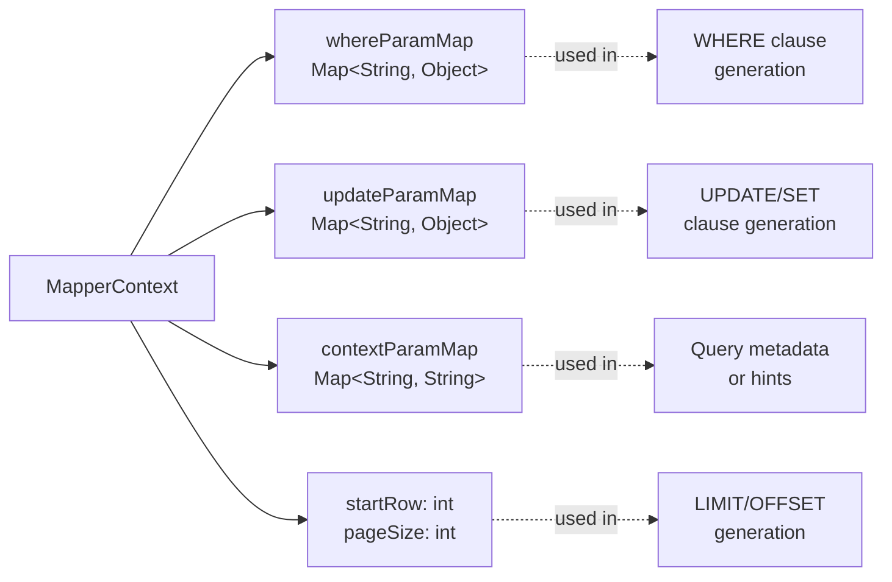
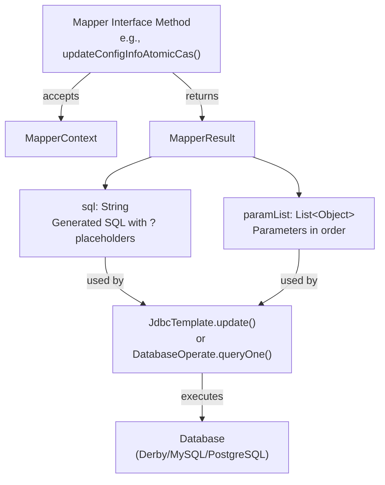
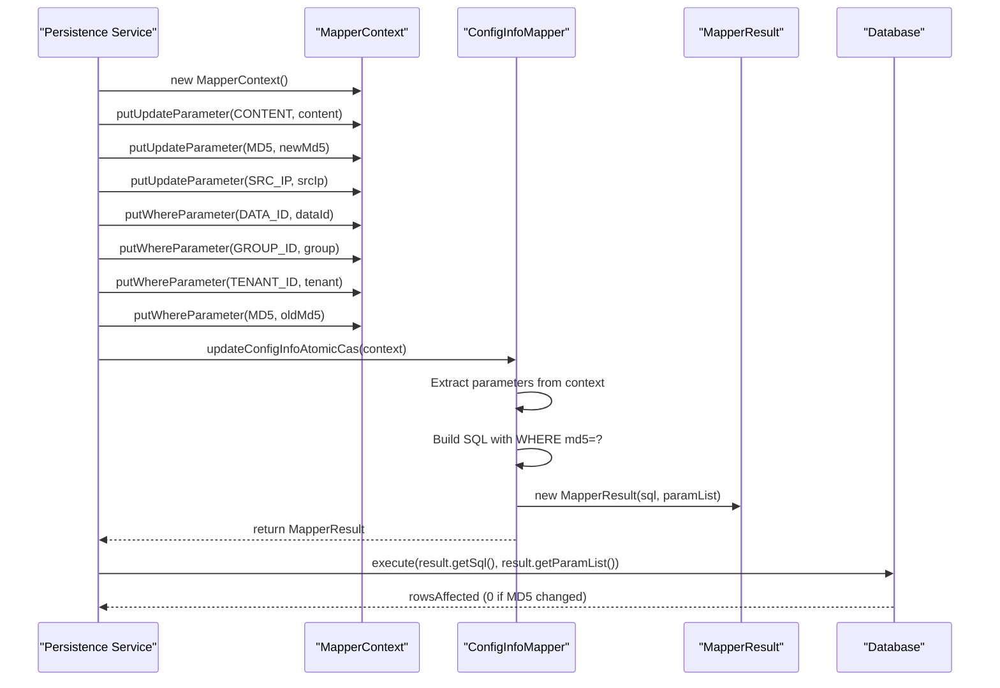

<!-- source: DeepWiki mcp.deepwiki.com · repo alibaba/nacos · page 5.2 Data Access Layer and Mappers · fetched 2026-10-29 -->

# Data Access Layer and Mappers

<details>
<summary>Relevant source files</summary>

The following files were used as context for generating this wiki page:

- [config/src/main/java/com/alibaba/nacos/config/server/service/repository/embedded/EmbeddedConfigInfoBetaPersistServiceImpl.java](config/src/main/java/com/alibaba/nacos/config/server/service/repository/embedded/EmbeddedConfigInfoBetaPersistServiceImpl.java)
- [config/src/main/java/com/alibaba/nacos/config/server/service/repository/embedded/EmbeddedConfigInfoPersistServiceImpl.java](config/src/main/java/com/alibaba/nacos/config/server/service/repository/embedded/EmbeddedConfigInfoPersistServiceImpl.java)
- [config/src/main/java/com/alibaba/nacos/config/server/service/repository/embedded/EmbeddedConfigInfoTagPersistServiceImpl.java](config/src/main/java/com/alibaba/nacos/config/server/service/repository/embedded/EmbeddedConfigInfoTagPersistServiceImpl.java)
- [config/src/main/java/com/alibaba/nacos/config/server/service/repository/embedded/EmbeddedHistoryConfigInfoPersistServiceImpl.java](config/src/main/java/com/alibaba/nacos/config/server/service/repository/embedded/EmbeddedHistoryConfigInfoPersistServiceImpl.java)
- [config/src/main/java/com/alibaba/nacos/config/server/service/repository/extrnal/ExternalConfigInfoBetaPersistServiceImpl.java](config/src/main/java/com/alibaba/nacos/config/server/service/repository/extrnal/ExternalConfigInfoBetaPersistServiceImpl.java)
- [config/src/main/java/com/alibaba/nacos/config/server/service/repository/extrnal/ExternalConfigInfoPersistServiceImpl.java](config/src/main/java/com/alibaba/nacos/config/server/service/repository/extrnal/ExternalConfigInfoPersistServiceImpl.java)
- [config/src/main/java/com/alibaba/nacos/config/server/service/repository/extrnal/ExternalConfigInfoTagPersistServiceImpl.java](config/src/main/java/com/alibaba/nacos/config/server/service/repository/extrnal/ExternalConfigInfoTagPersistServiceImpl.java)
- [config/src/main/java/com/alibaba/nacos/config/server/service/repository/extrnal/ExternalHistoryConfigInfoPersistServiceImpl.java](config/src/main/java/com/alibaba/nacos/config/server/service/repository/extrnal/ExternalHistoryConfigInfoPersistServiceImpl.java)
- [plugin/datasource/src/main/java/com/alibaba/nacos/plugin/datasource/mapper/ConfigInfoAggrMapper.java](plugin/datasource/src/main/java/com/alibaba/nacos/plugin/datasource/mapper/ConfigInfoAggrMapper.java)
- [plugin/datasource/src/main/java/com/alibaba/nacos/plugin/datasource/mapper/ConfigInfoBetaMapper.java](plugin/datasource/src/main/java/com/alibaba/nacos/plugin/datasource/mapper/ConfigInfoBetaMapper.java)
- [plugin/datasource/src/main/java/com/alibaba/nacos/plugin/datasource/model/MapperContext.java](plugin/datasource/src/main/java/com/alibaba/nacos/plugin/datasource/model/MapperContext.java)

</details>


The Data Access Layer provides an abstraction for database operations through a mapper pattern that generates database-specific SQL statements. This layer sits between the persistence service implementations (covered in [Storage Architecture and Implementations](#5.1)) and the underlying database, enabling Nacos to support multiple database types (Derby, MySQL, PostgreSQL) with a single codebase.

For information about the higher-level persistence service interfaces and their dual implementations, see [Storage Architecture and Implementations](#5.1).

## Overview

The mapper system provides:
- **Database-agnostic SQL generation** through the `Mapper` interface hierarchy
- **Dynamic mapper selection** via `MapperManager` factory based on database type
- **Parameterized query building** using `MapperContext` for type-safe SQL construction
- **Table-specific operations** through dedicated mapper interfaces for each database table

The key abstraction allows the same persistence service code to work with both embedded Derby and external MySQL/PostgreSQL databases without conditional logic.

## MapperManager Factory Pattern

`MapperManager` acts as a singleton factory that provides the appropriate mapper implementation based on the database type. Each persistence service obtains mappers through this central registry.

**Sources:** [config/src/main/java/com/alibaba/nacos/config/server/service/repository/extrnal/ExternalConfigInfoPersistServiceImpl.java:111-126](), [plugin/datasource/src/main/java/com/alibaba/nacos/plugin/datasource/model/MapperContext.java:1-142]()

### Mapper Factory Initialization



**Sources:** [config/src/main/java/com/alibaba/nacos/config/server/service/repository/extrnal/ExternalConfigInfoPersistServiceImpl.java:117-125](), [config/src/main/java/com/alibaba/nacos/config/server/service/repository/embedded/EmbeddedConfigInfoPersistServiceImpl.java:156-159]()

### Mapper Retrieval Pattern

The standard pattern for obtaining a mapper:

```java
// Get the appropriate mapper for the current database type
ConfigInfoMapper configInfoMapper = mapperManager.findMapper(
    dataSourceService.getDataSourceType(),
    TableConstant.CONFIG_INFO
);
```

This pattern appears throughout the persistence implementations. The `findMapper()` method returns a database-specific implementation (e.g., `MySqlConfigInfoMapper`, `PostgresqlConfigInfoMapper`, or `DerbyConfigInfoMapper`).

**Sources:** [config/src/main/java/com/alibaba/nacos/config/server/service/repository/extrnal/ExternalConfigInfoPersistServiceImpl.java:262-263](), [config/src/main/java/com/alibaba/nacos/config/server/service/repository/embedded/EmbeddedConfigInfoPersistServiceImpl.java:187-188]()

## Mapper Interface Hierarchy

Each database table has a corresponding mapper interface that defines SQL generation methods for that table. All mapper interfaces extend the base `Mapper` interface.

### Core Mapper Interfaces by Table

| Mapper Interface | Table Constant | Primary Responsibility |
|-----------------|----------------|----------------------|
| `ConfigInfoMapper` | `TableConstant.CONFIG_INFO` | Main configuration data CRUD operations |
| `ConfigInfoBetaMapper` | `TableConstant.CONFIG_INFO_BETA` | Beta configuration management |
| `ConfigInfoTagMapper` | `TableConstant.CONFIG_INFO_TAG` | Tagged configuration operations |
| `ConfigInfoAggrMapper` | `TableConstant.CONFIG_INFO_AGGR` | Aggregated configuration data |
| `HistoryConfigInfoMapper` | `TableConstant.HIS_CONFIG_INFO` | Configuration history tracking |
| `ConfigTagsRelationMapper` | `TableConstant.CONFIG_TAGS_RELATION` | Configuration-to-tag associations |

**Sources:** [config/src/main/java/com/alibaba/nacos/config/server/service/repository/extrnal/ExternalConfigInfoPersistServiceImpl.java:51-52](), [plugin/datasource/src/main/java/com/alibaba/nacos/plugin/datasource/mapper/ConfigInfoAggrMapper.java:34](), [plugin/datasource/src/main/java/com/alibaba/nacos/plugin/datasource/mapper/ConfigInfoBetaMapper.java:33]()

### Mapper Method Categories

Mappers provide methods that fall into these categories:

1. **Basic CRUD**: `insert()`, `select()`, `update()`, `delete()` with column lists
2. **Complex Queries**: Custom methods like `findConfigMaxId()`, `findAllConfigInfoFragment()`
3. **Conditional Operations**: CAS operations like `updateConfigInfoAtomicCas()`
4. **Pagination**: Methods accepting `MapperContext` with `startRow` and `pageSize`
5. **Aggregation**: Count and grouping operations

**Sources:** [plugin/datasource/src/main/java/com/alibaba/nacos/plugin/datasource/mapper/ConfigInfoAggrMapper.java:44-149]()

## MapperContext: Query Parameter Container

`MapperContext` serves as a type-safe container for building SQL queries. It separates WHERE clause parameters, UPDATE clause parameters, and pagination settings.



**Sources:** [plugin/datasource/src/main/java/com/alibaba/nacos/plugin/datasource/model/MapperContext.java:28-142]()

### MapperContext Usage Pattern

The typical usage pattern for building a parameterized query:

```java
MapperContext context = new MapperContext();

// WHERE clause parameters
context.putWhereParameter(FieldConstant.DATA_ID, configInfo.getDataId());
context.putWhereParameter(FieldConstant.GROUP_ID, configInfo.getGroup());
context.putWhereParameter(FieldConstant.TENANT_ID, tenantTmp);
context.putWhereParameter(FieldConstant.MD5, configInfo.getMd5());

// UPDATE clause parameters
context.putUpdateParameter(FieldConstant.CONTENT, configInfo.getContent());
context.putUpdateParameter(FieldConstant.MD5, md5Tmp);
context.putUpdateParameter(FieldConstant.SRC_IP, srcIp);

// Generate SQL
MapperResult result = configInfoMapper.updateConfigInfoAtomicCas(context);
```

**Sources:** [config/src/main/java/com/alibaba/nacos/config/server/service/repository/extrnal/ExternalConfigInfoPersistServiceImpl.java:665-687](), [config/src/main/java/com/alibaba/nacos/config/server/service/repository/embedded/EmbeddedConfigInfoBetaPersistServiceImpl.java:237-249]()

### FieldConstant for Type Safety

All field names are defined as constants in `FieldConstant` to avoid string literals:

- `FieldConstant.DATA_ID` - "data_id"
- `FieldConstant.GROUP_ID` - "group_id"
- `FieldConstant.TENANT_ID` - "tenant_id"
- `FieldConstant.CONTENT` - "content"
- `FieldConstant.MD5` - "md5"
- `FieldConstant.IDS` - "ids" (for batch operations)

**Sources:** [config/src/main/java/com/alibaba/nacos/config/server/service/repository/extrnal/ExternalConfigInfoPersistServiceImpl.java:47-56]()

## MapperResult: SQL and Parameters

The `MapperResult` class encapsulates the generated SQL statement along with its bound parameters as an ordered list.



**Sources:** [config/src/main/java/com/alibaba/nacos/config/server/service/repository/extrnal/ExternalConfigInfoPersistServiceImpl.java:534-536](), [config/src/main/java/com/alibaba/nacos/config/server/service/repository/embedded/EmbeddedHistoryConfigInfoPersistServiceImpl.java:137-139]()

### MapperResult Execution Pattern

**External Storage (JdbcTemplate):**
```java
MapperResult result = configInfoMapper.removeConfigInfoByIdsAtomic(context);
jt.update(result.getSql(), result.getParamList().toArray());
```

**Embedded Storage (DatabaseOperate):**
```java
MapperResult mapperResult = historyConfigInfoMapper.findDeletedConfig(context);
List<ConfigHistoryInfo> infos = databaseOperate.queryMany(
    mapperResult.getSql(),
    mapperResult.getParamList().toArray(),
    HISTORY_DETAIL_ROW_MAPPER
);
```

**Sources:** [config/src/main/java/com/alibaba/nacos/config/server/service/repository/extrnal/ExternalConfigInfoPersistServiceImpl.java:535-536](), [config/src/main/java/com/alibaba/nacos/config/server/service/repository/embedded/EmbeddedHistoryConfigInfoPersistServiceImpl.java:137-139]()

## Database-Specific SQL Generation

Mappers provide default implementations for common operations, but database-specific implementations can override these methods to generate optimized SQL for each database type.

### Common Mapper Methods

The base `Mapper` interface provides utility methods for common SQL operations:

**`insert(List<String> columns)`** - Generates INSERT statements:
```sql
INSERT INTO table_name (col1, col2, col3) VALUES (?, ?, ?)
```

**`select(List<String> columns, List<String> where)`** - Generates SELECT statements:
```sql
SELECT col1, col2, col3 FROM table_name WHERE where1 = ? AND where2 = ?
```

**`update(List<String> columns, List<String> where)`** - Generates UPDATE statements:
```sql
UPDATE table_name SET col1 = ?, col2 = ? WHERE where1 = ? AND where2 = ?
```

**`delete(List<String> where)`** - Generates DELETE statements:
```sql
DELETE FROM table_name WHERE where1 = ? AND where2 = ?
```

**Sources:** [config/src/main/java/com/alibaba/nacos/config/server/service/repository/extrnal/ExternalConfigInfoPersistServiceImpl.java:293-296](), [config/src/main/java/com/alibaba/nacos/config/server/service/repository/embedded/EmbeddedConfigInfoPersistServiceImpl.java:318-321]()

### Special Column Syntax

Columns can include functions by appending `@FUNCTION_NAME()`:

- `"gmt_modified@NOW()"` - Sets column to `NOW()` function
- `"gmt_create@NOW()"` - Sets column to `NOW()` function

This syntax is parsed by the mapper to generate appropriate SQL like:
```sql
INSERT INTO config_info (..., gmt_create, gmt_modified) 
VALUES (..., NOW(), NOW())
```

**Sources:** [config/src/main/java/com/alibaba/nacos/config/server/service/repository/extrnal/ExternalConfigInfoPersistServiceImpl.java:294-295](), [config/src/main/java/com/alibaba/nacos/config/server/service/repository/embedded/EmbeddedConfigInfoBetaPersistServiceImpl.java:129-131]()

### Database-Specific Optimizations

Different databases require different SQL syntax for operations like pagination:

**MySQL/PostgreSQL:**
```sql
SELECT ... FROM table LIMIT ? OFFSET ?
```

**Derby:**
```sql
SELECT ... FROM table OFFSET ? ROWS FETCH NEXT ? ROWS ONLY
```

The mapper implementation for each database type handles these differences transparently.

**Sources:** [plugin/datasource/src/main/java/com/alibaba/nacos/plugin/datasource/mapper/ConfigInfoBetaMapper.java:69-76]()

## Integration with Persistence Services

The mapper layer integrates seamlessly with both external and embedded persistence service implementations.


**Sources:** [config/src/main/java/com/alibaba/nacos/config/server/service/repository/extrnal/ExternalConfigInfoPersistServiceImpl.java:262-267](), [config/src/main/java/com/alibaba/nacos/config/server/service/repository/embedded/EmbeddedConfigInfoPersistServiceImpl.java:315-324]()

### Example: Insert Configuration

**External Storage Implementation:**
```java
// 1. Get mapper
ConfigInfoMapper configInfoMapper = mapperManager.findMapper(
    dataSourceService.getDataSourceType(),
    TableConstant.CONFIG_INFO
);

// 2. Generate SQL with mapper
String insertSql = configInfoMapper.insert(
    Arrays.asList("data_id", "group_id", "tenant_id", "app_name", "content", 
                  "md5", "src_ip", "src_user", "gmt_create@NOW()", 
                  "gmt_modified@NOW()", "c_desc", "c_use", "effect", "type", 
                  "c_schema", "encrypted_data_key")
);

// 3. Execute with JdbcTemplate
PreparedStatement ps = connection.prepareStatement(insertSql, 
                       configInfoMapper.getPrimaryKeyGeneratedKeys());
// ... set parameters ...
jt.update(ps);
```

**Embedded Storage Implementation:**
```java
// 1. Get mapper
ConfigInfoMapper configInfoMapper = mapperManager.findMapper(
    dataSourceService.getDataSourceType(),
    TableConstant.CONFIG_INFO
);

// 2. Generate SQL with mapper
final String sql = configInfoMapper.insert(
    Arrays.asList("id", "data_id", "group_id", "tenant_id", "app_name", 
                  "content", "md5", "src_ip", "src_user", "gmt_create@NOW()", 
                  "gmt_modified@NOW()", "c_desc", "c_use", "effect", "type", 
                  "c_schema", "encrypted_data_key")
);

// 3. Add to transaction context
final Object[] args = new Object[] {id, configInfo.getDataId(), ...};
EmbeddedStorageContextHolder.addSqlContext(sql, args);

// 4. Execute as part of transaction
databaseOperate.blockUpdate();
```

**Sources:** [config/src/main/java/com/alibaba/nacos/config/server/service/repository/extrnal/ExternalConfigInfoPersistServiceImpl.java:279-313](), [config/src/main/java/com/alibaba/nacos/config/server/service/repository/embedded/EmbeddedConfigInfoPersistServiceImpl.java:315-326]()

## Complex Query Example: CAS Update

The Compare-And-Set (CAS) update operation demonstrates how `MapperContext` enables complex conditional queries with type safety.



**Sources:** [config/src/main/java/com/alibaba/nacos/config/server/service/repository/extrnal/ExternalConfigInfoPersistServiceImpl.java:652-693]()

### CAS Update Implementation

The CAS operation ensures the configuration hasn't changed since it was read by checking the MD5 hash:

```java
// Build context with both UPDATE and WHERE parameters
MapperContext context = new MapperContext();

// What to update
context.putUpdateParameter(FieldConstant.CONTENT, configInfo.getContent());
context.putUpdateParameter(FieldConstant.MD5, md5Tmp);
context.putUpdateParameter(FieldConstant.SRC_IP, srcIp);
context.putUpdateParameter(FieldConstant.SRC_USER, srcUser);
// ... more update parameters ...

// Conditions (including old MD5 for CAS)
context.putWhereParameter(FieldConstant.DATA_ID, configInfo.getDataId());
context.putWhereParameter(FieldConstant.GROUP_ID, configInfo.getGroup());
context.putWhereParameter(FieldConstant.TENANT_ID, tenantTmp);
context.putWhereParameter(FieldConstant.MD5, configInfo.getMd5()); // Old MD5

// Generate SQL
ConfigInfoMapper mapper = mapperManager.findMapper(...);
MapperResult result = mapper.updateConfigInfoAtomicCas(context);

// Execute and check result
int rows = jt.update(result.getSql(), result.getParamList().toArray());
if (rows < 1) {
    return new ConfigOperateResult(false); // CAS failed
}
```

The generated SQL includes a WHERE clause like:
```sql
UPDATE config_info SET content=?, md5=?, ... 
WHERE data_id=? AND group_id=? AND tenant_id=? 
  AND (md5=? OR md5 IS NULL OR md5='')
```

**Sources:** [config/src/main/java/com/alibaba/nacos/config/server/service/repository/extrnal/ExternalConfigInfoPersistServiceImpl.java:665-688](), [plugin/datasource/src/main/java/com/alibaba/nacos/plugin/datasource/mapper/ConfigInfoBetaMapper.java:44-65]()

## Pagination with MapperContext

Pagination is handled through `MapperContext` fields `startRow` and `pageSize`, which mappers use to generate database-specific LIMIT/OFFSET clauses.

### Pagination Pattern

```java
final int startRow = (pageNo - 1) * pageSize;

// Create context with pagination
MapperContext context = new MapperContext();
context.setStartRow(startRow);
context.setPageSize(pageSize);

// Optionally add WHERE parameters
context.putWhereParameter(FieldConstant.DATA_ID, dataId);
context.putWhereParameter(FieldConstant.GROUP_ID, group);

// Get paginated SQL
ConfigInfoBetaMapper mapper = mapperManager.findMapper(...);
MapperResult result = mapper.findAllConfigInfoBetaForDumpAllFetchRows(context);

// Execute with PaginationHelper
PaginationHelper<ConfigInfoBetaWrapper> helper = createPaginationHelper();
Page<ConfigInfoBetaWrapper> page = helper.fetchPageLimit(
    countSql, 
    result.getSql(), 
    result.getParamList().toArray(), 
    pageNo, 
    pageSize, 
    ROW_MAPPER
);
```

**Sources:** [config/src/main/java/com/alibaba/nacos/config/server/service/repository/extrnal/ExternalConfigInfoBetaPersistServiceImpl.java:273-289](), [config/src/main/java/com/alibaba/nacos/config/server/service/repository/embedded/EmbeddedConfigInfoBetaPersistServiceImpl.java:297-314]()

## Aggregation Queries

The `ConfigInfoAggrMapper` demonstrates how mappers handle complex aggregation operations with dynamic IN clauses.

### Batch Delete with IN Clause

```java
// Build context with list of datum IDs to delete
MapperContext context = new MapperContext();
context.putWhereParameter(FieldConstant.DATUM_ID, datumList); // List<String>
context.putWhereParameter(FieldConstant.DATA_ID, dataId);
context.putWhereParameter(FieldConstant.GROUP_ID, group);
context.putWhereParameter(FieldConstant.TENANT_ID, tenantTmp);

// Mapper generates SQL with dynamic placeholders
MapperResult result = configInfoAggrMapper.batchRemoveAggr(context);
// Result SQL: DELETE FROM config_info_aggr 
//             WHERE data_id=? AND group_id=? AND tenant_id=? 
//               AND datum_id IN (?, ?, ?, ...)
```

The mapper dynamically builds the IN clause based on the list size:

```java
// From ConfigInfoAggrMapper.batchRemoveAggr()
final List<String> datumList = (List<String>) context.getWhereParameter(FieldConstant.DATUM_ID);
final StringBuilder placeholderString = new StringBuilder();
for (int i = 0; i < datumList.size(); i++) {
    if (i != 0) {
        placeholderString.append(", ");
    }
    placeholderString.append('?');
    paramList.add(datumList.get(i));
}
```

**Sources:** [plugin/datasource/src/main/java/com/alibaba/nacos/plugin/datasource/mapper/ConfigInfoAggrMapper.java:44-69](), [plugin/datasource/src/main/java/com/alibaba/nacos/plugin/datasource/mapper/ConfigInfoAggrMapper.java:79-105]()

## TableConstant for Table Names

All table names are defined in `TableConstant` to ensure consistency:

- `TableConstant.CONFIG_INFO` - "config_info"
- `TableConstant.CONFIG_INFO_BETA` - "config_info_beta"
- `TableConstant.CONFIG_INFO_TAG` - "config_info_tag"
- `TableConstant.CONFIG_INFO_AGGR` - "config_info_aggr"
- `TableConstant.HIS_CONFIG_INFO` - "his_config_info"
- `TableConstant.CONFIG_TAGS_RELATION` - "config_tags_relation"

Each mapper interface provides a `getTableName()` method that returns the corresponding constant.

**Sources:** [plugin/datasource/src/main/java/com/alibaba/nacos/plugin/datasource/mapper/ConfigInfoAggrMapper.java:157-159](), [plugin/datasource/src/main/java/com/alibaba/nacos/plugin/datasource/mapper/ConfigInfoBetaMapper.java:83-85]()

## Summary

The mapper layer provides:

1. **Database abstraction** through `MapperManager` factory selecting appropriate implementations
2. **Type-safe query building** via `MapperContext` for WHERE, UPDATE, and pagination parameters
3. **SQL generation** producing `MapperResult` with SQL strings and ordered parameter lists
4. **Table-specific operations** through dedicated mapper interfaces per database table
5. **Multi-database support** with database-specific SQL optimizations

This architecture enables Nacos to support both embedded Derby (for standalone mode) and external MySQL/PostgreSQL (for cluster mode) without duplicating business logic in the persistence service layer.

---

