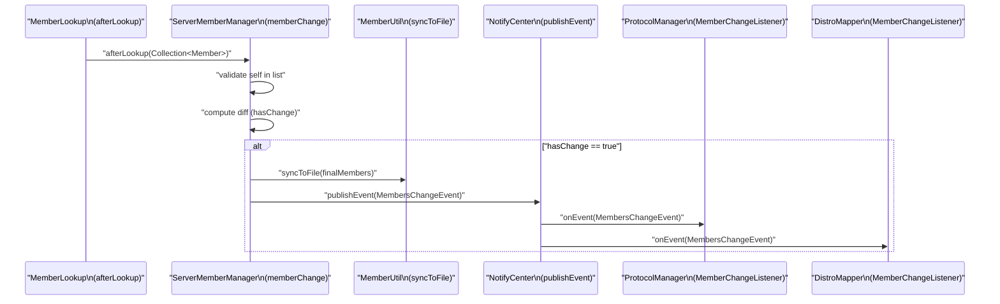

<!-- source: DeepWiki mcp.deepwiki.com · repo alibaba/nacos · page 6 Cluster Management · fetched 2026-10-29 -->

# Cluster Management

<details>
<summary>Relevant source files</summary>

The following files were used as context for generating this wiki page:

- [common/src/main/java/com/alibaba/nacos/common/utils/LoggerUtils.java](common/src/main/java/com/alibaba/nacos/common/utils/LoggerUtils.java)
- [core/src/main/java/com/alibaba/nacos/core/cluster/Member.java](core/src/main/java/com/alibaba/nacos/core/cluster/Member.java)
- [core/src/main/java/com/alibaba/nacos/core/cluster/MemberChangeListener.java](core/src/main/java/com/alibaba/nacos/core/cluster/MemberChangeListener.java)
- [core/src/main/java/com/alibaba/nacos/core/cluster/MemberMetaDataConstants.java](core/src/main/java/com/alibaba/nacos/core/cluster/MemberMetaDataConstants.java)
- [core/src/main/java/com/alibaba/nacos/core/cluster/MemberUtil.java](core/src/main/java/com/alibaba/nacos/core/cluster/MemberUtil.java)
- [core/src/main/java/com/alibaba/nacos/core/cluster/MembersChangeEvent.java](core/src/main/java/com/alibaba/nacos/core/cluster/MembersChangeEvent.java)
- [core/src/main/java/com/alibaba/nacos/core/cluster/ServerMemberManager.java](core/src/main/java/com/alibaba/nacos/core/cluster/ServerMemberManager.java)
- [core/src/main/java/com/alibaba/nacos/core/cluster/lookup/AddressServerMemberLookup.java](core/src/main/java/com/alibaba/nacos/core/cluster/lookup/AddressServerMemberLookup.java)
- [core/src/main/java/com/alibaba/nacos/core/cluster/lookup/FileConfigMemberLookup.java](core/src/main/java/com/alibaba/nacos/core/cluster/lookup/FileConfigMemberLookup.java)
- [core/src/main/java/com/alibaba/nacos/core/cluster/lookup/LookupFactory.java](core/src/main/java/com/alibaba/nacos/core/cluster/lookup/LookupFactory.java)
- [core/src/main/java/com/alibaba/nacos/core/cluster/lookup/StandaloneMemberLookup.java](core/src/main/java/com/alibaba/nacos/core/cluster/lookup/StandaloneMemberLookup.java)
- [naming/src/main/java/com/alibaba/nacos/naming/cluster/ServerStatus.java](naming/src/main/java/com/alibaba/nacos/naming/cluster/ServerStatus.java)
- [naming/src/main/java/com/alibaba/nacos/naming/cluster/ServerStatusManager.java](naming/src/main/java/com/alibaba/nacos/naming/cluster/ServerStatusManager.java)
- [naming/src/main/java/com/alibaba/nacos/naming/consistency/KeyBuilder.java](naming/src/main/java/com/alibaba/nacos/naming/consistency/KeyBuilder.java)
- [naming/src/main/java/com/alibaba/nacos/naming/core/DistroMapper.java](naming/src/main/java/com/alibaba/nacos/naming/core/DistroMapper.java)
- [naming/src/main/java/com/alibaba/nacos/naming/web/TrafficReviseFilter.java](naming/src/main/java/com/alibaba/nacos/naming/web/TrafficReviseFilter.java)

</details>


## Purpose and Scope

Cluster Management in Nacos coordinates server nodes in a distributed deployment. It handles member discovery, health monitoring, metadata synchronization, and integration with consistency protocols. The cluster layer, implemented primarily in the `core` module, provides the foundation for Configuration and Naming services to operate across multiple nodes with appropriate consistency guarantees.

- **Member Discovery and Health** (page 6.1): How nodes find each other via file-based or address-server strategies, and how `ServerMemberManager` monitors health through periodic report tasks.
- **Consistency Protocols** (page 6.2): JRaft for CP (strong consistency) and Distro for AP (eventual consistency), and how both protocols react to membership changes.

## Core Architecture

The cluster management system is centered around `ServerMemberManager`, which maintains the member list and coordinates health monitoring. Each cluster node is represented by a `Member` object containing addressing information, health state, and metadata about node capabilities.

**Cluster Management Components and Their Relationships**

```mermaid
graph TB
    subgraph "Member Discovery (core/cluster/lookup)"
        LookupFactory["LookupFactory\n(chooseLookup)"]
        AddressServer["AddressServerMemberLookup\n(HTTP periodic sync)"]
        FileConfig["FileConfigMemberLookup\n(cluster.conf + FileWatcher)"]
        Standalone["StandaloneMemberLookup\n(self only)"]
    end

    subgraph "Cluster Core (core/cluster)"
        SMM["ServerMemberManager\n@Component"]
        MemberList["serverList\nConcurrentSkipListMap"]
        HealthyAddrs["memberAddressInfos\nSet of UP addresses"]
        MCE["MembersChangeEvent\n(NotifyCenter)"]
    end

    subgraph "Health Monitoring (inner classes)"
        InfoReport["MemberInfoReportTask\nevery 2s"]
        UnhealthyReport["UnhealthyMemberInfoReportTask\nevery 5s"]
        RpcProxy["ClusterRpcClientProxy\nMemberReportRequest"]
    end

    subgraph "Consumers"
        ProtocolMgr["ProtocolManager\n(JRaft + Distro)"]
        DistroMapper["DistroMapper\n(naming)"]
    end

    LookupFactory --> AddressServer & FileConfig & Standalone
    AddressServer & FileConfig & Standalone -.afterLookup.-> SMM
    SMM --> MemberList & HealthyAddrs
    SMM --> InfoReport & UnhealthyReport
    InfoReport & UnhealthyReport --> RpcProxy
    RpcProxy -.MemberUtil.onSuccess/onFail.-> SMM
    SMM -.publishEvent.-> MCE
    MCE -.onEvent.-> ProtocolMgr & DistroMapper
```

Sources: [core/src/main/java/com/alibaba/nacos/core/cluster/ServerMemberManager.java:92-154](), [core/src/main/java/com/alibaba/nacos/core/cluster/lookup/LookupFactory.java:35-191](), [naming/src/main/java/com/alibaba/nacos/naming/core/DistroMapper.java:43-144]()

## Member Representation and State

The `Member` class ([core/src/main/java/com/alibaba/nacos/core/cluster/Member.java:41-190]()) represents a cluster node with the following key attributes:

| Attribute | Type | Description |
|-----------|------|-------------|
| `ip` | `String` | Node IP address |
| `port` | `int` | Main server port (default 8848) |
| `state` | `NodeState` | Health state: `UP`, `SUSPICIOUS`, or `DOWN` |
| `extendInfo` | `Map<String, Object>` | Metadata keyed by `MemberMetaDataConstants` (version, raftPort, weight, etc.) |
| `abilities` | `ServerAbilities` | Node capability flags (gRPC support, remote connection) |
| `failAccessCnt` | `int` | Consecutive health check failures (transient, not serialized) |

`MemberMetaDataConstants` defines the standard metadata keys:

| Constant | Key | Description |
|----------|-----|-------------|
| `VERSION` | `"version"` | Nacos server version string |
| `RAFT_PORT` | `"raftPort"` | Raft consensus port (main port − 1000) |
| `WEIGHT` | `"weight"` | Load balancing weight |
| `AD_WEIGHT` | `"adWeight"` | Administrative weight override |
| `SITE_KEY` | `"site"` | Deployment site identifier |
| `READY_TO_UPGRADE` | `"readyToUpgrade"` | Upgrade compatibility flag |

`ServerMemberManager` maintains two key data structures:
- `ConcurrentSkipListMap<String, Member> serverList`: All known cluster members indexed by `"ip:port"`
- `Set<String> memberAddressInfos`: Addresses of only `UP` members, used for request routing decisions

Sources: [core/src/main/java/com/alibaba/nacos/core/cluster/Member.java:41-190](), [core/src/main/java/com/alibaba/nacos/core/cluster/MemberMetaDataConstants.java:24-49](), [core/src/main/java/com/alibaba/nacos/core/cluster/ServerMemberManager.java:108-142]()

## Member Discovery and Health Monitoring

Nacos selects one of three member lookup strategies via `LookupFactory.createLookUp()`:

| Strategy Class | `LookupType` | Trigger | Use Case |
|----------------|--------------|---------|----------|
| `StandaloneMemberLookup` | — | On startup | Standalone mode (self only) |
| `FileConfigMemberLookup` | `FILE_CONFIG` | `cluster.conf` file + `WatchFileCenter` | Static cluster configuration |
| `AddressServerMemberLookup` | `ADDRESS_SERVER` | Periodic HTTP GET every 5 seconds | Dynamic clusters via external address server |

Selection logic in `LookupFactory.chooseLookup()`: if `nacos.core.member.lookup.type` is set, use it; otherwise use `FILE_CONFIG` if `cluster.conf` exists or `nacos.member.list` is set; otherwise fall back to `ADDRESS_SERVER`.

Health is maintained by two inner classes in `ServerMemberManager`:

| Task | Interval | Behavior |
|------|----------|----------|
| `MemberInfoReportTask` | 2 seconds | Round-robins peers; sends `MemberReportRequest` via gRPC (`ClusterRpcClientProxy`) or HTTP fallback |
| `UnhealthyMemberInfoReportTask` | 5 seconds | Reports to all non-`UP` members to attempt recovery |

`MemberUtil.onSuccess()` resets `failAccessCnt` to 0 and sets state to `UP`. `MemberUtil.onFail()` increments the counter and transitions to `SUSPICIOUS`, then to `DOWN` when the count exceeds `nacos.core.member.fail-access-cnt` (default: 3), or immediately on connection refused.

These tasks are started by `setSelfReady()`, which is called after the server has finished initializing its services.

For full details on each lookup implementation, see page 6.1.

Sources: [core/src/main/java/com/alibaba/nacos/core/cluster/ServerMemberManager.java:231-247](), [core/src/main/java/com/alibaba/nacos/core/cluster/ServerMemberManager.java:481-490](), [core/src/main/java/com/alibaba/nacos/core/cluster/ServerMemberManager.java:530-698](), [core/src/main/java/com/alibaba/nacos/core/cluster/MemberUtil.java:143-205](), [core/src/main/java/com/alibaba/nacos/core/cluster/lookup/LookupFactory.java:119-131]()

## Member Change Events and Propagation

The cluster uses an event-driven model to propagate membership changes. `MembersChangeEvent` is the central event published via `NotifyCenter` whenever the member list changes.

**Member Change Event Flow**



**Initialization Sequence**

`ServerMemberManager.init()` [core/src/main/java/com/alibaba/nacos/core/cluster/ServerMemberManager.java:156-182]() performs these steps in order:

1. Reads port from `nacos.server.main.port` (default: `8848`)
2. Creates local `Member` via `MemberUtil.singleParse(localAddress)`
3. Sets version and capabilities on `self`
4. Registers `MembersChangeEvent` publisher to `NotifyCenter`
5. Subscribes to `InetUtils.IPChangeEvent` to handle local IP changes
6. Calls `LookupFactory.createLookUp(this)` to initialize member discovery

Health tasks (`MemberInfoReportTask`, `UnhealthyMemberInfoReportTask`) start only after `setSelfReady()` is called [core/src/main/java/com/alibaba/nacos/core/cluster/ServerMemberManager.java:481-490]() and only when not in standalone mode.

**Member Change Processing**

`memberChange(Collection<Member>)` [core/src/main/java/com/alibaba/nacos/core/cluster/ServerMemberManager.java:356-418]() follows this logic:

1. Ensures self is in the list (adds self with a warning if missing; sets `isInIpList = false`)
2. Compares old and new sizes; iterates to detect any new addresses
3. Retains existing member metadata (abilities, extendInfo) for known addresses
4. Replaces `serverList` atomically
5. Calls `MemberUtil.syncToFile()` to persist the updated list to `cluster.conf`
6. Publishes `MembersChangeEvent` to all registered `MemberChangeListener` subscribers

`MembersChangeEvent` carries the full member list and optional trigger members. Subscribers like `DistroMapper` use it to rebuild their sorted healthy-node lists.

Sources: [core/src/main/java/com/alibaba/nacos/core/cluster/ServerMemberManager.java:156-235](), [core/src/main/java/com/alibaba/nacos/core/cluster/ServerMemberManager.java:356-418](), [core/src/main/java/com/alibaba/nacos/core/cluster/MembersChangeEvent.java:36-106](), [core/src/main/java/com/alibaba/nacos/core/cluster/MemberUtil.java:212-224](), [naming/src/main/java/com/alibaba/nacos/naming/core/DistroMapper.java:128-138]()

## Integration with Consistency Protocols

The cluster layer integrates with two consistency protocols that subscribe to `MembersChangeEvent`:

| Protocol | Consistency | Use Case |
|----------|-------------|----------|
| JRaft (CP) | Strong (Raft consensus) | Configuration data, persistent service instances |
| Distro (AP) | Eventual | Ephemeral service instances |

When `ServerMemberManager` publishes `MembersChangeEvent`, `ProtocolManager` (a `MemberChangeListener`) forwards the updated peer list to both protocols. This ensures Raft groups update their peer sets when nodes join or leave, and the Distro protocol adjusts its data ownership partitions.

`DistroMapper` in the naming module also subscribes to `MembersChangeEvent` and rebuilds its sorted healthy-node list to recalculate hash-based service ownership (`responsible(String responsibleTag)`).

See page 6.2 for detailed coverage of JRaft server setup, Raft group management, `NacosStateMachine`, Distro `DataSyncer`, and `TaskDispatcher`.

Sources: [naming/src/main/java/com/alibaba/nacos/naming/core/DistroMapper.java:43-144](), [core/src/main/java/com/alibaba/nacos/core/cluster/MemberChangeListener.java:27-48]()

## Key Configuration Properties

The following properties control cluster management behavior:

| Property | Default | Description |
|----------|---------|-------------|
| `nacos.server.main.port` | 8848 | Main server port |
| `nacos.member-change-event.queue.size` | 128 | Event queue capacity for member changes |
| `nacos.core.member.fail-access-cnt` | 3 | Failed access threshold before marking DOWN |
| `nacos.core.protocol.raft.data.election_timeout_ms` | 5000 | Raft election timeout |
| `nacos.core.protocol.raft.data.snapshot_interval_secs` | 1800 | Snapshot interval (30 minutes) |
| `nacos.core.address-server.retry` | 5 | Address server retry attempts on startup |

The Raft port is calculated as main port minus 1000 (e.g., 7848 for default configuration) and stored in member metadata as `MemberMetaDataConstants.RAFT_PORT`.

Sources: [core/src/main/java/com/alibaba/nacos/core/cluster/ServerMemberManager.java:97-106](), [core/src/main/java/com/alibaba/nacos/core/distributed/raft/JRaftServer.java:167-168](), [core/src/main/java/com/alibaba/nacos/core/cluster/MemberUtil.java:120-122]()

---

