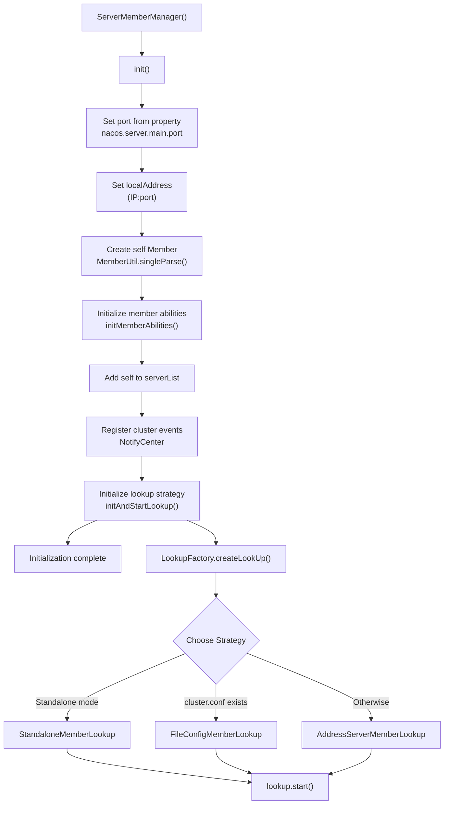
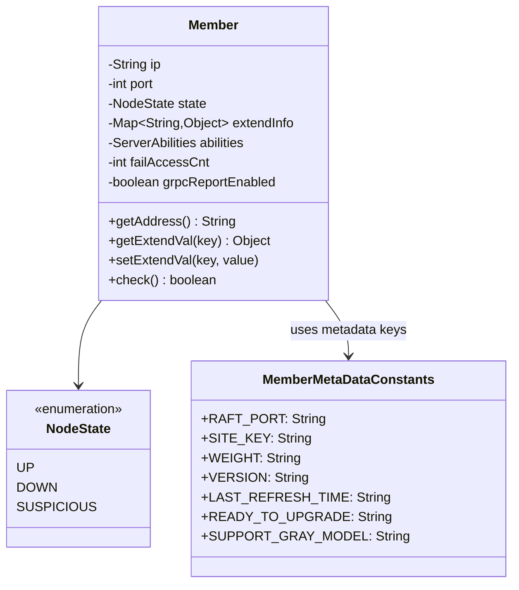
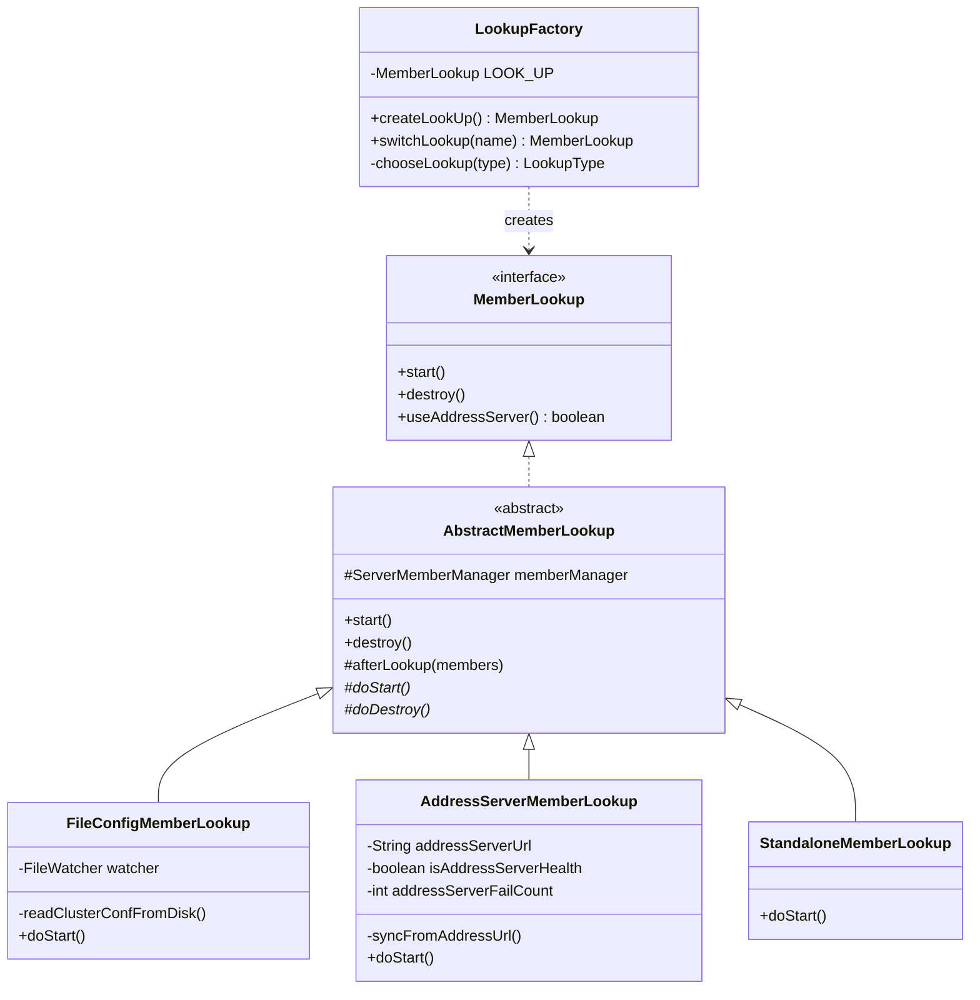
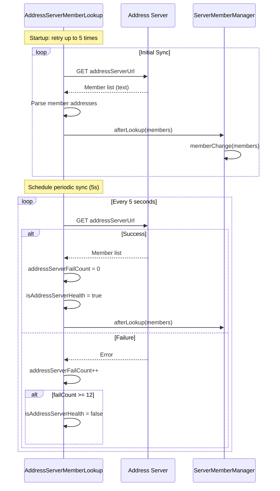
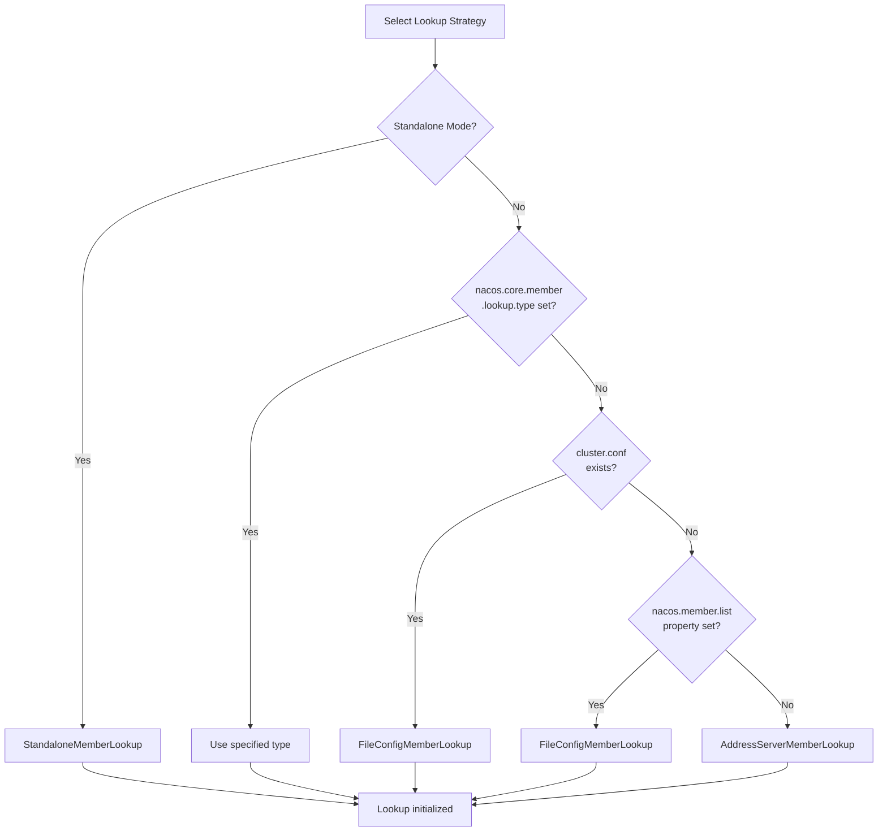
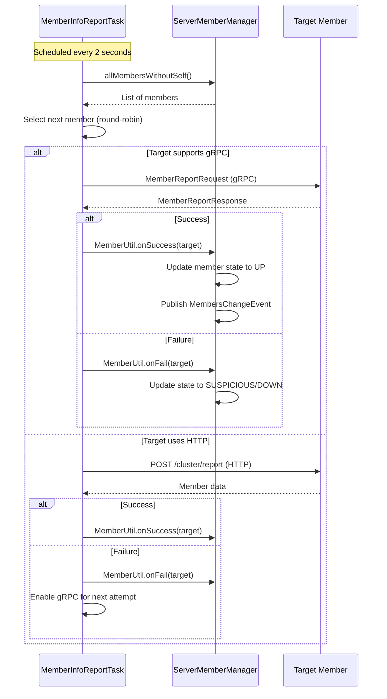
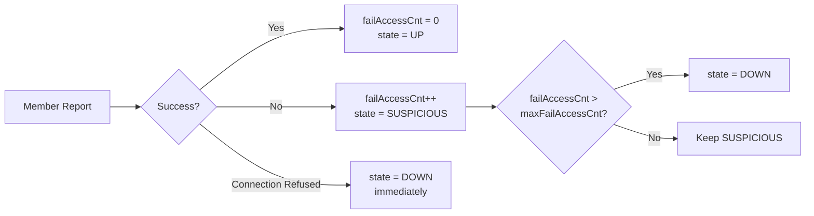
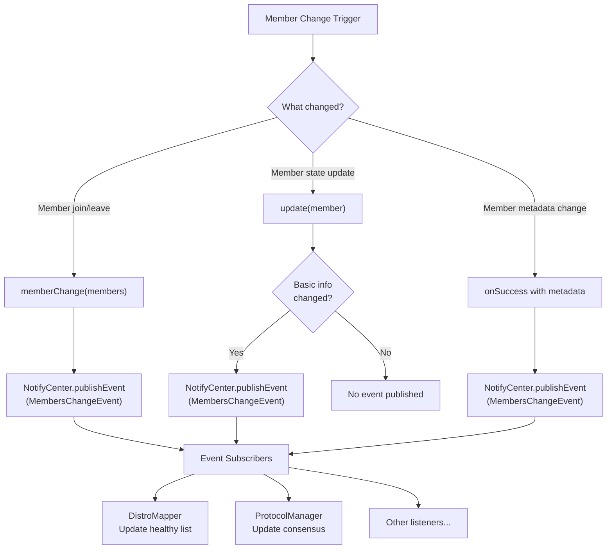
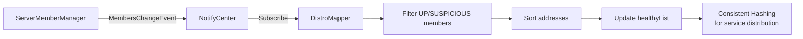

<!-- source: DeepWiki mcp.deepwiki.com · repo alibaba/nacos · page 6.1 Member Discovery and Cluster Configuration · fetched 2026-10-29 -->

# Member Discovery and Cluster Configuration

<details>
<summary>Relevant source files</summary>

The following files were used as context for generating this wiki page:

- [common/src/main/java/com/alibaba/nacos/common/utils/LoggerUtils.java](common/src/main/java/com/alibaba/nacos/common/utils/LoggerUtils.java)
- [core/src/main/java/com/alibaba/nacos/core/cluster/Member.java](core/src/main/java/com/alibaba/nacos/core/cluster/Member.java)
- [core/src/main/java/com/alibaba/nacos/core/cluster/MemberChangeListener.java](core/src/main/java/com/alibaba/nacos/core/cluster/MemberChangeListener.java)
- [core/src/main/java/com/alibaba/nacos/core/cluster/MemberMetaDataConstants.java](core/src/main/java/com/alibaba/nacos/core/cluster/MemberMetaDataConstants.java)
- [core/src/main/java/com/alibaba/nacos/core/cluster/MemberUtil.java](core/src/main/java/com/alibaba/nacos/core/cluster/MemberUtil.java)
- [core/src/main/java/com/alibaba/nacos/core/cluster/MembersChangeEvent.java](core/src/main/java/com/alibaba/nacos/core/cluster/MembersChangeEvent.java)
- [core/src/main/java/com/alibaba/nacos/core/cluster/ServerMemberManager.java](core/src/main/java/com/alibaba/nacos/core/cluster/ServerMemberManager.java)
- [core/src/main/java/com/alibaba/nacos/core/cluster/lookup/AddressServerMemberLookup.java](core/src/main/java/com/alibaba/nacos/core/cluster/lookup/AddressServerMemberLookup.java)
- [core/src/main/java/com/alibaba/nacos/core/cluster/lookup/FileConfigMemberLookup.java](core/src/main/java/com/alibaba/nacos/core/cluster/lookup/FileConfigMemberLookup.java)
- [core/src/main/java/com/alibaba/nacos/core/cluster/lookup/LookupFactory.java](core/src/main/java/com/alibaba/nacos/core/cluster/lookup/LookupFactory.java)
- [core/src/main/java/com/alibaba/nacos/core/cluster/lookup/StandaloneMemberLookup.java](core/src/main/java/com/alibaba/nacos/core/cluster/lookup/StandaloneMemberLookup.java)

</details>


This document describes how Nacos discovers and manages cluster member nodes, including the various addressing strategies, health monitoring, and state synchronization mechanisms. The `ServerMemberManager` is the core component responsible for maintaining the cluster topology and ensuring all nodes have a consistent view of cluster membership.

For information about how cluster member data is used for service instance distribution, see [Request Distribution and Service Discovery](#4.3). For details on consistency protocols that rely on cluster membership, see [Consistency Protocols](#6.2).

## Overview

Member discovery and cluster configuration in Nacos provides:

- **Multiple Addressing Strategies**: File-based configuration, address server lookup, and standalone mode
- **Dynamic Member Management**: Automatic detection of member joins, leaves, and state changes
- **Health Monitoring**: Continuous health checking of cluster nodes with state transitions
- **Member Synchronization**: Periodic information exchange between nodes via HTTP or gRPC
- **Event Notification**: Publish-subscribe system for member change events

The system supports both cluster and standalone deployment modes, with the addressing strategy selected automatically or explicitly configured.

## ServerMemberManager

The `ServerMemberManager` class is the central component for cluster membership management. It maintains the list of all cluster members, tracks their health state, and coordinates member information synchronization.

**Key Responsibilities:**

| Responsibility | Description |
|----------------|-------------|
| Member Registry | Maintains a thread-safe map of all cluster members |
| Health Tracking | Monitors member health states (UP, DOWN, SUSPICIOUS) |
| Information Reporting | Periodically reports local member info to other nodes |
| Lookup Management | Initializes and manages the addressing strategy |
| Event Publishing | Notifies subscribers of member changes |

### Member Storage and State

The manager uses a `ConcurrentSkipListMap<String, Member>` to store members, keyed by their address (ip:port). This provides thread-safe access with ordered iteration. A separate `Set<String>` tracks only healthy member addresses for quick access.

[core/src/main/java/com/alibaba/nacos/core/cluster/ServerMemberManager.java:110-137]()

### Initialization Flow



**Sources:** [core/src/main/java/com/alibaba/nacos/core/cluster/ServerMemberManager.java:146-173](), [core/src/main/java/com/alibaba/nacos/core/cluster/lookup/LookupFactory.java:64-73]()

## Member Entity and Metadata

The `Member` class represents a single cluster node with its IP, port, state, and extensible metadata.

### Member Structure



**Sources:** [core/src/main/java/com/alibaba/nacos/core/cluster/Member.java:41-190](), [core/src/main/java/com/alibaba/nacos/core/cluster/MemberMetaDataConstants.java:24-49]()

### Member State Lifecycle

| State | Description | Transition Conditions |
|-------|-------------|----------------------|
| UP | Member is healthy and operational | Successful health check or report |
| SUSPICIOUS | Member failed to respond but not yet marked down | Single health check failure |
| DOWN | Member is unreachable | Multiple consecutive failures (>3) or connection refused |

State transitions are managed by `MemberUtil.onSuccess()` and `MemberUtil.onFail()` methods, which update the member's state and trigger change notifications.

[core/src/main/java/com/alibaba/nacos/core/cluster/MemberUtil.java:143-205]()

## Member Lookup Strategies

Nacos supports three addressing strategies for discovering cluster members, selected via the `nacos.core.member.lookup.type` property or automatically based on deployment configuration.

### Lookup Strategy Architecture



**Sources:** [core/src/main/java/com/alibaba/nacos/core/cluster/lookup/LookupFactory.java:35-191]()

### File-Based Configuration Lookup

`FileConfigMemberLookup` reads cluster member addresses from the `cluster.conf` file located in the Nacos configuration directory.

**Configuration File Format:**
```
# cluster.conf
192.168.1.1:8848
192.168.1.2:8848
192.168.1.3:8848
```

The lookup monitors the file for changes using `WatchFileCenter` and automatically reloads the member list when the file is modified.

**Key Properties:**
- **File Path**: `{nacos.home}/conf/cluster.conf`
- **Watch Mechanism**: File system notifications via `FileWatcher`
- **Reload Trigger**: File modification events

[core/src/main/java/com/alibaba/nacos/core/cluster/lookup/FileConfigMemberLookup.java:38-89]()

### Address Server Lookup

`AddressServerMemberLookup` retrieves cluster member addresses from a centralized address server via HTTP requests. This is useful for dynamic environments where member addresses change frequently.

**Configuration Properties:**

| Property | Environment Variable | Default | Description |
|----------|---------------------|---------|-------------|
| `address.server.domain` | `address_server_domain` | `jmenv.tbsite.net` | Address server domain |
| `address.server.port` | `address_server_port` | `8080` | Address server port |
| `address.server.url` | `address_server_url` | `/serverlist` | Server list endpoint |
| `nacos.core.address-server.retry` | - | `5` | Startup retry attempts |
| `maxHealthCheckFailCount` | - | `12` | Max failures before unhealthy |

**Synchronization Process:**



**Sources:** [core/src/main/java/com/alibaba/nacos/core/cluster/lookup/AddressServerMemberLookup.java:45-213]()

### Standalone Mode Lookup

`StandaloneMemberLookup` is used when Nacos runs in standalone mode. It creates a single-member cluster containing only the local node.

[core/src/main/java/com/alibaba/nacos/core/cluster/lookup/StandaloneMemberLookup.java:30-47]()

### Lookup Selection Logic



**Sources:** [core/src/main/java/com/alibaba/nacos/core/cluster/lookup/LookupFactory.java:119-131]()

## Member Information Reporting

In cluster mode, each Nacos server periodically reports its member information to other nodes to maintain cluster health awareness and synchronize metadata.

### Reporting Architecture

The `ServerMemberManager` uses two internal tasks for member information reporting:

1. **MemberInfoReportTask**: Reports to one healthy node per cycle (round-robin)
2. **UnhealthyMemberInfoReportTask**: Specifically targets unhealthy nodes to attempt recovery

[core/src/main/java/com/alibaba/nacos/core/cluster/ServerMemberManager.java:511-679]()

### Report Flow



**Sources:** [core/src/main/java/com/alibaba/nacos/core/cluster/ServerMemberManager.java:511-651]()

### Report Intervals

| Task | Interval | Purpose |
|------|----------|---------|
| MemberInfoReportTask | 2 seconds | Report to one healthy node per cycle |
| UnhealthyMemberInfoReportTask | 5 seconds | Attempt to recover unhealthy nodes |
| Member count logging | 50 seconds | Log total member count |

The round-robin cursor ensures all members are contacted over time, distributing the reporting load evenly.

[core/src/main/java/com/alibaba/nacos/core/cluster/ServerMemberManager.java:520-530]()

## Health Checking and State Management

Member health is tracked through multiple mechanisms:

### Health Check Strategies

1. **Active Reporting**: Members actively report to each other, updating health on success/failure
2. **Failure Counting**: Track consecutive failures with configurable threshold
3. **Connection Monitoring**: Detect connection refused errors for immediate DOWN state

### Failure Threshold Configuration



**Configuration:**
- **Property**: `nacos.core.member.fail-access-cnt`
- **Default**: `3` consecutive failures
- **Override**: Connection refused errors bypass the counter

**Sources:** [core/src/main/java/com/alibaba/nacos/core/cluster/MemberUtil.java:177-205]()

### State Update Methods

The `MemberUtil` class provides utility methods for state updates:

| Method | Purpose | State Transition |
|--------|---------|------------------|
| `onSuccess(manager, member)` | Mark member healthy | → UP |
| `onSuccess(manager, member, receivedMember)` | Update health with metadata sync | → UP + metadata update |
| `onFail(manager, member)` | Mark member unhealthy | → SUSPICIOUS |
| `onFail(manager, member, throwable)` | Mark unhealthy with error analysis | → SUSPICIOUS or DOWN |

[core/src/main/java/com/alibaba/nacos/core/cluster/MemberUtil.java:143-205]()

## Member Change Events

The cluster uses a publish-subscribe pattern for member change notifications. When the member list or individual member states change, the `ServerMemberManager` publishes `MembersChangeEvent` instances through the `NotifyCenter`.

### Event Publishing



**Sources:** [core/src/main/java/com/alibaba/nacos/core/cluster/ServerMemberManager.java:272-274](), [core/src/main/java/com/alibaba/nacos/core/cluster/ServerMemberManager.java:347-406]()

### Event Subscribers

Key components that subscribe to `MembersChangeEvent`:

1. **DistroMapper**: Updates the healthy server list for consistent hashing
2. **ProtocolManager**: Adjusts consensus protocol participants
3. **RaftPeerSet**: Updates Raft cluster configuration

[core/src/main/java/com/alibaba/nacos/core/cluster/MembersChangeEvent.java:25-35]()

### Event Queue Configuration

The member change event queue size is configurable to handle burst scenarios:

- **Property**: `nacos.member-change-event.queue.size`
- **Default**: `128` events

[core/src/main/java/com/alibaba/nacos/core/cluster/ServerMemberManager.java:101-103](), [core/src/main/java/com/alibaba/nacos/core/cluster/ServerMemberManager.java:189-194]()

## Member Operations API

The `ServerMemberManager` provides a comprehensive API for member management:

### Query Operations

| Method | Return Type | Description |
|--------|-------------|-------------|
| `getSelf()` | `Member` | Returns the local node's member object |
| `allMembers()` | `Collection<Member>` | Returns all members including self |
| `allMembersWithoutSelf()` | `List<Member>` | Returns all members excluding self |
| `find(address)` | `Member` | Finds a specific member by address |
| `hasMember(address)` | `boolean` | Checks if member exists (supports fuzzy match) |
| `getServerList()` | `Map<String, Member>` | Returns unmodifiable view of server list |
| `getMemberAddressInfos()` | `Set<String>` | Returns addresses of healthy members only |
| `getServerListUnhealth()` | `List<String>` | Returns list of unhealthy member addresses |

[core/src/main/java/com/alibaba/nacos/core/cluster/ServerMemberManager.java:314-333](), [core/src/main/java/com/alibaba/nacos/core/cluster/ServerMemberManager.java:298-308]()

### Modification Operations

| Method | Description | Synchronized |
|--------|-------------|--------------|
| `memberChange(members)` | Replace entire member list | Yes |
| `memberJoin(members)` | Add members to cluster | Yes |
| `memberLeave(members)` | Remove members from cluster | Yes |
| `update(member)` | Update specific member information | No |

The synchronization ensures thread-safe modifications and atomic event publishing.

[core/src/main/java/com/alibaba/nacos/core/cluster/ServerMemberManager.java:347-430]()

## Configuration Properties

### Core Configuration

| Property | Default | Description |
|----------|---------|-------------|
| `nacos.server.main.port` | `8848` | Main server port |
| `nacos.member-change-event.queue.size` | `128` | Event queue capacity |
| `nacos.core.member.fail-access-cnt` | `3` | Failure threshold for DOWN state |
| `nacos.core.member.lookup.type` | Auto-detect | Lookup strategy: `file` or `address-server` |

### Address Server Configuration

| Property | Environment Variable | Default |
|----------|---------------------|---------|
| `address.server.domain` | `address_server_domain` | `jmenv.tbsite.net` |
| `address.server.port` | `address_server_port` | `8080` |
| `address.server.url` | `address_server_url` | `/serverlist` |
| `nacos.core.address-server.retry` | - | `5` |
| `maxHealthCheckFailCount` | - | `12` |

### Member Metadata Configuration

Member metadata can be configured via properties with prefix `nacos.core.member.meta.`:

| Metadata Key | Property | Default |
|--------------|----------|---------|
| `site` | `nacos.core.member.meta.site` | `unknow` |
| `weight` | `nacos.core.member.meta.weight` | `1` |
| `adWeight` | `nacos.core.member.meta.adWeight` | `0` |

**Sources:** [core/src/main/java/com/alibaba/nacos/core/cluster/Member.java:55-63]()

## Integration with Other Systems

### DistroMapper Integration

The `DistroMapper` subscribes to `MembersChangeEvent` to maintain a sorted list of healthy member addresses for consistent hashing in service discovery.



**Sources:** [naming/src/main/java/com/alibaba/nacos/naming/core/DistroMapper.java:42-144]()

### RPC Connection Management

The member list is used by the `ClusterRpcClientProxy` to establish and maintain gRPC connections between cluster nodes.

[core/src/main/java/com/alibaba/nacos/core/cluster/ServerMemberManager.java:597-626]()

## Lifecycle Management

### Startup Sequence

1. Initialize port and local address from configuration
2. Create self member object with initial metadata and abilities
3. Register cluster event publishers and subscribers
4. Initialize and start the appropriate lookup strategy
5. Schedule member information reporting tasks (cluster mode only)

[core/src/main/java/com/alibaba/nacos/core/cluster/ServerMemberManager.java:151-173]()

### Ready State

Once the server is ready to serve requests, `setSelfReady()` is called to:
- Set self member state to UP
- Start periodic reporting tasks (if not in standalone mode)
- Update environment properties

[core/src/main/java/com/alibaba/nacos/core/cluster/ServerMemberManager.java:469-478]()

### Shutdown

The shutdown process cleans up resources:
1. Clear server list and address info
2. Shutdown reporting tasks
3. Destroy lookup strategy
4. Deregister event subscribers

[core/src/main/java/com/alibaba/nacos/core/cluster/ServerMemberManager.java:485-491]()

## Best Practices

### File-Based Configuration
- Use for stable, manually-managed clusters
- Place `cluster.conf` in `{nacos.home}/conf/`
- Monitor file changes to verify automatic reloads
- Keep addresses in sorted order for consistency

### Address Server Configuration
- Use for dynamic, auto-scaling environments
- Ensure address server high availability
- Monitor `isAddressServerHealth` metric
- Configure appropriate retry and failure thresholds

### Health Monitoring
- Set `nacos.core.member.fail-access-cnt` based on network reliability
- Lower values (1-2) for stable networks with fast failure detection
- Higher values (5-10) for unreliable networks to avoid false positives

### Member Metadata
- Use metadata for custom routing or weight-based load balancing
- Keep metadata keys consistent across cluster
- Monitor `LAST_REFRESH_TIME` to detect stale members

**Sources:** [core/src/main/java/com/alibaba/nacos/core/cluster/ServerMemberManager.java:1-681](), [core/src/main/java/com/alibaba/nacos/core/cluster/lookup/]()

---

