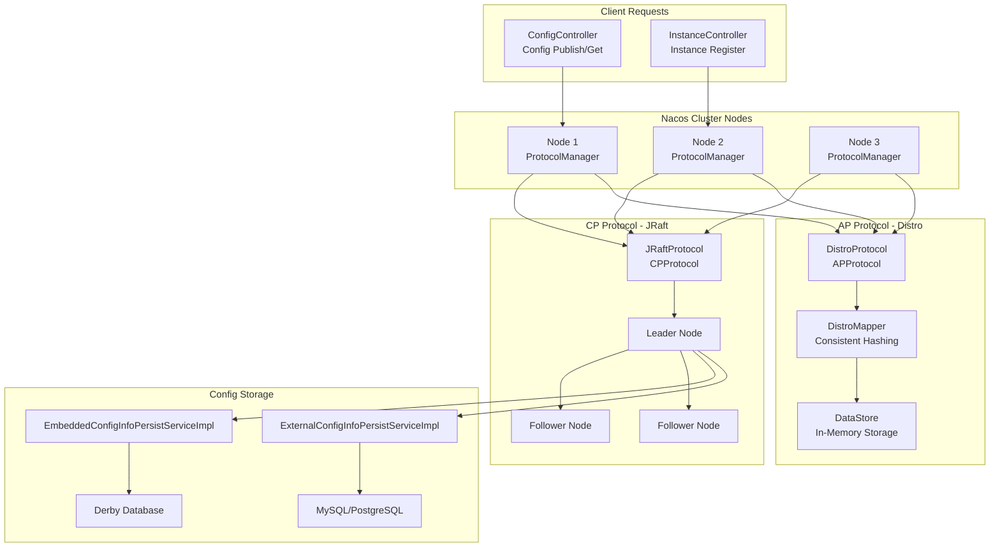
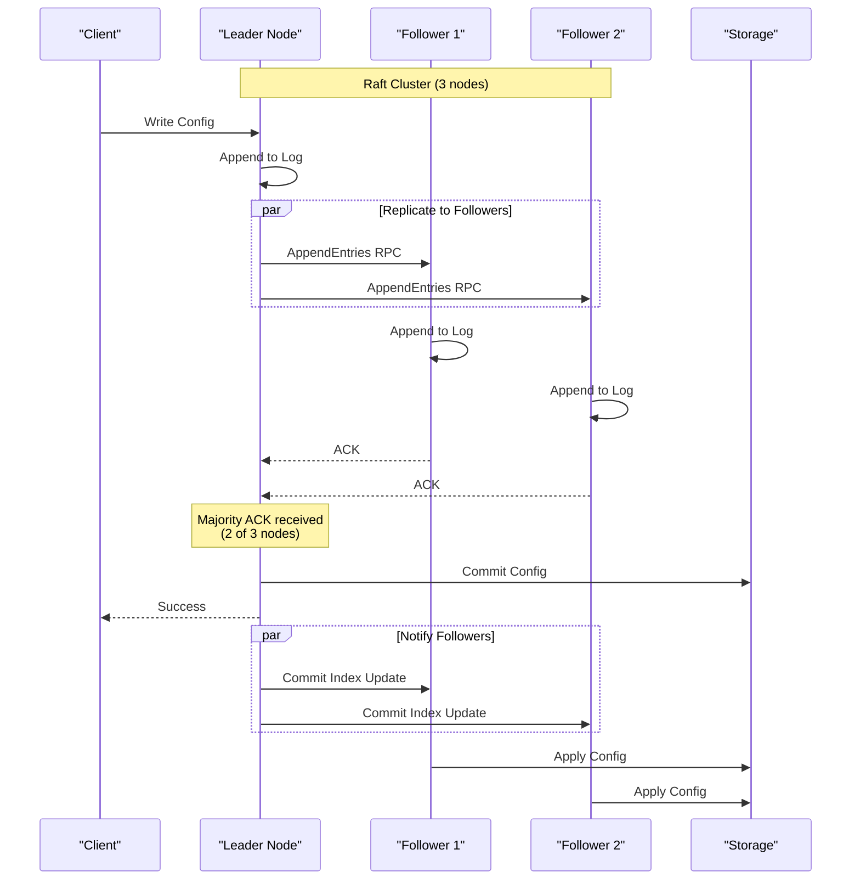
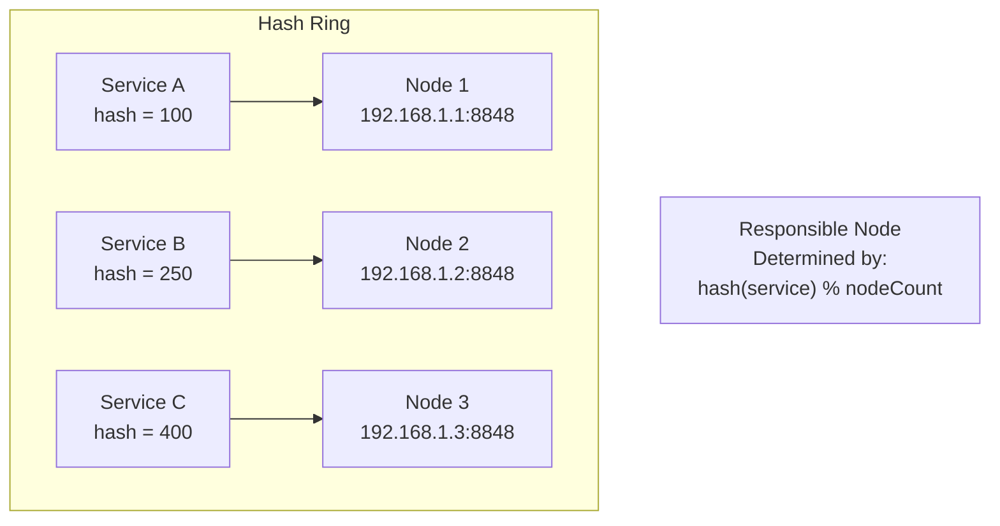
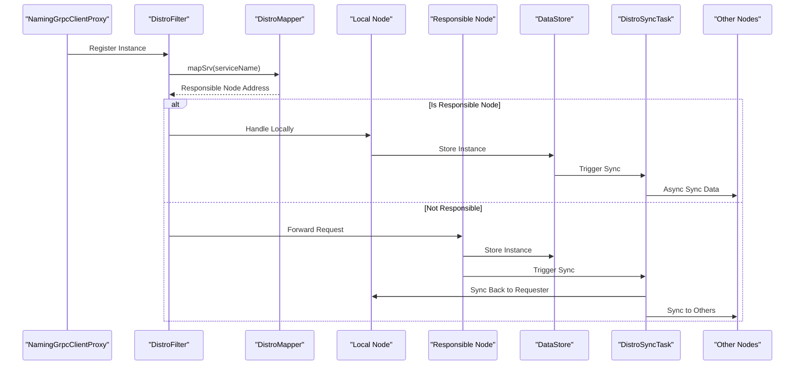
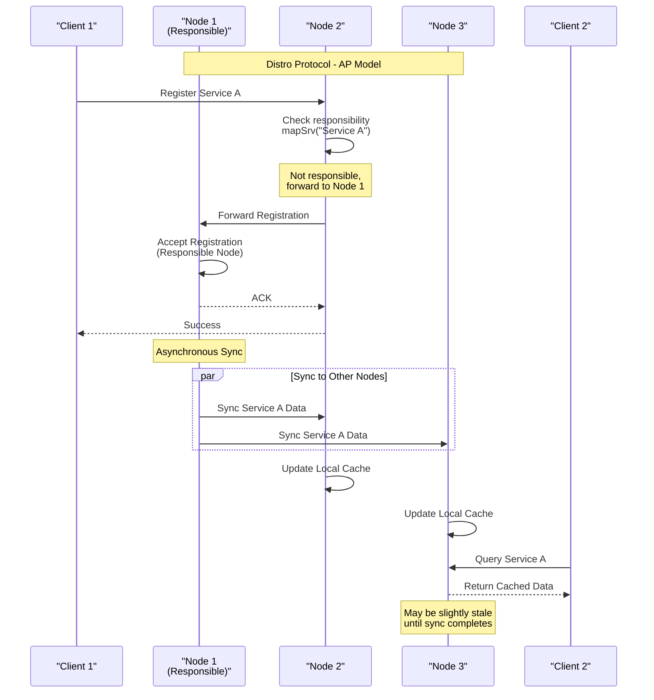
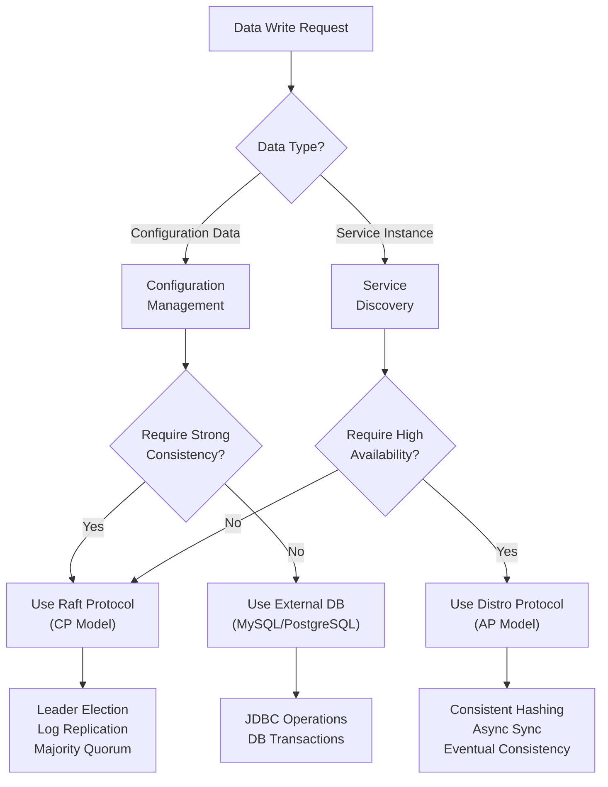
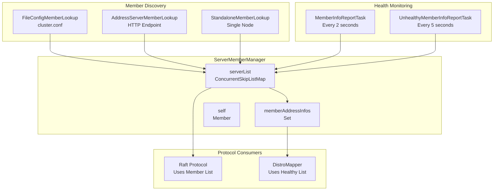
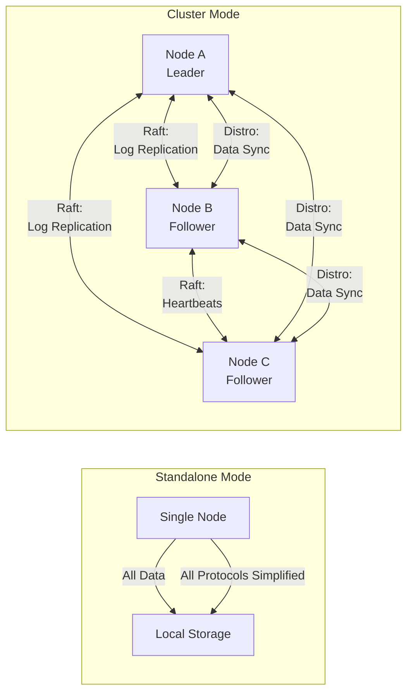
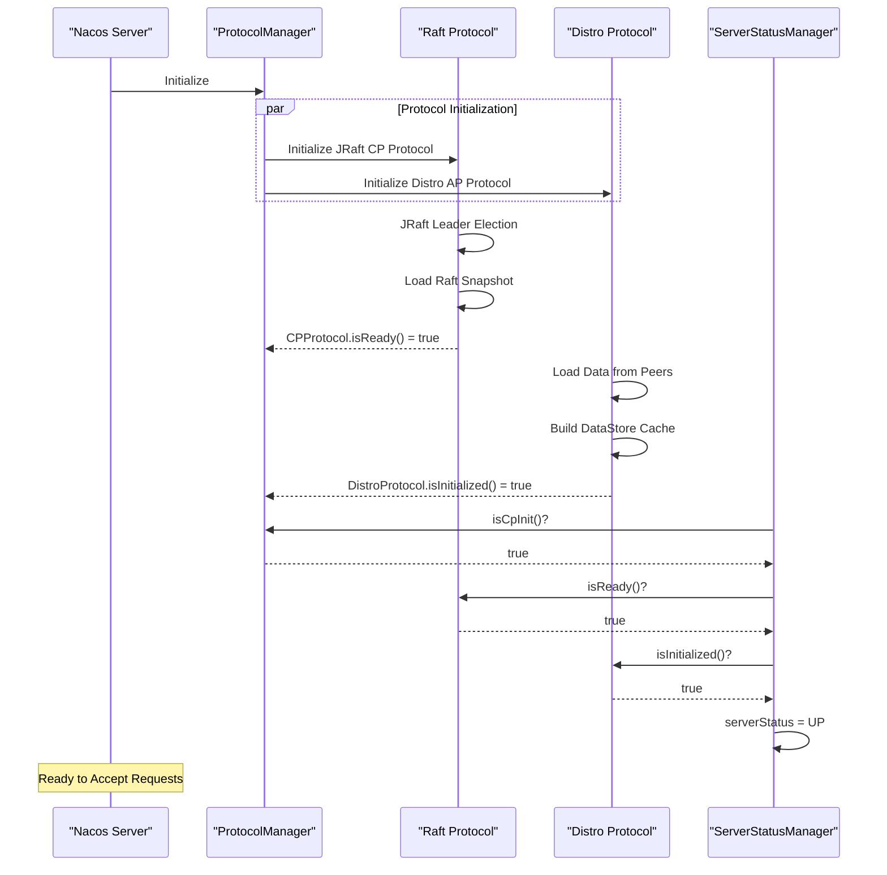

<!-- source: DeepWiki mcp.deepwiki.com · repo alibaba/nacos · page 6.2 Consistency Protocols · fetched 2026-10-29 -->

# Consistency Protocols

<details>
<summary>Relevant source files</summary>

The following files were used as context for generating this wiki page:

- [config/src/main/java/com/alibaba/nacos/config/server/service/repository/embedded/EmbeddedConfigInfoBetaPersistServiceImpl.java](config/src/main/java/com/alibaba/nacos/config/server/service/repository/embedded/EmbeddedConfigInfoBetaPersistServiceImpl.java)
- [config/src/main/java/com/alibaba/nacos/config/server/service/repository/embedded/EmbeddedConfigInfoPersistServiceImpl.java](config/src/main/java/com/alibaba/nacos/config/server/service/repository/embedded/EmbeddedConfigInfoPersistServiceImpl.java)
- [config/src/main/java/com/alibaba/nacos/config/server/service/repository/embedded/EmbeddedConfigInfoTagPersistServiceImpl.java](config/src/main/java/com/alibaba/nacos/config/server/service/repository/embedded/EmbeddedConfigInfoTagPersistServiceImpl.java)
- [config/src/main/java/com/alibaba/nacos/config/server/service/repository/embedded/EmbeddedHistoryConfigInfoPersistServiceImpl.java](config/src/main/java/com/alibaba/nacos/config/server/service/repository/embedded/EmbeddedHistoryConfigInfoPersistServiceImpl.java)
- [config/src/main/java/com/alibaba/nacos/config/server/service/repository/extrnal/ExternalConfigInfoBetaPersistServiceImpl.java](config/src/main/java/com/alibaba/nacos/config/server/service/repository/extrnal/ExternalConfigInfoBetaPersistServiceImpl.java)
- [config/src/main/java/com/alibaba/nacos/config/server/service/repository/extrnal/ExternalConfigInfoPersistServiceImpl.java](config/src/main/java/com/alibaba/nacos/config/server/service/repository/extrnal/ExternalConfigInfoPersistServiceImpl.java)
- [config/src/main/java/com/alibaba/nacos/config/server/service/repository/extrnal/ExternalConfigInfoTagPersistServiceImpl.java](config/src/main/java/com/alibaba/nacos/config/server/service/repository/extrnal/ExternalConfigInfoTagPersistServiceImpl.java)
- [config/src/main/java/com/alibaba/nacos/config/server/service/repository/extrnal/ExternalHistoryConfigInfoPersistServiceImpl.java](config/src/main/java/com/alibaba/nacos/config/server/service/repository/extrnal/ExternalHistoryConfigInfoPersistServiceImpl.java)
- [naming/src/main/java/com/alibaba/nacos/naming/cluster/ServerStatus.java](naming/src/main/java/com/alibaba/nacos/naming/cluster/ServerStatus.java)
- [naming/src/main/java/com/alibaba/nacos/naming/cluster/ServerStatusManager.java](naming/src/main/java/com/alibaba/nacos/naming/cluster/ServerStatusManager.java)
- [naming/src/main/java/com/alibaba/nacos/naming/consistency/KeyBuilder.java](naming/src/main/java/com/alibaba/nacos/naming/consistency/KeyBuilder.java)
- [naming/src/main/java/com/alibaba/nacos/naming/core/DistroMapper.java](naming/src/main/java/com/alibaba/nacos/naming/core/DistroMapper.java)
- [naming/src/main/java/com/alibaba/nacos/naming/web/TrafficReviseFilter.java](naming/src/main/java/com/alibaba/nacos/naming/web/TrafficReviseFilter.java)
- [plugin/datasource/src/main/java/com/alibaba/nacos/plugin/datasource/mapper/ConfigInfoAggrMapper.java](plugin/datasource/src/main/java/com/alibaba/nacos/plugin/datasource/mapper/ConfigInfoAggrMapper.java)
- [plugin/datasource/src/main/java/com/alibaba/nacos/plugin/datasource/mapper/ConfigInfoBetaMapper.java](plugin/datasource/src/main/java/com/alibaba/nacos/plugin/datasource/mapper/ConfigInfoBetaMapper.java)
- [plugin/datasource/src/main/java/com/alibaba/nacos/plugin/datasource/model/MapperContext.java](plugin/datasource/src/main/java/com/alibaba/nacos/plugin/datasource/model/MapperContext.java)

</details>


## Purpose and Scope

This document describes the two consistency protocols used in Nacos to achieve different consistency guarantees for different types of data. Nacos employs a **dual-protocol architecture**: the **Raft protocol** for configuration data requiring strong consistency (CP model), and the **Distro protocol** for service instance data prioritizing availability (AP model).

For cluster membership management details, see [Member Discovery and Cluster Configuration](#6.1). For information about RPC communication between cluster nodes, see [RPC Server and Connection Management](#7.2).

---

## Overview of Dual Protocol Architecture

Nacos uses different consistency models for different data types based on their operational requirements:

| Data Type | Protocol | CAP Model | Use Case | Consistency Level |
|-----------|----------|-----------|----------|-------------------|
| Configuration Data | JRaft | CP (Consistency + Partition Tolerance) | Configuration management | Strong consistency |
| Service Instance Data (Ephemeral) | Distro | AP (Availability + Partition Tolerance) | Service discovery | Eventual consistency |
| Service Instance Data (Persistent) | JRaft | CP | Service metadata | Strong consistency |

**Dual Protocol Architecture with Code Entities**



**Sources:** [naming/src/main/java/com/alibaba/nacos/naming/cluster/ServerStatusManager.java:75-83](), [config/src/main/java/com/alibaba/nacos/config/server/service/repository/embedded/EmbeddedConfigInfoPersistServiceImpl.java:97-99](), [config/src/main/java/com/alibaba/nacos/config/server/service/repository/extrnal/ExternalConfigInfoPersistServiceImpl.java:98-100]()

---

## JRaft Protocol (CP Model)

### Overview

Nacos uses the **JRaft** library implementation of the Raft consensus protocol to provide **strong consistency** for configuration data. When a configuration is written, the change must be replicated to a majority of nodes before being acknowledged. This ensures that configuration reads always return the most recent committed value, even in the presence of network partitions.

### Key Characteristics

- **Leader Election**: One node is elected as the leader and handles all write operations
- **Log Replication**: Configuration changes are written to a replicated log before being applied through the state machine
- **Majority Quorum**: Writes require acknowledgment from a majority of nodes (N/2 + 1)
- **Strong Consistency**: All reads reflect the most recent committed write
- **Partition Tolerance**: System remains consistent during network partitions but may become unavailable if no majority exists
- **Implementation**: Uses SOFAJRaft (JRaft) library with embedded Derby or external database as storage backend



### Protocol Readiness Check

The Raft protocol must be initialized and ready before the server can handle requests. The `ServerStatusManager` checks both Raft and Distro protocol readiness:

[naming/src/main/java/com/alibaba/nacos/naming/cluster/ServerStatusManager.java:75-83]()

```java
private boolean isReady() {
    if (!globalConfig.isDataWarmup()) {
        return true;
    }
    if (!protocolManager.isCpInit() || protocolManager.getCpProtocol() == null) {
        return false;
    }
    return protocolManager.getCpProtocol().isReady() && distroProtocol.isInitialized();
}
```

The server transitions to `UP` status only when both protocols are ready. If Raft is not ready, error messages indicate that no leader is available.

### Storage Implementation

JRaft-backed configuration data uses two different storage implementations based on deployment mode:

**Embedded Storage Mode**

The `EmbeddedConfigInfoPersistServiceImpl` uses embedded Derby database with JRaft managing replication:

[config/src/main/java/com/alibaba/nacos/config/server/service/repository/embedded/EmbeddedConfigInfoPersistServiceImpl.java:97-99]()

Operations use `EmbeddedStorageContextHolder` to batch SQL statements that are executed through the JRaft state machine:

[config/src/main/java/com/alibaba/nacos/config/server/service/repository/embedded/EmbeddedConfigInfoPersistServiceImpl.java:324]()

```java
EmbeddedStorageContextHolder.addSqlContext(sql, args);
```

Then the database operation executes through the replicated log:

[config/src/main/java/com/alibaba/nacos/config/server/service/repository/embedded/EmbeddedConfigInfoPersistServiceImpl.java:236-240]()

**External Storage Mode**

The `ExternalConfigInfoPersistServiceImpl` uses external MySQL/PostgreSQL with manual transaction management:

[config/src/main/java/com/alibaba/nacos/config/server/service/repository/extrnal/ExternalConfigInfoPersistServiceImpl.java:98-100]()

Operations use Spring's `TransactionTemplate` for ACID guarantees:

[config/src/main/java/com/alibaba/nacos/config/server/service/repository/extrnal/ExternalConfigInfoPersistServiceImpl.java:151]()

```java
return tjt.execute(status -> {
    // Database operations within transaction
});
```

**Sources:** [config/src/main/java/com/alibaba/nacos/config/server/service/repository/embedded/EmbeddedConfigInfoPersistServiceImpl.java:97-245](), [config/src/main/java/com/alibaba/nacos/config/server/service/repository/extrnal/ExternalConfigInfoPersistServiceImpl.java:98-176](), [naming/src/main/java/com/alibaba/nacos/naming/cluster/ServerStatusManager.java:62-99]()

---

## Distro Protocol (AP Model)

### Overview

The Distro protocol is a proprietary **eventually consistent** protocol designed specifically for service discovery scenarios. It prioritizes **availability and partition tolerance** over strong consistency, making it ideal for service instance registration where temporary inconsistency is acceptable.

### Consistent Hashing for Data Distribution

The core of the Distro protocol is the `DistroMapper`, which uses **consistent hashing** to determine data ownership across cluster nodes. Each service instance is mapped to a specific "responsible" node based on its identifier.



### DistroMapper Implementation

The `DistroMapper` class implements the consistent hashing logic:

[naming/src/main/java/com/alibaba/nacos/naming/core/DistroMapper.java:78-99]()

```java
public boolean responsible(String responsibleTag) {
    final List<String> servers = healthyList;
    
    if (!switchDomain.isDistroEnabled() || EnvUtil.getStandaloneMode()) {
        return true;  // All data is local in standalone mode
    }
    
    if (CollectionUtils.isEmpty(servers)) {
        return false;  // Cluster not ready
    }
    
    String localAddress = EnvUtil.getLocalAddress();
    int index = servers.indexOf(localAddress);
    int lastIndex = servers.lastIndexOf(localAddress);
    
    if (lastIndex < 0 || index < 0) {
        return true;  // Fail-open: accept if not in list
    }
    
    int target = distroHash(responsibleTag) % servers.size();
    return target >= index && target <= lastIndex;
}
```

The hash function ensures consistent distribution:

[naming/src/main/java/com/alibaba/nacos/naming/core/DistroMapper.java:124-126]()

```java
private int distroHash(String responsibleTag) {
    return Math.abs(responsibleTag.hashCode() % Integer.MAX_VALUE);
}
```

### Determining Responsible Server

When a request arrives, the `mapSrv` method determines which node should handle it:

[naming/src/main/java/com/alibaba/nacos/naming/core/DistroMapper.java:107-122]()

```java
public String mapSrv(String responsibleTag) {
    final List<String> servers = healthyList;
    
    if (CollectionUtils.isEmpty(servers) || !switchDomain.isDistroEnabled()) {
        return EnvUtil.getLocalAddress();
    }
    
    try {
        int index = distroHash(responsibleTag) % servers.size();
        return servers.get(index);
    } catch (Throwable e) {
        Loggers.SRV_LOG.warn("[NACOS-DISTRO] distro mapper failed, return localhost: " 
            + EnvUtil.getLocalAddress(), e);
        return EnvUtil.getLocalAddress();
    }
}
```

### Health List Management

The `DistroMapper` maintains a sorted list of healthy nodes and updates it when cluster membership changes:

[naming/src/main/java/com/alibaba/nacos/naming/core/DistroMapper.java:128-138]()

```java
@Override
public void onEvent(MembersChangeEvent event) {
    // Node list must be sorted to ensure all servers use the same order
    List<String> list = MemberUtil.selectTargetMembers(event.getMembers(),
            member -> NodeState.UP.equals(member.getState()) 
                   || NodeState.SUSPICIOUS.equals(member.getState()));
    Collections.sort(list);
    Collection<String> old = healthyList;
    healthyList = Collections.unmodifiableList(list);
    Loggers.SRV_LOG.info("[NACOS-DISTRO] healthy server list changed, old: {}, new: {}", 
                         old, healthyList);
}
```

**Critical**: The health list must be **sorted identically** on all nodes to ensure consistent hashing produces the same results cluster-wide.

### Distro Data Storage

The Distro protocol stores ephemeral service instance data in-memory using the `DataStore` component. Unlike Raft which uses persistent storage, Distro data is:

- **In-Memory Only**: Stored in concurrent hash maps for fast access
- **Ephemeral**: Lost on server restart, requiring re-registration
- **Partitioned**: Each node owns a subset of data based on consistent hashing
- **Replicated**: Eventually synchronized to all nodes for high-availability reads

**Data Flow**



### Distro Protocol Characteristics

| Aspect | Behavior |
|--------|----------|
| **Write Operations** | Written to responsible node only, then asynchronously synchronized |
| **Read Operations** | Can read from any node, may return stale data temporarily |
| **Consistency** | Eventual consistency through periodic synchronization |
| **Availability** | High - continues operation even with network partitions |
| **Partition Handling** | Each partition continues to accept writes independently |
| **Data Ownership** | Determined by `DistroMapper` consistent hashing, changes when membership changes |
| **Storage Backend** | In-memory `DataStore`, no persistent storage |

**Sources:** [naming/src/main/java/com/alibaba/nacos/naming/core/DistroMapper.java:107-122]()



### DistroMapper Health List Update

The `DistroMapper` listens to `MembersChangeEvent` and updates its internal health list to ensure consistent hashing remains stable across the cluster:

[naming/src/main/java/com/alibaba/nacos/naming/core/DistroMapper.java:128-138]()

```java
@Override
public void onEvent(MembersChangeEvent event) {
    // Node list must be sorted to ensure all servers use the same order
    List<String> list = MemberUtil.selectTargetMembers(event.getMembers(),
            member -> NodeState.UP.equals(member.getState()) 
                   || NodeState.SUSPICIOUS.equals(member.getState()));
    Collections.sort(list);
    Collection<String> old = healthyList;
    healthyList = Collections.unmodifiableList(list);
    Loggers.SRV_LOG.info("[NACOS-DISTRO] healthy server list changed, old: {}, new: {}", 
                         old, healthyList);
}
```

**Critical**: The health list must be **sorted identically** on all nodes. If different nodes have different sort orders, the same service will hash to different responsible nodes on different servers, causing data inconsistency.

**Sources:** [naming/src/main/java/com/alibaba/nacos/naming/core/DistroMapper.java:42-144]()

---

## Protocol Selection Strategy

### Decision Matrix

The choice between Raft and Distro protocols is determined by the data type and operational requirements:



### Configuration Data (Raft)

**Use Cases:**
- Configuration publishing and updates
- Namespace management
- Metadata for services
- System switches and feature flags

**Characteristics:**
- Must be strongly consistent across all nodes
- Relatively low write frequency
- Critical correctness requirements
- Can tolerate brief unavailability during elections

### Service Instance Data (Distro)

**Use Cases:**
- Service instance registration
- Instance heartbeat updates
- Instance health status
- Ephemeral service data

**Characteristics:**
- High write frequency (heartbeats every 5 seconds)
- Can tolerate temporary inconsistency
- Must remain available during network partitions
- Read-heavy workload (service discovery queries)

**Sources:** Analysis based on high-level architecture diagrams and [naming/src/main/java/com/alibaba/nacos/naming/core/DistroMapper.java:78-99](), [naming/src/main/java/com/alibaba/nacos/naming/cluster/ServerStatusManager.java:75-83]()

---

## Cluster Membership and Protocol Coordination

### ServerMemberManager Role

The `ServerMemberManager` is the foundation for both consistency protocols. It maintains the cluster membership view that both Raft and Distro rely on:



### Member State Management

Each cluster member can be in one of several states, tracked by `ServerMemberManager`:

[core/src/main/java/com/alibaba/nacos/core/cluster/ServerMemberManager.java:246-270]()

```java
public boolean update(Member newMember) {
    String address = newMember.getAddress();
    if (!serverList.containsKey(address)) {
        return false;
    }
    
    serverList.computeIfPresent(address, (s, member) -> {
        if (NodeState.DOWN.equals(newMember.getState())) {
            memberAddressInfos.remove(newMember.getAddress());
        }
        boolean isPublishChangeEvent = MemberUtil.isBasicInfoChanged(newMember, member);
        newMember.setExtendVal(MemberMetaDataConstants.LAST_REFRESH_TIME, System.currentTimeMillis());
        MemberUtil.copy(newMember, member);
        if (isPublishChangeEvent) {
            notifyMemberChange(member);
        }
        return member;
    });
    
    return true;
}
```

### Node States

| State | Description | Impact on Protocols |
|-------|-------------|---------------------|
| `UP` | Node is healthy and operational | Included in Raft quorum and Distro hash ring |
| `SUSPICIOUS` | Node may be experiencing issues | Included in Distro but monitored closely |
| `DOWN` | Node is unavailable | Excluded from both protocols |

### Member Health Checking

The cluster membership foundation is maintained by `ServerMemberManager`, which both protocols rely on for their member lists. This component runs periodic health checks to ensure accurate cluster state. For details on member discovery, health monitoring, and state transitions, see [Member Discovery and Cluster Configuration](#6.1).

Both the JRaft protocol implementation and `DistroMapper` subscribe to `MembersChangeEvent` to update their internal state when cluster membership changes.

**Sources:** Reference to page 6.1 for cluster management details

---

## Standalone vs. Cluster Mode

The consistency protocols behave differently in standalone versus cluster modes:

### Standalone Mode

In standalone mode (single-node deployment), consistency protocols are simplified:

[naming/src/main/java/com/alibaba/nacos/naming/core/DistroMapper.java:78-83]()

```java
public boolean responsible(String responsibleTag) {
    final List<String> servers = healthyList;
    
    if (!switchDomain.isDistroEnabled() || EnvUtil.getStandaloneMode()) {
        return true;  // All data is local in standalone
    }
    // ...
}
```

**Standalone Characteristics:**
- No JRaft leader election needed (single node is implicit leader)
- No Distro synchronization required (all data is local)
- `DistroMapper.responsible()` always returns true
- All requests handled locally
- Uses embedded Derby database by default

### Cluster Mode

In cluster mode, full protocol semantics apply:

**JRaft Cluster:**
- Leader election among nodes using JRaft
- Log replication to followers through Raft state machine
- Majority quorum for writes (N/2 + 1)
- Follower redirection to leader for write operations
- `ProtocolManager` manages JRaft lifecycle

**Distro Cluster:**
- `DistroMapper` uses consistent hashing to distribute data ownership
- Asynchronous peer-to-peer synchronization via `DistroSyncTask`
- Each node handles its responsible services based on hash
- Cross-node forwarding for non-responsible requests via `DistroFilter`
- `DistroProtocol` manages data synchronization



**Sources:** [naming/src/main/java/com/alibaba/nacos/naming/core/DistroMapper.java:78-99](), [core/src/main/java/com/alibaba/nacos/core/cluster/lookup/StandaloneMemberLookup.java:30-47]()

---

## Protocol Initialization and Readiness

Both JRaft and Distro protocols must complete initialization before the server can accept requests. The `ServerStatusManager` coordinates this by checking readiness of both protocols:



The `TrafficReviseFilter` blocks requests until the server is ready:

[naming/src/main/java/com/alibaba/nacos/naming/web/TrafficReviseFilter.java:74-78]()

```java
// if server is UP:
if (serverStatusManager.getServerStatus() == ServerStatus.UP) {
    filterChain.doFilter(req, resp);
    return;
}
```

**Sources:** [naming/src/main/java/com/alibaba/nacos/naming/cluster/ServerStatusManager.java:36-108](), [naming/src/main/java/com/alibaba/nacos/naming/web/TrafficReviseFilter.java:45-110]()

---

## Summary

Nacos's dual-protocol architecture provides optimal consistency guarantees for different data types:

| Protocol | Model | Data Type | Consistency | Availability | Use When |
|----------|-------|-----------|-------------|--------------|----------|
| **Raft** | CP | Configuration | Strong | Medium | Correctness is critical |
| **Distro** | AP | Service Instances | Eventual | High | Speed and availability matter |

The `ServerMemberManager` provides the cluster membership foundation that both protocols depend on, while `DistroMapper` implements the consistent hashing logic that makes Distro's AP model work efficiently. Together, these protocols enable Nacos to handle both configuration management and service discovery at scale with appropriate consistency guarantees for each use case.

---

