<!-- source: DeepWiki mcp.deepwiki.com · repo alibaba/nacos · page 7 Communication Framework · fetched 2026-10-29 -->

# Communication Framework

Relevant source files

The following files were used as context for generating this wiki page:

- [api/src/main/java/com/alibaba/nacos/api/remote/request/ConnectionSetupRequest.java](api/src/main/java/com/alibaba/nacos/api/remote/request/ConnectionSetupRequest.java)
- [api/src/main/java/com/alibaba/nacos/api/remote/request/RequestMeta.java](api/src/main/java/com/alibaba/nacos/api/remote/request/RequestMeta.java)
- [api/src/main/java/com/alibaba/nacos/api/remote/request/SetupAckRequest.java](api/src/main/java/com/alibaba/nacos/api/remote/request/SetupAckRequest.java)
- [api/src/main/java/com/alibaba/nacos/api/remote/response/ServerCheckResponse.java](api/src/main/java/com/alibaba/nacos/api/remote/response/ServerCheckResponse.java)
- [client/src/test/java/com/alibaba/nacos/client/ability/AbilityTest.java](client/src/test/java/com/alibaba/nacos/client/ability/AbilityTest.java)
- [common/src/main/java/com/alibaba/nacos/common/remote/client/Connection.java](common/src/main/java/com/alibaba/nacos/common/remote/client/Connection.java)
- [common/src/main/java/com/alibaba/nacos/common/remote/client/RpcClient.java](common/src/main/java/com/alibaba/nacos/common/remote/client/RpcClient.java)
- [common/src/main/java/com/alibaba/nacos/common/remote/client/RpcClientConfig.java](common/src/main/java/com/alibaba/nacos/common/remote/client/RpcClientConfig.java)
- [common/src/main/java/com/alibaba/nacos/common/remote/client/RpcClientFactory.java](common/src/main/java/com/alibaba/nacos/common/remote/client/RpcClientFactory.java)
- [common/src/main/java/com/alibaba/nacos/common/remote/client/grpc/GrpcClient.java](common/src/main/java/com/alibaba/nacos/common/remote/client/grpc/GrpcClient.java)
- [common/src/main/java/com/alibaba/nacos/common/remote/client/grpc/GrpcClusterClient.java](common/src/main/java/com/alibaba/nacos/common/remote/client/grpc/GrpcClusterClient.java)
- [common/src/main/java/com/alibaba/nacos/common/remote/client/grpc/GrpcConnection.java](common/src/main/java/com/alibaba/nacos/common/remote/client/grpc/GrpcConnection.java)
- [common/src/main/java/com/alibaba/nacos/common/remote/client/grpc/GrpcSdkClient.java](common/src/main/java/com/alibaba/nacos/common/remote/client/grpc/GrpcSdkClient.java)
- [common/src/test/java/com/alibaba/nacos/common/remote/client/grpc/GrpcClientTest.java](common/src/test/java/com/alibaba/nacos/common/remote/client/grpc/GrpcClientTest.java)
- [config/src/main/java/com/alibaba/nacos/config/server/remote/RpcConfigChangeNotifier.java](config/src/main/java/com/alibaba/nacos/config/server/remote/RpcConfigChangeNotifier.java)
- [core/src/main/java/com/alibaba/nacos/core/remote/BaseRpcServer.java](core/src/main/java/com/alibaba/nacos/core/remote/BaseRpcServer.java)
- [core/src/main/java/com/alibaba/nacos/core/remote/Connection.java](core/src/main/java/com/alibaba/nacos/core/remote/Connection.java)
- [core/src/main/java/com/alibaba/nacos/core/remote/ConnectionManager.java](core/src/main/java/com/alibaba/nacos/core/remote/ConnectionManager.java)
- [core/src/main/java/com/alibaba/nacos/core/remote/RpcPushService.java](core/src/main/java/com/alibaba/nacos/core/remote/RpcPushService.java)
- [core/src/main/java/com/alibaba/nacos/core/remote/grpc/BaseGrpcServer.java](core/src/main/java/com/alibaba/nacos/core/remote/grpc/BaseGrpcServer.java)
- [core/src/main/java/com/alibaba/nacos/core/remote/grpc/GrpcBiStreamRequestAcceptor.java](core/src/main/java/com/alibaba/nacos/core/remote/grpc/GrpcBiStreamRequestAcceptor.java)
- [core/src/main/java/com/alibaba/nacos/core/remote/grpc/GrpcClusterServer.java](core/src/main/java/com/alibaba/nacos/core/remote/grpc/GrpcClusterServer.java)
- [core/src/main/java/com/alibaba/nacos/core/remote/grpc/GrpcConnection.java](core/src/main/java/com/alibaba/nacos/core/remote/grpc/GrpcConnection.java)
- [core/src/main/java/com/alibaba/nacos/core/remote/grpc/GrpcRequestAcceptor.java](core/src/main/java/com/alibaba/nacos/core/remote/grpc/GrpcRequestAcceptor.java)
- [core/src/main/java/com/alibaba/nacos/core/remote/grpc/GrpcSdkServer.java](core/src/main/java/com/alibaba/nacos/core/remote/grpc/GrpcSdkServer.java)
- [core/src/test/java/com/alibaba/nacos/core/remote/grpc/GrpcBiStreamRequestAcceptorTest.java](core/src/test/java/com/alibaba/nacos/core/remote/grpc/GrpcBiStreamRequestAcceptorTest.java)
- [core/src/test/java/com/alibaba/nacos/core/remote/grpc/GrpcRequestAcceptorTest.java](core/src/test/java/com/alibaba/nacos/core/remote/grpc/GrpcRequestAcceptorTest.java)

The Communication Framework provides the RPC (Remote Procedure Call) layer for all client-server and server-server communication in Nacos. It implements a gRPC-based bidirectional streaming protocol that supports synchronous requests, asynchronous callbacks, server push notifications, and capability negotiation between endpoints.

This page covers the RPC communication infrastructure. For information about how configuration changes are pushed to clients, see [Configuration Change Notification](#3.3). For cluster-to-cluster communication protocols, see [Consistency Protocols](#6.2).

## Architecture Overview

The communication framework consists of three primary layers: the client layer (`RpcClient` and implementations), the server layer (`BaseRpcServer` and request acceptors), and the connection management layer (`ConnectionManager` and `Connection` abstractions).

### Component Hierarchy

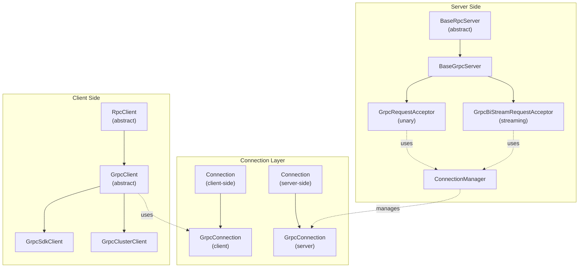

Sources: [common/src/main/java/com/alibaba/nacos/common/remote/client/RpcClient.java:69](), [common/src/main/java/com/alibaba/nacos/common/remote/client/grpc/GrpcClient.java:79](), [core/src/main/java/com/alibaba/nacos/core/remote/BaseRpcServer.java:34](), [core/src/main/java/com/alibaba/nacos/core/remote/grpc/BaseGrpcServer.java:64]()

## RPC Client Implementation

### Client Class Structure

The `RpcClient` abstract class provides the foundation for all RPC clients. It manages connection lifecycle, server switching, health checks, and retry logic. Two concrete implementations exist: `GrpcSdkClient` for SDK clients and `GrpcClusterClient` for inter-cluster communication.

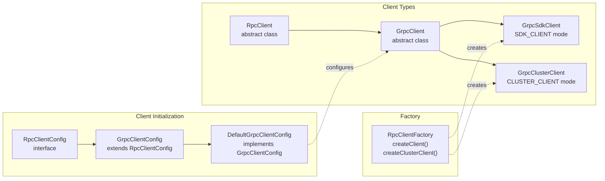

Sources: [common/src/main/java/com/alibaba/nacos/common/remote/client/RpcClient.java:69-118](), [common/src/main/java/com/alibaba/nacos/common/remote/client/grpc/GrpcClient.java:79-153](), [common/src/main/java/com/alibaba/nacos/common/remote/client/RpcClientFactory.java:38-230]()

### Client Lifecycle and Connection Management

The `RpcClient` maintains an internal state machine and manages connections through automated reconnection logic:

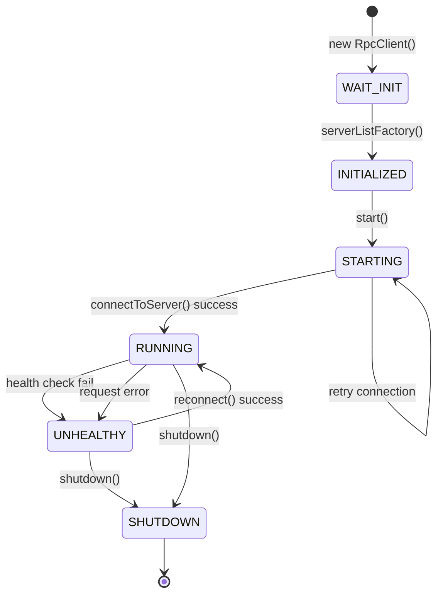

The client uses two background threads for connection management:

1. **Connection Event Consumer** - Processes connection/disconnection events from `eventLinkedBlockingQueue` and notifies registered listeners
2. **Reconnection Handler** - Monitors connection health via `reconnectionSignal` queue and performs automatic reconnection

Sources: [common/src/main/java/com/alibaba/nacos/common/remote/client/RpcClient.java:77-79](), [common/src/main/java/com/alibaba/nacos/common/remote/client/RpcClient.java:238-380](), [common/src/main/java/com/alibaba/nacos/common/remote/client/RpcClient.java:471-579]()

### Request Execution Patterns

The `RpcClient` supports three request patterns with built-in retry and failover logic:

| Method | Return Type | Use Case | Timeout Source |
|--------|-------------|----------|----------------|
| `request(Request, long)` | `Response` | Synchronous blocking call | Parameter or `timeOutMills()` config |
| `asyncRequest(Request, RequestCallBack)` | `void` | Asynchronous with callback | `callback.getTimeout()` |
| `requestFuture(Request)` | `RequestFuture` | Non-blocking future | `timeOutMills()` config |

All methods implement retry logic controlled by `RpcClientConfig.retryTimes()` and automatically trigger reconnection if the connection is unhealthy.

Sources: [common/src/main/java/com/alibaba/nacos/common/remote/client/RpcClient.java:621-699](), [common/src/main/java/com/alibaba/nacos/common/remote/client/RpcClient.java:706-748](), [common/src/main/java/com/alibaba/nacos/common/remote/client/RpcClient.java:756-797]()

### gRPC Client Connection Setup

The `GrpcClient` establishes connections using bidirectional streaming and performs server health checks:

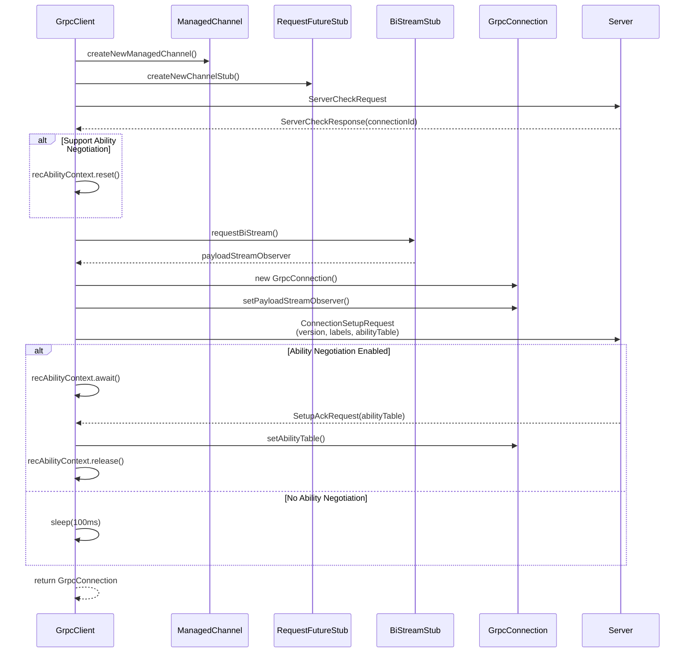

Sources: [common/src/main/java/com/alibaba/nacos/common/remote/client/grpc/GrpcClient.java:334-404](), [common/src/main/java/com/alibaba/nacos/common/remote/client/grpc/GrpcClient.java:228-246]()

## RPC Server Implementation

### Server Architecture

The `BaseGrpcServer` initializes gRPC services with both unary and bidirectional streaming support:

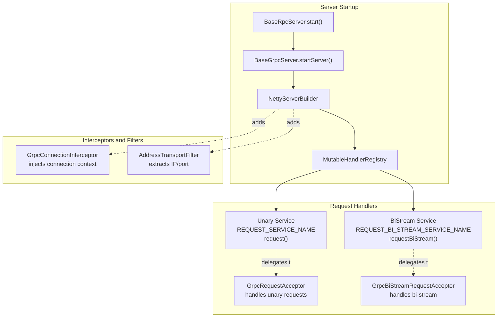

Sources: [core/src/main/java/com/alibaba/nacos/core/remote/BaseRpcServer.java:43-68](), [core/src/main/java/com/alibaba/nacos/core/remote/grpc/BaseGrpcServer.java:90-117](), [core/src/main/java/com/alibaba/nacos/core/remote/grpc/BaseGrpcServer.java:207-241]()

### Request Processing Flow

The server processes incoming requests through a pipeline that validates connections, parses payloads, and dispatches to registered handlers:

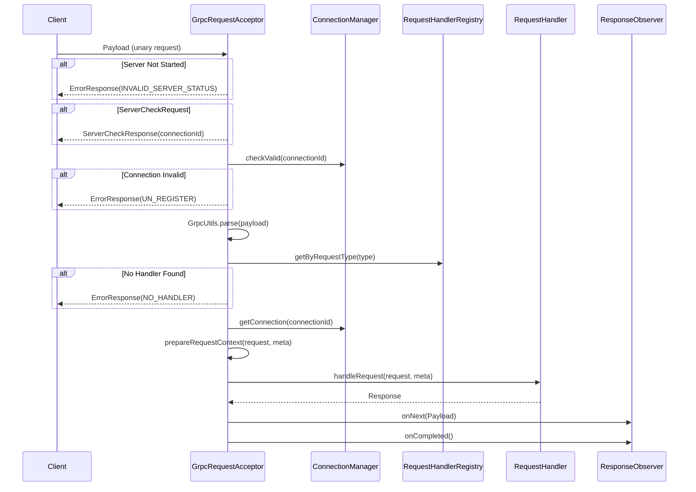

Sources: [core/src/main/java/com/alibaba/nacos/core/remote/grpc/GrpcRequestAcceptor.java:82-227]()

### Bidirectional Stream Handling

The `GrpcBiStreamRequestAcceptor` manages long-lived bidirectional streams for connection setup and server push capabilities:

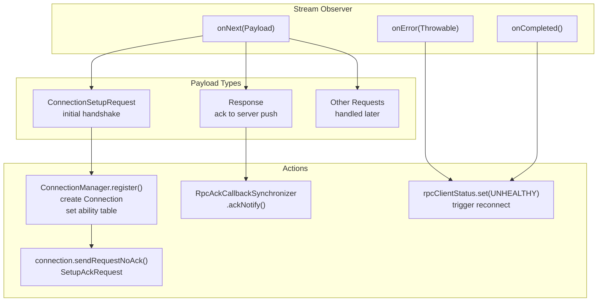

Sources: [core/src/main/java/com/alibaba/nacos/core/remote/grpc/GrpcBiStreamRequestAcceptor.java:73-133](), [core/src/main/java/com/alibaba/nacos/core/remote/grpc/GrpcBiStreamRequestAcceptor.java:135-212]()

## Connection Management

### ConnectionManager Responsibilities

The `ConnectionManager` maintains a registry of active connections and enforces connection limits through control plugins:

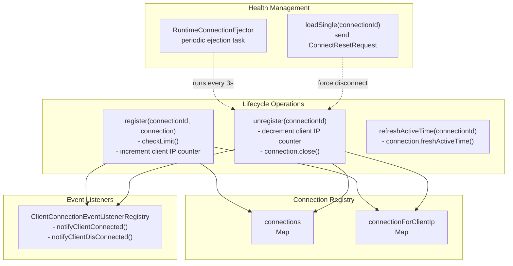

Sources: [core/src/main/java/com/alibaba/nacos/core/remote/ConnectionManager.java:57-162](), [core/src/main/java/com/alibaba/nacos/core/remote/ConnectionManager.java:244-265]()

### Connection Abstraction

Both client and server sides use `Connection` abstractions that implement the `Requester` interface:

| Class | Location | Purpose |
|-------|----------|---------|
| `Connection` (client) | [common/src/main/java/com/alibaba/nacos/common/remote/client/Connection.java:31]() | Client-side connection wrapping `ManagedChannel` |
| `GrpcConnection` (client) | [common/src/main/java/com/alibaba/nacos/common/remote/client/grpc/GrpcConnection.java:49]() | gRPC implementation with `RequestFutureStub` and `StreamObserver` |
| `Connection` (server) | [core/src/main/java/com/alibaba/nacos/core/remote/Connection.java:31]() | Server-side connection with `ConnectionMeta` |
| `GrpcConnection` (server) | [core/src/main/java/com/alibaba/nacos/core/remote/grpc/GrpcConnection.java:51]() | Server-side gRPC with streaming and queue blocking checks |

The server-side `GrpcConnection` implements flow control by checking `ServerCallStreamObserver.isReady()` before sending, preventing memory exhaustion from fast producers:

Sources: [core/src/main/java/com/alibaba/nacos/core/remote/grpc/GrpcConnection.java:102-128]()

## Request and Response Patterns

### Synchronous Request-Response

Standard request-response uses `RequestFutureStub` for unary calls:

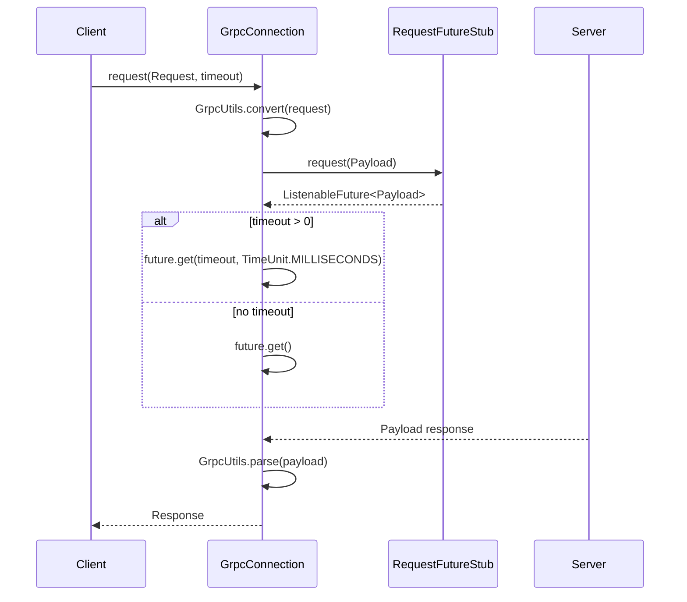

Sources: [common/src/main/java/com/alibaba/nacos/common/remote/client/grpc/GrpcConnection.java:70-86]()

### Asynchronous Request with Callback

Asynchronous requests use `Futures.addCallback()` to handle responses without blocking:

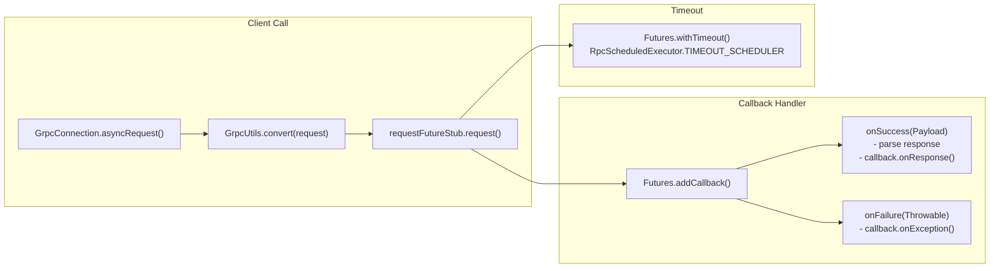

Sources: [common/src/main/java/com/alibaba/nacos/common/remote/client/grpc/GrpcConnection.java:132-172]()

### Server Push Notifications

The `RpcPushService` enables the server to push notifications to clients without client polling:

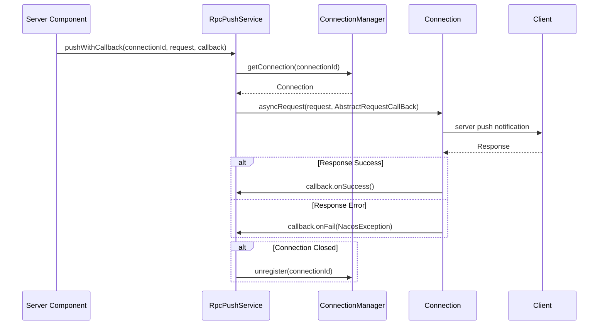

The `RpcConfigChangeNotifier` uses this mechanism to push configuration changes to listening clients:

Sources: [core/src/main/java/com/alibaba/nacos/core/remote/RpcPushService.java:38-89](), [config/src/main/java/com/alibaba/nacos/config/server/remote/RpcConfigChangeNotifier.java:87-114]()

## Ability Negotiation

Ability negotiation allows clients and servers to exchange capability information during connection setup, enabling backward and forward compatibility:

### Negotiation Protocol

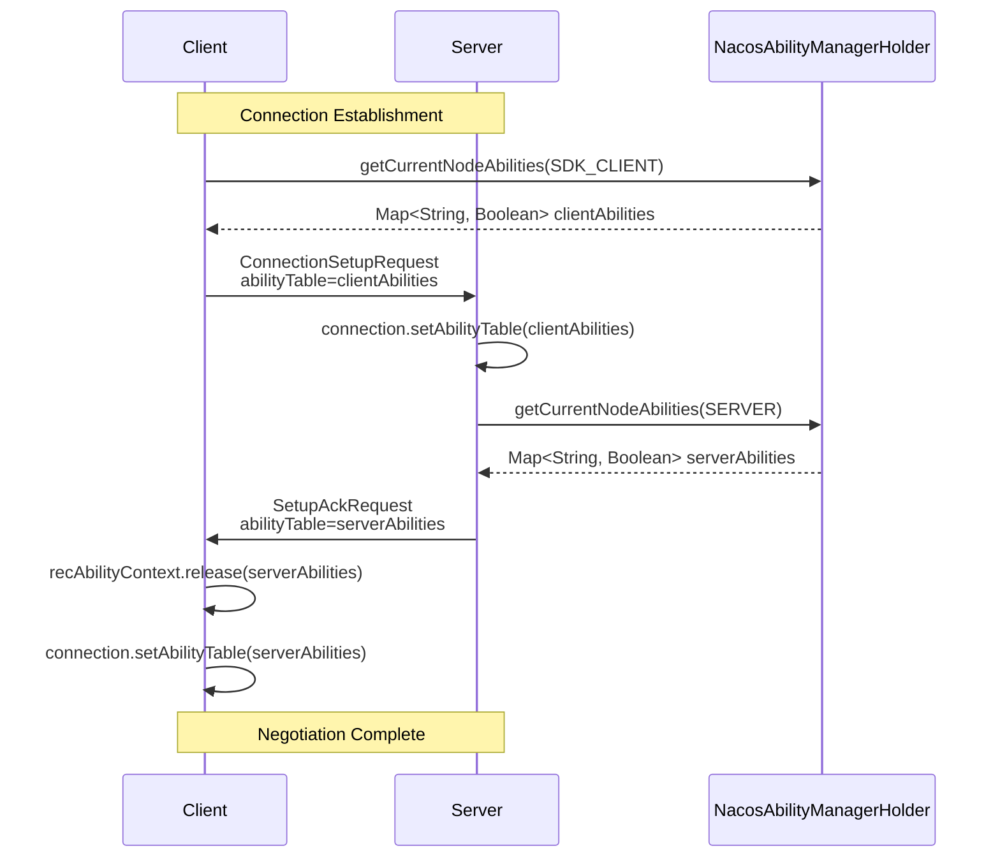

Sources: [common/src/main/java/com/alibaba/nacos/common/remote/client/grpc/GrpcClient.java:375-391](), [core/src/main/java/com/alibaba/nacos/core/remote/grpc/GrpcBiStreamRequestAcceptor.java:186-198]()

### Ability Context Management

The `RecAbilityContext` in `GrpcClient` manages synchronization during ability negotiation:

| Method | Purpose |
|--------|---------|
| `reset(Connection)` | Marks connection as waiting for abilities, creates new `CountDownLatch` |
| `release(Map<String, Boolean>)` | Sets ability table on connection and counts down latch |
| `await(long, TimeUnit)` | Blocks until abilities received or timeout |
| `check(Connection)` | Validates that ability table was set, closes connection if not |

The client waits up to `capabilityNegotiationTimeout` milliseconds (default 5000) for the server's ability table. If not received, the connection is abandoned:

Sources: [common/src/main/java/com/alibaba/nacos/common/remote/client/grpc/GrpcClient.java:425-514]()

### Ability Usage

Once negotiated, abilities are queried through `Connection.getConnectionAbility(AbilityKey)` which returns `AbilityStatus`:

- `SUPPORTED` - Capability is available
- `NOT_SUPPORTED` - Capability is explicitly not available  
- `UNKNOWN` - No information about capability (treat as not supported for safety)

Sources: [common/src/main/java/com/alibaba/nacos/common/remote/client/Connection.java:53-58](), [api/src/main/java/com/alibaba/nacos/api/remote/request/RequestMeta.java:47-52]()

## Configuration

### Client Configuration

The `GrpcClientConfig` interface extends `RpcClientConfig` with gRPC-specific settings:

| Property Key | Config Method | Default | Description |
|-------------|---------------|---------|-------------|
| `nacos.remote.client.grpc.name` | `name()` | - | Client identifier |
| `nacos.remote.client.grpc.retry.times` | `retryTimes()` | 3 | Request retry count |
| `nacos.remote.client.grpc.timeout` | `timeOutMills()` | 3000 | Request timeout (ms) |
| `nacos.remote.client.grpc.connect.keep.alive` | `connectionKeepAlive()` | 5000 | Connection health check interval (ms) |
| `nacos.remote.client.grpc.pool.core.size` | `threadPoolCoreSize()` | CPU-based | Executor core threads |
| `nacos.remote.client.grpc.pool.max.size` | `threadPoolMaxSize()` | CPU-based | Executor max threads |
| `nacos.remote.client.grpc.pool.alive` | `threadPoolKeepAlive()` | 10000 | Thread keep-alive (ms) |
| `nacos.remote.client.grpc.queue.size` | `threadPoolQueueSize()` | 10000 | Executor queue capacity |
| `nacos.remote.client.grpc.maxinbound.message.size` | `maxInboundMessageSize()` | 10485760 | Max message size (bytes) |
| `nacos.remote.client.grpc.channel.keep.alive` | `channelKeepAlive()` | 360000 | gRPC channel keep-alive (ms) |
| `nacos.remote.client.grpc.channel.keep.alive.timeout` | `channelKeepAliveTimeout()` | 20000 | Keep-alive timeout (ms) |
| `nacos.remote.client.grpc.channel.capability.negotiation.timeout` | `capabilityNegotiationTimeout()` | 5000 | Ability negotiation timeout (ms) |
| `nacos.remote.client.grpc.health.retry` | `healthCheckRetryTimes()` | 3 | Health check retry count |
| `nacos.remote.client.grpc.health.timeout` | `healthCheckTimeOut()` | 3000 | Health check timeout (ms) |

Configuration can be loaded from `Properties` using `DefaultGrpcClientConfig.Builder.fromProperties()`:

Sources: [common/src/main/java/com/alibaba/nacos/common/remote/client/grpc/GrpcClientConfig.java:28-120](), [common/src/main/java/com/alibaba/nacos/common/remote/client/grpc/DefaultGrpcClientConfig.java:264-327](), [common/src/main/java/com/alibaba/nacos/common/remote/client/grpc/GrpcConstants.java:34-115]()

### Server Configuration

Server-side gRPC configuration is controlled through `BaseGrpcServer`:

| Property Key | Method | Default | Description |
|-------------|--------|---------|-------------|
| `nacos.remote.server.grpc.max.inbound.message.size` | `getMaxInboundMessageSize()` | 10485760 | Max inbound message size (bytes) |
| - | `getKeepAliveTime()` | 360000 | Keep-alive time (ms) |
| - | `getKeepAliveTimeout()` | 180000 | Keep-alive timeout (ms) |
| - | `getPermitKeepAliveTime()` | 300000 | Permit keep-alive time (ms) |

Port calculation: The RPC server port is determined by `EnvUtil.getPort() + rpcPortOffset()`:

- SDK clients use offset defined by `Constants.SDK_GRPC_PORT_DEFAULT_OFFSET` (1000)
- Cluster clients use offset defined by `Constants.CLUSTER_GRPC_PORT_DEFAULT_OFFSET` (1001)

Sources: [core/src/main/java/com/alibaba/nacos/core/remote/grpc/BaseGrpcServer.java:150-169](), [core/src/main/java/com/alibaba/nacos/core/remote/BaseRpcServer.java:100-109]()

### TLS Configuration

Both client and server support TLS encryption through `RpcClientTlsConfig`:

| Property | Description |
|----------|-------------|
| `enableTls` | Enable TLS encryption |
| `sslProvider` | SSL provider (OPENSSL, JDK, OPENSSL_REFCNT) |
| `protocols` | TLS protocols (comma-separated) |
| `ciphers` | Cipher suites (comma-separated) |
| `trustAll` | Trust all certificates (insecure) |
| `trustCollectionCertFile` | Path to trust certificate |
| `mutualAuthEnable` | Enable mutual TLS authentication |
| `certChainFile` | Client certificate chain file |
| `certPrivateKey` | Client private key file |
| `certPrivateKeyPassword` | Private key password |

TLS context is built using `GrpcSslContexts` and `SslContextBuilder`:

Sources: [common/src/main/java/com/alibaba/nacos/common/remote/client/grpc/GrpcClient.java:516-558](), [common/src/main/java/com/alibaba/nacos/common/remote/TlsConfig.java:24-149]()

### Factory and Client Creation

The `RpcClientFactory` provides static methods to create and manage RPC clients:

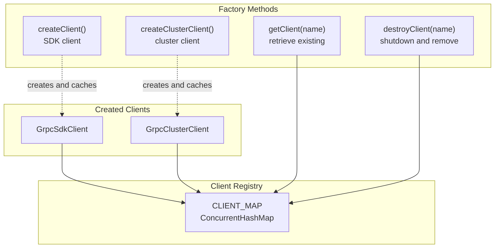

Sources: [common/src/main/java/com/alibaba/nacos/common/remote/client/RpcClientFactory.java:38-230]()

---

