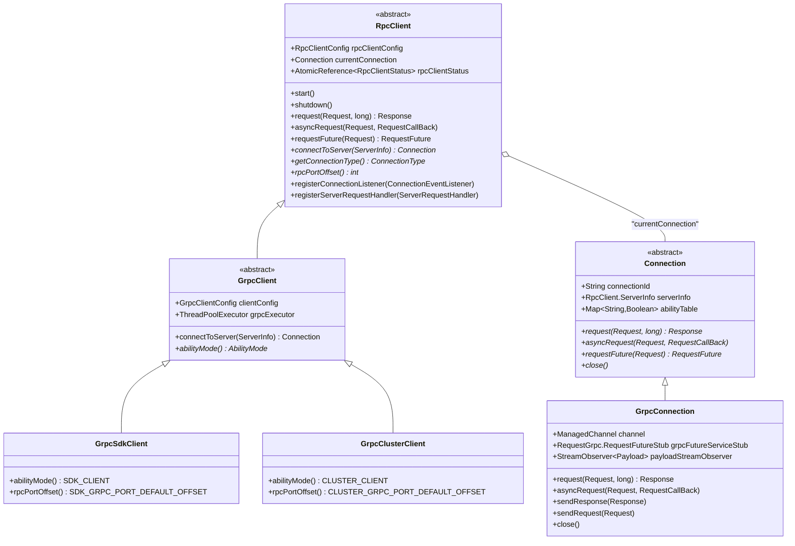
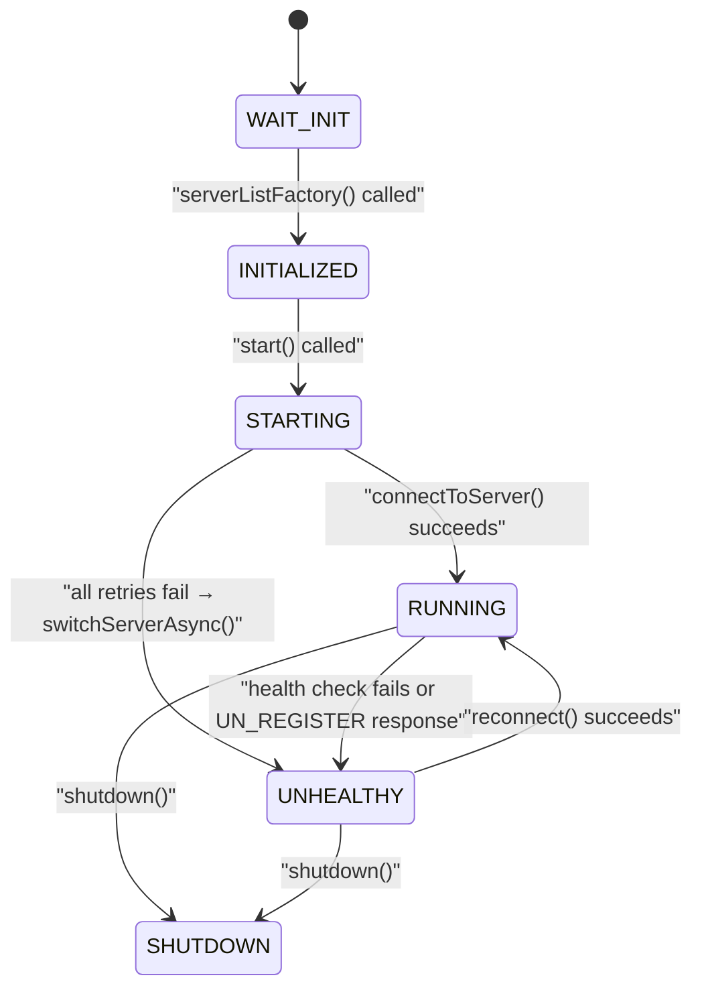
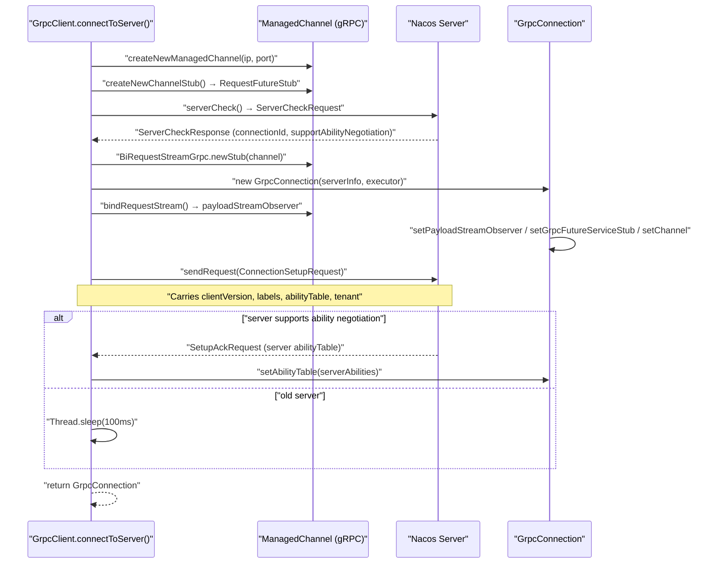
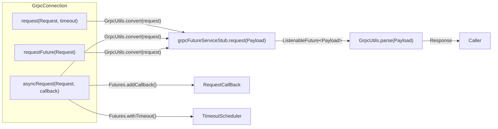
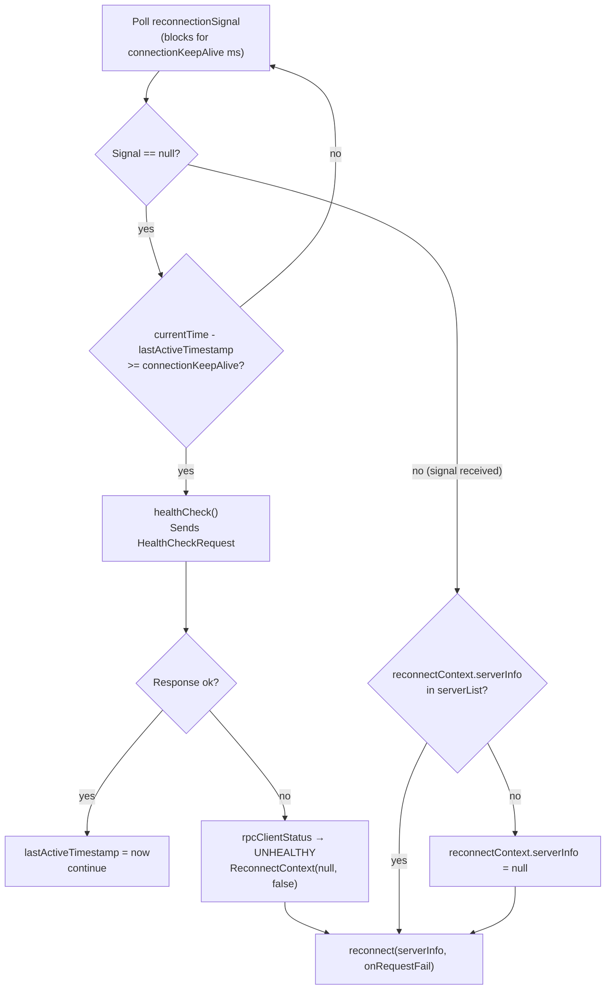

<!-- source: DeepWiki mcp.deepwiki.com · repo alibaba/nacos · page 7.1 RPC Client Architecture · fetched 2026-10-29 -->

# RPC Client Architecture

<details>
<summary>Relevant source files</summary>

The following files were used as context for generating this wiki page:

- [api/src/main/java/com/alibaba/nacos/api/remote/request/ConnectionSetupRequest.java](api/src/main/java/com/alibaba/nacos/api/remote/request/ConnectionSetupRequest.java)
- [api/src/main/java/com/alibaba/nacos/api/remote/request/RequestMeta.java](api/src/main/java/com/alibaba/nacos/api/remote/request/RequestMeta.java)
- [api/src/main/java/com/alibaba/nacos/api/remote/request/SetupAckRequest.java](api/src/main/java/com/alibaba/nacos/api/remote/request/SetupAckRequest.java)
- [api/src/main/java/com/alibaba/nacos/api/remote/response/ServerCheckResponse.java](api/src/main/java/com/alibaba/nacos/api/remote/response/ServerCheckResponse.java)
- [client/src/test/java/com/alibaba/nacos/client/ability/AbilityTest.java](client/src/test/java/com/alibaba/nacos/client/ability/AbilityTest.java)
- [common/src/main/java/com/alibaba/nacos/common/remote/client/Connection.java](common/src/main/java/com/alibaba/nacos/common/remote/client/Connection.java)
- [common/src/main/java/com/alibaba/nacos/common/remote/client/RpcClient.java](common/src/main/java/com/alibaba/nacos/common/remote/client/RpcClient.java)
- [common/src/main/java/com/alibaba/nacos/common/remote/client/RpcClientConfig.java](common/src/main/java/com/alibaba/nacos/common/remote/client/RpcClientConfig.java)
- [common/src/main/java/com/alibaba/nacos/common/remote/client/RpcClientFactory.java](common/src/main/java/com/alibaba/nacos/common/remote/client/RpcClientFactory.java)
- [common/src/main/java/com/alibaba/nacos/common/remote/client/grpc/GrpcClient.java](common/src/main/java/com/alibaba/nacos/common/remote/client/grpc/GrpcClient.java)
- [common/src/main/java/com/alibaba/nacos/common/remote/client/grpc/GrpcClusterClient.java](common/src/main/java/com/alibaba/nacos/common/remote/client/grpc/GrpcClusterClient.java)
- [common/src/main/java/com/alibaba/nacos/common/remote/client/grpc/GrpcConnection.java](common/src/main/java/com/alibaba/nacos/common/remote/client/grpc/GrpcConnection.java)
- [common/src/main/java/com/alibaba/nacos/common/remote/client/grpc/GrpcSdkClient.java](common/src/main/java/com/alibaba/nacos/common/remote/client/grpc/GrpcSdkClient.java)
- [common/src/test/java/com/alibaba/nacos/common/remote/client/grpc/GrpcClientTest.java](common/src/test/java/com/alibaba/nacos/common/remote/client/grpc/GrpcClientTest.java)
- [config/src/main/java/com/alibaba/nacos/config/server/remote/RpcConfigChangeNotifier.java](config/src/main/java/com/alibaba/nacos/config/server/remote/RpcConfigChangeNotifier.java)
- [core/src/main/java/com/alibaba/nacos/core/remote/BaseRpcServer.java](core/src/main/java/com/alibaba/nacos/core/remote/BaseRpcServer.java)
- [core/src/main/java/com/alibaba/nacos/core/remote/Connection.java](core/src/main/java/com/alibaba/nacos/core/remote/Connection.java)
- [core/src/main/java/com/alibaba/nacos/core/remote/ConnectionManager.java](core/src/main/java/com/alibaba/nacos/core/remote/ConnectionManager.java)
- [core/src/main/java/com/alibaba/nacos/core/remote/RpcPushService.java](core/src/main/java/com/alibaba/nacos/core/remote/RpcPushService.java)
- [core/src/main/java/com/alibaba/nacos/core/remote/grpc/BaseGrpcServer.java](core/src/main/java/com/alibaba/nacos/core/remote/grpc/BaseGrpcServer.java)
- [core/src/main/java/com/alibaba/nacos/core/remote/grpc/GrpcBiStreamRequestAcceptor.java](core/src/main/java/com/alibaba/nacos/core/remote/grpc/GrpcBiStreamRequestAcceptor.java)
- [core/src/main/java/com/alibaba/nacos/core/remote/grpc/GrpcClusterServer.java](core/src/main/java/com/alibaba/nacos/core/remote/grpc/GrpcClusterServer.java)
- [core/src/main/java/com/alibaba/nacos/core/remote/grpc/GrpcConnection.java](core/src/main/java/com/alibaba/nacos/core/remote/grpc/GrpcConnection.java)
- [core/src/main/java/com/alibaba/nacos/core/remote/grpc/GrpcRequestAcceptor.java](core/src/main/java/com/alibaba/nacos/core/remote/grpc/GrpcRequestAcceptor.java)
- [core/src/main/java/com/alibaba/nacos/core/remote/grpc/GrpcSdkServer.java](core/src/main/java/com/alibaba/nacos/core/remote/grpc/GrpcSdkServer.java)
- [core/src/test/java/com/alibaba/nacos/core/remote/grpc/GrpcBiStreamRequestAcceptorTest.java](core/src/test/java/com/alibaba/nacos/core/remote/grpc/GrpcBiStreamRequestAcceptorTest.java)
- [core/src/test/java/com/alibaba/nacos/core/remote/grpc/GrpcRequestAcceptorTest.java](core/src/test/java/com/alibaba/nacos/core/remote/grpc/GrpcRequestAcceptorTest.java)

</details>


This page documents the client-side gRPC communication stack used by Nacos SDK clients to connect to Nacos servers, and by Nacos server nodes to communicate with each other. It covers the class hierarchy, connection lifecycle, request dispatch, serialization, and configuration. For the server-side counterpart (gRPC server startup, acceptors, and `ConnectionManager`), see [RPC Server and Connection Management](#7.2). For the ability negotiation handshake and server-push service, see [Ability Negotiation and Push Service](#7.3).

---

## Class Hierarchy

All client-side RPC functionality is built on two layers: a transport-agnostic base (`RpcClient`) and a gRPC-specific implementation (`GrpcClient`). Two concrete variants cover the two usage scenarios.

**Class hierarchy diagram**



Sources: [common/src/main/java/com/alibaba/nacos/common/remote/client/RpcClient.java:69-120](), [common/src/main/java/com/alibaba/nacos/common/remote/client/grpc/GrpcClient.java:79-133](), [common/src/main/java/com/alibaba/nacos/common/remote/client/grpc/GrpcSdkClient.java:31-80](), [common/src/main/java/com/alibaba/nacos/common/remote/client/grpc/GrpcClusterClient.java:32-88](), [common/src/main/java/com/alibaba/nacos/common/remote/client/Connection.java:31-86](), [common/src/main/java/com/alibaba/nacos/common/remote/client/grpc/GrpcConnection.java:49-240]()

---

## Concrete Client Variants

There are exactly two concrete classes. Their only meaningful differences are the `AbilityMode` they advertise and the port offset they apply when connecting.

| Class | `abilityMode()` | `rpcPortOffset()` | Used by |
|---|---|---|---|
| `GrpcSdkClient` | `AbilityMode.SDK_CLIENT` | `SDK_GRPC_PORT_DEFAULT_OFFSET` (1000) | Nacos Java client SDK (config, naming) |
| `GrpcClusterClient` | `AbilityMode.CLUSTER_CLIENT` | `CLUSTER_GRPC_PORT_DEFAULT_OFFSET` (1001) | Server-to-server cluster communication |

The port offset is added to the base Nacos HTTP port (default 8848) to derive the actual gRPC port at connect time: `GrpcSdkClient` connects to port **9848**, `GrpcClusterClient` connects to **9849**.

Sources: [common/src/main/java/com/alibaba/nacos/common/remote/client/grpc/GrpcSdkClient.java:62-80](), [common/src/main/java/com/alibaba/nacos/common/remote/client/grpc/GrpcClusterClient.java:73-88]()

---

## RpcClient Base Class

`RpcClient` (`common/src/main/java/com/alibaba/nacos/common/remote/client/RpcClient.java`) is the abstract base for all remote clients. It manages the connection lifecycle state machine, a health-check loop, and a reconnect signal queue.

### Client Status State Machine



Sources: [common/src/main/java/com/alibaba/nacos/common/remote/client/RpcClient.java:238-380](), [common/src/main/java/com/alibaba/nacos/common/remote/client/RpcClient.java:457-580]()

### start() Method

`start()` performs an initial synchronous connection attempt (up to `rpcClientConfig.retryTimes()` tries). It launches two background threads inside a `ScheduledThreadPoolExecutor`:

1. **Event consumer thread** — drains `eventLinkedBlockingQueue`, calls `notifyConnected` or `notifyDisConnected` on all registered `ConnectionEventListener` instances.
2. **Reconnect thread** — polls `reconnectionSignal` (an `ArrayBlockingQueue<ReconnectContext>` of capacity 1). If idle for `connectionKeepAlive` milliseconds without activity, it issues a `HealthCheckRequest`. On failure it transitions the client to `UNHEALTHY` and begins the reconnect loop.

Sources: [common/src/main/java/com/alibaba/nacos/common/remote/client/RpcClient.java:238-380]()

### request / asyncRequest / requestFuture

All three request methods follow the same pattern:

1. Check that `currentConnection != null` and status is `RUNNING`.
2. Delegate to `currentConnection.request(...)`.
3. If the response is an `ErrorResponse` with code `UN_REGISTER`, transition to `UNHEALTHY` and call `switchServerAsync()`.
4. If retries are exhausted, call `switchServerAsyncOnRequestFail()` and throw `NacosException`.

`switchServerAsync` puts a `ReconnectContext` onto `reconnectionSignal`, which the reconnect thread picks up.

Sources: [common/src/main/java/com/alibaba/nacos/common/remote/client/RpcClient.java:622-800]()

### Built-in Server Request Handlers

During `start()`, two `ServerRequestHandler` instances are registered:

| Handler | Trigger | Action |
|---|---|---|
| `ConnectResetRequestHandler` | `ConnectResetRequest` from server | Calls `switchServerAsync()` with optional preferred server |
| Lambda | `ClientDetectionRequest` from server | Returns `ClientDetectionResponse` immediately |

Sources: [common/src/main/java/com/alibaba/nacos/common/remote/client/RpcClient.java:368-410]()

---

## GrpcClient: connectToServer

`GrpcClient.connectToServer(ServerInfo)` is the gRPC-specific implementation of the abstract method declared in `RpcClient`. This is the most complex method in the client stack.

**Connection setup sequence**



Sources: [common/src/main/java/com/alibaba/nacos/common/remote/client/grpc/GrpcClient.java:334-404]()

Key steps:

1. **Server check** — Sends a `ServerCheckRequest` via the unary stub. A `ServerCheckResponse` contains the assigned `connectionId` and a `supportAbilityNegotiation` flag.
2. **Bidirectional stream** — `bindRequestStream()` opens a `requestBiStream` stream. The returned `StreamObserver<Payload>` is stored on `GrpcConnection` as `payloadStreamObserver` and is used for all subsequent server-push handling and response sending.
3. **Setup request** — `ConnectionSetupRequest` carries `clientVersion`, `labels`, the client's own `abilityTable`, and `tenant`. It is sent over the bidirectional stream.
4. **Ability negotiation wait** — If the server indicated support, `RecAbilityContext.await()` blocks until a `SetupAckRequest` arrives from the server (via the bidirectional stream). The inner `SetupRequestHandler` receives the `SetupAckRequest` and calls `recAbilityContext.release()` with the server's ability table.

Sources: [common/src/main/java/com/alibaba/nacos/common/remote/client/grpc/GrpcClient.java:248-322](), [common/src/main/java/com/alibaba/nacos/common/remote/client/grpc/GrpcClient.java:425-514]()

### Bidirectional Stream — onNext Routing

When a payload arrives on the server-push stream, `bindRequestStream`'s `onNext` does the following:

1. Parses the payload with `GrpcUtils.parse(payload)`.
2. If it is a `SetupAckRequest`, routes it to `SetupRequestHandler` (which unblocks the ability negotiation latch). No connection-level response is sent.
3. Otherwise, calls `RpcClient.handleServerRequest(request)`, which iterates all registered `ServerRequestHandler` instances and returns the first non-null response.
4. Sends the response back via `GrpcConnection.sendResponse()`.

On stream `onError` or `onCompleted`, if the client is `RUNNING` and the connection is not marked as `abandon`, the client transitions to `UNHEALTHY` and calls `switchServerAsync()`.

Sources: [common/src/main/java/com/alibaba/nacos/common/remote/client/grpc/GrpcClient.java:248-322]()

---

## GrpcConnection (Client Side)

`GrpcConnection` in `common/src/main/java/com/alibaba/nacos/common/remote/client/grpc/GrpcConnection.java` is the client-side connection object. It holds the three gRPC handles and implements the `Requester` contract.

> **Note:** There is a separate, unrelated `GrpcConnection` in `core/src/main/java/com/alibaba/nacos/core/remote/grpc/GrpcConnection.java` which is the **server-side** connection. See [RPC Server and Connection Management](#7.2) for that class.

| Field | Type | Purpose |
|---|---|---|
| `channel` | `ManagedChannel` | The underlying Netty gRPC channel |
| `grpcFutureServiceStub` | `RequestGrpc.RequestFutureStub` | Used for synchronous unary requests |
| `payloadStreamObserver` | `StreamObserver<Payload>` | Used to send responses/requests back to the server over the bidirectional stream |

### Request Methods



- `request(Request, long)` — Converts the request to a `Payload`, calls the future stub, blocks for the timeout, then parses the response.
- `asyncRequest(Request, RequestCallBack)` — Attaches a `FutureCallback` via Guava's `Futures.addCallback()`. A separate `Futures.withTimeout()` enforces the deadline.
- `requestFuture(Request)` — Returns a `RequestFuture` adapter wrapping the `ListenableFuture`.
- `sendResponse(Response)` — Sends a response **to the server** over `payloadStreamObserver`. Used when handling server-push requests.
- `close()` — Calls `payloadStreamObserver.onCompleted()` then `channel.shutdownNow()`.

Sources: [common/src/main/java/com/alibaba/nacos/common/remote/client/grpc/GrpcConnection.java:71-185]()

---

## GrpcUtils — Payload Serialization

`GrpcUtils` (`common/src/main/java/com/alibaba/nacos/common/remote/client/grpc/GrpcUtils.java`) is the serialization bridge between Nacos Java objects and the protobuf `Payload` type.

| Method | Direction | Mechanism |
|---|---|---|
| `convert(Request)` | Java → Protobuf | JSON-serializes the request body; puts class simple name in `Metadata.type`; puts client IP in `Metadata.clientIp` |
| `convert(Request, RequestMeta)` | Java → Protobuf | Same as above, also copies request headers into `Metadata` |
| `convert(Response)` | Java → Protobuf | JSON-serializes the response; puts class simple name in `Metadata.type` |
| `parse(Payload)` | Protobuf → Java | Looks up the target class from `PayloadRegistry.getClassByType(metadata.type)`; deserializes JSON body |

`PayloadRegistry` is a static registry populated at class-loading time (`PayloadRegistry.init()` is called from `RpcClient`'s static block) and maps type-name strings to `Class` objects. Both the client and the server share this registry.

Sources: [common/src/main/java/com/alibaba/nacos/common/remote/client/grpc/GrpcUtils.java:44-132](), [common/src/main/java/com/alibaba/nacos/common/remote/client/RpcClient.java:106-108]()

---

## Configuration

### RpcClientConfig Interface

`RpcClientConfig` (`common/src/main/java/com/alibaba/nacos/common/remote/client/RpcClientConfig.java`) defines the base configuration contract consumed by `RpcClient`:

| Method | Purpose |
|---|---|
| `name()` | Client identifier for logging |
| `retryTimes()` | Maximum request retry attempts |
| `timeOutMills()` | Default request timeout (ms) |
| `connectionKeepAlive()` | Keep-alive interval; health check fires after this idle time (ms) |
| `healthCheckRetryTimes()` | Health check retry attempts |
| `healthCheckTimeOut()` | Health check request timeout (ms) |
| `labels()` | Labels propagated in `ConnectionSetupRequest` |

### DefaultGrpcClientConfig

`DefaultGrpcClientConfig` extends `RpcClientConfig` with gRPC-specific tuning. Key additional fields:

| Property | Purpose |
|---|---|
| `channelKeepAlive` | gRPC HTTP/2 keep-alive ping interval (ms) |
| `channelKeepAliveTimeout` | Timeout waiting for keep-alive ping ACK (ms) |
| `maxInboundMessageSize` | Maximum gRPC message size in bytes |
| `threadPoolCoreSize` / `threadPoolMaxSize` | Size of the `grpcExecutor` thread pool |
| `serverCheckTimeOut` | Timeout for the initial `ServerCheckRequest` |
| `capabilityNegotiationTimeout` | How long to wait for `SetupAckRequest` after sending `ConnectionSetupRequest` |
| `tlsConfig` | TLS settings (`RpcClientTlsConfig`) |

Sources: [common/src/main/java/com/alibaba/nacos/common/remote/client/RpcClientConfig.java:26-77](), [common/src/main/java/com/alibaba/nacos/common/remote/client/grpc/GrpcClient.java:162-170]()

### TLS Support

`GrpcClient.buildSslContext()` reads `TlsConfig` from `GrpcClientConfig`. If `enableTls` is true, it constructs an `SslContext` via `GrpcSslContexts.forClient()`. Optional mutual-auth (`mutualAuthEnable`) requires `certChainFile` and `certPrivateKey`. If TLS is disabled, `ManagedChannelBuilder.usePlaintext()` is used instead.

Sources: [common/src/main/java/com/alibaba/nacos/common/remote/client/grpc/GrpcClient.java:516-568]()

---

## Channel Construction

`GrpcClient.createNewManagedChannel(serverIp, serverPort)` builds the `ManagedChannel` with these settings applied from `GrpcClientConfig`:

```
NettyChannelBuilder / ManagedChannelBuilder
  .executor(grpcExecutor)
  .compressorRegistry(CompressorRegistry.getDefaultInstance())
  .decompressorRegistry(DecompressorRegistry.getDefaultInstance())
  .maxInboundMessageSize(clientConfig.maxInboundMessageSize())
  .keepAliveTime(clientConfig.channelKeepAlive(), MILLISECONDS)
  .keepAliveTimeout(clientConfig.channelKeepAliveTimeout(), MILLISECONDS)
```

The `grpcExecutor` is a `ThreadPoolExecutor` created per-connection (one per server IP) in `createGrpcExecutor(serverIp)`. Thread names follow the pattern `nacos-grpc-client-executor-<ip>-<n>`.

Sources: [common/src/main/java/com/alibaba/nacos/common/remote/client/grpc/GrpcClient.java:199-209](), [common/src/main/java/com/alibaba/nacos/common/remote/client/grpc/GrpcClient.java:161-171]()

---

## Health Check and Reconnect Loop

**Reconnect loop logic**



`reconnect()` loops through the server list calling `connectToServer()`. On each failed attempt it sleeps `min((retryTurns+1), 50) * 100ms`. If a new connection is established, the old `currentConnection` is marked as `abandon = true`, closed, and the new connection takes its place with status `RUNNING`.

Sources: [common/src/main/java/com/alibaba/nacos/common/remote/client/RpcClient.java:265-334](), [common/src/main/java/com/alibaba/nacos/common/remote/client/RpcClient.java:472-580](), [common/src/main/java/com/alibaba/nacos/common/remote/client/RpcClient.java:433-455]()

---

## Extension Points

`RpcClient` exposes two registration APIs for higher-level code to attach behavior:

| Method | Interface | When called |
|---|---|---|
| `registerConnectionListener(ConnectionEventListener)` | `ConnectionEventListener` | On `onConnected(Connection)` or `onDisConnect(Connection)` events |
| `registerServerRequestHandler(ServerRequestHandler)` | `ServerRequestHandler` | On every server-push request received via the bidirectional stream |

`NamingGrpcRedoService` uses `registerConnectionListener` to trigger redo-on-reconnect (see [Naming Client Proxy and Redo Service](#4.3)). Config and naming push handlers register `ServerRequestHandler` implementations to handle server-initiated change notifications (see [Ability Negotiation and Push Service](#7.3)).

Sources: [common/src/main/java/com/alibaba/nacos/common/remote/client/RpcClient.java:844-862]()

---

## Component Map Summary

The following diagram places the key code entities in their module context and shows their relationships.

```mermaid
graph TD
    subgraph "nacos-common (common module)"
        RC["RpcClient\n(common/.../remote/client/RpcClient.java)"]
        CONN["Connection\n(common/.../remote/client/Connection.java)"]
        GC["GrpcClient\n(common/.../remote/client/grpc/GrpcClient.java)"]
        GConn["GrpcConnection\n(common/.../remote/client/grpc/GrpcConnection.java)"]
        GSdk["GrpcSdkClient\n(.../grpc/GrpcSdkClient.java)"]
        GCluster["GrpcClusterClient\n(.../grpc/GrpcClusterClient.java)"]
        GUtils["GrpcUtils\n(.../grpc/GrpcUtils.java)"]
        DGCC["DefaultGrpcClientConfig\n(.../grpc/DefaultGrpcClientConfig.java)"]
    end

    subgraph "nacos-api (api module)"
        CSR["ConnectionSetupRequest"]
        SAR["SetupAckRequest"]
        SCR["ServerCheckRequest"]
        SCRSP["ServerCheckResponse"]
        PR["PayloadRegistry"]
    end

    subgraph "gRPC transport"
        MC["ManagedChannel"]
        STUB["RequestGrpc.RequestFutureStub"]
        BISTREAM["BiRequestStreamGrpc.BiRequestStreamStub"]
        PAYLOAD["Payload (protobuf)"]
    end

    RC --> CONN
    RC <|-- GC
    GC <|-- GSdk
    GC <|-- GCluster
    CONN <|-- GConn

    GC --> GConn
    GConn --> MC
    GConn --> STUB
    GConn --> BISTREAM

    GUtils --> PAYLOAD
    GUtils --> PR
    GC --> GUtils
    GConn --> GUtils

    GC --> CSR
    GC --> SAR
    GC --> SCR
    GC --> SCRSP
    GC --> DGCC
```

Sources: All files listed in this document.

---

