<!-- source: DeepWiki mcp.deepwiki.com · repo alibaba/nacos · page 7.2 RPC Server and Connection Management · fetched 2026-10-29 -->

# RPC Server and Connection Management

<details>
<summary>Relevant source files</summary>

The following files were used as context for generating this wiki page:

- [api/src/main/java/com/alibaba/nacos/api/remote/request/ConnectionSetupRequest.java](api/src/main/java/com/alibaba/nacos/api/remote/request/ConnectionSetupRequest.java)
- [api/src/main/java/com/alibaba/nacos/api/remote/request/RequestMeta.java](api/src/main/java/com/alibaba/nacos/api/remote/request/RequestMeta.java)
- [api/src/main/java/com/alibaba/nacos/api/remote/request/SetupAckRequest.java](api/src/main/java/com/alibaba/nacos/api/remote/request/SetupAckRequest.java)
- [api/src/main/java/com/alibaba/nacos/api/remote/response/ServerCheckResponse.java](api/src/main/java/com/alibaba/nacos/api/remote/response/ServerCheckResponse.java)
- [client/src/test/java/com/alibaba/nacos/client/ability/AbilityTest.java](client/src/test/java/com/alibaba/nacos/client/ability/AbilityTest.java)
- [common/src/main/java/com/alibaba/nacos/common/remote/client/Connection.java](common/src/main/java/com/alibaba/nacos/common/remote/client/Connection.java)
- [common/src/main/java/com/alibaba/nacos/common/remote/client/RpcClient.java](common/src/main/java/com/alibaba/nacos/common/remote/client/RpcClient.java)
- [common/src/main/java/com/alibaba/nacos/common/remote/client/RpcClientConfig.java](common/src/main/java/com/alibaba/nacos/common/remote/client/RpcClientConfig.java)
- [common/src/main/java/com/alibaba/nacos/common/remote/client/RpcClientFactory.java](common/src/main/java/com/alibaba/nacos/common/remote/client/RpcClientFactory.java)
- [common/src/main/java/com/alibaba/nacos/common/remote/client/grpc/GrpcClient.java](common/src/main/java/com/alibaba/nacos/common/remote/client/grpc/GrpcClient.java)
- [common/src/main/java/com/alibaba/nacos/common/remote/client/grpc/GrpcClusterClient.java](common/src/main/java/com/alibaba/nacos/common/remote/client/grpc/GrpcClusterClient.java)
- [common/src/main/java/com/alibaba/nacos/common/remote/client/grpc/GrpcConnection.java](common/src/main/java/com/alibaba/nacos/common/remote/client/grpc/GrpcConnection.java)
- [common/src/main/java/com/alibaba/nacos/common/remote/client/grpc/GrpcSdkClient.java](common/src/main/java/com/alibaba/nacos/common/remote/client/grpc/GrpcSdkClient.java)
- [common/src/test/java/com/alibaba/nacos/common/remote/client/grpc/GrpcClientTest.java](common/src/test/java/com/alibaba/nacos/common/remote/client/grpc/GrpcClientTest.java)
- [config/src/main/java/com/alibaba/nacos/config/server/remote/RpcConfigChangeNotifier.java](config/src/main/java/com/alibaba/nacos/config/server/remote/RpcConfigChangeNotifier.java)
- [core/src/main/java/com/alibaba/nacos/core/remote/BaseRpcServer.java](core/src/main/java/com/alibaba/nacos/core/remote/BaseRpcServer.java)
- [core/src/main/java/com/alibaba/nacos/core/remote/Connection.java](core/src/main/java/com/alibaba/nacos/core/remote/Connection.java)
- [core/src/main/java/com/alibaba/nacos/core/remote/ConnectionManager.java](core/src/main/java/com/alibaba/nacos/core/remote/ConnectionManager.java)
- [core/src/main/java/com/alibaba/nacos/core/remote/RpcPushService.java](core/src/main/java/com/alibaba/nacos/core/remote/RpcPushService.java)
- [core/src/main/java/com/alibaba/nacos/core/remote/grpc/BaseGrpcServer.java](core/src/main/java/com/alibaba/nacos/core/remote/grpc/BaseGrpcServer.java)
- [core/src/main/java/com/alibaba/nacos/core/remote/grpc/GrpcBiStreamRequestAcceptor.java](core/src/main/java/com/alibaba/nacos/core/remote/grpc/GrpcBiStreamRequestAcceptor.java)
- [core/src/main/java/com/alibaba/nacos/core/remote/grpc/GrpcClusterServer.java](core/src/main/java/com/alibaba/nacos/core/remote/grpc/GrpcClusterServer.java)
- [core/src/main/java/com/alibaba/nacos/core/remote/grpc/GrpcConnection.java](core/src/main/java/com/alibaba/nacos/core/remote/grpc/GrpcConnection.java)
- [core/src/main/java/com/alibaba/nacos/core/remote/grpc/GrpcRequestAcceptor.java](core/src/main/java/com/alibaba/nacos/core/remote/grpc/GrpcRequestAcceptor.java)
- [core/src/main/java/com/alibaba/nacos/core/remote/grpc/GrpcSdkServer.java](core/src/main/java/com/alibaba/nacos/core/remote/grpc/GrpcSdkServer.java)
- [core/src/test/java/com/alibaba/nacos/core/remote/grpc/GrpcBiStreamRequestAcceptorTest.java](core/src/test/java/com/alibaba/nacos/core/remote/grpc/GrpcBiStreamRequestAcceptorTest.java)
- [core/src/test/java/com/alibaba/nacos/core/remote/grpc/GrpcRequestAcceptorTest.java](core/src/test/java/com/alibaba/nacos/core/remote/grpc/GrpcRequestAcceptorTest.java)

</details>


## Purpose and Scope

This document describes the server-side RPC framework in Nacos, focusing on how the server accepts incoming connections, manages client connections, handles requests, and pushes notifications to clients. It covers the gRPC-based server implementation, connection lifecycle management, and the bidirectional streaming architecture that enables server-to-client communication.

For client-side RPC architecture, see [RPC Client Architecture](#7.1). For details on capability negotiation and push services, see [Ability Negotiation and Push Service](#7.3).

## Server Architecture Overview

The Nacos server implements a gRPC-based RPC framework that supports both unary request-response and bidirectional streaming communication patterns. The architecture consists of several key components:

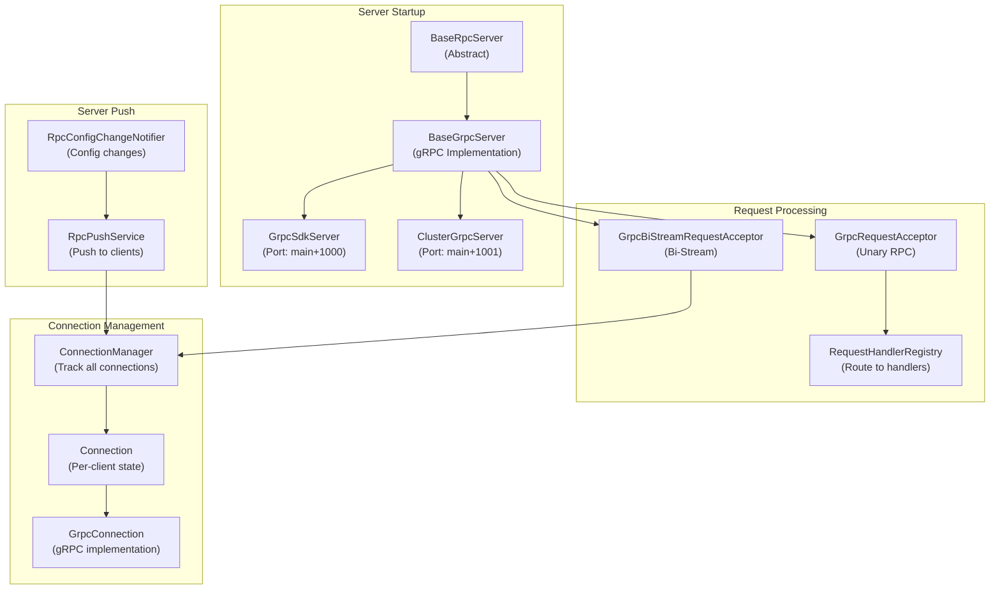

**Sources:** [core/src/main/java/com/alibaba/nacos/core/remote/BaseRpcServer.java:1-127](), [core/src/main/java/com/alibaba/nacos/core/remote/grpc/BaseGrpcServer.java:1-258]()

## BaseRpcServer Lifecycle

The `BaseRpcServer` abstract class defines the lifecycle of all RPC servers. Servers are automatically started via the `@PostConstruct` annotation and register shutdown hooks for graceful termination.

| Lifecycle Phase | Method | Description |
|----------------|--------|-------------|
| Initialization | `start()` | Annotated with `@PostConstruct`, called after dependency injection |
| Server Start | `startServer()` | Abstract method implemented by subclasses to start the actual server |
| Protocol Reload | `reloadProtocolContext()` | Reloads protocol contexts (e.g., TLS certificates) without restarting |
| Shutdown | `stopServer()` / `shutdownServer()` | Graceful shutdown via shutdown hook or `@PreDestroy` |

The server calculates its service port by adding a port offset to the main Nacos server port:

```
Service Port = EnvUtil.getPort() + rpcPortOffset()
```

- **GrpcSdkServer**: Offset = 1000 (for SDK clients)
- **ClusterGrpcServer**: Offset = 1001 (for cluster communication)

**Sources:** [core/src/main/java/com/alibaba/nacos/core/remote/BaseRpcServer.java:43-126]()

## gRPC Server Implementation

### Server Initialization

`BaseGrpcServer` initializes the gRPC server using Netty as the transport layer. The initialization process includes:

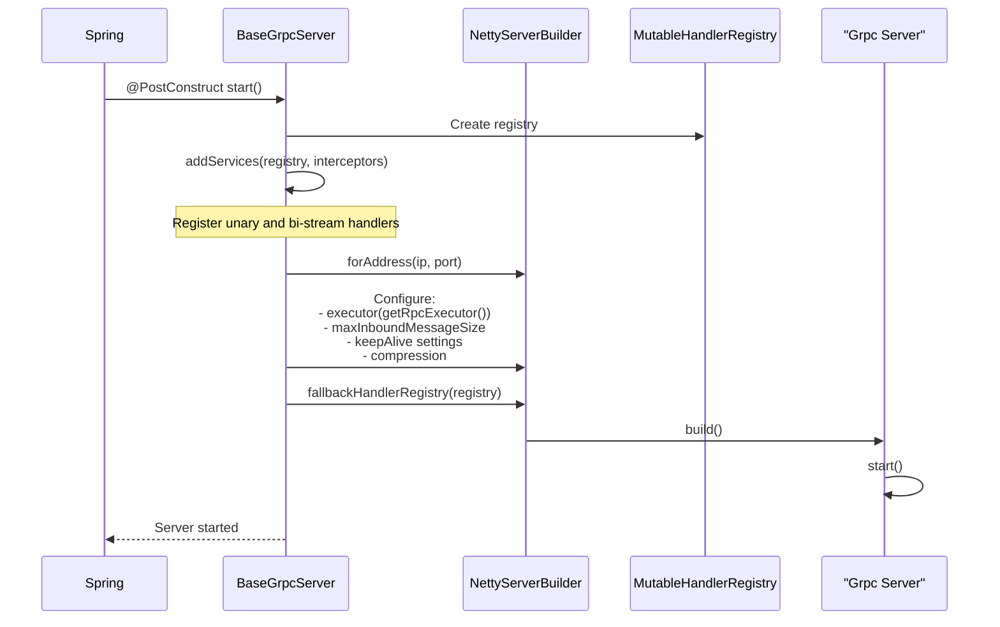

Key configuration parameters in `BaseGrpcServer.startServer()`:

| Configuration | Default Value | Property |
|---------------|---------------|----------|
| Max Inbound Message Size | 10 MB | `nacos.remote.server.grpc.maxinbound.message.size` |
| Keep Alive Time | 6 minutes | N/A |
| Keep Alive Timeout | 20 seconds | N/A |
| Permit Keep Alive Time | 5 seconds | N/A |

**Sources:** [core/src/main/java/com/alibaba/nacos/core/remote/grpc/BaseGrpcServer.java:91-117]()

### Service Registration

The server registers two gRPC service definitions:

1. **Unary Request Service**: `Request/request` - for simple request-response patterns
2. **Bi-directional Stream Service**: `BiRequestStream/requestBiStream` - for streaming and server push

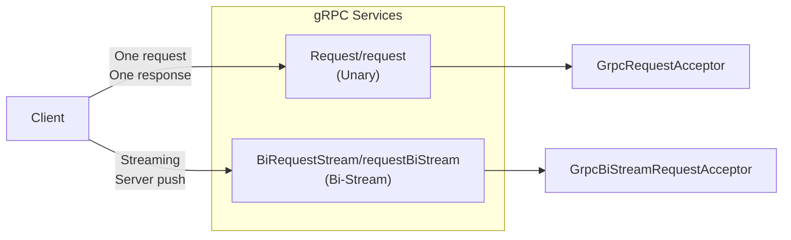

The service registration happens in `addServices()` method which creates `MethodDescriptor` instances for each service type and attaches the appropriate handlers.

**Sources:** [core/src/main/java/com/alibaba/nacos/core/remote/grpc/BaseGrpcServer.java:207-240]()

## Request Handling

### Unary Request Processing

The `GrpcRequestAcceptor` handles synchronous request-response interactions. The request flow includes multiple validation and routing stages:

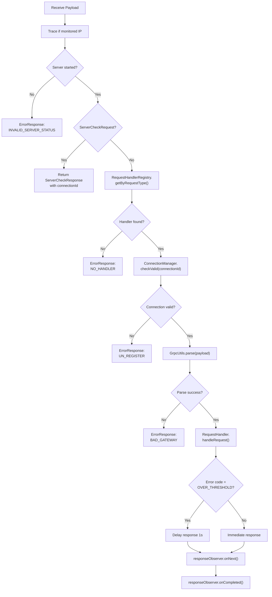

**Connection Validation**: Before processing any request (except `ServerCheckRequest`), the server validates that the connection is registered in `ConnectionManager`. Unregistered connections receive an `UN_REGISTER` error code, triggering client reconnection.

**Sources:** [core/src/main/java/com/alibaba/nacos/core/remote/grpc/GrpcRequestAcceptor.java:82-227]()

### Bi-directional Stream Processing

The `GrpcBiStreamRequestAcceptor` manages long-lived bidirectional streams for server push and client subscriptions:

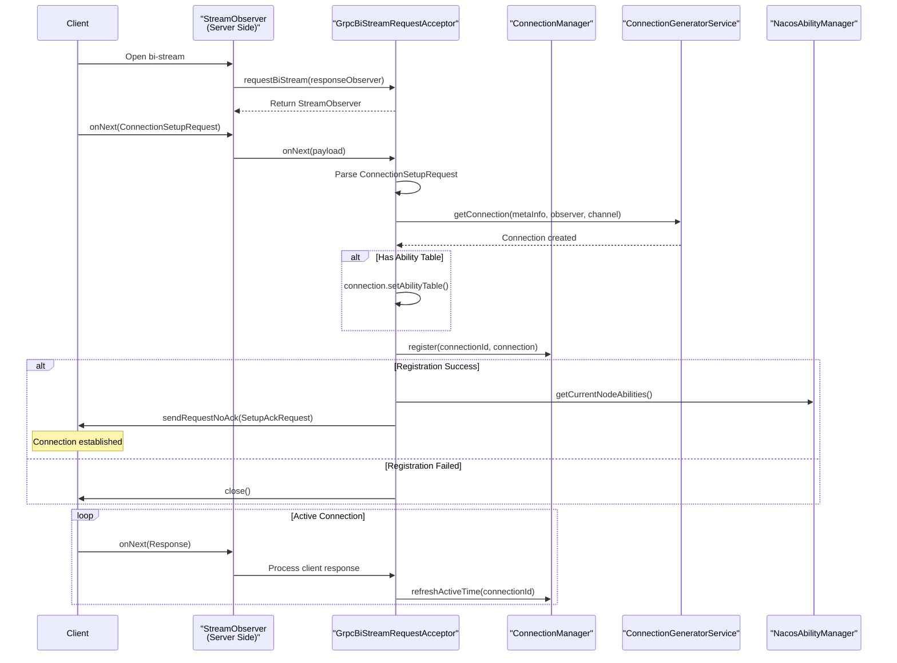

The bi-stream handler processes three types of messages:

1. **ConnectionSetupRequest**: Initial handshake to establish connection
2. **Response**: Client responses to server push requests
3. **Other Requests**: Reserved for future extensions

**Sources:** [core/src/main/java/com/alibaba/nacos/core/remote/grpc/GrpcBiStreamRequestAcceptor.java:74-213]()

## Connection Management

### ConnectionManager

The `ConnectionManager` is the central registry for all active client connections. It provides connection tracking, lifecycle management, and health monitoring.

**Data Structures**:

| Structure | Type | Purpose |
|-----------|------|---------|
| `connections` | `ConcurrentHashMap<String, Connection>` | Maps connection ID to Connection object |
| `connectionForClientIp` | `ConcurrentHashMap<String, AtomicInteger>` | Tracks connection count per client IP |
| `runtimeConnectionEjector` | `RuntimeConnectionEjector` | Manages unhealthy connection ejection |

**Core Operations**:

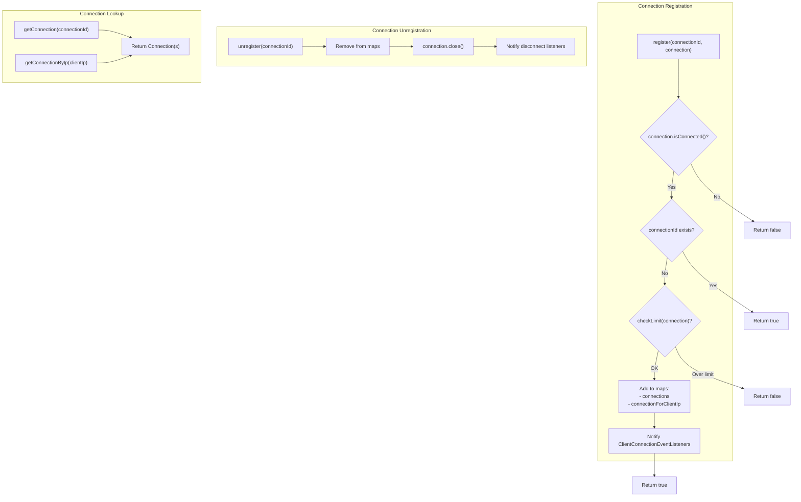

**Connection Limits**: The server enforces connection limits through the plugin control system. The `checkLimit()` method consults `ControlManagerCenter` to determine if a new connection should be accepted based on client IP, app name, and labels.

**Sources:** [core/src/main/java/com/alibaba/nacos/core/remote/ConnectionManager.java:102-162]()

### Connection Lifecycle

The server-side `Connection` class represents an established connection to a client. Each connection has:

**Connection Metadata** (`ConnectionMeta`):
- Connection ID (unique identifier)
- Client IP and remote IP
- Local and remote ports
- Connection type (GRPC)
- Client version
- Application name
- Labels (arbitrary key-value pairs)
- Namespace ID
- TLS protection status

**Connection State**:
- Last active timestamp (updated on each request)
- Traced flag (for detailed logging)
- Ability table (client capabilities)

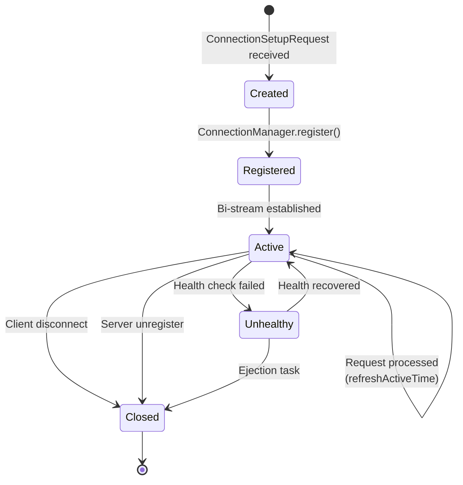

**Health Monitoring**: The `ConnectionManager` runs a scheduled task every 3 seconds to check connection health and eject unhealthy connections:

```java
// From ConnectionManager.start()
RpcScheduledExecutor.COMMON_SERVER_EXECUTOR.scheduleWithFixedDelay(() -> {
    runtimeConnectionEjector.doEject();
    MetricsMonitor.getLongConnectionMonitor().set(connections.size());
}, 1000L, 3000L, TimeUnit.MILLISECONDS);
```

**Sources:** [core/src/main/java/com/alibaba/nacos/core/remote/Connection.java:1-103](), [core/src/main/java/com/alibaba/nacos/core/remote/ConnectionManager.java:244-265]()

### GrpcConnection Implementation

`GrpcConnection` implements the server-side gRPC connection, providing bidirectional communication capabilities:

**Request Types Supported**:

| Method | Acknowledgment | Use Case |
|--------|----------------|----------|
| `sendRequestNoAck()` | No | Fire-and-forget notifications |
| `request()` | Yes | Request with timeout waiting for response |
| `requestFuture()` | Yes (async) | Non-blocking request with future |
| `asyncRequest()` | Yes (callback) | Request with callback on response |

**Backpressure Handling**:

The connection implements backpressure control using gRPC's `ServerCallStreamObserver.isReady()` mechanism:

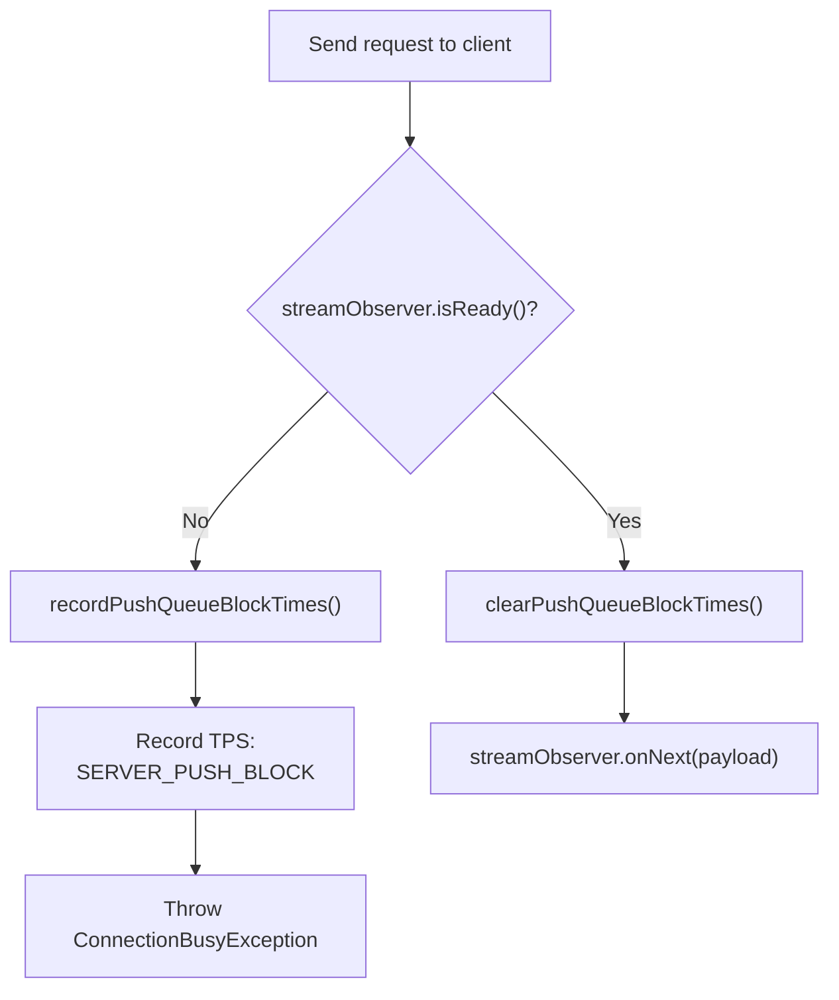

The ready threshold is 32KB of queued data. When the queue exceeds this threshold, the connection throws `ConnectionBusyException` and records the event for metrics.

**Thread Safety**: The `sendRequestNoAck()` method synchronizes on `streamObserver` because `StreamObserver.onNext()` is not thread-safe. The actual send is submitted to the channel's event loop to avoid blocking.

**Sources:** [core/src/main/java/com/alibaba/nacos/core/remote/grpc/GrpcConnection.java:71-100](), [core/src/main/java/com/alibaba/nacos/core/remote/grpc/GrpcConnection.java:102-128]()

## Server Push Mechanism

### RpcPushService

The `RpcPushService` provides a high-level API for pushing requests to connected clients:

**Push Methods**:

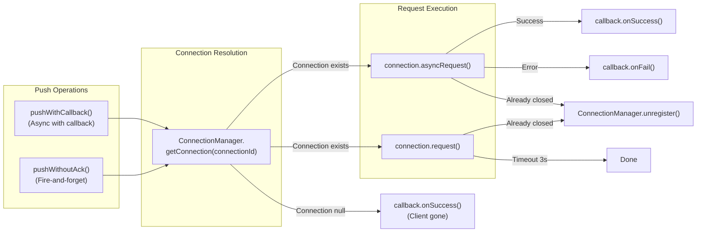

**Error Handling Philosophy**: When a connection is not found or already closed, `pushWithCallback()` calls `callback.onSuccess()` rather than `onFail()`. This design assumes the client has disconnected and the push is no longer needed, avoiding unnecessary retries.

**Sources:** [core/src/main/java/com/alibaba/nacos/core/remote/RpcPushService.java:50-89]()

### Configuration Change Notifications

The `RpcConfigChangeNotifier` demonstrates how server push is used in practice to notify clients of configuration changes:

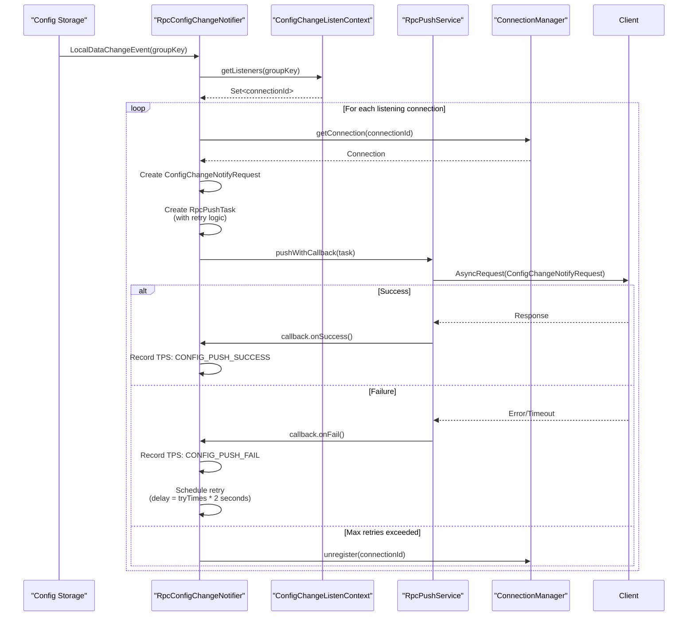

**Retry Strategy**: The notifier implements exponential backoff:
- 1st retry: Immediate (0s delay)
- 2nd retry: 2s delay
- 3rd retry: 4s delay
- After max retries: Unregister connection

**TPS Monitoring**: The notifier tracks three TPS points:
- `CONFIG_PUSH_COUNT`: Total push attempts
- `CONFIG_PUSH_SUCCESS`: Successful pushes
- `CONFIG_PUSH_FAIL`: Failed pushes

**Sources:** [config/src/main/java/com/alibaba/nacos/config/server/remote/RpcConfigChangeNotifier.java:87-114](), [config/src/main/java/com/alibaba/nacos/config/server/remote/RpcConfigChangeNotifier.java:134-199](), [config/src/main/java/com/alibaba/nacos/config/server/remote/RpcConfigChangeNotifier.java:236-250]()

## Request Context and Metadata

Every request processed by the server has associated context information managed through `RequestContext`:

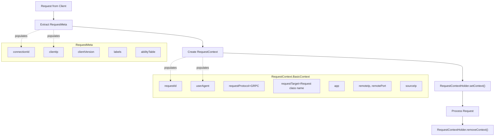

The context is stored in a `ThreadLocal` via `RequestContextHolder` and must be cleared in a `finally` block to prevent leaks.

**Sources:** [core/src/main/java/com/alibaba/nacos/core/remote/grpc/GrpcRequestAcceptor.java:229-243](), [core/src/main/java/com/alibaba/nacos/core/remote/grpc/GrpcRequestAcceptor.java:187-226]()

## Key Configuration Properties

| Property | Default | Description |
|----------|---------|-------------|
| `nacos.remote.server.grpc.maxinbound.message.size` | 10 MB | Maximum size of incoming messages |
| `nacos.remote.server.grpc.keep.alive.time` | 6 minutes | Keep-alive time for connections |
| `nacos.remote.server.grpc.keep.alive.timeout` | 20 seconds | Keep-alive timeout |
| `nacos.remote.server.grpc.permit.keep.alive.time` | 5 seconds | Minimum keep-alive interval permitted |
| `nacos.metric.grpc.server.connection.enabled` | true | Enable connection metrics collection |
| `nacos.metric.grpc.server.connection.interval` | 15 seconds | Metrics collection interval |

**Sources:** [core/src/main/java/com/alibaba/nacos/core/remote/grpc/BaseGrpcServer.java:150-169](), [core/src/main/java/com/alibaba/nacos/core/remote/ConnectionManager.java:254-264]()

---

