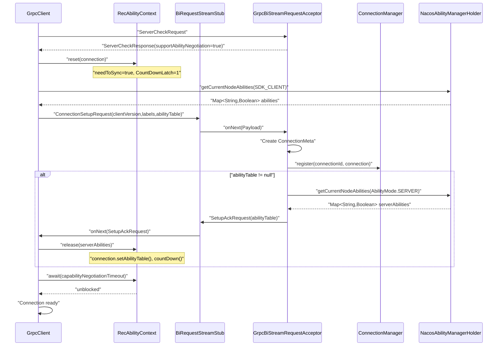
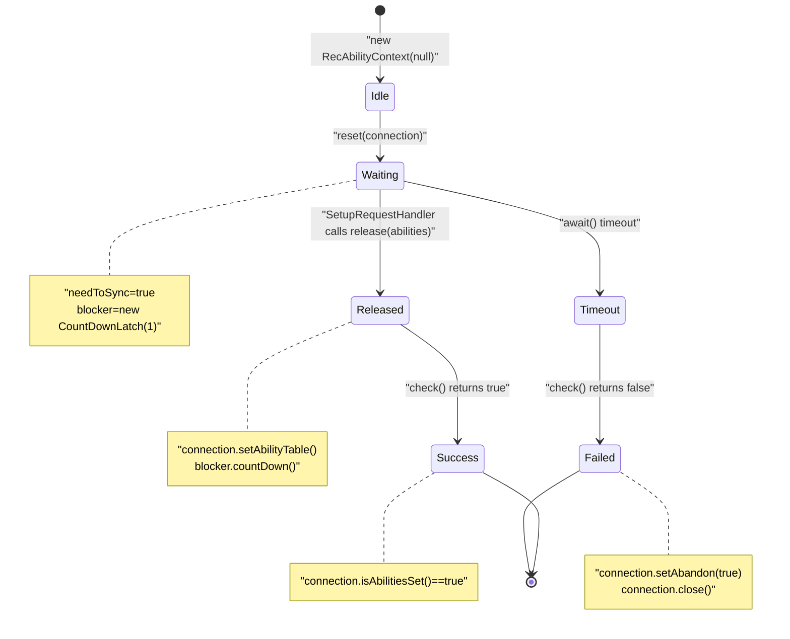
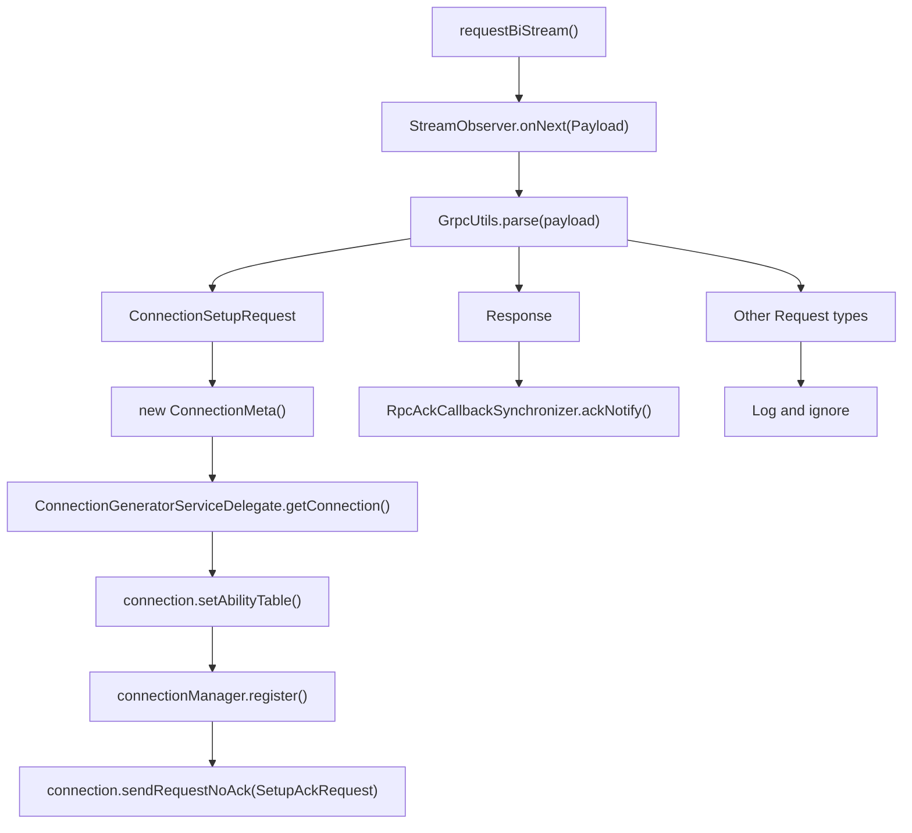
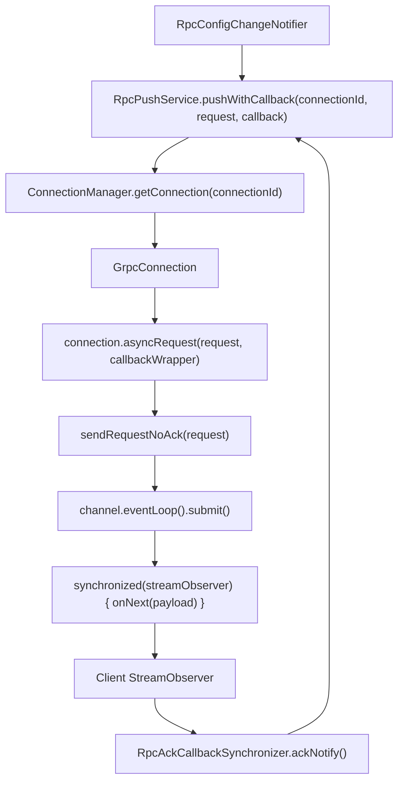
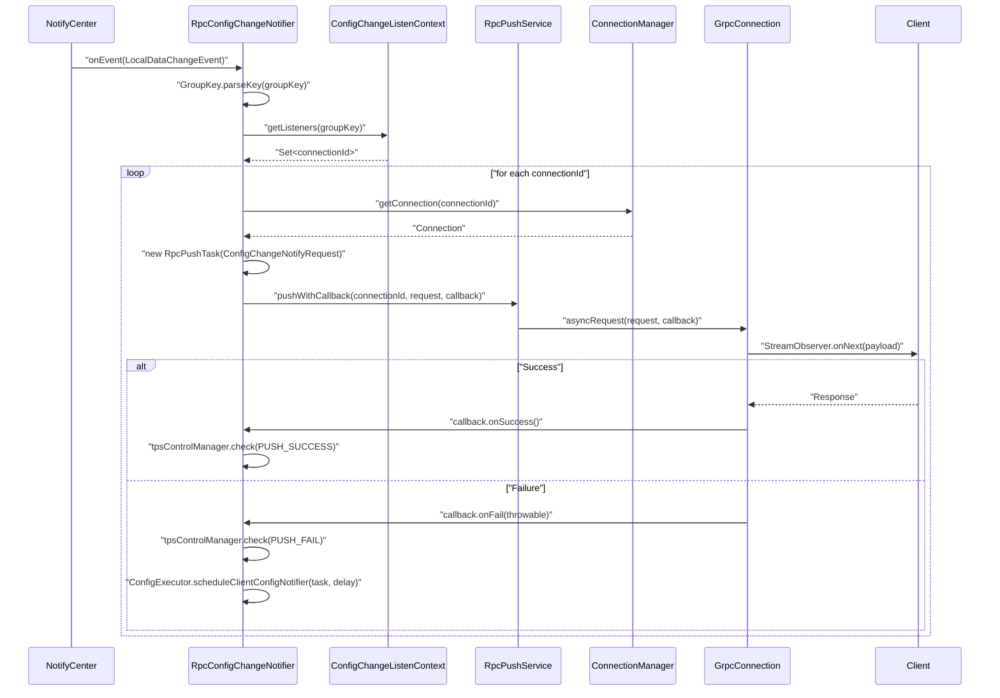

<!-- source: DeepWiki mcp.deepwiki.com · repo alibaba/nacos · page 7.3 Ability Negotiation and Push Service · fetched 2026-10-29 -->

# Ability Negotiation and Push Service

Relevant source files

The following files were used as context for generating this wiki page:

- [api/src/main/java/com/alibaba/nacos/api/remote/request/ConnectionSetupRequest.java](api/src/main/java/com/alibaba/nacos/api/remote/request/ConnectionSetupRequest.java)
- [api/src/main/java/com/alibaba/nacos/api/remote/request/RequestMeta.java](api/src/main/java/com/alibaba/nacos/api/remote/request/RequestMeta.java)
- [api/src/main/java/com/alibaba/nacos/api/remote/request/SetupAckRequest.java](api/src/main/java/com/alibaba/nacos/api/remote/request/SetupAckRequest.java)
- [api/src/main/java/com/alibaba/nacos/api/remote/response/ServerCheckResponse.java](api/src/main/java/com/alibaba/nacos/api/remote/response/ServerCheckResponse.java)
- [client/src/test/java/com/alibaba/nacos/client/ability/AbilityTest.java](client/src/test/java/com/alibaba/nacos/client/ability/AbilityTest.java)
- [common/src/main/java/com/alibaba/nacos/common/remote/client/Connection.java](common/src/main/java/com/alibaba/nacos/common/remote/client/Connection.java)
- [common/src/main/java/com/alibaba/nacos/common/remote/client/RpcClient.java](common/src/main/java/com/alibaba/nacos/common/remote/client/RpcClient.java)
- [common/src/main/java/com/alibaba/nacos/common/remote/client/RpcClientConfig.java](common/src/main/java/com/alibaba/nacos/common/remote/client/RpcClientConfig.java)
- [common/src/main/java/com/alibaba/nacos/common/remote/client/RpcClientFactory.java](common/src/main/java/com/alibaba/nacos/common/remote/client/RpcClientFactory.java)
- [common/src/main/java/com/alibaba/nacos/common/remote/client/grpc/GrpcClient.java](common/src/main/java/com/alibaba/nacos/common/remote/client/grpc/GrpcClient.java)
- [common/src/main/java/com/alibaba/nacos/common/remote/client/grpc/GrpcClusterClient.java](common/src/main/java/com/alibaba/nacos/common/remote/client/grpc/GrpcClusterClient.java)
- [common/src/main/java/com/alibaba/nacos/common/remote/client/grpc/GrpcConnection.java](common/src/main/java/com/alibaba/nacos/common/remote/client/grpc/GrpcConnection.java)
- [common/src/main/java/com/alibaba/nacos/common/remote/client/grpc/GrpcSdkClient.java](common/src/main/java/com/alibaba/nacos/common/remote/client/grpc/GrpcSdkClient.java)
- [common/src/test/java/com/alibaba/nacos/common/remote/client/grpc/GrpcClientTest.java](common/src/test/java/com/alibaba/nacos/common/remote/client/grpc/GrpcClientTest.java)
- [config/src/main/java/com/alibaba/nacos/config/server/remote/RpcConfigChangeNotifier.java](config/src/main/java/com/alibaba/nacos/config/server/remote/RpcConfigChangeNotifier.java)
- [core/src/main/java/com/alibaba/nacos/core/remote/BaseRpcServer.java](core/src/main/java/com/alibaba/nacos/core/remote/BaseRpcServer.java)
- [core/src/main/java/com/alibaba/nacos/core/remote/Connection.java](core/src/main/java/com/alibaba/nacos/core/remote/Connection.java)
- [core/src/main/java/com/alibaba/nacos/core/remote/ConnectionManager.java](core/src/main/java/com/alibaba/nacos/core/remote/ConnectionManager.java)
- [core/src/main/java/com/alibaba/nacos/core/remote/RpcPushService.java](core/src/main/java/com/alibaba/nacos/core/remote/RpcPushService.java)
- [core/src/main/java/com/alibaba/nacos/core/remote/grpc/BaseGrpcServer.java](core/src/main/java/com/alibaba/nacos/core/remote/grpc/BaseGrpcServer.java)
- [core/src/main/java/com/alibaba/nacos/core/remote/grpc/GrpcBiStreamRequestAcceptor.java](core/src/main/java/com/alibaba/nacos/core/remote/grpc/GrpcBiStreamRequestAcceptor.java)
- [core/src/main/java/com/alibaba/nacos/core/remote/grpc/GrpcClusterServer.java](core/src/main/java/com/alibaba/nacos/core/remote/grpc/GrpcClusterServer.java)
- [core/src/main/java/com/alibaba/nacos/core/remote/grpc/GrpcConnection.java](core/src/main/java/com/alibaba/nacos/core/remote/grpc/GrpcConnection.java)
- [core/src/main/java/com/alibaba/nacos/core/remote/grpc/GrpcRequestAcceptor.java](core/src/main/java/com/alibaba/nacos/core/remote/grpc/GrpcRequestAcceptor.java)
- [core/src/main/java/com/alibaba/nacos/core/remote/grpc/GrpcSdkServer.java](core/src/main/java/com/alibaba/nacos/core/remote/grpc/GrpcSdkServer.java)
- [core/src/test/java/com/alibaba/nacos/core/remote/grpc/GrpcBiStreamRequestAcceptorTest.java](core/src/test/java/com/alibaba/nacos/core/remote/grpc/GrpcBiStreamRequestAcceptorTest.java)
- [core/src/test/java/com/alibaba/nacos/core/remote/grpc/GrpcRequestAcceptorTest.java](core/src/test/java/com/alibaba/nacos/core/remote/grpc/GrpcRequestAcceptorTest.java)

## Purpose and Scope

This page documents the ability negotiation protocol and server push mechanisms in Nacos's gRPC communication framework. Ability negotiation enables clients and servers to exchange capability tables during connection establishment, allowing version-specific feature checks. The push service provides server-initiated notifications to clients for real-time updates.

Related documentation: [RPC Client Architecture](#7.1) and [RPC Server and Connection Management](#7.2).

## Overview

This system consists of two components:

1. **Ability Negotiation**: Handshake protocol during connection setup where `ConnectionSetupRequest` and `SetupAckRequest` exchange ability tables (`Map<String, Boolean>`)
2. **Push Service**: Server-to-client notification mechanism via `RpcPushService`, primarily for configuration change notifications via `RpcConfigChangeNotifier`

Both components use the bidirectional gRPC stream established by `GrpcBiStreamRequestAcceptor` on the server and `GrpcClient.bindRequestStream()` on the client.

## Ability Negotiation Protocol

### Protocol Overview

Ability negotiation occurs during the initial connection setup phase. The process follows these steps:

1. Client performs server health check
2. Client sends `ConnectionSetupRequest` with its ability table
3. Server registers connection and sends `SetupAckRequest` with its ability table
4. Both sides store the peer's abilities for future capability checks

**Connection Setup Sequence Diagram**

Sources: [common/src/main/java/com/alibaba/nacos/common/remote/client/grpc/GrpcClient.java:334-404](), [core/src/main/java/com/alibaba/nacos/core/remote/grpc/GrpcBiStreamRequestAcceptor.java:151-199]()
</str>

<old_str>
**RecAbilityContext State Machine**

Sources: [common/src/main/java/com/alibaba/nacos/common/remote/client/grpc/GrpcClient.java:425-514]()
</old_str>
<new_str>
**Connection Establishment in GrpcClient.connectToServer():**

1. Creates `ManagedChannel` via `createNewManagedChannel()` and performs health check with `ServerCheckRequest` [common/src/main/java/com/alibaba/nacos/common/remote/client/grpc/GrpcClient.java:342-345]()
2. If `ServerCheckResponse.isSupportAbilityNegotiation()` is true, calls `recAbilityContext.reset(grpcConn)` to initialize blocking [common/src/main/java/com/alibaba/nacos/common/remote/client/grpc/GrpcClient.java:360-365]()
3. Retrieves client abilities via `NacosAbilityManagerHolder.getInstance().getCurrentNodeAbilities(abilityMode())` [common/src/main/java/com/alibaba/nacos/common/remote/client/grpc/GrpcClient.java:379-380]()
4. Sends `ConnectionSetupRequest` via `grpcConn.sendRequest(conSetupRequest)` [common/src/main/java/com/alibaba/nacos/common/remote/client/grpc/GrpcClient.java:375-382]()
5. Blocks on `recAbilityContext.await(capabilityNegotiationTimeout)` [common/src/main/java/com/alibaba/nacos/common/remote/client/grpc/GrpcClient.java:386]()
6. Validates abilities received via `recAbilityContext.check(grpcConn)`, which checks `connection.isAbilitiesSet()` [common/src/main/java/com/alibaba/nacos/common/remote/client/grpc/GrpcClient.java:388-390]()

### Client-Side Implementation

The client-side ability negotiation is implemented in `GrpcClient` using the `RecAbilityContext` helper class.

**Key Classes:**
- `GrpcClient` - Main gRPC client implementation
- `GrpcClient.RecAbilityContext` - Context for managing ability reception with blocking
- `ConnectionSetupRequest` - Request containing client abilities
- `SetupAckRequest` - Response containing server abilities

**Connection Establishment Flow:**

When connecting to a server, the client:

1. Creates a managed channel and checks server health using `ServerCheckRequest`
2. If `ServerCheckResponse.isSupportAbilityNegotiation()` returns `true`, initializes `RecAbilityContext` to wait for server abilities
3. Retrieves its own ability table via `NacosAbilityManagerHolder.getInstance().getCurrentNodeAbilities(abilityMode())`
4. Sends `ConnectionSetupRequest` with client version, labels, tenant, and ability table
5. Registers a `SetupRequestHandler` to process incoming `SetupAckRequest`
6. Blocks on `recAbilityContext.await(capabilityNegotiationTimeout)` waiting for server abilities
7. Validates that abilities were received; closes connection if timeout occurs

**Configuration:**

- Timeout: `GrpcClientConfig.capabilityNegotiationTimeout()`, default 5000ms
- System property: `nacos.remote.client.grpc.channel.capability.negotiation.timeout`
- Constant: `GrpcConstants.GRPC_CHANNEL_CAPABILITY_NEGOTIATION_TIMEOUT`

Sources: [common/src/main/java/com/alibaba/nacos/common/remote/client/grpc/GrpcClient.java:386]()

**GrpcBiStreamRequestAcceptor.streamObserverOnNext() Processing:**

When `ConnectionSetupRequest` is received [core/src/main/java/com/alibaba/nacos/core/remote/grpc/GrpcBiStreamRequestAcceptor.java:151-152]():

1. Extract client metadata: `clientIp`, `remoteIp`, `remotePort`, `localPort`, `clientVersion`, `labels`, `tenant`
2. Create `ConnectionMeta(connectionId, clientIp, remoteIp, remotePort, localPort, ConnectionType.GRPC, clientVersion, appName, labels)` [core/src/main/java/com/alibaba/nacos/core/remote/grpc/GrpcBiStreamRequestAcceptor.java:158-160]()
3. Generate `Connection` via `ConnectionGeneratorServiceDelegate.getInstance().getConnection(metaInfo, responseObserver, channel)` [core/src/main/java/com/alibaba/nacos/core/remote/grpc/GrpcBiStreamRequestAcceptor.java:165-166]()
4. Set client ability table: `connection.setAbilityTable(setUpRequest.getAbilityTable())` if not null [core/src/main/java/com/alibaba/nacos/core/remote/grpc/GrpcBiStreamRequestAcceptor.java:168-171]()
5. Register: `connectionManager.register(connectionId, connection)` [core/src/main/java/com/alibaba/nacos/core/remote/grpc/GrpcBiStreamRequestAcceptor.java:173]()
6. If ability table present, send `SetupAckRequest` with server abilities via `connection.sendRequestNoAck()` [core/src/main/java/com/alibaba/nacos/core/remote/grpc/GrpcBiStreamRequestAcceptor.java:190-194]()

Sources: [core/src/main/java/com/alibaba/nacos/core/remote/grpc/GrpcBiStreamRequestAcceptor.java:151-199]()

### Server-Side Implementation

The server-side ability negotiation is handled by `GrpcBiStreamRequestAcceptor` when processing the bidirectional stream.

**GrpcBiStreamRequestAcceptor Request Routing**

Sources: [core/src/main/java/com/alibaba/nacos/core/remote/grpc/GrpcBiStreamRequestAcceptor.java:74-212]()

**Ability Checking APIs:**

| Side | Class | Method | Returns |
|------|-------|--------|---------|
| Client | `Connection` | `getConnectionAbility(AbilityKey)` | `AbilityStatus` (SUPPORTED/NOT_SUPPORTED/UNKNOWN) |
| Server | `RequestMeta` | `getConnectionAbility(AbilityKey)` | `AbilityStatus` (SUPPORTED/NOT_SUPPORTED/UNKNOWN) |

Both methods return `UNKNOWN` if `abilityTable == null` or key not present, otherwise return `SUPPORTED`/`NOT_SUPPORTED` based on boolean value.

Access to ability table:
- Client: `Connection.getAbilityTable()` returns `Map<String, Boolean>`
- Server: `RequestMeta.getAbilityTable()` passed to `RequestHandler.handleRequest()`

Sources: [common/src/main/java/com/alibaba/nacos/common/remote/client/Connection.java:53-66](), [api/src/main/java/com/alibaba/nacos/api/remote/request/RequestMeta.java:47-61]()

### Ability Tables and Usage

Ability tables are `Map<String, Boolean>` structures where:
- **Key**: Ability name (e.g., `AbilityKey` constants)
- **Value**: `true` if supported, `false` if not supported

**RpcPushService Data Flow**

Sources: [core/src/main/java/com/alibaba/nacos/core/remote/RpcPushService.java:50-88](), [core/src/main/java/com/alibaba/nacos/core/remote/grpc/GrpcConnection.java:71-100]()

## Server Push Service

The push service enables the server to proactively send requests to connected clients. This is primarily used for real-time notifications when data changes on the server.

### RpcPushService

`RpcPushService` is the core service responsible for sending push notifications to clients.

**Key Methods:**

| Method | Description | Acknowledgment |
|--------|-------------|----------------|
| `pushWithCallback()` | Sends request with callback handlers for success/failure | Yes - waits for client response |
| `pushWithoutAck()` | Sends request without waiting for acknowledgment | No - fire and forget |

**RpcPushService.pushWithCallback() Flow:**

1. `connectionManager.getConnection(connectionId)` retrieves connection [core/src/main/java/com/alibaba/nacos/core/remote/RpcPushService.java:52]()
2. If connection exists, calls `connection.asyncRequest(request, callbackWrapper)` [core/src/main/java/com/alibaba/nacos/core/remote/RpcPushService.java:55]()
3. Callback wrapper translates `Response.isSuccess()` to `requestCallBack.onSuccess()` or `requestCallBack.onFail()` [core/src/main/java/com/alibaba/nacos/core/remote/RpcPushService.java:63-68]()
4. On `ConnectionAlreadyClosedException`, unregisters connection and calls `onSuccess()` [core/src/main/java/com/alibaba/nacos/core/remote/RpcPushService.java:76-78]()
5. If connection null, immediately calls `onSuccess()` [core/src/main/java/com/alibaba/nacos/core/remote/RpcPushService.java:85-87]()

**Thread Safety in GrpcConnection.sendRequestNoAck():**

To prevent memory leaks, all `StreamObserver.onNext()` calls are:
1. Submitted to `channel.eventLoop()` for serial execution [core/src/main/java/com/alibaba/nacos/core/remote/grpc/GrpcConnection.java:73]()
2. Synchronized on `streamObserver` [core/src/main/java/com/alibaba/nacos/core/remote/grpc/GrpcConnection.java:75]()

This ensures thread-safe access to the gRPC stream observer.

Sources: [core/src/main/java/com/alibaba/nacos/core/remote/RpcPushService.java:50-88](), [core/src/main/java/com/alibaba/nacos/core/remote/grpc/GrpcConnection.java:71-100]()

**RpcConfigChangeNotifier Push Flow**

Sources: [config/src/main/java/com/alibaba/nacos/config/server/remote/RpcConfigChangeNotifier.java:87-127](), [config/src/main/java/com/alibaba/nacos/config/server/remote/RpcConfigChangeNotifier.java:186-198]()

### Configuration Change Notifications

`RpcConfigChangeNotifier` uses the push service to notify clients about configuration changes in real-time.

**RpcPushTask Retry Mechanism:**

Retry delay formula: `tryTimes * 2` seconds
- Try 1: immediate
- Try 2: 2s delay
- Try 3: 4s delay  
- Try N: N*2s delay

Scheduled via `ConfigExecutor.scheduleClientConfigNotifier(retryTask, delay, TimeUnit.SECONDS)` [config/src/main/java/com/alibaba/nacos/config/server/remote/RpcConfigChangeNotifier.java:246]()

**Termination Conditions:**

1. `isOverTimes()` returns true: `tryTimes >= maxRetryTimes` - unregister connection [config/src/main/java/com/alibaba/nacos/config/server/remote/RpcConfigChangeNotifier.java:238-243]()
2. `getConnection(connectionId)` returns null: client offline, ignore [config/src/main/java/com/alibaba/nacos/config/server/remote/RpcConfigChangeNotifier.java:247-249]()

**TPS Monitoring:**

Three control points in `TpsControlManager`:
- `CONFIG_PUSH_COUNT`: All push attempts
- `CONFIG_PUSH_SUCCESS`: Successful pushes
- `CONFIG_PUSH_FAIL`: Failed pushes

Sources: [config/src/main/java/com/alibaba/nacos/config/server/remote/RpcConfigChangeNotifier.java:134-251]()

**Retry Mechanism:**

The `RpcPushTask` implements retry logic with exponential backoff:

1. First attempt: immediate
2. Second attempt: 2 seconds delay
3. Third attempt: 4 seconds delay
4. Continues until `maxRetryTimes` is reached

If all retries fail, the connection is unregistered from `ConnectionManager`.

**Configuration:**

- `maxRetryTimes` is configurable via `ConfigCommonConfig.getInstance().getMaxPushRetryTimes()`
- TPS control points: `CONFIG_PUSH_COUNT`, `CONFIG_PUSH_SUCCESS`, `CONFIG_PUSH_FAIL`

Sources: [config/src/main/java/com/alibaba/nacos/config/server/remote/RpcConfigChangeNotifier.java:134-251]()

## Key Classes and Components

**Ability Negotiation:**

| Class | Location | Purpose |
|-------|----------|---------|
| `GrpcClient.RecAbilityContext` | [common/src/main/java/com/alibaba/nacos/common/remote/client/grpc/GrpcClient.java:425-514]() | Manages ability table reception with blocking/timeout |
| `GrpcClient.SetupRequestHandler` | [common/src/main/java/com/alibaba/nacos/common/remote/client/grpc/GrpcClient.java:573-593]() | Handles `SetupAckRequest` from server |
| `ConnectionSetupRequest` | [api/src/main/java/com/alibaba/nacos/api/remote/request/ConnectionSetupRequest.java]() | Client connection setup with ability table |
| `SetupAckRequest` | [api/src/main/java/com/alibaba/nacos/api/remote/request/SetupAckRequest.java]() | Server acknowledgment with ability table |
| `ServerCheckResponse` | [api/src/main/java/com/alibaba/nacos/api/remote/response/ServerCheckResponse.java]() | Indicates if server supports ability negotiation |
| `NacosAbilityManagerHolder` | Referenced in code | Provides ability tables for SDK_CLIENT/SERVER/CLUSTER_CLIENT modes |

**Push Service:**

| Class | Location | Purpose |
|-------|----------|---------|
| `RpcPushService` | [core/src/main/java/com/alibaba/nacos/core/remote/RpcPushService.java]() | Core service for pushing requests to clients |
| `RpcConfigChangeNotifier` | [config/src/main/java/com/alibaba/nacos/config/server/remote/RpcConfigChangeNotifier.java]() | Notifies clients of config changes using push service |
| `ConfigChangeListenContext` | Referenced in code | Tracks which clients are listening to which configs |
| `RpcAckCallbackSynchronizer` | Referenced in code | Synchronizes response callbacks from clients |
| `GrpcConnection` (server) | [core/src/main/java/com/alibaba/nacos/core/remote/grpc/GrpcConnection.java]() | Server-side connection with thread-safe push methods |

**Connection Management:**

| Class | Location | Purpose |
|-------|----------|---------|
| `Connection` (client) | [common/src/main/java/com/alibaba/nacos/common/remote/client/Connection.java]() | Client-side connection with ability table |
| `Connection` (server) | [core/src/main/java/com/alibaba/nacos/core/remote/Connection.java]() | Server-side connection with ability table |
| `ConnectionManager` | [core/src/main/java/com/alibaba/nacos/core/remote/ConnectionManager.java]() | Manages all active connections |
| `GrpcBiStreamRequestAcceptor` | [core/src/main/java/com/alibaba/nacos/core/remote/grpc/GrpcBiStreamRequestAcceptor.java]() | Accepts bidirectional gRPC streams |

Sources: All files listed in table

## Configuration Properties

**Client-Side Properties:**

| Property | Constant | Default | Description |
|----------|----------|---------|-------------|
| `nacos.remote.client.grpc.channel.capability.negotiation.timeout` | `GRPC_CHANNEL_CAPABILITY_NEGOTIATION_TIMEOUT` | 5000ms | Timeout waiting for server abilities |
| `nacos.remote.client.grpc.server.check.timeout` | `GRPC_SERVER_CHECK_TIMEOUT` | 3000ms | Timeout for initial server check |

**Server-Side Properties:**

Configuration change notification retry behavior is controlled by `ConfigCommonConfig.getInstance().getMaxPushRetryTimes()`.

Sources: [common/src/main/java/com/alibaba/nacos/common/remote/client/grpc/GrpcConstants.java:83](), [common/src/main/java/com/alibaba/nacos/common/remote/client/grpc/DefaultGrpcClientConfig.java:237]()

---

