<!-- source: DeepWiki mcp.deepwiki.com · repo alibaba/nacos · page 8 Console and Management UI · fetched 2026-10-29 -->

# Console and Management UI

<details>
<summary>Relevant source files</summary>

The following files were used as context for generating this wiki page:

- [console-ui/package-lock.json](console-ui/package-lock.json)
- [console-ui/package.json](console-ui/package.json)
- [console-ui/src/components/Page/TotalRender.js](console-ui/src/components/Page/TotalRender.js)
- [console-ui/src/locales/en-US.js](console-ui/src/locales/en-US.js)
- [console-ui/src/locales/zh-CN.js](console-ui/src/locales/zh-CN.js)
- [console-ui/src/pages/AI/McpDetail/CreateTools/DeleteTool.js](console-ui/src/pages/AI/McpDetail/CreateTools/DeleteTool.js)
- [console-ui/src/pages/AI/McpDetail/CreateTools/components.js](console-ui/src/pages/AI/McpDetail/CreateTools/components.js)
- [console-ui/src/pages/AI/McpDetail/CreateTools/index.js](console-ui/src/pages/AI/McpDetail/CreateTools/index.js)
- [console-ui/src/pages/AI/McpDetail/McpDetail.js](console-ui/src/pages/AI/McpDetail/McpDetail.js)
- [console-ui/src/pages/AI/McpDetail/ShowTools.js](console-ui/src/pages/AI/McpDetail/ShowTools.js)
- [console-ui/src/pages/AI/McpManagement/McpManagement.js](console-ui/src/pages/AI/McpManagement/McpManagement.js)
- [console-ui/src/pages/AI/NewMcpServer/NewMcpServer.js](console-ui/src/pages/AI/NewMcpServer/NewMcpServer.js)
- [console-ui/src/pages/ClusterManagement/ClusterNodeList/ClusterNodeList.js](console-ui/src/pages/ClusterManagement/ClusterNodeList/ClusterNodeList.js)
- [console-ui/src/pages/ConfigurationManagement/ConfigurationManagement/ConfigurationManagement.js](console-ui/src/pages/ConfigurationManagement/ConfigurationManagement/ConfigurationManagement.js)
- [console-ui/src/pages/ConfigurationManagement/HistoryRollback/HistoryRollback.js](console-ui/src/pages/ConfigurationManagement/HistoryRollback/HistoryRollback.js)
- [console-ui/src/pages/ConfigurationManagement/ListeningToQuery/ListeningToQuery.js](console-ui/src/pages/ConfigurationManagement/ListeningToQuery/ListeningToQuery.js)
- [console-ui/src/pages/NameSpace/NameSpace.js](console-ui/src/pages/NameSpace/NameSpace.js)
- [console-ui/src/pages/ServiceManagement/ServiceList/ServiceList.js](console-ui/src/pages/ServiceManagement/ServiceList/ServiceList.js)
- [console-ui/src/pages/ServiceManagement/SubscriberList/SubscriberList.js](console-ui/src/pages/ServiceManagement/SubscriberList/SubscriberList.js)
- [console/src/main/resources/static/css/main.css](console/src/main/resources/static/css/main.css)
- [console/src/main/resources/static/index.html](console/src/main/resources/static/index.html)
- [console/src/main/resources/static/js/main.js](console/src/main/resources/static/js/main.js)

</details>


## Purpose and Scope

This document describes the Nacos console web interface - a React-based management UI that provides administrators and operators with graphical tools for managing configurations, services, namespaces, clusters, and AI/MCP features. The console communicates with backend REST APIs to perform operations and display system state.

For information about the underlying configuration service implementation, see [Configuration Service](#3). For details on the naming/service discovery backend, see [Naming Service](#4). This page focuses on the web UI layer and its integration with backend APIs.

---

## System Architecture

The console follows a three-tier web application architecture with a React frontend, REST API backend, and persistence layer.

### Overall Console Architecture

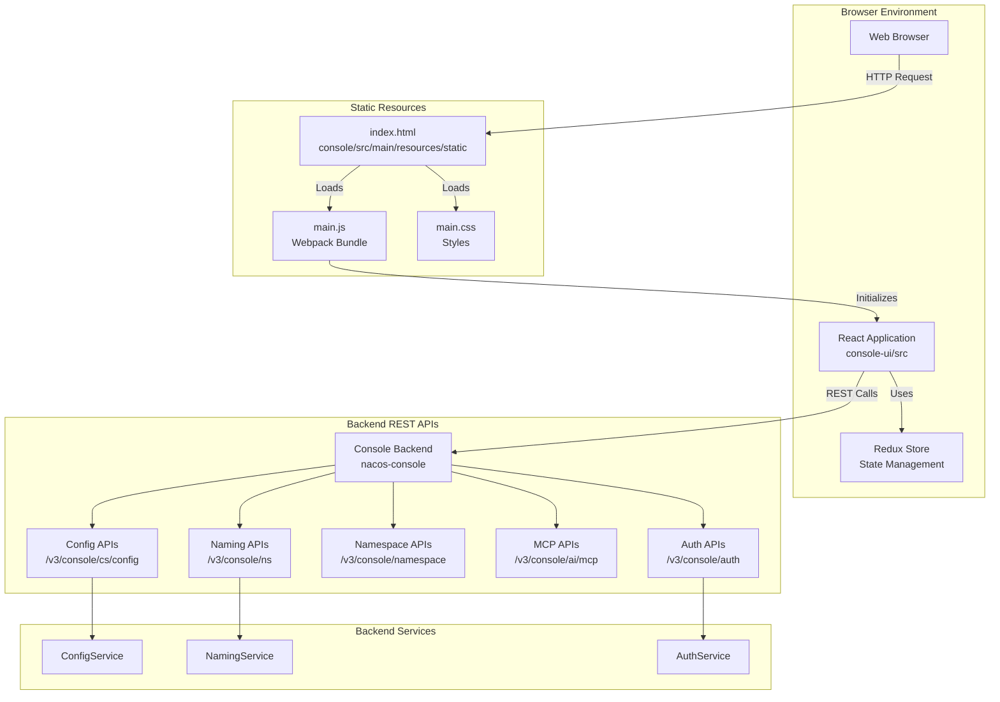

**Sources:** [console/src/main/resources/static/index.html:17-61](), [console-ui/package.json:1-90]()

---

## Frontend Architecture

The console UI is built with React 16.12.0 and uses the Alibaba Fusion Design component library (`@alifd/next`). The application follows a component-based architecture with route-based code splitting.

### Component Hierarchy and Routing

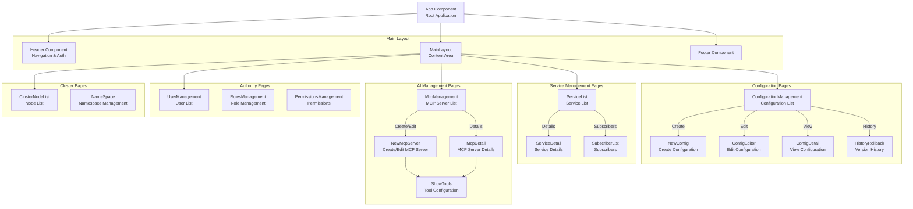

**Sources:** [console-ui/src/locales/zh-CN.js:44-81](), [console-ui/src/locales/en-US.js:46-87]()

### State Management Architecture

The application uses Redux for global state management with specific reducers for different domain entities:

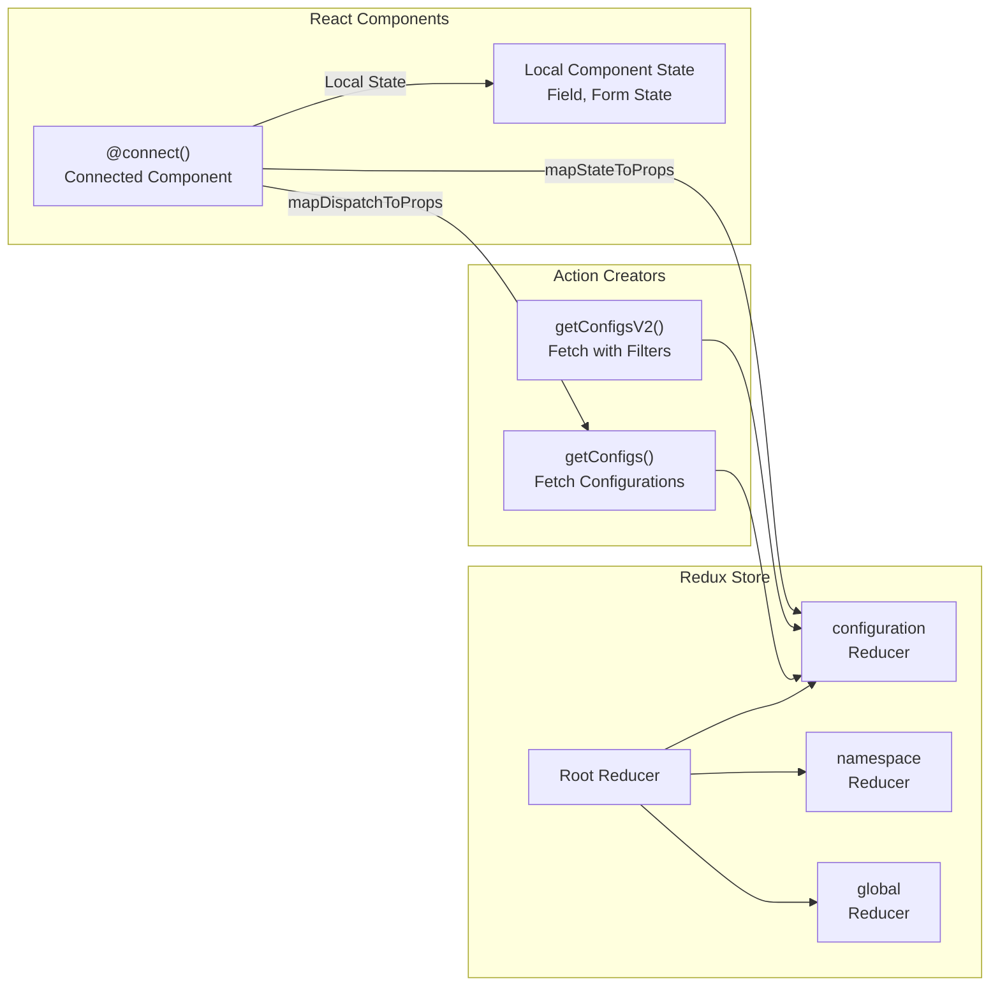

**Sources:** [console-ui/src/pages/AI/McpManagement/McpManagement.js:56-62](), [console-ui/package.json:67-88]()

---

## Backend API Structure

The console backend exposes REST APIs under the `/v3/console/` prefix. These APIs handle CRUD operations for configurations, services, namespaces, and other entities.

### API Endpoint Categories

```mermaid
graph TB
    subgraph "API Base Path: /v3/console"
        ConfigAPIs["/cs/config<br/>Configuration APIs"]
        NamingAPIs["/ns<br/>Naming/Service APIs"]
        NamespaceAPIs["/namespace<br/>Namespace APIs"]
        AuthAPIs["/auth<br/>Authentication APIs"]
        MCPAPIs["/ai/mcp<br/>MCP Management APIs"]
        PluginAPIs["/plugin<br/>Plugin Management APIs"]
        ClusterAPIs["/cluster<br/>Cluster Node APIs"]
    end
    
    ConfigAPIs -->|"GET"| ConfigList["List Configurations"]
    ConfigAPIs -->|"POST"| ConfigCreate["Create Configuration"]
    ConfigAPIs -->|"PUT"| ConfigUpdate["Update Configuration"]
    ConfigAPIs -->|"DELETE"| ConfigDelete["Delete Configuration"]
    
    NamingAPIs -->|"GET"| ServiceList["List Services"]
    NamingAPIs -->|"POST"| ServiceCreate["Create Service"]
    NamingAPIs -->|"GET /instance/list"| InstanceList["List Instances"]
    
    NamespaceAPIs -->|"GET"| NamespaceList["List Namespaces"]
    NamespaceAPIs -->|"POST"| NamespaceCreate["Create Namespace"]
    NamespaceAPIs -->|"DELETE"| NamespaceDelete["Delete Namespace"]
    
    MCPAPIs -->|"GET /list"| MCPList["List MCP Servers"]
    MCPAPIs -->|"GET"| MCPDetail["MCP Server Details"]
    MCPAPIs -->|"POST"| MCPCreate["Create MCP Server"]
    MCPAPIs -->|"PUT"| MCPUpdate["Update MCP Server"]
    MCPAPIs -->|"DELETE"| MCPDelete["Delete MCP Server"]
    
    AuthAPIs -->|"POST /login"| Login["User Login"]
    AuthAPIs -->|"POST /users"| UserCreate["Create User"]
    AuthAPIs -->|"GET /users"| UserList["List Users"]
```

### Request Flow with Authentication

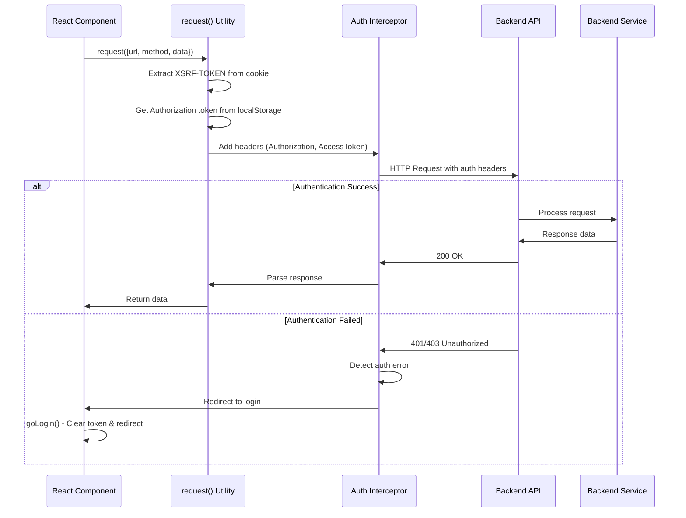

**Sources:** [console/src/main/resources/static/js/main.js:1-1](), [console-ui/src/locales/zh-CN.js:1-1000]()

---

## Configuration Management UI

The Configuration Management UI provides comprehensive tools for creating, editing, searching, importing, exporting, and managing configuration items. It is one of the primary functions of the Nacos console.

### Configuration List Page Components

```mermaid
graph TB
    subgraph "ConfigurationManagement Page"
        SearchPanel["Search Panel<br/>Filters and Query"]
        ConfigTable["Configuration Table<br/>Display Results"]
        Pagination["Pagination Component"]
        BatchActions["Batch Actions Bar<br/>Export, Clone, Delete"]
    end
    
    subgraph "Search Filters"
        DataIdFilter["Data ID Input<br/>Fuzzy Search Support"]
        GroupFilter["Group Input<br/>Fuzzy Search Support"]
        NamespaceFilter["Namespace Selector<br/>Current Namespace"]
        AdvancedFilters["Advanced Filters<br/>App, Tags, Type"]
    end
    
    subgraph "Table Operations Per Row"
        DetailsAction["Details Button<br/>View Configuration"]
        EditAction["Edit Button<br/>Modify Configuration"]
        HistoryAction["History Button<br/>Version History"]
        DeleteAction["Delete Button<br/>Remove Configuration"]
        MoreMenu["More Menu<br/>Listen Query, Sample Code"]
    end
    
    subgraph "Batch Operations"
        ExportSelected["Export Selected<br/>Download as ZIP"]
        CloneSelected["Clone Selected<br/>Copy to Namespace"]
        DeleteSelected["Delete Selected<br/>Bulk Delete"]
        ImportConfigs["Import Configurations<br/>Upload ZIP"]
    end
    
    SearchPanel --> DataIdFilter
    SearchPanel --> GroupFilter
    SearchPanel --> NamespaceFilter
    SearchPanel --> AdvancedFilters
    
    ConfigTable --> DetailsAction
    ConfigTable --> EditAction
    ConfigTable --> HistoryAction
    ConfigTable --> DeleteAction
    ConfigTable --> MoreMenu
    
    BatchActions --> ExportSelected
    BatchActions --> CloneSelected
    BatchActions --> DeleteSelected
    BatchActions --> ImportConfigs
    
    Pagination --> ConfigTable
```

### Configuration Editor Flow

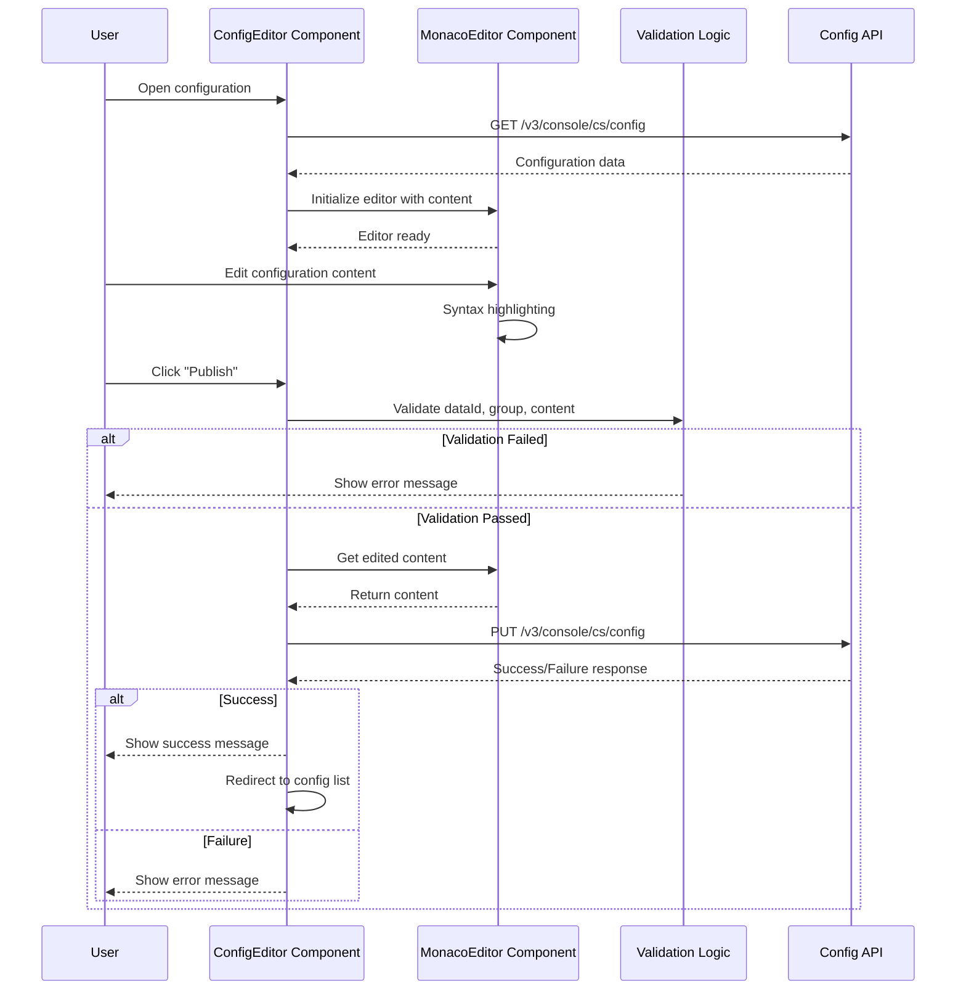

**Sources:** [console-ui/src/locales/zh-CN.js:349-437](), [console-ui/src/locales/en-US.js:349-445]()

---

## Service Management UI

The Service Management UI allows operators to view, create, edit, and monitor services and their instances. It integrates with the Naming Service backend.

### Service List and Instance Management

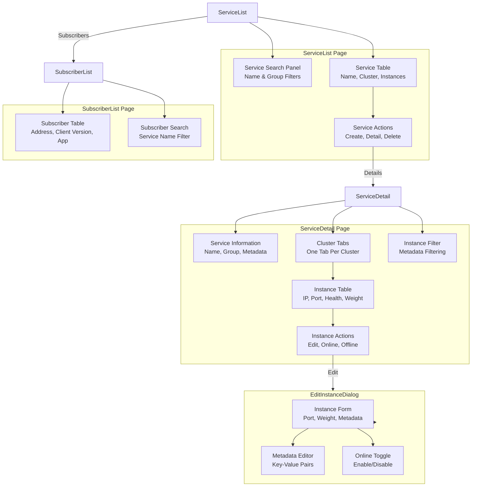

### Service-to-Backend Integration

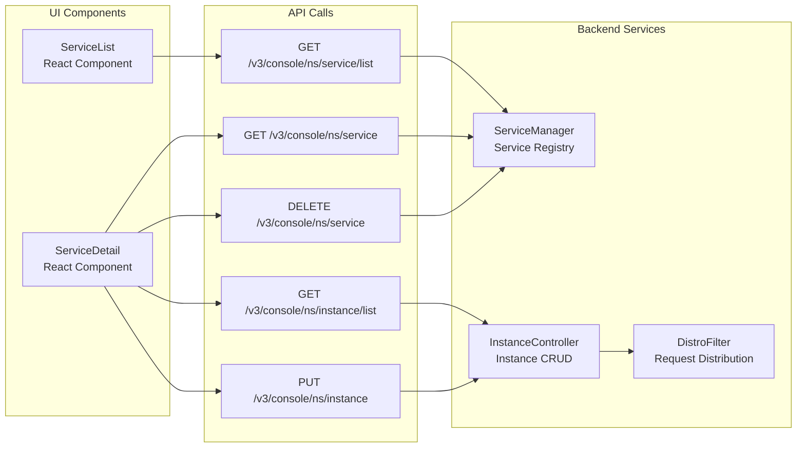

**Sources:** [console-ui/src/locales/zh-CN.js:164-201](), [console-ui/src/locales/en-US.js:170-206]()

---

## AI and MCP Management System

The AI and MCP (Model Context Protocol) Management system is a newer feature that allows users to register, configure, and manage MCP servers and AI agents. This subsystem provides a sophisticated UI for defining tools, security schemes, and runtime configurations.

### MCP Server Management Architecture

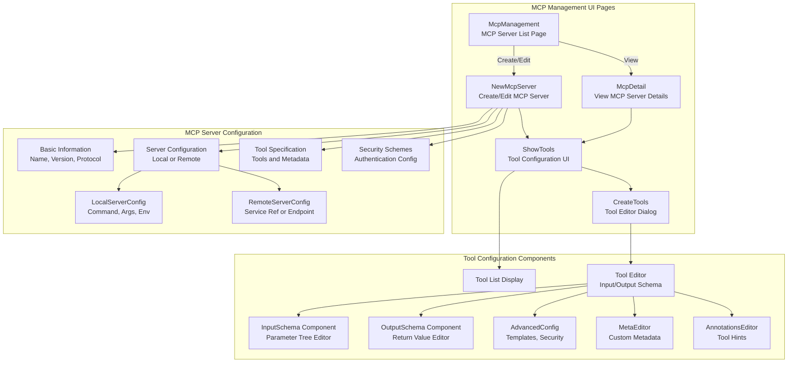

### MCP Server Data Flow

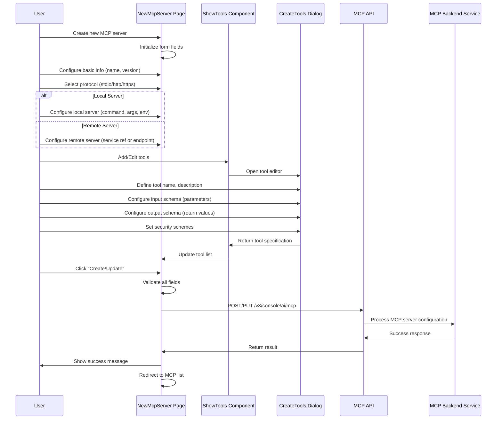

### Tool Schema Editor Structure

The tool schema editor uses a tree-based structure to represent nested parameters with support for complex types (objects, arrays).

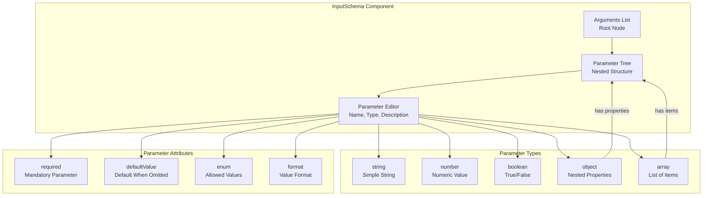

**Sources:** [console-ui/src/pages/AI/NewMcpServer/NewMcpServer.js:1-1000](), [console-ui/src/pages/AI/McpDetail/ShowTools.js:1-600](), [console-ui/src/pages/AI/McpDetail/CreateTools/index.js:1-400](), [console-ui/src/locales/zh-CN.js:885-1200](), [console-ui/src/locales/en-US.js:875-1150]()

---

## Localization System (i18n)

The console supports multiple languages through a comprehensive internationalization system. All user-facing text is externalized into locale files.

### Localization Architecture

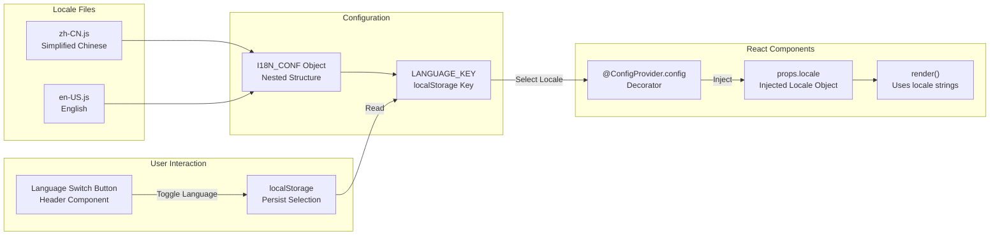

### Locale Object Structure

The locale files organize translations by functional area:

| Locale Key | Purpose | Example Keys |
|------------|---------|--------------|
| `Header` | Navigation and authentication | `home`, `docs`, `logout`, `changePassword` |
| `Login` | Login page | `login`, `pleaseInputUsername`, `submit` |
| `MainLayout` | Main navigation menu | `configurationManagement`, `serviceManagement`, `namespace` |
| `ConfigurationManagement` | Configuration list page | `createConfiguration`, `export`, `import`, `query` |
| `NewConfig` | Configuration editor | `newListingMain`, `publishFailed`, `dataIdIsNotEmpty` |
| `ServiceList` | Service list page | `serviceList`, `serviceName`, `query`, `detail` |
| `McpManagement` | MCP management | `mcpServerManagement`, `createMcpServer`, `importFromRegistry` |
| `PluginManagement` | Plugin management | `pluginManagement`, `enable`, `disable`, `configure` |

### Usage Pattern in Components

```javascript
// Component decorated with @ConfigProvider.config
@ConfigProvider.config
class MyComponent extends React.Component {
  static propTypes = {
    locale: PropTypes.object, // Injected by ConfigProvider
  };
  
  render() {
    const { locale } = this.props;
    return (
      <div>
        <h1>{locale.pageTitle}</h1>
        <Button>{locale.submitButton}</Button>
        <Message>{locale.successMessage}</Message>
      </div>
    );
  }
}
```

**Sources:** [console-ui/src/locales/zh-CN.js:17-1500](), [console-ui/src/locales/en-US.js:17-1500]()

---

## Namespace and Multi-Tenancy UI

Namespaces provide logical isolation for configurations and services. The console provides a namespace selector and management interface.

### Namespace Selection Flow

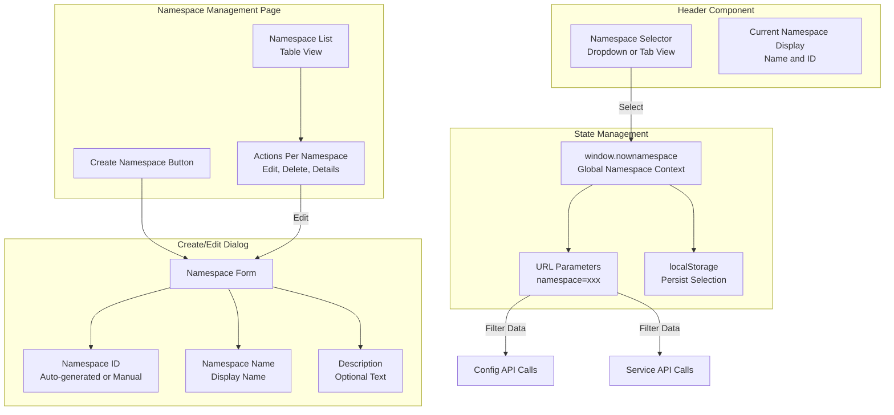

### Namespace-Aware API Requests

All API requests include the current namespace context:

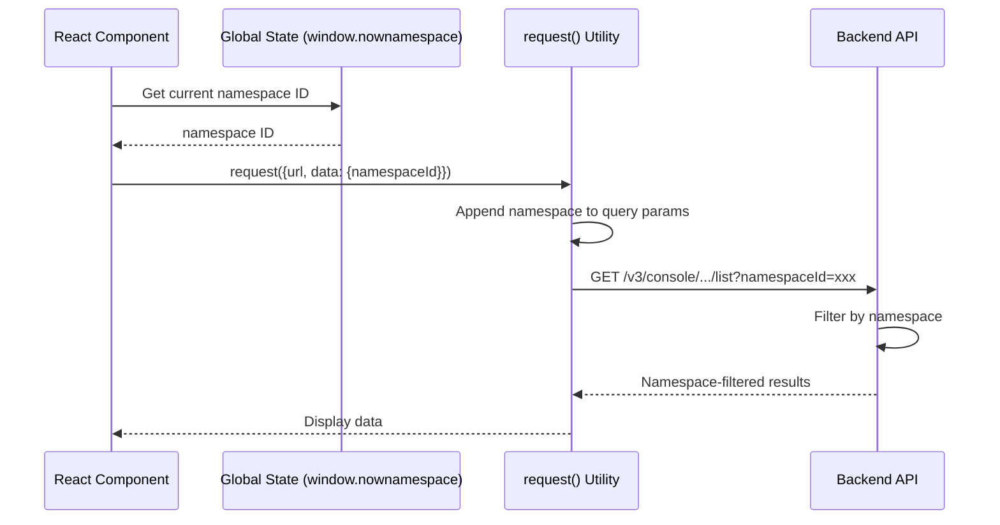

**Sources:** [console-ui/src/locales/zh-CN.js:138-163](), [console-ui/src/locales/en-US.js:144-169]()

---

## Authentication and Authorization UI

The console implements a complete authentication and authorization system with user management, role-based access control, and permission management.

### Login Flow

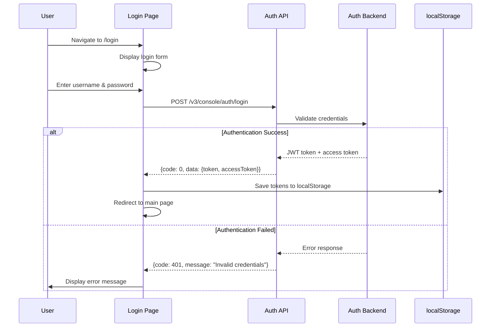

### Authority Management UI Components

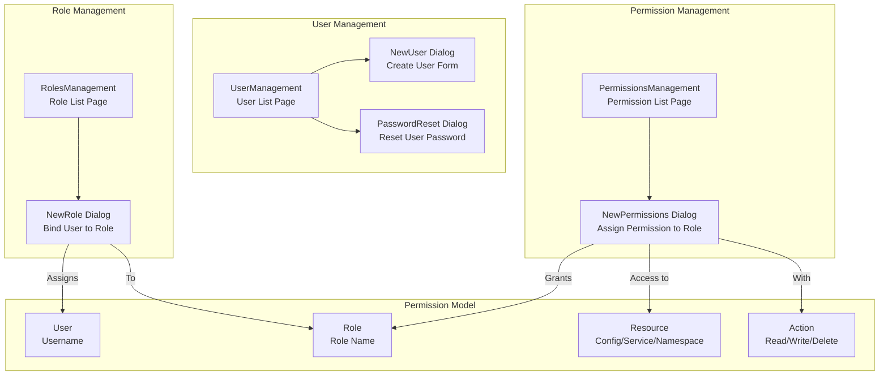

### Permission Enforcement

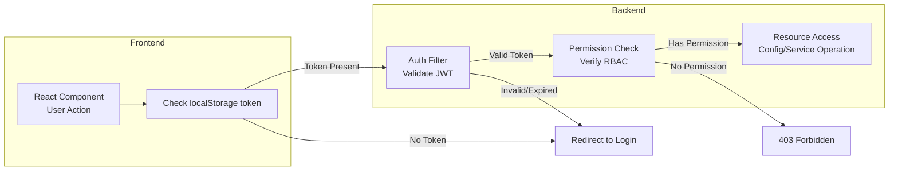

**Sources:** [console-ui/src/locales/zh-CN.js:647-743](), [console-ui/src/locales/en-US.js:648-743]()

---

## Plugin Management UI

The Plugin Management system allows administrators to view, enable, disable, and configure Nacos plugins at runtime.

### Plugin Management Page Structure

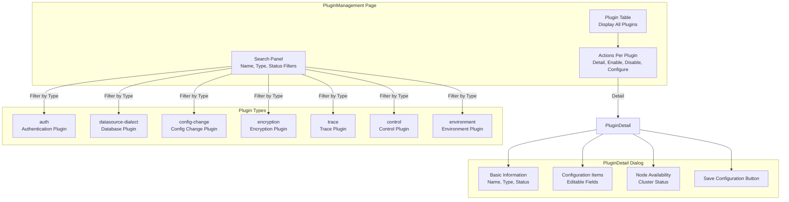

### Plugin Lifecycle Operations

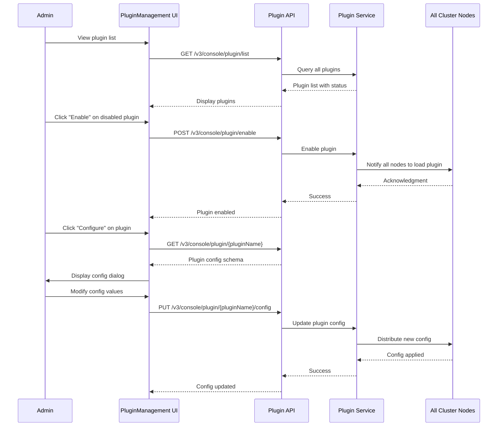

**Sources:** [console-ui/src/locales/zh-CN.js:83-128](), [console-ui/src/locales/en-US.js:88-129]()

---

## Build System and Deployment

The console UI is built using Webpack 4 and deployed as static assets served by the Nacos server.

### Build Process Architecture

```mermaid
graph LR
    subgraph "Source Files"
        ReactComponents["React Components<br/>console-ui/src"]
        SCSS["SCSS Styles<br/>*.scss"]
        Assets["Static Assets<br/>Images, Fonts"]
        LocaleFiles["Locale Files<br/>i18n/*.js"]
    end
    
    subgraph "Build Tools"
        Webpack["Webpack 4<br/>webpack.config.js"]
        BabelLoader["babel-loader<br/>JSX → JS"]
        SASSLoader["sass-loader<br/>SCSS → CSS"]
        MiniCSSExtract["mini-css-extract-plugin<br/>Extract CSS"]
        UglifyJS["uglifyjs-webpack-plugin<br/>Minify JS"]
    end
    
    subgraph "Build Output"
        MainJS["main.js<br/>Bundled JavaScript"]
        MainCSS["main.css<br/>Bundled Styles"]
        IndexHTML["index.html<br/>Entry Point"]
        ChunkJS["Chunk JS Files<br/>Code Split Bundles"]
    end
    
    subgraph "Deployment Target"
        ConsoleStatic["console/src/main/resources/static/<br/>Nacos Server Static Dir"]
        JavaServer["Nacos Server<br/>Serves Static Files"]
    end
    
    ReactComponents --> BabelLoader
    SCSS --> SASSLoader
    LocaleFiles --> BabelLoader
    
    BabelLoader --> Webpack
    SASSLoader --> MiniCSSExtract
    MiniCSSExtract --> Webpack
    Assets --> Webpack
    
    Webpack --> MainJS
    Webpack --> MainCSS
    Webpack --> IndexHTML
    Webpack --> ChunkJS
    
    MainJS --> ConsoleStatic
    MainCSS --> ConsoleStatic
    IndexHTML --> ConsoleStatic
    ChunkJS --> ConsoleStatic
    
    ConsoleStatic --> JavaServer
```

### Build Scripts and Configuration

| npm Script | Purpose | Command |
|------------|---------|---------|
| `start` | Development server with hot reload | `cross-env NODE_ENV=development webpack-dev-server` |
| `build` | Production build with optimization | `cross-env NODE_ENV=production webpack` |
| `eslint` | Run linter on source files | `eslint --ext .js src/` |
| `eslint-fix` | Auto-fix linting issues | `eslint --ext .js --fix src/` |

### Webpack Configuration Highlights

Key features of the Webpack configuration:

1. **Code Splitting**: Lazy loading of route components using dynamic imports
2. **CSS Extraction**: Separate CSS files for better caching
3. **Asset Optimization**: Image and font compression
4. **Source Maps**: Generated for development builds
5. **Bundle Analysis**: Optional plugin to analyze bundle size
6. **Theme Support**: Alibaba Fusion Design theme compilation via `@alifd/next-theme-loader`

**Sources:** [console-ui/package.json:6-11](), [console-ui/package.json:28-70]()

---

## Component Library and UI Framework

The console uses Alibaba's Fusion Design component library (`@alifd/next`) for consistent UI components.

### Core UI Components Used

| Component | Usage | Pages |
|-----------|-------|-------|
| `Table` | Data tables with pagination, sorting, selection | Configuration List, Service List, User List, Plugin List |
| `Form` | Input forms with validation | Configuration Editor, User Management, MCP Server Editor |
| `Dialog` | Modal dialogs for confirmations and forms | Delete confirmations, Create/Edit dialogs |
| `Button` | Action buttons with various styles | All pages |
| `Input` | Text input fields with search support | Search panels, form fields |
| `Select` | Dropdown selectors for filters | Namespace selector, type filters |
| `Message` | Toast notifications for success/error | All CRUD operations |
| `Loading` | Loading spinners for async operations | All data fetching scenarios |
| `Tab` | Tab navigation within pages | Service Detail (clusters), MCP Server Editor (tabs) |
| `Tree` | Hierarchical data display | Parameter schema editors |
| `MonacoEditor` | Code editor with syntax highlighting | Configuration content editor |

### Theme Customization

The console uses `@alifd/theme-design-pro` for a professional look:

```javascript
// Theme is applied via next-theme-loader in webpack config
// Customizes colors, spacing, typography for all @alifd/next components
```

**Sources:** [console-ui/package.json:67-88](), [console/src/main/resources/static/index.html:29-37]()

---

## Error Handling and User Feedback

The console implements comprehensive error handling with user-friendly feedback mechanisms.

### Error Handling Flow

```mermaid
graph TB
    subgraph "User Action"
        UserClick["User Clicks Button<br/>e.g., Save Configuration"]
    end
    
    subgraph "Frontend Validation"
        ClientValidation["Client-Side Validation<br/>Field.validate()"]
        ValidationError["Validation Error"]
        ShowFieldError["Display Field Error<br/>Red Border + Message"]
    end
    
    subgraph "API Call"
        RequestUtil["request() Utility"]
        NetworkError["Network Error<br/>Timeout, Connection Failed"]
        ShowNetworkError["Show Network Error Toast"]
    end
    
    subgraph "Backend Response"
        SuccessResponse["Success (code: 0)"]
        ErrorResponse["Error (code: 401, 403, 500, etc.)"]
        ShowSuccessMsg["Show Success Toast<br/>Message.success()"]
        ShowErrorMsg["Show Error Toast<br/>Message.error()"]
    end
    
    subgraph "Special Error Handling"
        AuthError["401/403 Auth Error"]
        RedirectLogin["Clear Token & Redirect to Login<br/>goLogin()"]
    end
    
    UserClick --> ClientValidation
    ClientValidation -->|"Valid"| RequestUtil
    ClientValidation -->|"Invalid"| ValidationError
    ValidationError --> ShowFieldError
    
    RequestUtil -->|"Network Issue"| NetworkError
    NetworkError --> ShowNetworkError
    
    RequestUtil -->|"Response Received"| SuccessResponse
    RequestUtil -->|"Response Received"| ErrorResponse
    
    SuccessResponse --> ShowSuccessMsg
    ErrorResponse --> ShowErrorMsg
    
    ErrorResponse -->|"401/403"| AuthError
    AuthError --> RedirectLogin
```

### Error Message Localization

Error messages are localized and context-specific:

```javascript
// Example from ConfigEditor
if (result.code === 0) {
  Message.success(locale.publishSuccess);
  this.props.history.push('/configurationManagement');
} else if (result.code === 403) {
  Message.error(locale.publishFailed403); // "Publish failed. No permission"
} else {
  Message.error(result.message || locale.publishFailed); // Generic or server message
}
```

**Sources:** [console/src/main/resources/static/js/main.js:1-1]()

---

## Summary

The Nacos Console and Management UI is a comprehensive React-based web application that provides:

1. **Configuration Management**: Full CRUD operations, version history, import/export, and cloning capabilities
2. **Service Management**: Service and instance registration, health monitoring, and subscriber tracking
3. **AI/MCP Integration**: Advanced MCP server configuration with tool schema editors and security management
4. **Namespace Isolation**: Multi-tenancy support with namespace-based data segregation
5. **Access Control**: User, role, and permission management with RBAC enforcement
6. **Plugin Management**: Runtime plugin configuration and lifecycle management
7. **Internationalization**: Full i18n support for Chinese and English
8. **Modern Build System**: Webpack-based build with code splitting and optimization

The UI communicates with backend REST APIs under `/v3/console/` and maintains authentication state using JWT tokens stored in localStorage. The architecture emphasizes component reusability, type safety via PropTypes, and comprehensive error handling with localized user feedback.

---

