<!-- source: DeepWiki mcp.deepwiki.com · repo alibaba/nacos · page 8.1 Frontend Architecture · fetched 2026-10-29 -->

# Frontend Architecture

<details>
<summary>Relevant source files</summary>

The following files were used as context for generating this wiki page:

- [console-ui/package-lock.json](console-ui/package-lock.json)
- [console-ui/package.json](console-ui/package.json)
- [console-ui/src/components/Page/TotalRender.js](console-ui/src/components/Page/TotalRender.js)
- [console-ui/src/locales/en-US.js](console-ui/src/locales/en-US.js)
- [console-ui/src/locales/zh-CN.js](console-ui/src/locales/zh-CN.js)
- [console-ui/src/pages/AI/McpDetail/CreateTools/DeleteTool.js](console-ui/src/pages/AI/McpDetail/CreateTools/DeleteTool.js)
- [console-ui/src/pages/AI/McpDetail/CreateTools/components.js](console-ui/src/pages/AI/McpDetail/CreateTools/components.js)
- [console-ui/src/pages/AI/McpDetail/CreateTools/index.js](console-ui/src/pages/AI/McpDetail/CreateTools/index.js)
- [console-ui/src/pages/AI/McpDetail/McpDetail.js](console-ui/src/pages/AI/McpDetail/McpDetail.js)
- [console-ui/src/pages/AI/McpDetail/ShowTools.js](console-ui/src/pages/AI/McpDetail/ShowTools.js)
- [console-ui/src/pages/AI/McpManagement/McpManagement.js](console-ui/src/pages/AI/McpManagement/McpManagement.js)
- [console-ui/src/pages/AI/NewMcpServer/NewMcpServer.js](console-ui/src/pages/AI/NewMcpServer/NewMcpServer.js)
- [console-ui/src/pages/ClusterManagement/ClusterNodeList/ClusterNodeList.js](console-ui/src/pages/ClusterManagement/ClusterNodeList/ClusterNodeList.js)
- [console-ui/src/pages/ConfigurationManagement/ConfigurationManagement/ConfigurationManagement.js](console-ui/src/pages/ConfigurationManagement/ConfigurationManagement/ConfigurationManagement.js)
- [console-ui/src/pages/ConfigurationManagement/HistoryRollback/HistoryRollback.js](console-ui/src/pages/ConfigurationManagement/HistoryRollback/HistoryRollback.js)
- [console-ui/src/pages/ConfigurationManagement/ListeningToQuery/ListeningToQuery.js](console-ui/src/pages/ConfigurationManagement/ListeningToQuery/ListeningToQuery.js)
- [console-ui/src/pages/NameSpace/NameSpace.js](console-ui/src/pages/NameSpace/NameSpace.js)
- [console-ui/src/pages/ServiceManagement/ServiceList/ServiceList.js](console-ui/src/pages/ServiceManagement/ServiceList/ServiceList.js)
- [console-ui/src/pages/ServiceManagement/SubscriberList/SubscriberList.js](console-ui/src/pages/ServiceManagement/SubscriberList/SubscriberList.js)
- [console/src/main/resources/static/css/main.css](console/src/main/resources/static/css/main.css)
- [console/src/main/resources/static/index.html](console/src/main/resources/static/index.html)
- [console/src/main/resources/static/js/main.js](console/src/main/resources/static/js/main.js)

</details>


## Purpose and Scope

This document describes the frontend architecture of the Nacos Console web application. It covers the React-based UI framework, component structure, state management patterns, localization system, and build toolchain. For backend server configuration and API details, see [Server Configuration](#2.2). For AI/MCP management features specifically, see [AI and MCP Management System](#8.3).

---

## Technology Stack and Dependencies

The Nacos Console frontend is built using the following core technologies:

| Technology | Version | Purpose |
|------------|---------|---------|
| React | 16.12.0 | UI framework |
| @alifd/next | 1.26.24+ | Alibaba Fusion Design component library |
| React Router | 5.1.2 | Client-side routing |
| Redux | 4.0.5 | Global state management |
| Webpack | 4.43.0 | Module bundler |
| Babel | 7.x | JavaScript transpiler |
| SASS | 1.54.0 | CSS preprocessing |
| Monaco Editor | - | Code editing component |
| Moment.js | 2.23.0 | Date/time manipulation |

**Key UI Components**: The application heavily relies on Fusion Design (`@alifd/next`), which provides React components for forms, tables, dialogs, navigation, and data visualization. These components are imported and configured throughout the application.

**State Management**: The application uses both Redux for global state and the `@alifd/field` API for form-level state management, avoiding prop drilling in complex forms.

**Build Tooling**: Webpack handles module bundling, code splitting, and asset optimization. Babel transpiles modern JavaScript (including JSX and decorators) to ES5-compatible code.

Sources: [console-ui/package.json:1-89](), [console-ui/package-lock.json:1-100]()

---

## Application Entry Point and Module Loading

The frontend application bootstrap follows this sequence:

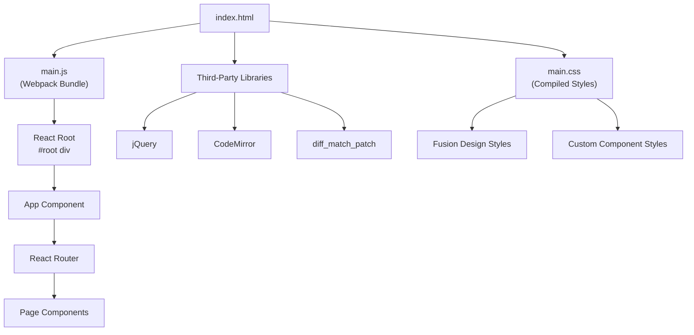

The HTML entry point [console/src/main/resources/static/index.html:1-62]() loads resources in this order:

1. **Third-party CSS libraries** [console/src/main/resources/static/index.html:30-37]():
   - Bootstrap CSS
   - Custom console styles (`console1412.css`)
   - CodeMirror and merge tools
   - Font Awesome icons

2. **Third-party JavaScript libraries** [console/src/main/resources/static/index.html:46-58]():
   - jQuery (for legacy code and plugins)
   - CodeMirror (code editor)
   - JavaScript/XML syntax highlighters
   - JSON/YAML linters
   - Diff/merge utilities
   - Loader.js (AMD module loader)

3. **Webpack bundles** [console/src/main/resources/static/index.html:38,59]():
   - `main.css` - Compiled application styles
   - `main.js` - Bundled React application code

The main JavaScript bundle [console/src/main/resources/static/js/main.js:1-6]() uses Webpack's module system with code splitting. It defines a custom module loader that supports dynamic imports via `u.e(moduleId)` and lazy loading of chunks.

**DOM Mount Points**: The HTML defines three mount points [console/src/main/resources/static/index.html:41-43]():
- `#root` - Primary React application container
- `#app` - Secondary mount point (legacy or dialogs)
- `#other` - Additional mount point for overlays

Sources: [console/src/main/resources/static/index.html:1-62](), [console/src/main/resources/static/js/main.js:1-10]()

---

## Component Architecture and Patterns

The Nacos Console uses React class components with several architectural patterns:

### Component Structure Pattern

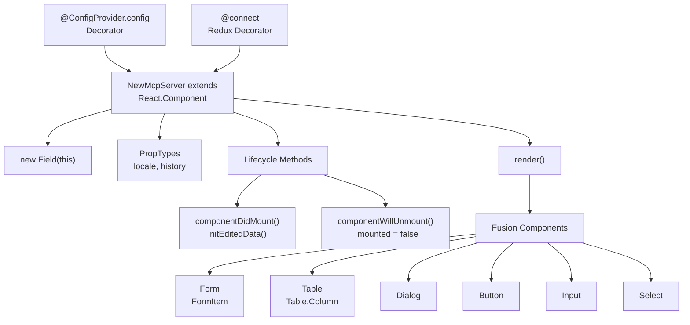

**Class Component Example - NewMcpServer** [console-ui/src/pages/AI/NewMcpServer/NewMcpServer.js:52-100]():

Components follow this structure:
1. **Decorators** (`@ConfigProvider.config`, `@connect`) for dependency injection and locale support
2. **Constructor** [console-ui/src/pages/AI/NewMcpServer/NewMcpServer.js:60-89]() initializes `Field` instance and local state
3. **Lifecycle methods** [console-ui/src/pages/AI/NewMcpServer/NewMcpServer.js:92-104]() handle data fetching (`componentDidMount`) and cleanup (`componentWillUnmount`)
4. **Event handlers** manage user interactions and form submissions
5. **Render method** returns JSX using Fusion Design components from `@alifd/next`

### Field API for Form Management

The `@alifd/field` API provides declarative form state management:

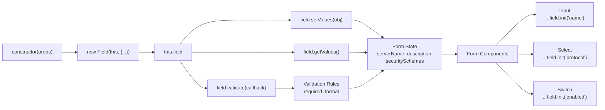

Field API initialization [console-ui/src/pages/AI/NewMcpServer/NewMcpServer.js:62-72]():
```javascript
this.field = new Field(this, {
  parseName: true,
  values: {
    securitySchemes: [],
    localServerConfig: localServerConfigDesc,
    defaultDownstreamSecurityId: '',
    // ...
  },
});
```

Key features:
- Creates a `Field` instance with `parseName: true` for nested field support (e.g., `securitySchemes[0].id`)
- Initial values set in constructor via `values` property
- Field instance passed to form components via `{...this.field.init('fieldName')}`
- Supports validation, value retrieval, and programmatic updates

**Key Methods**:
- `field.setValues(obj)` - Updates form values programmatically [console-ui/src/pages/AI/NewMcpServer/NewMcpServer.js:182-186]()
- `field.getValues()` - Retrieves current form values [console-ui/src/pages/AI/NewMcpServer/NewMcpServer.js:183]()
- `field.validate(callback)` - Validates form with error handling [console-ui/src/pages/AI/McpDetail/CreateTools/index.js:229]()
- `field.init(name, options)` - Binds form control to field state (used in JSX)

Sources: [console-ui/src/pages/AI/NewMcpServer/NewMcpServer.js:52-100](), [console-ui/src/pages/AI/McpDetail/CreateTools/index.js:23-40]()

---

## State Management Architecture

The application uses a hybrid state management approach:

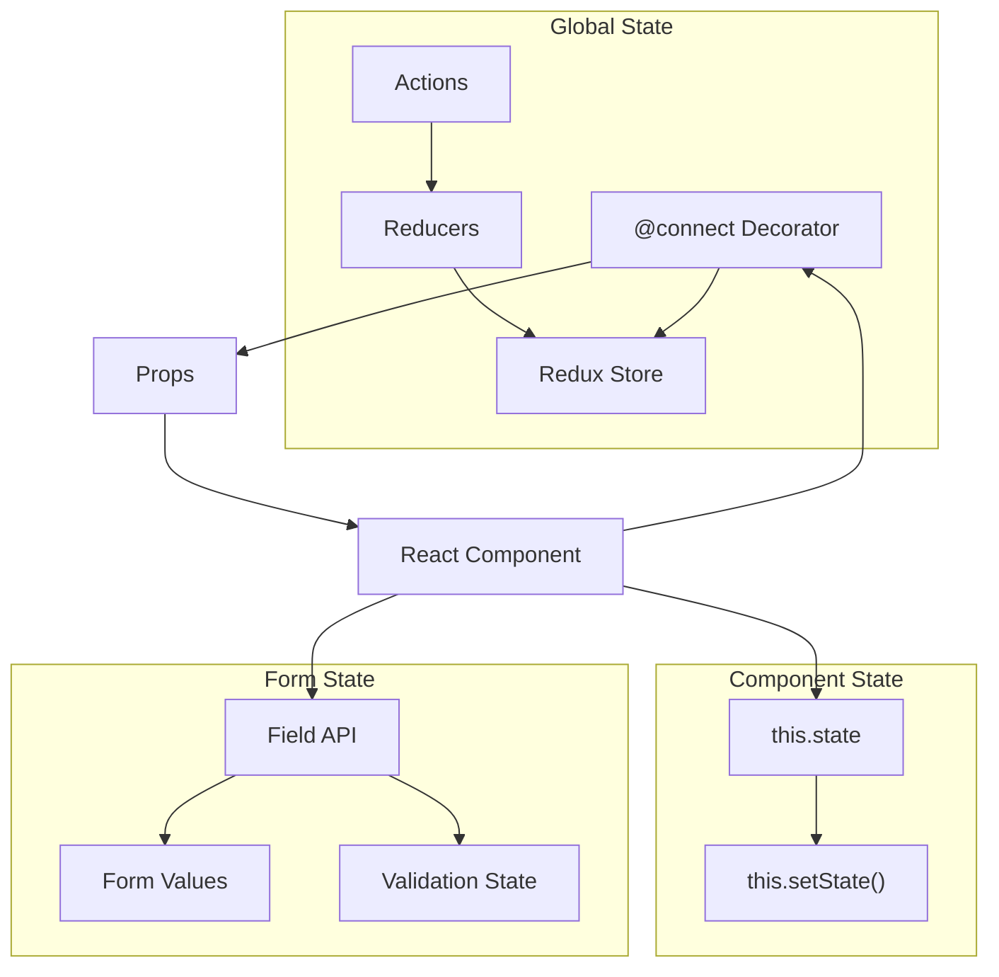

### Local Component State

Used for UI-specific state [console-ui/src/pages/AI/NewMcpServer/NewMcpServer.js:74-90]():
- Loading indicators (`loading: false`)
- Dialog visibility (`visible: false`) 
- UI toggles (`restToMcpSwitch`, `advancedConfigCollapsed`)
- Temporary data (`currentVersion`, `versionsList`)

### Field API State

Manages form data and validation [console-ui/src/pages/AI/NewMcpServer/NewMcpServer.js:62-72]():
- Form field values (`serverName`, `description`, `version`)
- Nested objects (`securitySchemes`, `invokeContext`)
- Configuration JSON (`localServerConfig`)
- Validation rules via `required` prop on form items

### Redux Global State

Connected via `@connect` decorator [console-ui/src/pages/AI/McpManagement/McpManagement.js:56-62]():

```javascript
@connect(
  state => ({
    configurations: state.configuration.configurations,
  }),
  { getConfigs, getConfigsV2 }
)
```

Maps Redux state to component props and action creators for dispatching. Used for data shared across multiple components (e.g., configuration lists, namespace information).

Sources: [console-ui/src/pages/AI/NewMcpServer/NewMcpServer.js:60-90](), [console-ui/src/pages/AI/McpManagement/McpManagement.js:56-62](), [console-ui/src/pages/AI/McpDetail/CreateTools/index.js:25-37]()

---

## Localization System

The console supports internationalization (i18n) with Chinese (zh-CN) and English (en-US) locales:

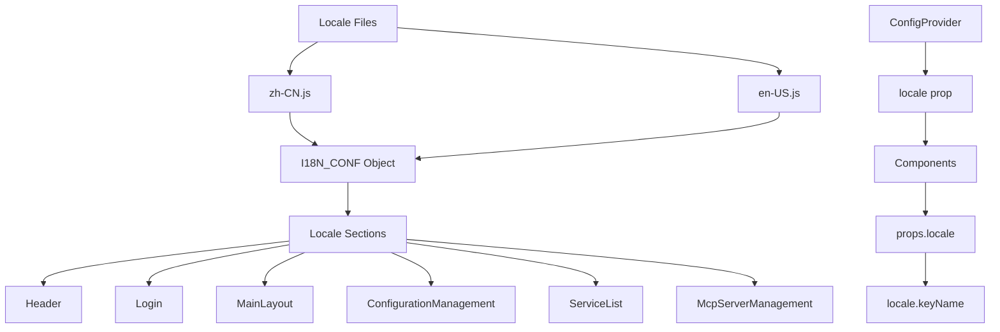

### Locale File Structure

Both locale files [console-ui/src/locales/zh-CN.js:17-28]() and [console-ui/src/locales/en-US.js:17-30]() export an `I18N_CONF` object organized by feature area:

```javascript
const I18N_CONF = {
  Header: {
    home: '首页',  // or 'HOME' in en-US
    docs: '文档',
    logout: '登出',
    // ...
  },
  Login: {
    login: '登录',
    submit: '提交',
    // ...
  },
  McpServerManagement: {
    mcpManagement8: 'MCP管理',
    addNewMcpServer: '创建 MCP Server',
    // ...
  }
}
```

### Accessing Locale Strings

Components receive locale strings via `props.locale` [console-ui/src/pages/AI/NewMcpServer/NewMcpServer.js:56-57]():

```javascript
static propTypes = {
  locale: PropTypes.object,
  history: PropTypes.object,
};
```

Usage in JSX [console-ui/src/pages/AI/McpDetail/ShowTools.js:328]():

```javascript
Message.error(locale.pleaseSelectFile);
```

The `@ConfigProvider.config` decorator injects the appropriate locale object based on the current language setting stored in `localStorage.getItem(LANGUAGE_KEY)`.

### Locale Coverage

Each locale file contains translations for:
- **Navigation**: Header, menu items [console-ui/src/locales/zh-CN.js:18-28]()
- **Authentication**: Login, password management [console-ui/src/locales/zh-CN.js:29-44]()
- **Core Features**: Configuration, services, namespaces [console-ui/src/locales/zh-CN.js:341-438]()
- **AI/MCP Features**: MCP server management, agents, tools [console-ui/src/locales/zh-CN.js:873-1043]()
- **User Management**: Users, roles, permissions [console-ui/src/locales/zh-CN.js:646-741]()
- **Components**: Common UI messages, errors, confirmations [console-ui/src/locales/zh-CN.js:743-755]()

Sources: [console-ui/src/locales/zh-CN.js:1-1000](), [console-ui/src/locales/en-US.js:1-1000](), [console-ui/src/pages/AI/NewMcpServer/NewMcpServer.js:56-57]()

---

## Component Communication Patterns

The frontend uses several patterns for component communication:

### Parent-Child Communication via Props

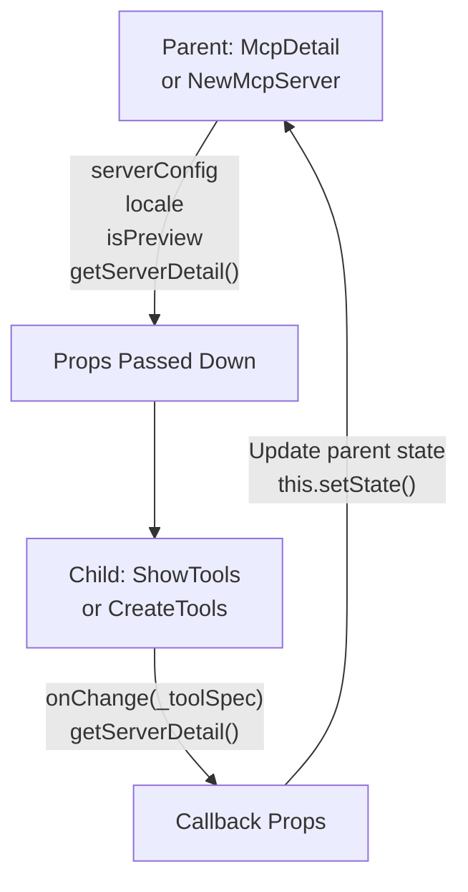

**Example: ShowTools Component** [console-ui/src/pages/AI/McpDetail/ShowTools.js:19-34]():

```javascript
const ShowTools = props => {
  const {
    serverConfig,        // Server configuration object
    frontProtocol,       // Protocol type (stdio, http, etc.)
    address,             // Server address
    port,                // Server port
    useExistService,     // Boolean flag
    service,             // Service reference
    locale,              // Localization strings
    isPreview,           // Preview mode flag
    onlyEditRuntimeInfo, // Editing mode flag
  } = props;
  // ...
}
```

**Parent-to-child data flow**: Parent passes configuration and state as props

**Child-to-parent notifications**: Child calls callback props to notify parent [console-ui/src/pages/AI/McpDetail/CreateTools/DeleteTool.js:11]():

```javascript
props?.onChange && props.onChange(_toolSpec, closeDialog);
```

Child also calls parent methods directly via props [console-ui/src/pages/AI/McpDetail/ShowTools.js:50-52]():

```javascript
const getServerDetail = () => {
  props.getServerDetail && props.getServerDetail();
};
```

### Ref-based Communication

**Pattern**: Parent components use React refs to call child component methods directly, bypassing props.

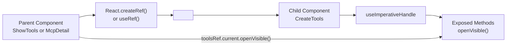

**Parent creates and uses ref** [console-ui/src/pages/AI/McpDetail/ShowTools.js:40,273]():

```javascript
// Create ref
const toolsRef = useRef(null);

// Call child method via ref
toolsRef?.current?.openVisible && 
  toolsRef.current.openVisible({ type, record, toolsMeta });
```

**Child exposes methods via useImperativeHandle** [console-ui/src/pages/AI/McpDetail/CreateTools/index.js:216-218]():

```javascript
useImperativeHandle(ref, () => ({
  openVisible,
}));
```

This pattern allows parent to trigger child actions (e.g., opening a dialog) without managing state in the parent.

### Event-based Updates

Components trigger parent updates after operations [console-ui/src/pages/AI/McpDetail/ShowTools.js:50-52]():

```javascript
const getServerDetail = () => {
  props.getServerDetail && props.getServerDetail();
};
```

Sources: [console-ui/src/pages/AI/McpDetail/ShowTools.js:19-52](), [console-ui/src/pages/AI/McpDetail/CreateTools/index.js:216-218](), [console-ui/src/pages/AI/McpDetail/CreateTools/DeleteTool.js:6-44]()

---

## Routing and Page Structure

The application uses React Router for client-side navigation:

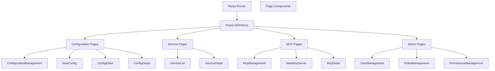

### Navigation Utilities

The application provides helper functions for navigation [console/src/main/resources/static/js/main.js:1-6]():

- `setParams(obj)` - Updates URL query parameters
- `getParams(key)` - Retrieves URL parameter values  
- `history.push(url)` - Programmatic navigation

Example navigation with parameters [console-ui/src/pages/AI/McpDetail/McpDetail.js:107-114]():

```javascript
goToServiceDetail = serviceRef => {
  this.props.history.push(
    generateUrl('/serviceDetail', {
      namespaceId: serviceRef.namespaceId,
      groupName: serviceRef.groupName,
      name: serviceRef.serviceName,
    })
  );
}
```

### Route Constants

Page routes are defined as constants [console-ui/src/pages/AI/NewMcpServer/NewMcpServer.js:24]():

```javascript
import { McpServerManagementRoute } from '../../../layouts/menu';
```

Components check route parameters on mount [console-ui/src/pages/AI/NewMcpServer/NewMcpServer.js:92-99]():

```javascript
componentDidMount() {
  this._mounted = true;
  if (!getParams('namespace')) {
    this.props?.history?.push({
      pathname: McpServerManagementRoute,
    });
  }
  this.initEditedData();
}
```

Sources: [console-ui/src/pages/AI/McpDetail/McpDetail.js:107-137](), [console-ui/src/pages/AI/NewMcpServer/NewMcpServer.js:92-99]()

---

## Advanced UI Components

### Monaco Editor Integration

The console integrates Monaco Editor for code editing [console-ui/src/pages/AI/NewMcpServer/NewMcpServer.js:23]():

```javascript
import MonacoEditor from '../../../components/MonacoEditor';
```

Monaco provides syntax highlighting, validation, and formatting for JSON, YAML, and other configuration formats. The editor component is used in configuration and MCP server forms.

### Tree Components for Hierarchical Data

Complex nested data structures use Tree components [console-ui/src/pages/AI/McpDetail/ShowTools.js:54-268]():

The `buildParameterTreeData` function recursively constructs tree nodes from JSON schema:

```javascript
const buildParameterTreeData = (properties, required = [], parentKey = '', mapRef) => {
  // Recursively process object properties and array items
  // Creates tree structure with parameter metadata
  // Handles nested objects, arrays, and primitive types
}
```

Tree data structure [console-ui/src/pages/AI/McpDetail/ShowTools.js:260-267]():

```javascript
{
  key: nodeKey,
  label: paramName,
  children: children.length > 0 ? children : undefined,
  isLeaf: children.length === 0,
}
```

### Table Components with Selection

**Fusion Table** provides built-in row selection for batch operations:

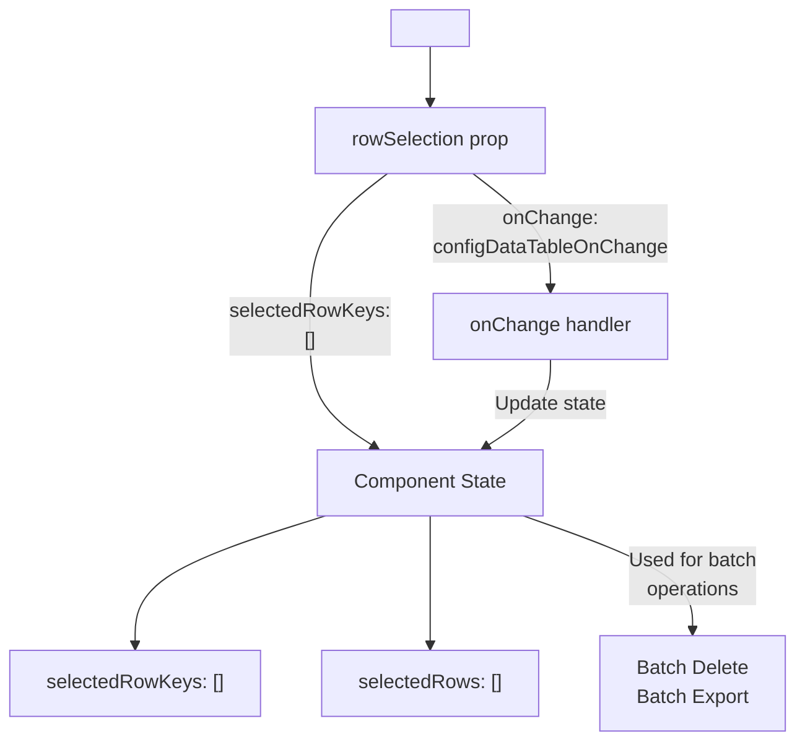

**Selection Configuration** [console-ui/src/pages/AI/McpManagement/McpManagement.js:128-132]():

```javascript
rowSelection: {
  onChange: this.configDataTableOnChange.bind(this),
  selectedRowKeys: [],
}
```

**State Management** [console-ui/src/pages/AI/McpManagement/McpManagement.js:132-133]():

```javascript
selectedRowKeys: [],  // Array of selected row keys (IDs)
selectedRows: [],     // Array of selected row objects (full data)
```

The `onChange` callback receives selected keys and row data, which are stored in state and used for batch operations like bulk delete or export.

Sources: [console-ui/src/pages/AI/McpDetail/ShowTools.js:54-268](), [console-ui/src/pages/AI/McpManagement/McpManagement.js:128-133]()

---

## Build System and Development Workflow

The frontend uses Webpack 4 for module bundling and development:

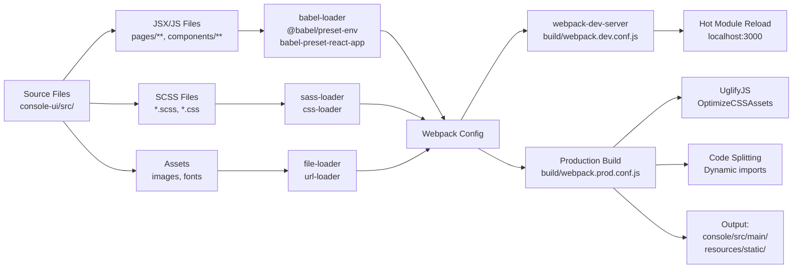

### Build Scripts

Package.json defines build commands [console-ui/package.json:6-11]():

| Command | Purpose |
|---------|---------|
| `npm start` | Development server with hot reload |
| `npm run build` | Production build with optimization |
| `npm run eslint` | Lint JavaScript files |
| `npm run eslint-fix` | Auto-fix linting issues |

### Development Configuration

Development mode [console-ui/package.json:7]():
- `webpack-dev-server` provides live reload
- `NODE_ENV=development` enables source maps
- Config in `build/webpack.dev.conf.js`

### Production Configuration

Production build [console-ui/package.json:8]():
- `NODE_ENV=production` enables optimizations
- Config in `build/webpack.prod.conf.js`
- Post-build script `build/copyFile.js` copies assets
- Output directory: `console/src/main/resources/static/`

### Babel Configuration

Babel transpiles modern JavaScript [console-ui/package.json:31-37]():
- `@babel/preset-env` for ES6+ features (async/await, destructuring, etc.)
- `@babel/plugin-proposal-decorators` for decorator syntax (`@ConfigProvider.config`, `@connect`)
- `babel-preset-react-app` for JSX transformation and React optimization
- `babel-plugin-import` for tree shaking Fusion components (imports only used components from `@alifd/next`)

**Example decorator usage** [console-ui/src/pages/AI/NewMcpServer/NewMcpServer.js:51-52]():
```javascript
@ConfigProvider.config
class NewMcpServer extends React.Component {
```

This decorator syntax requires `@babel/plugin-proposal-decorators` to transpile correctly.

### Loader Pipeline

Webpack loaders process different file types [console-ui/package.json:41-62]():

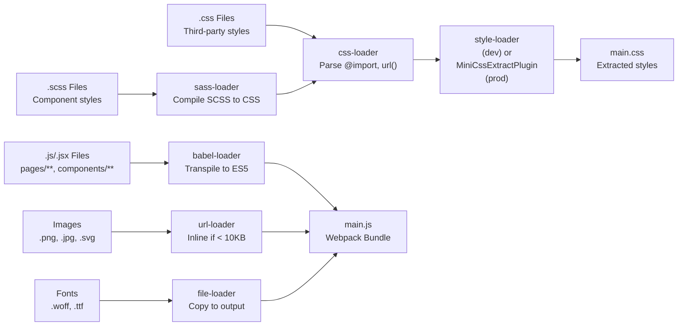

### Code Quality Tools

ESLint configuration [console-ui/package.json:43-50]():
- `eslint-config-ali` for Alibaba coding standards
- `eslint-plugin-react` for React best practices
- `eslint-plugin-react-hooks` for hooks rules
- Pre-commit hooks via Husky [console-ui/package.json:12-15]()

### Theme Customization

Fusion Design themes loaded via custom loader [console-ui/package.json:29]():

```json
"@alifd/next-theme-loader": "^1.3.2"
```

Theme customization in `@alifd/theme-design-pro` [console-ui/package.json:69]().

Sources: [console-ui/package.json:1-89](), [console/src/main/resources/static/index.html:38,59]()

---

## Asset Management and Optimization

### Static Asset Structure

The compiled application outputs to [console/src/main/resources/static/]():

```
static/
├── console-ui/           # Console UI assets
│   └── public/
│       ├── css/         # Bootstrap, CodeMirror styles
│       ├── icons/       # Icon fonts
│       ├── img/         # Images
│       └── js/          # Third-party JS libraries
├── css/
│   └── main.css         # Compiled application styles
└── js/
    └── main.js          # Webpack bundle
```

### CSS Organization

Compiled CSS [console/src/main/resources/static/css/main.css:1-31]() includes:
- Icon fonts from Fusion Design
- Component styles from `@alifd/next`
- Custom styles for Nacos-specific features
- Third-party library styles (CodeMirror, etc.)

The CSS is minified and includes source maps for debugging.

### Code Splitting

The main.js bundle [console/src/main/resources/static/js/main.js:1-6]() implements Webpack's code splitting:
- Dynamic `import()` for lazy loading
- Chunk loading via `u.e(moduleId)` function
- Manifest for chunk management
- Error handling for failed chunk loads

Example chunk loading logic [console/src/main/resources/static/js/main.js:1-6]():

```javascript
u.e = function(a) {
  // Load chunk dynamically
  // Handle loading state
  // Return promise for chunk
}
```

### Asset Caching Strategy

Production builds use content hashing [console/src/main/resources/static/index.html:38]():

```html
<link href="./css/main.css?e5df235feb440da81fe1" rel="stylesheet">
<script src="./js/main.js?e5df235feb440da81fe1"></script>
```

Cache-busting query parameters ensure browsers load updated assets after deployments.

Sources: [console/src/main/resources/static/css/main.css:1-31](), [console/src/main/resources/static/index.html:38,59](), [console/src/main/resources/static/js/main.js:1-6]()

---

## Error Handling and Loading States

### Loading Indicators

Components manage loading state [console-ui/src/pages/AI/NewMcpServer/NewMcpServer.js:75]():

```javascript
this.state = {
  loading: false,
  // ...
}
```

Fusion's `Loading` component wraps content [console-ui/src/pages/AI/McpDetail/McpDetail.js:14]():

```javascript
import { Loading } from '@alifd/next';
```

### Error Boundaries

The application includes error boundary support via `@alifd/next` configuration [console-ui/package.json:68]().

### Message Notifications

User feedback via Message component [console-ui/src/pages/AI/McpDetail/ShowTools.js:328]():

```javascript
Message.error(locale.pleaseSelectFile);
Message.success(locale.importSuccess);
```

### Validation Error Handling

Form validation with Field API [console-ui/src/pages/AI/McpDetail/CreateTools/index.js:229-233]():

```javascript
field.validate((error, values) => {
  if (error) {
    return;
  }
  // Process form submission
});
```

### API Error Handling

Request error callbacks [console-ui/src/pages/AI/McpManagement/McpManagement.js:294-301]():

```javascript
const result = await request({
  url: 'v3/console/ai/mcp/list',
  method: 'get',
  data,
  error: () => {
    this.setState({ loading: false });
  },
});
```

Sources: [console-ui/src/pages/AI/NewMcpServer/NewMcpServer.js:75](), [console-ui/src/pages/AI/McpDetail/ShowTools.js:328-352](), [console-ui/src/pages/AI/McpDetail/CreateTools/index.js:229-233]()

---

